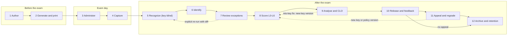
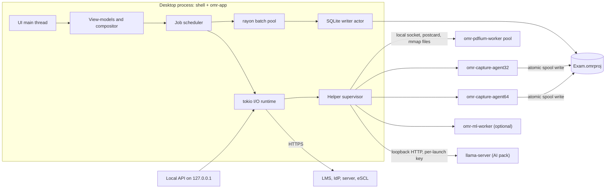
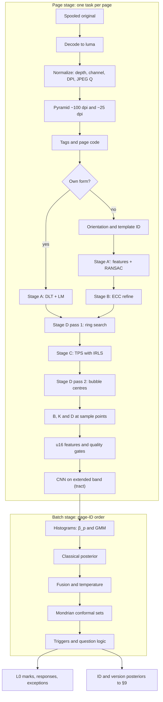

# OMR Correction — Technical Design Description

| | |
|---|---|
| **Document** | Technical design description for a native, local-first OMR exam-correction and outcome-analytics platform |
| **Version / status** | Draft v0.1, for review |
| **Facts verified as of** | 2026-10-15. Crate, model and standard versions were checked against crates.io, Hugging Face, vendor documentation and standards bodies on that date. |
| **Audience** | The product owner and the engineering team that will build the product |
| **Working name** | "OMR Correction" (codename). Rust crates use the `omr-` prefix. Projects are `*.omrproj/` packages and `*.omrx` archives. |

**How to read this document**

- **§1** summarizes the design and lists the decisions the owner still has to make.
- **§2–§3** set goals and metrics, and define what "superior to Remark Office OMR" means in measurable terms.
- **§4–§5** cover the architecture and the technology stack. §5.3 is the single authoritative stack table.
- **§6–§13** follow an exam through the system: forms, capture, recognition, identity, scoring, CLO outcomes, analytics and human review.
- **§14–§20** cover the platform: data and reproducibility, server mode, integrations, reporting, AI, security and privacy, i18n and accessibility.
- **§21–§23** cover quality attributes: performance, reliability, and accuracy assurance.
- **§24–§26** cover packaging and commercial model, the delivery plan, and risks.
- **Appendix A** catalogues every exception code: what can go wrong, how it is detected, and how it is handled. **Appendix B** is a glossary.

**Conventions**

- MUST / SHOULD / MAY follow RFC 2119.
- **[M]** marks a figure measured in the research benchmark harness. That harness ran on a 4-vCPU VM with synthetic sheets, so treat [M] figures as order-of-magnitude anchors and re-measure them on reference hardware.
- *initial* marks a starting threshold that MUST be replaced by values chosen with Learn-then-Test on the labelled corpus before GA.
- **(unverified)** marks a claim that could not be confirmed from a primary source.
- "§N.M" is a cross-reference.
- Each top-level section ends with its key sources.

## Contents

- [1. Executive summary](#1-executive-summary)
  - [1.1 What we are building](#11-what-we-are-building)
  - [1.2 How the design answers the four requests](#12-how-the-design-answers-the-four-requests)
  - [1.3 Ten architectural bets](#13-ten-architectural-bets)
  - [1.4 Stack at a glance](#14-stack-at-a-glance)
  - [1.5 Where it is superior to Remark Office OMR 12.4](#15-where-it-is-superior-to-remark-office-omr-124)
  - [1.6 Decisions needed from the owner, and the size of the job](#16-decisions-needed-from-the-owner-and-the-size-of-the-job)
- [2. Goals, non-goals and success metrics](#2-goals-non-goals-and-success-metrics)
  - [2.1 Problem statement and target users](#21-problem-statement-and-target-users)
  - [2.2 Goals](#22-goals)
  - [2.3 Non-goals](#23-non-goals)
  - [2.4 Success metrics](#24-success-metrics)
- [3. Competitive baseline and differentiation](#3-competitive-baseline-and-differentiation)
  - [3.1 Remark Office OMR 12.4 / Test Grading](#31-remark-office-omr-124--test-grading)
  - [3.2 Other incumbents and entrants](#32-other-incumbents-and-entrants)
  - [3.3 Day-one parity checklist (table stakes)](#33-day-one-parity-checklist-table-stakes)
  - [3.4 Differentiators (gap list)](#34-differentiators-gap-list)
  - [3.5 Migration path from Remark and Scantron](#35-migration-path-from-remark-and-scantron)
- [4. System architecture](#4-system-architecture)
  - [4.1 End-to-end exam lifecycle](#41-end-to-end-exam-lifecycle)
  - [4.2 Architectural principles](#42-architectural-principles)
  - [4.3 Workspace and crate map](#43-workspace-and-crate-map)
  - [4.4 Process model](#44-process-model)
  - [4.5 Threading and job model](#45-threading-and-job-model)
  - [4.6 Deployment modes](#46-deployment-modes)
  - [4.7 View-model & compositor design](#47-view-model--compositor-design)
- [5. Technology stack and key decisions](#5-technology-stack-and-key-decisions)
  - [5.1 Why Rust (and where it is not used)](#51-why-rust-and-where-it-is-not-used)
  - [5.2 ADR-001 GUI shell](#52-adr-001-gui-shell)
  - [5.3 Stack decision table](#53-stack-decision-table)
  - [5.4 Licence policy](#54-licence-policy)
  - [5.5 Dependency risk register](#55-dependency-risk-register)
  - [5.6 Effort estimate snapshot](#56-effort-estimate-snapshot)
- [6. Answer-sheet design and generation](#6-answer-sheet-design-and-generation)
  - [6.1 Template model](#61-template-model)
  - [6.2 Designer UX + Typst macro DSL over the same model](#62-designer-ux--typst-macro-dsl-over-the-same-model)
  - [6.3 Geometry specification table](#63-geometry-specification-table)
  - [6.4 Fiducials and page identity](#64-fiducials-and-page-identity)
  - [6.5 Field types](#65-field-types)
  - [6.6 Multi-version and per-student shuffling](#66-multi-version-and-per-student-shuffling)
  - [6.7 Personalized and serialized booklets](#67-personalized-and-serialized-booklets)
  - [6.8 Print safety](#68-print-safety)
  - [6.9 Pre-print lint, synthetic-fill simulator and printer/scanner qualification kit](#69-pre-print-lint-synthetic-fill-simulator-and-printerscanner-qualification-kit)
  - [6.10 Legacy and third-party form import](#610-legacy-and-third-party-form-import)
  - [6.11 Accessible sheet variants](#611-accessible-sheet-variants)
- [7. Capture and ingestion](#7-capture-and-ingestion)
  - [7.1 Source tiers](#71-source-tiers)
  - [7.2 Recommended scanner settings, device profiles and scanner tiers](#72-recommended-scanner-settings-device-profiles-and-scanner-tiers)
  - [7.3 Decode paths](#73-decode-paths)
  - [7.4 Spool-first ingestion](#74-spool-first-ingestion)
  - [7.5 Batch header sheets, imprinter sequence, expected-count reconciliation, rescan pull lists](#75-batch-header-sheets-imprinter-sequence-expected-count-reconciliation-rescan-pull-lists)
  - [7.6 Phone/tablet capture details](#76-phonetablet-capture-details)
- [8. Recognition engine](#8-recognition-engine)
  - [8.1 Pipeline overview and per-stage cost budget](#81-pipeline-overview-and-per-stage-cost-budget)
  - [8.2 Normalization](#82-normalization)
  - [8.3 Orientation, mirroring, page/template identification](#83-orientation-mirroring-pagetemplate-identification)
  - [8.4 Registration](#84-registration)
  - [8.5 Illumination/background normalization and normalized darkness D = (B−I)/(B−K)](#85-illuminationbackground-normalization-and-normalized-darkness-d--bibk)
  - [8.6 Per-bubble features](#86-per-bubble-features)
  - [8.7 Classification cascade](#87-classification-cascade)
  - [8.8 Per-question decision logic](#88-per-question-decision-logic)
  - [8.9 Image-quality metrics and gates table](#89-image-quality-metrics-and-gates-table)
  - [8.10 Phone-capture path](#810-phone-capture-path)
  - [8.11 Determinism & provenance rules specific to recognition](#811-determinism--provenance-rules-specific-to-recognition)
  - [8.12 Recognition edge-case table](#812-recognition-edge-case-table)
  - [8.13 Published accuracy baselines & how existing systems work](#813-published-accuracy-baselines--how-existing-systems-work)
- [9. Identity and contextual data extraction](#9-identity-and-contextual-data-extraction)
  - [9.1 What "context" is extracted and channel overview](#91-what-context-is-extracted-and-channel-overview)
  - [9.2 Roster ingestion & snapshots](#92-roster-ingestion--snapshots)
  - [9.3 Name normalization](#93-name-normalization)
  - [9.4 Recognizers per channel](#94-recognizers-per-channel)
  - [9.5 Roster-constrained fusion](#95-roster-constrained-fusion)
  - [9.6 Batch assignment](#96-batch-assignment)
  - [9.7 Calibration, abstention, certification](#97-calibration-abstention-certification)
  - [9.8 VLM fallback for identity](#98-vlm-fallback-for-identity)
  - [9.9 Identity edge-case table](#99-identity-edge-case-table)
  - [9.10 Privacy of identity snippets](#910-privacy-of-identity-snippets)
- [10. Scoring engine](#10-scoring-engine)
  - [10.1 Layered pipeline L0–L6, purity, determinism, idempotent regrades](#101-layered-pipeline-l0l6-purity-determinism-idempotent-regrades)
  - [10.2 Numeric policy](#102-numeric-policy)
  - [10.3 Multi-form model](#103-multi-form-model)
  - [10.4 Item types and scoring rules table + scoring-rule simulator](#104-item-types-and-scoring-rules-table--scoring-rule-simulator)
  - [10.5 Policies](#105-policies)
  - [10.6 Curving/scaling/grade scales](#106-curvingscalinggrade-scales)
  - [10.7 Rule extensibility and validation](#107-rule-extensibility-and-validation)
  - [10.8 Regrades, appeals, impact reports, SUPERSEDED watermarking, four-eyes after release](#108-regrades-appeals-impact-reports-superseded-watermarking-four-eyes-after-release)
- [11. Learning-outcome (CLO/PLO) engine](#11-learning-outcome-cloplo-engine)
  - [11.1 Outcome framework model](#111-outcome-framework-model)
  - [11.2 Mapping model](#112-mapping-model)
  - [11.3 Formulas](#113-formulas)
  - [11.4 Attainment policy objects](#114-attainment-policy-objects)
  - [11.5 PLO/SO roll-up, longitudinal trends, item-bank memory across terms](#115-ploso-roll-up-longitudinal-trends-item-bank-memory-across-terms)
  - [11.6 Closing the loop, evidence sampling](#116-closing-the-loop-evidence-sampling)
  - [11.7 Report pack](#117-report-pack)
  - [11.8 Edge cases](#118-edge-cases)
- [12. Item, test and integrity analytics](#12-item-test-and-integrity-analytics)
  - [12.1 CTT statistics table](#121-ctt-statistics-table)
  - [12.2 Mis-key and flawed-item detection rules (ranked)](#122-mis-key-and-flawed-item-detection-rules-ranked)
  - [12.3 Small-N handling](#123-small-n-handling)
  - [12.4 Rasch](#124-rasch)
  - [12.5 DIF, marker-severity analysis for score boxes](#125-dif-marker-severity-analysis-for-score-boxes)
  - [12.6 Standard setting and CSEM band](#126-standard-setting-and-csem-band)
  - [12.7 Integrity analytics](#127-integrity-analytics)
  - [12.8 Validation against reference implementations as CI oracles](#128-validation-against-reference-implementations-as-ci-oracles)
- [13. Review and exception handling](#13-review-and-exception-handling)
  - [13.1 Exception model](#131-exception-model)
  - [13.2 Queue ordering & grouping](#132-queue-ordering--grouping)
  - [13.3 Review UI spec](#133-review-ui-spec)
  - [13.4 Governance](#134-governance)
  - [13.5 Throughput math](#135-throughput-math)
- [14. Data architecture and reproducibility](#14-data-architecture-and-reproducibility)
  - [14.1 Project package and archive format](#141-project-package-and-archive-format)
  - [14.2 SQLite configuration](#142-sqlite-configuration)
  - [14.3 Logical data model](#143-logical-data-model)
  - [14.4 Audit/event log](#144-auditevent-log)
  - [14.5 Content-addressed object store](#145-content-addressed-object-store)
  - [14.6 Engine manifest & reproducibility](#146-engine-manifest--reproducibility)
  - [14.7 Migrations, backups, restore verification, schema-compat policy](#147-migrations-backups-restore-verification-schema-compat-policy)
  - [14.8 Ingest state machine and resumability](#148-ingest-state-machine-and-resumability)
- [15. Multi-user server mode, sync and access control](#15-multi-user-server-mode-sync-and-access-control)
  - [15.1 Server architecture](#151-server-architecture)
  - [15.2 Sync model](#152-sync-model)
  - [15.3 Concurrent review](#153-concurrent-review)
  - [15.4 AuthN](#154-authn)
  - [15.5 AuthZ with Cedar](#155-authz-with-cedar)
- [16. Integrations and extensibility](#16-integrations-and-extensibility)
  - [16.1 LMS matrix](#161-lms-matrix)
  - [16.2 SIS & standards](#162-sis--standards)
  - [16.3 File formats in/out](#163-file-formats-inout)
  - [16.4 Local API, server REST (OpenAPI 3.1), Standard Webhooks events list, CLI](#164-local-api-server-rest-openapi-31-standard-webhooks-events-list-cli)
  - [16.5 Plugin system](#165-plugin-system)
  - [16.6 Outbox semantics for pushes](#166-outbox-semantics-for-pushes)
- [17. Reporting and student feedback](#17-reporting-and-student-feedback)
  - [17.1 Report engine](#171-report-engine)
  - [17.2 Report catalogue table](#172-report-catalogue-table)
  - [17.3 Annotated student sheets](#173-annotated-student-sheets)
  - [17.4 Release gate & distribution](#174-release-gate--distribution)
  - [17.5 Appeals & regrade-request workflow](#175-appeals--regrade-request-workflow)
  - [17.6 Exports for accreditation](#176-exports-for-accreditation)
- [18. AI-assisted features and governance](#18-ai-assisted-features-and-governance)
  - [18.1 Principles](#181-principles)
  - [18.2 Runtime](#182-runtime)
  - [18.3 Feature specs](#183-feature-specs)
  - [18.4 Optional cloud LLM (Claude API)](#184-optional-cloud-llm-claude-api)
  - [18.5 Governance table and invariants](#185-governance-table-and-invariants)
  - [18.6 Evaluation and oversight telemetry](#186-evaluation-and-oversight-telemetry)
  - [18.7 Prompt-injection and model supply-chain defences](#187-prompt-injection-and-model-supply-chain-defences)
- [19. Security, privacy and compliance](#19-security-privacy-and-compliance)
  - [19.1 Threat model summary](#191-threat-model-summary)
  - [19.2 Encryption at rest & key hierarchy](#192-encryption-at-rest--key-hierarchy)
  - [19.3 Answer-key secrecy](#193-answer-key-secrecy)
  - [19.4 Untrusted input handling, local API hardening, TLS](#194-untrusted-input-handling-local-api-hardening-tls)
  - [19.5 Privacy regimes table → product features](#195-privacy-regimes-table--product-features)
  - [19.6 EU AI Act and EU CRA](#196-eu-ai-act-and-eu-cra)
  - [19.7 Supply chain & release integrity](#197-supply-chain--release-integrity)
  - [19.8 Telemetry & crash reporting policy; procurement artefacts](#198-telemetry--crash-reporting-policy-procurement-artefacts)
- [20. Internationalisation and accessibility](#20-internationalisation-and-accessibility)
  - [20.1 i18n stack](#201-i18n-stack)
  - [20.2 RTL & Arabic specifics](#202-rtl--arabic-specifics)
  - [20.3 Accessibility of the app](#203-accessibility-of-the-app)
  - [20.4 Accessible outputs](#204-accessible-outputs)
- [21. Performance engineering](#21-performance-engineering)
  - [21.1 Targets and measured anchors](#211-targets-and-measured-anchors)
  - [21.2 Pipeline design](#212-pipeline-design)
  - [21.3 Decode strategy and per-stage cost](#213-decode-strategy-and-per-stage-cost)
  - [21.4 ROI-first processing, SIMD policy and GPU policy](#214-roi-first-processing-simd-policy-and-gpu-policy)
  - [21.5 Memory budget](#215-memory-budget)
  - [21.6 Incremental recomputation and UI responsiveness](#216-incremental-recomputation-and-ui-responsiveness)
  - [21.7 Profiling and benchmark toolchain, and bare-metal performance CI](#217-profiling-and-benchmark-toolchain-and-bare-metal-performance-ci)
- [22. Reliability and failure handling](#22-reliability-and-failure-handling)
  - [22.1 Fault-isolation model](#221-fault-isolation-model)
  - [22.2 Crash safety and resumability](#222-crash-safety-and-resumability)
  - [22.3 Resource exhaustion](#223-resource-exhaustion)
  - [22.4 Timeouts and watchdogs](#224-timeouts-and-watchdogs)
  - [22.5 External-system failures](#225-external-system-failures)
  - [22.6 Master failure-mode table](#226-master-failure-mode-table)
  - [22.7 Observability](#227-observability)
- [23. Quality engineering and accuracy assurance](#23-quality-engineering-and-accuracy-assurance)
  - [23.1 Accuracy contract](#231-accuracy-contract)
  - [23.2 Benchmark corpus](#232-benchmark-corpus)
  - [23.3 Semi-synthetic generator](#233-semi-synthetic-generator)
  - [23.4 Test strategy](#234-test-strategy)
  - [23.5 Calibration and abstention evaluation, drift monitoring, per-device recalibration](#235-calibration-and-abstention-evaluation-drift-monitoring-per-device-recalibration)
  - [23.6 CI gates and cross-platform decision identity](#236-ci-gates-and-cross-platform-decision-identity)
  - [23.7 Customer-side acceptance kit and first-batch supervised mode](#237-customer-side-acceptance-kit-and-first-batch-supervised-mode)
  - [23.8 Active learning from corrections](#238-active-learning-from-corrections)
- [24. Packaging, licensing and commercial model](#24-packaging-licensing-and-commercial-model)
  - [24.1 Distribution](#241-distribution)
  - [24.2 Code signing](#242-code-signing)
  - [24.3 Licensing mechanics](#243-licensing-mechanics)
  - [24.4 Editions and pricing hypotheses](#244-editions-and-pricing-hypotheses)
- [25. Delivery plan: phases, team and spikes](#25-delivery-plan-phases-team-and-spikes)
  - [25.1 Spikes before commitment](#251-spikes-before-commitment)
  - [25.2 Phases with scope and exit criteria](#252-phases-with-scope-and-exit-criteria)
  - [25.3 Team composition and effort](#253-team-composition-and-effort)
  - [25.4 Build-vs-buy notes](#254-build-vs-buy-notes)
- [26. Risks and open questions](#26-risks-and-open-questions)
- [Appendix A. Exception code catalogue](#appendix-a-exception-code-catalogue)
- [Appendix B. Glossary](#appendix-b-glossary)

## 1. Executive summary

### 1.1 What we are building

OMR Correction is a native desktop application for Windows, macOS and Linux, written in Rust with no Electron. It can scale up to a self-hosted department server and a phone companion. It turns paper assessments into three things:

1. **Grades**, under a published accuracy contract.
2. **Reconciled student identities.**
3. **Course- and programme-level learning-outcome evidence** that accreditors accept.

The product works fully offline, records every decision in a tamper-evident audit log, and never lets AI make a final decision.

The design rests on one observation from the research. Speed and raw per-answer accuracy are no longer where the competition is:
- a commodity CPU recognizes pages 30–60× faster than the fastest production scanner feeds them (§21);
- published systems already reach 99.95% per answer, and that still leaves about 4% of 100-question sheets with at least one error (§8).

The real competition is on four fronts:
- **Never silently wrong.** Calibrated abstention, with every doubtful mark routed to a fast human review.
- **Getting identity right.** The roster is treated as a closed vocabulary.
- **Turning item scores into defensible outcome attainment.**
- **Removing institutional friction:** platforms, licensing, LMS integration, privacy and accessibility.

### 1.2 How the design answers the four requests

| Owner's request | Design answer | Where |
|---|---|---|
| Extremely fast, state-of-the-art grading | Page-per-task Rust pipeline: target ≥ 200 pages/s on an 8-core laptop; 219–266 pages/s already [M] on 4 vCPUs. Fiducial-first registration with a thin-plate-spline correction. Calibrated mark classification: batch Gaussian mixture, then a tiny CNN, then Mondrian conformal sets. Accuracy contract: silent-error rate ≤ 10⁻⁵ per question at ≤ 0.5% review rate. Re-scoring 10,000 sheets after a key change takes milliseconds, because recognition and scoring are separate | §8, §10, §21, §23 |
| Fetch student name, ID and other context | Several independent channels: bubbled ID grid, handwritten ID boxes (Western and Arabic-Indic digits), handwritten names (Latin and Arabic, local HTR), barcodes/QR, seat maps. They are fused against a versioned roster snapshot with Fellegi–Sunter weights and exact CTC scoring of roster candidates, then resolved by a batch one-sheet-per-student assignment. Auto-accept requires agreement between independent channels. Everything else goes to a keyboard-first review queue | §9, §13 |
| Map CLOs with specific grade weights and notes | Versioned item→CLO mappings with weight, note, evidence link, rationale and approval. Assessment weights. Selectable, versioned attainment policies: average, threshold-proportion, levels, EAMU. Wilson confidence intervals and thin-evidence warnings. Direct and indirect blending. CLO→PLO→ABET/NCAAA/AACSB/NBA roll-ups. Closing-the-loop actions and exemplar evidence packs. Attainment is always computed on uncurved item scores | §11, §17 |
| Everything else that might be overlooked | A coded exception catalogue covering every failure mode (Appendix A). Item analysis with mis-key detection. Responsible integrity analytics. Multi-version exams. Accommodations. Appeals. LMS/SIS standards (LTI 1.3, OneRoster 1.2, CASE 1.1, QTI 3.0). RBAC/SSO. GDPR, FERPA and PDPL features. WCAG 2.2 and RTL. Scanner qualification. Reproducibility. Packaging and signing. Licensing without dongles | §6–§26 |

### 1.3 Ten architectural bets

1. **The core is deterministic and AI only advises.** Grades, identities, keys and attainment come from deterministic code plus human decisions. AI output is a labelled suggestion and can be switched off in a way that can be attested (§4.2, §18).
2. **Recognition is separate from scoring.** Key, weight, policy and CLO changes never re-run computer vision; they recompute a pure function over a compact mark matrix (§10.1).
3. **Recognition is key-blind.** The crate graph makes it impossible for recognition or identity code to see the answer key (§4.3).
4. **`UNREADABLE` is never `EMPTY`.** A bubble that is occluded, cut off, glared or badly registered is never silently scored as blank (§8.8).
5. **We generate our own forms.** Typst-generated sheets carry AprilTag corners, row ticks and a MAC-protected page code. They need no template set-up, and their geometry, identity and version are deterministic. Legacy and third-party forms are still read, through an assisted import (§6).
6. **Evidence is preserved.** Originals are immutable and content-addressed. Every decision is an event in a SHA-256 hash chain with signed checkpoints. Results carry an engine manifest and are reproducible across CPUs (§14).
7. **Local-first, with an optional server.** Everything works offline in a portable project package. A self-hosted, in-country server adds multi-user review, LTI, SSO and sync (§14–§16).
8. **Native code that can crash runs out of process.** PDFium, TWAIN drivers, GPU execution providers and llama.cpp run in supervised helpers. A bad page never kills a batch (§4.4, §22).
9. **Capture is grayscale and spool-first.** We deliberately diverge from Remark's bitonal advice, because driver-side thresholding destroys light pencil and erasure evidence (§7.2).
10. **Turnaround is a review-UX problem.** The bottleneck is operator seconds per exception, not CPU time. Exceptions are coded, grouped and resolved with the keyboard, against a ≤ 2 s per-item target (§13).

### 1.4 Stack at a glance

| Layer | Choice (verified 2026-10-15) |
|---|---|
| Language | Rust, edition 2024, MSRV 1.92. A headless core workspace with a thin UI shell |
| Desktop UI | **Slint 1.18**, gated by a 3-week spike. **Qt 6.12 via cxx-qt 0.10** is the pre-planned fallback, and the starting point if a mirrored Arabic UI is a v1 requirement (ADR-001, §5.2) |
| Imaging and CV | Pure Rust: `image`/`zune-jpeg`/`tiff`/`hayro-*` decoders, `fast_image_resize`, `imageproc`, `kornia-rs` (AprilTag, RANSAC), `faer`. Runtime-dispatched SIMD. No OpenCV in the product |
| ML | `tract-onnx` for decision-path tiny CNNs (deterministic FP32 CPU). `ort` (ONNX Runtime 1.31) for HTR/OCR (PP-OCRv6, Arabic PP-OCRv5). Optional AI pack: llama.cpp sidecar with Apache-2.0 models (Qwen3.5, Gemma 4, PaddleOCR-VL-1.6) |
| PDF | Extract embedded scan images natively. PDFium worker pool for rasterization. Embedded **Typst 0.15** for sheets and PDF/A + PDF/UA reports |
| Capture | Hot folders and MFP push; driverless eSCL/AirScan; TWAIN (32/64-bit agents), WIA, ImageCaptureCore and SANE in out-of-process capture agents; phone companion |
| Data | SQLite ≥ 3.51.3 (WAL, STRICT) plus a BLAKE3 content-addressed object store, inside a `.omrproj` package. Hash-chained, Ed25519-checkpointed audit log |
| Server (optional) | axum + Postgres 18 + S3-compatible storage. Cedar authorization, OIDC/SAML/SCIM, LTI 1.3 Advantage, OneRoster 1.2 |
| Extensibility | Rhai scoring formulas; wasmtime WASM-component plugins with deny-by-default capabilities |

### 1.5 Where it is superior to Remark Office OMR 12.4

| Dimension | Remark Office OMR 12.4 | OMR Correction |
|---|---|---|
| Platforms and licensing | Windows only; per-PC activation; online activation on every VM launch; US$1,295/PC + $250/yr | Windows/macOS/Linux plus a phone companion. Signed offline licences with no dongles and no VM penalty. Free instructor tier; per-user Pro; per-FTE institution tier (§24) |
| Forms | Designed in Word; templates dragged over a scanned blank | Built-in generator and linter (WYSIWYG plus a Typst DSL). Unlimited variants, per-student shuffles, personalized booklets, pre-print simulation (§6) |
| Capture | TWAIN; bitonal recommended | Grayscale spool-first capture from scanners, MFPs, eSCL, PDFs and phones in one project, with device qualification (§7) |
| Accuracy | No published figures | A published SER/AR contract per capture slice. Calibrated abstention. A public benchmark protocol (§23) |
| Identity | Exact-match database lookup; handwriting read via the customer's Azure account | Local multi-channel roster-constrained fusion, including Arabic. Batch conflict detection. Calibrated, certifiable mis-attribution bound (§9) |
| Outcomes | Per-test objectives and benchmarks | A full CLO/PLO engine across assessments, sections and terms, with accreditor packs (§11) |
| Psychometrics | KR-20/21, α, uncorrected point-biserial, non-inferential similarity | Corrected item–rest r, CIs, mis-key inference with one-click re-keying, Rasch, DIF, inferential collusion indices behind role gates (§12) |
| Audit and reproducibility | Change tracking | Hash-chained events, signed checkpoints, engine manifests, cross-CPU decision identity (§14) |
| Collaboration and integration | Single-PC licence; LMS connectors sold separately | Shared projects, review leases, four-eyes approval, LTI 1.3, OneRoster, CASE, QTI, REST API, CLI, plugins (§15, §16) |
| Openness | Proprietary formats; older versions cannot read newer files | Documented package format, read compatibility for ≥ 2 major versions, `omr-verify` CLI, escrow (§14, §24) |

### 1.6 Decisions needed from the owner, and the size of the job

| # | Decision | Why it matters |
|---|---|---|
| Q-01 | Is a mirrored Arabic (RTL) user interface required at GA? | Yes → start the UI on Qt/cxx-qt. No → run the Slint spike first (§5.2) |
| Q-02 | In which jurisdiction is the legal entity registered? | Decides the Windows code-signing route, the primary privacy regime and pricing currency (§24.2) |
| Q-03 | Which market comes first: the US Scantron-retirement wave, KSA/GCC (NCAAA), or India (NBA)? | Orders the accreditation report packs, locales and LMS connectors (§25) |
| Q-04 | Is K-12 in scope? | Adds COPPA and GDPR Art. 8 duties, and larger default bubbles (§19.5) |
| Q-05 | Open-source the recognition engine? | A trust and audit asset, against commoditization; the decision is deferred to phase P3 (§24.4) |

**Effort.** Reaching v1.0 GA is estimated at about 45–55 engineer-months all-in: core, UI, scanners, ML data, QA and corpus work. That is roughly 6–7 people over about 11 months, preceded by nine de-risking spikes (§25). Server mode, LTI, the mobile companion and the AI pack follow in phase P3.

## 2. Goals, non-goals and success metrics

### 2.1 Problem statement and target users

Paper multiple-choice exams are still the default in large-enrolment courses and in many national systems (MENA, South Asia). US campuses are losing their hardware OMR services (§3.2). The tools that remain grade one test at a time, run on Windows only and are licensed per PC. None of them turns item scores into course-level CLO attainment that accreditors (ABET, NCAAA, AACSB, NBA) accept as evidence. OMR Correction is a native, local-first Rust desktop product for Windows, macOS and Linux, with no Electron. It captures, recognizes, identifies, scores, analyses and reports paper assessments under a published accuracy contract with a tamper-evident audit trail, and it scales up to a self-hosted department server (§4.6).

| Persona | Role (§15.5) | Needs from the product | § |
|---|---|---|---|
| Instructor | Instructor, Co-instructor | Exam and variants, key/policy versions, CLO mapping, results in minutes, instant regrade, CLO report without spreadsheets | §6, §10, §11 |
| TA / reviewer | TA-Reviewer | Keyboard-first exception queue at ≤ 2 s per item; key hidden unless permitted | §13 |
| Scanning operator | Scanner-Operator | Scan-to-folder and driverless capture (most faculty use MFPs, not TWAIN); batch counts that reconcile; rescan pull lists | §7 |
| Course coordinator | Instructor scoped to all sections | One key/policy version across sections; pooled CLO attainment; section comparison | §11.3, §12.5 |
| QA / accreditation officer | QA/Accreditation Officer, Auditor | PLO/SO roll-up, accreditor report packs, exemplar scripts, CIs, closing-the-loop actions | §11.5–§11.7 |
| Integrity officer | Integrity Officer | Documented similarity and erasure indices; restricted access; no automatic penalties | §12.7 |
| Registrar / IT admin | Registrar, Admin | SIS/LMS push, MSI/ADMX, SSO, retention and legal hold, no PII in telemetry | §15, §19, §24 |
| Student (recipient) | No login role in v1 | Correct attribution, annotated sheet with CLO breakdown, appeal path, subject-access copy | §17.3–§17.5 |

### 2.2 Goals

| ID | Goal | Measurable definition | § |
|---|---|---|---|
| GO-1 | Fast, state-of-the-art accurate grading (owner ask 1) | Accuracy contract and throughput targets in §2.4; recognition ≈ 30× faster than the fastest production ADF (≈ 7 images/s), so only the scanner and the reviewer limit turnaround | §8, §21, §23 |
| GO-2 | Extract context and reconcile it with rosters (ask 2) | Roster-constrained fusion of ≥ 2 independent channels; local Latin and Arabic HTR; certified mis-attribution bound | §9 |
| GO-3 | Map questions to CLOs with weights and notes (ask 3) | Versioned item→CLO mappings (weight, note, evidence, rationale, approval); versioned attainment policies; a weight or key change re-computes everything in ≤ 50 ms for 10k sheets | §11 |
| GO-4 | Cover what the owner may have overlooked (ask 4) | Every failure mode has an exception code (Appendix A); audit chain, privacy regimes, accessibility, RTL, integrations and procurement artefacts | §13, §19, §20, §22 |
| GO-5 | Superior to Remark Office OMR in every dimension | 100% of the §3.3 parity checklist at GA, and each differentiator G1–G11 (§3.4) shipped with a metric | §3 |
| GO-6 | Native Rust, no Electron | Rust core with a Slint or Qt shell; web UI only for server dashboards and LTI launches | §5.2 |

A dimension counts as "superior" only when a §2.4 metric beats Remark 12.4 on a shared corpus, or when Remark lacks the capability. Public claims MUST cite a published measurement (§3.5).

### 2.3 Non-goals

- **NG-1. Not an LMS or a gradebook of record.** Results are pushed out (§16).
- **NG-2. No online-testing platform in v1.** The only digital response path is the accessible digital form (§6.11).
- **NG-3. No drivers for legacy hardware OMR readers.** Their forms are read from image scans instead (§6.10).
- **NG-4. No writer identification, handwriting biometrics or face matching.**
- **NG-5. AI is never the final decision-maker** on grades, identities, keys, attainment or integrity (invariant 1).
- **NG-6. No mandatory cloud** (invariant 7).
- **NG-7. No printing of proprietary third-party sheet designs.**
- **NG-8. No ISIS, TWAIN Direct or proctoring in v1.**

### 2.4 Success metrics

The numbers come from the locked decisions. Rows marked *proposed* are W1 proposals. Verification is described in §21.7 and §23.

| Metric | GA target | Remark 12.4 baseline | § |
|---|---|---|---|
| Silent error rate, standard capture | SER ≤ 1×10⁻⁵ per question at AR ≤ 0.5%, proven on ≥ 300k labelled questions (n ≥ 3/SER, Clopper–Pearson 95%) | No figures published | §23.1 |
| High-stakes mode | SER ≤ 2×10⁻⁶ at AR ≤ 2% (≥ 1.5M questions) | None | §23.1 |
| Bitonal / phone input | Separate published targets, e.g. SER ≤ 5×10⁻⁵ at AR ≤ 3% | Bitonal is the recommended mode | §23.1 |
| Identity mis-attribution | Certified ≤ 10⁻⁴ per auto-accepted sheet at launch (LTT on ~30k sheets; shadow mode until then); engineering goal ≤ 10⁻⁶ | Exact-match DB lookup | §9.7 |
| Throughput | ≥ 200 pages/s on an 8-core laptop (stretch 400); ≥ 40 pages/s on 4-core N100-class; scanned PDF ≥ 100 pages/s; scanner-bound p99 ≤ 1 s | "Tied to scanner speed"; field point ≈ 3 s/sheet | §21.1 |
| Time to first result, 30 sheets | < 3 s | Not published | §21.1 |
| Regrade latency | Key change → all scores, CLO and item stats ≤ 50 ms for 10k sheets | Regrade without rescan | §10.1 |
| Review effort | ≤ 2 s median per exception; ≤ 0.5% of items queued on a well-scanned batch | Exception grid, no confidence ranking | §13.5 |
| Scale | Open a 10k-sheet project ≤ 300 ms; cold start ≤ 1.5 s, warm ≤ 0.5 s; RSS ≤ 1.2 GB on 4 GB; 60 Hz UI | Student Test Report capped at 100 images per run | §21 |
| Setup time *(proposed)* | ≤ 10 min from roster and typed key to a printable personalised PDF (50 items, 2 variants); ≤ 15 min to template a third-party form; measured in a usability test with ≥ 8 instructors | Sheets designed in Word; regions dragged on a scanned blank | §6.2, §6.10 |
| Determinism | Zero decision differences on the golden corpus across x86-64-v3/v4, aarch64, thread counts and page orders | Not claimed | §23.6 |
| Fault isolation | Zero batch aborts over a 100k-page soak and the fuzz corpus | Users report large-batch crashes on older hardware; 12.4 fixed a large-save CSV error | §22 |
| Platforms | Windows 10 22H2+/11 (x64, arm64); macOS universal2 (arm64-only from 2028); Linux x86-64; mobile companion in P3 | Windows only | §24.1 |
| Accessibility | WCAG 2.2 AA and EN 301 549 V4.1.1; external ACR (VPAT 2.5 INT); NVDA, JAWS, VoiceOver and Orca complete review; reports PDF/UA-1 | No ACR located (unverified) | §20.3 |
| Local-first | Zero outbound connections in the default configuration (CI egress test) | Online activation; ICR through the customer's Azure | §19.8 |

Key sources: https://remarksoftware.com/blog/2026/07/remark-office-omr-12-4-is-now-available/ · https://its.hku.hk/kb/user-guide-on-remark-office-omr-software/ · https://doi.org/10.3390/jimaging11090308 · https://its.uky.edu/news/scantron-service-ending-spring-2026 · https://www.kodakalaris.com/en/scanners/i5850-scanner · https://nda.ie/news/en301549-published

## 3. Competitive baseline and differentiation

### 3.1 Remark Office OMR 12.4 / Test Grading

Gravic's family has four products:
- **Office OMR**: Windows desktop; 12.4 released 2026-07-28.
- **Test Grading**: hosted on AWS, subscription.
- **Classic OMR 7**: hardware OMR readers.
- **Web Survey**: shelved 2025-12-31.

Scantron TestFlex (March 2025) is probably an OEM of Test Grading (unverified). Scantron has belonged to Regent LP since August 2024.

| Aspect | Remark baseline | Our answer |
|---|---|---|
| Price | US$1,295 per Windows PC with 1 year of maintenance; US$250/yr renewal; €1,141.95; ₹1,35,000 + GST (India); quote above 5 seats; no updates without maintenance | §24.4 |
| Licensing | Per-PC activation with re-validation; on a VM, online activation on every launch; a deactivated PC needs vendor support; floating licence not documented (unverified) | §24.3 |
| Platform | Windows 10/11, .NET Framework | Windows, macOS, Linux |
| Capture | TWAIN only; PDF/TIFF/JPG/PNG/PCX import; recommends 200–300 dpi B&W; throughput "largely tied to the speed of the scanner" | §7: grayscale, tiered sources |
| Forms | Office OMR "is not a form designer": sheets come from Word plus guidelines; template by dragging regions on a scanned blank | §6: generator and linter |
| Recognition | Thresholds, auto-rotate, ignore large marks, brightness compensation, 2-px despeckle, blank-page detection; anchors since 12.0; "patented"; no accuracy figures | §8, §23: calibrated, with a contract |
| Identity | Bubbled grids, OCR, barcodes (2D up to 99 fields); ICR only through the customer's Azure Computer Vision; Database Lookup is exact-match verify-and-replace | §9: local fusion |
| Review | Grid with BLANK/MULTIPLE colours, image review, duplicates, validation rules, change tracking and data lock; Automation Control Center; no public API | §13, §14.4, §16.4 |
| Grading | Quick Grade (key sheet first in the stack); Advanced Grade adds partial credit with AND keys, extra credit, throw-outs, curves, scaled-score tables, benchmarks, learning objectives and version mapping. Test Grading: ≤ 5 versions, no learning objectives with multiple versions, equal totals | §10: master item space |
| Analytics | KR-20/21, α, uncorrected point-biserial, CIs, changed-answer reports, non-inferential similarity | §12 |
| Outcomes | Per-test objectives and benchmarks only; no CLO→PLO, no cross-assessment aggregation | G1, §11 |
| Exports and formats | 35+ exports; LMS connectors licensed separately; proprietary, undocumented formats that cannot be opened by earlier versions | §16; §14.7 (read-compat ≥ 2 majors) |
| Reported weaknesses | Pencil false positives; rigid form design; large-batch crashes on old hardware; no phone capture; no course-level database; "AI Assistant" is a documentation chatbot | G1–G11 |

### 3.2 Other incumbents and entrants

| Product | Strength to match | Gap we exploit | Price anchor |
|---|---|---|---|
| Scantron hardware with ScanTools; TestFlex | 15,000 sheets/h (iNSIGHT 1500c); installed form base | #2 pencil and proprietary forms; 24–48 h campus turnaround; ParScore end-of-life; TestFlex is cloud-only | 882-E ≈ $0.36/sheet |
| Gradescope Bubble Sheet | 5 versions with uncertain-version handling; Canvas; replaced Scantron at JMU, UMich LSA, UDel | Fixed 200-Q template; cloud only; institutional licence only | Unpublished |
| Akindi | Plain paper; inside the LMS; emails scans to students | MC only; a report of grades landing in the wrong course via scan-to-email | Per test (unpublished) |
| Crowdmark | QR booklets; TA rubric grading | Per-student printing; documented staple and streak failures | Per course and student |
| ZipGrade | Offline phone app; versions; standards; item analysis | One sheet at a time; pencil glare | $6.99/yr; 100 papers/month free |
| Gradient (formerly GradeCam) | K-12 standards reporting; gradebook sync | K-12/US focus; web only | $3.50/student, from $2,800/yr |
| Apperson DataLink | Standards and outcomes proficiency | Hardware and proprietary forms; per-test only | DL1200 $1,250 |
| ExamSoft | Outcome tagging for accreditation | Digital-first; paper through Remark's export | Enterprise |
| Addmen, Verificare, Alpha OMR (India) | Negative and decimal marking, sets A–D, rank lists, lifetime licences | Windows only; "100% accuracy" marketing; no LMS | Alpha ₹4,999–9,999/yr |
| ScanToGrade, Papeez, ScanScore, FormRead (2025–26) | Mac/Windows desktop; 4-level shuffling; free on-device Android; free web OMR with paid AI ICR | No CLO engine, no published accuracy; mostly cloud or phone | Papeez from €4/month |
| AMC 1.7.0 (GPLv2+) | Per-student shuffles with page codes; annotated returns | LaTeX-only authoring. GPL: re-implement ideas, never copy code | Free |
| OMRChecker (MIT), SDAPS (GPL-3) | JSON templates; survey sheet codes | Side projects; OMRChecker self-reports ~90% on phone images; no review, roster or analytics | Free |
| AI-native graders (ExamGrader.ai, Notla, PaperArch, Intrazero, Evalezy, others) | Rubric-assisted handwriting grading; Intrazero handles Arabic and Bloom levels | All cloud; no OMR rigour, item analysis or CLO; Evalezy documents prompt injection in answer sheets | Varies |

**Market read.** Scantron services are being retired at JMU (2025), UKY (after Spring 2026) and UWW (Aug 2026); ParScore is at end-of-life, and IUP moved to Remark. Institutions keep their form stock but lose the hardware, so image-based reading of legacy forms is the migration wedge. Commodity MCQ OMR is heading to free. Defensible value lies in correctness guarantees, outcome and accreditation evidence, local AI and institutional workflow.

### 3.3 Day-one parity checklist (table stakes)

No item on this list may be deferred past GA; if one slips, GA moves (§25.2).

| ID | Area | Required at GA | § |
|---|---|---|---|
| PAR-01 | Forms | Letter and A4; multi-page and duplex; bubbles, checkboxes, numeric and math grids; ≤ 26 choices; scales; logo; roster-personalised and generic bubbled-ID sheets; fillable-PDF sheet; survey forms | §6 |
| PAR-02 | Regions | OMR; Code 39/128, QR, DataMatrix, PDF417; OCR; ICR; image clip; linked and skip-logic regions | §6.5, §9.4 |
| PAR-03 | Capture | Direct scanner; PDF/TIFF (G4/LZW)/JPG/PNG; watch folders; unattended mode; batch headers; persistent unrecognized-image queue | §7 |
| PAR-04 | Recognition | Auto-rotate and deskew; works without corner marks; brightness compensation; threshold override; ignore large marks; blank and page-error detection; damaged bubbles; form/page ID; collation; duplicates | §8 |
| PAR-05 | Review | Grid plus image review; validation and transform rules; database lookup (ODBC/MariaDB/Postgres); change tracking; data lock; keyboard-first | §13, §9.2 |
| PAR-06 | Grading | Scanned or typed key; CSV key with partial credit and AND keys; multiple correct answers; negative and decimal marking; bonus and throw-out; version mapping; curves; grade scales; scaled-score lookup; rubric points; benchmarks; objectives | §10 |
| PAR-07 | Reports | KR-20/21, α, point-biserial, CIs, percentiles, demographic comparison, similarity, changed-answer reports, annotated student reports, survey crosstabs | §12, §17.2 |
| PAR-08 | Exports | CSV/templated text, XLSX, SPSS .sav, JSON; SQL Server/Oracle/Postgres/ODBC; Canvas, Moodle, Blackboard Ultra and D2L CSVs; ExamSoft; QSF (low priority) | §16.3 |
| PAR-09 | Migration | Remark data and key import; template library | §3.5 |
| PAR-10 | Localisation | EN, ES, PT, DE and a full RTL/Arabic UI (RTL depends on ADR-001) | §20, §5.2 |
| PAR-11 | Accommodations | Large-print and alternate layouts on the same key; a single make-up sheet scored without rescanning the class | §6.11 |

### 3.4 Differentiators (gap list)

| Gap | Differentiator | Deliverable | § |
|---|---|---|---|
| G1 | Outcome attainment engine (no competitor has it end to end) | Weighted item→CLO mapping with notes; cross-assessment and multi-section aggregation; attainment policies with Wilson CIs; direct and indirect blending (course-evaluation OMR fills the gap left by Remark Web Survey); CLO→PLO→accreditor matrix; exemplar scripts as PDF/A | §11, §17.6 |
| G2 | Cross-platform native app, frictionless licensing | Signed Windows, macOS and Linux builds; offline licences; floating seats | §24 |
| G3 | Unified capture | ADF, PDF, hot folder/MFP push, eSCL and phone in one project | §7 |
| G4 | Local AI and HTR | Offline Latin and Arabic name/ID HTR with roster-constrained decoding; optional advise-only VLM | §9, §18 |
| G5 | Calibrated confidence and a public benchmark | Per-slice SER/AR contract; every low-confidence mark is reviewed; published benchmark protocol | §8.7, §23 |
| G6 | Collaboration | Shared projects, review leases, roles, four-eyes | §15 |
| G7 | Exam generation | Unlimited variants, per-student shuffles, QR page codes, QTI 3.0 and Word import | §6.6 |
| G8 | Psychometrics beyond CTT | Corrected r; mis-key inference with a one-click new key version; Rasch (2PL/3PL only for pooled banks); DIF; inferential collusion indices | §12 |
| G9 | Open format, CLI, API, plugins | Documented `.omrproj`/`.omrx`; `omr-cli`; OpenAPI 3.1; Rhai and WASM | §14, §16 |
| G10 | Student feedback loop | Annotated sheet with CLO breakdown via the LMS; appeals | §17 |
| G11 | Emerging-market fit | Arabic-Indic/Persian digits; RTL reports; negative marking; rank lists; regional pricing | §20, §24.4 |

Cross-cutting properties Remark does not claim:
- key-blind recognition;
- `UNREADABLE` ≠ `EMPTY`;
- reproducible, manifest-stamped decisions;
- a signed, hash-chained audit log (§4.2).

### 3.5 Migration path from Remark and Scantron

1. **Template library.** It ships *reading* templates (geometry only, never printable copies) for Remark standard sheets, Scantron and Apperson pre-printed forms (882-E/815-E class, read from colour or gray scans with channel dropout, pen or pencil), Gradescope 200-Q and ZipGrade 20/50/100. Product names are used only nominatively, with no logos.
2. **Template re-creation.** Binary Remark templates are not imported. Users rebuild templates from the blank form PDF (§6.10). Remark's fillable-PDF export, whose AcroForm widget rectangles may encode region geometry, is a second path. It is unverified and needs legal review.
3. **Data and keys.** Importers accept Remark CSV, XLSX and SPSS exports; key CSVs with partial credit and AND keys ("+", "&", "and"); version mapping tables; and scaled-score tables. Remark learning objectives become weight-1 CLO mappings flagged "imported, needs review" (§11.2).
4. **Remark-compatible exports** keep downstream scripts working (§16.3).
5. **Parallel-run mode.** For one exam cycle, the institution imports Remark's results for the same scans. The product reports per-question disagreements, and each one goes to review. The institution gets its own comparison without the vendor publishing one.

**Legal constraints.**
- **Reverse engineering.** Interoperability exceptions differ between the US (DMCA §1201(f)) and the EU (Software Directive Art. 6). The team MUST NOT reverse engineer Remark formats without a written legal opinion.
- **Benchmarks.** Remark's EULA may restrict publishing benchmarks (a "DeWitt clause" risk). Head-to-head numbers MUST pass legal review, and an evaluation licence must be budgeted.

| Case | Detection | Handling |
|---|---|---|
| Excel-mangled IDs in exports (lost zeros, `E+` notation) | Length variance against the roster; pattern match | IDs as text; preview diff; explicit confirm (§9.2) |
| Option-scrambled versions (Remark documents question reordering only, unverified) | Mapping-table shape | Map into master item space π_f/σ_f (§10.3) |
| Windows-1252/1256 exports | `chardetng` | Transcode with `encoding_rs`; preview |
| Pre-v11 data the customer cannot export | No readable export | Export from their Remark install; never parse binaries |

Key sources: https://remarksoftware.com/products/office-omr/features/ · https://buy.remarksoftware.com/products/remark-office-omr · https://remarksoftware.com/products/remark-test-grading/features/ · https://remarksoftware.com/wp-content/uploads/2021/06/Remark-Office-OMR-Users-Guide11.pdf · https://www.scantograde.com/blog/scantron-alternatives-remark-gradescope-akindi-zipgrade-amc/ · https://guides.gradescope.com/hc/en-us/articles/22246010755853 · https://www.auto-multiple-choice.net/ · https://github.com/Udayraj123/OMRChecker

## 4. System architecture

### 4.1 End-to-end exam lifecycle

An *assessment* passes through twelve stages. Stages 4–7 overlap on a stream of pages, so a 30-sheet class shows its first results in under 3 s (§21.1). Nothing from stage 8 onward re-runs computer vision (invariant 2).



| # | Stage | Output | Exit gate | Owner |
|---|---|---|---|---|
| 1 | Author | Course, CLOs, master items, item→CLO map, key and policy versions | Key sealed (§19.3); mapping lint clean | §10.3, §11 |
| 2 | Generate and print | Typst-rendered template revision, variants, serialized booklets | Pre-print lint passes. The first print freezes the revision | §6 |
| 3 | Administer | Seat map, attendance, accommodation variants | None; these records become identity priors | §6.7, §9.1 |
| 4 | Capture | Spooled originals (BLAKE3 + SHA-256), batch header, imprinter sequence | Expected count = received count | §7 |
| 5 | Recognize | L0 mark states, quantized features, exceptions | Quality gates (§8.9) | §8 |
| 6 | Identify | Roster-constrained identity, booklet collation | Identity confirmed, or an IDN/COL exception raised | §9 |
| 7 | Review | Human decisions, each an audit event | No open BLOCKER or ERROR | §13 |
| 8 | Score | L1–L6 score run for one key version and one policy version | Run stamped with version hashes | §10 |
| 9 | Analyse and CLO | Item and test statistics, mis-key flags, attainment computed on uncurved L3 | Mis-key flags resolved or acknowledged | §11, §12 |
| 10 | Release and feedback | Frozen grades, outbox push, annotated sheets | Release gate (§17.4) | §16, §17 |
| 11 | Appeal and regrade | Decision event, new version, impact diff, re-push | Reason-coded decision; four-eyes approval after release | §10.8, §17.5 |
| 12 | Archive and retention | Signed `.omrx`; retention schedule, legal holds, crypto-shredding | Retention engine (§19.5) | §14.1, §19.2 |

An assessment's status runs Draft → Printed → Capturing → Reviewing → Scored → Released → Archived and is derived from the gates above. The status changes only through an audit event (§14.4) and never moves backwards. A change after release creates new versions rather than reopening old ones.

### 4.2 Architectural principles

| # | Invariant | Rationale | Mechanical enforcement |
|---|---|---|---|
| 1 | Deterministic core; AI only advises | Appeals need explainable decisions. GDPR Art. 22 (SCHUFA); AI Act Annex III (§19.6) | `omr-ai` emits `Suggestion` records only. Only a human `Command` changes state. The "AI off" attestation is recorded in the engine manifest (§18.1) |
| 2 | Recognition ≠ scoring | A key or weight change re-scores 10k sheets in milliseconds (2.9 ms measured) | Separate crates. `score()` is a pure function, memoized by `(marks_hash, key_hash, policy_hash)`; a property test checks memoized = fresh |
| 3 | Key-blind recognition | Tie-breaking toward the key biases grades | Crate graph rule R2 (§4.3), checked in CI |
| 4 | UNREADABLE ≠ EMPTY | A silent false blank is worse than a visible failure | Distinct `MarkState::Unreadable` variant. Scoring raises an exception on it. `cargo-mutants` covers that branch |
| 5 | Evidence preservation | Appeals, *Nowak* access requests, accreditation | Write-once object store (§14.5); hash-chained `events` (§14.4); verification on restore (§14.7) |
| 6 | Reproducible decisions, not bit-identical floats | A grade must not depend on CPU, OS or thread count | u16 features at 1/1024, hysteresis bands, FP32 CPU decision models, seeded RANSAC, engine manifest, cross-platform golden gate (§23.6) |
| 7 | Local-first and offline | Exam centres, data residency, procurement | No network call on any grading path. The full test suite also runs with networking disabled |
| 8 | Fault isolation | Third-party native code crashes and hangs | Helper processes (§4.4), `catch_unwind` per page, a rayon `panic_handler`, iterative algorithms (§22.1) |

### 4.3 Workspace and crate map

| Crate | Responsibility | Key external deps | May depend on |
|---|---|---|---|
| `omr-model` | IDs (UUIDv7), units, `MarkState`, errors, `EngineManifest`, `OverlayScene`. No key, policy or score types | serde, postcard | — |
| `omr-imaging` | Decode, normalize, pyramid, registration primitives, SIMD sampling | image, zune-jpeg, tiff, hayro-*, fast_image_resize, imageproc, kornia-*, faer, pulp, rxing | model |
| `omr-forms` | Template model; Typst generation behind feature `render` | typst (render only), qrcode | model |
| `omr-recog` | Page ID, registration, features, classification cascade, calibration, per-question decisions; `InferenceBackend` trait | tract-onnx, ort (feature) | model, imaging, forms (no `render`) |
| `omr-identity` | Channel readers, roster fusion, LAPJV assignment | ort (feature), icu | model, imaging, recog |
| `omr-pdf` | Image-stream extraction, hayro fallback, PDFium worker protocol and client | lopdf, hayro, pdfium-render (`worker` feature only) | model, imaging, ipc |
| `omr-scan` | Source traits, eSCL, hot folders, MFP push, agent protocol; driver back ends feature-gated into the agents | notify, mdns-sd, libunftp, windows, objc2-image-capture-core | model, ipc |
| `omr-ipc` | Framing, handshake, `ImageRef` temp files, helper supervisor, OS job and sandbox launch | interprocess, memmap2 | model |
| `omr-store` | SQLite schema, migrations, writer actor, object store, event chain, PII vault, `.omrx` | rusqlite, blake3, zip, age, ed25519-dalek, keyring-core | model, forms, scoring, outcomes |
| `omr-scoring` | Key and policy versions, L0–L6, Rhai formulas, `ScoringRule` trait | rust_decimal, num-rational, rhai | model |
| `omr-outcomes` | CLO/PLO engine, attainment policies | — | model, scoring |
| `omr-analytics` | CTT, Rasch, DIF, integrity | statrs, faer, argmin | model, scoring, outcomes |
| `omr-report` | Typst reports (PDF/A-2a + PDF/UA-1); annotated sheets | typst-pdf, typst-render, krilla | model, forms[render], scoring, outcomes, analytics |
| `omr-integrations` | LMS/SIS adapters, file formats, webhooks, WASM plugin host | csv, rust_xlsxwriter, calamine, quick-xml, wasmtime | model, scoring, outcomes |
| `omr-ai` (optional) | llama-server client, model manifests, grammars | fastembed | model, ipc |
| `omr-app` | Services, command/query bus, scheduler, undo/redo, view-models, compositor, desktop Cedar | tokio, rayon, crossbeam-channel, flume, cedar-policy, tiny-skia, rstar | all of the above |
| `omr-cli` | Headless runs, watch-folder daemon, CI regression | clap | app |
| `omr-server` | REST, LTI, Postgres repositories, stateless workers | axum, sqlx, object_store, utoipa | engines and adapters (not view-models) |
| `omr-ffi` | UniFFI bindings for mobile | uniffi | app |
| `shell-slint` / `shell-qt` | Widget binding and pixel blitting only | slint / cxx-qt | app |

**Helper executables:**
- `omr-pdfium-worker`: PDFium, plus zxing-cpp and (if enabled) the C AprilTag fallback.
- `omr-capture-agent32` and `omr-capture-agent64`: scanner drivers.
- `omr-ml-worker`: ORT with GPU/NPU execution providers.
- `llama-server`: an external, pinned build.

**Dependency rules.** An architecture test over `cargo metadata`, plus cargo-deny `[bans]` with `wrappers`, fails the build on any violation.
- **R1.** Only `shell-*` crates may depend on Slint, Qt or cxx-qt. This is both a licence rule (§5.4) and the shell-swap hedge.
- **R2 (key-blindness).** `omr-imaging`, `omr-forms`, `omr-recog` and `omr-identity` MUST NOT depend, directly or transitively, on `omr-scoring`, `omr-outcomes`, `omr-analytics`, `omr-store`, `omr-integrations` or `omr-ai`.
  - Recognition receives a `BatchContext` from `omr-app`: template revision, engine manifest and batch statistics, with no key, policy or answer fields.
  - Keys are encrypted at rest (§19.3), and only scoring services can decrypt them.
- **R3.** Only `omr-app`, `omr-cli` and `omr-server` may depend on `omr-ai`. `FallbackRead` requests have no key or roster fields (§18.3).
- **R4.** Engine crates do no file or network I/O and create no thread pools. Parallelism belongs to the scheduler.
- **R5.** PDFium, zxing-cpp, C AprilTag and scanner drivers are linked only into helper executables.
- **R6.** `#![forbid(unsafe_code)]` everywhere except an audited allowlist (`omr-imaging` SIMD, `omr-ipc`, `omr-scan` FFI, `omr-pdf[worker]`, `omr-ffi`), which runs under Miri where feasible.
- **R7.** `omr-scoring` never links wasmtime. WASM `scoring-rule` plugins implement `ScoringRule` in `omr-integrations` and are injected by `omr-app`.

### 4.4 Process model



The main process runs the shell, `omr-app` and every pure-Rust engine. It also runs the ORT CPU execution provider, but only on BLAKE3-verified models, so ORT never parses an untrusted file.

| Helper | Hosts | Isolation and limits | Lifecycle | Fallback |
|---|---|---|---|---|
| `omr-pdfium-worker` × N | PDFium raster (not thread-safe); zxing-cpp; C AprilTag | AppContainer / App Sandbox / seccomp + Landlock. No network. Reads only the per-request file. Memory cap via Job Object or rlimit | N = clamp(physical cores ÷ 2, 1, 4). Lazy start; exits after 60 s idle | hayro 0.8; rxing only; kornia-apriltag |
| `omr-capture-agent32` / `omr-capture-agent64` | TWAIN state machine on its own message loop, driver UIs, WIA; ICA/SANE back ends | Crash containment only, because drivers need devices and sometimes network. The x64 agent also runs under emulation on Windows ARM64 | Opened per device; the architecture choice is remembered per device | eSCL, WIA or hot folder (§7.1) |
| `omr-ml-worker` | GPU/NPU execution providers for non-decision models | Memory cap; no network | Lazy; exits when idle | ORT CPU in process |
| `llama-server` | GGUF VLM/LLM | Minimal privileges; loopback only; random port and API key per launch; RSS cap per tier | Lazy; unloads after 5 min idle (default) | AI off; the core is unaffected |

**IPC contract (`omr-ipc`):**
- **Transport.** `interprocess` 2.4 local sockets (named pipes or Unix domain sockets), with a random name per session.
  - On Unix the socket lives in a 0700 directory; on Windows the pipe has an owner-only DACL.
  - Frames are `u32 LE length (≤ 1 MiB) ‖ postcard(Envelope{proto_ver, req_id, deadline_ms, body})`.
- **Handshake.** The child returns a one-time 256-bit token, which the parent sent over the child's stdin, together with its `build_sha`. On any mismatch the parent refuses the connection, so mixed builds never run together.
- **Pixels never cross the socket.** The sender writes a `memmap2` temp file in a per-session 0700 directory and passes `ImageRef{path, offset, len, blake3, w, h, stride, format}`. The receiver verifies the length and hash, and the file is deleted after the acknowledgement. Stale session directories are swept at startup.
- **Liveness.** A heartbeat every 1 s, plus a per-request deadline from §22.4 (for example, 30 s per PDF render).
- **Parent death.** Helpers exit on socket EOF. Windows Job Objects use kill-on-close, Linux uses `PR_SET_PDEATHSIG`, and macOS watches the parent with kqueue `NOTE_EXIT`.
- **Spawning.** Helpers are spawned only by absolute install path, after their signature and hash are checked (§19.4).
- **Capture agents and the spool.** Agents write each page atomically into the project spool before notifying the parent, so a stalled main process never blocks a driver's transfer.

| Case | Detection | Handling (back-off and quarantine policy: §22.1) |
|---|---|---|
| Helper crash or OOM | Socket EOF or non-zero exit | Requeue the request as *retryable* and restart with exponential back-off. Two crashes on one input quarantine that input. A crash storm of one helper type disables it for the session, switches to the fallback and raises a SYS exception (Appendix A) |
| Helper hang | 3 missed heartbeats, or deadline exceeded | Kill it, then handle as a crash |
| Binary missing, quarantined by AV, or build mismatch | Spawn error, hash check or handshake | Disable the dependent feature and offer a repair install; the core keeps running |
| Main app dies during a scan | The agent sees socket EOF | The agent finishes spooling the current page and exits; the spool resumes on restart (§14.8) |

### 4.5 Threading and job model

| Context | Size | Priority | Work | Forbidden |
|---|---|---|---|---|
| UI main thread | 1 | Normal | Widget binding, input, blitting; ≤ 8 ms per frame | Decode, SQL, waits > 1 ms |
| Interactive pool | Compositor thread + 2 | Normal | Viewport tiles, hit-testing, re-score (≤ 50 ms for 10k sheets), grid sort | Batch work |
| Batch rayon pool | W = min(physical cores − 1, ⌊memory budget ÷ 20 MB⌋) | Below normal | Page-per-task recognition, import decode, thumbnails | Blocking I/O |
| Background pool | 1–2 | Lowest | OCR/HTR, AI requests, integrity checks, backups | Critical-path work |
| tokio runtime | 2–4 workers | Normal | Network, helper IPC, `notify`, local API, OIDC | CPU work > ~1 ms per poll (moved to rayon via `rayon::spawn` + oneshot) |
| SQLite writer actor + reader pool | 1 + 4 connections | Normal | Writer: all writes. Readers: queries and projections | Writes from readers |
| Watchdog | 1 | Above normal | 500 ms scan of in-flight work (§22.4) | — |

**Jobs.**
- Jobs (import, recognition run, score run, export, push, backup) are rows in a `jobs` table with an idempotency key and progress. Unfinished jobs resume at startup, following the ingest state machine in §14.8.
- Each job carries a cancellation token that is checked inside loops. Progress messages to the UI are coalesced to ≤ 20 Hz.
- The scheduler preempts only at page boundaries. Its classes, highest first:
  - P0, interactive: ±5 review-item prefetch, re-score, viewport.
  - P1, scanner-following recognition (p99 image→result ≤ 1 s).
  - P2, bulk import and re-recognition.
  - P3, background: OCR, AI, thumbnails, maintenance.

**Back-pressure.**
- Channels are bounded:
  - spool → compute: capacity 2W;
  - compute → writer: capacity 64;
  - UI events: `flume`;
  - other synchronous edges: `crossbeam-channel`.
- A full channel never blocks capture, because agents and watchers write to the spool first.
- A byte-weighted semaphore guards buffer allocation. Before allocating, a worker acquires permits for its estimated size from the header: w·h·bytes per pixel, plus the compressed length, plus 2 MB of scratch.
  - A page larger than the whole budget takes every permit and runs alone, so it cannot deadlock.
  - A page over the hard input limits (§22.1) is rejected before allocation.
  - OS memory pressure halves the budget (§21.5, §22.3).

**ML threading.** ORT runs with `intra_op_num_threads = 1` inside workers, and tract decision models run single-threaded, so the pools never oversubscribe the CPU. W follows measured pages/s rather than core count, which handles E-cores, battery saver and throttling (§22.3).

**Durability lanes.**
- **Human decisions** use the writer's priority lane. Each commits immediately with `synchronous=FULL`, and the UI acknowledges it only after the commit (there is no Save button).
- **Recognition output** commits with `NORMAL` in groups of 50 pages or every 250 ms.
- In WAL mode a FULL commit also syncs every earlier frame, so a durable decision never refers to lost recognition output. Pragmas are in §14.2.

**Sleep inhibition.** While capture or a batch is active the app holds `SetThreadExecutionState(ES_CONTINUOUS | ES_SYSTEM_REQUIRED)` on Windows, an `IOPMAssertion` on macOS, or a logind inhibitor on Linux.

**Determinism.** Pages share no mutable state. Batch-level statistics (for example, the batch GMM in §8.7) run after the page stage, over results sorted by page ID.

**Panics and stuck threads.** A panicking page becomes `PageOutcome::Failed`, and a rayon `panic_handler` is always set (§22.1). A stuck pool is replaced (§22.4).

### 4.6 Deployment modes

Every desktop mode runs the same signed binary. Whether a project is *local* or *server-backed* is a property of the project.

| Mode | Topology | Data | Limits | Network |
|---|---|---|---|---|
| Desktop solo | One PC. Software renderer under RDP/VDI | `Exam.omrproj/` on a local disk; network and sync folders refused (§14.2) | No LTI; no concurrent multi-user review | None |
| Department/Institution server | `omr-server` (axum, Postgres 18, S3-compatible store), self-hosted in-country. Stateless workers run the same engine crates. Desktops act as capture/review clients through the outbox. Browser dashboards and LTI | Server-authoritative; desktops keep a cache | — | Campus network. LTI needs public endpoints (§15.1, §16.1) |
| Mobile companion | SwiftUI or Compose over UniFFI 0.32. On-device quality gates and full recognition | Device, until synced to the paired desktop or the server | No design, scoring configuration or reports | LAN pairing or server (§7.6) |
| Headless CLI / watch folder | `omr-cli watch` as a Windows service, launchd job or systemd unit behind a production scanner's hot folder | Local project | Never releases grades unattended; exceptions wait for desktop review | None |
| Air-gapped exam-centre kit | Offline installers, offline licence (§24.3), signed offline update bundles, AI models on USB | Local; moved by signed sneakernet review bundles (§15.2) | No RFC 3161 timestamps | None |

**Air-gapped tamper evidence.** Tamper evidence only becomes real once a checkpoint leaves the machine (§14.4). In air-gapped mode the batch-end chain head is therefore also printed as a QR code plus an echo line on the batch summary sheet, which is filed with the paper scripts.

### 4.7 View-model & compositor design

**View-models.**
- `omr-app` exposes plain Rust view-models with observable properties and commands. Shells contain no logic.
- **Commands.** Every mutation is a typed `Command{actor, scope, payload, reason_code}`:
  1. Cedar authorizes it (§15.5).
  2. It is validated.
  3. The state change and its event row commit in one writer transaction.
  4. A `DomainEvent` invalidates the affected view-models and triggers memoized recomputation.
- **Undo** writes a compensating event; the log is never rewritten. Undo stops at a release boundary (§10.8).
- **Queries** read from the reader pool or from in-memory projections. The key projection is the mark matrix: ~1 MB for 10k sheets × 100 questions, loaded in 20–24 ms (measured).
- **Grids** expose a windowed model (`row_count`, `row_data(i)`) over Rust column vectors. Sorting and filtering stay in Rust (target < 100 ms for 100k rows), so the toolkit never holds 100k rows of widgets.

**Compositor.**
- **Tiles.** At ingest, `fast_image_resize` builds a mip pyramid of 512-px tiles (1, ½, ¼, ⅛, …; ≈ 1.33× memory). Tiles are stored as raw gray or zstd in pack files under the disposable `cache/`, behind an LRU.
- **Frames.** For each frame, the compositor thread picks the smallest mip level at or above the display scale. It then draws tiles and overlays into a double-buffered RGBA buffer at device resolution with `tiny-skia` 0.12, or `vello_cpu` 0.3 if the spike favours it. A 2560×1440 viewport is estimated at 3–8 ms.
- **Blitting.** The shell copies the buffer via Slint `SharedPixelBuffer`, or a `QImage` in a `QQuickPaintedItem` for Qt.
- **Pan gestures** translate the last frame and recomposite when the gesture settles.
- **Scale-factor changes** re-render overlays; screen-scaled pixels are never cached as truth.

**Overlays and interaction.**
- **Overlays** come from an `OverlayScene` display list in template millimetres, mapped through the page's homography or TPS warp to the screen.
- **Toggleable layers:** template grid, detected bubbles, fill bars with threshold line, decisions and confidence, exceptions, registration residual. States are shown by shape and pattern as well as colour (WCAG 1.4.1).
- **Original/registered toggle.** The registered view is resampled per tile through the inverse warp.
- **Hit-testing.** An `rstar` 0.13 R-tree holds bubble and field rectangles in page coordinates. The shell forwards only pointer coordinates.
- **Accessibility.** Keyboard focus walks the same element model. Because the canvas is a bitmap to assistive technology, the view-model also exposes a parallel accessible list (for example "Q12: B 0.83, C 0.41, ambiguous"), mapped to AccessKit or Qt accessibility (§20.3).
- **Prefetch.** Tiles for the next ±5 review items are fetched at P0, to meet the 50 ms next-item target (§21.6).

**Export parity.**
- Raster exports come from the same compositor, so they match the screen pixel for pixel.
- PDF exports embed the original JPEG unchanged (DCT passthrough, §17.3) and draw the same `OverlayScene` as vectors.
- A golden test rasterizes each PDF with `typst-render` or hayro and compares it with the compositor output. It requires ≤ 1 px of edge displacement and identical element IDs and states.
- If the renderer fails to initialize, or a crash flag is set at startup, the app falls back to the software renderer and records a persistent safe-mode flag (§22.6).

Key sources: https://github.com/ajrcarey/pdfium-render · https://www.sqlite.org/pragma.html#pragma_synchronous · https://mjtsai.com/blog/2026/08/14/sqlite-wal-reset-bug/ · https://github.com/cyanfish/naps2 · https://github.com/ggml-org/llama.cpp/blob/master/docs/multimodal.md · https://learn.microsoft.com/en-us/windows/win32/api/memoryapi/nf-memoryapi-creatememoryresourcenotification · https://github.com/slint-ui/slint/blob/master/CHANGELOG.md

## 5. Technology stack and key decisions

### 5.1 Why Rust (and where it is not used)

**Why Rust:**
- Memory-safe in-process parsing of untrusted JPEG, TIFF/G4, JBIG2, JPEG 2000, PDF syntax and CSV/XLSX, under `catch_unwind` and input limits. Only C and C++ code needs a process boundary.
- Native speed on stable Rust with runtime SIMD dispatch. The harness measured 219–266 pages/s on 4 vCPU, with decode taking 70–90% of the time.
- One codebase for desktop, server workers, CLI, mobile (UniFFI) and WASM (plugins; the optional archived decision core, §14.6).
- Mature crates for every hard dependency: Typst, rusqlite, axum, wasmtime, Cedar, tract.

**Costs:**
- An immature GUI ecosystem (§5.2).
- Less ready-made computer vision than OpenCV, so we write our own kernels and differential-test them.
- Release-candidate and pre-1.0 dependencies (§5.5).
- Long compile times, mitigated by CI caching.

| Not Rust | Why | Containment |
|---|---|---|
| PDFium (C++) | No pure-Rust renderer is robust on every PDF yet | Sandboxed `omr-pdfium-worker` |
| TWAIN DSM/drivers, WIA (COM), ImageCaptureCore (Obj-C), SANE (C) | OS and vendor APIs | Capture agents |
| ONNX Runtime (C++) via `ort` | Operator coverage and speed for HTR/OCR | In process on the CPU EP with hash-verified models only; GPU EPs in `omr-ml-worker` |
| llama.cpp (C++) | VLM/LLM serving | `llama-server` sidecar |
| zxing-cpp (C++); C AprilTag (fallback) | Independent second decoder; tag-detection fallback | Native worker |
| SQLite, mimalloc (C) | Mature and fuzzed upstream | In process |
| SwiftUI / Jetpack Compose | Native mobile accessibility | UniFFI boundary |
| Qt/QML (fallback only) | RTL and accessibility maturity | `shell-qt` only |
| TypeScript server web UI | The browser is the client for dashboards and LTI | Separate front end (§15.1) |

### 5.2 ADR-001 GUI shell

**Status:** accepted, conditional on a spike.

**Context:** Electron is forbidden. The shell needs:
- screen readers on three operating systems;
- Arabic text;
- 60 fps over 600-dpi scans;
- 100k-row grids;
- an RDP/VDI fallback.

**Decision:**
- **Primary: Slint 1.18.x** (1.18.1, released 2026-09-21), under the Royalty-free License 2.0.
  - Skia renderer, with the software renderer for RDP/VDI. Adopt `renderer-skia-software` when 1.19 ships.
  - AccessKit, parley shaping, IME, virtualized ListView/TableView, and deterministic generated code.
- **Fallback: Qt 6.12 Qt Quick via cxx-qt 0.10**, under LGPLv3 with dynamic linking.
  - It is the only option that meets every hard UI criterion today: native UIA/NSAccessibility/AT-SPI, `LayoutMirroring`, HarfBuzz with bidi editing, and a virtualized `TableView`.
  - Its costs are a C++ toolchain, cxx-qt churn, and roughly 30–80 MB of deployment payload (estimate).

**Decision rule:**
1. If a mirrored RTL (Arabic) UI is a v1 requirement, start on Qt. Slint RTL mirroring (#2294, open since 2023) and bidi editing (#7841) are both still open.
2. Otherwise run a 3-week Slint spike against the criteria below. Go with Slint if all criteria pass. Switch to Qt if S1, S2 or S3 fails and cannot be fixed within the spike.
3. In parallel, ask SixtyFPS for a dated commitment on #2294 and #7841, or a paid feature.

| # | Criterion | Method | Pass |
|---|---|---|---|
| S1 | Pan/zoom, 600-dpi A4 page, 5,000 overlays | Scripted trace on a 2019 iGPU laptop and under RDP; frame times from Tracy | 60 fps on both |
| S2 | 100k-row grid | Windowed model; scrolling and sorting | Sort < 100 ms; smooth scrolling |
| S3 | Screen readers | NVDA, VoiceOver and Orca run the scripted review flow, keyboard only | Flow completed on all three |
| S4 | Arabic | Names in grids and labels; editing | Display correct; editing usable |
| S5 | Cold start | Launch to interactive | < 1 s |
| S6 | Installer size | Including ORT and PDFium | < 60 MB |

**Consequences:**
- Only `shell-*` touches the toolkit (rule R1). If the `omr-app` view-model discipline holds, a late switch costs 6–9 EM.
- Slint has no docking or chart widget. Charts are drawn by the Rust compositor and always come with an accessible data table. We build a custom grid with frozen columns and column virtualization for 200-question matrices.

**Rejected for the product shell:**

| Option (2026-10-15) | Disqualifier | Still used for |
|---|---|---|
| Electron | Forbidden by the owner | — |
| Tauri 2.12.4 / 3.0 alpha | Web UI model; 3.0 adds a CEF (Chromium) runtime (see below) | — |
| egui 0.37.0 | No bidi (#1016) | Internal tools (engine debug viewer, corpus labelling) |
| iced 0.14.0 | No accessibility in mainline (#552) | — |
| GPUI 0.2.2 / gpui-pre | Accessibility behind a flag; bidi still in PRs; official crate stale since Oct 2025 | Watch list |
| Dioxus Native, Xilem 0.4, Freya, Floem, Makepad | Experimental, single-maintainer or stagnant | — |
| gtk4-rs 0.11.5 | Linux-first | — |
| SwiftUI / WinUI 3 / GTK, one shell per OS | ~2.5–3× UI effort (estimate); WinUI needs C# | Mobile companion only |

**Tauri, honestly.** Unlike Electron, Tauri bundles no Chromium or Node, has a Rust back end and ships single-digit-MB installers. Like Electron, its UI is HTML/CSS/JS, rendered here by three engines (WebView2, WKWebView, WebKitGTK; the last is weak for canvas work), and Tauri 3's CEF runtime bundles Chromium, which is Electron's architecture with a Rust back end. A webview would win on exactly Slint's weak spots: grids, charts, RTL and accessibility. We still choose Qt over a webview as the RTL escape hatch, because it keeps a native rendering model and one engine on every OS. The browser front end is used only where the browser is already the client: server dashboards and LTI launches.

### 5.3 Stack decision table

This is the authoritative stack for the whole document. Versions were verified on 2026-10-15. Licences are as declared upstream; the cargo-deny gate (§5.4) is the enforcement source of truth.

| Concern | Choice (version) | Licence | Why | Rejected (reason) |
|---|---|---|---|---|
| Language | Rust stable, edition 2024, MSRV 1.92. `Cargo.lock` committed; `cargo vendor` for offline builds | MIT/Apache-2.0 | Memory safety; one codebase across five targets | C++ (unsafe parsers); C#/Go (runtime; weaker SIMD and WASM story) |
| Desktop GUI | Slint 1.18.x (Skia renderer; software fallback) | Royalty-free 2.0 | §5.2 | §5.2 |
| GUI fallback | Qt 6.12 Qt Quick + cxx-qt 0.10.0 | LGPLv3 (dynamic); MIT/Apache-2.0 | RTL, bidi and accessibility today | — |
| Mobile | SwiftUI and Jetpack Compose over UniFFI 0.32; `crux_core` 0.20 as reference pattern | MPL-2.0 (UniFFI) | Native accessibility; core runs on device | Slint mobile (AccessKit iOS adapter immature, unverified); Qt on iOS (LGPL static-linking problem) |
| Compositor, hit-testing | tiny-skia 0.12 or vello_cpu 0.3; rstar 0.13; fast_image_resize 6.1 | BSD-3; MIT/Apache-2.0 | CPU-deterministic; same code for screen and exports | GPU-only canvas on wgpu 30 (iGPU/RDP variance); Slint `unstable-wgpu-30` kept as a later optimisation |
| Image decode | image 0.25.10; zune-jpeg 0.5.15 (luma-only); tiff 0.11.3 + `fax`; hayro-ccitt 0.4, hayro-jbig2 0.3, hayro-jpeg2000 0.4; HEIC via OS codecs; kamadak-exif; moxcms (ICC) | MIT/Apache-2.0 family | Pure Rust, fuzzable; 200-dpi gray JPEG decodes in 6.4 ms | libjpeg-turbo (C; CI oracle only); jbig2dec (AGPL); libheif (LGPL, HEVC patents); libvips (LGPL, glib) |
| CV and geometry | imageproc 0.27.0; kornia-imgproc / kornia-3d / kornia-apriltag 0.2.0 (pinned, behind own traits); `apriltag` 0.4 C binding as fallback in the worker; faer 0.24; nalgebra 0.35; `libm` on decision paths | MIT; Apache-2.0; BSD-2 | No OpenCV in the product | `opencv` 0.101.1 (libclang, per-OS shipping; dev oracle only); rust-cv crates (unmaintained) |
| SIMD, threads, allocator | pulp 0.22 / fearless_simd 1.1 + multiversion 0.9; x86-64-v2 base with runtime dispatch to v3/v4; NEON; rayon 1.12; crossbeam-channel 0.5.17; flume 0.12.0; tokio 1.53 (I/O only); mimalloc 0.1.52 | MIT/Apache-2.0 | Stable Rust, runtime dispatch | `std::simd` (nightly); `wide` 1.7 (no multiversioning); `target-cpu=native`; GPU compute (wgpu 30.0.1, CubeCL 0.11) in v1 |
| Barcodes | rxing 0.9.3 (encode and decode); zxing-cpp 0.5.3 (C++ 3.1.1) as second decoder in the worker; qrcode 0.14 | Apache-2.0; MIT/Apache-2.0 | Pure-Rust primary plus an independent second read | zbar (LGPL); rqrr (QR only) |
| Decision-path ML | tract-onnx 0.23.9 for the bubble/mark CNN (~15k–300k params) and the digit-box classifier. FP32, single-threaded, never INT8 | MIT/Apache-2.0 | Pure Rust, deterministic, WASM-capable. 83–157 µs per crop is ample for a cascade | ORT on the decision path (ISA-dependent MLAS kernels, ORT #5667); INT8 (ORT #6004/#14642); candle 0.11; burn 0.22; rten 0.27 |
| Other ML | `ort` =2.0.0-rc.14 (ONNX Runtime 1.31.0, CPU EP, `load-dynamic`) behind `InferenceBackend`. Models: PP-OCRv6 Latin, arabic_PP-OCRv5_mobile_rec (fine-tuned), PP-LCNet doc_ori, RF-DETR Nano/Small or D-FINE. GPU/NPU EPs only in `omr-ml-worker`. `oar-ocr` 0.10 as reference or fork base | MIT/Apache-2.0; MIT (ORT); Apache-2.0 (models) | Operator coverage; 25–44 µs per crop | DirectML (sustained engineering; Windows ML if GPU is needed); Ultralytics YOLO (AGPL); DEIMv2 (non-commercial) |
| AI pack | llama.cpp `llama-server` sidecar (pinned bNNNN build). GGUF models: Qwen3.5 0.8B/2B/4B/9B, Gemma 4 E2B/E4B, PaddleOCR-VL-1.6. GBNF / llguidance 1.9.1; fastembed 7.1.1 (multilingual-e5-small); DINOv2-S. In-process alternative: mistralrs 0.8 | MIT; Apache-2.0/MIT models | Isolation; Metal/CUDA/Vulkan/CPU back ends | `llama-cpp-2` 0.1.160 in process ("not safe"); kalosm (stale); excluded licences (§5.4) |
| PDF in | lopdf 0.45 / hayro-syntax stream extraction with native decode; PDFium via pdfium-render 0.9.4 + bblanchon binaries (one pinned build per platform) in a worker pool; hayro 0.8 fallback | MIT; BSD-3/Apache-2.0; Apache/MIT | 0.4 ms extraction vs 37 ms raster | MuPDF/PyMuPDF, Ghostscript, jbig2dec (AGPL); Poppler (GPL); `pdf` 0.10 (slow-moving) |
| PDF and reports out | Typst 0.15.1 (`typst`, `typst-pdf`, `typst-kit`, `typst-render`) with vendored packages and fonts (Noto Sans, Noto Naskh Arabic, IBM Plex Sans Arabic); krilla 0.8 / pdf-writer 0.15; PDF/A-2a + PDF/UA-1 | Apache-2.0; OFL-1.1 | Deterministic, offline, Arabic shaping, tagged PDF | printpdf 0.12.8 (lower level); LaTeX (external toolchain); headless-Chromium HTML→PDF (Electron-class runtime) |
| Capture | Hot folders (`notify` 8.2, 2-s stability gate, SMB polling); MFP push (SMB, LAN-only FTP via `libunftp`, IMAP); eSCL in pure Rust (`mdns-sd` 0.21); agents for TWAIN 2.x via TWAINDSM 32/64-bit, WIA 2.0 (`windows` 0.62), ImageCaptureCore (`objc2-image-capture-core` 0.3.2), SANE (own bindgen FFI) | Various; TWAINDSM LGPL (OS-installed, loaded dynamically) | From phone to production ADF | ISIS (proprietary SDK); TWAIN Direct (low adoption); NAPS2 (LGPL; reference only); `twain` 0.1.0 / `sane-scan` 0.1.2 (unmaintained) |
| Desktop storage | rusqlite 0.40.2 `bundled` (SQLite 3.53.2; ≥ 3.51.3 asserted at open); WAL, STRICT tables; rusqlite_migration 2.6; per-page `postcard` 1.1.3 blobs; blake3 1.8.7 content addressing + SHA-256 | MIT; public domain | 10k sheets load in 20–24 ms (measured) | DuckDB in desktop v1 (tens of MB of C++); Turso 0.8.3 (beta); libsql (vendor protocol); one row per bubble (4.7 s); SQLCipher as default (no per-student shredding) |
| Archive and signing | zip 9 (ZIP64); age 0.12; minisign 0.10 / ed25519-dalek 3.0 | MIT; MIT/Apache-2.0; BSD-3 | Standard tools can open and verify | Custom container |
| Local IPC | interprocess 2.4 + postcard; memmap2 | (unverified); MIT/Apache-2.0 | One API over pipes and sockets | Local gRPC/HTTP (overhead, attack surface) |
| Server | axum 0.8.9; tokio 1.53; tower-http 0.7; sqlx 0.9 + Postgres 18; object_store 0.14 (S3 / Ceph RGW / SeaweedFS); `FOR UPDATE SKIP LOCKED` queue; utoipa 6.0 (OpenAPI 3.1); opentelemetry 0.33; pgaudit; pgBackRest; S3 Object Lock | MIT; PostgreSQL; Apache-2.0 | Stateless workers share the engine crates | MinIO CE (archived April 2026); Garage (AGPL); apalis 1.0 (too fresh); CRDTs (loro/yrs) for grading |
| AuthZ and AuthN | cedar-policy 4.13; openidconnect 4.0.1 (RFC 8252 PKCE loopback); SAML via a Keycloak broker; SCIM 2.0; jsonwebtoken 11.1 (LTI) | Apache-2.0; MIT | One policy language on desktop and server | samael 0.0.x (libxmlsec1, signature-wrapping risk); ZITADEL (AGPL since v3); atomic-lti 2.2.0 (reference only) |
| Crypto and secrets | keyring-core 1.0.1; XChaCha20-Poly1305 or AES-256-GCM with HKDF per-object keys; zeroize 1.9; rustls with the platform verifier; SQLCipher 4.17.0 optional | MIT/Apache-2.0 family | Per-student crypto-shredding | keyring 3.x (split); whole-database-only encryption |
| i18n | fluent-bundle 0.16; icu 2.3.1 (ICU4X, data trimmed with datagen); encoding_rs + chardetng | Apache-2.0/MIT; Unicode-3.0 | Six Arabic plural forms, Umm al-Qura Hijri, collation | ICU4C (large C++ dependency) |
| Files and standards | csv 1.4; rust_xlsxwriter 0.99.1; calamine 0.36.1; quick-xml 0.42 (QTI); Standard Webhooks | MIT/Apache-2.0 family | §16.3 | — |
| Plugins | rhai 1.26.1 (pure, operation-limited formulas); wasmtime 49.0.3 components (WIT worlds, WASI 0.3, fuel/epoch limits, Ed25519-signed packages) | MIT/Apache-2.0; Apache-2.0 WITH LLVM-exception | Deny-by-default sandbox; data-only API | mlua 0.12 (C code); Extism 1.41 (outside the component model); native dylibs (unsafe ABI) |
| Numerics | rust_decimal (points); num-rational (1/3-credit schemes); statrs, faer, argmin (f64 statistics); Rasch in-house | MIT/Apache-2.0 family | Exact points, explicit rounding | f64 points; shipping R mirt/CopyDetect (GPL; CI oracles only) |
| Serialization | postcard 1.1.3; serde_json; RFC 8785 JCS for hashed payloads | MIT/Apache-2.0 | Stable, compact | bincode (RUSTSEC-2025-0141) |
| Observability | tracing 0.1.44, tracing-subscriber 0.3.23, tracing-appender 0.2.5, hdrhistogram; crash-handler 0.8.1 + minidumper 0.11.0 + sentry 0.49.3 (opt-in, self-hostable DSN) | MIT | PII-redacting, local-first | Vendor-hosted telemetry; on-by-default crash upload |
| CLI and FFI | clap 4.6; UniFFI 0.32 | MIT/Apache-2.0; MPL-2.0 | — | — |
| Packaging | MSIX + MSI (WiX); notarized DMG (universal2 through 2027); AppImage, Flatpak, .deb/.rpm; Velopack 1.2.161 (Sparkle 2 on macOS); `dist` 0.33.0 for the CLI | MIT | Silent and managed installs; offline bundles | cargo-packager 0.11.8 (maintenance slowing) |
| Supply chain | cargo-deny 0.20.2; cargo-vet 0.10.2; cargo-auditable 0.7.7; cargo-cyclonedx 0.5.9; cargo-about 0.9; Sigstore | Dev-only | §5.4, §19.7 | — |
| Testing and profiling | insta 1.49; proptest 1.12; cargo-fuzz 0.13; cargo-mutants; cargo-nextest; criterion 0.8.2; gungraun 0.20.0; Tracy (tracing-tracy 0.12.0); samply 0.13.1. Dev-only oracles: OpenCV, libjpeg-turbo (`turbojpeg` 1.5.1) | Dev-only | §23.4 | divan 0.1.21 (stale) |

### 5.4 Licence policy

The product ships closed source (editions in §24.4).

| Class | Licences | Rule |
|---|---|---|
| Allow | MIT, Apache-2.0 (including WITH LLVM-exception), BSD-2/3-Clause, ISC, Zlib, 0BSD, CC0-1.0, Unlicense, BSL-1.0, Unicode-3.0, PostgreSQL | Automatic |
| Allow with conditions | MPL-2.0 (UniFFI: unmodified, or modified files published). OFL-1.1 (fonts only, licence shipped, never sold alone) | Per-crate cargo-deny exception |
| Legal sign-off; dynamic loading only | LGPL (OS-installed TWAINDSM; Qt if the fallback is taken). SANE back ends (GPL with a linking exception, loaded from the OS; unverified). Slint Royalty-free 2.0 | Licence register entry with an obligations checklist |
| Deny | GPL (including Qt GPL-only modules); AGPL (MuPDF, Ghostscript, jbig2dec, Garage, ZITADEL v3, Ultralytics); SSPL, Business Source and other source-available licences; non-commercial or research-only; revenue-gated; unlicensed | Build fails |

**Enforcement.**
- **cargo-deny 0.20:**
  - `[licenses]` holds the allow-list.
  - `[bans]` covers `bincode`, `opencv` and `turbojpeg` (allowed only under the dev feature `oracle`), and the R1/R2 graphs via `wrappers`.
  - `[sources]` allows crates.io and pinned-revision git sources only.
- **Non-Cargo artefacts.** cargo-deny cannot see these, so they are listed in `third_party/manifest.toml` with SHA-256, licence, source URL and notices:
  - PDFium, including its bundled libjpeg-turbo, OpenJPEG, FreeType and LCMS;
  - ONNX Runtime;
  - the llama.cpp build;
  - Qt;
  - fonts;
  - models.

  The manifest is merged into the CycloneDX SBOM and the `cargo-about` notices. CI fails on any unlisted binary in an installer.

**Model-licence register.** Each model has one entry recording:
- name, version and BLAKE3 hash;
- licence and NOTICE text;
- training-data provenance, including any non-commercial dataset used for fine-tuning;
- approver and date.

Release manifests may reference only *Approved* entries.

The following are permanently excluded:
- Ultralytics YOLO;
- DEIMv2;
- RF-DETR Atto/Femto/Pico/XL;
- DINOv3 weights;
- SuperPoint weights;
- DocTr/DocTr++;
- UVDoc weights;
- Surya weights;
- Qwen2.5-VL-3B and its fine-tunes;
- Llama;
- Gemma 3/3n/EmbeddingGemma;
- weights trained on KHATT, Muharaf, IFN-ENIT or IAM.

Synthetic training sheets rendered with Typst sidestep most dataset questions (§23.3).

**Slint (Royalty-free 2.0):**
- Show the `AboutSlint` widget in the About dialog, or the Slint badge on the download page.
- Embedded systems are excluded, so a locked-down scan-station appliance needs written confirmation or a commercial licence.
- Nothing distributed may expose Slint APIs. The plugin API (WIT worlds, Rhai scope) is data-only and MUST NOT carry Slint types; rule R1 enforces this structurally.

**Qt (only if the fallback is taken):**
- Dynamic linking only. Ship the licence texts, provide Qt source availability, and let users replace the Qt libraries.
- Whether relinking can coexist with macOS hardened-runtime library validation is unverified and needs review.
- Never use GPL-only modules: Qt Graphs, Qt Quick 3D, Qt Virtual Keyboard, the Qt Qml Compiler (qmlsc), Qt Quick Timeline, Qt GRPC, Qt HTTP Server, Qt Network Authorization.

**Copyleft reference implementations.** AMC, SDAPS and FormScanner (GPL), R psych/mirt/difR/CopyDetect (GPL) and NAPS2 (LGPL) are used for ideas only, never code. The R packages run only as CI oracles.

### 5.5 Dependency risk register

**Rules:**
- Every dependency that is on the decision path, pre-1.0 or single-maintainer sits behind an internal trait.
- A decision-path upgrade requires a recognition diff on the golden corpus (§23.6).
- Weekly update PRs run the full PR gate and new versions are audited with `cargo vet`.

| Dependency | Risk | L / I | Mitigation | Exit |
|---|---|---|---|---|
| `ort` =2.0.0-rc.14 | Still an RC; rc.13 and rc.14 broke the API | Low / Med | Exact pin; `InferenceBackend`; vendored ORT 1.31.0; model-contract tests; off the decision path | tract/rten for small models; HTR via llama-server |
| kornia-rs 0.2.0 | Young; ORB/SIFT quality and AprilTag robustness at 3–4 px per module unvalidated | Med / Med | Pin; own traits; differential tests against OpenCV; spike (§25.1) | `apriltag` 0.4 in the worker; in-house DLT/RANSAC |
| Typst 0.15.1 | No API stability; output drift | Med / Med | Pin; `DocRenderer` trait; golden PDFs; veraPDF/PAC checks; upgrades only with a golden diff review | krilla directly |
| hayro 0.8 | Experimental; no encryption; 66–86 ms per page | Med / Low | Fallback and cross-check only | PDFium only |
| PDFium binaries | ABI drift (bindings 7881 vs build 8100); bundled C libraries | Med / Med | One tested build per platform; ABI smoke test at worker start | hayro |
| sqlx 0.9 | New major (May 2026) | Med / Low | Server only; Postgres 18 integration tests | tokio-postgres |
| oar-ocr 0.10 | Single maintainer; licence read from a badge | Med / Low | Reference or vendored fork | Own PP-OCR pipeline on `ort` |
| Slint #2294/#7841 | Arabic UI not deliverable | Med / High | ADR-001 rule; ask SixtyFPS | Qt shell (6–9 EM late) |
| cxx-qt 0.10 | API churn | Med / Med (only if Qt) | Pin; thin bridge | Direct C++ glue |
| llama.cpp | Rolling builds; GGUF parser CVEs | Med / Low | Pinned build; hash-pinned models; sandbox; no user-supplied GGUF by default | mistralrs 0.8 |
| wasmtime 49 | Fast major cadence | Med / Low | Pin a major; versioned WIT worlds | Rehost on the next major |
| zune-jpeg 0.5.15 | Every downstream stage depends on it | Low / High | Pin; libjpeg-turbo differential oracle (99.46–99.83% identical pixels, max \|Δ\| = 1) | libjpeg-turbo behind a feature flag |
| SQLite | WAL-reset corruption in 3.7.0–3.51.2 | Low / High | `bundled`; refuse to open if `sqlite3_libversion_number() < 3051003` | — |
| Velopack | `vpk` may need .NET (unverified) | Low / Low | Verify during P0 CI work | MSIX App Installer, Sparkle 2, MSI |
| Object storage | MinIO CE archived; SeaweedFS Object Lock unverified | Med / Med | `object_store` abstraction; Ceph RGW wherever WORM is required | Any S3 store with Object Lock |

### 5.6 Effort estimate snapshot

These are estimates for senior Rust engineers, covering P0–P2 (to v1.0 GA). Server mode, mobile and the AI pack are P3 and are not included; see §25.

| Work package | Slint | Qt/cxx-qt |
|---|---|---|
| Core engine (ingest, registration, recognition, identity, scoring, CLO model, store, exports, CLI) | 10–14 EM | Same |
| UI shell | 8–11 EM | 10–14 EM (bridge, C++ glue, build and deploy) |
| Scanner layer (TWAIN + 32-bit agent 3; WIA 1; ICA 1–1.5; SANE 1; eSCL 1–1.5; hot folder 0.25) | 7–8 EM | Same |
| PDF ingest + Typst sheets and reports | 2–3 EM | Same |
| Packaging, signing, updates, CI | 2 EM + 0.25 FTE ongoing | 2.5 EM |
| Accessibility + Arabic/RTL QA, ACR audit | 1.5–2 EM (+ RTL contribution) | 1–1.5 EM |
| **Total to GA** | **~31–40 EM** (4–5 engineers × 8–10 months) | **~34–45 EM** |

Key sources: https://github.com/slint-ui/slint/blob/master/LICENSES/LicenseRef-Slint-Royalty-free-2.0.md · https://github.com/slint-ui/slint/issues/2294 · https://doc.qt.io/qt-6/licensing.html · https://github.com/pykeio/ort/releases · https://typst.app/blog/2026/typst-0.15/ · https://github.com/bblanchon/pdfium-binaries · https://shnatsel.github.io/state-of-simd-rust-2026/ · https://github.com/roboflow/rf-detr

## 6. Answer-sheet design and generation

The product generates its own sheets. The generator (`omr-forms`) writes a **layout manifest** next to every PDF, and the recognizer reads only that manifest, so our own forms need no template setup. This replaces Remark's workflow of designing in Word and then dragging regions onto a scanned blank. Third-party forms are covered in §6.10.

### 6.1 Template model

**Structure and units.**
- The hierarchy is TemplateFamily → TemplateRevision → Page → Block → Field → Bubble or Region. Forms and permutation tables reference a revision (§6.6).
- Geometry MUST be stored as integer micrometres (`i32` µm, origin at the top-left, y down). Using no pixels and no floats makes RFC 8785 (JCS) hashes exact across platforms.
- `bubble_id = "<field_id>/<option_index>"`. Overrides and the mark matrix are keyed by it, never by coordinates.

**What the hash covers.**
- **Hashed:** paper, ink mode, fiducials, code slots, ticks, every bubble and region (centre, radii, shape, stroke, interior ratio, label flag), field kinds, label sets, master-item references and the mirror map.
- **Not hashed:** display text and logos.
- **Never in a template:** keys, points, rules (invariant 3, §10) and CLO mappings (§11.2).

**Lifecycle: Draft → Frozen → Retired.**
- The first printable-PDF export freezes the revision and logs an audit event (§14.4).
- A frozen revision MUST NOT change; any edit forks `rev_no + 1`.
- Draft previews carry a PROOF watermark and the proof tag set (§6.4), so a draft cannot be graded.

**Layout manifest.** The manifest records the *as-rendered* geometry: tags, codes, ticks, bubbles, regions, mirror map, dropout configuration and generator version.
- It is stored as JCS JSON. Its BLAKE3 hash is the template hash in every engine manifest (invariant 6), and its SHA-256 goes into exports.
- Freezing requires every model bubble and region to appear exactly once in the manifest, within 10 µm of its designed position.
- Reprints use the archived PDF bytes. If a frozen revision is regenerated (e.g. after a Typst upgrade), it MUST reproduce its manifest within 10 µm, or it becomes a new revision.

### 6.2 Designer UX + Typst macro DSL over the same model

Both front ends compile to one model and obtain the manifest through Typst introspection.

**Designer (instructors, exam offices).**
- Auto-flow layout by default (items, options, label set, columns), with optional manual placement.
- Snapping to a 0.5 mm grid and to the bubble pitch.
- Every edit is an `omr-app` command, so undo and redo come for free.
- A live `typst-render` preview runs alongside the lint panel (§6.9).
- Master items can be imported from QTI 3.0, Moodle XML, GIFT, Aiken or CSV (§16.3).
- In server mode, shared institution templates keep their headers locked.

**Keyboard placement (WCAG 2.2 SC 2.5.7).**
- `Tab` cycles through blocks.
- Arrow keys move a block 1 mm; `Shift`+arrows move 0.1 mm; `Ctrl`+arrows move one pitch.
- `Alt`+arrows resize a block.
- `Enter` opens numeric X/Y/W/H entry.

Screen readers announce each block's kind, position and lint state (§20.3).

**Typst DSL (power users, AMC migrants).** Templates are version-controlled `.typ` files that use the vendored `@omr/sheet` package:

```typst
#import "@omr/sheet:1.0.0": *
#show: omr-sheet.with(exam: "PHYS101-MT1", paper: "a4", cancel: "erase-fully")
#id-grid(digits: 9, check: "luhn", writein: true)
#mcq-block(from: 1, to: 60, options: 5, labels: "A-E", columns: 4)
```

**How the DSL works.**
- Each macro emits `metadata((kind: "bubble", id: "Q17/2", r: 2.1mm))` at `here().position()`, which returns `{page, x, y}` from the top-left. The host then walks the compiled document's introspector. `typst eval --in`, which replaced `typst query` in 0.15, is the command-line equivalent.
- Optional `points:` and `clo:` arguments only create *draft* key and mapping versions (§10, §11.2).
- Typst 0.15.1 is pinned behind a `LayoutEngine` trait, with golden PDF and manifest tests (§23.4).
- Our `World` exposes only vendored fonts and packages.
- Third-party sources compile in a worker process under a deadline, because Typst loops have no fuel limit.

### 6.3 Geometry specification table

| Parameter | Default | Range / rule |
|---|---|---|
| Bubble shape | Circle; square for multi-select | Horizontal oval 4.8×3.4 mm on dense sheets |
| Bubble Ø | 4.2 mm (33 px at 200 dpi) | 3.5–5.5 mm. At least 5 mm for primary school, 8–10 mm for large print, and 20 px at capture dpi. Gravic uses ≈ 2.5–3.6 mm (usability study open, §26) |
| Outline | 0.6 pt, 100 % K | 0.5–0.8 pt; 60–70 % K allowed |
| Measured interior | Inner 80 % of radius | Same as AMC's 0.8 |
| Horizontal pitch | 7.0 mm | ≥ 1.6 × Ø; edge gap ≥ 2 mm |
| Row pitch | 6.35 mm | 5.5–7.0 mm; +2 mm gap or a band every 5 rows |
| Option label | 6 pt sans, 45 % K, inside the bubble | Or outside it; cancelled by the per-position baseline (§8.6) |
| Quiet zone | 3 mm around blocks, tags and codes | Nothing printed inside |
| Content area | Inside A4∩Letter (210 × 279.4 mm), ≥ 7 mm margins | Must also fit the safe box below |
| Corner tags | AprilTag 36h11, 8 mm (6.3 px/cell at 200 dpi) | Outer edge ≥ 7 mm from the paper edge |
| Row ticks | 1.2 × 0.6 mm at both ends of each answer row | Or 2.5 mm squares at block corners |
| Page code | QR v2-M with 0.65 mm modules: 16.25 mm (≈ 21.5 mm with quiet zone) | DataMatrix 20×20 (≈ 13 mm) for tight layouts |
| Mirror separation | ≥ Ø + 1 mm from the mirrored position of any bubble on the reverse side or facing page | Hard lint rule |
| Capacity | ≈ 100–150 five-option items per A4 side | 4 columns of ≈ 28 rows under a 60 mm header |

**Safe box.** Content MUST survive a driver that prints at 100 % but places a mismatched page centred or top-left. The derived boxes, in page coordinates:

| Page | x | y |
|---|---|---|
| A4 | 7–203 mm | 15.8–272.4 mm |
| Letter | 9.95–203 mm | 7–272.4 mm |

The PDF MUST set `/ViewerPreferences <</PrintScaling /None>>`.

### 6.4 Fiducials and page identity

**Corner tags.**
- Four AprilTag 36h11 tags with distinct TL/TR/BR/BL IDs. They give orientation, mirror detection and 16 sub-pixel points (§8.4). Row ticks add per-row control points.
- The *tag set* k (IDs 4k…4k+3) routes a sheet before its code is read: 0 = answer pages, 1 = batch headers (§7.5), 2 = calibration (§6.9), 3 = proofs, 4–146 reserved.
- Detection uses `kornia-apriltag` 0.2.0 (Apache-2.0; very young, pinned behind our own trait). The fallback is the `apriltag` 0.4 C binding (BSD-2), run in the worker.

**Page code** (QR v2-M, or DataMatrix 20×20).
- Printed **twice**, on the diagonal that avoids the binding corner: TR + BL by default (staples at TL), TL + BR for right-bound RTL booklets.
- Printed on **every side**, including "intentionally blank" backs.
- The payload is fixed-width Crockford Base32 (no I, L, O, U), which suits QR alphanumeric mode and OCR.
- **No PII.**

| # | Field | Encoding | Chars | Example |
|---|---|---|---|---|
| 1 | Scheme version | Base32 digit | 1 | `1` |
| 2 | Exam/template ID | First 40 bits of BLAKE3(exam UUID ‖ manifest hash) | 8 | `X7K2QF3M` |
| 3 | Template revision | 10 bits | 2 | `03` |
| 4 | Variant/form | 10 bits; `00` = per-booklet shuffle (§6.6), `01` = A … | 2 | `02` |
| 5 | Page (each side counts) | 10 bits | 2 | `02` |
| 6 | Booklet serial | 30 bits per exam; `000000` = generic copy | 6 | `000CH1` |
| 7 | MAC | First **32 bits** of HMAC-SHA256(K_exam, "omr-pc1" ‖ chars 1–21) | 7 | `K9QF2ZA` |
| | **Total** (capacity: QR v2-M 38, DataMatrix 20×20 31) | | **28** | |

**MAC.**
- K_exam is a random 256-bit secret per exam. It is encrypted under the project key (§19.2), travels inside `.omrx` archives, and is never printed or logged.
- The MAC rejects sheets from other exams or institutions, self-printed sheets and misread echo lines.
- A forgery has a 2⁻³² chance per attempt, with no offline way to test guesses.
- A machine without K_exam still routes pages but flags them as unverified.
- The 40-bit ID can collide between exams. Collisions are resolved by testing the MAC under each candidate exam, and the generator re-salts any ID that collides in its registry.

**Echo line.** A line under each code prints a friendly prefix plus *every* payload character in a vendored OFL monospace face, for example `PHYS101-MT1 · Form B · Page 2/4 · 1 X7K2QF3M 03 02 02 000CH1 K9QF2ZA`. A typed or OCR'd echo line is therefore MAC-verified exactly like a scanned code.

**Decoding (§8.3, §9.4).** The decoder tries each copy in turn, then a 2× adaptive-binarized pass, then `zxing-cpp`, then OCR of the echo line.

| Failure | Result |
|---|---|
| Code unreadable | IDN-001 |
| Bad MAC or unknown exam | IDN-002 |
| Two valid copies disagree | Collation conflict |

Codes are generated with `rxing` 0.9.3 or, as SVG, with `qrcode` 0.14.

**Legacy anchors.** Gravic-style solid squares (6.35–19.05 mm, ≥ 3.175 mm clearance, ≥ 3 per page), AMC corner circles and timing tracks are additional fiducial kinds. They use the same registration path.

### 6.5 Field types

| Field | Layout and parameters | Hand-off |
|---|---|---|
| MCQ | 2–26 bubbles, wrapping after 10. Label sets A–Z, 1–n, أ ب ج د…, Roman numerals. Optional "omit" bubble | §8.8, §10.4 |
| True/false | 2 bubbles (T/F, ص/خ) | As MCQ |
| Multi-select | Square boxes; min/max selections stated in the stem | Per-bubble decision (§8.8) |
| Numeric grid-in | Write-in comb above 0–9 columns; optional sign, decimal-point and fraction columns | Bubbles are authoritative; an ICR mismatch raises MRK-014 |
| ID grid | 0–9 columns under a write-in comb. Length taken from the roster. Luhn, mod-11 or institutional check digit. Optional ٠–٩ labels (values stored as ASCII) | Identity channels A/B (§9.4) |
| Name write-in | Latin: comb cells 4×7 mm with 2 mm dropout separators. **Arabic and other cursive scripts: a ruled line, never combs.** A–Z name grids are available but discouraged (they take ≈ ⅓ of a page) | Channel C (§9.4) |
| Short answer + score box | Image clip next to a squares-only "FOR INSTRUCTOR" grid (tens/units/½ or 0..max) and an initials box | Rescanned after hand-marking; MRK-013 |
| Likert / matrix | 5 or 7 points plus N/A; header repeated every 10 rows | §16.3 |
| Admin bubbles | Version, absent, accommodation, invigilator flag, "not my sheet", seat, confirm-last-3-ID-digits | Version → §10.3. Confirm digits → IDN-006. The accommodation flag is health data (§20.4) |
| 2-up / 4-up | A5/A6 sub-sheets, each with its own tags and code | A crooked cut is harmless |

Every sheet prints a "how to mark" row: a correct fill, plus a tick, an X, a circle and a partial fill, each shown as flagged. It also prints the exam's **cancel convention**: erase fully, cross out, or fill completely to cancel. The convention is a mandatory setting with no default, because a wrong default changes scores (§8.8).

### 6.6 Multi-version and per-student shuffling

**Seed.** seed = HMAC-SHA256(K_exam, "omr-shuffle-v1" ‖ exam_id ‖ variant_or_serial ‖ reroll_counter). The seed drives Fisher–Yates over ChaCha20 (`rand_chacha`, pinned). Integer-only arithmetic gives the same permutation on every platform. The algorithm version and the counter are recorded.

**Constraints.**
- Items stay within their section.
- Shared-stem groups move as one unit.
- Pinned items and options keep their place, so "none of the above" stays last.
- Ordered option sets may only be reversed.
- Items marked "no shuffle" never move.

**Permutation tables.** For each form or booklet f, π_f maps printed position to master item, and σ_f,i maps printed option to master option. Both are hashed and archived. Scoring works in master space (§10.3), as do analytics and CLOs.

**Key-overlap check** for adjacently seated forms:
- A_fg = (1/n) Σᵢ [key_f(i) = key_g(i)]
- O_fg = (1/n) Σᵢ [π_f(i) = π_g(i)]

Proposed default: re-roll if A_fg > 1/k + 0.10 (k = options per item) or O_fg > 0.20. The check runs in the key-authorized scoring service, so `omr-forms` and the recognizer stay key-blind.

**Integrated question-paper mode (AMC model).**
- Questions and their boxes are authored together in Typst, and introspection gives exact box positions after reflow.
- An optional upper threshold reads a fully filled box as "cancelled".
- Each student generates 6–10 scanned pages instead of one, with a higher risk of missing pages. Classes above about 60 therefore default to a separate answer sheet.
- Under per-student shuffle, that answer sheet is a page of the serialized booklet.

### 6.7 Personalized and serialized booklets

**Serials.**
- Every page carries the booklet serial, even when unpersonalized, so collation works in any scan order.
- Output is one variable-data PDF of N booklets, sorted by room and seat.
- Serials are monotonic and never reused. A reprint gets a new serial and logs `serial_voided` for the old one; scanning a voided serial is handled as a collation conflict (COL-004).

**Personalization.**
- Name, ID, seat and room are pre-printed from a roster snapshot (§9.2). Anonymous marking prints only a candidate number (§9.10).
- A confirm-digits block catches seat swaps (IDN-006).
- Unused booklets reconcile attendance.

**Generic masters.** Serial `000000` is allowed only for single-sheet forms. Photocopying a serialized master repeats its serial, which is caught as COL-004.

**Duplex and staples.**
- Booklets are padded to an even page count (a multiple of 4 for saddle-stitch) with "intentionally blank" pages that still carry tags and codes. An odd count would shift every later booklet in duplex variable-data printing.
- Staples MUST be removed, or spines cut, before ADF scanning. The Canon DR-G2 and Kodak scanners detect staples.

**Print-run manifest.** Each print run logs serial ranges per room, the printer and the PDF's SHA-256, for reconciliation (§7.5).

**Compile time.** About 50–200 ms per 4-page booklet in parallel (estimate, unverified; spike §25.1). Unshuffled personalized runs SHOULD compile once per variant and stamp per-booklet data as overlays on a shared Form XObject (`krilla` 0.8 / `pdf-writer` 0.15).

### 6.8 Print safety

**Defaults.**
- PDF 1.7 with embedded subset fonts, vector bubbles and no transparency.
- Printed in 100 % K. Tags, codes and ticks stay 100 % K in every mode.
- A PDF/A-2b archival copy is kept.
- Paper: 80 g/m², without optical brighteners where possible (they "flare", per NIST FIPS 40). Lighter stock raises double-feeds and bleed-through.

**Optional dropout mode.**
- Guides use M+Y-only reds or oranges (ABS lists PMS 123/137/150/177/486/700).
- The dropout colour is removed in software (§8.2), never in the driver.
- Blue and cyan are never used, because students write in blue pen.

| Case | Detection | Handling |
|---|---|---|
| "Fit to page", shrink, or `/PrintScaling` ignored (browsers, Preview: unverified) | Measured scale (A4→Letter 0.941; Letter→A4 0.973; shrink costs a further 2–4 %) | 0.88–1.05: logged. 0.80–0.88 or 1.05–1.10: REG-004 WARN ("print at 100 %"). Outside: error |
| Mismatched paper, top-left aligned | Bottom tags or code missing | Safe box prevents it; otherwise 3-tag registration and CAP-009 |
| Dropout ink printed in grayscale (≈ 50 % gray) | Empty baseline far above prediction | Switch to the non-dropout model; WARN |
| Coloured paper | Per-channel paper-white estimate | Luminance model; CAP-008 |
| Red pen on a red-dropout form | Chroma strokes missing from the dropout channel | MRK-007: re-measure on luminance |
| Toner-save, low toner, inkjet bleed | Low tag contrast; dot gain on the calibration sheet | Adaptive tag thresholds; differential measurement (§8.5) |
| Duplex front/back offset of 1–2 mm | — | Harmless: each side has its own tags and code |
| Bleed-through; graphite transfer between facing pages | Faint marks at mirrored coordinates | Prevented by the mirror rule; residual cases raise MRK-011 |

### 6.9 Pre-print lint, synthetic-fill simulator and printer/scanner qualification kit

**Lint** runs live in the designer and again at freeze. Every rule blocks printing except L03 and L13, which only warn.

| Rules | Checks |
|---|---|
| L01–L05 | Quiet zones; bubble Ø below the audience minimum or < 20 px at the declared capture dpi; pitch < 1.6 × Ø (L03); content outside the safe box; label collisions |
| L06–L09 | Mirror separation < Ø + 1 mm; wrong duplex padding or a generic multi-page booklet; self-recognition test fails; manifest round-trip drift > 10 µm |
| L10–L15 | Non-K ink in black mode, or blue/cyan in dropout mode; unembedded fonts or missing `/PrintScaling`; simulator predicts ambiguity on > 0.1 % of items; key overlap (L13); no cancel convention; combs on a cursive-script name field |

**Self-recognition test (L08).** Each page is rendered with `typst-render` at 150 and 200 dpi gray, with noise added. The production recognizer MUST then find all 4 tags, decode both codes with valid MACs, and register with RMS < 0.05 mm.

**Synthetic-fill simulator.** It renders pencil and pen fills, partial fills, erasures, X marks, blur, rotation and scaling, runs the recognizer, and predicts abstention for each field (the generator is described in §23.3).

**Qualification kit** (calibration sheet, tag set 2).
- **Contents:** 100 mm X/Y rulers, K patches from 5 to 100 %, bubbles pre-filled at known coverage, dropout swatches, line pairs, and boxes for HB and 2B pencil swatches.
- **Reports:** scale and anisotropy, dot gain, dropout residual, pencil contrast, edge spread, JPEG quality and streaks.
- **Outcome:** pass/fail, the exact driver settings, and a stored printer × scanner profile (§7.2).

The kit provides print-time QA that scan-time checks miss, and replaces Remark's human "form review" service.

### 6.10 Legacy and third-party form import

Import is an assisted wizard, never autonomous recognition. The wizard tries these methods in order:

| Path | Method |
|---|---|
| (a) Vector PDF | Parse content streams (`hayro` 0.8 or `pdfium-render` 0.9.4; never MuPDF). A circle is drawn as 4 cubic Béziers. Cluster shapes by size, snap to a lattice, and attach the nearest text runs ("1.", A–E, 0–9). Exact geometry, no ML |
| (b) Raster, classical CV | Scan in **colour**, because red-dropout (Scantron-type) forms vanish in the red channel. Pipeline: Sauvola → connected components (circularity 4πA/P² > 0.70, aspect 0.7–1.4, dpi-scaled area band; Hough and MSER as backups) → DBSCAN on centres → RANSAC affine lattice → gap analysis; PP-OCR reads the labels |
| (c) Learned detector (P4) | RF-DETR Nano/Small or D-FINE (Apache-2.0), trained on synthetic Typst sheets (§18.3c). A VLM may name blocks but never supplies geometry |

**Activation.**
1. The user confirms the proposed blocks.
2. The simulator runs, followed by 3–5 hand-filled test scans.
3. A dry run on the first 5 filled sheets checks for a pitch error. The signs are an option nobody marks, or a column of uniform marks.

**Imported revisions.**
- They carry `origin = imported`.
- They are identified by thumbnail NCC with a top-2 margin (§8.3).
- They are reported as their own accuracy slice (§23.1).

**Migration and legal limits.**
- Old Word forms convert in one click to an equivalent managed form.
- Scantron and Remark sheets are read but never reproduced, because of trademark and copyright risk.
- Binary Remark templates are not imported (§3.5).

### 6.11 Accessible sheet variants

Each variant is a revision in the **same family**: the geometry changes, but the master items do not. Keys, π/σ tables and CLO mappings (§11.2) therefore apply unchanged.

| Variant | Design | Pipeline |
|---|---|---|
| Large print | Text ≥ 18 pt (24–36 pt available); 8–10 mm bubbles; A3, 11×17 or 141 % scale; high-contrast outlines with no dropout | Standard OMR with its own manifest |
| X-in-box | Students mark boxes with an X (College Board style) | `check_or_x` counts as a selection in "check" mode (§8.8) |
| Accessible digital form | WCAG 2.2 AA web form (server mode) | Provenance `digital_accessible` (§20.4) |
| Scribe / transcription (incl. Braille) | Answers transferred onto a standard sheet | Original kept; `transcribed_by` and `verified_by` recorded (a second educator where required); item analysis may exclude these responses (§12) |

The accommodation itself is health data. It is kept in the PII vault (§19.2) and appears on paper only as an admin bubble or variant code.

Key sources: https://github.com/typst/typst/releases/tag/v0.15.0 · https://typst.app/docs/reference/introspection/location/ · https://remarksoftware.com/support/office/form-design · https://project.auto-multiple-choice.net/projects/auto-multiple-choice/wiki/Automatic_data_capture_process · https://github.com/kornia/kornia-rs/tree/main/crates/kornia-apriltag · https://github.com/rxing-core/rxing · https://docs.abbyy.com/flexi-capture/mrf-requirements/ap-mrf-types-color · https://nvlpubs.nist.gov/nistpubs/Legacy/FIPS/fipspub40.pdf

## 7. Capture and ingestion

Every source lands as an immutable original in the project spool (§7.4). Recognition follows the spool at scanner speed (scheduler class P1, §4.5), so a 30-sheet class sees its first results in under 3 s.

### 7.1 Source tiers

| Tier | Source | Implementation | Limits / failure handling |
|---|---|---|---|
| A1 | File import | JPEG, PNG, TIFF, PDF and HEIC (§7.3), from the GUI or `omr-cli` | Each file is isolated; failures are quarantined as CAP-001 |
| A2 | Hot folder | `notify` 8.2. A file is taken only once it has been stable for 2 s and can be opened exclusively. SMB shares are polled every 5–10 s | Serves PaperStream, CaptureOnTouch, Kodak Capture Pro and any MFP. Files move to `.omr-done/` only after the durable acknowledgement (§7.4) |
| A3 | MFP push | SMB; LAN-only FTP (`libunftp`) with per-device credentials; IMAP mailbox | Jobs split across emails are reassembled by job ID. "Auto colour" output is checked per page. One settings card per brand |
| B | eSCL / AirScan | Pure Rust: `mdns-sd` 0.21 discovery (`_uscan._tcp`, `_uscans._tcp`); `ScannerCapabilities`, `ScanJobs`, `NextDocument` | ADF, duplex and Grayscale8 are standard. There is no double-feed or imprinter control, so production sites use C or A2 |
| C | Capture agent | Out-of-process (§4.4). TWAIN 2.x via TWAINDSM in **separate 32- and 64-bit agents** (x64 also runs under emulation on Windows ARM64); WIA 2.0; ImageCaptureCore; SANE (own FFI) | A driver crash costs one batch. No ISIS or TWAIN Direct in v1. NAPS2 is a behavioural reference only (LGPL) |
| D | Phone / tablet | §7.6 | Separate accuracy targets |
| E | Browser upload | Server mode only (HTTPS): `<input type="file" accept="image/*" capture="environment">` | No live preview; the server validates and bounces bad captures immediately |
| F | Document camera | Overhead 8–13 MP USB camera via `nokhwa` 0.10.11. Fires when the page code changes and the frame is stable | ≈ 15–30 sheets/min (estimate) |

**TWAIN agent.**
- **Capability lock.** The agent sets the profile, then reads back `ICAP_PIXELTYPE`, `ICAP_BITDEPTH`, `ICAP_XRESOLUTION`, `ICAP_AUTODISCARDBLANKPAGES`, `CAP_DUPLEXENABLED`, `CAP_DOUBLEFEEDDETECTION` and `CAP_PRINTERENABLED`/`CAP_PRINTERSTRING`. These are TWAIN 2.x names; verify them against 2.4. If a driver refuses a value, the batch is blocked until the operator acknowledges it, and the acknowledgement is logged.
- **Transfers.** File or compressed-memory transfer keeps the driver's bytes. DIB transfers are stored losslessly.
- **Jams.** `TWCC_PAPERJAM` or `TWCC_PAPERDOUBLEFEED` pauses the batch and keeps its sequence. The operator can then resume from sheet N, with re-fed sheets de-duplicated by page code and content hash.
- **Testing.** VDI/Citrix TWAIN redirection is part of the test matrix.

### 7.2 Recommended scanner settings, device profiles and scanner tiers

Remark recommends bitonal capture at 200–300 dpi "for speed". We diverge, for three reasons:
- Bitonal is not faster here. 300 dpi G4 decodes in 11.9 ms, against 6.4 ms for 200 dpi gray JPEG (measured).
- CIS scanners run grayscale at their rated speed.
- Driver thresholding irreversibly destroys light pencil and erasure evidence.

| Setting | Value | Reason / enforcement |
|---|---|---|
| Mode | **8-bit grayscale**; colour only for dropout or ink diagnostics | Bit depth checked on every page. Bitonal input raises CAP-003 (WARN) and is held to the bitonal targets |
| Resolution | 200 dpi for OMR; 300 dpi with ICR or small codes | 4.2 mm = 33 px at 200 dpi. Measured < 100 dpi is rejected; 100–150 dpi warns; > 400 dpi gets a downsampled working copy (CAP-002) |
| Compression | JPEG q ≥ 85, or lossless | JBIG2 symbol substitution swapped digits on Xerox devices in 2013. Q < 70 widens the ambiguous band (§8.2). Lossy JBIG2 and MRC are refused (CAP-004) |
| Blank-page skip | **OFF** | Blank backs carry codes, so a skipped side shows up as a gap (COL-001) |
| Despeckle, sharpening, text enhancement, background removal, driver dropout, hole-punch fill, streak reduction, bitonal thresholding | **OFF** | Each alters mark pixels. Checked by capability read-back and per-page histograms |
| Deskew / crop | Allowed, with overscan and a **black background** | Tears stay detectable (CAP-009) |
| Double-feed / imprinter / duplex | Ultrasonic ON / `BATCH-SEQ` ON / ON even for one-sided forms | CAP-010; §7.5; duplex also catches flipped sheets |

**Sites that insist on bitonal** (HKU, for example, advises B/W at 400 dpi): scan at 300–400 dpi, use the black-pixel-ratio model, raise CAP-003, and report against the bitonal targets (§2.4).

**Device profiles.**
- Keyed by vendor, model, serial, driver version and transport.
- Store the locked settings, a capability snapshot, white level, edge spread, ADF anisotropy, skew and streak history.
- Auto-calibrated from the first N sheets and from the calibration sheet (§6.9, §23.5).

**Local health telemetry** (Diagnostics, §22.7) tracks:
- streak and dust incidence (CAP-006), prompting "clean the glass" after 3 affected pages;
- skew and anisotropy trends;
- double feeds per 1,000 sheets, as a proxy for roller wear.

| Tier | Example | Speed | ADF | Notes (all have ultrasonic double-feed detection) |
|---|---|---|---|---|
| Workgroup | Epson DS-790WN | 45 ppm / 90 ipm | 100 | TWAIN, ISIS |
| Workgroup | Brother ADS-4900W | 60 ppm / 120 ipm | 100 | TWAIN/WIA/ISIS |
| Departmental | Ricoh fi-8170 | 70 ppm / 140 ipm in every colour mode | 100 | TWAIN x64, WIA, ICA, SANE; 10k sheets/day |
| Production | Kodak Alaris S3100 | 100 ppm / 200 ipm | 300 | Linux TWAIN + SANE; rear imprinter; 45k/day |
| Production | Canon DR-G2140 | 140–145 ppm / 280–290 ipm | 500 | Staple detection; imprinter; patch codes |

At 290 ipm (≈ 4.8 images/s), the scanner is still far slower than recognition, which runs at ≥ 200 pages/s (§21.1).

### 7.3 Decode paths

Most "wrong answer" bugs start at ingestion. Every decode path is fuzzed (§23.4) and isolated per page.

| Input | Decoder | Quirks handled | Failure |
|---|---|---|---|
| JPEG | `zune-jpeg` 0.5.15, **luma only** (12.8 ms vs 24.7 ms for RGB); 20,000 px per-side cap checked before allocation | EXIF orientation (`kamadak-exif`); Adobe APP14 inverted CMYK; quality estimated from DQT; progressive ≈ 2× slower (unverified) | Truncated file or missing EOI: CAP-001, "rescan needed", bytes kept |
| TIFF | `tiff` 0.11.3 (G4 via `fax`, LZW, Deflate, PackBits, JPEG); G3 via `hayro-ccitt` 0.4 (unverified) | Per-page IFD isolation. 1-bit `WhiteIsZero` inversion (image-tiff #296) caught by a polarity check: paper must be the bright majority | Old-style JPEG-in-TIFF: CAP-001 |
| PNG / WebP / BMP | `image` 0.25.10 | 16/48-bit reduced to 8-bit; alpha composited on white | CAP-001 |
| PDF, one full-page image | `lopdf` 0.45 / `hayro-syntax` extract the stream (0.39 ms), then native decode: DCT, CCITT (`fax`), JBIG2 (`hayro-jbig2` 0.3), JPX (`hayro-jpeg2000` 0.4) | `/Rotate`, image CTM, `/Decode [1 0]`, `BlackIs1`, `/ImageMask`, `/UserUnit` | `/JBIG2Globals` or MRC layers: CAP-004, refused (admin override forces double review) |
| PDF, vector or composite | PDFium worker pool (`pdfium-render` 0.9.4), `Gray` at target dpi; `hayro` 0.8 fallback | Annotated remote-exam PDFs flattened at 300 dpi, provenance `born_digital` | Encrypted: password prompt, never brute-forced. Worker crash: retry, then quarantine |
| HEIC / HEIF | OS codecs only (WIC, ImageIO); `libheif` never bundled (LGPL, HEVC patents) | — | No codec (e.g. on Linux): CAP-001 with "export JPEG" advice |
| Colour | `moxcms` applies the embedded ICC on colour→gray conversion; the profile hash goes into the engine manifest | Dropout channel chosen in §8.2 | — |

**Header DPI is recorded but never trusted.** TIFF, JFIF and PDF headers often claim 72 or 96 dpi. Geometry always uses the scale measured from the fiducials (§8.2).

### 7.4 Spool-first ingestion

**Invariant: no source is told "received" before its bytes are durable.** A crash therefore cannot lose a page, and recognition can never block a scanner.

1. Stream the bytes to `spool/tmp/<uuidv7>`, computing **BLAKE3** (content address) and **SHA-256** (evidence) in the same pass, then fsync.
2. Rename the file, without replacing, to `objects/ab/cd/<blake3>`. If that object already exists, the file is an exact duplicate: record CAP-011 (INFO) and link to the existing object.
3. In one transaction, insert the `source_file` and `page` rows as `Spooled`. The ingest state machine is in §14.8; write ordering and garbage collection are in §14.5.
4. **Acknowledge durably:** move the hot-folder file, answer FTP 226 or HTTP 200, or let the capture agent continue.
5. Enqueue the page for recognition (§4.5).

**Provenance per file:** source kind, device profile, driver version and capability snapshot, operator, batch, imprint string, original name and mtime, `received_at` (UTC + HLC), length, both hashes, and the page index within its container.

**Originals are never re-encoded.** Rotation is stored as metadata, and derived images live only in the disposable `cache/`.

**Rescans** are detected after recognition:
- Same serial, page and marks → COL-003. A perceptual hash of the *registered* page confirms the match (`image_hasher` 3.1.1, Hamming distance ≤ 6/64). The better image is kept and both are linked.
- Same serial, different marks → COL-004.

**Input limits.** Checked from headers, using `try_reserve`, before any allocation:
- images: ≤ 100 MP, ≤ 20,000 px per side;
- PDFs: ≤ 5,000 pages, streamed;
- files: ≤ 2 GB; a zero-byte file raises CAP-001;
- optional bulk ZIP: ≤ 10,000 entries, ≤ 4 GB unpacked, compression ratio ≤ 100:1, and no absolute or `..` paths.

**Covered elsewhere:** decode deadlines (§22.4), disk-space preflight and low-water pause (§22.3), pack files to reduce antivirus overhead (§14.5), and refusal of network or sync folders (§14.2).

### 7.5 Batch header sheets, imprinter sequence, expected-count reconciliation, rescan pull lists

**Batch header sheets** use tag set 1 and carry a MAC'd QR code. The code holds the batch UUID, exam, section, room, expected count and an opaque operator ID; it contains no PII. Header sheets separate batches within one stack. Patch-code separators are also accepted.

**Imprinter.** The imprinter prints `BATCH-SEQ` (for example `B0042-000137`) on each sheet, and the agent records the string. Without an imprinter, the batch and stack position are recorded instead. Either way, any image leads back to its physical sheet in minutes, which settles grade disputes.

**Reconciliation** runs per batch and per exam. Release is blocked while any ERROR is open (§13.4).

| Check | Exception |
|---|---|
| Sheets received ≠ header count | COL-005 (ERROR) |
| A serial's expected pages missing (blank backs carry codes) | COL-001 (ERROR) |
| Odd image count in a duplex batch, or an imprint gap (usually driver blank-page skip) | COL-001 |
| Abnormal image length, or an agent double-feed stop | CAP-010; re-feed prompt |
| Serial from another room or exam (print-run manifest, §6.7) | COL-002 (INFO); auto-routed |
| Expected serial never scanned | Absent/unreturned list (§9) |
| Page cannot be attributed | Persistent unrecognized queue (IDN-002 / REG-001); never dropped |

**Rescan pull list.** Sorted by batch, then by stack position. Each entry shows the imprint number, serial, page, room and reason, so an operator retrieves every sheet in one pass through the stack. The list is available on screen or as a PDF, and pressing `R` in review adds to it (§13.3). Rescans are linked through COL-003, and superseded images are kept.

### 7.6 Phone/tablet capture details

**On-device processing.** The companion app (SwiftUI and Jetpack Compose over UniFFI 0.32) runs the Rust core on the device: tags, homography, gates and full recognition. What the operator sees is what the desktop will compute. The authoritative run is still the project's own, under its engine manifest, and any disagreement with the device's result is surfaced as a diff (invariant 6).

**Pairing.**
1. The desktop shows a QR code containing its LAN address, a 128-bit one-time token, its self-signed certificate's SHA-256 fingerprint, and an expiry.
2. The phone pins that certificate and exchanges the token for a per-device credential, which both sides keep in the keychain.
3. The LAN listener runs only during a capture session and accepts only paired uploads. It is separate from the 127.0.0.1 local API (§16.4).

In server mode, phones upload under OIDC instead.

**Live gates** (≈ 1280×720 at 10–15 fps; all must hold for 400 ms):
- 4 tags and the page code decoded;
- tilt < 20°;
- Laplacian variance at the tags above the device's threshold;
- < 0.5 % saturated pixels in answer blocks;
- illumination gradient < 40 %;
- ≥ 150 dpi effective (bubble ≥ 25 px).

The app then auto-captures a 2–3 frame burst and keeps the sharpest frame. A 12 MP frame with A4 filling 85 % of the long side gives about 260–290 dpi. Phone registration gates are < 0.4 mm accept, 0.4–0.8 mm warn and > 0.8 mm error (§8.4).

**Graphite glare.** Graphite is specular, so a filled pencil bubble can read *lighter* than paper. Specular clusters over a bubble make it `UNREADABLE` (CAP-005) and force a recapture, because no algorithm recovers it reliably. The app coaches the operator towards diffuse light and a slight tilt.

**Platform scanners.**
- **Never ML Kit `SCANNER_MODE_FULL`**: its "image cleaning" can erase pencil.
- `SCANNER_MODE_BASE` is a fallback only. It needs Google Play services, which excludes Huawei and AOSP devices.
- VisionKit applies its own enhancement.
- The default is our own CameraX/AVFoundation pipeline, saving JPEG with HEIC off.

**Images on the phone are student records.**
- They are encrypted in the app sandbox and never saved to the camera roll.
- They are deleted once the durable acknowledgement arrives (§7.4).
- Unsent images expire after a configurable TTL.
- There is no cloud relay by default.

**Browser fallback.** `getUserMedia` requires a secure context, and how `capture=` behaves over plain HTTP is unverified. The browser fallback is therefore HTTPS-only (server mode) and has no live preview.

Key sources: https://remarksoftware.com/wp-content/uploads/2025/06/Remark-Office-OMR-Users-Guide.pdf · https://www.pfu-us.ricoh.com/-/media/project/scanners/files/products/datasheets/r_datasheet_fi8170.pdf · https://mopria.org/mopria-escl-specification · https://www.dkriesel.com/en/blog/2013/0802_xerox-workcentres_are_switching_written_numbers_when_scanning · https://github.com/cyanfish/naps2/tree/master/NAPS2.Sdk · https://developers.google.com/ml-kit/vision/doc-scanner/android · https://developer.mozilla.org/en-US/docs/Web/API/MediaDevices/getUserMedia · https://gdlp01.c-wss.com/gds/8/0300031738/03/DR-G2140_G2110_G2090_User_Manual_EN.pdf

## 8. Recognition engine

`omr-recog`, with primitives in `omr-imaging`, implements `responses = recognize(image, template_rev, engine_manifest)`. It produces per-bubble mark states (L0), per-question responses with calibrated confidence, and coded exceptions.

The engine is key-blind. Its only inputs are the image, the template revision and a `BatchContext`, which carries no key, policy or roster fields (rule R2, §4.3). The objective is the silent-error rate at a stated abstention rate (SER/AR, §2.4, §23.1), not per-answer accuracy: at 99.95 % per answer, about 4 % of 100-question sheets still contain an error (Hernández-Mier 2025).

Values marked *initial* are starting points. Before GA they MUST be replaced by values selected with Learn-then-Test (LTT) on the corpus (§8.7, §23.5).

### 8.1 Pipeline overview and per-stage cost budget

Recognition runs in two phases.

**Page stage.** One rayon task per page (§4.5, §21.2). It is a pure function of the original, the template revision, the engine manifest and the *prior model* (template defaults plus the device profile). It produces:
- the transform;
- quality metrics;
- u16 features;
- CNN logits for an *extended band* of possibly ambiguous bubbles;
- a **provisional** decision, used for live display, the p99 ≤ 1 s scanner-following target and time-to-first-result.

**Batch stage.** Runs at batch close or on demand. It processes all pages of one (assessment, template revision, input slice) in page-ID order and builds integer histograms of the quantized features. From these it estimates β_p and the GMM, then fuses, calibrates and builds conformal sets before making the question decisions. The result is the **final** recognition run.
- Re-finalization after more pages arrive creates a new run version with a diff (§14.6). Human decisions are never overwritten (§13.4).
- Provisional exceptions that the final run resolves close with reason `resolved_by_batch_model`.
- A bubble routed to the CNN in the final run but without stored logits re-queues its page for a *crop pass*, which re-decodes the page. The extended band MUST keep crop passes below 1 % of pages, because decode dominates cost.



**Per-page CPU cost, one core, 300-dpi A4.** Values tagged [M] were measured on a 4-vCPU Xeon with a synthetic 500-bubble sheet (perf notes). Estimates come from the vision notes.

| Stage | Measured [M] | Estimate | Budget |
|---|---|---|---|
| Decode gray JPEG to luma | 10.0–13.3 ms clean; 26.2–36.7 ms noisy; 200 dpi: 6.4 ms; G4: 11.9 ms | 20–35 ms | ≤ 20 ms typical |
| PDF image-stream extraction (then decode) | 0.39 ms (PDFium raster: 36.8 ms) | — | ≤ 1 ms |
| Pyramid | 2.2 ms (¼ box, AVX2) | 2–4 ms | ≤ 2.5 ms |
| Tags and page code (corner ROIs) | 0.5 ms (4-corner SAD) | 2–6 ms | ≤ 3 ms |
| Stage A; Stage A′ (foreign forms only) | — | < 1 ms; 10–40 ms | ≤ 0.2 ms; ≤ 40 ms |
| Stage B ECC (conditional) | — | 5–15 ms | 0 typical |
| Stage D ×2 + Stage C | — | 3–8 ms + < 1 ms | ≤ 4 ms |
| Background B, ink K | 0.34 ms (¼-scale integral) | 3–8 ms | ≤ 1.5 ms |
| Feature sampling | 1.1 ms (masked mean only) | 2–5 ms | ≤ 2.5 ms |
| CNN, 10–25 routed crops (tract) | 83–157 µs/crop | 1–15 ms | ≤ 4 ms |
| **Total (own form, standard mode)** | 16.7 ms clean; ≈ 27–36 ms noisy | 30–70 ms | **≤ 35 ms** |

How to read the budget:
- **Derivation.** The target is ≥ 200 pages/s on 8 cores with W = 7 workers, which allows ≤ 35 ms per page. Decode alone takes 10–37 ms measured. That is why Stage B is conditional, the CNN is cascaded, and 200-dpi capture is preferred (§7.2).
- **Measured scope.** The [M] harness covered decode, fiducial search, homography and mean darkness only. Full-pipeline figures stay **unverified** until the corpus spike (§25.1).
- **Batch stage.** EM runs on ≤ 1,025 histogram bins, so its cost does not depend on N: < 1 ms per field type (estimate).
- **High-stakes all-bubble CNN.** Adds 14–79 ms per page [M] (14 ms with ORT batched, 79 ms with tract), giving ≈ 70–100 pages/s on 8 cores with tract (estimate).

### 8.2 Normalization

| Property | Handling |
|---|---|
| Bit depth | 8-bit native. 16/48-bit is scaled to 8 bits; alpha is composited on white. 1-bit or two-level input (dither: checkerboard FFT energy) selects *bitonal mode* (§8.5), CAP-003 |
| Colour / ICC | ICC is applied once (`moxcms`). Measurement uses Y = 0.299R + 0.587G + 0.114B, or for dropout templates the channel where the form ink is brightest (red for M+Y inks), checked against per-channel paper white. Registration uses min(R,G,B) |
| Measured DPI | Header DPI is distrusted. dpi_eff = 25.4 × tag-centre distance (px) ÷ template distance (mm), per axis. Print scale = dpi_eff ÷ dpi_capture, where dpi_capture comes from agent metadata or the device profile, or else the nearest standard value (150/200/240/300/400/600). CAP-002: < 100 reject; 100–150 WARN; > 400 downsampled working copy |
| JPEG quality | From the luma DQT. IJG scale S = 5000/Q (Q < 50) or 200 − 2Q, with T_Q[k] = clamp(⌊(T_base[k]·S + 50)/100⌋, 1, 255). Fit Ŝ = 100·ΣT[k]T_base[k] / ΣT_base[k]² and invert to Q̂ (vendor tables give an equivalent Q). Q̂ < 70 doubles the hysteresis and selects the low-Q calibration slice. Never deblock |
| Pyramid | Box factor f = max(1, round(dpi_eff/100)) gives L1 ≈ 100 dpi (registration, background, quality, template NCC). L2 ≈ 25 dpi serves orientation hypotheses and thumbnails. `fast_image_resize` 6.1, pooled buffers. Measurement samples native luma; the page is never rectified |

At 200 dpi an 8-mm tag module covers 6.3 px, but at L1 only 3.1 px, at the practical floor of 3–4 px (unverified for `kornia-apriltag`). Tags are therefore located at L1 and decoded and refined at native resolution in their ROIs.

### 8.3 Orientation, mirroring, page/template identification

**Own forms** carry four AprilTag 36h11 tags (one distinct ID per corner) and a page code printed twice (§6.4).

1. **Find the tags.**
   - Search the four 60 × 60 mm corner windows (initial) at L1.
   - Decode and refine at native resolution with `kornia-apriltag` 0.2.0. The fallback is the C `apriltag` 0.4 binding, run out of process (§4.4).
   - The expected IDs are known, so decoding is verification only; any unexpected ID marks the page as foreign.
2. **Fix the orientation.**
   - Corner IDs give the rotation: 0, 90, 180 or 270°.
   - Fewer than 2 tags: retry on the flipped image. Success means a mirrored scan: un-mirror and raise REG-005.
   - Still fewer than 2: search the full page at L1, then take the foreign-form path.
3. **Read the page code.** Decode both copies with `rxing` 0.9.3; `zxing-cpp` 0.5.3 in the helper worker is the second decoder.
   - Verify the 32-bit truncated HMAC-SHA256 against the per-exam secret, using a constant-time compare. This secret is not the answer key.
   - The verified code yields the revision, variant, page and booklet serial.
   - The copies disagree or the MAC fails: IDN-002 (BLOCKER).
   - The revision is unknown: block auto-grading and suggest the matching revision.
   - The code is unreadable but the tags are fine: IDN-001. Fall back to echo-line OCR (§9.4), then imprinter neighbours, then manual entry.

**Foreign or legacy forms** (§6.10):
- **Orientation.** **PP-LCNet_x1_0_doc_ori** (Apache-2.0, 7 MB, ≈ 3.2 ms CPU, 99.06 % top-1 on PaddleX 1k) runs via `ort` and predicts 4 rotations. It cannot detect mirroring.
- **Cross-check.** Thumbnail NCC at L2 scores 8 hypotheses (4 rotations × 2 mirror states) against each candidate template. The orientation is accepted only if the classifier and the NCC argmax agree.
- **Template choice.** Accept the best template when NCC₁ ≥ 0.5 and NCC₁ − NCC₂ ≥ 0.05 (initial). Otherwise the Stage A′ inlier count breaks the tie. If it is still unresolved, raise IDN-002 and queue the page for template assignment.

Mixed stacks are routed per page (COL-002). No page is scored against a template chosen by elimination.

### 8.4 Registration

The map from template millimetres to image pixels is built in stages. A failed gate narrows the scope (sheet → region → bubble) rather than guessing.

**Stage A — global fit from fiducials.**
- **Correspondences:** the 16 tag corners, refined to 0.05–0.1 px with gradient-weighted line fits; the page-code finder corners; and the row-tick endpoints.
- **Fit:** normalized DLT, then Levenberg–Marquardt.
- **Model choice:** pick affine (k = 6) or homography (k = 8) by minimum AIC = 2N·ln(RSS/2N) + 2k. Phones always use a homography.
- **Outlier screening:** leave-one-out instead of RANSAC, since N < 30. Drop tag t if its residual exceeds max(3 × median, the error gate), then refit.
- **Tag count:**
  - ≥ 3 tags: unconditional.
  - 2 tags + code + ticks: allowed with a confidence penalty, and Stage B is forced.
  - < 2 tags: REG-001.
- **Decomposition:** A = R(θ)·[[s_x, k],[0, s_y]] gives the skew θ, the scale √(s_x·s_y) and the anisotropy |s_x/s_y − 1|.

**Stage A′ — feature fallback** for foreign forms and damaged fiducials.
- **Keypoints:** ORB (`kornia-imgproc` 0.2.0), 1–3k at L1, ratio test 0.75–0.8 plus cross-check. SIFT is the second detector. AKAZE is OpenCV-only and serves as a dev oracle.
- **Masking:** keypoints inside bubble blocks are discarded, because repetitive grids mismatch.
- **Robust fit:** `kornia-3d` 0.2.0 `ransac_homography` with adaptive stopping and SPRT. Inliers within 2–3 px at L1, confidence 0.999, at most 5,000 iterations, then LM.
- **Seed:** BLAKE3(page_blake3 ‖ template_hash ‖ "ransac")[0..8].
- **Learned matchers:** XFeat (Apache-2.0) or ALIKED (BSD-3) + LightGlue (Apache-2.0) MAY be used for phone captures of foreign forms. SuperPoint weights are excluded.

**Stage B — sub-pixel global refinement.**
- **Method:** ECC (or inverse-compositional LK) at L1 against the cached blank render of the template revision. It maximizes ρ(p) = ⟨î_r, î_w(p)⟩ / (‖î_r‖·‖î_w(p)‖) over zero-mean vectors. Pixels more than δ darker than the template get weight 0, because marks are outliers.
- **Convergence:** 10–30 Gauss–Newton iterations reach about 0.1 px (custom code on `nalgebra`).
- **Runs only when:** the A′ path was taken, the Stage A residual is in the warn band, or fewer than 4 tags were found.
- **Failure** (no convergence within 50 iterations): keep Stage A and raise REG-003 (WARN).

**Stage D, pass 1 — ring localization.**
- For each bubble, search ±0.75 mm (range 0.5–1 mm) by NCC against the printed ring. The ring is rendered at the local scale given by the Jacobian.
- Refine to sub-pixel with a parabolic fit to the 3×3 peak.
- A ring becomes a control point if peak NCC ≥ 0.6 (initial) and it agrees with its neighbours.

**Stage C — non-rigid residual (thin-plate spline).**
- **Model:** Δ(X) = a₀ + a₁X + a₂Y + Σᵢ wᵢ·U(‖X − Xᵢ‖), with U(r) = r²·ln r, fitted to the residuals δᵢ = xᵢ − M(Xᵢ).
- **Control points:** tag corners, row ticks, and pass-1 rings stratified on a 10 mm grid in bubble-ID order. At most 120 on scanners and 300 on phones.
- **Solve:** [[K + λW⁻¹, P], [Pᵀ, 0]]·[w; a] = [δ; 0] with `faer` LU, where:
  - K_ij = U(‖Xᵢ − Xⱼ‖) and Pᵢ = [1, Xᵢ, Yᵢ];
  - λ is fixed per modality by offline GCV;
  - IRLS Huber weights W = diag(ωᵢ), with ωᵢ = min(1, 0.5 px/|rᵢ|), over 3–5 iterations.
- **Cost:** ≈ (n+3)³/3 flops per iteration, i.e. 0.6 Mflop at n = 120 and 9 Mflop at n = 300 (estimate 0.1–1 ms). The fallback is a piecewise-affine Delaunay mesh.
- **What it absorbs:** ADF feed-speed variation (non-uniform stretch that no homography models), photocopy scale of 98–102 %, humidity, and curl.
- **Gate:** if the p95 ring residual exceeds 0.25 r₀ (0.53 mm for Ø 4.2), the block goes to review (REG-003).

**Stage D, pass 2 — final bubble centres.**
- Repeat the search under M + Δ.
- **Filled bubbles** (ring occluded): use the TPS prediction plus the dark-mass centroid, constrained to half the search radius.
- **Neighbour consistency:** a bubble whose offset deviates from its row and column neighbours' median by more than 0.25 r₀ (initial) takes the TPS prediction and is flagged.
- **Unreadable:** if the region also failed the Stage C gate, the bubble is `UNREADABLE` (invariant 4).

| Gate (locked, §6.4) | Accept | Warn | Error |
|---|---|---|---|
| RMS anchor residual, scanner | < 0.25 mm | 0.25–0.5 mm | > 0.5 mm → sheet review (REG-003) |
| RMS anchor residual, phone | < 0.4 mm | 0.4–0.8 mm | > 0.8 mm → recapture |
| Print scale | 0.88–1.05 (logged) | 0.80–0.88, 1.05–1.10 (REG-004) | outside 0.80–1.10 |
| Anisotropy s_x/s_y | ≤ 0.5 % | > 0.5 % logged; > 2 % WARN (REG-004) | — |
| TPS p95 ring residual | ≤ 0.25 r₀ | — | > 0.25 r₀ → block review |
| Skew (ADF) | ≤ 3° | > 3° → misfeed WARN | — |

### 8.5 Illumination/background normalization and normalized darkness D = (B−I)/(B−K)

- **Paper background B.**
  - Computed at L1 by grayscale closing (max filter, then min filter) with a square element 2 × the bubble diameter, using separable van Herk/Gil-Werman filters at O(1) per pixel, followed by a box blur of the same size.
  - Template-known artwork (tags, bars, logos, codes) is excluded by normalized convolution: B = blur(closed·M) / blur(M), where M marks valid background.
  - B is upsampled bilinearly at each sample point.
- **Ink black K.**
  - Per tag, the median of the eroded black-border module interiors; K is the median across tags.
  - If the tags differ by more than 25 gray levels (toner gradient), K is interpolated bilinearly between them.
  - Foreign forms use the 1st percentile of template-known printed rules, or else the device-profile default.
- **Normalized darkness.** D(x) = clamp((B(x) − I(x)) / (B(x) − K), 0, 1), evaluated only at sample points.
  - It cancels exposure, toner density, shadows and lamp drift.
  - Filled graphite sits well below 1. The batch model (§8.7) learns where "filled" lies.
- **Contrast gate.** B_p95 − K_p5 below 80 gray levels raises a WARN; below 50 sends the sheet to review.
- **Not used before measurement.**
  - **CLAHE** is non-monotone and changes relative darkness between bubbles. It is limited to display, registration and AI-pack crops (§18.3).
  - **Learned shadow removal** (DocShadow, GCDRNet, DocRes, DocTr) can bleach light pencil; DocTr is also non-commercial.
  - **Generative enhancement** of any kind.
- **Thresholding is auxiliary only.**
  - The fill ratio uses D > 0.35 (358/1024).
  - Sauvola, T = m·(1 + k·(s/R − 1)) with k = 0.34 (0.2–0.5) and R = 128, over a 25–51 px window at 300 dpi, is used only for bitonal and foreign-form contours. It uses integral images over ROI blocks only; a full-page integral costs 6.2 ms and 33 MB [M].
  - Otsu runs only on D.
- **Bitonal mode.** Set B = 255 and K = 0, then box-average 2×2 (300 dpi) or 3×3 (≥ 400 dpi) to recover pseudo-gray. Features become fill fractions, hysteresis doubles, and a separate calibration slice and target apply (§2.4).

### 8.6 Per-bubble features

Regions are defined in template millimetres around the refined centre c, with r₀ = Ø/2.

Sample coordinates are quantized to 1/256 px. Bilinear interpolation uses integer arithmetic (8-bit fractional weights), so samples are bit-identical across SIMD levels. Features are stored as u16 at 1/1024; peer-relative features are stored as i16.

| Region | Extent | Purpose |
|---|---|---|
| Inner disk | r ≤ 0.8 r₀ (locked; leaves ≈ 0.3 mm registration slack inside the 0.6-pt ring) | Darkness evidence |
| Ring band | 0.85–1.15 r₀ | Ring visibility (registration, circled letters, white-out) |
| Annulus | 1.2–1.6 r₀, clipped to the bubble's Voronoi cell | Ink outside the bubble |
| CNN crop | ±1.5 r₀ square → 48 × 48 (≈ native at 200 dpi: 6.3 mm ≈ 50 px) | §8.7 |

| # | Feature | Definition |
|---|---|---|
| F1–F4 | μ_in, median_in, p90_in, fill_in | Mean, median and 90th percentile of D, and the fraction with D > 0.35, over the inner disk |
| F5 | Ring contrast | mean D(ring) − mean D(annulus) |
| F6 | Annulus ink | Fraction with D > 0.35, and mean D |
| F7 | Edge density | Mean Sobel magnitude of D within 1.2 r₀ (✓/X vs solid fill) |
| F8 | Orientation histogram | 8 bins; diagonal energy indicates crosses |
| F9 | Largest component | Area fraction within 1.6 r₀ (iterative labelling) |
| F10 | Centroid offset | ‖dark centroid − c‖/r₀ |
| F11 | Specular fraction | Raw ≥ 250 and above B (graphite glare) |
| F12 | Bright patch | I > B + δ_w while ring contrast is lost (white-out) |
| F13 | Chroma | Mean chroma and hue in the inner disk (colour input only) |
| F14 | Peer-relative | Δᵢ = μ̃ᵢ − median_q μ̃; rank; margin m = μ̃₍₁₎ − μ̃₍₂₎; ratio ρ = μ̃₍₂₎/μ̃₍₁₎ |
| F15 | Sheet-relative | zᵢ = (μ_in − β̂_p)/(F_s − β̂_p), where F_s is the median μ_in of the sheet's confident marks |
| F16 | Bleed-through | D at the mirrored coordinate on the registered back side or facing page, if scanned |

**Per-position empty baseline β_p.** β_p removes in-bubble labels, toner and constant streaks.
- **Batch estimate.** β_batch,p is the median μ_in over sheets where the prior model calls p empty with ℓ < −9.2. This is the empty mode for any item difficulty. The plain median breaks when more than 50 % of students mark the same option, and the 20th percentile breaks above 80 %.
- **Shrinkage.** β̂_p = (n_p·β_batch,p + n₀·β_p⁰)/(n_p + n₀), with n₀ = 20 (initial). The prior β_p⁰ is predicted from the layout's in-bubble label coverage × 45 % K, plus the device offset.
- **Corrected darkness.** μ̃ = (μ_in − β̂_p)/(1 − β̂_p).
- **Model switch.** If β̂_p > β_p⁰ + 0.15 (initial) at most positions, the dropout form was probably printed in grayscale or photocopied. Switch to the non-dropout model and raise a WARN.

**No per-sheet threshold fitting.** A blank sheet would be forced into two clusters, which is the OMRChecker failure. F15 is a feature only. A sheet is flagged as a *light marker* if F_s < μ_f − 2σ_f of the batch "filled" component.

**Streaks.** CAP-006 columns are excluded from sampling. A bubble with more than 30 % of its inner-disk samples masked (initial) becomes `UNREADABLE`.

### 8.7 Classification cascade

**1. Batch GMM in logit space** (per field type and slice).
- **Input.** x = logit(clamp(μ̃, 2⁻¹⁰, 1 − 2⁻¹⁰)). Because μ̃ is re-quantized to 1/1024, x takes at most 1,025 values, so EM runs on an **integer histogram**. The counts are order-independent and the cost does not depend on N.
- **Model.** f(x) = Σₖ πₖ·N(x; μₖ, σₖ²) with K = 2 (empty, filled) or K = 3 (adding light/erased), chosen by BIC = −2 ln L + (3K − 1)·ln N.
- **Fitting.** MAP-EM with a conjugate prior from the profile (n₀ = 500 per component, initial). Initialization at histogram quantiles 0.40/0.95 (or 0.40/0.80/0.95). At most 200 iterations, stopping when Δ ln L < 10⁻⁹·N. Arithmetic is f64 in bin order, using `libm`.
- **Bimodality check.** Ashman's D = √2·|μ_f − μ_e| / √(σ_f² + σ_e²) must exceed 2, with π_e and π_f ≥ 0.005. Otherwise fall back to the prior model and record `gmm_fallback` (INFO).
- **Output.** g = ln γ_f − ln(1 − γ_f), where γ_f is the posterior of the filled component.

**2. Classical logistic model.** ℓ_c = wᵀφ + b, where φ = [g, F1–F16].
- Trained offline on the corpus (§23.3). Inference is hand-rolled, about 100 lines. `linfa` 0.8.1 and `smartcore` 0.6.16 are used for tooling only.
- The weights are hashed in the model manifest.
- The classical-only path outputs {empty, filled}.

**3. Router.** The CNN scores a bubble if any of these holds:
- |ℓ_c| < L_cnn (initial 9.2 nat, i.e. p within [10⁻⁴, 1 − 10⁻⁴]);
- F6 > a_min or F7 > e_min;
- ≥ 2 bubbles in the question have ℓ_c > −4.6;
- the region has a quality flag;
- the bubble is in a **deterministic 1 % audit sample**, BLAKE3(bubble_uid) mod 100 = 0, used as a drift sentinel;
- high-stakes mode is on, which routes every bubble.

The page stage runs the same router with the prior model and a 2× wider band. Closed-form features decide ≥ 95–99 % of bubbles (perf notes).

**4. Tiny CNN** (decision path).
- **Input:** 2 × 48 × 48 FP32, the quantized D crop plus a template ring mask.
- **Architecture:** 4–5 blocks of 3×3 convolutions (16 → 64 channels, BN folded), ReLU, global average pooling, FC to 10 logits.
- **Size:** from 15,235 parameters / 0.81 M MAC (measured prototype) to 300k parameters / 2–10 MFLOP (estimated ceiling). Ship the smallest model that meets the per-class calibration targets, within ≤ 160 µs per crop on tract.
- **Classes (locked):** `empty`, `filled`, `light_fill`, `erased_residue`, `crossed_out`, `check_or_x`, `circled_label`, `partial_or_dot`, `stray_or_damage`, `whiteout`.
- **Runtime:** `tract-onnx` 0.23.9, FP32, single-threaded, micro-batch ≤ 16. Measured per-crop cost rose from 83 µs at batch 1 to 157 µs at batch 500.
- **Excluded:** `ort` (25–44 µs/crop) MUST NOT run in the decision path, because its outputs differ across ISAs (ORT #5667); it is for evaluation only. INT8 is never used.
- **Training data:** synthetic data (§23.3), real review crops excluding ID and name fields (§23.8), and the Afifi & Hussain cross-out set (licence to verify).

**5. Fusion and temperature scaling.**
- Inputs are quantized to 1/1024 before fusion.
- A 10-way stacking layer computes z = W·[z_cnn; ℓ_c; g] + b.
- Calibrated probabilities are p̂ = softmax(z/T), with one T per slice fitted by NLL on a scanner-diverse hold-out (Guo 2017).
- On the classical-only path, p̂ = σ(ℓ_c/T_c).

**6. Mondrian split-conformal sets.**
- **Construction:**
  - Score: sᵢ = 1 − p̂(yᵢ|xᵢ), on n_y ≥ 2,000 adjudicated, double-keyed crops per class y.
  - Threshold: q̂_y = the ⌈(n_y+1)(1−α)⌉-th smallest score, with α = 0.001–0.005.
  - Set: C(x) = {y : 1 − p̂(y|x) ≤ q̂_y}.
  - Guarantee: P(Y ∈ C(X) | Y = y) ≥ 1 − α, under exchangeability.
- **Sensitivity.** At n_y = 2,000 and α = 0.001, q̂_y is the 1,999th order statistic, so one mislabelled crop moves it. Labels therefore need adjudication.
- **Selection-conditional calibration.** Calibration MUST match the routing: the classical path is calibrated only on crops the router sends there, and the fused path only on routed crops. Otherwise the cascade loses its coverage guarantee.
- **Uncalibrated classes.** Classes with fewer than 2,000 crops at launch are uncalibrated (probably `whiteout` and `circled_label`). Any set containing one goes to review.
- **Locked rule.** Any non-singleton or empty set goes to review.

**7. Additional abstention triggers** (each sends the question to review):
- **Disagreement:** sign(ℓ_c) ≠ sign(logit p_sel).
- **Instability:** for extended-band bubbles, re-sample at (±1, 0) and (0, ±1) px and recompute the features. Re-run the CNN only where the fused log-odds lie within 2× the hysteresis width. Any flip of selected state or top-1 class triggers review.
- **Hysteresis:** any decision variable within h of its threshold. h = 8/1024 for D features and 0.25 nat for log-odds (initial), doubled for Q̂ < 70 or bitonal input.

**8. Threshold selection (Learn-then-Test), per slice** (standard, high-stakes, bitonal, phone).
- **Search space:** λ = (α, L_q, L_cnn, erasure ρ and gap, h), with candidates ordered from conservative to aggressive.
- **Test:** for candidate j with kⱼ silent errors in n calibration questions, pⱼ = P(Binom(n, ε*) ≤ kⱼ). Accept candidates while pⱼ ≤ δ (fixed-sequence testing) and deploy the last one accepted, which has the lowest AR.
- **Guarantee:** P(SER > ε*) ≤ δ = 0.05.
- **Sample size:** with k = 0 this needs n ≥ ln δ / ln(1 − ε*) ≈ 3/ε*, so ≥ 300k questions for ε* = 10⁻⁵ (§23.1).

**9. Drift.**
- **Monitors:** audit-sample disagreement, review overturn rate, β̂_p and GMM parameters vs the device profile, and the AR trend.
- **Automatic adaptation only tightens.** Adaptive conformal inference, α_{t+1} = α_t + γ(α − err_t) (Gibbs & Candès 2021), is clipped to α_t ≤ α_LTT. Loosening needs a new LTT run.
- **New devices** start with the calibration sheet and first-batch supervised mode (§23.5, §23.7).

**AI fallback.** Review items MAY carry a blind, grammar-constrained VLM suggestion, never applied (§18.3a). The output is {A…E, NONE, MULTIPLE, UNREADABLE}, and the crop gets a 10–15 % margin and is rendered twice (gray and CLAHE).

### 8.8 Per-question decision logic

The cancel and mark conventions are a mandatory per-exam setting, printed in the instructions (§6.5). In the table, Y = selected, N = not selected, and R = review.

| Class | `fill` + `cross_cancels` (default) | `fill` + no cancel | `check` + `fill_cancels_check` (AMC/SDAPS) |
|---|---|---|---|
| empty, erased_residue | N | N | N |
| filled | Y | Y | N (cancel) |
| light_fill | Y | Y | R |
| crossed_out | N | R | R |
| check_or_x | R | R | Y |
| circled_label | R | R | R |
| partial_or_dot, stray_or_damage | N if another bubble in the question is Y, else R | same | same |
| whiteout | N; R if it is the only mark | same | same |

**Selection probability.** pᵢ = Σ_{c: S(c)=Y} p̂(c|xᵢ).

**Single-answer item, k options.** Under conditional independence:
- P(ans = i) = pᵢ·∏_{j≠i}(1 − pⱼ)
- P(blank) = ∏ⱼ(1 − pⱼ)
- P(multi) = 1 − Σᵢ P(ans = i) − P(blank)

Pen pressure and local registration error are shared within a question, so independence is false. These values are scores whose thresholds LTT calibrates at question level.

**Auto-accept rule.** Take o* = argmax over {1…k, blank, multi}. Auto-accept o* only if all four conditions hold:
1. logit P(o*) ≥ L_q, with initial L_q = 6.9 nat (0.999) in standard mode and 9.2 nat (0.9999) in high-stakes mode.
2. Every set is a singleton with no R class.
3. No bubble is `UNREADABLE`.
4. No trigger fired and no region flag is set.

Generic low-confidence routing (set, disagreement, instability or posterior below L_q) is coded MRK-001 with a sub-reason.

| Outcome | Response | Exception |
|---|---|---|
| Single i | `Single(i)` | — |
| Blank | `Blank`; credit per §10.5 | MRK-015 if a whole section or booklet is blank |
| Multi | `Multi{set}`; review of a confident multi is set by `multi_review: always / high_stakes / never`; credit per §10.5 | MRK-002 |
| Any `UNREADABLE` | `Unreadable{bubbles}`, never `Blank` | The cause's code (CAP-005/006/009, REG-003) |

**Erasure rule.** On by default; review-only in high-stakes mode. It applies when exactly two candidates exist, the weaker one's set ⊆ {erased_residue, light_fill, partial_or_dot}, ρ = μ̃₍₂₎/μ̃₍₁₎ ≤ 0.5 (configurable to 0.67, i.e. 1.5–2× darker), and m ≥ 0.25. The darker bubble is then accepted as `Single` and the case is logged as MRK-003 `resolved_erasure`; otherwise MRK-003/002 goes to review. Its parameters are part of λ, so any errors it causes count against SER.

**Multi-select.** Each bubble is decided on its own:
- selected if logit pᵢ ≥ L_b;
- not selected if logit pᵢ ≤ −L_b;
- either way only with a singleton set;
- anything else sends the question to review with that bubble highlighted.

The response is `Set{options}`. One wrong bubble makes the whole question a silent error.

**ID and version grids.** Each column is decoded as single-answer but never auto-accepted. The per-column outcome vectors (0–9, blank, multi), the sets and the `UNREADABLE` flags go to roster-constrained decoding (§9.5) and form identification (§10.3).

**Score boxes and grid-ins.**
- Tens, units and ½ columns are decoded as single-answer.
- An ambiguous value, or one above the template's printed maximum, raises MRK-013.
- A grid-in that disagrees with the write-in ICR (§9.4) raises MRK-014.
- Short-answer clips are cropped for §17 and §18.3b.

**Key-blindness.** Nothing in this logic sees the key. Row-shift detection (MRK-012) needs the key, so it is raised by §10/§12, never here.

### 8.9 Image-quality metrics and gates table

| Metric | Computation | Gate → action | Code |
|---|---|---|---|
| Effective DPI | Tag pitch (§8.2) | < 100 reject; 100–150 WARN; > 400 working copy | CAP-002 |
| Local bubble size | 2r₀·√det J per bubble | < 20 px → bubble `UNREADABLE` (phone live gate 25 px, §7.6) | CAP-002 |
| Bitonal / dither | 1-bit or two-level histogram; checkerboard FFT | Bitonal mode; settings card | CAP-003 |
| Lossy JBIG2 / MRC | `/JBIG2Globals`; mask + layered page | Refuse; an admin override forces double review | CAP-004 |
| JPEG quality | DQT fit | Q̂ < 70 → hysteresis ×2, low-Q slice | INFO |
| Blur | Edge spread (10–90 %) across tag edges; Laplacian variance per device | ESF > 0.3 mm → region review (scanner) or recapture (phone) | CAP-005 |
| Contrast | B_p95 − K_p5 | < 80 WARN; < 50 sheet review | CAP-005 |
| Illumination | Coefficient of variation of B | > 0.15 on a scanner → lamp or lid WARN | CAP-005 |
| Glare | Saturated (≥ 250) clusters above B; F11 | Overlapped bubbles `UNREADABLE` | CAP-005 |
| Coverage | ROIs in frame, not under backing, staple or tear | < 100 % → `UNREADABLE`, never blank | CAP-009 |
| Registration | §8.4 table | §8.4 | REG-001/003/004 |
| Streaks | Columns 1–4 px wide, dark over > 80 % of height, same x on ≥ 3 pages | Mask; "clean glass" alert | CAP-006 |
| Moiré | Mid/high-frequency FFT peaks | σ ≈ 1 px pre-blur for registration only; WARN | CAP-007 |
| Colour cast | Paper white not neutral | White balance from paper p90–p95 (display and channel choice only) | CAP-008 |
| Blank page | < 0.2 % dark pixels and no tags | Drop, or COL-001 if content expected | CAP-012 |
| Page length | Height vs template × scale tolerance | Double-feed suspicion | CAP-010 |
| Baseline drift | β̂_p vs β_p⁰ (§8.6) | Model switch; WARN | new code (App. A) |

### 8.10 Phone-capture path

1. **Detection.** Apply EXIF orientation and detect at a 1024–1280 px long side, on device (UniFFI core) or on the desktop. The live gates (tilt < 20°, sharpness, < 0.5 % saturation in answer blocks, illumination gradient < 40 %, bubble ≥ 25 px, 400 ms stable, 2–3-frame burst) are specified in §7.6.
2. **Tags found.**
   - Fit an 8-DoF homography from the tags, then run Stages B, C and D on the full-resolution frame by patch sampling.
   - Phone gates apply (§8.4), with up to 300 TPS points.
   - Foreshortening varies resolution across the page, so the bubble-size gate uses the local Jacobian.
3. **No tags (foreign form).**
   - Find the page quad with **DocAligner** (Apache-2.0; heatmap regression, FastViT/MobileNetV2 backbones, ONNX). It publishes no parameter counts or IoU, so we benchmark it in-house.
   - The classical fallback is LSD/Canny lines with quad scoring (arXiv 2106.09987).
   - Then run Stage A′ on patch coordinates.
4. **Strong curl.**
   - UVDoc (8 M parameters, ≈ 870 ms on a Xeon CPU) MAY only initialize Stage C, and only once its weights are licensed or retrained. Until then it stays excluded.
   - Otherwise, regions that fail the TPS gate require recapture.
   - DocTr/DocTr++, DocGeoNet, ForCenNet and DvD are not used.
5. **Graphite glare.** Graphite is specular, so a filled bubble can read *lighter* than paper. Specular clusters make the bubble `UNREADABLE` and require recapture; no algorithm recovers it.
6. **Raw frames only.** Measure the raw frame. ML Kit `SCANNER_MODE_FULL` and VisionKit enhancement are never used.
7. **Separate calibration.** The phone slice has its own T, q̂_y, λ and published target, for example SER ≤ 5×10⁻⁵ at AR ≤ 3 % (§2.4).

### 8.11 Determinism & provenance rules specific to recognition

| Rule | Mechanism |
|---|---|
| Identical across thread counts and page orders | No shared mutable state. Batch statistics use integer histograms. f64 reductions run in bin or page-ID order. A metamorphic page-permutation test runs (§23.4) |
| Identical mark states across ISAs and OSes (floats may differ) | Coordinates at 1/256 px; integer bilinear sampling; features and logits stored as 16-bit at 1/1024, with log-odds clamped to ±32 nat; `libm` for exp/ln; hysteresis bands; a golden test across x86-64-v2/v3/v4 and NEON (§23.6) |
| Decision-path ML | `tract-onnx` FP32 on CPU, single-threaded; no INT8, no GPU; models BLAKE3-verified before load |
| Randomness | Seeded RANSAC only (§8.4) |
| Per-page record (postcard, §14.3) | Stage A/B parameters, TPS coefficients, Stage D offsets and metrics. Per bubble: F1–F16, ℓ_c, g, 10 logits, set bitmask, class, state and the deciding rule ID. About 60 B per bubble, or 30 KB per page |
| Crops | Re-derived bit-exactly from the immutable original plus the transform; cached only for exception and audit bubbles |
| Engine manifest | App version and git SHA; model and weight BLAKE3 hashes; template, config and calibration-set hashes; CPU level; T per slice; q̂_y; λ; batch-statistics hash (§14.6) |
| Upgrades | Never silently re-recognized. An explicit re-run creates a new run and a per-question diff; human decisions are kept and disagreements surfaced (§13.4) |

### 8.12 Recognition edge-case table

| # | Case | Detection | Handling | Code |
|---|---|---|---|---|
| 1 | Light or 2H pencil, or a student who marks lightly throughout | μ̃ in the GMM middle; low F7; F_s < μ_f − 2σ_f | `light_fill`; accept only with a singleton set and peer margin; F15 relative fill; sheet flag | MRK-001 |
| 2 | Incomplete erasure | Two candidates; weaker one diffuse, ρ ≤ 0.5–0.67 | Erasure rule, else review | MRK-003/002 |
| 3 | Cross-out to cancel | `crossed_out`: diagonal energy + annulus ink | Per `cancel_mode` | MRK-004 |
| 4 | Tick or X instead of a fill | `check_or_x`: coverage 0.08–0.4, high F7 | Y in check mode, else review | MRK-005 |
| 5 | Circled letter | Ring and annulus inked; inner disk clean | Always review | MRK-005 |
| 6 | Stray marks, margin writing | Component spans bubbles; ink outside the template | Ignore if another mark is clear, else review | MRK-006 |
| 7 | Multiple marks | o* = multi (≥ 2 bubbles selected) | `Multi`; review per setting | MRK-002 |
| 8 | Bleed-through or facing-page transfer | Soft low D; F16 correlation | Suppress if correlated; WARN; offset grids (§6.8) | MRK-011 |
| 9 | Rotated or back side first | Tag IDs | Rotate; log | REG-002 |
| 10 | Mirrored image | Tags decode only when flipped | Un-mirror; WARN | REG-005 |
| 11 | Staple, punch or torn corner over a tag | < 4 tags; backing intrusion | 3 tags: affine; 2: penalty + Stage B; < 2: REG-001 | CAP-009 |
| 12 | Cut-off scan or photo | Coverage < 100 % | `UNREADABLE`, never `Blank` | CAP-009 |
| 13 | ADF slip, feed-speed drift | Tick-spacing variance; anisotropy | Stage C on ticks; WARN above 2 % | REG-004 |
| 14 | Double feed | Agent ultrasonic flag; length; code or imprinter gap | Quarantine segment; rescan list (§7.5) | CAP-010 |
| 15 | Dirty-glass streak | Recurring dark columns | Mask; > 30 % masked → `UNREADABLE`; alert | CAP-006 |
| 16 | Photocopied form | Scale 0.98–1.02; high β̂_p; speckle | Stage C + β_p; repeated serials to §9 | REG-004 / COL-004 |
| 17 | Old template revision | Valid MAC but unknown revision; high RMS | Block auto-grade; suggest a revision | IDN-002 |
| 18 | Mixed stack | Page code per page; NCC margin | Route per page; ambiguous → queue | COL-002 |
| 19 | Graphite glare (phone) | F11 clusters | `UNREADABLE`; recapture | CAP-005 |
| 20 | Shadows, uneven light | CV of B; contrast | Cancelled by D; sheet review if contrast < 50 | CAP-005 |
| 21 | Curl, fold, crease | TPS residual; ridge across bubbles | Local TPS; `stray_or_damage` → review | REG-003 / MRK-010 |
| 22 | Heavy JPEG or bitonal input | Q̂ < 70; 1-bit | Hysteresis ×2; own slice; recommend a gray rescan | INFO / CAP-003 |
| 23 | Red pen under red dropout | Chroma strokes missing from the dropout channel | Re-measure the row on luminance or min channel | MRK-007 |
| 24 | Dropout form printed in gray | β̂_p ≫ β_p⁰ | Non-dropout model; WARN | new code (App. A) |
| 25 | Highlighter | High-chroma band; uniform band in gray | Subtract the band baseline; WARN | MRK-009 |
| 26 | Stain, smudge | Low-frequency darkening; chroma | Local B; ERR only if instability flips the decision | MRK-010 |
| 27 | White-out | F12; ring lost | N; review if it is the only mark | MRK-008 |
| 28 | Blank sheet, absent student | All pᵢ low; no ID | "Blank sheet" bucket; never auto-scored 0 | MRK-015 / CAP-012 |
| 29 | Tiny batch, all-blank survey, or > 80 % choosing the same option | Bimodality fails; few empties at a position | Prior model (`gmm_fallback`); β_p from confident empties + shrinkage | INFO |
| 30 | Duplicate or rescan | BLAKE3; perceptual hash of the registered page + same marks | Collation (§9) | CAP-011 / COL-003 |
| 31 | Decoder bomb or truncated file | Header limits before `try_reserve`; deadline | Reject the page; the batch continues (§22.1) | CAP-001 |
| 32 | Driver despeckle, bitonal or blank-skip left on | Bitonal detect; light-mark shift; count gaps | Settings card (§7.2); batch WARN | CAP-003 / COL-005 |
| 33 | Drift (scanner, paper, pen) | AR trend; audit disagreement; feature shift | Tighten-only ACI; recalibrate; supervised batch | SYS (§22) |

### 8.13 Published accuracy baselines & how existing systems work

| System / study | Method | Result | Consequence here |
|---|---|---|---|
| OMRChecker (MIT) | Box mean intensity; global threshold at the largest gap (`MIN_JUMP` 25). If no jump qualifies, the threshold stays at 255 and every bubble reads as marked | "Nearly 100 %" on scans, ~90 % on mobile (README, no protocol) | Batch GMM with a bimodality check; no per-sheet gaps |
| AMC (GPL-2+) | Corner circles; 6-parameter affine with leave-one-out; darkness ratio in a box shrunk to 0.8; upper threshold means cancel | Not published | Stage A LOO; 0.8 r₀; `fill_cancels_check` |
| SDAPS (GPLv3) | Three coverage metrics mapped through piecewise-linear (state, quality) tables; checkcorrect mode | Not published | Multi-feature evidence; check mode |
| Loke 2018 | ~11.7k field samples | 99.94 %; on print artefacts thresholding fell to 51.4 % while pixel counting held 96.2 % | Normalized D and β_p |
| Hernández-Mier 2025 | 564,040 answers | 99.95 % per answer; 96.15 % of sheets error-free; 1.04 s/sheet | SER/AR contract |
| Espitia 2019 | ~65k images | 99.7 %; 8 sheets/s on 8 threads | Speed is cheap; accuracy is not |
| Afifi & Hussain 2019; OMRNet 2023 | Crossed-out set; MobileNetV2 | 95.96 % | Learned cross-out class |
| Tabassum 2024 | YOLOv8n | P 96.5 %, R 99.8 % | AGPL, so excluded |
| Ali 2025 (review of 25 papers) | — | No large public benchmark | Own benchmark (§23.2) |

AMC and SDAPS are GPL, so they serve as reference designs only: ideas are re-implemented and no code is copied.

Key sources: https://doi.org/10.3390/jimaging11090308 · https://doi.org/10.1371/journal.pone.0206420 · https://github.com/Udayraj123/OMRChecker · https://www.auto-multiple-choice.net/doc/usage/ · https://arxiv.org/abs/2107.07511 · https://arxiv.org/abs/2110.01052 · https://arxiv.org/abs/1706.04599 · https://github.com/PaddlePaddle/PaddleOCR/blob/main/docs/version3.x/pipeline_usage/doc_preprocessor.en.md

## 9. Identity and contextual data extraction

`omr-identity` produces one identity decision per booklet. Its inputs are:
- the registered identity regions;
- the ID-grid posteriors from §8.8;
- the page-code payloads;
- a roster snapshot.

It is key-blind and MUST NOT depend on `omr-scoring` (rule R2, §4.3).

Identity is closed-set inference over a versioned roster snapshot R plus an explicit "not on roster" hypothesis ∅. It is never free OCR. The roster is the strongest model available: a digit CNN that scored 99.57% on EMNIST read only 90.7–94.4% of real exam IDs, and roster-constrained matching raised that to 99.37% (Senturk).

Remark checks recognized IDs by exact-match "Database Lookup", and its handwriting ICR runs through the customer's own Azure Computer Vision account. Here every reader runs on the device, the channels are fused probabilistically, and conflicts are checked across the whole batch.

### 9.1 What "context" is extracted and channel overview

| Field | Source (primary → fallback) | Consumer |
|---|---|---|
| Student (roster entry) | Channels A + B → C, E, F | Attribution (§10), release (§17.4) |
| Section, seat, room | Roster enrollment, seat map, print-run manifest (§6.7) → batch header (§7.5), admin bubbles | Section keys (§10.3), CLO pooling (§11.3), prior F, neighbour restriction (§12.7) |
| Exam session / instance | Batch header, exam ID in the page code → operator choice | Identity scope |
| Form / version | Page-code variant → bubbled version grid → statistical inference | §10.3 (IDN-003, SCO-005) |
| Page and booklet identity | Page code (template, revision, variant, page, serial) → echo-line OCR, imprinter neighbours | Collation (§7.5) |
| Attendance and admin flags | Bubbles: absent, accommodation, invigilator, "not my sheet", confirm-last-3-digits; proctor sign-in import; candidate number (anonymous mode, §9.10) | Absent list, IDN-006 |

| Ch | Evidence | Reader (§9.4) | Character |
|---|---|---|---|
| A | Bubbled ID grid (n×10, optional A–Z) | §8.8 column posteriors | In one study, 2.6% of sheets had a writer defect in the ID matrix (Pavičić) |
| B | Handwritten ID boxes above the grid | Dual-script per-box CNN + row CTC | Same intent as A, captured in a different image |
| C | Handwritten name (combs for Latin, ruled line for Arabic, §6.5) | CTC HTR (Latin, Arabic) | Weak but independent. Near-neutral for namesakes and cross-script names |
| D | Printed text | Avoided. PP-OCR + lexicon only if unavoidable | — |
| E | Page-code serial → bound student (personalized sheets). Institutional barcodes | `rxing` → `zxing-cpp` → echo-line OCR | Shows who was *handed* the sheet, not who *wrote* on it |
| F | Seat map, room, attendance, header section | — | Prior π(s) only. Never counts as an agreeing channel |

Rules:
- Identity attaches to the **booklet serial**, after collation (§7.5), and pools every page that carries identity fields. If pages of one serial resolve to different students, IDN-004 `channel_conflict` is raised.
- Identity is resolved per **exam instance**. Make-ups, retakes and multi-session exams legitimately repeat a student.
- Record values (ID, name, email) come only from the roster snapshot. Handwriting is evidence, never data.

### 9.2 Roster ingestion & snapshots

Sources (§16.1–16.5): CSV (UTF-8/UTF-16 with BOM, else `chardetng` + `encoding_rs` incl. Windows-1256, confirmed on a preview when confidence is low), XLSX (`calamine` 0.36), OneRoster 1.2 CSV/REST (`sourcedId` kept), LTI NRPS (server mode), LMS vendor REST (desktop), SIS plugins (`roster-connector` world).

Import rules (MUST):
1. **IDs are text end to end.** A numeric ID cell is treated as suspect.
   - Integer-valued floats below 10¹⁵ are converted and flagged.
   - Scientific notation (`1.23E+15`), more than 15 significant digits, or `.0` artefacts block the import as precision loss.
2. **Leading zeros** are restored only under an explicit institution rule (fixed length N), shown in the preview. Mixed ID lengths are reported.
3. **Key normalization.** Arabic-Indic, Extended and full-width digits become ASCII. NBSP and bidi controls (U+200E/200F, U+2066–2069) are stripped from keys but kept in display text.
4. **Validation report before commit.**
   - Duplicate IDs block the import.
   - Regex or check-digit failures and empty names produce warnings.
   - *Namesake groups* (identical normalized names, or token edit distance ≤ 1) are recorded for §9.5.
5. **Formula-like names** (`= + - @`) are stored verbatim and neutralized only on export (§16.3).

**Snapshots.** Each import creates `roster_snapshot{id UUIDv7, offering_ids, source, fetched_at_utc, parent_id, row_count, sha256}`.
- `sha256` covers the RFC 8785 JCS form of the normalized rows, sorted by ID.
- Rows hold a pseudonymous `student` UUID. PII is stored encrypted in `pii_vault` (§19.2).
- Every identity decision stores the snapshot hash, so an appeal replays exactly.
- Multi-section exams use a union snapshot with section labels.

**Aliases.** Each alias (`preferred`, `nickname`, `prior`, `name_ar`, `name_en`, `alt_identifier`) is an extra candidate string; candidates are combined by log-sum-exp. Alternate identifiers such as national ID or phone are used only if the institution enables them.

**Roster changes after scanning.** A new snapshot re-runs linkage idempotently and presents a diff for approval (IDN-004 `roster_diff`). Human-confirmed pairs never move silently.

**Students missing from the roster** may be added as audited *provisional* records, flagged for registrar sync. Their results stay provisional and are excluded from LMS/SIS pushes until matched.

Often overlooked: most identity failures in the field come from roster ingestion, not OCR. Typical causes are Excel float coercion, Windows-1256 files and stale exports.

### 9.3 Name normalization

Matching uses derived keys. Displayed and exported names are never changed.

| Step | Rule (applied to a copy) |
|---|---|
| Unicode | NFKC (`unicode-normalization` 0.1.25; also folds presentation forms U+FB50–FEFF). Latin: ICU4X `icu` 2.3.1 case fold, then remove combining marks |
| Arabic letters | Remove tatweel U+0640 and harakat U+064B–0652, U+0670. Map أ إ آ ٱ → ا; ى → ي; ة → ه; ؤ → و; ئ → ي; Persian ک/ی → ك/ي |
| Digits | Arabic-Indic and Extended → ASCII |
| Affixes | Match "ال" both with and without. Match "عبد" + next token both merged and split |
| Latin punctuation | Try hyphens and apostrophes both deleted and as separators |
| Token order | Arabic: given · father · grandfather · family (2–4 tokens), in order. Latin: given/family swap allowed at a small cost |

**Token alignment.** Tokens are aligned in order, and omitting a middle token is cheap. The distance is a hybrid of token- and character-level Levenshtein. On Arabic names this raised worst-case success under token omission from 69% to about 80% (ACL O14-2003).

**Token weights** come from term frequency (§9.5). A match on "محمد"/"Mohammed" carries little information; a match on a rare family name carries a lot.

**Cross-script names:**
1. Use the bilingual roster fields `name_ar`/`name_en` when they exist.
2. Otherwise compare consonant skeletons through a curated variant lexicon (Muhammad/Mohammed/Mohamed…). On the Latin side only, add Double Metaphone or Beider–Morse (`rphonetic` 4.0.0).
3. `icu_experimental` transliteration MUST NOT be on the critical path.

When only skeletons can be compared, the name weight is lowered and the ID channels decide.

### 9.4 Recognizers per channel

| Ch | Model / algorithm | Size, licence | Runtime | CPU (est.) |
|---|---|---|---|---|
| A | Calibrated column likelihood built from §8.8 bubble posteriors | — | In-process | < 0.5 ms per sheet |
| B | Per-box CNN (ResNet-8 / MobileNetV3-small class), 32–48 px input. 25 glyph classes: Western 0–9, Arabic-Indic ٠–٩, Persian ۴ ۵ ۶, blank, scribble | 0.3–1.5M params, in-house | `tract-onnx` 0.23.9, FP32 | ~0.1 ms per box |
| B′ | Whole-row CTC digit reader (PP-OCRv6-small architecture) | ~8M, Apache-2.0 base | `ort` =2.0.0-rc.14, CPU | 3–5 ms |
| C | CTC name recognizers, both fine-tuned on handwritten names: PP-OCRv6-small architecture (Latin) and `arabic_PP-OCRv5_mobile_rec` (~2M, Arabic) | Apache-2.0 base | `ort` | 5–20 ms per line |
| D | Same recognizers, constrained to a lexicon (course catalogue, rooms) | Apache-2.0 | `ort` | 5–20 ms |
| E | `rxing` 0.9.3 → 2× adaptive-binarized retry → `zxing-cpp` 0.5.3 → echo-line OCR (Crockford Base32, MAC-checked, §6.4). Also reads Code 128/39, PDF417 and DataMatrix stickers | Apache-2.0 | In-process | 1–10 ms |

- **Crops.** Cut after registration (§8.4) with a 15–25% margin. Box lines are removed by template subtraction or via the dropout channel. Forms with handwriting are scanned at 300 dpi (§7.2).
- **Script latent (B).** A sheet-level latent script ∈ {Western, Arabic-Indic, mixed} is inferred jointly over all boxes:

  `P(script | boxes) ∝ P(script) · Π_b Σ_{g ∈ glyphs(script)} P(g | box_b)`

  Glyphs are mapped to digit values only after fusion. This keeps the collisions 0/٥ (٥ has value 5) and 7/٦/۷ visible.
- **OOD guard.** An energy score above a calibrated threshold maps the box to `scribble`, never to a confident digit.
- **Wrong field.** If the name read contains only digits, or the ID boxes contain letters, the crop is re-scored with the other channel's recognizer.
- **Determinism.** FP32 on CPU, single-threaded per session, execution provider recorded. No GPU for identity (§4.2, invariant 6).
- **Lazy evaluation.** E and A (< 1 ms) and the B per-box CNN (1–2 ms) run first. The row CTC and name HTR run only if the §9.7 conditions are not yet met, or later in the low-priority lane. Running everything costs ≈ 15–40 ms of a core per identity page (est.), about the whole per-page CPU budget implied by §21 (≈ 40 ms of a core at 200 pages/s on 8 cores).
- **Training data.** Typst-rendered synthetic sheets with commercially licensed handwriting fonts and stroke/slant/elastic/scan-noise augmentation, plus consented pilot data. KHATT, Muharaf (CC BY-NC-SA 4.0) and IFN/ENIT are evaluation-only; MADBase/AHDBase/HODA terms are unverified, so research-only.

### 9.5 Roster-constrained fusion

For booklet i, with observations O = (O_A, O_B, O_C, O_E) and candidates S_i ⊆ R ∪ {∅}:

`log P(s | O) = log π(s) + log ℓ_AB(O_A, O_B | s) + log ℓ_C(O_C | s) + log ℓ_E(O_E | s) − log Z`

**Blocking.** S_i is the top 20 from these sources, plus ∅:
- a beam search of A's column posteriors and of B's n-best through an ID-prefix trie;
- a name-skeleton and character-n-gram index;
- the page-code binding;
- seat-map neighbours.

This keeps exams with 3–5k students at milliseconds per booklet.

**Channel A.** With calibrated selection probabilities p_k (§8.8):
- `L_c(k) ∝ p_k · Π_{j≠k}(1 − p_j)`, mixed with "blank" and "double-marked" states;
- `log ℓ_A(O_A | u) = Σ_c log L_c(u_c)`.

Blank, multi and `UNREADABLE` columns do not depend on the candidate, so they act as wildcards.

**Channel B.** `log ℓ_B(O_B | u) = logsumexp(w₁ · DP_box(u), w₂ · log P_CTC(u | row))`.
- DP_box aligns u to the box lattice.
- A substitution costs −log P(u_k | box_j), summed over that value's glyphs under the script posterior.
- Low-prior skip and insert moves cover a skipped first box and digits written outside the comb.

**CTC forward scoring.** P_CTC(y | x) sums over all alignments that collapse to y. The forward recursion computes it in O(T·L): ≈ 1–3 ms for 500 variants at T ≈ 64, L ≤ 40 (est.). It is a true likelihood for each roster string, and it cannot invent a string.

**Latent intent.** A and B are two images of one intention u. A student who copies the wrong ID makes both wrong together, so the channels are not independent:

`ℓ_AB(O_A, O_B | s) = Σ_{u ∈ N(id(s))} P(u | s) · [(1 − ε_x) · ℓ_A(O_A|u) · ℓ_B(O_B|u) + ε_x · ½ · (ℓ_A(O_A|u) · ℓ_B(O_B|∅) + ℓ_A(O_A|∅) · ℓ_B(O_B|u))]`

- P(u = id(s)) = 1 − ε_w.
- The remaining ε_w is spread over the writer-error neighbourhood N: adjacent transposition, one substitution, one dropped digit, and authorized alternate identifiers. |N| ≈ 100 for a 9-digit ID.
- ε_x is the probability that the bubbled digit differs from the written one.
- Start with ε_w = ε_x = 0.01 (unverified) and re-estimate from corrections.

**Channel C.** `log ℓ_C(O_C | s) = logsumexp_{v ∈ V(s)} [log P_CTC(v | crop) + log P(v | s)]`, over the student's name variants and aliases.

Where CTC cannot be used (skeleton-only matching, partial names), Fellegi–Sunter token weights replace it:
- add log(m_t/u_t) for each agreeing token and log((1−m_t)/(1−u_t)) for each disagreeing one;
- u_t is the token's frequency in the roster plus institutional history (Splink term-frequency adjustment);
- m and u are estimated by EM on unlabelled batches and refined by corrections.

**Channel E.** ℓ_E = 1 − ε_qr for the student bound to the serial, and ε_qr/(|R| − 1) for everyone else. ε_qr ≈ 10⁻³ models sheet swaps (unverified). An unbound or unreadable code contributes nothing.

**∅ hypothesis.** ℓ(O | ∅) uses unconstrained reads:
- names: best-path CTC × a name-shape prior;
- IDs: best ID string × a format prior.

If the best roster candidate falls 8–12 nats below it (tunable), the resolver raises IDN-004 `not_on_roster`. It MUST NOT snap to the nearest roster entry.

**Priors π(s)** are uniform over the session's sections, down-weighted for students already confirmed in this instance or marked absent, and up-weighted by seat map, room and header section. Other sections stay possible but are surfaced (IDN-004 `cross_section`, INFO).

**Hard conflicts** block auto-accept whatever the posterior:
- the code binding or confirm digits disagree with the handwriting (IDN-006);
- two booklets claim one student (IDN-005);
- a channel decisively contradicts s (§9.7).

Whether the code outranks handwriting is institutional policy, and it is applied visibly.

**Evidence record:** per-channel log-likelihoods for the top 3 candidates and ∅, the writer-error hypothesis in words ("boxes 20231457 → roster 20231475, adjacent swap"), and snapshot, model and calibration hashes.

### 9.6 Batch assignment

Assignment runs after each batch and after each new roster snapshot.

**Costs.**
- c[i, s] = −log P(s | O_i) for the top-20 candidates.
- One ∅ column per booklet, at −log P(∅ | O_i) + λ_new. λ_new is a policy value (start 2 nats, unverified).
- One second-copy column per student, at c[i, s] + λ_dup, with λ_dup ≈ 4–7 nats.
- Costs are quantized to 1/1024 nat (§4.2) so ties reproduce exactly.

**Solve.**
- Union-find splits the bipartite graph into connected components. Singletons take their argmax.
- Larger components are solved with LAPJV (`lapjv` 0.3.0) on the quantized costs, which are exact in f64. Rows and columns are ordered by UUIDv7.
- `pathfinding` 4.16 Kuhn–Munkres is the fallback.
- A dense 5,000 × 5,000 Hungarian solve (~10¹¹ operations) is never used.

**Margin.** Δ_i = OPT(component with (i, s*) forbidden) − OPT. LAP reduced costs give a lower bound; the component is re-solved exactly only when that bound is below τ_m.

Human-confirmed pairs are fixed edges. Team sheets get a capacity above 1.

**Flag, never reassign.** If a booklet's assignment differs from its own argmax, the resolver raises IDN-004 `assignment_changed`. One overconfident wrong sheet must not silently push a correct sheet onto another student.

**Batch close.**
- Students without a booklet, plus serials never scanned (§7.5), form the absent/unreturned list. It is reconciled with attendance and absent bubbles.
- A booklet assigned to a student marked absent raises IDN-004 `assigned_to_absent`.
- The leftover solver (§13.3) pairs the rest.

### 9.7 Calibration, abstention, certification

**Calibration.** Each recognizer is temperature-scaled, and ECE is checked per channel. L_c is fitted by logistic calibration on labelled columns.

**Auto-accept.** Booklet i is auto-accepted as student s only if all four conditions hold:
1. P(s | O_i) ≥ 0.999.
2. Δ_i ≥ τ_m (start 4.6 nats, unverified).
3. There is no hard conflict.
4. At least two independent channels support s, and none contradicts it.

Channel definitions for condition 4:
- Channel f *supports* s when LLR_f(s) = log ℓ_f(O_f | s) − max_{s′≠s} log ℓ_f(O_f | s′) ≥ θ_f (start 4.6 nats, unverified).
- Channel f *contradicts* s when LLR_f(s) ≤ −θ_f.
- A and B count as two channels: they are different images, and writer error is already modelled in the latent-intent term.
- F never counts. C is never decisive within a namesake group.

**Hysteresis.** Log-likelihoods are quantized to 1/1024 nat. Values within h = 0.5 nat (starting value) of any threshold go to review (§4.2, invariant 6).

**Certification.** Thresholds are set by Learn-then-Test / conformal risk control, so that misattribution among auto-accepted booklets is ≤ α with confidence 1 − δ.
- α = 10⁻³ needs ≈ 3k labelled sheets; α = 10⁻⁴ needs ≈ 30k.
- Launch contract: ≤ 10⁻⁴.
- Engineering goal: ≤ 10⁻⁶, through the two-channel rule.

**Shadow mode** applies until certification. Booklets that would have been auto-accepted are shown as a contact sheet (crop + roster row, ≥ 24 per screen), and each screen is confirmed with one key press. Errors found there count against certification.

**Drift.** EWMA charts per scanner and per template track the identity review rate, override rate and channel-disagreement rate (chart parameters unverified). An alarm tightens thresholds and raises SYS-019; it never loosens them.

**Learning loop.** Corrections feed local recalibration (opt-in, §23.8). Identity crops never leave the device for training without a separate opt-in.

**Coordinator metrics:** auto-accept rate, identity review minutes per 100 sheets, per-channel disagreement, writer-error rates per section (fed back to instructors), and post-release identity corrections from appeals — the only true field error rate.

### 9.8 VLM fallback for identity

This is an optional AI-pack feature (§18.2, §18.5).
- It runs asynchronously, only on booklets already in identity review (expected < 5%), and never on the scan path.
- Its output MUST NOT auto-accept a booklet, enter the P(s | O) of §9.6–9.7, or write a record.

Small VLMs fail mainly by following language priors: in WildHandBench, 63–91% of model errors were prior-driven, against 49% of human errors. Putting the roster in the prompt turns those priors into confident wrong matches. Two signals are therefore computed separately and used only as review evidence.

**(a) Blind constrained read.**
- The prompt contains no roster, no key and no expected answer.
- Output is constrained by a GBNF/`llguidance` grammar:
  - ID: `[0-9٠-٩۰-۹]{N−2,N+2}` or `UNREADABLE`. Glyphs are mapped to values outside the model, using B's script posterior.
  - Name: Latin and Arabic letters, space, hyphen and apostrophe, at most 60 characters, or `UNREADABLE`.
- Two renders (native 300 dpi gray and contrast-normalized) must agree. The top-1/top-2 margin of each token (`n_probs`) gives a minimum character margin.
- The read is compared with the independent reader (B′ for IDs, C for names).
- It becomes evidence through a calibrated edit model:

  `log ℓ_blind(s) = d · log(ε_V/(|Σ| − 1)) + (|c_s| − d) · log(1 − ε_V)`

  Here d is the edit distance to candidate c_s, and ε_V is the character error rate measured on the golden kit (§23.7).
- A read whose two renders disagree, or that returns `UNREADABLE`, contributes nothing.

**(b) Prior-corrected candidate scoring.**
- Each candidate string c (top-k roster names or IDs, and their aliases) is scored on its own, so the model never sees the candidate set. Both terms are teacher-forced:

  `S(c) = log P_θ(c | crop, prompt) − log P_θ(c | null, prompt)`

- *null* is the same field rendered from the blank template: box lines, no ink. The second term depends only on (field, candidate, model), so it is computed once per exam and cached.
- S is a pointwise-mutual-information ratio. A common name that the model would "read" even from an empty box gains nothing.
- ∅ is scored as S(blind read).
- Calibration: ℓ_pmi(s) ∝ exp(S(c_s)/T_V), with T_V fitted on the golden kit.
- It is unverified whether `llama-server` returns prompt-token log-probs. If it does not, the ML worker MAY run this call in-process with `mistralrs` 0.8 or `llama-cpp-2` 0.1.160 (§18.2).

**Fusion.**

`P_AI(s) ∝ P(s | O) · ℓ_blind(s)^{w_b} · ℓ_pmi(s)^{w_p}`

- Each weighted term is capped at 4.6 nats (starting value, unverified), because both signals come from one model reading one crop.
- P_AI only re-orders candidates and sets badges such as "blind read agrees" and "AI signals disagree".
- Batch-confirm is offered only when four signals name the same student — the blind read, the independent reader, the PMI top-1 and the deterministic resolver — and the check digit passes. A human still performs the confirmation.

**Models.** PaddleOCR-VL-1.6 (0.96B, Apache-2.0, reads Arabic) by default; Qwen3.5-2B/4B (Apache-2.0) as alternative; ≈ 1–3 s per crop on a Tier-1 CPU (est.). VLMs hallucinate on random digit strings, so ID evidence is weighted below name evidence. Each call logs model ID and hashes, runtime build, prompt-template hash, grammar, decoding parameters, seed and log-probs.

### 9.9 Identity edge-case table

| # | Case | Detection | Handling | Code |
|---|---|---|---|---|
| 1 | Student not on roster | ∅ wins; best roster LL is 8–12 nats below the unconstrained read | Unmatched queue; audited provisional add; never snap to nearest neighbour | IDN-004 `not_on_roster` |
| 2 | Two booklets for one student (replacement sheet, mis-bubbled neighbour) | Duplicate column used in assignment | Side-by-side review. Policy: latest, merge pages, or manual. Neutral note | IDN-005 |
| 3 | Namesakes | Namesake groups found at import | Name evidence neutral; ID channels required; show section and seat | IDN-004 `namesake` |
| 4 | Transposed digits | Roster ID equals the read with one adjacent swap | Auto-accept only if unique within edit radius 2 and the name or code agrees. Log as writer error | IDN-004 `writer_error` |
| 5 | Written ID ≠ bubbled ID | One channel matches exactly, the other is a near miss | Latent intent favours the roster-consistent channel. Accept if a second channel agrees. Statistics go to the instructor | IDN-004 `channel_conflict` |
| 6 | Blank, double, erased or `UNREADABLE` ID columns | Column states | Treat as wildcard. Accept only if the rest plus another channel are unique with margin | IDN-004 `id_blank` / `id_ambiguous` |
| 7 | Arabic-Indic vs Western digits, or mixed | Script latent; 0/٥ and 7/٦/۷ classes | Decode jointly per script; no collapse to values before fusion | — |
| 8 | Wrong identifier written (national ID, phone, seat) | Format classifier on length and prefix | Use alternate identifiers only if authorized; otherwise review | IDN-004 `wrong_identifier` |
| 9 | ID in the name box, or vice versa | Name read is all digits; letters in ID boxes | Re-score with the other recognizer | INFO |
| 10 | Absent student, or sheet assigned to someone marked absent | No booklet at batch close; assignment vs absent flag | Absent list reconciled with attendance; conflict flagged | IDN-004 `assigned_to_absent` |
| 11 | Several sections share one exam | Union roster | Section prior. Cross-section matches surfaced. Keys follow the student | IDN-004 `cross_section` (INFO) |
| 12 | Name in another script; nickname; 2 of 4 Arabic tokens | Script detector; low full-name score but high subsequence score | Cross-script path, aliases, ordered alignment, TF weights | — |
| 13 | Personalized sheet used by another student | Binding ≠ handwriting; confirm digits ≠ pre-printed ID | Hard conflict; hold score; institution precedence applies | IDN-006 |
| 14 | Photocopied personalized or serialized sheet | Same serial with different marks or identity | Split into provisional booklets | COL-004 + IDN-006 |
| 15 | Both page-code copies unreadable | All decoders and echo-line OCR fail | Use channels A–C and booklet neighbours; print-quality report | IDN-001 |
| 16 | Loose page without identity fields | Serial known, no identity fields | Inherits the booklet identity; no serial → manual attach | COL-001 / COL-004 |
| 17 | Red or green ink erased by dropout | Box empty, but strokes visible in the colour scan | Re-measure identity ROIs on luminance; rescan in colour | MRK-007 |
| 18 | Despeckle removed the dot of ٠; JPEG artefacts in ID boxes | Scanner profile; blank box where the row CTC sees a glyph | Settings card (§7.2); rescan | CAP-003 / IDN-004 |
| 19 | Roster changed after scanning | New snapshot hash | Idempotent re-run; diff for approval; confirmed pairs stay fixed | IDN-004 `roster_diff` |
| 20 | Adversarial swap: student writes a stronger student's ID | Duplicate on the victim + name mismatch | Duplicate workflow; never auto-accepted | IDN-005 |
| 21 | Team sheet; accommodation or make-up template | Multi-identity regions; template ID | Capacity > 1; same pipeline per template and exam instance | — |

### 9.10 Privacy of identity snippets

- **Stored data.** Only identity ROIs: name, ID boxes and grid, and confirm digits. Each is a 200 dpi gray lossless WebP or PNG of ≈ 5–20 KB and can be re-derived from the original scan.
- **Encryption.** Per-object key `K_obj = HKDF-SHA256(K_snip,exam ‖ K_student, object_id)`, XChaCha20-Poly1305 or AES-256-GCM (§19.2), hierarchy wrapped by the OS keychain (`keyring-core` 1.0). Destroying either the per-exam key (TTL expiry) or the per-student key (erasure request) makes the snippet unreadable.
- **Retention.** TTL = end of the appeal window + N days (policy; a legal hold suspends it). Expiry crypto-shreds K_snip,exam; the audit log keeps hashes and decisions without pixels. Identity regions inside retained originals follow the §19.5 retention engine.
- **Role gating** (Cedar, §15.5). Only Scanner-Operator, TA-Reviewer in the identity lane, and Instructor see snippets. They never appear in mark-review items, logs, crash reports or telemetry (§22.7).
- **Anonymous marking** (required by many UK universities; often overlooked). Identity is resolved normally, but the compositor masks identity ROIs in every mark and score view; graders see only a candidate number, and identity review is done by a non-grading role. Unmasking happens at release; any earlier de-anonymization is an audited event with a reason.
- **Identity-confidence gate.** Nothing leaves the system unless the booklet's identity is `confirmed`, meaning auto-accepted under certified thresholds or confirmed by a human. This covers LMS pushes, student PDFs, email links, and any export with names or IDs.
  - An unresolved booklet blocks only that student (§17.4).
  - Sending student A's sheet to student B is a personal-data breach (GDPR Art. 33 analysis), so the gate is a release invariant.
- **No biometrics.** Handwriting is never used for writer identification or similarity matching (GDPR Art. 4(14), Art. 9). Duplicates and impersonation are settled from IDs, codes, seat data and human judgement.
- **Cloud.** A cloud VLM fallback on identity crops is data tier C (§18.4). It is off by default and needs a per-institution opt-in with a DPA and disclosure.
- **Subject access.** The subject-access package includes snippets, evidence vectors and identity notes (§19.5).

Key sources: https://papers.ssrn.com/sol3/papers.cfm?abstract_id=5061151 · https://doi.org/10.48550/arxiv.2307.06120 · https://moj-analytical-services.github.io/splink/topic_guides/theory/fellegi_sunter.html · https://arxiv.org/abs/2110.01052 · https://aclanthology.org/O14-2003.pdf · https://huggingface.co/PaddlePaddle/PaddleOCR-VL-1.6 · https://arxiv.org/abs/2608.22959 · https://remarksoftware.com/blog/2024/07/icr-regions-to-omr-regions-in-remark-office-omr/

## 10. Scoring engine

`omr-scoring` is the only crate that reads keys (key-blindness rule R2, §4.3). Every function in this section is pure, so a key, policy or weight change never re-runs computer vision (invariant 2).

### 10.1 Layered pipeline L0–L6, purity, determinism, idempotent regrades

| Layer | Content | Changed only by |
|---|---|---|
| L0 | Mark states, features and posteriors per bubble (§8; postcard blob per page) | Explicit re-recognition, which produces a diff (§14.6) |
| L1 | Reviewed response per (booklet, printed position): `Single(o)`, `Set{…}`, `Blank`, `Multi{…}`, `Unreadable`, `Numeric(q)`, `Points(d)`; review status auto / confirmed / changed (who, why) | `ResponseCorrected` |
| L2 | Binding of form map (π_f, σ_f), key version and policy version; responses projected into master space | `KeyVersionPublished`, `PolicyVersionPublished` |
| L3 | Exact item score s_{n,i} and item state | Derived only |
| L4 | Void/drop, bonus, best-k, section minimums, individual overrides, curve or equating | `ItemVoided`, `IndividualOverride`, `CurveApplied` |
| L5 | Course aggregation (weights W_a, drop-lowest, minimum requirements) | Course policy version |
| L6 | Letter grade and GPA points | Grade-scale version |

**Layer rule.**
- L1–L3 hold what the student *demonstrated*: corrected marks, re-marked score boxes, key fixes.
- L4–L6 hold what the *grade* is: curves, misconduct penalties, special consideration.
- CLO attainment reads L3 and the L4 void list, and nothing else from L4–L6 (§11.3).

**Signature.** `score(l1: &ResponseSnapshot, forms: &FormMap, key: &KeyVersion, policy: &PolicyVersion) -> ScoreRun`.
- Run ID = SHA-256(JCS{l1_hash, form_map_hash, key_hash, policy_hash, engine_version}).
- `l1_hash` is computed over sorted (booklet_id, booklet_response_hash) pairs, so one correction rehashes only one booklet.
- Runs are immutable and memoized by ID, so an identical regrade is a no-op.

**Data structures and execution.**
- **`ResponseMatrix`:** N × I `u32` cells in master space, stored column-major.
  - Bits 0–25: the option set.
  - Bits 26–29: the state (`Answered`, `Blank`, `NotPresented`, `Pending`, `Excused`, `Numeric`, `Points`).
  - Rationals and decimals live in side tables.
  - 10k × 100 cells = 4 MB.
- **Hot loop:** integer adds over credits scaled to a run-wide common denominator D (the LCM of all credit denominators). If D > 2³², the run falls back to `Ratio<i128>`. Multi-select uses popcounts:
  - TP = popcnt(r ∧ K)
  - FP = popcnt(r ∧ ¬K ∧ O_i)
  - FN = t − TP
  - TN = n − t − FP
- **Parallelism:** rayon over fixed student chunks with in-order reduction, so output is bit-identical at any thread count.
- **Always a full recompute.** The measured anchor is 10k × 100 items + 6 CLOs in 2.9 ms on 1 thread and 0.66 ms with rayon. The target is ≤ 50 ms for key change → scores + CLO + item stats (§21.6). Incremental maintenance would add bug surface for nothing.

**Pending, never guessed.**
- An `Unreadable` response, or one with an open exception, makes the item `Pending` and the booklet total `Provisional`.
- It is never scored as blank or wrong.
- The release gate refuses `Provisional` totals (§13.4, §17.4).

**Key versions** are append-only and live in master space.
- **Sources:**
  - manual entry;
  - CSV in Remark partial-credit syntax: OR, and AND via "+", "&" or "and";
  - QTI 3.0 (§16.3);
  - a teacher-filled key sheet.
- **Key sheets.** The key-blind recognizer reads a key sheet as an ordinary sheet, anywhere in the stack (Remark Quick Grade requires it first). `omr-scoring` routes the result to the key store. Key-sheet responses are **never** auto-accepted: the instructor MUST confirm a rendered key summary.
- **Checks at publish:**
  - **SCO-001 (BLOCKER):** a blank keyed item, or a key option ≥ k_i.
  - **SCO-002 (WARN):** a multi-mark on an SBA key without explicit multi-accept, a letter distribution with χ² p < 0.01, or a run of ≥ 5 identical letters.
- **AI cross-checks** are advisory only (§18.3d).
- **Secrecy:** keys are sealed until the exam ends (§19.3).

### 10.2 Numeric policy

| Quantity | Representation | Rule |
|---|---|---|
| Points, credits, totals | `rust_decimal` 1.43.0 (MIT; 96-bit mantissa, 28 dp). `num-rational` 0.4.2 for non-terminating fractions (⅓, 1/(k−1)) | Never via f64 |
| Percentages, P_{n,c} | Exact rational until display | Comparisons against grade boundaries and τ MUST be exact. 7/10 ≥ 0.7 is true; in f64 it can be false |
| Statistics | f64 (`statrs` 0.19.1, `faer` 0.24) | Population variance (÷N) for CTT (§12.1) |
| Exports | Decimal strings at the declared precision; JSON adds the exact fraction | "." decimal separator, locale-neutral |

**Rounding policy.** `RoundingPolicy { stage: Item | Section | Assessment | Course, decimals, strategy, letter_basis: Rounded | Unrounded }`.
- **Strategies:** `MidpointAwayFromZero` (Rust `f64::round`), `MidpointNearestEven` (banker's), `ToZero`, `AwayFromZero`.
- **Default:** no intermediate rounding. Round once, at the course stage, to 2 dp with `MidpointAwayFromZero`, and set `letter_basis = Rounded`, so the displayed value and the mapped value never disagree.
- Every grade report prints the active policy.

**Boundary-student list (SCO-010, INFO).** It covers students with abs(x − b) ≤ δ for any grade boundary b.
- δ = max(0.5 percentage points, CSEM at b from §12.1, in %).
- Students with a human-resolved response, an open appeal or a pending exception sort first, because a review decision there can flip a letter.
- The list is shown before release.

### 10.3 Multi-form model

**Master item space.** A master item is {id, type, M_i, k_i, rule, Bloom, CLO mappings}. A form f is a printed variant or a per-student booklet (§6.6).
- **Maps.** π_f maps printed position → master item. It is injective; subsets are allowed for bank-sampled and make-up forms. σ_{f,i} maps printed option → master option.
- **Translation.** A response (f, j, ℓ) becomes (π_f(j), σ_{f,π_f(j)}(ℓ)). Option sets are permuted through a 26-entry table.
- **One key, in master space.** Per-form printed keys are derived, never edited separately.
- **Consequence.** Item analysis, CLOs and integrity indices all run in one space for unlimited forms. Remark Test Grading allows ≤ 5 versions and no learning objectives with multiple versions.

**Validation at publish:**
- **SCO-003 (BLOCKER):** π_f is not injective, σ_{f,i} is not a bijection, or a master item is never presented.
- **SCO-004 (ERROR):** form totals M_f = Σ_j M_{π_f(j)} differ and no per-form normalization (score as % of M_f) is declared.
- The key-overlap check of §6.6 also runs here, inside the key-authorized service.

**Form identification priority:**
1. **Page-code variant or booklet serial (HMAC valid).** Authoritative when questions and bubbles are printed on the same paper.
2. **Bubbled version grid.** On a generic answer sheet the student declares the version.
3. **Statistical inference.** A check on 1 and 2, and a suggestion when both are absent.

**Inference.**
- **Categories:** the k_i options plus blank and multi.
- **Proportions:** p̂_i(o) = (c_i(o) + 0.5) / (N_conf + 0.5·(k_i + 2)).
- **Likelihood:** LL_f(n) = Σ_j log p̂_{π_f(j)}(σ_{f,π_f(j)}(r_{n,j})).
- **EM:** initialize from declared codes, or else from the argmax number-right score under each derived key. Then assign booklets to the argmax, re-estimate p̂, and stop when stable or after 3 iterations.
- **Small-class fallback** (< 20 confirmed booklets): a key-likelihood model.
  - P(key) = p̄, the class proportion correct, clipped to [1/k_i + 0.05, 0.95].
  - Each other option has probability (1 − p̄)/(k_i − 1).
- **Margin:** ΔLL = LL₍₁₎ − LL₍₂₎.

| Situation | Action |
|---|---|
| Declared = argmax | Accept |
| Declared ≠ argmax, ΔLL ≥ 10 nats | IDN-003 (ERROR): show the score under every key side by side; never auto-switch |
| Declared ≠ argmax, ΔLL < 10 nats | Accept declared; INFO |
| Nothing declared | Provisional argmax and IDN-003. Cases with ΔLL ≥ 10 nats can be confirmed as a group |
| Best-form score ≤ n/k + 2·√(n·(1/k)·(1 − 1/k)) | SCO-005 (WARN): wrong exam, wrong key or random responding |

The 10-nat margin is a heuristic (unverified), to be tuned on the corpus (§23.2).

**Row shift (MRK-012).** The check needs the key, so it runs here.
- In any window of ≥ 6 consecutive positions, let m_s = the number of positions j whose response equals the key at j + s, for s = ±1.
- Flag when m_s ≥ 5 and m₀ ≤ 1 (configurable; unverified).
- WARN. Shifting is a manual L1 correction with a reason code, never automatic.

**Equating (optional).**
- A Welch ANOVA of form means is always shown when ≥ 2 forms each have n_f ≥ 20.
- Linear equating x* = μ_Y + (σ_Y/σ_X)·(x − μ_X) is allowed only under declared random-groups (spiraled) assignment with n_f ≥ 100 (heuristic, unverified). Mean equating is the case σ_Y/σ_X = 1.
- It is an approved L4 adjustment and is never silent.
- Equating legitimately lowers scores on an easier form, so the no-decrease default of §10.6 does not apply. The impact report lists every decrease.
- CLO attainment uses unequated L3 scores.

### 10.4 Item types and scoring rules table + scoring-rule simulator

Credit c is a proportion; s = M_i·c. Notation: t = #K keyed options, n options, TP/FP/FN/TN as in §10.1.

| Type | Key | Rules | Default |
|---|---|---|---|
| Single best answer, 2–26 options | Credit vector c_o ∈ ℚ: key 1; optional partial (e.g. ½); 0 or −p | s = M_i·c_o. Several accepted answers = several c_o = 1 (Remark "OR") | Number-right |
| Multi-select (Pick-N, select-all) | Key set K | **Dichotomous:** 1 iff FP = FN = 0 (closest to Remark "AND" keys; Remark's handling of extra marks unverified). **MTF:** (TP + TN)/n. **PS1/t:** TP/t. **Ripkey:** TP/t if TP + FP ≤ t, else 0. **PS50:** 1 if perfect, ½ if TP ≥ t/2. **Plus/minus:** max(0, TP/t − FP/(n − t)) | Pick-N: PS1/N with marks capped at N (= Ripkey). Select-all: plus/minus |
| Multiple true–false | T/F per statement | 1/n per statement, or threshold variants (½ if ≥ n − 1 right) | Per statement |
| True/false | T or F | Number-right, or R − W | Number-right |
| Matching | Stem → option | Per-stem SBA; optional all-or-nothing; INFO if a one-to-one key gets a repeated option | Per stem |
| Numeric grid-in | Values or intervals | Exact rational compare; absolute or relative tolerance; ½ = 0.5 = .5; partial-credit bands. Unparseable input ("1/0", a gap column) scores 0 (SCO-007, INFO). Written ≠ bubbled (MRK-014): "bubbles win" or "written wins" | Exact |
| Score box | M_i, step (e.g. ½) | s = d (a value > M_i is MRK-013). Double marking: mean, max, or a third marker beyond tolerance; severity in §12.5 | Third marker if the difference > 1 step |
| Likert / survey | Values, reverse flag | Not graded; indirect CLO evidence (§11.3); scale α (§12.1) | — |
| Confidence-based | Key + confidence 1–3 | +1/+2/+3 right, 0/−2/−6 wrong (Gardner-Medwin; unverified) | Off |

**Scoring-rule simulator.** 41 multiple-select rules applied to the same responses gave mean item scores from 0.02 to 0.98, so rule choice must be visible before commitment.
- **Runs.** For candidate rules R₁…R_m, the simulator performs one score run each on live L1 data, in milliseconds.
- **Shows:**
  - the distribution, mean and SD;
  - α (KR-20 if dichotomous);
  - the pass rate at the cut;
  - the number of letter changes versus the current rule;
  - for negative marking, the omission rate per item and per group, where the roster supplies a group attribute (never inferred).
- **Gate.** It MUST be shown before a non-default multi-select or negative-marking rule is committed.
- **Evidence.** Partial-credit rules gave better reliability and discrimination than dichotomous scoring.

### 10.5 Policies

| Policy | Options (default **bold**) | Semantics and edge handling |
|---|---|---|
| Negative marking | **Off**; per-item penalty p_i; formula scoring S = R − W/(k − 1) | Floor: item, section, **total ≥ 0** or none. Blanks are never penalized. A confirmed SBA multi follows `invalid_as`: **zero** or wrong. Enabling it shows a fairness warning: under penalties, women skipped more questions than equally knowledgeable men and scored lower (Baldiga 2014) |
| Blank | **0, no penalty** | — |
| Not reached | Sections flagged `speeded` | The trailing blank run after the last answer: 0 for grading, *missing* for item statistics (§12.1) |
| Confirmed multi on SBA | **Invalid = 0**; partial = max marked credit ÷ #set; human | Review behaviour per §8.8 (MRK-002) |
| Bonus | Numerator only; **cap at 100 %** | Remains CLO evidence (§11.3) |
| Void | **Drop:** S′ = Σ_{i≠v} s_i / (M − M_v). **Full credit to all**, including blanks. **Credit any response** (rarely defensible). **Key correction:** key ∪ {d} | Not equivalent; reason code mandatory; voided items are never CLO evidence |
| Sections | Weight; minimum ("must pass B"); best-k-of-m as **best-k** or first-k-attempted | Below a minimum, L5 sets "requirement not met" plus the policy's letter cap. Best-k ties go to the lower master position |
| Accommodations | Alternate forms on the same master items (§6.11); excused items; scribe transcription | Excused items leave both numerator and denominator. Transcriptions enter L1 with `ACCOMMODATION_TRANSCRIPTION`. Flags are health data, never printed (§20.4) |
| Absent | Status `Absent`, not 0 | L5 policy: excused → reweight or make-up; unexcused → 0 |
| Individual override | L4 only | `IndividualOverride(student, item?, Δ, reason, approver)`; a separate report line; never CLO evidence |

### 10.6 Curving/scaling/grade scales

**Transforms** are L4 parameters; L3 is never altered.

| Transform | Formula |
|---|---|
| Additive shift | x′ = x + (μ_t − μ) |
| Proportional to top | x′ = x·M/max_obs |
| Two-point linear | (μ, max_obs) ↦ (μ_t, M) |
| z-scaling | x′ = μ_t + σ_t·(x − μ)/σ; refused when σ = 0 |
| Root | x′ = 10·√x (0–100) |
| Percentile / rank | x′ = F(PR) |
| Lookup table | External x ↦ x′ (Remark parity); monotonicity checked on import |

**Reporting-only scaled scores (Remark parity).**
- z = (x − μ)/σ
- T = 50 + 10z
- CEEB/ETS = 500 + 100z
- Deviation IQ = 100 + 15z
- Mid-rank percentile PR = 100·(B + E/2)/N

**Constraints.**
- **Monotone non-decreasing** (MUST), checked on the sorted observed scores and on a 0.01 grid over [0, M].
- **No-decrease default:** x′ ≥ x for every student. A violation blocks, or needs an override with an approver (SCO-008, ERROR).
- **Bounds:** clamp to [0, M]; ties keep their order.
- **Fitting:** parameters are fitted on `Scored`, non-provisional students and **frozen at publication**. A late make-up gets the frozen parameters, so one student never shifts everyone. Re-fitting needs a new policy version and an impact report.

**Grade scales.**
- **Form:** half-open intervals [lo, hi) with GPA points on 4.0 or 5.0 scales.
- **Scope:** per test, section or learning objective (Remark parity).
- **Validation:** a gap, overlap or non-increasing boundary is SCO-009 (BLOCKER).
- **Saudi-style template** (A+ ≥ 95 … F < 60): editable only, because institutions vary (unverified).

### 10.7 Rule extensibility and validation

| Tier | Mechanism | Limits |
|---|---|---|
| Built-in | Declarative rule enum (§10.4, §10.5) | — |
| Formula | **Rhai 1.26**. An expression over a read-only scope (TP, FP, FN, TN, t, n, k, marked count, M_i, response, key) returns a rational; compiled once per policy version | Operation limit (start 10⁴/evaluation), no I/O or modules; no floats, decimal type on (exact feature flags confirmed in the P0 spike) |
| WASM component | `scoring-rule` WIT world on **wasmtime 49**. Implements `ScoringRule` in `omr-integrations`, injected by `omr-app`; `omr-scoring` never links wasmtime (§4.3 R7). Column-batched: `score-column(item-spec, key-spec, list<response>) -> result<list<rational>, rule-error>` | Fuel and epoch deadline, `ResourceLimiter`, no WASI filesystem or network, NaN canonicalization, Ed25519-signed (§16.5) |

**Validation gate.** A custom rule MUST pass all four checks before a published policy can use it:
1. **Property checks** on synthetic responses:
   - output lies in [−floor, M_i];
   - a perfect response scores M_i;
   - a blank scores 0 unless declared otherwise;
   - two runs are identical;
   - the score is monotone in TP when the rule declares it.
2. **Golden vectors:** ≥ 10 author-supplied cases in the package.
3. **Simulator comparison** with the nearest built-in rule.
4. **Pinned hash:** the rule's SHA-256 is recorded in the policy version and the engine manifest (§14.6).

**Runtime failure.** A trap, fuel exhaustion, timeout or out-of-range value fails the whole run closed (SCO-011, ERROR). The previous published run stays current.

### 10.8 Regrades, appeals, impact reports, SUPERSEDED watermarking, four-eyes after release

**Events.** All are written to the hash-chained log (§14.4):
- `ResponseCorrected`
- `KeyVersionPublished`
- `PolicyVersionPublished`
- `ItemVoided`
- `IndividualOverride`
- `CurveApplied`
- `ScoresPublished(snapshot_hash)`
- `Appeal{opened, evidence, decision}`

The appeal workflow and SLA are in §17.5.

| Appeal class | Change | Scope |
|---|---|---|
| Misread mark or score box | `ResponseCorrected` (L1), reason `APPEAL_UPHELD` | That student |
| Key challenge (two defensible answers) | `KeyVersionPublished`, e.g. key ∪ {d} | MUST apply to **every** student, form and section that uses that master item, not only the appellant |
| Clerical or special consideration | `IndividualOverride` (L4) | That student; never CLO evidence |

**Impact report.** It diffs each new run against the last published run.
- Per student: Δ total, Δ letter and Δ P_{n,c}, with the item-level cause. Decreases are listed first.
- A SIS correction CSV.
- An LMS re-push through the outbox with a fresh timestamp (§16.6).
- Student notifications (§17.4).

Earlier reports receive a SUPERSEDED watermark (§17.1).

**Release freeze.**
- `ScoresPublished` freezes the snapshot, and undo stops at that boundary.
- After release, any change to the key, a void, a curve, the policy or the grade scale needs a second approver (four-eyes, Cedar, §15.5). It is not effective until approved (SCO-012, WARN).
- Decreases need a reason and an approver. The `hold_harmless` option forbids them.
- After release, the one-click mis-key fix (§12.2) defaults to "accept key ∪ {d}", so nobody loses points.

**Scoring edge cases (codes proposed for Appendix A).**

| Case | Detection | Handling | Code |
|---|---|---|---|
| Key incomplete or invalid | Publish validation | Refused | SCO-001 BLOCKER |
| Suspicious key pattern | χ², runs, multi on SBA key | Confirm with reason | SCO-002 WARN |
| Invalid form map | Injectivity and bijectivity | Refused | SCO-003 BLOCKER |
| Unequal form totals | M_f differ | Declare normalization | SCO-004 ERROR |
| Form conflict or no code | §10.3 | Per-key scores side by side | IDN-003 ERROR |
| Near-chance under every key | Binomial bound | Review: wrong exam or key | SCO-005 WARN |
| Row shift | Window test | Instructor flag only | MRK-012 WARN |
| Missing page | COL-001 | Items stay `Pending`. If the page is lost: excuse those items or score 0, by instructor decision with reason | COL-001 ERROR |
| Pick-N rule without cap; marks > t | Lint plus data | Suggest Ripkey or plus/minus | SCO-006 WARN |
| Unparseable grid-in | Parser | 0; listed | SCO-007 INFO |
| Non-monotone curve, or a score lowered | §10.6 | Block, or approved override | SCO-008 ERROR |
| Grade-scale gap or overlap | Validation | Refused | SCO-009 BLOCKER |
| Near a grade boundary | §10.2 | Boundary list | SCO-010 INFO |
| Custom rule fails or traps | §10.7 | Run fails closed | SCO-011 ERROR |
| Post-release change awaiting second approver | Event state | Not yet effective | SCO-012 WARN |
| Σ W_a ≠ 100 % | Validation | Course (L5) publication refused | SCO-013 BLOCKER |
| Sections of one assessment on different key versions | Version compare | Pooled stats and pooled CLO blocked until aligned or acknowledged | SCO-014 WARN |
| "Absent" bubble filled but answers present | Admin bubble vs responses | Review; never auto-zero | SCO-015 WARN |

Key sources: https://remarksoftware.com/products/remark-test-grading/features/ ; https://remarksoftware.com/blog/2025/12/creating-a-test-with-multiple-versions-in-remark-test-grading/ ; https://remarksoftware.com/blog/2025/10/how-do-i-import-a-partial-credit-key-in-remark-office-omr/ ; https://remarksoftware.com/wp-content/uploads/2018/05/Remark-Quick-Stats-Users-Guide10.0.pdf ; https://doi.org/10.1007/s10459-010-9256-1 ; https://doi.org/10.1177/0013164421994636 ; https://doi.org/10.1287/mnsc.2013.1776

## 11. Learning-outcome (CLO/PLO) engine

`omr-outcomes` (depends on `omr-model` and `omr-scoring`, §4.3) is a pure function:

(L3 scores + L4 void list, mapping set, attainment policy, framework versions) → `AttainmentResult`

A weight or mapping edit therefore recomputes within the ≤ 50 ms regrade budget. This is differentiator G1 (§3.4):
- Remark has per-test learning objectives and benchmarks only.
- Remark Test Grading cannot combine learning objectives with multiple versions.
- No competitor aggregates across assessments, sections and terms up to PLOs and accreditor outcomes.

### 11.1 Outcome framework model

```
Institution 1─* College 1─* Department 1─* Program 1─* PLO(code, text_en, text_ar, version, eff_from/to term)
OutcomeFramework 1─* FrameworkOutcome(code, text, domain, version, eff_from/to)
PLO *─* FrameworkOutcome   via Crosswalk(strength x, notes, approved_by)
Course(catalog ver) 1─* CloSet(version) 1─* CLO(code, text_en, text_ar, domain, bloom, τ_c?, T_c?)
CLO *─* PLO                via CloPloMap(strength m, notes, approved_by, version)
Offering(course, term) 1─* Section ; Offering 1─* Assessment(W_a, direct|indirect) 1─* MasterItem
MasterItem|SubPart|RubricCriterion|ImportedColumn|SurveyItem *─* CLO   via ItemCloMap (§11.2)
AttainmentPolicy ; AttainmentResult(scope, CLO|PLO|SO, values, CI, hashes) ; ActionItem ; EvidenceSample
```

These entities align with §14.3.

| Framework template | Outcomes | Notes |
|---|---|---|
| ABET EAC 2026–27, Criterion 3 | SO 1–7 | SO 5 lost "and inclusive" in 2025–26, so text is versioned. **No numeric thresholds prescribed** (Criterion 4) |
| ABET CAC | Own SO set | Criteria changes under review (July 2026); template provisional |
| NQF-KSA 2023 | Knowledge & Understanding; Skills (cognitive; practical & physical; communication, ICT & numeracy); Values, Autonomy & Responsibility; levels 1–8 (bachelor = 6, unverified) | Legacy 5-domain set plus crosswalk for historical data |
| AACSB 2020 (rev. 2025-02-28), Standard 5 AoL | Institution-defined competency goals | Direct and indirect measures; no prescribed minimum; samples allowed. New Global Standards voted 2026-03-31; effective date unverified |
| NBA (India) | POs, PSOs | Levels 60/70/80 %, 80/20 direct/indirect |
| Custom ILO | Any | — |

**Time versioning.**
- Edits to outcome text, CLO sets, mappings and policies create versions with `effective_from_term`. Results are never edited in place.
- An `AttainmentResult` binds to the versions in force for its term, so a 2024–25 report shows the old SO 5 wording.

**Interchange.** CASE 1.1 import and export (§16.2):
- CFDocument ↔ framework or CLO set;
- CFItem ↔ outcome;
- CFAssociation ↔ every mapping. Associations may point at non-CASE targets, and the `notes` field (new in 1.1) carries mapping notes.

GUIDs are preserved through an identifier ↔ UUIDv7 table, and CI round-trips a sample framework. Other imports: Canvas Outcomes CSV, Moodle competency CSV, and an XLSX template for an NCAAA TP-153 CLO table (there is no Word parser).

### 11.2 Mapping model

Mappings live in master-item space. They therefore apply unchanged to every form, per-student shuffle, make-up form and accessible variant (§6.6, §6.11), and they are never stored in templates (§6.1).

| `ItemCloMap` field | Semantics | Validation |
|---|---|---|
| `evidence_source` | Master item, sub-part, rubric criterion, imported grade column, or survey item (indirect) | Exists in the assessment |
| `clo_id`, `clo_version` | Target CLO | Version in force for the term (SCO-109) |
| `w` = w_{i,c} (Decimal ≥ 0) | Relative strength of i as evidence for c | Full mode: any w > 0, default 1. Split mode: Σ_c w_{i,c} = 1 exactly (SCO-103) |
| `note` | Free bilingual note, e.g. "parts b–c only" | — |
| `evidence_uri` | Content hash or URI of item text, rubric or QTI item | Resolves at export |
| `rationale` | Why i evidences c | Required for `approved` in accreditation mode |
| `bloom_item` (1–6) | Revised-Bloom level of the item | Compared with the CLO level (SCO-105) |
| `status` | `draft` / `proposed` (imported or AI-suggested, §18.3d) / `approved` / `retired` | Official reports use `approved` rows only (SCO-106) |
| `source` | Manual; Remark import (weight 1, "needs review", §3.5); QTI metadata; AI; carried forward | — |
| `approved_by/at`, `version`, `supersedes` | Approval act by a coordinator- or QA-scoped role (§15.5); append-only history | Each approval is an audit event |

**Three weights that must never be confused.**
1. **w_{i,c}: item → CLO weight.** The relative strength of evidence within a CLO.
2. **W_a: assessment weight in the course grade.** Σ_a W_a = 1 (SCO-013).
3. **V_{a,c}: optional assessment → CLO weight.** Used only by the `custom` method ("the final counts 60 % toward CLO2"); Σ_a V_{a,c} = 1.

Derived quantities:
- the item grade share g_i = W_a·M_i/M_a;
- the evidence weight e_{i,c} = w_{i,c}·g_i.

**Full vs split** (a property of the mapping set).
- **Full (default; common practice).** Every mapped CLO receives the item's whole evidence, so Σ_c e_{i,c} can exceed g_i.
- **Split.** Σ_c w_{i,c} = 1. When every scored item is mapped, Σ_c Σ_i e_{i,c} = 1, and the e-weighted mean of a student's CLO performances equals their uncurved course percentage. A proptest invariant checks this; the worked example in §11.3 shows it.
- **Indivisible items.** An SBA, TF or grid-in item split across CLOs raises SCO-110 (INFO): splitting one MCQ is a statistical fiction. The lint suggests a primary CLO, or a mapping by sub-part or rubric criterion.

**CloPloMap.**
- Strength m_{c,p} ∈ {1, 2, 3}, or I/P/M (Introduced/Practiced/Mastered, mapped to 1/2/3 and editable).
- Each link carries notes, an approver and a version.
- PLO → framework crosswalks use the same shape with strength x_{p,k}.

**Bloom alignment.**
- An item level below its CLO's level raises SCO-105 (INFO).
- Per CLO, the engine reports the share of evidence weight at or above the CLO level. Below 50 % it raises a WARN, "assessed below stated level" (heuristic).

**Non-OMR evidence.**
- Rubric criteria need a level → points table.
- Imported grade columns declare M_i. A missing value is missing, never 0.
- Survey items count as indirect evidence only.

**Lint panel.** A CLO × assessment coverage matrix shows Σ e_{i,c} per cell. It also lists unmapped items, unassessed CLOs, thin evidence and Bloom gaps.

### 11.3 Formulas

**Notation.**
- s_{n,i}: the **uncurved L3** score. Voided items are removed for everyone; excused items are removed for that student.
- M_i: the item maximum.
- I_{c,a}: the items of assessment a with w_{i,c} > 0.
- A_{n,c}: the assessments that carry evidence for c and count for student n under the missing-data policy.
- τ_c: the student threshold, default 0.60.
- T_c: the class target, default 0.70.

**Student performance.** Exact rationals.
- Within one assessment: P_{n,c,a} = Σ_{i∈I_{c,a}} w_{i,c}·s_{n,i} / Σ_{i∈I_{c,a}} w_{i,c}·M_i
- Across assessments: **P_{n,c} = Σ_{a∈A_{n,c}} ω_{a,c}·P_{n,c,a} / Σ_{a∈A_{n,c}} ω_{a,c}**

| `student_method` | ω_{a,c} | Effect |
|---|---|---|
| **Grade-consistent (default)** | W_a·(Σ_{i∈I_{c,a}} w_{i,c}·M_i)/M_a = Σ_i w_{i,c}·g_i | Same as P_{n,c} = Σ w·g·(s/M) / Σ w·g; evidence is weighted as the grade is |
| Points-pooled | Σ_{i∈I_{c,a}} w_{i,c}·M_i | Ignores W_a; big exams dominate |
| Assessment-equal | 1 if I_{c,a} ≠ ∅ | Each assessment counts equally |
| Custom | V_{a,c} | Programme-mandated weights |

**Class attainment** over the N_c students with evidence. Every comparison is exact.

| `class_method` | Statistic | Attained iff |
|---|---|---|
| Average (NCAAA-style) | μ_c = (1/N_c)·Σ_n P_{n,c} | μ_c ≥ T_c |
| Threshold-proportion | π_c = x_c/N_c, where x_c = #{n : P_{n,c} ≥ τ_c} | π_c ≥ T_c |
| Levels (NBA) | L_c = max{ℓ : π_c ≥ T_ℓ}, with (T₁, T₂, T₃) = (0.6, 0.7, 0.8); 0 if none | L_c ≥ target level |
| EAMU (FCAR) | E: P ≥ 0.90; A: [0.75, 0.90); M: [0.60, 0.75); U: < 0.60. avg₃ = (3E + 2A + M)/N_c; avg₅ = avg₃·5/3 | Red flag if avg₅ < 3.3 **and** U/N_c > 10 % |
| Rubric | Share at "Meets" or above on criteria mapped to c | As threshold-proportion |

**Uncertainty.** Computed in f64.
- **Wilson 95 % CI for π_c.** With p̂ = x/N and z = 1.959964:
  - centre = (p̂ + z²/(2N)) / (1 + z²/N)
  - half-width = z·√(p̂(1 − p̂)/N + z²/(4N²)) / (1 + z²/N)
- **Average method:** μ_c ± t_{N−1, 0.975}·s/√N_c. When N_c < 30, a seeded percentile bootstrap is added (B = 2,000; seed from the run ID).
- **Verdict.** `verdict_basis` is `point` (default) or `ci_lower`. A badge, "statistically indistinguishable from target", appears whenever the CI contains T_c. With 20–40 students per section, a 70 % target usually lies inside the noise.
- **Thin evidence (SCO-104).** Raised for fewer than 3 items, Σ_i e_{i,c} < 10 % of the course, or a single assessment.
- **Per-student coverage.** A student whose P_{n,c} covers less than `min_evidence_share` (0.5) of the CLO's planned Σ ω is flagged and left out of N_c.
- **Small n.** N_c < 10 gets a badge (SCO-107). Dashboards suppress indirect cells with n < 5.

**Direct + indirect.**
- A_c = β·Direct_c + (1 − β)·Indirect_c.
- β = 0.8 in the NBA template; 1.0 when no indirect source exists. ABET and NCAAA prescribe none.
- Indirect_c = the share of course-exit-survey respondents rating "I can [CLO c]" ≥ 4 of 5. These are anonymous forms read by the same OMR engine, which fills the gap left by the retired Remark Web Survey.
- Both terms must use one scale, otherwise SCO-111.

**Across sections.**
- **Pooled students by default:** π_c = Σ_s x_{c,s} / Σ_s N_{c,s}.
- Averaging section rates is opt-in, with a Simpson's-paradox warning.
- A per-section breakdown is always shown.
- Each student counts once, in the section of record.
- Pooling requires identical mapping-set and policy versions (SCO-112).

**Missing data.**

| Status | Treatment |
|---|---|
| Withdrawn | Excluded |
| Absent, excused | Assessment removed from A_{n,c}; excluded from N_c if nothing remains |
| Absent, unexcused | s = 0 on that assessment's items |
| Incomplete, make-up pending, or `Pending` responses | Result provisional (SCO-108) |
| Not-reached items | 0, as in grading |

**Worked example.** Illustrative numbers. Every item maps to one CLO with w = 1, so full and split modes coincide. Each cell gives M_{a,c}, the points mapped to c in assessment a, and in brackets ω_{a,c} = W_a·M_{a,c}/M_a.

| Assessment | W_a | M_a | CLO1 | CLO2 | CLO3 | CLO4 |
|---|---|---|---|---|---|---|
| Quiz | 0.10 | 20 | 12 (0.06) | 8 (0.04) | — | — |
| Midterm | 0.30 | 40 | — | 8 (0.06) | 22 (0.165) | 10 (0.075) |
| Final | 0.60 | 100 | 20 (0.12) | 20 (0.12) | 20 (0.12) | 40 (0.24) |
| Σ_a ω_{a,c} | | | 0.18 | 0.22 | 0.285 | 0.315 |

*One student, S1.* Points earned:
- Quiz: CLO1 9/12, CLO2 6/8.
- Midterm: CLO2 4/8, CLO3 16/22, CLO4 6/10.
- Final: CLO1 15/20, CLO2 11/20, CLO3 12/20, CLO4 26/40.

Grade-consistent P_{S1,c}:
- CLO1 = (0.06·0.75 + 0.12·0.75)/0.18 = **0.750**
- CLO2 = (0.04·0.75 + 0.06·0.50 + 0.12·0.55)/0.22 = 63/110 = **0.573**
- CLO3 = (0.165·16/22 + 0.12·0.60)/0.285 = 64/95 = **0.674**
- CLO4 = (0.075·0.60 + 0.24·0.65)/0.315 = 67/105 = **0.638**

Check: Σ_c ω_c·P_{S1,c} = 0.135 + 0.126 + 0.192 + 0.201 = 0.654. This equals S1's uncurved course percentage, 0.1·15/20 + 0.3·26/40 + 0.6·64/100.

The other methods give different CLO2 values:
- points-pooled: 21/36 = 0.583;
- assessment-equal: (0.75 + 0.50 + 0.55)/3 = 3/5 = 0.600.

With τ = 0.60, S1 misses CLO2 under the default and meets it exactly under assessment-equal (3/5 ≥ 3/5). That is why the method is printed on every report and the comparison is exact.

*One class.* A section of 25; CLO2; τ = 0.60; T = 0.70.
- **Data.** 18 students have P ≥ 0.60; μ = 0.684; s = 0.155.
- **Average.** 68.4 % < 70 % → **not attained**. t-CI [62.0 %, 74.8 %].
- **Threshold-proportion.** π = 18/25 = 72.0 % → **attained**. Wilson CI [52.4 %, 85.7 %] contains 70 %, so the badge reads "indistinguishable from target".
- **Levels.** Level 2.
- **EAMU.** E/A/M/U = 3/7/8/7 → avg₃ = 31/25 = 1.24 (avg₅ = 2.07). U = 28 %, so FCAR raises a red flag.
- **Indirect.** 16 of 20 survey respondents answer ≥ 4, so Indirect = 0.80. With β = 0.8: A = 0.8·0.72 + 0.2·0.80 = 0.736.
- **Pooling.** A second section scores 6/10. Pooled: 24/35 = 68.6 % (Wilson [52.0 %, 81.4 %]). The mean of the two section rates would be 66.0 %.

*PLO roll-up* (§11.5).
- **Inputs.** A_c = π_c with β = 1: CLO1 0.84, CLO2 0.72, CLO3 0.64, CLO4 0.68.
- **Map.** PLO1 ← CLO1 (M = 3), CLO2 (P = 2), CLO4 (I = 1). PLO2 ← CLO3 (M), CLO4 (P).
- **Course level.**
  - PLO1 = (3·0.84 + 2·0.72 + 1·0.68)/6 = **0.773**
  - PLO2 = (3·0.64 + 2·0.68)/5 = **0.656**
  - M-only variant: 0.84 and 0.64.
- **Student level, S1.**
  - P_{S1,PLO1} = (3·0.750 + 2·0.573 + 0.638)/6 = **0.672**
  - P_{S1,PLO2} = (3·0.674 + 2·0.638)/5 = **0.659**

### 11.4 Attainment policy objects

An `AttainmentPolicy` is JSON, JCS-canonical and SHA-256-identified, with `effective_from_term`.
- **Cascade:** institution → college → programme → course. A more specific policy overrides a broader one, and the UI shows the difference.
- **Locking:** QA locks a policy at term close (Cedar, §15.5).
- **Changes:** a change creates a new version and recomputes results in milliseconds.
- **Provenance:** each `AttainmentResult` stores the policy hash, mapping-set hash, score-run ID and framework versions.

| Parameter | Values | Default |
|---|---|---|
| `student_method` | grade_consistent / points_pooled / assessment_equal / custom(V) | grade_consistent |
| `class_method` | average / threshold_proportion / levels / eamu / rubric | threshold_proportion |
| τ_c, T_c | Global, with per-CLO overrides (the course specification's "targeted level") | 0.60, 0.70 |
| `levels`; `eamu_bands` | (T₁, T₂, T₃); (E, A, M) cut-points | (0.6, 0.7, 0.8); (0.90, 0.75, 0.60) |
| `verdict_basis` | point / ci_lower | point |
| β; `indirect_cutoff` | 0–1; Likert value | 1.0 (0.8 in NBA template); ≥ 4 of 5 |
| `section_aggregation` | pooled / mean_of_sections | pooled |
| `missing_data`; `retake_rule` | Per status (§11.3); latest / best / first | §11.3 table; latest |
| `min_evidence_share`; `thin_evidence` | 0–1; (items, course share, assessments) | 0.5; (3, 10 %, 2) |
| `small_n`; `suppress_n` | Integers | 10; 5 |
| `bonus_items_as_evidence` | bool | true |
| `plo_rollup` | course / student; strength map; m_only | course; I/P/M = 1/2/3; false |

| Shipped template (editable; none hard-coded) | Settings |
|---|---|
| NCAAA-style (SEU practice) | average, T = 0.70. "Achieved" if ≥ 70 %; otherwise a reason and recommendations are required fields |
| NBA CO–PO | levels 0.6/0.7/0.8; β = 0.8; PO = mean of the mapped course levels |
| FCAR / EAMU | eamu with the red-flag rule |
| ABET | threshold_proportion; the institution sets τ and T, because ABET sets none |
| AACSB AoL | threshold_proportion over sampled evidence |

### 11.5 PLO/SO roll-up, longitudinal trends, item-bank memory across terms

All A_c in one roll-up must share a scale (SCO-111).

- **Course level.** PLO_p = Σ_c m_{c,p}·A_c / Σ_c m_{c,p}.
  - It runs over every CLO of the programme's courses in the window: term, year or accreditation cycle.
  - An optional "M-only" filter suits summative SO assessment.
- **Student level** (preferred when IDs are stable). P_{n,p} = Σ m_{c,p}·P_{n,c} / Σ m_{c,p} over the courses student n took.
  - π_p = the share of the graduating cohort with P_{n,p} ≥ τ_p.
  - It needs the pseudonymous student identity (§14.3) and courses that were scored in-product or imported via OneRoster or CSV.
- **Framework level.** SO_k = Σ_p x_{p,k}·PLO_p / Σ_p x_{p,k}.
  - The chain item → CLO → PLO → SO / NQF domain / AoL goal is stored once.
  - Every accreditor view is a projection of it.

**Trends.**
- Each CLO and PLO has a per-term series with CIs.
- A "changed" badge appears only when the Newcombe hybrid-score 95 % interval for the difference of two proportions excludes 0.
- Official history is the as-published value, under the versions then in force.
- A separate "like-for-like" view recomputes past terms under today's policy from retained L3 data and is labelled "recomputed".

**Item-bank memory.**
- Master items keep a stable UUID and content hash across terms, with per-term p, r_ir, N and form position, an exposure count, the mapping history and an anchor flag.
- A reused item carries its mappings forward as "carried forward — confirm" whenever the CLO-set version has changed.
- This feeds Rasch linking (§12.4), difficulty drift, and leakage signals: p rising across terms, or section DIF (§12.5).

### 11.6 Closing the loop, evidence sampling

**Closing the loop as data.** AACSB and ABET look for the improvement that resulted, not prose. An `ActionItem` holds:
- `finding`: an `AttainmentResult` reference;
- `cause_note`;
- `action`;
- `owner`;
- `due`;
- `status`: proposed → approved → in_progress → done → verified, or dropped;
- `follow_up_result`: the same CLO's result in the next offering, linked automatically;
- `effectiveness`: improved / no change / worse, by the Newcombe rule of §11.5 and confirmed by a human.

A CLO that is not attained, or that raises an EAMU red flag, auto-creates a *proposed* item with empty cause and action fields. AI-drafted suggestions are optional and labelled (§18.3e). State changes are audit events.

**Evidence sampling.** Per CLO, the engine picks the students nearest the 90th, 50th and 10th percentiles of P_{n,c}.
- **Tie-breaks** use SHA-256(student pseudo-ID ‖ CLO ‖ term). This is deterministic, and it does not always pick the same student.
- **Exclusions:** students with open appeals or exceptions, and students with accommodation flags.
- **Output** goes to the §17.6 binder:
  - only the items mapped to that CLO, as annotated crops with the key and a CLO overlay;
  - name and ID regions redacted from the template geometry;
  - pseudonymous labels ("CLO2-High");
  - PDF/A.
- **Sample size:** 3 per CLO by default. An AACSB option takes a seeded random sample of k per section.

### 11.7 Report pack

All reports go through the Typst engine (§17.1), bilingual Arabic/English with Hijri term labels such as "1445, 2nd term" (§20.2). Each prints its policy, mapping and framework versions, and carries a "draft mappings" watermark while SCO-106 is open. Per-student CLO data is restricted personal data (§19.5).

| Report | Audience | Content |
|---|---|---|
| Section CLO report | Instructor | Per CLO: N_c, P histogram, μ, π, CI, verdict and badge, warnings, contributing items |
| Student CLO breakdown | Student | P_{n,c} on the student report (§17.3) |
| Integrated course report (NCAAA TP-154 layout) | Coordinator, QA | Per section and pooled: CLO, aligned PLO, assessment methods, targeted level, actual level, comment. The exact 09/2025 field list is unverified; obtain the ETEC template first |
| FCAR | Coordinator | EAMU vectors, red flags, actions |
| CLO × section heatmap; CLO × assessment coverage | Coordinator | — |
| Programme PLO matrix | Programme, QA | Courses × PLO with I/P/M and attainment; TP-152 tables; TP-158 PLO verification |
| ABET Criterion 4 summary | Accreditation | SO 1–7 per course and term, methods, institutional targets, trend, actions |
| AACSB Table 5-1 style | AoL committee | Goal, direct and indirect measures, performance, closing-the-loop actions |
| NBA CO–PO table | Accreditation | Levels, blend, PO attainment |
| Action tracker; evidence binder | QA | §11.6, §17.6 |

**Machine-readable exports (§16.2):**
- OneRoster 1.2 `learningObjectiveSet` results keyed by CASE GUIDs;
- CASE 1.1 frameworks and mappings;
- AGS line items tagged `CLO:<id>` (server mode);
- XLSX/CSV.

### 11.8 Edge cases

SCO-1xx codes are WARN or INFO on the global release gate, so they never block grade release to students. The last column says whether a case blocks the **official attainment report**.

| Case | Detection | Handling | Code | Blocks report |
|---|---|---|---|---|
| CLO with no items, or all voided | Coverage lint | "Not assessed", never 0 %; can be marked "assessed elsewhere" or "indirect only" | SCO-101 | Yes, unless marked |
| Scored item with no CLO | Coverage lint | Listed; allowed (warm-up items) | SCO-102 | No |
| Split weights ≠ 1 | Σ_c w_{i,c} | Explicit "normalize" action or edit | SCO-103 | Yes |
| Course weights ≠ 100 % | Σ_a W_a | Course publication refused | SCO-013 | Yes |
| Thin evidence; Bloom gap | §11.3; level compare | Badges | SCO-104, -105 | No |
| Draft, proposed or imported mappings | Status ≠ approved | Watermark; approval queue | SCO-106 | Accreditation exports |
| Small n | N_c < 10 | CI and badge; dashboards suppress n < 5 | SCO-107 | No |
| Absent or incomplete students | Roster vs sheets | Missing-data policy; N per CLO shown | SCO-108 | No (provisional) |
| Weight or mapping change mid-term | New version | Recompute; history kept; version cited | — | No |
| Make-up on another form or a subset | π_f subset | Master-space mapping; per-student coverage rule | — | No |
| Retakes; section moves | Enrolment history | `retake_rule`; counted once, in the section of record | — | No |
| Cross-listed course | One offering, several codes | Home course's CLO set; reports filtered per listing | — | No |
| Framework or CLO text changed | Version dates | Bind to the version in force; re-map retired targets | SCO-109 | Yes |
| MCQ split across CLOs | Item type + split mode | Suggest a primary CLO or sub-parts | SCO-110 | No |
| Scale mismatch (blend or roll-up) | Policy validation | Policy refused | SCO-111 | Yes |
| Sections on different mapping or policy versions | Version compare | Per-section only | SCO-112 | Pooled only |
| P exactly at τ | Exact compare | Met (≥) | — | No |
| Curve or misconduct penalty | L4 | Excluded by construction | — | No |
| Imported column blank or "EX" | Import parser | Missing (excused), not 0 | — | No |
| Different instruments per section | Different master items | Pooled on P; note "non-common instruments" | — | No |
| Survey linkable to students | ID fields on an indirect form | Separate anonymous forms; suppress n < 5 | — | No |

Key sources: https://www.abet.org/accreditation/accreditation-criteria/criteria-for-accrediting-engineering-programs-2026-2027/ ; https://dau.edu.sa/wp-content/uploads/2023/07/National-Qualifications-Framework-2023.pdf ; https://psu.edu.sa/quality-assurance-templates ; https://seu.edu.sa/media/1114562/english-language-and-translation-program-quality-guide.pdf ; https://www.nbaind.org/Files/sar-ug-t-ii-final-ver-06.pdf ; https://doi.org/10.18260/p.27316 ; https://www.imsglobal.org/spec/case/v1p1/ ; https://standards.1edtech.org/oneroster/specifications/standards/v1p2/services/gradebook/im

## 12. Item, test and integrity analytics

`omr-analytics` holds pure functions over one score run's L1 responses and uncurved L3 item scores (§10.1). Everything is computed in master item space (§10.3), so forms pool automatically. Per-printed-position views expose order effects.

- **Numerics.** f64 (`statrs` 0.19.1, `faer` 0.24), population variance (÷N). Results are advisory and never change a score (invariant 1).
- **Recompute.** Memoized per `(marks_hash, key_hash, policy_hash)`. CTT is O(N·k), estimated at under 10 ms for 10k × 100, inside the 50 ms key-change budget (§21.1).
- **Data rules.**
  - Not reached = missing; omitted = 0.
  - Voided items leave α and totals.
  - `UNREADABLE` never arrives (SCO-008).
  - Sections pool only on a shared key version (§10.8).
  - Accommodation-variant and transcribed records are filterable, with per-variant item analysis (§6.11).
- **Reproducibility.** Bootstrap and randomization draws use a counter-based PRNG seeded with SHA-256(score_run_id ‖ statistic_id), so CIs and p-values are identical on every machine.

### 12.1 CTT statistics table

Notation: k = scored items; N = examinees; x_i = item score; M_i = item maximum; X = total; R_i = X − x_i (rest score); m_i = number of options.

| Statistic | Formula | Default display / flag |
|---|---|---|
| Difficulty p_i | mean(x_i)/M_i over examinees who reached i | < 0.30 hard; > 0.90 easy; ≤ 1/m_i + 0.05 near chance → review |
| Upper–lower D | p_U − p_L, top and bottom 27 % by X (Kelley); students tied at a cut are all included | Secondary only; hidden when N < 50 |
| Point-biserial r_pb (uncorrected) | ((M₁ − M₀)/s_X)·√(p·q) | Remark parity only; labelled "includes the item" |
| **Corrected item–rest r_ir** (primary) | corr(x_i, R_i), Pearson; also used for polytomous items | < 0 probable flaw or mis-key; < .10 review; .10–.19 marginal; .20–.29 acceptable; ≥ .30 good. 95 % CI = tanh(atanh(r) ± 1.96/√(N − 3)) |
| Option-level r_o | corr(1[chose o], R_i) for every option, omit included | A distractor with r_o > 0 is suspicious |
| Distractor functioning | P(o); proportions by rest-score quintile (trace lines) | P(o) < 5 % → non-functioning distractor (unverified rule) |
| KR-20 | (k/(k−1))·(1 − Σ p_i·q_i / σ_X²) | Dichotomous only; switches to α automatically when any item has partial credit |
| KR-21 | (k/(k−1))·(1 − μ(k − μ)/(k·σ_X²)) | Legacy parity only |
| Cronbach α | (k/(k−1))·(1 − Σ σ_i² / σ_X²) | Reference bands (Downing 2004): ≥ .90 high stakes, .80–.89 end of course, .70–.79 low stakes. α < .50 or negative → SCO-018 |
| α-if-item-deleted | α over the other k − 1 items | Rise ≥ .01 → flag (heuristic) |
| Feldt CI for α | (1 − α)/(1 − α̂) ~ F(N−1, (N−1)(k−1)). Lower = 1 − (1 − α̂)·F_{1−γ/2}; upper = 1 − (1 − α̂)·F_{γ/2}; γ = .05 | Always shown when N < 100 |
| SEM | σ_X·√(1 − α) | ±1.96·SEM band on the histogram |
| CSEM (Lord binomial) | √(x(k − x)/(k − 1)) at raw score x | At the cut (k = 50, x = 30 → 3.5 points). Feeds SCO-017 (§12.6) |

The summary adds N, mean, median, SD, range and percentiles, and repeats α per section/subtest and per form. A zero-variance statistic shows "n/a", never 0. A negative α is reported as is, with the hint "mis-keyed, multidimensional or mis-scanned? check person-fit (§12.4)".

### 12.2 Mis-key and flawed-item detection rules (ranked)

| Rank | Rule (thresholds configurable) | Message | Code |
|---|---|---|---|
| 1 | r_ir(key) < 0 and some distractor d has r_d > 0.10 | "Probable mis-key: d" | SCO-001 (ERROR, acknowledge) |
| 2 | p_U(d) > p_U(key): the top 27 % prefer d. Remark's equivalent flag uses whole-class counts | "Top group prefers d" | SCO-002 |
| 3 | p(key) < 1/m and p(d) > p(key) with r_d > r_key | "Distractor outperforms key" | SCO-002 |
| 4 | Two options each with r > 0.15 | "Possibly two correct answers" | SCO-002 |
| 5 | p ≤ 1/m + 0.05 and \|r_ir\| < 0.10 | "Too hard or guessed" | Item-report flag |
| 6 | r_ir < 0.10; P(d) < 5 %; or p > 0.95 with r_ir ≈ 0 | "Low discrimination" / "non-functioning distractor" / "little information" | INFO |

- **Multi-select keys.** An option in K with r_o < 0, while an option outside K has r_o > 0.10, raises "probable mis-keyed option" (SCO-001).
- **Row shifts.** MRK-012 (§10.5) is shown in the same panel, because a run of shifted answers looks like a run of mis-keys.
- **Flag stability.** Each flag shows the share of the 1,000 bootstrap resamples (§12.3) in which its rule fires. Below 50 % the flag is marked low-confidence *(proposed)*. Flags are sorted by rank, then by stability.
- **One-click resolutions.**
  - The actions are: change key to d; accept key ∪ {d}; void under a §10.5 policy (drop is the default); keep with a note.
  - **What-if preview** (a pure re-score, milliseconds): Δ grade distribution, letter changes (decreases first), Δ α, Δ pass rate, and Δ CLO attainment on uncurved L3.
  - **Commit** emits `KeyVersionPublished` (reason `KEY_ERROR`, plus a snapshot of the evidence). It applies to every form and section that uses the master item.
  - The impact diff, re-push and SUPERSEDED watermark follow §10.8. After release the default is key ∪ {d}, under four-eyes approval.
  - Flags never re-key on their own. Optional LLM explanations are labelled speculative (§18.3f).

### 12.3 Small-N handling

| N (examinees reaching the item) | Behaviour |
|---|---|
| ≥ 100 | All statistics |
| 50–99 | All statistics. Feldt CI and bootstrap CIs on r_ir always shown |
| 30–49 | D hidden. Rules 3–4 low-confidence. DIF unavailable |
| 10–29 | Bootstrap CIs and a "low confidence" badge on r_ir and α. Rules 1–2 read "possible — insufficient data" and show their CI; rules 3–4 suppressed. Rasch, DIF and integrity unavailable |
| < 10 | Counts, p and option distribution only *(proposed)* |

- **Bootstrap.** 1,000 non-parametric resamples of examinees with percentile CIs. Cost is milliseconds at N = 300, k = 100. The Fisher-z CI is the analytic cross-check.
- **Suppression.** Any report shared beyond the instructor shows cells with n < 5 as "< 5" (SCO-023). Complementary suppression applies where a total would reveal a suppressed cell *(proposed)*.

### 12.4 Rasch

- **Gate.** N ≥ 100 in the calibration set, or sections/terms pooled through anchor items (§11.5).
  - Linacre: N ≈ 30 → ±1 logit; N ≈ 100–150 → ±½ logit (95 %); ≥ 250 for high stakes.
  - Items need ≥ 8 correct and ≥ 8 incorrect responses, else they are listed as extreme.
  - v1 calibrates dichotomous items only.
- **Estimation.**
  - Items by CML (elementary symmetric functions; default) or MML-EM with 21–41 Gauss–Hermite nodes. Persons by Warm's WLE.
  - Identification: mean b = 0, or fixed anchors.
  - Stop at max \|Δb\| < 10⁻⁴ or 200 iterations *(proposed)*; on non-convergence, CTT only, with a notice.
  - Built in-house (~2–3k lines on `faer`/`nalgebra` + `argmin` 0.11); no mature Rust IRT crate exists.
- **Outputs.** Item/person infit and outfit MNSQ (0.5–1.5 productive, > 2.0 degrading; unverified). A Wright map per CLO shows whether its items target the class.
- **Person-fit as an OMR QA signal.** A strong student with misfitting responses usually means a mis-registered grid or the wrong form.
  - Trigger: person outfit > 2.0, or a Guttman-error outlier when N < 100 *(proposed)*.
  - The sheet goes to review with "check registration or form" (Appendix A code to be assigned).
- **Grades stay raw.** Rasch never changes grades; the raw score is sufficient, so orderings agree.
- **No 2PL/3PL in v1.** They need roughly ≥ 500 / ≥ 1,000 examinees, and c is poorly identified (unverified). They MAY come later for pooled server-mode banks, never for grading a single class.

### 12.5 DIF, marker-severity analysis for score boxes

**Mantel–Haenszel DIF.**
- **Strata.** Rest-score strata, merged until each contains both groups.
- **Statistic.** Per stratum s: A_s/B_s are reference-group correct/incorrect, C_s/D_s are focal-group correct/incorrect, and T_s is the stratum total.
  - α_MH = Σ_s(A_s·D_s/T_s) / Σ_s(B_s·C_s/T_s)
  - Δ_MH = −2.35·ln α_MH
- **ETS classes.**
  - A: \|Δ\| < 1, or not significant.
  - B: 1 ≤ \|Δ\| < 1.5 and significant.
  - C: \|Δ\| ≥ 1.5 and significantly > 1, by the interval-null test (Paek & Holland 2013).
- **Gate.** Pooled data only, with identical master items and key version, always labelled "exploratory". Below 100 per group *(proposed)*, Δ and its CI are shown without a class. The C rule is low-powered even at scale.
- **Groupings.** Gender (in Saudi Arabia usually male vs female campus sections), section or instructor, campus, language of instruction. Demographic attributes are QA-only, with n < 5 suppression.
- **Section DIF** is the overlooked diagnostic. Uniform DIF favouring a *later* sitting on several items raises a neutral "possible item exposure" note.
- **No automatic action.** C items go to the item-bank review list.

**Marker severity (score boxes).**
- **Prerequisite.** Every awarded score carries the marker's identity: the on-screen actor, or a bubbled marker-ID field beside the score box. The §6.5 initials box is a handwritten clip, not machine-readable. Without either, the analysis is unavailable.
- **Descriptives.** Per marker × item: n, mean, SD and distribution.
- **Severity.** Markers see different students, so severity is adjusted.
  - ŝ comes from regressing s_i on each student's objective-item score, pooled across markers.
  - severity_m = mean(s − ŝ) over marker m's scripts, with a 95 % CI.
  - Flag when the CI excludes 0 and \|severity\| ≥ ½ step *(proposed)*.
- **Double-marked subsample (§10.4).** Quadratic-weighted κ and ICC with CIs. κ_w < 0.6 flags rubric clarity *(proposed)*.
- **Moderation** is an explicit, audited decision. There is never automatic rescaling.

### 12.6 Standard setting and CSEM band

| Method | Inputs | Cut | Use |
|---|---|---|---|
| Modified Angoff | p_ij = judge j's probability that a minimally competent candidate answers item i correctly | Σ_i mean_j(p_ij); judge SD, rounds and impact shown | Panels |
| Nedelsky | n_i = options the minimally competent candidate cannot eliminate | Σ_i 1/n_i | SBA only |
| Ebel | Difficulty × relevance grid; expected % per cell | Σ_cells n_cell·e_cell | Panels |
| Hofstee | k_min, k_max (acceptable cut %), f_min, f_max (acceptable fail rate) | Line (k_min, f_max)→(k_max, f_min) ∩ observed fail-rate curve F(c). No intersection → warn, offer the nearest bound | Compromise |
| Cohen | Observed scores | 0.60 × 95th-percentile score | Single class, no panel |
| Bookmark | Items ordered by Rasch difficulty at RP67 | Judges' bookmark | Calibrated bank only (§12.4) |
| Borderline regression | Station score + global rating | Regression value at "borderline" | OSCE / rubric stations |

- **Proposal only (optional module).** Each method outputs a *proposed* cut. It becomes a grade-scale version (§10.6) only when an instructor adopts it.
- **Always shown:** the fail rate at the cut per section, and the band cut ± 1.96·CSEM.
- **Boundary list.** Students inside the band are listed (SCO-017).
- **Judge data.** Ratings are audit events under pseudonymous judge IDs.

### 12.7 Integrity analytics

Integrity analytics are **off by default**. An Integrity Officer (Cedar role, §15.5) enables them per assessment, and only that role sees results. Findings are not exceptions (§13). They never touch scores, CLO evidence or LMS pushes, never trigger an automatic penalty or notification, and no AI narrative is ever written about an individual (§18.5). Where the research differs, the most conservative position is taken.

**Preconditions.** L1 final; identities `confirmed`; k ≥ 30 scored items; N ≥ 30 *(proposed)*. Otherwise only the descriptive Harpp–Hogan view is offered.

**Probability model (distractor-popularity conditioning).**
- P̂(o ∣ i, g) = (n_{i,o,g} + 0.5)/(n_{i,g} + 0.5·m_i), within rest-score groups g of ≥ 20 examinees *(proposed)*. The match probability for copier c and source s on item i is P̂(r_{s,i} ∣ i, g_c).
- This conditions on ability *and* distractor popularity. An ability-only baseline over-flagged pairs sharing a misconception: 85.7 % of flagged pairs in PIRLS data (copyfair 2026).
- Matches are identical incorrect and identical correct responses on scored, non-voided items. Omits and not-reached never match.

| Index | Evidence | Role |
|---|---|---|
| GBT (van der Linden & Sotaridona 2006) | Poisson-binomial tail on matches under the conditioned P̂ | **Primary** when N < 200 |
| ω (Wollack 1997) | Nominal-response-model probabilities | **Primary** when N ≥ 200 (gate set by our own simulation). Best Type I control and power in Wollack 2003 |
| Randomization test (Lang 2023) | Exact, distribution-free p | **Confirmatory.** A pair is flagged only if this test *and* the primary test pass the family threshold (implementation to be validated) |
| K, K1/K2, S1/S2; M4 (Maynes 2014) | Identical incorrect (S2 and M4 add correct) | Descriptive companions |
| Harpp–Hogan | EEIC/D ≥ 1.0 and similarity > 5 SD | Explainer; never flags on its own |
| g2 | CTT probabilities | Oracle comparison only (liberal Type I); never shown as a flag |

The primary index is fixed per assessment before any result is displayed, so nobody can shop between indices.

**Multiplicity.** Uncontrolled pairwise testing falsely flags examinees at about 3× the nominal α (Wollack, Cohen & Serlin 2001).
- **With seating data** (seat bubbles §6.5, seat map §9.1): copier c is tested only against its ≤ 8 adjacent seats in the same room and sitting. A pair is flagged if p ≤ α_e/m_c, with α_e = 0.001 per examinee and m_c = c's neighbour count (Bonferroni).
- **Without seating data:** all ordered pairs in the room and sitting (or the cohort) are tested under Benjamini–Hochberg FDR at q = 0.01, with a banner "no seating data — lower specificity".
- Families never cross sittings, so accommodation rooms and make-ups are separate. If seat bubbles contradict the seat map, the no-seating mode is used and the conflict is shown.

**Further signals.**
- **Cross-form letter matches.** Neighbours on different forms are compared on *printed letters*. The signal is a low score with a high letter match to the neighbour's sheet. High key overlap (SCO-007) is reported as lost power.
- **Erasure (wrong→right) analysis.**
  - The key-blind recognizer reports `erased_residue` and `resolved_erasure` (MRK-003). Analytics joins these with the key and classifies each erasure as WR, RW or WW.
  - A sheet's WR count is tested against its score group's rate (Poisson tail).
  - The default view aggregates by room, proctor and batch (K-12 tampering is the classic case).
  - Disabled for bitonal (CAP-003) and phone captures until erasure detection is calibrated for them.
- **Remark parity.** *Changed answers by item* go to the Instructor; they also reveal ambiguous items. *Changed answers by student* and a Remark-style similarity listing stay inside this module unless Cedar policy widens access.

**Presentation and governance.**
- **Wording.** "Unusual response similarity — a statistical anomaly, not evidence of misconduct on its own." The words "cheating", "copying" and "suspect" never appear.
- **Pseudonymity.** Pairs stay pseudonymous until the officer unmasks them, which is an audited event.
- **Case view:**
  - seat distance and map, forms and scores;
  - observed vs expected identical-incorrect and identical-correct counts;
  - p, the threshold or q, and the model's assumptions;
  - every shared wrong answer with its class-wide and within-group popularity;
  - the Harpp–Hogan explainer;
  - an alternative-explanations checklist: study group, shared tutor, leaked key, shared misconception.
- **Popular-answer guard.** If ≥ 50 % *(proposed)* of the shared wrong answers are the modal wrong option, a banner warns that honest similarity is likely. In Harpp's 1.19-million-pair McGill study, 8 of 11 common errors in the one pair above threshold were the most popular wrong answer.
- **Audit and retention.** Every view is a read-access event and decisions carry reason codes. A referral is a signed PDF case file with the chain head. Results are purged with the exam archive unless a legal hold applies (§19.5). Institutions SHOULD complete a legal review before first use.

| Case | Detection | Handling |
|---|---|---|
| Shared misconception on hard items | Shared errors concentrate on modal distractors | Conditioned model; banner; no automatic action |
| Leaked key or circulated answers | Flagged pairs dominated by identical *correct* responses | Aggregate "possible key exposure" view instead of pair flags; check key-view events (§19.3) |
| Study group or shared tutor | Statistically indistinguishable | Alternatives checklist; human adjudication |

### 12.8 Validation against reference implementations as CI oracles

| Oracle | Licence | Checks | Tolerance |
|---|---|---|---|
| R psych, CTT | GPL (unverified each) | α, KR-20/21, r_ir, α-if-deleted, Feldt | \|Δ\| ≤ 10⁻⁹ |
| R mirt (CRAN 2026-08-20); girth 0.8.0, py-irt 0.7.1 (MIT) | GPL; MIT | Rasch b, WLE θ, infit/outfit | \|Δb\| ≤ 0.01 logit |
| R difR | GPL (unverified) | α_MH, Δ_MH, ETS class | \|Δ\| ≤ 10⁻⁶; same class |
| CopyDetect (archived on CRAN 2022-04-10; GitHub source) | GPL (unverified) | ω, GBT, K variants, M4 | Relative p ≤ 10⁻⁶, or the same decision |
| Published simulations (Wollack 2003; Sotaridona & Meijer 2003; Lang 2023; copyfair 2026) | — | Type I error and power | Within the published intervals |

- **Isolation.** Oracles run in a separate CI container and write JSON fixtures, which are committed. They are never linked or bundled, and `cargo-deny` enforces that (§5.4).
- **Integrity release gate.** Simulate honest classes at N ∈ {30, 60, 100, 200, 300} and k ∈ {30, 40, 60, 100}, including misconception-heavy distractors. The per-examinee false-flag rate must stay ≤ 0.001 by Clopper–Pearson upper bound. Power curves are published.
- **Property tests (`proptest`).** Invariance to examinee order, form permutation and option relabelling; r ∈ [−1, 1]; zero variance → n/a. Analytics SHOULD meet the scoring core's zero-survivor `cargo-mutants` bar.

Key sources: https://www.rasch.org/rmt/rmt74m.htm · https://nces.ed.gov/nationsreportcard/tdw/analysis/scaling_checks_dif_categ.aspx · https://doi.org/10.1111/j.1745-3984.2003.tb01104.x · https://journals.sagepub.com/doi/10.1177/01466210122032118 · https://doi.org/10.1177/01466216261488632 · https://doi.org/10.3102/10769986221143515 · https://pubs.acs.org/doi/10.1021/acs.jchemed.8b00434 · https://cran.r-project.org/package=CopyDetect

## 13. Review and exception handling

Anything the engines will not decide becomes a coded exception (Appendix A) in a single review system. Turnaround depends on review cost, not CPU time (§13.5).

### 13.1 Exception model

```rust
pub struct Exception {
    pub id: Uuid,                        // UUIDv7
    pub code: ExcCode,                   // e.g. Mrk(1); catalogue = Appendix A
    pub sub_reason: SubReason,           // closed enum per code, e.g. NotOnRoster
    pub severity: Severity,              // Blocker | Error | Warn | Info
    pub scope: Scope,                    // Batch|Booklet|Page|Region|Item|Student|Assessment|Course|System
    pub subject: SubjectRef,             // stable ids: batch, serial, page, bubble ids, master item, student
    pub evidence: Evidence,              // crop refs (BLAKE3 + transform), quantized features, sets,
                                         // candidates, run id, engine_manifest_hash
    pub suggestion: Option<Suggestion>,  // value + source (Engine | Rule | Ai{model_hash}) + confidence
    pub group_key: u64,                  // §13.2
    pub state: ExcState,
    pub raised_by: RunRef,               // recognition | identity | score run | system component
}
```

| Severity | Meaning |
|---|---|
| BLOCKER | Cannot be attributed, graded or trusted |
| ERROR | Affects a score or an attribution; must be cleared before release |
| WARN | Review or sample |
| INFO | Handled automatically and logged |

- **Severity changes.** Exam policy MAY raise a severity; high-stakes mode, for example, raises MRK-004/005 to ERROR. Lowering a catalogue BLOCKER or ERROR is an audited Admin policy change.
- **Identity of an exception.** An exception is keyed by (code, sub_reason, subject).
  - A re-run that raises the same key updates the evidence rather than creating a duplicate.
  - A re-run that no longer raises the key marks the exception `superseded` (`resolved_by_batch_model`), unless a human has already resolved it.
  - SYS exceptions close themselves when the underlying condition clears.
- **Durability.** Every transition is a hash-chained event (§14.4) committed with `synchronous=FULL`. There is no Save button.

| State | Entered by | Next |
|---|---|---|
| open | Engine, rule or system | assigned, superseded |
| assigned | Lease. Desktop: local lock. Server: 10-min lease, 60-s heartbeat (§15.3) | resolved, deferred, escalated, open (lease lost) |
| deferred / escalated | Reviewer (`S` / `F`); escalation moves the item to the Instructor lane | assigned |
| resolved | A value plus a reason code | verified, reopened |
| verified | A second reviewer (two-person rule or blind sample), or automatically when no second check is required | reopened |
| superseded | A later run no longer raises it, or its subject was replaced (COL-003) | — |
| reopened | Appeal, re-run disagreement or adjudication | assigned |

**Release scope.** An open BLOCKER or ERROR blocks release only within its own scope:
- an item, page, booklet or student exception blocks that student's release;
- a batch, assessment or course exception blocks the whole release (examples: COL-005, SCO-010).

### 13.2 Queue ordering & grouping

**Lanes.**

| Lane | Reviewers | Codes |
|---|---|---|
| Identity | Scanner-Operator, TA-Reviewer | IDN, identity-related COL |
| Marks | TA-Reviewer | MRK (except MRK-012), CAP, REG |
| Scoring | Instructor | SCO, MRK-012 |
| System | Admin | SYS |

Integrity findings are not exceptions. They follow §12.7.

**Order within a lane:** severity (highest first), then code, master item or field, group, and similarity.
- **Marks:** each group is sorted by top-bubble darkness (the quantized row fill vector). Q17's 40 MRK-001s are then judged as one monotone sequence.
- **Identity:** sorted by batch and stack position, so the reviewer makes a single pass through the paper.
- **SCO:** sorted by the number of students affected.

**Group key:** `group_key = H(code, sub_reason, item/field, suggested value, feature bucket)`.

**Batch confirm** (`Shift+Enter`) is allowed only when all of the following hold:
- the cases share a group key and every member is within tolerance;
- no bubble is `UNREADABLE`;
- no case is a BLOCKER;
- the reviewer has seen a contact sheet of every member crop, with the count.

Identity batch confirm also requires every channel and any AI signal to agree, and the check digit to pass (§9.8).

**Prefetch.** The next 8 items' tiles are prefetched, so the next item appears within 50 ms.

### 13.3 Review UI spec

**Mark items** show:
- the row strip with per-bubble fill bars, the threshold line and the hysteresis band;
- a 3× zoom;
- original/registered (`Z`) and overlay (`Space`) toggles;
- the student's other answers, which show their typical "full" darkness;
- the suggestion and its source (engine, rule, or AI plus model).

**No answer key is shown.** Reviewers decide what was marked, not whether it is right. Key-dependent codes go to the Instructor lane.

**Identity items** show:
- registered crops of the name, ID boxes and ID grid, at 2×, contrast-normalized, with marks overlaid;
- the top 3 candidates with per-channel evidence (agree/disagree shown by colour *and* shape) and the writer-error hypothesis in words;
- seat-map neighbours;
- section and seat for namesakes.

**Keyboard** (WCAG 2.1.1):
- A letter inside the item's printed option range always sets the answer. Arabic labels أ ب ج د map to positional A–D.
- A command whose letter collides with an option uses its `Alt+` chord, which is always available.

| Key | Mark context | Identity context |
|---|---|---|
| `J` / `K` | Next / previous | Same |
| `Enter` | Accept suggestion | Accept top candidate |
| Option letters, `1`–`9` | Set answer | `1`–`3`: choose candidate |
| `0` / `M` / `U` | Blank / multi / unreadable (rescan needed) | — |
| `N` / `D` | — | Not on roster / duplicate (side-by-side) |
| `/` | Roster search (fuzzy, by ID or name, bidi-aware) | Same |
| `S` / `F` / `R` | Defer / escalate / add to rescan list (imprint number, stack position) | Same |
| `Z` / `Space` | Original vs registered / overlay | Same |
| `Shift+Enter` | Apply to rest of group (shows count) | Only under the §13.2 identity rule |
| `Ctrl+Z` / `?` | Undo (compensating event) / help | Same |

**Accessibility.** Each item has an AccessKit text summary, for example "Question 17, form B. B filled 0.82, D light 0.31. Suggestion B, engine." States are shown by shape and pattern, not by colour alone (WCAG 1.4.1; §20.3).

**Leftover solver** (at batch close):
- Unassigned booklets (as crops) are shown beside roster students without a booklet (name, ID, section, seat). Edges are labelled with candidate scores.
- The reviewer pairs them with the keyboard (`/`, `Enter`) or by dragging.
- Each pairing fixes an edge and re-solves its component (§9.6), which often produces confirmable suggestions for neighbouring cases.

**Notes.** Reviewer notes are personal data that the student can access (*Nowak*). The note field says so.

### 13.4 Governance

**Overrides are events** (§14.4).
- Each records the old and new value, a structured reason code, an optional note, the actor and role, the image hash, the engine manifest hash and the exception ID.
- Overrides are keyed by stable bubble ID, master item and serial, never by pixel position or run.
- Base reason codes: `AMBIGUOUS_MARK`, `ERASURE_RESIDUE`, `STRAY_MARK`, `MULTI_MARK_INTENT_NOTE`, `SCANNER_ARTIFACT`, `TEMPLATE_MISALIGN`, `KEY_ERROR`, `ACCOMMODATION_TRANSCRIPTION`, `APPEAL_UPHELD`, `ID_CORRECTION`.
- Code families add their own (e.g. `NOT_ON_ROSTER`, `DUPLICATE_RESOLVED`, `RESCAN_REPLACED`). The canonical list is in §14.4.

**Two-person rule** (on by default in high-stakes mode).
- ERROR and BLOCKER resolutions need an independent second resolution from a user who cannot see the first.
- If the two disagree, the Instructor adjudicates.
- Post-release key or policy changes always need four-eyes approval (§10.8).

**Blind double review.**
- A random 2–5% of resolved items is shown again to a different reviewer, without the first decision or any suggestion.
- Agreement per reviewer, code and lane estimates the post-review residual error (§23.1).
- The same sampler draws the AI blind-calibration sample (§18.6).

**Reviewer quality and automation bias.**
- Each reviewer's disagreement with adjudicated outcomes, dwell time and suggestion-acceptance rate are tracked.
- Acceptance near 100% with dwell under 0.5 s (threshold unverified) triggers a coaching prompt and more sampling.
- Under the CJEU *SCHUFA* reading of GDPR Art. 22, rubber-stamping a suggestion does not count as human involvement.
- These metrics are QA instruments, not disciplinary tools by default.

**Release gate.** Release is blocked while any of the following is true:
- a BLOCKER or ERROR is open in scope;
- an identity is not `confirmed` (§9.10);
- counts are unreconciled (COL-005);
- a required verification is missing.

Each gate evaluation is logged with the audit-chain head.

**Re-recognition** creates a new run (§14.6). Human resolutions carry over by stable key. A run that disagrees with a human resolution opens a `rerun_disagrees_with_override` exception and never overwrites the human value.

**New scanners or templates** start in first-batch supervised mode, which reviews a stratified 2% sample (§23.7).

**Wording.** Duplicate, swap and impersonation cases use neutral wording, such as "two sheets resolve to one student".

### 13.5 Throughput math

`H = N_sheets · (Q · AR · t_m + r_id · t_id) · k_2p / 3600 + Σ_code n_code · t̄_code / 3600`

| Symbol | Meaning |
|---|---|
| H | Operator hours |
| N_sheets, Q | Sheets, and questions per sheet |
| AR | Abstention rate per question |
| t_m | Median seconds per mark item |
| r_id | Identity review rate per sheet |
| t_id | Seconds per identity item |
| k_2p | 2 under the two-person rule, otherwise 1 |
| n_code, t̄_code | Count and measured median seconds for each other exception code |

| Scenario | Sheets × Q | AR | Marks (t_m = 2 s) | Identity (r_id = 3%, t_id = 10 s) | Total |
|---|---|---|---|---|---|
| Class quiz | 200 × 50 | 0.5% | 50 items, 1.7 min | 6 items, 1 min | ≈ 3 min |
| Department exam | 1,000 × 100 | 0.5% | 500 items, 17 min | 30 items, 5 min | ≈ 22 min |
| High-stakes, two-person | 1,000 × 100 | 2% | 2,000 × 2, 2.2 h | 10 min | ≈ 2.4 h |
| Phone or bitonal batch | 1,000 × 100 | 3% | 3,000 items, 1.7 h | 5 min | ≈ 1.75 h |
| Large programme | 100,000 × 100 | 1% | 100,000 items, 55.6 h | 8.3 h | ≈ 64 h |

- **Assumptions.** r_id = 3% is taken from the 2.6% writer-defect base rate. Both r_id and t_id = 10 s are unverified and must be measured.
- **Shadow mode** adds contact-sheet confirmation at ≈ 0.5 s per sheet (unverified), about 8 min per 1,000 sheets.
- **AR dominates.** At AR = 1%, 100k sheets need ≈ 56 operator-hours of mark review. For turnaround, AR matters more than CPU throughput.
- **Locked targets:**
  - ≤ 2 s median per exception item;
  - ≤ 0.5% of items queued on a well-scanned batch;
  - next item within 50 ms.

  Identity items are too few to move the median. They are tracked separately, with a goal of t_id ≤ 10 s median (unverified).
- **Forecasts.** For each exam the app MUST show the AR–SER trade-off curve (§23.5) and the forecast operator-hours from the formula above, using per-code medians measured on that installation. It shows them before a batch is committed and during review, and tracks how often batch confirm is used.

Key sources: https://consensus.app/papers/details/95ba2ba158a85920b65f680a801f8b74/ · https://project.auto-multiple-choice.net/projects/auto-multiple-choice/wiki/Automatic_data_capture_process · https://github.com/sdaps/sdaps · https://www.scl.org/10098-cjeu-exam-answers-and-examiner-s-comments-are-personal-data/ · https://twobirds.com/en/insights/2023/global/key-takeaways-from-the-schufa-case-of-the-cjeu · https://arxiv.org/abs/2606.11477

## 14. Data architecture and reproducibility

`omr-store` owns this section (§4.3). It has three goals: no human decision is ever lost; every result can be replayed from its inputs; and the format outlives the app version that wrote it.

### 14.1 Project package and archive format

```
Exam.omrproj/
  project.omr              marker + header: format major.minor, project UUID
  project.db (-wal, -shm)  SQLite: metadata, events, small blobs (page records, mark vectors)
  objects/ab/cd/<blake3>   immutable originals in encrypted envelopes; objects/packs/ (§14.5)
  spool/tmp/               in-flight ingest writes (§7.4)
  snapshots/               rotating DB snapshots (§14.7)
  cache/                   tiles, thumbnails, crops: disposable, never backed up
  exports/                 artefacts + manifest.json + .minisig
  .lock                    OS advisory lock of the single writer process
```

**Why a package rather than one SQLite file.** Scans of 0.1–1 MB are past the size at which SQLite BLOBs beat plain files. A single 10–20 GB file would make every backup a full copy, and one torn write could damage evidence. Because objects are immutable, backups are incremental.

**Platform treatment.**
- **macOS** registers the package with `LSTypeIsPackage` and a UTI conforming to `com.apple.package`, so Finder shows one document.
- **Windows and Linux** see a plain folder. *Proposed:*
  - `project.omr` is a registered file type.
  - The default root is a local, non-redirected folder that ADMX can set (§24.1).
  - Projects travel only as `.omrx`.

**Archive `.omrx`** (ZIP64, `zip` 9.0.3):

| Entry | Content and rule |
|---|---|
| `manifest.json` | First entry, JCS-canonical. Holds format, schema and app versions and the project UUID. Per object: BLAKE3 and SHA-256 of the plaintext, SHA-256 of the envelope, and length. Also the engine manifests, the chain head and the latest signed checkpoints |
| `signature.minisig` | minisign/Ed25519 signature over the manifest (`minisign` 0.10), checked before anything is unpacked |
| `project.db` | Snapshot taken with the backup API, never the live file plus WAL |
| `objects/…` | Envelopes, stored with ZIP method *stored* (no recompression) |
| `keys/pdk.age` | Project key wrapped to the recipients (`age` 0.12.1, X25519 or passphrase; an escrow recipient can be added by policy). If absent, this is a **pseudonymous archive**: scores are readable, PII and images are not |
| `engine/` and outer `.age` layer | Both optional. `engine/` holds the WASM decision core (§14.6). The outer layer encrypts the whole archive, and stock `age`/`rage` can decrypt it for escrow |

**Import checks.** Before an untrusted `.omrx` opens read-write, these run in order: ZIP limits (§7.4), signature, manifest, object hashes, `integrity_check`, chain verification.

**`omr-verify`** is a standalone CLI that runs the same checks. Without the project key it verifies the envelopes, the signature and the chain, because events carry no plaintext PII. With the key it also verifies the plaintext hashes.

### 14.2 SQLite configuration

**Version floor.** `rusqlite` 0.40.2 `bundled` ships SQLite 3.53.2. The app MUST refuse to run on `sqlite_version()` < 3.51.3: versions 3.7.0–3.51.2 have a WAL-reset corruption bug triggered by concurrent writes and checkpoints from several connections, which is exactly the writer-plus-readers design.

| Setting | Value |
|---|---|
| `journal_mode`; `synchronous` | WAL; FULL on the decision lane, NORMAL on the bulk lane (set per transaction) |
| `foreign_keys`; `busy_timeout` | ON; 5000 ms |
| `journal_size_limit` | 64 MiB, plus `wal_checkpoint(TRUNCATE)` at batch end and on close |
| `secure_delete` | ON. Supports §19.2, but is not sufficient on its own |
| `application_id`; `user_version` | `0x4F4D5231` ("OMR1", proposed); migration number (§14.7) |
| Tables | `STRICT`; `WITHOUT ROWID` for hash-keyed tables |
| `trusted_schema`; `SQLITE_DBCONFIG_DEFENSIVE` | OFF; ON. A received database cannot smuggle in triggers or views (§19.4) |
| Readers | 4 connections, `query_only`, `mmap_size` 256 MiB |
| Checks | `quick_check` on open; weekly `integrity_check` (SYS-010) |

**Writer actor** (§4.5). One thread owns the only read-write connection.
- **Decision lane.** Each command (state change, event and projection update) is one FULL transaction. The UI acknowledges only after the commit.
- **Bulk lane.** Recognition output commits with NORMAL, in groups of ≤ 50 pages or every 250 ms.
- A FULL commit in WAL mode syncs all earlier frames, so a decision never refers to lost rows.
- A unique `command_id` makes a retry after a crash a no-op.

**Refused locations (SYS-015).** Sync clients copy `-wal`/`-shm` out of step with the database, which corrupts it, and they upload PII to a third party. Network filesystems break SQLite locking. Detection:

| Platform | Signals |
|---|---|
| Windows | UNC path; `GetDriveTypeW` = `DRIVE_REMOTE`, which covers mapped drives and folders redirected to SMB; Cloud Files `SyncRootManager` roots |
| macOS | `statfs` type `smbfs`, `nfs`, `afpfs` or `webdav`; `~/Library/Mobile Documents`; `~/Library/CloudStorage/*` |
| Linux | `statfs` type NFS, SMB2/CIFS or FUSE |

Coverage of every sync client is unverified.

**Handling.**
- The live project is refused, with an offer to copy it locally and verify the hashes.
- Read-only viewing uses the SQLite URI `mode=ro&immutable=1`.
- Snapshots, backups and exports MAY go to these locations.

**Two users, one project** (RDP, user switching, a USB disk moved between PCs).
- The project is guarded by the `.lock` OS lock (`File::try_lock`, stable since Rust 1.89) and a `project_lease` row with a 30-s heartbeat.
- A second opener gets read-only access with an "opened by X on Y since T" banner.
- Takeover needs a free OS lock, or a heartbeat older than 5 min plus confirmation. It is recorded as an event.
- Concurrent editing requires server mode (§15).

### 14.3 Logical data model

**Conventions.**
- **Keys:** UUIDv7 primary keys. Mutable rows add `created_seq` and `version`; `version` is what raises the sync 409 (§15.2).
- **Content-addressed rows** are unique on the SHA-256 of their JCS form.
- **Numbers:** points and weights are decimal `TEXT`; rationals are stored as `"n/d"`.
- **Time:** UTC plus HLC.
- **PII** appears only in `pii_vault` and in the encrypted `roster_row` and `alias` fields. Every other table uses a pseudonymous `student_id`.

The outcome entities are specified in §11.1. This section adds two:
- `clo_key`, stable across CLO versions;
- `clo_lineage(old, new, relation)`, so that multi-year trends survive curriculum revisions.

```
term 1-* offering 1-* section ; section *-* student via enrollment(status)
student(id only) 1-1 pii_vault(enc fields, key_id) ; alias(kind, enc value)
roster_snapshot(sha256, parent, source, fetched_at) 1-* roster_row(student_id, section, enc fields)
offering 1-* assessment(W_a, direct|indirect, mode, sealed_until) 1-* master_item(item_key, bank_item_id, M_i, k_i, bloom)
template_revision(sha256, frozen_at) ; form(code, template_revision, pi_f, sigma_f) 1-* booklet(serial, bound_student?)
key_version(n, parent, enc payload) ; policy_version(sha256) ; grade_scale_version ; course_policy_version
(master_item|rubric_criterion|imported_column|survey_item) *-* clo via item_clo_map(w, note, evidence_uri,
    rationale, bloom_item, status, source, approved_by, version, supersedes) ; mapping_set(sha256)
attainment_policy(sha256, scope, effective_from_term, locked)
batch(header, operator, device_profile, expected_count) 1-* source_file 1-* page(object, state, serial, page_no, imprint) *-1 booklet(state)
object(blake3 PK, sha256, len, wrap_key_id, pack_id?, offset?)
recognition_run(kind provisional|final, parent_run, engine_manifest) 1-* page_record(blob) ; 1-* booklet_marks(blob)
identity_run(roster_snapshot, models, thresholds) 1-* identity_decision(booklet, student|null, status, evidence)
exception(code, subject, severity, state) ; review_lease ; response_correction(booklet, position, old, new, reason, event)
score_run(id = sha256 of inputs, key_version, policy_version, results blob) ; adjustment(void|bonus|curve|equating|override)
release(score_run, snapshot_hash, chain_head) 1-* published_score ; attainment_result ; action_item ; evidence_sample
outbox ; export ; events ; checkpoint ; access_log ; legal_hold ; retention_policy ; erasure_ledger ; disclosure_record ; jobs
```

| Storage class | Entities | Rule |
|---|---|---|
| Immutable, hashed | `object`, `template_revision`, `engine_manifest`, `roster_snapshot`, `policy_version`, `attainment_policy`, `mapping_set` | Never updated |
| Append-only versioned | `key_version`, `clo_set`/`clo`, `item_clo_map`, `clo_plo_map`, `crosswalk`, `grade_scale_version` | A change is a new row with `supersedes`. Publishing or approving is an event |
| State projection | `exception`, `identity_decision`, `response_correction`, page and booklet state, `outbox` | Changed only together with an event in the same transaction; replay-checked (§14.4) |
| Derived, persisted | `page_record`, `booklet_marks`, `score_run`, `attainment_result`, `published_score` | Recomputable; keyed by input hashes (§10.1, §11.4) |

**Blobs and the mark matrix.**
- **`page_record`.** A postcard blob of about 30 KB per page (§8.11), never `bincode`.
- **`booklet_marks`.** The option bitmask plus state per printed position, about 1 B per question.
  - 10k booklets load into the ≈ 1 MB mark matrix in 20–24 ms; one row per bubble took 4.7 s (measured).
  - The matrix feeds the `ResponseMatrix` (§10.1).
- **L1.** Final-run decisions plus the sparse `response_correction` rows. Corrections are keyed by (serial, printed position), never by run, so they survive re-recognition (§13.4).
- **`score_run.results`.** A columnar blob.
  - `published_score` serves SQL exports and the outbox.
  - Item-level relational rows are generated only at export. A permanent `item_scores` table would add 10⁶ rows per 10k-sheet exam that no engine reads.

### 14.4 Audit/event log

**Hybrid model.** State lives in ordinary tables. Every grading-relevant fact is appended to `events` in the same transaction as the state change. Full event sourcing was rejected: it adds upcasting cost without adding audit value.

| Column | Notes |
|---|---|
| `seq`; `event_id`; `type`; `schema_ver` | Local monotonic key (the server assigns a global seq, §15.2); UUIDv7 idempotency key; payloads are upcast on read and never rewritten |
| `entity_type`, `entity_id`, `actor_id`, `actor_role` | Engines act as `engine:<component>` |
| `payload` | RFC 8785 JCS. Decimals are strings, because JCS serializes numbers as doubles. **No PII values.** Notes are stored as `{note_ref, note_ct_sha256}`, with the ciphertext under K_student (§19.2) |
| `device_id`, `device_seq`, `hlc_ts`, `wall_ts_utc` | Ordering uses seq/HLC only |
| `reason_code`, `reason_note_ref`, `engine_manifest_hash` | Codes listed below |
| `prev_hash`, `hash` | `hash = SHA-256(prev_hash ‖ JCS(row without hash))`. Genesis: `prev_hash = SHA-256("omr-chain-v1" ‖ project UUID)` |

**Event types.** Besides the scoring events of §10.8, examples include `PageSpooled`, `IdentityConfirmed`, `ExceptionResolved`, `GradesReleased`, `KeyViewed`, `ErasureExecuted`, `BreakGlassUsed` and `ChainCheckpoint`.

**Canonical reason codes** (referenced by §13.4). Codes are stable strings with Fluent labels; adding one is a minor format change.

| Family | Codes |
|---|---|
| Marks | `AMBIGUOUS_MARK`, `ERASURE_RESIDUE`, `STRAY_MARK`, `MULTI_MARK_INTENT_NOTE`, `SCANNER_ARTIFACT`, `TEMPLATE_MISALIGN`, `ROW_SHIFT_CORRECTION`, `ACCOMMODATION_TRANSCRIPTION` |
| Identity, collation | `ID_CORRECTION`, `NOT_ON_ROSTER`, `DUPLICATE_RESOLVED`, `ROSTER_DIFF_ACCEPTED`, `PROVISIONAL_STUDENT_ADDED`, `RESCAN_REPLACED`, `PAGE_ATTACHED`, `MISSING_PAGE_EXCUSED` |
| Scoring | `KEY_ERROR`, `KEY_CHALLENGE_UPHELD`, `ITEM_VOIDED_FLAWED`, `BONUS_AWARDED`, `CLERICAL_CORRECTION`, `SPECIAL_CONSIDERATION`, `POLICY_CORRECTION` |
| Appeals, QA | `APPEAL_UPHELD`, `APPEAL_DENIED`, `ADJUDICATION`, `RERUN_ACCEPTED` |
| Governance | `ERASURE_REQUEST`, `RETENTION_EXPIRY`, `LEGAL_HOLD`, `BREAK_GLASS`, `SECURITY_INCIDENT`, `OTHER` (a note is mandatory) |

Reviewer notes are personal data that the student can access (CJEU *Nowak*), and the note field says so.

**Checkpoints.**
- **Content and trigger.** `{project, seq, head_hash, hlc_ts}`, signed with the device's Ed25519 key (`ed25519-dalek` 3.0; FIPS 186-5 approved) held in the keychain. A checkpoint is written every 1,000 events (proposed) and at batch end, release, export and close.
- **Timestamping.** When online, an RFC 3161 timestamp is added.
- **Server mode.** The log becomes an RFC 9162-style Merkle log (§15.2).
- **Leaving the machine.** The chain head is embedded in every signed export, LMS push comment and registrar report. Air-gapped sites also print it on the batch summary (§4.6).

**Verification.**
- On open: incremental.
- Full: weekly, on restore and import, and in `omr-verify`.
- Monthly projection replay check: rebuild corrections, key versions, identity decisions and releases from events and compare them with the tables. This catches writes that bypassed the command bus.
- On failure, SYS-011 makes the project read-only and blocks release.

| Tamper evidence proves | It does not prove |
|---|---|
| Nothing up to an externally held checkpoint was altered, removed or reordered | History that never left the machine is intact: whoever holds the key and the file can rewrite it |
| An export, push or report matches the chain at seq n | A human decision was correct or honest |
| An original is bit-identical to what was ingested | The paper was the student's genuine script |
| Wall-clock time, given an RFC 3161 token | That every state change produced an event (same-transaction writes and the replay check mitigate this) |

### 14.5 Content-addressed object store

**Write order** (executed by §7.4). A database row never points at a missing file; a crash leaves at most an orphan.
1. Stream into `spool/tmp/`, hashing the plaintext with BLAKE3 and SHA-256 while writing the encrypted envelope.
2. fsync the file.
3. Rename it, without replacing, to `objects/ab/cd/<blake3>`:
   - Linux: `renameat2(RENAME_NOREPLACE)`;
   - macOS: `renamex_np(RENAME_EXCL)`;
   - Windows: `MoveFileExW(MOVEFILE_WRITE_THROUGH)` without `REPLACE_EXISTING`.
4. fsync the directory.
5. Insert the database row.

**Deduplication.** If the target already exists, the file is an exact duplicate (CAP-011). Rescans with different bytes are linked by COL-003.

**Hashes.** BLAKE3 1.8.7 is the internal address. SHA-256 is used for anything a third party verifies, because BLAKE3 is not FIPS-approved.

**Envelope.** `magic ‖ version ‖ key_id ‖` STREAM-style AEAD in 1 MiB chunks (§19.2). The plaintext is the original bit for bit, so DCT passthrough still works (§17.3).

**Garbage collection.**
- Loose files with no database row are swept after 24 h.
- `cache/` is LRU-capped at 2 GB (proposed).
- Originals are deleted only by the retention engine, through crypto-erase and unlink (§19.5).

**Pack files** reduce antivirus per-file overhead (magnitude unverified).
- They switch on automatically above ~10k loose objects.
- Sealed objects are copied into immutable ~256 MB packs: copy, fsync, verify, switch offsets in one transaction, then unlink the loose file.
- A pack is rewritten once more than 50% of it is dead.

**Growth.** Expect 10–20 GB of originals per large course per semester. The retention engine offers "purge full scans after the appeal window; keep crops and scores" (§19.5).

### 14.6 Engine manifest & reproducibility

Every recognition, identity and score run stores a manifest as JCS JSON, identified by its SHA-256.

| Group | Contents |
|---|---|
| Build, CPU | App semver, git SHA, rustc, target, `Cargo.lock` hash; dispatched SIMD level (x86-64-v2/v3/v4, NEON); threads |
| Decoders, ML | `zune-jpeg`, `tiff` and `hayro-*` versions; PDFium build; `tract-onnx`; `ort`, ONNX Runtime and execution provider; BLAKE3 of every model |
| Inputs, calibration | Template revision, config, ICC and device-profile hashes; calibration state and batch-statistics hash (§8.11) |
| Identity, scoring, AI | Roster snapshot and thresholds (§9.7); key, policy, form-map and rule hashes (§10.7); the "AI off" attestation or per-suggestion provenance (§18.5) |

**Cache keys.** The page stage uses `H(image ‖ template revision ‖ engine manifest ‖ config)`. Score runs use the key from §10.1, attainment the key from §11.4.

**Re-runs.**
- A project whose manifest differs from the running engine raises SYS-007. Nothing is re-recognized silently.
- "Re-recognize with current engine" adds a new run beside the old one.
- A signed diff report lists per-question changes and any contradicted human resolutions (`rerun_disagrees_with_override`, §13.4). The §10.8 impact report adds the effect on scores and CLOs.
- Adoption is an event with reason `RERUN_ACCEPTED`.

**Appeal replay.** For any booklet the app shows:
- the original's hash, the template revision and the manifest;
- each bubble's decision path;
- the identity decision with its roster snapshot;
- every correction and who made it.

Re-execution needs one of: the matching engine, the archived core, or an archived signed `omr-cli` build. *Proposed:* every release stays downloadable for ≥ 6 years.

**Optional archived WASM decision core.** The classical decision logic over stored u16 features is compiled to `wasm32` and stored in `.omrx`.
- With NaN canonicalization, wasmtime runs it bit-reproducibly across hosts and years.
- It costs about 1.2–2× for that stage (estimate), which is negligible because it reads stored features, not pixels.
- Recommended for high-stakes mode.
- Including the CNNs is an open question.

### 14.7 Migrations, backups, restore verification, schema-compat policy

**Migrations** use `rusqlite_migration` 2.6.0.
- They are forward-only, one transaction each.
- They run after a `VACUUM INTO` snapshot and a confirmation that older apps will then open the project read-only.
- They are followed by `integrity_check`, `foreign_key_check` and chain verification.
- Events are never rewritten.
- CI migrates stored projects from every released schema and compares golden query outputs.

| Situation | Behaviour |
|---|---|
| Older format, within 2 majors (MUST) | Opens at once; migrated on first write, after confirmation and a snapshot |
| Older than 2 majors | Migration code SHOULD be kept indefinitely; otherwise import through an intermediate `omr-cli` |
| Newer than the app | Read-only, with an upgrade prompt (SYS-016) |
| Sending to a colleague on an older version | Down-level `.omrx` (SHOULD) when no newer-only feature is used |

**Backups.**
- **Rolling snapshots** (backup API or `VACUUM INTO`): every 15 min while active, plus hourly, daily and weekly. Keep 3, 24, 7 and 4 respectively.
- **Extra snapshots** before a post-release key change, mass re-recognition, erasure, migration or restore.
- **Off-device copies:** encrypted and incremental (snapshot plus new objects), to a disk, share, sync folder or server.
- **Retention:** rolling copies ≤ 35 days, which also bounds erasure residue (§19.2).

**Restore verification.** The same steps run as a monthly background drill; failure raises SYS-028.
1. `integrity_check` and `foreign_key_check`.
2. Re-hash every object: BLAKE3 for all of them, plus SHA-256 on a sample, or on all in high-stakes mode.
3. Verify the chain to its last signed checkpoint, and compare it with checkpoints held off the machine to detect rollback.
4. Re-apply the erasure ledger (§19.2).
5. Replay later events from the server or event bundles (§15.2). Otherwise list the lost window and the batches to rescan.

### 14.8 Ingest state machine and resumability

Each transition is one idempotent transaction, keyed by (object BLAKE3, step, step version) or by (booklet, run). Unfinished jobs resume at launch (§4.5).

| Page state | Entered when | Durability | On restart |
|---|---|---|---|
| `Spooled` | Original durable and rows inserted. Only then is the source acknowledged (§7.4) | FULL | Enqueue decode |
| `Decoded` → `Registered` → `Read` | Pyramid built; transform passed the gates; provisional page record stored | NORMAL | Pages below `Read` re-run the pure page stage (§14.6 cache key) |
| `Final` | Included in a final recognition run | NORMAL | — |
| `Quarantined(reason)` | CAP-001, SYS-001/003, or two helper crashes | FULL | Rescan list |
| `Superseded` | Replaced by a rescan (COL-003) | FULL | — |

**Booklet states:** `Collating` → `Collated` → `Recognized(run)` → `IdentityResolved` (FULL) → `Scored(run)` (derived; may be `Provisional`, §10.1) → `Reviewed` (no BLOCKER or ERROR in scope; FULL) → `Released` (FULL) → `Pushed` (read-back confirmed, §16.6).
- **Before release,** these states are projections and may move back. For example, a reopened exception returns a booklet from `Reviewed` to `Scored`.
- **`Released` is never reverted.** A later change creates a new release (§10.8).
- **After a crash,** at most the page in flight is lost, because agents spool before notifying (§4.4). The UI names that page by imprint number.
- **Recovery cases:**
  - an orphan file is adopted on re-import, otherwise swept;
  - re-importing the project's own `.omrx` offers "open" or "import as copy";
  - disk full and clock skew follow SYS-004 and SYS-018 (§22).

Key sources: https://mjtsai.com/blog/2026/08/14/sqlite-wal-reset-bug/ · https://sqlite.org/releaselog/3_52_0.html · https://docs.gotosocial.org/en/latest/advanced/sqlite-networked-storage/ · https://docs.rs/crate/rusqlite/* · https://discuss.pytorch.org/t/reproducibility-and-floating-point-arithmetics-with-out-avx512/220674 · https://csrc.nist.gov/pubs/sp/800/88/r2/final

## 15. Multi-user server mode, sync and access control

### 15.1 Server architecture

`omr-server` is a single signed binary that runs in three roles: `api`, `worker` and `scheduler`.

| Component | Choice | Notes |
|---|---|---|
| API | `axum` 0.8.9, `tokio` 1.53, `tower-sessions` 0.15 | REST (§16.4), LTI (§16.1), SCIM |
| Database | Postgres 18 via `sqlx` 0.9.0 | Compile-time-checked queries. `sqlx` 0.9 is a fresh major (May 2026), so pin it. Postgres 14 reaches end of life on 2026-11-12 |
| Objects | `object_store` 0.14.2 over Ceph RGW (Object Lock), SeaweedFS (Object Lock unverified), or in-region cloud S3/Azure; local FS for small installs | MinIO CE was archived in April 2026; Garage is AGPL-3.0 and excluded; RustFS is early |
| Queue | `jobs` table, `FOR UPDATE SKIP LOCKED`, lease plus heartbeat | Simpler and more auditable than `apalis`, which reached 1.0.0 only on 2026-10-12 |
| Workers | Stateless; same engine crates and manifest as the desktop; sandboxed PDFium workers (§4.4) | CPU level recorded per worker (§14.6) |
| Web UI | TypeScript SPA: dashboards, LTI launches, accessible digital response form (§6.11) | Uses the public REST API only |
| Keys | KMS or Vault, envelope encryption (§19.2) | Never on worker disks |
| Audit and recovery | RFC 9162-style Merkle log (§14.4); `pgaudit`; pgBackRest PITR; S3 Object Lock (WORM) for evidence; `opentelemetry` 0.33 | Quarterly restore drill (proposed) |

**Data.** The schema mirrors §14.3. Blobs are stored as `bytea`. Originals are the same encrypted envelopes, keyed by BLAKE3. DuckDB MAY be added later as an analyst layer, on the server only.

**Deployment.** The server is self-hosted in-country; the Saudi PDPL draft requires in-Kingdom storage (§19.5).
- One node covers a department.
- High-availability tooling is unverified.
- Only the web UI and the LTI endpoints need public HTTPS.

### 15.2 Sync model

The server is authoritative. On a desktop, a server-backed project consists of a local SQLite cache, an event outbox and an object upload queue.

**Push.**
- Events are sent in order with `(device_id, device_seq, hlc_ts)`. The objects they reference are uploaded first.
- The server authorizes each event as its actor (Cedar), checks its `version` precondition and assigns a global `seq`.
- It deduplicates by `event_id` and by `(device_id, device_seq)`.
- It returns the accepted seqs, a signed checkpoint, and any rejections (409 with the server's state).

**Pull.**
- The client fetches `seq > last_seen` and rebuilds its projections.
- Derived results (score runs, attainment) are recomputed locally and never synced as truth.
- Originals are fetched lazily, by hash.

**Clocks.**
- HLC = 48-bit physical ms + 16-bit counter, with `device_id` as the tie-break.
- Wall time is recorded but never used for ordering, because exam-centre clocks are often wrong. Skew over 5 min raises SYS-018.
- Clients verify the server's Merkle consistency proofs on pull, so the server cannot silently rewrite history.

| Conflict class | Example | Resolution |
|---|---|---|
| Commutative | Tags, appended notes, new exceptions | Auto-merge |
| Competing override | Two resolutions of one response or identity from the same `version` | Both kept; adjudication task; neither value released (SYS-023). **Last-writer-wins is forbidden** |
| Concurrent publication | Two key or policy versions from the same parent | Serialized; the second becomes a draft that must be rebased and re-approved |
| Derived | Scores under key v3 while the server has v4 | Not a conflict: recompute |
| Authorization lapse | Expired offline grant or revoked binding | Rejected; returned as a *proposal* for someone in scope |

CRDTs are rejected because an override needs an accountable decision, not a merge.

**Sneakernet bundles** (exam centres without a network).
1. The coordinator exports a bundle that is `age`-encrypted to the TA's device key, Ed25519-signed, and expires after 14 days. It contains:
   - a base seq;
   - the exception IDs in scope;
   - the needed crops;
   - the roster subset, for the identity lane only.
2. The TA works offline.
3. The returned event bundle is checked for its device signature, replay (`device_seq`) and scope, and the conflict classes above are applied. The bundle hash is recorded as an event.

SQLite session changesets were rejected as the transport: they carry no actor, reason or chain.

**Attaching a solo project to a server.** Upload its `.omrx`. The server verifies it (§14.1) and imports its chain as a device chain.

### 15.3 Concurrent review

**Leases.**
- Table: `review_lease(exception_id PK, holder, expires_at)`.
- Acquire with `INSERT … ON CONFLICT (exception_id) DO UPDATE SET holder = EXCLUDED.holder, expires_at = EXCLUDED.expires_at WHERE review_lease.expires_at < now()`.
- TTL 10 min, heartbeat 60 s. A reviewer holds the current item plus up to 5 prefetched.
- Queues draw with `… ORDER BY <§13.2 order> LIMIT 6 FOR UPDATE SKIP LOCKED`.

**Lease lost while offline.** The decision is saved as *proposed* (SYS-024). If someone else resolved the item meanwhile, it goes to adjudication.

**Blind double review.**
- Sampling rates are set in §13.4. The research baseline is 5–10% of low-confidence items plus all ID-mismatch resolutions.
- The server enforces blindness: the API omits the first decision, the first reviewer and any AI suggestion (Cedar `forbid` on `ViewPriorResolution`).

**Four-eyes.**
- Approval requests are entities, and Cedar forbids approver = author.
- A change is not effective until approved (SCO-012).
- Released grades stay frozen (§10.8).

**Reviewer metrics** (§13.4) are visible to QA only.

### 15.4 AuthN

| Mechanism | Implementation |
|---|---|
| OIDC, desktop | `openidconnect` 4.0.1, RFC 8252 loopback redirect with PKCE S256 in the system browser. Tokens in the keychain; refresh-token rotation |
| OIDC, server | Entra ID, Google Workspace, Keycloak. MFA is delegated to the IdP; Admin, Registrar and Integrity Officer require an MFA `acr`/`amr` claim |
| SAML 2.0 | Through a Keycloak broker (Shibboleth, ADFS, eduGAIN/InCommon). Not `samael`: still 0.0.x on libxmlsec1, and XML signature-wrapping is the classic SAML failure. ZITADEL went AGPL-3.0 with v3 and is not bundled |
| Provisioning | SCIM 2.0 (RFC 7643/7644) users and groups → role bindings. Deprovisioning revokes sessions, leases and offline grants |
| Break-glass | ≥ 2 local accounts; credentials sealed by Admin and Registrar; WebAuthn or a long random secret. Each use raises an event and an alert, is valid for 8 h (proposed) and is reviewed. Covers an IdP outage on exam day |
| Desktop offline grant | Server-signed Ed25519 grant {user, bindings, expiry ≤ 14 days}, unlocked by a PIN, kept in the keychain. Expired → read-only (SYS-022) |
| Machine clients | OAuth2 client credentials (server); bearer token (local API, §16.4) |

**Web sessions.** Cookies are `Secure; HttpOnly; SameSite=Lax`, with a 30-min idle timeout (proposed) and CSRF tokens.

**Assurance.** The server targets OWASP ASVS 5.0.0 L2. Sign-in is delegated to the IdP, which satisfies WCAG 2.2 SC 3.3.8.

**Students** have no login role in v1 (§2.1). They use SSO-protected, short-lived download links (§17.4).

### 15.5 AuthZ with Cedar

**Engine.** `cedar-policy` 4.13 runs in `omr-app` on the desktop and in the API middleware on the server, with one policy set and one schema.

**Principals and scope.**
- A principal has role bindings: (role, scope ∈ {institution … section}, valid_from, valid_to).
- A coordinator is an Instructor bound at offering scope.

**Enforcement.**
- Every command (§4.7) and every API request is authorized, and denials are logged.
- The server adds Postgres row-level security as a backstop: the API sets `app.scopes` per transaction, and policies use `USING (offering_id = ANY (current_setting('app.scopes')::uuid[]))`.

Legend: ● allowed in scope; letter = restricted (see the key below the table); — denied.

| Action | Instr | Co-instr | TA | Scan-Op | QA | Integrity | Registrar | Auditor | Admin |
|---|---|---|---|---|---|---|---|---|---|
| Design templates and forms | ● | ● | — | — | — | — | — | — | — |
| Capture, batch reconciliation | ● | ● | — | ● | — | — | — | — | — |
| Resolve mark exceptions | ● | ● | a | — | — | — | — | — | — |
| Resolve identity; see snippets (§9.10) | ● | ● | b | ● | — | — | — | — | — |
| View answer key | c | d | e | — | f | f | — | f | — |
| Edit or publish key or policy | ● | d | — | — | — | — | — | — | — |
| Approve post-release change | g | g | — | — | ● | — | — | — | — |
| Release grades; push to LMS | ● | d | — | — | — | — | h | — | — |
| Edit CLO mappings / approve them | ● / i | ● / — | — | — | — / ● | — | — | — | — |
| Lock attainment policy; frameworks | — | — | — | — | ● | — | — | — | — |
| View per-student PII and results | ● | ● | j | k | l | m | ● | l | — |
| Integrity analytics (§12.7) | n | — | — | — | — | ● | — | — | — |
| Audit and access logs | o | o | — | — | o | — | — | ● | p |
| Export data with PII | ● | ● | — | — | — | — | ● | — | — |
| Erasure, legal hold | — | — | — | — | — | — | q | — | q |
| Users, roles, plugins, integrations | — | — | — | — | — | — | — | — | ● |

**Restriction key:**
- a: assigned sections only.
- b: identity lane only.
- c: owner only before unsealing (§19.3).
- d: if delegated by the owner.
- e: if policy grants it, and only after unsealing.
- f: after release; hashes and history.
- g: not the change's author.
- h: SIS push only, after the Instructor releases.
- i: approval at offering (coordinator) scope.
- j: assigned sections; masked under anonymous marking.
- k: names for identity resolution only.
- l: pseudonymized by default.
- m: referred cases only.
- n: if institution policy grants it.
- o: own scope.
- p: system and security events only.
- q: Registrar executes, Admin approves.

**Global `forbid` rules:**
- Keys are sealed for everyone except the owner, Admin included.
- Released runs change only through four-eyes approval.
- Bindings expire: TA at term end plus the appeal window; Scanner-Operator at the end of the exam window.
- Accommodation variants are visible only to Instructor, Co-instructor and Registrar (GDPR Art. 9).
- Admin cannot read PII or keys without break-glass.

**Desktop solo.** The local user holds every role on their own projects, except where ADMX/MDM policy forces key sealing, retention or AI off.

```cedar
permit (principal in Role::"TA-Reviewer", action == Action::"ResolveException", resource)
when {
  principal.reviewSections.contains(resource.section) &&
  resource.lane == "marks" &&
  context.nowEpoch < principal.bindingExpiresEpoch
};

forbid (principal, action in [Action::"PublishKeyVersion", Action::"VoidItem", Action::"ApplyCurve"], resource)
when { resource.assessment.released }
unless { context has approver && context.approver != principal };
```

**Policy governance.** Policies and the schema are versioned, and every change is an event. CI validates them against the schema and tests every cell of the matrix.

Key sources: https://postgresql.org/developer/roadmap · https://blog.elest.io/minio-is-in-maintenance-mode-your-guide-to-s3-compatible-storage-alternatives/ · https://lib.rs/crates/samael · https://zitadel.com/blog/apache-to-agpl · https://www.owasp.org/index.php/OWASP_Application_Security_Verification_Standard · https://crates.io/api/v1/crates/cedar-policy

## 16. Integrations and extensibility

### 16.1 LMS matrix

**Where each path runs.**
- LTI 1.3 needs public login, launch and JWKS endpoints, so it is server-mode only (§4.6).
- The desktop uses vendor REST with institution-issued credentials, or files.

Every connector implements the `lms-connector` world (§16.5), which isolates vendor churn, and has contract tests against the vendor's sandbox.

| Platform | Desktop | Server | Facts and traps |
|---|---|---|---|
| Any LTI 1.3 platform | — | AGS, NRPS, Deep Linking 2.0, Dynamic Registration | **AGS:** one line item per assessment, plus optional per-CLO items tagged `CLO:<id>`. Each Score carries `scoreGiven`, `scoreMaximum`, `activityProgress=Completed`, `gradingProgress=FullyGraded` and `timestamp`. A timestamp that is not newer is ignored, so a regrade needs a fresh one. **NRPS:** often hides `lis.person_sourcedid`, so matching uses LMS IDs and emails held as roster aliases. **Dynamic Registration:** Canvas, Moodle 3.10+ and Brightspace; Blackboard is manual |
| Canvas | REST (per-institution developer key) or CSV | AGS | Bulk `POST …/submissions/update_grades` returns an async Progress object. Throttling is cost-based (`X-Rate-Limit-Remaining`). Docs moved to the Instructure Developer Portal (redirects after 2026-07-01). Outcome passback via rubric assessment is unverified |
| Moodle 4.x/5.x | Teacher web-service token (never site-admin; CVE-2021-20184) or CSV | AGS | `core_grades_update_grades` targets activity items. `core_competency_grade_competency_in_course` can map CLOs (parameters unverified) |
| Blackboard Learn | REST Gradebook v2 or offline CSV | AGS (manual registration) | Per-institution portal approval. Anthology filed Chapter 11 (September 2025) and Blackboard re-emerged standalone in March 2026, so expect API policy churn |
| D2L Brightspace | Valence `PUT /d2l/api/le/{v}/{ou}/grades/{go}/values/{user}`, numeric `IncomingGradeValue` | AGS | Category objects (type 9) are rejected. Needs an instructor-level role as well as the scope |
| Google Classroom | REST | — | Only coursework created by the **same Cloud project** can be graded, so the app creates it. Only `draftGrade` and `assignedGrade` are writable. Verification tier unverified |
| Microsoft Teams Assignments | Graph | Microsoft 365 LTI | PATCH `…/outcomes/{id}` with `educationPointsOutcome`, then `return`. Never write `published*`. The legacy Teams Assignments LTI was retired on 2026-09-17 |

**LTI implementation.**
- **Build.** In-house on `jsonwebtoken` 11.1 and `openidconnect`. `atomic-lti` 2.2.0 has low adoption and is a reference only. Seek 1EdTech LTI Advantage certification.
- **Launch validation:**
  - signature against the platform JWKS (cached, rotation-aware);
  - `iss`, `aud`/`azp`;
  - `deployment_id` against an allowlist;
  - single-use `nonce` and `state`;
  - `exp`/`iat` within ±5 min.
- **Service tokens** use a JWT client assertion signed by the tool key (RFC 7523).
- **New window.** Launches open in a new window by default, because iframe third-party-cookie blocking breaks `state` (unverified per platform).
- **Role claims** become time-limited Cedar bindings for the launched offering only. They never grant Admin or Registrar.

### 16.2 SIS & standards

| Standard or system | Use and notes |
|---|---|
| OneRoster 1.2 Rostering | Import orgs, classes, users and enrollments (CSV binding or REST). `sourcedId` is kept as an alias; each import is a roster snapshot (§9.2) |
| OneRoster 1.2 Gradebook | Export `LineItem`/`Result`. `learningObjectiveSet` carries CLO-level results keyed by CASE GUIDs; `AssessmentLineItem`/`AssessmentResult` carry item-level results. 22 CSV files and 81 REST endpoints in total; the ARP-GS profile can be adopted alone. Field names are unverified, so CI validates against the 1EdTech JSON schema |
| CASE 1.1 | Frameworks and CLO sets as `CFDocument`/`CFItem`/`CFAssociation` (with `notes`). GUID ↔ UUIDv7 table and round-trip test (§11.1) |
| Banner (Ellucian Ethos); PeopleSoft Campus Solutions; Workday Student (WWS, REST, RaaS) | `roster-connector` and `lms-connector` WASM plugins over the CSV/OneRoster core. Ethos documentation is gated and keys are per institution; grade write-back is unverified |
| Registrar correction CSV | Always-available fallback after post-release changes (§10.8) |

### 16.3 File formats in/out

| Format | In / Out | Library | Safety rules |
|---|---|---|---|
| CSV | ● / ● | `csv` 1.4 | **Export:** UTF-8 with BOM; IDs as quoted text; `.` decimals and ISO 8601 dates; bidi isolates (U+2066–2069) stripped; cells beginning with `=`, `+`, `-`, `@`, TAB or CR prefixed with `'`. **Import:** BOM/UTF-16 detection, else `chardetng` + `encoding_rs` (Windows-1256) confirmed on a preview; formulas never evaluated; ID precision checks (§9.2) |
| XLSX | ● / ● | `calamine` 0.36.1 / `rust_xlsxwriter` 0.99.1 | IDs written as text; RTL view for Arabic sheets; `.xlsm` refused |
| SPSS `.sav` | — / ● | Own writer (no maintained pure-Rust writer verified); ReadStat as a CI oracle only | Labels from item metadata |
| JSON | ● / ● | `serde_json` + published JSON Schema | Decimals as strings plus the exact fraction (§10.2) |
| SQL / ODBC | — / ● | Dialect scripts (SQLite, PostgreSQL, SQL Server); ODBC via `odbc-api` (version unverified) | Parameterized statements; credentials in the keychain |
| QTI 3.0 (3.0.1); QTI 1.2 | ● / ● ; — / ● | `quick-xml` 0.42, XSD-validated in CI | DTD and external entities rejected. QTI 1.2 is for Canvas Classic Quizzes |
| Moodle XML, GIFT, Aiken | ● / — | Own parsers | Fuzzed; preview before commit |
| LMS gradebook CSVs (Canvas, Moodle, Blackboard Ultra, D2L); Remark-compatible layouts | — / ● (Remark keys and data also ● in) | Versioned templates | Remark layouts documented from public material; no proprietary binaries; legal note in §3.5 |

**Rules for every format.**
- Every importer is fuzzed and size-limited, and shows a preview with a validation report before it commits.
- Every export writes an `ExportCreated` event recording its purpose and whether it contains PII.
- An export to a third party also writes a FERPA 99.32 disclosure record.

### 16.4 Local API, server REST (OpenAPI 3.1), Standard Webhooks events list, CLI

**Desktop local API.** Off by default.
- **Binding.** `127.0.0.1` and `::1` only, on a random port. A 256-bit bearer token is generated per launch and stored in a user-only file (0600, or an owner-only DACL).
- **Request checks:**
  - `Host` MUST be `127.0.0.1:<port>`, `[::1]:<port>` or `localhost:<port>`, which blocks DNS rebinding;
  - requests with a foreign `Origin` are rejected;
  - no CORS headers are sent.
- **Scopes.** Read-only by default; write scopes (import, recognize, export) are opt-in; release and key endpoints are never exposed.
- Cedar authorizes each call as the signed-in user, and every call is logged.
- The phone-pairing listener is a separate component (§7.6).

**Server REST.**
- `/api/v1`, with an OpenAPI 3.1 document generated by `utoipa` 6.0, from which SDKs are generated.
- **Authentication:** OIDC sessions for browsers; scoped OAuth2 client credentials for integrations.
- **Conventions:**
  - `Idempotency-Key` on POST;
  - `ETag`/`If-Match`, returning 409 or 412 on conflict;
  - cursor pagination;
  - RFC 9457 problem details;
  - per-client rate limits.
- **Images** are served through short-lived signed URLs.
- **Versioning.** N−1 is kept for at least 12 months (proposed).

**Webhooks** (sent by the server and by `omr-cli watch`), following Standard Webhooks.
- **Signing.** HMAC-SHA256 over `id.timestamp.body`, in the headers `webhook-id`, `webhook-timestamp` and `webhook-signature` (`v1,<base64>`). Several signatures may be sent during secret rotation.
- **Replay.** 5-min tolerance; the ID doubles as the idempotency key.
- **Delivery.** Retries for 72 h, then a dead-letter queue.
- **Payloads are thin:** type, IDs and links, with no PII and no scores.
- **Events:** `batch.completed`, `sheet.flagged`, `key.changed`, `grades.released`, `lms.push_failed`, `appeal.opened`. *Proposed:* `exception.resolved`, `attainment.updated`, `export.ready`.

**CLI.** `omr-cli` is distributed with `dist` 0.33.
- **Subcommands:** `import`, `recognize`, `score`, `report`, `export`, `watch`, `verify`, `migrate`, `pack`, `bench`.
- `--json` output, documented exit codes, no prompts.
- It never releases grades unattended (§4.6).
- `omr-verify` also ships as a minimal separate binary for auditors.

### 16.5 Plugin system

| | Rhai tier | WASM component tier |
|---|---|---|
| Use | Scoring formulas (§10.7) | Scoring rules, exporters, roster connectors, LMS/SIS connectors |
| Runtime | Rhai 1.26.1, in process | wasmtime 49.0.3 (Apache-2.0 WITH LLVM-exception), WASI 0.3 (2026-06-11; native async HTTP) |
| Interface | Pure function over host values | WIT worlds `scoring-rule`, `exporter`, `roster-connector`, `lms-connector`, in package `omr:plugins@1.x`. The host supports majors N and N−1 |
| Limits | Operation count, call depth, size limits; no I/O | Fuel plus epoch deadline; `ResourceLimiter` (256 MiB default); no WASI filesystem or network unless granted |
| Determinism, trust | Decimal arithmetic; source pinned by SHA-256 in the policy version | NaN canonicalization; Ed25519-signed package from an allowlisted publisher; SHA-256 pinned in policy and engine manifest |

**Capability manifest.** Admin sees it at install, and granting it writes a `PluginInstalled` event.

```toml
[plugin]
id    = "edu.example.banner-connector"
world = "omr:plugins/lms-connector@1.0.0"

[capabilities]
http           = ["https://banner.example.edu"]   # exact origins only
secrets        = ["banner_client_id", "banner_client_secret"]
pii            = "minimal"   # none | minimal (LMS/SIS IDs + scores) | full
max_memory_mib = 256
```

**Host enforcement.**
- Secrets are injected per call.
- HTTP goes through a host proxy that enforces the origins, TLS (§19.4) and rate limits.
- Record fields are filtered to the declared PII level.

**Failure (SYS-009).** The plugin is killed and quarantined, the affected results are marked, and the built-in implementation takes over. A scoring rule fails closed (§10.7).

**Licence boundary.** The plugin API never exposes Slint types (Slint licence).

**Rejected:**
- `mlua` 0.12 / Luau: adds C code.
- Extism 1.41: sits outside the component model.
- Native dynamic libraries.

### 16.6 Outbox semantics for pushes

**Row.** `(target, line_item, student, score_run)`, plus:
- `payload_sha256`;
- `idem_key = SHA-256(target ‖ line_item ‖ student ‖ score_run)`;
- `state`, `attempts`;
- `last_pushed_value`, `last_read_back`.

**States.** `pending → sending → sent → confirmed`, with the side states `retrying`, `held`, `failed` (SYS-012), `diverged` (SYS-013) and `superseded`.

**Rules (MUST):**
1. **Eligibility.** Only released, identity-`confirmed`, non-provisional students are queued (§9.10, §13.4).
2. **Concurrency.** One request in flight per (target, line item, student). A newer score run supersedes queued older rows.
3. **Idempotency.** `idem_key` is sent where the API supports it and deduplicates locally. AGS is idempotent by timestamp.
4. **Retries.** Exponential back-off with full jitter (2 s base, 15 min cap; proposed), honouring `Retry-After` and vendor rate headers. Failures are isolated per student; after 72 h a row becomes `failed`.
5. **Read-back** after every write. A match makes the row `confirmed`, and "released" in the UI means confirmed.
6. **Never overwrite manual LMS edits.** If the LMS's current value differs from `last_pushed_value`, the row becomes `diverged`, and a divergence task asks the Instructor to keep the LMS value, overwrite it with a reason, or annotate it.
7. **Regrades** push again with a fresh AGS timestamp. The comment carries the score-run ID and the chain head (§14.4), and the impact report (§10.8) lists the re-pushed students.
8. **Unmapped or unenrolled students** are `held` until a roster mapping arrives.
9. **Disclosure records.** Every confirmed push to a third party writes one (FERPA 34 CFR 99.32).
10. **Offline desktops.** The outbox persists across offline periods and drains only with fresh authorization.

Key sources: https://docs.ltiaas.com/learn/lti-dynamic-registration · https://standards.1edtech.org/oneroster/specifications/standards/v1p2/services/gradebook/rest · https://standards.1edtech.org/case/specifications/standards/v1p1 · https://developers.google.com/classroom/reference/rest/v1/courses.courseWork.studentSubmissions/patch · https://learn.microsoft.com/en-us/graph/api/educationoutcome-update · https://www.svix.com/resources/glossary/webhook-signature/ · https://wasi.dev/releases/wasi-p3 · https://tenable.com/cve/CVE-2021-20184

## 17. Reporting and student feedback

### 17.1 Report engine

- **Engine.** `omr-report` embeds **Typst 0.15.1** (`typst`, `typst-pdf`, `typst-kit`; `typst-render` for previews).
  - Its `typst::World` sees only vendored OFL fonts (Noto Sans, Noto Naskh Arabic, IBM Plex Sans Arabic) and vendored packages. No system fonts and no network, so output is offline and deterministic.
  - Typst has no API stability guarantee: it is pinned behind a `ReportRenderer` trait with golden PDF and manifest tests (`insta`).
- **Templates are data.** A report = a versioned, hashed Typst template + a facts JSON from a pure query over one score-run snapshot. Institutional templates install as signed packages (§16.5) and are test-compiled against fixtures. A failing template fails closed and the built-in one is offered.
- **Standards.** PDF/A-2a and PDF/UA-1 together, tagged, `lang` per text run. Arabic tagged reading order is unverified; the §20.4 checks MUST pass before PDF/UA is claimed.
- **Bilingual.** Arabic and English from the same facts, as parallel labels or sequential sections. Strings from Fluent; numbers, dates and Hijri labels from ICU4X (§20.1–§20.2).
- **Determinism.** The document date is the snapshot time, never "now". Byte-identical output is a test target (unverified for 0.15); otherwise goldens compare the manifest and rendered pages.
- **Footer** on every page: run ID, key and policy versions, roster snapshot, engine manifest hash, chain head, UTC time + zone, and the AI label ("none" or the AI-drafted sections, §18.5).
- **Signing.** Exports carry `manifest.json` (SHA-256 per file) with a minisign/Ed25519 signature (§19.7).
- **Export registry.** Records every file produced and distributed. Once a newer key, policy or post-release change exists, re-renders carry a diagonal "SUPERSEDED by run X, date" and distributed copies are listed as stale (SCO-021).
- **Throughput.** Per-student reports compile in parallel (rayon, one `World` per task, fonts shared via `Arc`) and stream to disk. Remark caps its Student Test Report at 100 images per run; there is no such cap here. The 2,000-booklet spike is in §25.1.

### 17.2 Report catalogue table

| Report | Audience (Cedar role) | Content | Remark equivalent |
|---|---|---|---|
| Test summary | Instructor | N, mean, median, SD, range, percentiles, α + Feldt CI, SEM, histogram with cut and CSEM band, per form/section | Test Analysis; #310 |
| Item analysis | Instructor | p, D, r_ir, r_pb, option table by quintile, trace sparklines, ranked flags with stability (§12.2) | #203/#204/#206; #320 |
| Response matrix; incorrect responses | Instructor | Students × items, correct shown by glyph; per item, who chose which distractor | Same names |
| Grade list | Instructor, Registrar | Raw, adjusted, letter, scaled (z, T, CEEB, DIQ, percentile), boundary list (SCO-017) | Student Grade #150; Student Statistics |
| Student report | Student | Annotated sheets + CLO breakdown (§17.3) | Student Test Report #151 |
| Comparative / demographic | Instructor; demographics QA-only | Sections, campuses, terms; n < 5 suppressed | Comparative and Demographic Grade |
| CLO and accreditation pack | Instructor, QA, programme | §11.7 | Learning Objectives #111; Benchmark #112 |
| Changed answers | By item: Instructor. By student: Integrity Officer | WR/RW/WW counts (§12.7) | Changed Answer by item / student |
| Integrity case file | Integrity Officer | §12.7 | Response Similarities (non-inferential) |
| Survey / Likert crosstabs | Instructor, QA | Scale α; indirect CLO evidence (§11.3) | Quick/Advanced Survey |
| Regrade impact; release receipt | Instructor, Registrar, Auditor | Per-student Δ and SIS correction CSV (§10.8); released snapshot hash, chain head, per-student delivery status | — |
| Rasch, DIF, marker severity, standard setting | Instructor, QA | §12.4–§12.6 | — |
| Operations | Scanner-Operator, Admin | Batch reconciliation (COL-005), exception summary, reviewer QA and automation-bias metrics (§13.4), scanner health, signed acceptance report (§23.7) | — |

Every tabular report also exports to XLSX/CSV (§16.3).

### 17.3 Annotated student sheets

**Contents of the per-student PDF.**
1. **Summary page:** total, letter, section scores, per-CLO bars of P_{n,c} against target (§11.3), release ID, and an appeal link with QR (opaque token, no PII).
2. **Scans:** each page of *that student's* booklet.

**Scans without re-encoding (passthrough).** Original JPEG bytes become a `/DCTDecode` stream at native dpi, and TIFF G4 becomes `/CCITTFaxDecode`. HEIC and other formats become lossless Flate grayscale for the export only; the stored original is untouched. A 10k-page export is therefore I/O-bound (seconds), not 10–20 ms × 10k of encoding.

**Overlay.**
- The review UI's `OverlayScene` (§4.7), mapped through each page's homography/TPS warp and drawn as vectors, so the student's copy matches the reviewer's view pixel for pixel.
- Per item: selected-mark outline; ✓ / ✗ glyphs (shape as well as colour); points and partial-credit notes; "voided"; a "reviewed" glyph where a human changed the reading.
- **Reviewer notes** are personal data the student can obtain (*Nowak*). Policy decides whether they print here; they are always in the subject-access package (§19.5).

**Key disclosure policy:** none / correct-or-incorrect only / full key / full key after a date.
- The key MUST be withheld while any sitting of the same master items is outstanding (make-ups, other campuses). Instructors often overlook this.

**Isolation.**
- Pages come from the booklet's page list, never from ranges of a batch PDF, so a mis-collated neighbour cannot leak.
- On 2-up and 4-up sheets only the student's panel is cropped.

**Accessibility.** Each scan carries alt text generated from data ("Page 2 of 3, questions 26–50, 21 correct") plus a tagged item-results table (§20.4).

### 17.4 Release gate & distribution

**Release.** Release is a `GradesReleased` event per student and assessment, carrying the snapshot hash. It requires:
- the §13.4 gate: no BLOCKER or ERROR in scope, identity `confirmed` (§9.10), counts reconciled;
- a non-`Provisional` run;
- the required approvals;
- the scheduled release time, if one is set.

One blocked student never blocks the others.

**Channels, in order of preference.**
1. **LMS.** AGS score + comment (server mode); the PDF as Canvas submission comments or Moodle feedback files. Pushes go through the outbox (§16.6), and "released" is recorded only after read-back confirms.
2. **SSO-protected short-lived link.** A server-mode portal via OIDC, single-student token *(proposed TTL 14 days)*.
3. **Email carrying that link, never an attachment.** SMTP MUST use OAuth 2.0; Exchange Online disables SMTP AUTH Basic for existing tenants in December 2026. A wrong roster address cannot expose the PDF, because the link needs SSO.
4. **Desktop-only.** Print and hand back, or LMS bulk-feedback ZIPs.

**Logging.** Every release, link, delivery, download and view is an event. The read-access log answers "who saw what" within the PDPL 72-hour window (§19.5).

**Regrades** re-deliver with an "updated" banner and revoke old links. A pushed LMS comment cannot be recalled, which is why the gate is strict.

| Case | Detection | Handling |
|---|---|---|
| Name glyph missing from vendored fonts (e.g. Devanagari, CJK) | Typst missing-glyph warning | Optional font pack; otherwise a warning listing the students. Never silent tofu |
| Make-up sitting pending | Sitting schedule vs key policy | Key withheld; scores may still be released |
| Delivery failure | SMTP or LMS error | SYS-025 / SYS-012; that student stays pending |
| Identity corrected after release | `ID_CORRECTION` after `GradesReleased` | Revoke links; breach assessment (§9.10, §19.5); re-release |

### 17.5 Appeals & regrade-request workflow

**Intake.**
- **Channels:** a portal form (server mode), an LMS-linked form, or staff entry on the student's behalf.
- **Fields:** items, category (misread mark, key challenge, clerical, identity, special consideration), a statement and attachments.
- **Window.** Configurable. Late requests are flagged, not rejected.

| State | Entered when | Notes |
|---|---|---|
| submitted | Intake | SLA clock starts |
| triaged | Category and assignee set | Assignee ≠ the original reviewer of those items |
| evidence-ready | Pack generated | Automatic |
| decided | Upheld / partly / rejected, with reason | `Appeal{decision}` event; change classes per §10.8 |
| applied → notified → closed | New run, re-push, student informed | A key challenge applies to every student. Withdrawal is possible from any state |

**Evidence pack** (PDF/A + JSON):
- native-resolution crops with fill bars and mark states;
- confidence and the engine manifest;
- override history with actors and reason codes;
- key version history;
- **every AI suggestion offered, with the human decision** (§18.5);
- a what-if impact.

**SLA.** Configurable *(proposed default 10 working days)*, with reminders and escalation to the coordinator. The clock pauses while the student is asked for information. The overturn rate per exception code feeds recognition QA (§23.1).

**Retention.** Open appeals hold the scans against deletion (§19.5).

### 17.6 Exports for accreditation

**Evidence binder** per offering. It is a PDF/A-2a + PDF/UA-1 document plus a ZIP of CSV, XLSX and JSON, with a signed `manifest.json` and the chain head. It contains:
- the course summary;
- CLO reports with CIs (§11.7);
- the item→CLO map with versions and notes;
- the action tracker;
- evidence samples (§11.6).

Layouts follow §11.7: NCAAA TP-154, ABET, AACSB. Machine-readable exports follow §16.2.

**Redaction MUST alter pixels.**
- Scans are embedded unchanged (§17.3), so a vector box drawn over a name can simply be deleted from the PDF.
- Redacted crops are therefore re-rendered with the identity ROIs (from template geometry) filled, and re-encoded.
- The exporter verifies that each ROI has zero pixel variance.
- Metadata is stripped and labels are pseudonymous ("CLO2-High").

**Other rules.**
- Cells with n < 5 are suppressed.
- Terms are labelled in both Gregorian and Hijri (§20.2).
- Evidence crops are kept for the accreditation cycle, often 6 years (§19.5).

Key sources: https://typst.app/docs/changelog/0.15.0/ · https://remarksoftware.com/products/remark-test-grading/remark-test-grading-reports/ · https://www.scl.org/10098-cjeu-exam-answers-and-examiner-s-comments-are-personal-data/ · https://mc.merill.net/message/MC786329/v/2025-06-12T17-33-31-167Z · https://developerdocs.instructure.com/services/canvas/external-tools/lti/file.assignment_tools · https://psu.edu.sa/quality-assurance-templates

## 18. AI-assisted features and governance

This section specifies the optional AI pack (`omr-ai` plus the `llama-server` sidecar) and the governance that keeps invariant 1 (§4.2) true. Recognition, identity, scoring, CLO attainment and reporting are complete without it, which is Tier 0.

### 18.1 Principles

| # | Principle | Requirement |
|---|---|---|
| P1 | Advise only | `omr-ai` MUST emit only `Suggestion` records. Only a human `Command` changes state. No AI output enters P(s ∣ O) (§9.6), a mark state, key, score, attainment value or exception resolution. There is no default-accept and no accept-on-timeout. |
| P2 | Blind by construction | Requests that read student work (`FallbackRead`, `ShortAnswerRead`) carry no key, roster, expected answer or identity (rule R3, §4.3). Key-scoped requests (`KeyCrossCheck`) carry no student data. |
| P3 | Local first | Every feature runs on the device. Cloud is opt-in per institution × feature × data tier, and all of it is off by default (§18.4). Grading never waits on the network. |
| P4 | Licence-clean | Only Apache-2.0 or MIT weights in a signed manifest are loaded (§18.2); exclusions are in §5.4. MiniCPM-V-4.5 and Moondream 3 stay out until their LICENSE files are verified. |
| P5 | Asymmetric harm | Thresholds minimise errors against the student (a correct answer read as wrong, a mark read as blank) before total error (Grabowski 2026). |

**Attestable "AI off".**
- **Policy.** `ai.mode ∈ {off, local, local+cloud}` is set at institution level (ADMX or server policy) and per assessment. The stricter value wins, and each change is an audit event.
- **Effect of `off`.** The sidecar never spawns, `omr-ai` returns `Disabled`, and the writer actor rejects `AiInvocation` events.
- **Stronger options.** An institution MAY install without the AI pack, or deploy a build compiled without the `ai` cargo feature. The engine manifest records `ai: absent | off | local | cloud`.
- **Statement.** A report states "No generative-AI content or AI-assisted suggestions were used" only when the audit chain proves it: `off` for the whole event interval and zero `AiInvocation` events in scope. The statement is signed together with the chain head (§14.4).
- **ML is not the same as generative AI.** The decision-path CNNs and HTR recognizers (§8.7, §9.4) are machine-learning models, so the attestation lists them by name and hash. Boards that forbid any learned model MAY use a **classical-only profile**:
  - every bubble the router (§8.7) would send to the CNN goes to review;
  - identity uses only channels A and E;
  - AR rises several-fold (unverified).

**Hardware tiers.** Latencies are estimates and MUST be re-measured with `llama-bench`.

| Tier | Hardware | Default models (GGUF Q4) | Fallback read per crop | Features |
|---|---|---|---|---|
| 0 | Any, 4 GB | None | — | None; the full product works |
| 1 | CPU, 8 GB, 4–8 cores | Qwen3.5-2B (0.8B when free RAM < 3 GB, proposed), PaddleOCR-VL-1.6, multilingual-e5-small, DINOv2-S | 1–3 s | (a), (b) with HTR as a background job (1,600 crops ≈ 50 min; DINOv2-only grouping ≈ 30 ms per crop), (d), (e) |
| 2 | 16 GB, Apple Silicon or recent iGPU | Qwen3.5-4B or Gemma 4 E4B, PaddleOCR-VL-1.6 | 0.2–1 s | (a)–(g) |
| 3 | Discrete GPU, ≥ 8 GB VRAM | Qwen3.5-9B, batched HTR | < 0.5 s | (a)–(g) |

- **Footprints.** Q4 sizes are ≈ 1, 1.5–1.9, 3 and 6 GB for Qwen3.5 0.8B, 2B, 4B and 9B. Gemma 4 E4B's RAM follows its 8.0B total parameters.
- **Tier selection.** When the pack is first enabled, a 30 s micro-benchmark measures prompt and generation tokens/s on the smallest model, free RAM, and the available backend (Metal, Vulkan, CUDA, CPU). It stores a tier per machine. A user may choose a lower tier, never one the RAM cannot hold.
- **Downloads.** Weights never download automatically on a connection the OS flags as metered.

### 18.2 Runtime

**Processes and decoding.**
- **Sidecar.** `llama-server` (llama.cpp, MIT) is a supervised helper (§4.4):
  - loopback only, random port and per-launch API key;
  - the PDFium worker's sandbox profile, plus GPU device access at Tier ≥ 2;
  - an RSS cap per tier;
  - lazy start, unload after 5 min idle.

  Each app release pins one `bNNNN` build per platform and backend.
- **Embeddings and detectors.** `fastembed` 7.1 (e5-small), DINOv2-S and the template detector run on `ort` CPU in `omr-ml-worker`. They run in process only after BLAKE3 verification.
- **Prompt-token log-probs.** §18.3a needs them, and whether `llama-server` exposes them is unverified. If it does not, that call runs with `mistralrs` 0.8 (MIT) or `llama-cpp-2` 0.1.160 inside `omr-ml-worker`, never in the main process (`llama-cpp-2` declares itself "not safe").
- **Decoding.** Reads are greedy (T = 0) with top-2 log-probs (`n_probs`). Grammars use GBNF or `llguidance` 1.9.1. Self-consistency (§18.3b) uses T = 0.7 and 5 samples, with the seeds recorded.

**Signed model manifest**, Ed25519 with the release key (§24.1).

| Field | Purpose |
|---|---|
| `model_id`, family, parameter count, quantization, SPDX licence, NOTICE files | Identity; model-licence register (§19.7) |
| SHA-256 and BLAKE3 of every file (GGUF, `mmproj`, tokenizer, chat template) | Verified before load; partial files never load |
| Compatible `runtime_build` values; prompt-template and grammar hashes | Refuse mismatches; provenance |
| `min_tier`, RAM estimate | Tier selection |
| Hash of the golden-kit report and per-feature gate results (§18.6) | A model ships only after passing |

**Distribution and pinning.**
- **Separate download.** Weights are never in the installer. They come from mirrors with resume, or from signed offline USB bundles for air-gapped campuses, with the same verification.
- **No user-supplied GGUF by default.** An Admin MAY allow a custom model only after it passes the local golden kit (§18.6). Its output is labelled "unvalidated model".
- **Freeze per assessment.** The first `AiInvocation` of an assessment freezes model hashes, runtime build, templates and grammars. Changes need an explicit action and a golden-set regression. Outputs are stored records, never silently recomputed: CPU, Metal and Vulkan give different results.

**Records** (audit events; names proposed, schema in §14.4).
- **`AiInvocation`:** suggestion ID (UUIDv7), feature, target, data tier, model ID and SHA-256, runtime build, backend, template and grammar hashes, decoding parameters, seed, input object hashes, output, log-prob summary and latency.
- **`SuggestionDecided`:** `accepted | edited | rejected | ignored`, with dwell time.

**Failures.** None affects grading.

| Failure | Response | Code |
|---|---|---|
| Hash or signature mismatch | Refuse the load; feature off | SYS-006 |
| OOM, RSS cap or watchdog | Drop one tier; requeue | SYS-020 |
| Crash storm | AI off for the session | — |

### 18.3 Feature specs

**(a) Fallback reading of ambiguous marks, IDs and names.** This subsection covers the generic mechanism. Identity specifics (edit model, fusion caps, batch-confirm signals) are in §9.8.

**When and what.**
- **Trigger.** Only items already in review (MRK and IDN exceptions after deterministic abstention). It runs asynchronously in the P3 lane (§4.5), never on the scan path. The item shows "AI pending", and the reviewer never waits.
- **Input.** `FallbackRead{crop_ref, field_kind, grammar}`. The crop comes from the registered image with a 10–15% margin, in two renders: native gray and contrast-normalized (CLAHE never feeds measurement, §8.5).

**1. Blind constrained read.** The grammar restricts output to:
- **marks:** the question's options plus `NONE | MULTIPLE | UNREADABLE`, with Arabic labels (أ ب ج د) mapped to indices outside the model;
- **IDs:** digits of the template's length (§9.8 allows N ± 2), or `UNREADABLE`;
- **names:** Latin and Arabic letters, space, hyphen and apostrophe, at most 60 characters, or `UNREADABLE`.

The minimum top-1/top-2 token log-prob margin m is recorded.

**2. Independent second reader.**
- Marks: deterministic features and the CNN class (§8.7).
- IDs: the per-box digit CNN.
- Names: HTR (§9.4).

**3. Prior-corrected candidate scoring**, for closed candidate sets: `S(c) = log P_θ(c ∣ crop) − log P_θ(c ∣ null)`.
- Both terms are teacher-forced.
- *null* is the same field rendered from the blank template. Its term depends only on (field, candidate, model), so it is cached per exam.
- Candidates are the option labels plus NONE for marks, which cancels letter priors, or the roster top-k for identity (§9.8).
- Why it matters: in WildHandBench, 63–91% of small-model errors were prior-driven, against 49% for humans. Under S(c), a candidate the model would "read" from an empty box gains nothing.

**4. Badges and disposition.**
- "AI agrees" requires all four of these:
  - both renders give the same output;
  - m ≥ m*, with m* tuned so that suggestion error among agreeing reads is < 0.1% on the golden kit;
  - the second reader agrees;
  - argmax S(c) equals the blind read.
- Any disagreement shows a greyed "AI uncertain". `UNREADABLE` shows "AI abstained".
- The suggestion is never pre-selected, and accepting it takes an explicit key press.
- Batch-confirm is offered only for identical cases (§13.2) where every signal agrees and, for IDs, the check digit passes.

**Strengths and limits.** Small VLMs help with crossed-out letters, circled options, a letter written beside the grid, and an ID written in the name box. They hallucinate on random digit strings, so ID evidence is weighted below names (§9.8). VLM grounding is never used for geometry.

**Cost.** At Tier 1, 1–3 s per crop. With 1–5% of fields flagged, 500 sheets cost ≪ 1 min.

**(b) Handwritten short-answer grouping and rubric suggestions** (phase P4).
1. **Ink extraction.** Subtract the blank-template render from the registered page (morphological difference, then Sauvola with window 31–51 px and k = 0.2–0.35).
   - Ink < 0.3% of the region with no component above noise size gives *possibly blank*. Blank answers are never auto-zeroed.
   - Faint pencil gets a second, more sensitive pass and a flag.
2. **Representations.**
   - Transcription (PaddleOCR-VL-1.6 or Qwen3.5) with log-probs.
   - Normalized key: NFKC, case-fold, punctuation squash, Arabic folding (§9.3), numeric canonicalization (0.5 = .5 = 1/2), units.
   - Text embedding: e5-small, 384-d.
   - Image embedding: DINOv2-S. Qwen3-VL-Embedding-2B is optional for diagrams (Rust path unverified).
3. **Grouping.** Pass 1 is exact equality of normalized keys.
   - Pass 2, by default, is deterministic average-linkage clustering on `d = 0.6·d_text + 0.4·d_img` (image weight 1.0 when HTR confidence is low), cut at cosine distance 0.12–0.20 (initially 0.16).
   - Inputs are sorted by answer ID, and ties break by ID.
   - HDBSCAN (`petal-clustering` 0.14) is an option: min_cluster_size = max(3, ⌈n/50⌉), min_samples 2–3.
4. **Member trust.** margin = sim(own medoid) − sim(nearest other medoid). Members with margin < 0.05 are marked *uncertain* and shown first.
   - A **negation guard** checks negators and quantifiers (not, never, no, except, only, all, none, لا, ليس, غير, لم, لن, إلا).
   - A member that differs from its medoid on these is split out, because embeddings ignore negation.
5. **Grading UX.** The teacher grades the medoid, scans thumbnails, and evicts outliers with one key. Rubric items apply to the group.
   - **Editing a rubric item re-scores every answer it was applied to**, as a new score run (§10.1). Remark has no equivalent.
   - Identities are hidden, and group order is randomized with a recorded seed.
   - Grouping with full manual review cut workload by 64–74% (Weegar 2023).
6. **LLM rubric suggestions** (optional).
   - **Input:** question, rubric, medoid and up to 5 sampled members, as quoted data.
   - **Output:** `{rubric_item_ids[], evidence_spans[]}`. A span that is not a verbatim substring of a transcription voids the suggestion.
   - **Lanes:** 5 samples; agreement ≥ 0.8 is "high", anything lower is "review first".
   - **Scope:** checklist-type rubric items only, by default. LLM–human agreement is moderate (QWK 0.59–0.64 in one study), with both over- and under-scoring reported.
   - **Auto-disable:** below 70% acceptance after 30 decisions, the feature switches off for that question.
7. **Legal.** A patent freedom-to-operate search MUST precede marketing of "AI answer groups" (§26).

**(c) Template inference.** The wizard, the vector-PDF and classical-CV paths, and activation (overlay confirmation plus a dry run) are in §6.10. The learned tier works as follows:
- **Detector.** RF-DETR Nano or Small (30.5M / 32.1M params, Apache-2.0) or D-FINE (Apache-2.0).
- **Classes:** {bubble, option_row, question_block, id_grid, name_box, text_answer_box, barcode, qr, fiducial, version_code}.
- **Training data** is synthetic only: random Typst layouts with scanner noise, JPEG artefacts, ±3° skew, perspective and illumination warps, and partial fills.
- **Runtime.** ONNX on `ort` CPU, ≈ 50–150 ms per page (estimate).
- **Output.** A per-element confidence on an editable overlay. A VLM may label blocks semantically ("student ID") but never supplies geometry.

**(d) Answer-key cross-check and CLO/Bloom suggestions.**
- **Key cross-check.** When item text exists, an LLM answers each item without seeing the key. Disagreements show as INFO on key review ("model would choose C; key says B").
  - It never sets a key: small-model accuracy on real exams is unverified.
  - Item text and key never leave the device before key unseal (§19.3).
- **CLO and Bloom.** e5-small ranks CLO statements by cosine similarity to each item (top 3). The LLM proposes a Bloom level from the 6-level enum. Rows are created as `status = proposed`, `source = AI` (§11.2).
- **Not AI.** Version inference is deterministic (§10.3).

**(e) Grounded narrative reports.**
1. **Facts.** The deterministic engines (§11, §12) emit typed facts such as `F12 = {label, value, fmt, n, ci95}`, with no names or IDs.
2. **Claims.** The LLM emits claims from a closed set: `compare(Fa, Fb, gt|lt|eq±tol)`, `trend([F…], increasing|decreasing|flat)`, `below_target(F, T)`, `above_target(F, T)`. A checker verifies each against the data and drops failures.
3. **Prose.** A grammar forbids every digit (ASCII, Arabic-Indic, Persian) outside `{{F\d+}}` placeholders, and each sentence cites claim IDs. The validator rejects a draft that has an unknown placeholder or a sentence without a verified claim.
4. **Suggestions.** Causal and pedagogical text goes in a labelled *Suggestions* section. Faculty must approve it before ABET or NCAAA export, and exported AI-drafted paragraphs are labelled (§17.1).
5. **Baseline.** A deterministic `minijinja` 3.0.1 template always produces a complete, correct report, and it is the only generator when AI is off. Arabic and English come from the same facts.

**(f) Item-flag explanations.** Flags are deterministic (§12.2). The LLM may explain one, or say why a distractor could be defensible. The output is labelled "AI, speculative", never re-keys, and never reaches students.

**(g) Natural-language query.**
- **Plan.** The question becomes a `QueryPlan` JSON (metric, dimensions, filters, time range, comparison, chart). The `llguidance` schema's enums are the semantic-layer catalogue, and the model sees the catalogue, never data.
- **Compiler.** A deterministic compiler emits parameterized SQL on a **read-only** connection:
  - desktop: SQLite views and `omr-analytics` projections;
  - server and analyst mode: the optional DuckDB layer (§5.3).

  The compiler, not the model, injects Cedar row filters (§15.5) and n < 5 cell suppression for comparisons between demographic groups.
- **UX.** The UI restates the plan in words, and asks a clarifying question when several metrics match (raw vs weighted score).
- **Raw SQL** is an advanced opt-in: one read-only SELECT, with no ATTACH, PRAGMA or extension loading.
- **Gate.** Exact-plan accuracy ≥ 95% on ≥ 200 golden NL→plan pairs; otherwise the feature is disabled. Whether 2–4B models reach this is unverified.

### 18.4 Optional cloud LLM (Claude API)

Cloud use is off by default. It is enabled per institution × feature × tier by Admin policy, and it is visible in the UI while active.

| Tier | Content | Transform | Features | Prerequisites |
|---|---|---|---|---|
| A | Aggregates, facts JSON, semantic catalogue, item text after key unseal | No student rows; cells n < 5 suppressed | (d) after unseal, (e), (f), (g) | Institution opt-in |
| B | Pseudonymized transcriptions | IDs → HMAC-SHA256 with a local key; names scrubbed via the roster dictionary plus regexes for email, phone and ID patterns; a residual-PII detector blocks the send | (b) rubric suggestions | Opt-in, DPA |
| C | Handwriting images, including name and ID crops (cannot be anonymized) | None possible | (a), (b) HTR | Explicit opt-in, DPA, DPIA, disclosure to students |

**Rules.**
- **Transport.** Rust has no official SDK, so the app calls the Messages API over HTTPS (rustls with the platform verifier, §19.4).
- **Validation.** JSON-schema structured outputs (`output_config.format`) replace the local grammars. The local validators (digit ban, claim checker, verbatim spans) re-run on every response, and a failure falls back to the local or deterministic path.
- **Model allowlist.** `claude-haiku-5-5`, `claude-sonnet-5-5`, `claude-opus-5-5`. Covered Models (Claude Fable 5/5.1, Mythos 5/5.1) are blocked because they require 30-day retention and are not eligible for zero data retention (ZDR).
- **Data terms.** No training without express permission. No retention by default, except for Covered Models. ZDR per organization on request; its scope MUST be confirmed in the contract.
- **Residency.** `inference_geo` supports `"us"` and `"global"`. EU or GCC residency goes through Bedrock or Vertex regional endpoints, where the cloud provider is the processor. KSA-region availability is unverified.
- **Cost controls.** Batch API (50% off) for narratives and rubric pre-computation; prompt caching for the system prompt and rubric.
- **Failures.** 429, 5xx, timeout or `stop_reason = "refusal"` raise SYS-021. The work falls back to the local model or a queue, and grading never blocks.

**Cost** (USD per million tokens, input/output; as of 2026-10, subject to change; Batch API halves these):

| Model | Price | CLO narrative (≈ 6K in, 1.5K out) | Rubric suggestions per exam (10 q × 40 clusters, ≈ 2K in, 300 out) | Same, ×5 self-consistency |
|---|---|---|---|---|
| Claude Haiku 5.5 | $0.10 / $0.50 (prompts ≤ 100K) | ≈ $0.0014 | ≈ $0.14 | ≈ $0.70 |
| Claude Sonnet 5.5 | $2 / $10 | ≈ $0.027 | ≈ $2.80 | ≈ $14 |
| Claude Opus 5.5 | $4 / $20 | ≈ $0.054 | ≈ $5.60 | ≈ $28 |

Cost is not the constraint. Privacy, procurement and availability are.

**Legal checklist** (product detail in §19.5–§19.6):

| Regime | Obligation | Response |
|---|---|---|
| FERPA | School-official exception (34 CFR 99.31(a)(1)) requires direct control; 99.33 limits re-disclosure | DPA template prohibiting training; disclosure log |
| GDPR | Art. 28 processor terms; Art. 22 meaningful review (SCHUFA, C-634/21); Art. 35 DPIA likely | §18.5–§18.6; DPIA template; AI records in subject-access packages |
| EU AI Act | Annex III education is high-risk. Obligations deferred to 2027-12-02 (Official Journal publication unverified). Art. 6(3) for suggestion-only features is open | Logging and oversight evidence (§19.6) |
| KSA PDPL | SCCs needed without adequacy. SDAIA draft (consultation 2026-10-06 to 11-05) adds in-Kingdom storage | KSA policy template sets every cloud tier off |

### 18.5 Governance table and invariants

| Function | AI role | Auto-apply | Required human act | Logged |
|---|---|---|---|---|
| Clear bubble reading | None | Yes, with QA sampling (§13.4) | Exception review | Engine manifest |
| Ambiguous mark | VLM suggestion (§18.3a) | **Never** | Confirm per item, or per identical group | Crop, model, prompt hashes; log-probs |
| Name or ID reading | VLM evidence (§9.8) | **Never** | Per item; batch-confirm only when all signals agree | Same |
| Roster match, version inference | None (§9.5–§9.7, §10.3) | Only under §9.7; version never silently | Queue or confirm | Evidence vector; ΔLL |
| Template | Proposal | Never | Confirm overlay, then dry run | Diff from proposal |
| Answer key | Cross-check only | Never | Teacher enters or scans the key | Disagreements |
| CLO and Bloom mapping | Suggestion | Never (`status = proposed`) | Instructor approves | `source = AI` |
| Short-answer groups and rubric | Suggestions | Never | Teacher grades each group | Acceptance statistics |
| Scores, grades, attainment | None | From human-approved inputs | Instructor publishes | Full provenance |
| Narratives, student feedback | Draft | Never unapproved | Faculty approve or release | AI-drafted label |
| Item flags | Deterministic; optional LLM explanation | Flags yes, re-key never | Instructor re-keys | What-if impact |
| Integrity analytics | None; no AI text about individuals | Never | Role-gated review (§12.7) | Access log |
| NL query | Plan generation | Read-only execution | User sees the plan | Query log |
| Prompt-injection flag | Detector | Flag only | Teacher decides | Flag event |

**Invariants.**
1. AI never sees identity while assessing content, and never sees the key while reading student work.
2. AI never emits numbers into reports.
3. Acceptance is an explicit human act, logged with dwell time. Rubber-stamping is not human involvement (SCHUFA), so the §18.6 oversight metrics are mandatory.
4. Every AI artifact records model ID and SHA-256, runtime build, template and grammar hashes, decoding parameters and seed.
5. No training on institutional data without a separate opt-in (§23.8).
6. Suggestions are personal data.
   - They appear in subject-access packages (GDPR Art. 15).
   - An appeal shows every suggestion offered with the human decision (§17.5).
   - Pixels are crypto-shredded when the appeal window closes (§9.10); hashes and decisions remain.
7. Accreditation exports label AI-drafted content, or carry the signed "no AI" statement (§18.1).

### 18.6 Evaluation and oversight telemetry

**Gates before a model manifest is signed** (kit sizes and thresholds proposed):

| Feature | Golden kit | Gate |
|---|---|---|
| (a) Marks | ≥ 5,000 ambiguous crops (erasures, crosses, circles, ticks) | Error among "AI agrees" suggestions ≤ 0.1% |
| (a) Names and IDs | ≥ 2,000 Latin and ≥ 2,000 Arabic names; ≥ 2,000 ID rows | Same; per-script CER reported. A script over its CER threshold gets HTR suggestions disabled by default |
| (b) Grouping and rubric | ≥ 30 questions with gold groups; ≥ 1,000 rubric decisions | Purity and negation-split recall reported; "high"-lane precision ≥ 90% |
| (c) Template | ≥ 200 synthetic and ≥ 50 real forms | Bubble recall ≥ 99.5%; zero lattice errors after dry run |
| (e) Narratives | ≥ 100 fact sets | Zero unverifiable claims; zero digits outside placeholders (hard gate) |
| (g) NL query | ≥ 200 NL→plan pairs | Exact-plan accuracy ≥ 95% |

**In-production oversight.**
- **Blind calibration sample.**
  - 2–5% of AI-eligible review items are shown without the suggestion, drawn by the §13.4 sampler.
  - Comparing the hidden suggestion with the human decision measures AI accuracy in production, free of anchoring.
  - **Anchoring gap** = P(human = AI ∣ shown) − P(human = AI ∣ blind), per reviewer and feature. A large positive gap triggers coaching, more blind sampling and a stricter m*.
- **Acceptance metrics.** Acceptance rate, dwell time, edit distance and appeal overturns are tracked per feature, question, model and reviewer.
  - Near-100% acceptance with dwell under 0.5 s (unverified threshold) triggers the §13.4 response.
  - Per-question acceptance gates new model versions.
- **Fairness.** Suggestion error rates are compared across sections, scripts, answer languages, form variants (including large print) and capture slices. Errors against the student are tracked separately.
  - A ratio > 1.5 between slices with non-overlapping 95% CIs (proposed) disables the feature for the disadvantaged slice.
  - Accommodation variants are analysed only in aggregate by QA (health data, §19.5).
- **Where the metrics go.** They stay local and appear in the Operations report (§17.2). They are also the EU AI Act evidence (logging, oversight, accuracy, post-market monitoring), which is cheap now and costly to retrofit by December 2027.

### 18.7 Prompt-injection and model supply-chain defences

**Prompt injection.**
- **Containment.**
  - System prompts are fixed and hashed. Student content enters only as quoted data inside delimiters.
  - Outputs are grammar- or schema-constrained, and the model has no tools.
  - The sidecar can reach only its loopback socket, so a subverted model cannot exfiltrate. Cloud requests are built by the app, not the model.
- **Detection.** A regex plus a small classifier flags imperatives aimed at the grader in transcriptions ("give full marks", "ignore previous instructions", and Arabic equivalents). Text written in an answer box reaches the VLM as an image, so the detector runs on its transcription too.
- **Response.** A flag reaches the teacher as INFO and never triggers an action.
- **Worst case.** No AI output changes state (P1), so a successful injection yields at most a flagged, misleading suggestion.

**Supply chain.**
- **Pinning.** Models are hash-pinned in the signed manifest (SYS-006 on mismatch). The sidecar is signed, pinned per release, and spawned by absolute path (§4.4).
- **Parser risk.** llama.cpp has had GGUF-parser memory-safety bugs, so current CVEs MUST be checked for each pinned build. The parser runs sandboxed, with no network and an RSS cap, and fixes ship as signed app updates.
- **Registers.** The model-licence register sits beside the SBOM (§19.7). The dataset register marks IAM as non-commercial and KHATT, Muharaf and IFN/ENIT as evaluation-only.
- **Training data** is synthetic (Typst) or consented. Watch-list models (TeleOCR, OvisOCR2) never ship unreviewed.

Key sources: https://hf.co/Qwen/Qwen3.5-2B · https://hf.co/PaddlePaddle/PaddleOCR-VL-1.6 · https://github.com/ggml-org/llama.cpp/blob/master/docs/multimodal.md · https://arxiv.org/abs/2608.22959 · https://arxiv.org/abs/2606.11477 · https://doi.org/10.1007/s40593-022-00322-1 · https://platform.claude.com/docs/en/manage-claude/api-and-data-retention · https://twobirds.com/en/insights/2023/global/key-takeaways-from-the-schufa-case-of-the-cjeu

## 19. Security, privacy and compliance

### 19.1 Threat model summary

| Asset | Threats (actor) | Primary controls |
|---|---|---|
| Answer keys before and during the exam | Curious student; insider TA; lost laptop; malware | Encryption, owner-only access, sealing, audited views, key-blind recognizer (§19.3, §4.3) |
| Page-code secret K_exam | Forged or self-printed sheets | 256-bit secret under the project key; never printed or logged (§6.4) |
| PII, scans, notes | Lost laptop; insider browsing; sync-folder leak; processors; crash reports | Full-disk plus field and object encryption; Cedar + RLS; sync folders refused; telemetry off; read-access log (§19.2, §19.5) |
| Grades and responses | Insider alters marks; student writes another student's ID | Events, four-eyes, blind double review; identity gate (§13.4, §9.10) |
| Audit chain | Rewriting by whoever holds the key | Checkpoints held off the machine; RFC 3161; server Merkle log (§14.4) |
| Host integrity | Malicious PDF, TIFF, XLSX or `.omrx`; plugin; GGUF | Sandboxed workers, pure-Rust decoders, fuzzing, WASM sandbox, signed artefacts (§19.4) |
| Release integrity | Compromised dependency or update channel | §19.7 |
| LMS, SIS and SMTP credentials | Theft; over-privilege | Keychain or KMS; least-privilege scopes; no site-admin tokens (§16.1) |
| Exam-day availability | IdP outage; network loss; licence server down | Offline-first operation, break-glass, offline grants; the licence never blocks an exam in progress (§15.4, §24.3) |

**Out of scope:** malware running as an unlocked instructor session (it can do what the user can), and exam-room cheating beyond §12.7.

### 19.2 Encryption at rest & key hierarchy

The baseline is OS full-disk encryption (BitLocker, FileVault, LUKS). The app detects it and warns if it is off; policy MAY make that blocking.

```
OS keychain (keyring-core 1.0.1) / server: KMS or Vault
 KEK_device --wraps--> PDK (project data key, 256 bit) <--wraps-- recovery key (printed or escrowed)
                        +- K_keys         answer keys, permutation tables, key-sheet scans (§19.3)
                        +- K_exam         page-code MAC secret (§6.4)
                        +- K_snip,exam    identity snippets with TTL (§9.10)
                        +- K_vault,epoch  vault KEK, rotated per shred epoch
                        |    +- K_student pii_vault fields, notes, re-wrapped object DEKs
                        +- DEK_obj        per original; wrapped by PDK until identity is known, then by K_student
 K_sign (Ed25519, per device): checkpoint and export signatures, separate keychain item
```

**Algorithms.**
- **AEAD.** AES-256-GCM (`aes-gcm` 0.11.1), with a fresh key per item: `K_item = HKDF-SHA256(K_parent, salt ‖ purpose ‖ item_id)`, a 256-bit random salt and a 96-bit random nonce. Per-item keys avoid the 2³² random-nonce limit of a shared key.
- **Why AES-GCM rather than XChaCha20-Poly1305:** AES-GCM is FIPS-approved. The RustCrypto crate is not a validated module.
- **Key wrapping** also uses AES-256-GCM, with (purpose, key_id) as associated data.
- **Memory.** Keys are zeroized on drop (`zeroize` 1.9).

**Recovery key.** A keychain wiped by an OS reinstall is the likeliest way to lose data (SYS-017).
- Created with the project: 256 bits, printed as Base32 groups plus a QR code. The user must re-type one group before continuing.
- Policy MAY also wrap the PDK to an institutional escrow `age` recipient.
- Without either one, the data is unrecoverable by design, and setup says so.

**SQLCipher 4.17.0** MAY be added as an extra layer. It is not the default, because one database key cannot crypto-shred one student. Its Community Edition licence text is unverified.

**Server.** Keys live in the KMS or Vault, and workers receive short-lived DEKs. Postgres and the object store hold only ciphertext for vault fields and originals.

**Crypto-shredding.** Overwriting fails on SSDs and copy-on-write filesystems (APFS, Btrfs, ReFS), and against VSS, Time Machine and sync snapshots. NIST SP 800-88r2 recognizes cryptographic erase instead.
1. **Check.** A legal hold or an open appeal blocks the erasure (§19.5).
2. **Destroy keys.** Remove the K_student wrap and the DEK_obj wraps under it. An exam-level purge destroys K_snip,exam and the in-scope DEK wraps instead.
3. **Tombstone.** Append `ErasureExecuted`. The chain stays verifiable, because events hold no PII and notes are ciphertext.
4. **Scrub.** Run `secure_delete`, `wal_checkpoint(TRUNCATE)` and `VACUUM`, and purge the cache.
5. **Ledger.** Record the student in `erasure_ledger` and push it to the server or escrow.

**Erasure scope.**
- *Full:* everything is removed.
- *Identity-only:* pseudonymous scores are kept where a legal duty applies (GDPR Art. 17(3)(b)/(e)).

**Snapshots and archives.** A snapshot taken before an erasure still contains the old key wraps.
- K_vault,epoch therefore rotates every shred epoch (monthly by default), and the surviving keys are re-wrapped.
- The old epoch key is destroyed once the last snapshot that needs it has aged out (≤ 35 days, §14.7).
- Every restore re-applies the ledger.
- Users are told how long this residual window is.
- Older `.omrx` archives fall outside this scheme. The export inventory names which archives hold the student.

### 19.3 Answer-key secrecy

**Storage.** Key versions, derived per-form keys, permutation tables (π_f, σ_f) and key-sheet scans are all encrypted under K_keys. Permutation tables are covered too, because together with one form's key they reveal every form's key. Only the scoring services decrypt keys. A key never reaches recognition or identity (R2, §4.3), logs, crash reports, AI prompts or cloud tiers.

**Ownership.** The authoring Instructor owns the key and may share it with named Co-instructors. TA-Reviewers see a key only if policy allows, and only after unsealing.

**Sealing.** `sealed_until` defaults to the end of the last session, and make-ups extend it. Until then:
- only the owner can view, print or export the key; Admin cannot;
- scoring may run, but per-item correctness, item analysis and student reports stay owner-only.

**Audit.**
- Every view, print or export is an event with a reason.
- A denied attempt alerts the owner.
- Exported keys are watermarked with the recipient and their SHA-256.

**Leak signals.** Item p-values that jump across terms or sections are flagged (§11.5, §12.5).

### 19.4 Untrusted input handling, local API hardening, TLS

| Input | Risk | Control |
|---|---|---|
| Images and PDFs | Parser bugs; decompression bombs | Pure-Rust decoders under `catch_unwind` and header limits (§7.4). PDFium only in sandboxed workers: AppContainer, App Sandbox, or seccomp + Landlock; no network; memory cap (§4.4). `cargo-fuzz` 0.13 on every ingest path, nightly |
| CSV, XLSX, QTI, GIFT | Formula injection; XXE; entity expansion | No evaluation; no DTD processing; size limits (§16.3) |
| Foreign `.omrx` or `project.db` | Zip-slip; hostile schema; forged manifest | ZIP limits; signature and hashes; `trusted_schema=OFF` and DEFENSIVE; `application_id`; `integrity_check` (§14.1) |
| Plugins; GGUF models | Malicious code; llama.cpp parser bugs | WASM sandbox and signatures (§16.5); hash-pinned models, low-privilege sidecar (§18.7) |
| LMS and IdP responses | Token confusion; oversized JSON | Strict JWT validation; typed, size-limited parsing |
| Helpers and DLLs | Hijacking; antivirus quarantine | Absolute-path spawn after signature and hash checks (§4.4); SYS-006 |

**TLS.**
- `rustls` with `rustls-platform-verifier` (the OS trust store), so campus TLS-inspecting proxies with an IT-installed root CA work. Admin policy MAY add a CA.
- There is no "ignore TLS errors" option (SYS-027). TLS 1.2 minimum, 1.3 preferred.
- Updates and models are verified by Ed25519 signatures, so an intercepting proxy cannot inject code.

**Local API:** see §16.4.

**Server hardening:** ASVS 5.0 L2, CSP plus CSRF tokens, rate limits, and an annual external penetration test (proposed).

### 19.5 Privacy regimes table → product features

| Regime | Obligations that matter here | Product response |
|---|---|---|
| FERPA | Local staff use is not a disclosure. A vendor or hosted server must be a "school official" under direct control (34 CFR 99.31(a)(1)(i)(B)). Disclosure record (99.32); re-disclosure limits (99.33). NY Ed Law 2-d, CA SOPIPA; SDPC NDPA requests | Self-hosting; disclosure records; NDPA/DPA templates; no vendor access by default |
| GDPR | *Nowak*: answers and examiner comments are personal data, so students may access them; rectification covers misattribution, not wrong answers. Art. 9: accommodation flags are health data. Art. 17(3)(b)/(e): retention under legal obligation. Art. 22 with *SCHUFA*: review must be meaningful. Art. 28 processors; Art. 35 DPIA (likely, with minors); Art. 33: a misattributed sheet is a breach | Subject-access package; accommodations stored as a variant code only, restricted, never exported; retention engine; review queue; DPIA template; identity gate (§9.10) |
| Saudi PDPL (enforced 2024-09-14); draft amendments under consultation 2026-10-06 to 11-05 | Draft Art. 23(2): data **stored in the Kingdom**. 72 h breach notice to SDAIA **with no harm threshold**. 30 days for data-subject requests. Cross-border transfers need registration in the National Register of Controllers, plus SCCs. CST cloud rules cover government entities; whether they reach public universities is unverified | In-Kingdom server; cloud features off by default and region-pinned when on; read-access logging to answer "what did they see" within 72 h; request-deadline tracking |
| UAE PDPL; Egypt Law 151/2020; Jordan PDPL 2023; Qatar Law 13/2016; India DPDP | Similar principles; residency and consent details unverified | Per-jurisdiction profiles for residency, retention and deadlines |
| COPPA; GDPR Art. 8 (only if K-12 is in scope, Q-04) | Parental consent; minimal data | K-12 profile: no cloud tiers, stricter retention |

| Feature | Specification |
|---|---|
| Subject-access package | One click per student; PDF/A plus JSON with a SHA-256 manifest. Contents: the student's own original pages and annotated sheets; responses and corrections with reason codes; reviewer notes; identity snippets and evidence; AI suggestions shown and the human decisions; score history including superseded runs; CLO results. Each generation is logged |
| Retention engine | Per category, each with a legal basis. Defaults: full scans = appeal window + 1 term; snippets = TTL (§9.10); crops and evidence samples = accreditation cycle (often 6 years); per-student results = institution schedule; AI logs = appeal window; de-identified aggregates = indefinite. Runs a dry-run report first; acts by crypto-shred plus unlink; logs every action |
| Legal hold | Set by the Registrar per student, assessment or offering. Always beats retention and erasure |
| Read-access logging | `access_log`: a separate hash chain at NORMAL durability. Records who viewed which student's PII, scans or results, and when. Queryable per principal and per subject for breach scoping |
| Data map, DPA templates | Generated record of categories, locations, processors, transfers and retention. Templates: GDPR Art. 28 + SCCs, SDPC NDPA, KSA transfer clauses |
| Minimisation | Pseudonymous IDs outside the vault; small-n suppression (n < 5) in CLO reports shared beyond the instructor (§11.4); pseudonymized research and accreditation exports; anonymous marking (§9.10) |
| Breach support | Affected-subject list and access timeline within hours; SDAIA (72 h) and GDPR Art. 33 notification templates |

### 19.6 EU AI Act and EU CRA

**EU AI Act.**
- **Classification.** Annex III 3(b), systems that "evaluate learning outcomes", is **high-risk**. The decision-path CNN and HTR models make the product ML-based. Whether it legally counts as an "AI system" needs counsel.
- **Timing.** The Digital Omnibus deferred Annex III obligations to **2027-12-02**. Council approval came on 2026-06-29; Official Journal publication is unverified.
- **Art. 6(3).** Mark detection arguably fits the "narrow procedural task" derogation, and AI-pack suggestions the "preparatory task" one.
  - That assessment MUST be documented under Art. 6(4) before market placement.
  - The Art. 49(2) registration duty is unverified in the amended text.
  - A legal opinion is required (R-14).
- **Stance.** Meet the high-risk requirements anyway; retrofitting them by December 2027 would be expensive.

| Requirement | Evidence in the product |
|---|---|
| Risk management (Art. 9); data governance (Art. 10) | Risk register (§26), failure-mode table (§22.6); corpus, consent and keying (§23.2); dataset-licence register |
| Technical documentation (Art. 11); record-keeping (Art. 12) | This document, model cards, engine manifests (§14.6); event log (§14.4); AI provenance (§18.5) |
| Transparency (Art. 13); human oversight (Art. 14) | Published SER/AR contract and instructions for use; review queue; advise-only AI; automation-bias metrics (§13.4, §18.6) |
| Accuracy, robustness, security (Art. 15); post-market monitoring | §23; fuzzing; signed updates; drift control charts (SYS-019) |
| Deployer duties (Art. 26) | Log export and retention settings (deployer retention period ≥ 6 months, unverified) |

The attestable "AI off" switch (§18.1) lets exam boards that forbid AI state that none was used.

**EU Cyber Resilience Act.**
- **Since 2026-09-11:** actively exploited vulnerabilities and severe incidents must be reported through ENISA's Single Reporting Platform: an early warning within 24 h, a notification within 72 h, and a final report within 14 days.
- **From 2027-12-11:** SBOM, a declared support period and CE marking.
- **Product response:**
  - a PSIRT with 24 h on-call during terms;
  - `security.txt` (RFC 9116) and a coordinated vulnerability disclosure policy, published now;
  - an SBOM per release (§19.7) and the declared support period (§24.3);
  - secure defaults: telemetry off, local API off, no default passwords;
  - security updates offered automatically by default, deferrable by policy, available as offline bundles, and never applied during capture.

### 19.7 Supply chain & release integrity

| Control | Tool and gate |
|---|---|
| Licences, advisories, bans | `cargo-deny` 0.20.2, on every PR. Fails on GPL, AGPL, statically linked LGPL, RustSec advisories, banned crates (e.g. `bincode`, RUSTSEC-2025-0141) and unknown sources |
| Third-party audits | `cargo-vet` 0.10.2, on every PR |
| Dependency list in binaries; SBOM | `cargo-auditable` 0.7.7; `cargo-cyclonedx` 0.5.9 plus the non-Rust parts (PDFium, ORT, llama.cpp, fonts, models). Which CycloneDX version it emits is unverified; procurement may require 1.6+ or SPDX 3.0 |
| Notices | `cargo-about` 0.9, plus PDFium's bundled libraries (libjpeg-turbo, OpenJPEG, FreeType, LCMS) and model NOTICE files |
| Provenance | Sigstore attestations; reproducible-build check (Slint 1.18 generates deterministic code) |
| Model-licence register | Hash and licence per model; excluded licences per §5.4; downloads only through signed manifests (§18.2) |
| Code signing | Azure Artifact Signing (GA January 2026, $9.99/mo) is available only to US, CA, EU and UK organisations. A Saudi entity therefore needs an OV certificate with an HSM- or cloud-held key; EV no longer gives instant SmartScreen reputation. macOS: Developer ID plus notarization in the legal entity's name (§24.2) |
| Updates | Ed25519-signed manifests (Velopack; Sparkle 2 EdDSA); signed offline bundles; staged rollout and rollback |
| Runtime and release | Helpers, DLLs and models hash-checked at startup (SYS-006). Signing keys in an HSM; two-person release approval |

### 19.8 Telemetry & crash reporting policy; procurement artefacts

**Telemetry.**
- **Default:** no telemetry and zero outbound connections, enforced by a CI egress test. Licences are verified offline (§24.3).
- **Crash reports** are opt-in, prompted, and off by default in EU deployments.
  - Stack: `crash-handler` 0.8.1 + `minidumper` 0.11.0 + `sentry` 0.49.3, sent to an institution-configured DSN (self-hosted Sentry or GlitchTip).
  - Minidumps contain stacks and the module list only, with no heap. Names, IDs, answers and images are never included.
  - The user previews every bundle.
- **Usage metrics:** none in v1.
- **Policy controls.** ADMX/MDM policies can force all of this off. Logs pass through the PII redaction layer (§22.7).

| Procurement artefact | Content |
|---|---|
| HECVAT (Full and Lite) | Security questionnaire, for desktop and server modes |
| ACR (VPAT 2.5 INT) | WCAG 2.2 AA, EN 301 549 V4.1.1, Section 508 (§20.3) |
| SDPC NDPA; GDPR DPA + SCCs; KSA transfer terms; DPIA template; data map | Legal and privacy pack, pre-filled from §19.5 |
| AI Act Art. 6(4) assessment; technical-documentation summary | §19.6 |
| SBOM; model-licence register; notices | Per release (§19.7) |
| `security.txt`; CVD policy; PSIRT contact; CRA reporting procedure | Published |
| ASVS 5.0 L2 self-assessment; penetration-test summary; in-Kingdom deployment guide | Server mode |
| Accuracy contract and acceptance-kit report | §23.7 |

Key sources: https://www.scl.org/10098-cjeu-exam-answers-and-examiner-s-comments-are-personal-data/ · https://www.clydeco.com/en/insights/2026/10/sdaia-publishes-draft-amendments-to-the-pdpl · https://www.gibsondunn.com/eu-ai-act-omnibus-agreement-postponed-high-risk-deadlines-and-other-key-changes/ · https://www.jonesday.com/en/insights/2026/07/eu-cyber-resilience-act-24hour-reporting-duties-start-september-11-2026 · https://csrc.nist.gov/pubs/sp/800/88/r2/final · https://devclass.com/2026/01/14/code-signing-windows-apps-may-be-easier-and-more-secure-with-new-azure-artifact-service/ · https://docs.rs/keyring-core

## 20. Internationalisation and accessibility

### 20.1 i18n stack

- **Strings: Project Fluent** (`fluent-bundle` 0.16), one FTL file per locale, with stable message IDs and translator comments.
  - A build step diffs keys across locales. A missing key falls back to English and is listed in the build report.
  - Arabic uses all six CLDR plural categories through Fluent selectors.
- **Formatting: ICU4X** (`icu` 2.3.1) for numbers, dates, plural rules and collation.
  - Data is trimmed with `icu4x-datagen` to the shipped locales and compiled in.
  - Rosters sort with the locale collator, so Arabic sorts correctly.
- **Separate settings.** UI locale, report locale and digit style are independent, so an English UI can produce Arabic reports.
- **Bidi isolates.** Fluent wraps placeables in FSI/PDI (U+2068/U+2069).
  - They are kept in the UI and in PDFs.
  - They are stripped from CSV, XLSX, logs and any widget that renders them as boxes. Exports scan for U+2066–2069.
- **Digits at ingest.** U+0660–0669, U+06F0–06F9 and full-width U+FF10–FF19 become ASCII in IDs, numeric write-ins and roster files. The original string is kept for display and audit.
- **Time.** Stored as UTC + IANA zone (`Asia/Riyadh`), shown in the venue's zone, ordered by HLC (§15.2).
- **Locale-neutral data exports:** ASCII digits, `.` as the decimal separator, ISO 8601 dates, UTF-8 BOM for CSV, IDs typed as text.
- **CI** runs a +40 % expansion pseudo-locale and an RTL pseudo-locale to catch truncation and hard-coded strings *(proposed)*.

### 20.2 RTL & Arabic specifics

| Element | Mirrored in RTL UI? | Rule |
|---|---|---|
| Chrome, panels, toolbars, forms, tables | Yes | Logical start/end alignment |
| Directional icons (back/next, indent) | Yes | Non-directional icons stay |
| Scan canvas, thumbnails | **Never** | Paper geometry is physical |
| Bubble grids and overlays | **Never** | Follow the template |
| Item numbering and order | **Never** | Follows the template's printed reading direction, not the UI direction |
| Numeric chart axes, histograms, Wright maps | **Never** | Values increase left → right |
| IDs, course codes, emails and paths inside Arabic text | n/a | LRI/PDI isolates |

- **Fonts.** The UI and the PDFs share the vendored fonts (Noto Naskh Arabic, IBM Plex Sans Arabic, Noto Sans), so metrics match.
- **Digits.**
  - CLDR `ar` defaults to Arabic-Indic digits. `ar-SA-u-nu-arab` renders ١٧٫٥ / ٢٠ with U+066B/U+066C separators. `ar-MA` and `ar-DZ` default to Latin digits.
  - The product exposes an explicit institution/user setting (`latn` | `arab`) instead of trusting the locale default.
- **Hijri.** Umm al-Qura (ICU4X), shown beside Gregorian and display-only. It is never canonical, because sighting-based dates differ by ±1 day. Term labels such as "1445, 2nd term" are institution-defined strings on the term entity, not computed.
- **Option labels.**
  - The label set (A–Z, 1–n, أ ب ج د …) belongs to the template (§6.5), and reports display it.
  - Data exports MUST use positional codes, with the label set recorded in metadata.
  - Review keys map أ ب ج د to positions (§13.3).
- **Names.** Folding and matching are in §9.3. The display form is never mutated.
- **XLSX** in Arabic locales sets the RTL sheet-view flag (`rust_xlsxwriter` 0.99).
- **Shaping.** Typst shapes Arabic via rustybuzz. Kashida justification is unverified, so test it.
- **Toolkit gate (ADR-001, §5.2).**
  - Slint 1.18 renders shaped bidi text, but RTL mirroring (#2294) and bidi *editing* (#7841) are open.
  - If a mirrored Arabic UI is required in v1, the Qt 6.12/cxx-qt shell is used.
  - On Slint, Arabic name and note input fields MUST be on the spike's test list.

### 20.3 Accessibility of the app

**Targets.**
- WCAG 2.2 AA.
- EN 301 549 V4.1.1 (published 2026-09-02, aligned with WCAG 2.2). V3.2.1 stays harmonised until the new edition is cited in the OJEU, expected around December 2026 (unverified).
- European Accessibility Act, in force since 2025-06-28.
- US ADA Title II: WCAG 2.1 AA by 2027-04-26 for large entities and 2028-04-26 for small ones (interim final rule of 2026-04-20, under litigation). Vendor software counts toward the university's obligation.

**Deliverable and plumbing.** An externally audited ACR (VPAT 2.5 INT) before GA. Accessibility goes through AccessKit (Slint) or native Qt to UIA, NSAccessibility and AT-SPI.

| WCAG 2.2 criterion | Design consequence |
|---|---|
| 1.4.1 Use of colour | Mark states, flags and ✓/✗ use shape or pattern as well as colour (§4.7) |
| 1.4.3 / 1.4.11 Contrast | Text 4.5:1; UI components and overlay outlines 3:1; OS high-contrast mode honoured |
| 1.4.4 / 1.4.10 Resize, reflow | Panels reflow at 400 %. The scan canvas is exempt as 2-D content but zooms |
| 2.1.1 / 2.1.2 Keyboard | Every task, including template design and review, works from the keyboard. No focus trap in the canvas |
| 2.2.1 Timing adjustable | Review leases (10-min TTL) renew by heartbeat, so the user faces no time limit. Session expiry warns ≥ 20 s ahead and can be extended |
| 2.4.7 / 2.4.11 Focus visible, not obscured | Toasts and sticky panels never cover focus |
| 2.5.7 Dragging movements | Template zones move and resize with arrow keys (0.1 / 1 mm steps) and numeric fields |
| 2.5.8 Target size | ≥ 24 × 24 px |
| 3.3.8 Accessible authentication | OIDC in the system browser (password managers, passkeys). Offline PIN accepts paste |
| 4.1.2 Name, role, value | The custom canvas and grid expose roles and states |
| 4.1.3 Status messages | Batch progress is announced politely, at most once per 5 s *(proposed)* |

**Review grid for screen readers.** A parallel accessible list (§4.7) reads, for example, "Item 3 of 41. Q12: B 0.83, C 0.41, ambiguous, MRK-001". The keyboard map is the sighted one (§13.3).

**Honest limitation, stated in the ACR.** Judging a pencil mark on a scan needs sight. Reading the recognizer's own interpretation aloud would make the review circular. Screen-reader users can still do every other task: keys, scoring, CLO mapping, rosters and identity by text, and reports.

**Testing.**
- Accessibility-tree golden snapshots (`insta`) and keyboard-only end-to-end scripts in CI.
- Manual passes with NVDA, JAWS, Narrator, VoiceOver and Orca, at 200–400 % zoom and in high-contrast mode.
- Sessions with disabled users.
- The ADR-001 spike's go/no-go includes completing the review flow with NVDA, VoiceOver and Orca.
- The mobile companion uses native SwiftUI/Compose accessibility.

### 20.4 Accessible outputs

**Reports.** PDF/UA-1 + PDF/A-2a (§17.1), with:
- tagged headings and tables with header cells;
- per-span `lang`;
- data-generated alt text for every chart, plus a data-table appendix;
- palettes safe for colour-blind readers, with patterns.

**Validation.** veraPDF runs in CI. PAC runs as a manual release check, since its automation is unverified. Arabic and mixed-bidi reading order MUST be checked before PDF/UA is claimed.

**Student reports.** The tagged item-results table conveys everything the scan shows (§17.3). A large-print variant scales text by 150–200 %. An accessible HTML version in the server portal is *(proposed)*.

**Sheet variants.** Large print, X-in-box, the accessible digital form (provenance `digital_accessible`) and scribe transcription, including Braille. They map to the same master items and CLOs (§6.11), get their own item analysis, and transcribed records can be filtered (§12).

**Accommodation flags are health data** (GDPR Art. 9).
- Only a variant code is stored (`LP`, `scribe`, `extra_time`), never the reason. It sits in the PII vault (§19.2).
- It is visible only to roles that need it.
- It never appears in exports, LMS pushes or any document other than the student's own.
- Accommodated students are excluded from evidence samples (§11.6), and their sittings form separate integrity families (§12.7).

Key sources: https://github.com/slint-ui/slint/issues/2294 · https://github.com/slint-ui/slint/issues/7841 · https://blog.unicode.org/2026/04/ · https://corp.unicode.org/pipermail/cldr-users/2019-April/000917.html · https://nda.ie/news/en301549-published · https://plantemoran.com/explore-our-thinking/insight/2026/04/doj-extends-ada-title-ii-web-accessibility-compliance-deadlines · https://publications.ici.umn.edu/nceo/accommodations-toolkit/large-print-policies

## 21. Performance engineering

Recognition runs 30–60× faster than the fastest production ADF (Kodak i5850: 420 ipm ≈ 7 images/s). Turnaround is therefore bound by the scanner and the reviewer (§13.5), and performance work targets latency and low-end laptops as much as peak pages/s.

### 21.1 Targets and measured anchors

| Metric | Target (locked) | Anchor | Verified by |
|---|---|---|---|
| Recognition, 8-core laptop, 300 dpi gray JPEG, 100 questions | ≥ 200 pages/s; stretch 400 | 219–266 pages/s on 4 vCPU [M], clean; ≈ 110–150 on 4 vCPU with noisy 1 MB pages (est.) | Bare-metal nightly (§21.7) |
| Recognition, 4-core N100-class | ≥ 40 pages/s | Budget ≈ 75 ms per page per worker at W = 3 | Reference laptop |
| Scanner-following | p99 image → result ≤ 1 s; no queue growth at 420 ipm | 16.7 ms per clean page, 1 thread [M] | Simulated-scanner soak |
| Scanned-PDF import | ≥ 100 pages/s | Stream extraction 0.39 ms + decode [M] | Corpus benchmark |
| Key change → scores, CLO, item statistics, 10k sheets | ≤ 50 ms | Re-score 10k × 100 + 6 CLOs: 2.9 ms (1 thread), 0.66 ms (rayon) [M] | `criterion` + UI trace |
| Open a 10k-sheet project | ≤ 300 ms | Blob load 20–24 ms [M] | Tracy trace |
| UI | 60 Hz; ≤ 8 ms main-thread work per frame; no frame > 33 ms in a batch; input → visual ≤ 50 ms | — | Frame histogram |
| Next review item | ≤ 50 ms | ±5-item prefetch | Review harness |
| Time to first result, 30 sheets | < 3 s | ≈ 0.15–0.35 s of compute (30 × 35 ms ÷ W, W = 3–7) | End-to-end test |
| Cold / warm start | ≤ 1.5 s / ≤ 0.5 s | Lazy sessions | Startup trace |
| Memory | ≤ 1.2 GB RSS on 4 GB (≤ 2.5 GB on 16 GB) | §21.5 | 24 h soak |

**Caveats.** [M] comes from a Rust harness on a 4-vCPU Xeon VM (`x86-64-v3`) with synthetic 500-bubble sheets. It covered decode, fiducials, homography and mean darkness only. Still unverified:
- the JPEG entropy of real scans;
- laptop per-core speed (claimed 1.3–1.8× a server core) and throttling;
- full-pipeline cost (§8.1).

Before public claims, numbers MUST be re-measured on ≥ 2 reference laptops and ≥ 5 scanners (§25.1).

### 21.2 Pipeline design

Pools, priorities, channel capacities and the writer actor are in §4.5. Performance-specific rules:

**Data flow.**
- **Spool first** (§7.4). Back-pressure exists only between spool and compute, so no scanner ever waits.
- **Page per task.** One worker decodes, registers and reads a page while its 8.7 MB image is cache-hot.
  - This scaled linearly: 16.7 ms per page on 1 thread became 219 pages/s on 4 [M].
  - Stage-per-thread pipelines would ship 8.7 MB buffers between cores.
  - Decode once, then downsample: decoding twice fell to 171 pages/s [M].
- **Zero copy.**
  - Compressed inputs are `Arc<[u8]>`. `memmap2` is used only for files > 64 MB on local disks, because a truncated file on network or removable media raises SIGBUS or an in-page exception.
  - Decoded buffers come from a pool (`ArrayQueue<Vec<u8>>`), which saves ≈ 2,100 page faults per 8.7 MB allocation.
  - ROIs are stride views.

**ML.**
- **Batching.**
  - The decision CNN (tract) runs in micro-batches of ≤ 16 within a page, since tract's per-crop cost *rises* with batch (83 → 157 µs [M]).
  - The cross-page micro-batcher (32 crops or a 5 ms deadline) serves ORT models off the decision path (HTR, OCR, embeddings), where batch ≥ 16 cuts 44 → 25 µs per crop [M].
- **Threads.** ORT runs with `intra_op_num_threads = 1` inside rayon workers, or as one background inference thread with intra-op = cores ÷ 2. Never both at once.

**Latency and scaling.**
- **Small batches.** Provisional page-stage decisions (§8.1) stream to the UI per page. The tract session and decoder pool are created at project open, off the UI thread.
- **Adaptive W** (proposed).
  - Start at W₀ = min(physical cores − 1, memory bound).
  - Every 5 s, if the last added worker raised EWMA pages/s by < 5%, remove one (minimum 1).
  - Re-probe upward every 60 s.

  This copes with E-cores, battery saver and throttling.

### 21.3 Decode strategy and per-stage cost

The per-stage budget (≤ 35 ms per page) is in §8.1, and decoders per format are in §7.3. Decode is 70–90% of per-page CPU on realistic scans [M], so gains come from fewer and smaller pixels.

| Input | Path | Measured [M] | Rule |
|---|---|---|---|
| JPEG 300 dpi gray, clean / noisy (0.44 / 1.0 / 1.65 MB) | `zune-jpeg` 0.5.15, luma | 10.0–13.3 / 26.2 / 36.7 ms | Noisy pages exceed the 35 ms budget, hence 200 dpi for OMR-only forms (§7.2) |
| JPEG 200 dpi gray | Same | 6.4 ms | Preferred OMR-only capture |
| JPEG RGB 4:2:0 | Luma vs RGB output | 12.8 vs 24.7 ms | Always request luma |
| JPEG, libjpeg-turbo | `turbojpeg` 1.5.1 | ≈ 20% faster on noisy pages; IDCT ¼ scaling saves only 15–30% | Dev oracle and optional flag only (C, CVE history); no partial decode, since scans lack restart markers |
| TIFF G4 300 dpi | `tiff` 0.11.3 + `fax` | 11.9 ms | Bitonal is not faster than gray |
| Scanned PDF, image page | Stream extraction, then native decode | 0.39 ms + decode | Default |
| PDF raster | PDFium worker, Gray / BGRA; `hayro` 0.8 fallback | 36.8 / 117.2 ms; 66–86 ms | Vector or composite pages only; never BGRA |
| Phone photo, 12–48 MP | OS codec (WIC, ImageIO), decoded to target scale | — | Progressive JPEG ≈ 2× slower (unverified) |

### 21.4 ROI-first processing, SIMD policy and GPU policy

**ROI first.**
- **Registration** runs at ¼ scale (0.54 MP): fiducial SAD/NCC in 0.5 ms [M]; orientation at ⅛ scale in < 1 ms (estimate).
- **Integral images** are built only over the ¼ image or ROI blocks (0.34 ms), never the full page (6.2 ms and 33 MB [M]).
- **Bubble features** are sampled at native resolution through the inverse transform. This touches ≈ 8% of pixels: 1.1 ms for 500 bubbles [M].

**SIMD.**
- **Targets.** Base `x86-64-v2`, with runtime dispatch to v3 and v4 through `multiversion` 0.9, `pulp` 0.22 or `fearless_simd` 1.1. NEON on arm64. `fast_image_resize` 6.1 dispatches itself.
- **Release builds.** No `target-cpu=native`. No `wide`, which lacks multiversioning. AVX-512 only after a speed check.
- **Determinism.** Decision kernels (masked sums, SAD) are integer, so the dispatch level cannot change a decision. Golden tests cover every level (§23.6).
- **Priority.** Expected gain is ≤ 2–4× on the ≈ 4 ms non-decode share, so SIMD is low priority.

**GPU.** In v1, recognition and identity run on the CPU, and the CPU result is canonical.

| GPU helps | GPU hurts |
|---|---|
| Batched HTR and OCR, and models over ≈ 20M params (ORT execution providers in `omr-ml-worker`) | Bubble work is ≈ 1 ms of CPU per page, about one upload–dispatch–readback round trip |
| AI-pack inference (Metal, Vulkan, CUDA; Tiers 2–3) | iGPU driver variance and RDP/VDI multiply the test matrix |
| UI tile textures (≈ 1–3 ms upload per page) | Shader-compilation stalls ≥ 100 ms; vendor float behaviour breaks reproducibility. DirectML is in sustained engineering, so Windows GPU work targets Windows ML |

### 21.5 Memory budget

`W = min(physical cores − 1, ⌊(budget − base) ÷ 20 MB⌋)`, then adapted (§21.2). The AI sidecar is a separate process with its own cap, and it is not allowed on 4 GB machines.

| Component | 4 GB (N100-class, W = 3) | 16 GB (8-core, W = 7) | Notes |
|---|---|---|---|
| Base (code, heap, fonts; Typst lazy) | ≈ 150 MB (est.) | ≈ 200 MB | — |
| In-flight pages, W × ≈ 20 MB | 60 MB | 140 MB | 8.3 MiB gray + ¼ image + compressed + scratch. RGB decode would add 25 MB per page and is forbidden |
| Spool → compute queue (2W compressed) | 6 MB | 14 MB | — |
| Decision CNN (tract) | ≤ 20 MB | ≤ 20 MB | — |
| OCR/HTR models (ORT) | ≤ 250 MB (mobile only) | 150–400 MB | Lazy; unloaded after 60 s idle |
| Image LRU / thumbnail LRU | 128 / 64 MB | 200 / 100 MB | Dropped first under pressure |
| SQLite page cache | 64 MB writer + 4 × 16 MB readers | Same | `cache_size` applies **per connection**; 64 MB on each reader would cost 256 MB |
| UI, viewport tiles, textures | ≈ 250 MB | ≈ 300 MB | 512 px tiles (§4.7) |
| **Total** | **≈ 1.06 GB** | **≈ 1.5 GB** | Limits: 1.2 GB / 2.5 GB |

- **Byte-weighted semaphore** (§4.5). Permits are sized from headers. A 600 dpi A3 gray page (≈ 70 MB) takes every permit and runs alone, so it cannot deadlock.
- **Fallible allocation.** Every buffer sized from a file header uses `Vec::try_reserve_exact`, and failure maps to `PageError::TooLarge` (CAP-001). Rust otherwise aborts on allocation failure.
- **Allocator.** `mimalloc` is the global allocator, benchmarked against the system allocator per OS.

### 21.6 Incremental recomputation and UI responsiveness

**Recompute.**
- **Mark matrix.** Scoring runs on a `Vec<u8>` matrix (≈ 1 MB for 10k × 100) loaded from per-sheet `postcard` blobs in 20–24 ms. One row per bubble takes 4.7 s [M] (§14.3).
- **Score runs.** A score run is a full, pure recompute (§10.1), memoized by `(marks_hash, key_hash, policy_hash, clo_map_hash)`.
  - Measured: 0.66–2.9 ms [M]. Item statistics are estimated at < 10 ms (§12.1).
  - The 50 ms budget includes projection to view-models.
  - An LRU of the last 16 runs makes undo and redo free.
- **Exports.** Annotated sheets embed the original JPEG bytes unchanged (§17.3), so a 10k-page export is I/O-bound rather than spending 10–20 ms per page re-encoding.

**UI.**
- **Main thread.** No decode and no SQL (§4.5).
- **Thumbnails** (≈ 256 px, ≈ 8 KB) are cut from the ¼ image during recognition.
- **Review prefetch.** Exception and audit crops are materialized into `cache/` during recognition (§8.11), so review never decodes a page. Tiles for ±5 items are prefetched at P0.
- **Throttling.** Progress updates are coalesced to ≤ 20 Hz. Lists and grids are virtualized, and a 100k-row sort takes < 100 ms (§5.2).
- **Project open.** The read path (blobs plus summary rows) opens first. `PRAGMA quick_check` (§14.2) then runs on a reader connection in the background, and writes queue until it passes, so a large database cannot break the 300 ms target.
- **Cold start.** Model sessions, the Typst world and fonts load lazily. The AI sidecar never starts at launch.

### 21.7 Profiling and benchmark toolchain, and bare-metal performance CI

| Need | Tool | Note |
|---|---|---|
| Micro-benchmarks | `criterion` 0.8.2 | Kernels, decode, re-score |
| Deterministic gate | `gungraun` 0.20.0 (Valgrind instruction counts, Linux) | ±3% per PR |
| Timeline profiling | Tracy via `tracing-tracy` 0.12.0 / `tracy-client` 0.19.0 | Protocol locked to Tracy v0.14.1, so the GUI version must match |
| Sampling | `samply` 0.13.1; `cargo-flamegraph`; VTune, Instruments, WPA | — |
| Not adopted | `divan` 0.1.21 | Stale since Apr 2025 |

**Bare-metal performance CI.**
- **Runners.** Wall-clock tests never run on shared CI VMs. Two self-hosted laptops are used: 8-core Zen 4 or Core Ultra class, and 4-core N100 class. Each has a fixed governor, runs on AC power and logs thermals.
- **Nightly.** Corpus pages/s, as the median of 5 runs. A regression > 5% fails (proposed).
- **Per release.** Apple M-series and Snapdragon X are also measured, since tract on ARM64 is not yet benchmarked.
- **In the field.** `omr-cli bench` (proposed) runs the same corpus on customer hardware. Field reports come from the Diagnostics histograms (§22.7).

Key sources: https://github.com/etemesi254/zune-image · https://github.com/ajrcarey/pdfium-render · https://github.com/pykeio/ort/releases · https://github.com/microsoft/onnxruntime/issues/6004 · https://onnxruntime.ai/docs/execution-providers/DirectML-ExecutionProvider.html · https://github.com/nagisa/rust_tracy_client · https://www.kodakalaris.com/en/scanners/i5850-scanner

## 22. Reliability and failure handling

The goal is the §2.4 metric: zero batch aborts over a 100k-page soak and the fuzz corpus, no lost human decision, and no silent data loss. Every failure has an exception code (Appendix A, SYS family). The SYS codes point back to the subsections below.

### 22.1 Fault-isolation model

**Per page.** Each page task runs in `catch_unwind(AssertUnwindSafe(…))` and returns `PageOutcome::{Ok, Flagged, Failed{stage, reason}}`.
- A failure gets one retry (§22.4), then the page is **quarantined** with its reason (SYS-001).
- Quarantined pages stay in reconciliation (COL-005) and the rescan pull list (§7.5). They are never dropped.

**Panic plumbing.**
- The release profile keeps `panic = "unwind"`.
- Every rayon pool sets `ThreadPoolBuilder::panic_handler`; without one, `rayon::spawn` aborts the process.
- `par_iter` propagates panics, so it is used only inside page tasks.
- Every FFI callback body is wrapped in `catch_unwind`, because unwinding across `extern "C"` aborts.
- No lock is held across page work. A poisoned mutex rebuilds its component.

**What `catch_unwind` cannot catch:** stack overflow, abort, a C/C++ segfault and OOM abort.
- All native code that parses untrusted input or talks to drivers runs out of process (§4.4): PDFium, zxing-cpp, C AprilTag, the capture agents, GPU execution providers and llama.cpp.
- In-process ORT loads only BLAKE3-verified models, and libjpeg-turbo is a dev oracle only.
- Flood fill, connected components, contour tracing and union–find use explicit stacks. Fuzzing includes pathological images (all-black page, spirals, pure noise).

**Helper supervisor** (§4.4).
- A crashed helper restarts with exponential back-off (0.5 s × 2ⁿ with jitter, capped at 30 s; proposed).
- Two crashes on one input quarantine that input.
- A crash storm (≥ 5 crashes in 10 min; proposed) disables the helper for the session and switches to its fallback: `hayro`, `rxing`, `kornia-apriltag`, eSCL or hot folder, or AI off (SYS-002).

**Decision-path model missing or tampered** (SYS-006, BLOCKER). Recognition halts and the app offers a repair install.
- An Admin MAY start an explicit *classical-only* run instead (§18.1). It is recorded in the engine manifest, and every CNN-routed bubble goes to review.
- Silently continuing with fewer models is forbidden, because it would change decisions without changing the manifest.

### 22.2 Crash safety and resumability

The ingest state machine is owned by §14.8. Recovery rules:

**Resume and durability.**
- **Resume.** On start, all non-terminal items are re-enqueued. Stage outputs are upserts keyed by `(image_blake3, template_rev, engine_manifest_hash)`, so re-running is idempotent.
- **Durability tiers** (§4.5, §14.2).
  - Human decisions commit with `synchronous=FULL` (0.33 ms [M]) before the UI acknowledges them.
  - Recognition output commits with `NORMAL` every 50 pages or 250 ms (0.022 ms [M]). The last group may be lost on power loss and is recomputed.
  - A FULL commit syncs all earlier WAL frames, so no durable decision refers to lost output.
- **Spool.** No source is acknowledged before its bytes are durable (§7.4). A crash loses at most the page in flight, and the UI names the sheet to rescan.

**Storage integrity.**
- **WAL recovery** is automatic on open. A background `quick_check` (§21.6) follows, plus a weekly `integrity_check`. A failure opens the project read-only and offers the last verified snapshot (SYS-010).
- **Atomic files.**
  - Unix: temp file → `sync_all` → rename → directory fsync. Windows: `MoveFileExW` with replace-existing and write-through.
  - Implementation: `atomic-write-file` 0.3.1 (BSD-3) or `tempfile`.
  - Content-addressed objects are never overwritten (§14.5).
- **Snapshots.** `VACUUM INTO` every 15 min while active (3 kept), plus hourly, daily and weekly rotations, and a snapshot before each destructive operation (§14.7).

**Unclean shutdown and testing.**
- **Unclean shutdown.** A crash flag at start triggers safe mode: software renderer, AI off, lazy helpers. It also logs proposed SYS-031 and offers a diagnostics bundle. After two consecutive crashed starts, safe mode stays on until an Admin clears it.
- **Crash-consistency gate** (§23.6). SIGKILL and simulated power cuts are injected at random points over ≥ 10,000 iterations. After each, no acknowledged decision may be lost, no row may reference a missing object, and the audit chain must verify.

### 22.3 Resource exhaustion

**Disk** (SYS-004).
- **Preflight.** Estimated batch bytes × 1.3 is checked against `fs4::available_space`, with bytes per page learned from the first pages.
- **Low-water mark** = max(2 GB, 5%).
  - First evict the disposable `cache/` (tiles, then crops).
  - Then pause ingest and the scanner. Nothing scanned is dropped.
- **Reserve.** A 128 MB reserve file is deleted in an emergency so state can still commit.
- **Pause, not crash.** `SQLITE_FULL`, `ENOSPC` and `ERROR_DISK_FULL` are recoverable pauses. Work resumes automatically.

**Memory** (SYS-005).
- **Signals.**
  - Windows: `CreateMemoryResourceNotification(LowMemoryResourceNotification)`.
  - macOS: `DispatchSource` memory-pressure warning and critical.
  - Linux: PSI triggers on `/proc/pressure/memory`.
  - Everywhere: an RSS monitor (`sysinfo` 0.39) against §21.5.
- **Response ladder:**
  1. drop the image and thumbnail LRUs;
  2. halve the byte budget and workers (minimum 1);
  3. unload OCR/HTR models and stop the AI sidecar;
  4. pause ingest.
- **Recovery.** Steps are undone one at a time after 60 s without pressure (proposed). The UI process MUST never be the OOM victim.

**Power and sleep** (SYS-026).
- Sleep is inhibited during capture and batches (§4.5).
- On battery, power-saver or thermal events, W follows measured pages/s (§21.2), and long HTR and AI jobs pause until AC returns.
- On wake, the app re-checks helper heartbeats and the scanner session, and refreshes review leases.

**Antivirus.** On-access scanning of small files slows ingest; pack files mitigate it (§14.5). A quarantined DLL or helper surfaces as SYS-006, with repair guidance.

### 22.4 Timeouts and watchdogs

Deadlines are soft and enforced through cancellation tokens checked inside loops. A watchdog scans in-flight work every 500 ms, marks overruns `Stalled` and stops waiting (SYS-003).

| Operation | Deadline | On overrun |
|---|---|---|
| Decode | 2 s | Retry once with the alternate decoder (`fax` ↔ `hayro-ccitt`; stream extraction ↔ PDFium raster), then quarantine |
| Registration / read | 1 s / 1 s | Retry once at reduced dpi, then quarantine |
| OCR/HTR per field | 5 s | Drop that channel's evidence; identity review |
| PDF render (worker) | 30 s | Kill, retry once, `hayro` fallback, quarantine |
| Helper heartbeat | 1 s; 3 missed | Kill and restart (SYS-002) |
| Capture transfer | 60 s without `MSG_XFERREADY` (proposed) | Kill the agent; spooled pages survive (SYS-014) |
| VLM request | 20 s Tier 1, 10 s Tier ≥ 2 (proposed) | No suggestion; repeated overruns drop a tier (SYS-020) |
| Cloud LLM / LMS HTTP | 60 s; LMS 10 s connect (proposed) | Local fallback (SYS-021) / outbox back-off (SYS-012) |
| Report render (Typst) | 30 s per document (proposed) | Fail the document; retry once (proposed SYS-029) |

- **Stuck threads.** In-process threads cannot be killed. If more than 2 rayon threads are stuck, the pool is replaced, leaked threads are parked, and a restart is recommended at batch end.
- **Scaling.** Deadlines double on N100-class machines and in power-saver mode (proposed).
- **Cancel.** A user cancel keeps completed pages, and the job stays resumable.

### 22.5 External-system failures

| Failure | Detection | Handling | Code |
|---|---|---|---|
| Jam or double feed | `TWCC_PAPERJAM` / `TWCC_PAPERDOUBLEFEED`; eSCL `JobState`; expected vs received count | Pause; keep sequence numbers; "resume from sheet N" with dedup by page code and hash | SYS-014, COL-005 |
| Driver hang, modal UI, or vanished eSCL device | Heartbeat; transfer deadline; mDNS timeout | Restart the agent; keep spooled pages; offer the hot folder | SYS-014 |
| 32-bit-only TWAIN driver; Windows ARM64 | DSM finds no source | Use the matching-architecture agent and remember it per device (§7.1) | — |
| LMS 429/5xx, expired token, unenrolled student | Status code; per-student outbox | Back-off with jitter, honouring `Retry-After`; "released" only after read-back | SYS-012 |
| Manual LMS gradebook edit | Read-back ≠ last pushed value | Never overwrite; divergence task (§16.6) | SYS-013 |
| IdP outage | Discovery or token failure | 14-day offline grant (PIN + keychain); audited break-glass | SYS-022 |
| Clock skew or jump | HLC skew > 5 min | Order by sequence and HLC, never wall clock; flag | SYS-018 |
| Server unreachable during sync | Outbox unacknowledged; missed lease heartbeats | Queue events; save review work as *proposed*; adjudicate conflicts | SYS-023, SYS-024 |
| SMTP failure; intercepting TLS proxy | Send error; unknown root CA | Retry with the release pending; platform verifier with an admin-installed CA, never "ignore TLS" | SYS-025, SYS-027 |
| Cloud LLM outage, 429 or refusal | API status | Local fallback; queue | SYS-021 |
| Licence or update server unreachable | HTTP failure | Never blocks an exam in progress (§24.3); offline bundles | — |

### 22.6 Master failure-mode table

This table covers system-level failures. Recognition failures are in §8.12, identity failures in §9.9, capture and decode in §7.3–§7.5, and all codes in Appendix A.

| # | Failure | Detection | Handling | Code | Owner |
|---|---|---|---|---|---|
| 1 | Page-task panic | `catch_unwind` | Retry once, then quarantine; batch continues | SYS-001 | §22.1 |
| 2 | Helper crash, OOM or crash storm | EOF; exit code; Job Object or cgroup limit | Back-off restart; quarantine the input after 2 crashes; fallback after a storm | SYS-002 | §22.1 |
| 3 | Stall or lock-ordering deadlock | Watchdog sees no progress | Cancel, retry, replace the pool; thread stacks in the bundle | SYS-003 | §22.4 |
| 4 | Corrupt input or decompression bomb | Header limits before `try_reserve`; decoder error | Reject that page only | CAP-001 | §7.4 |
| 5 | Disk low or full | Preflight; low-water mark; `ENOSPC` | Evict cache, pause, use the reserve, resume | SYS-004 | §22.3 |
| 6 | Memory pressure | OS signals; RSS | Response ladder | SYS-005 | §22.3 |
| 7 | Power loss or OS crash | Non-terminal items; crash flag | Resume; recompute recognition; decisions are durable | SYS-031 (proposed) | §22.2 |
| 8 | Crash loop at start; GPU, RDP or VDI renderer failure | Crash flag; renderer init error | Safe mode with the software renderer; persistent flag | SYS-030 (proposed) | §22.2, §4.7 |
| 9 | Database integrity failure | `quick_check`; `integrity_check` | Read-only; restore the snapshot; replay later events | SYS-010 | §14.7 |
| 10 | Audit-chain break | Hash, gap or signature check | Read-only; release blocked; incident report | SYS-011 | §14.4 |
| 11 | Project on SMB/NFS or a sync folder | Filesystem probe | Refuse; offer copy-to-local | SYS-015 | §14.2 |
| 12 | Two users open one project | Lease row and heartbeat | Second user read-only; stale-lease takeover | — | §14.2 |
| 13 | Project schema newer than the app | `user_version` | Read-only; upgrade prompt | SYS-016 | §14.7 |
| 14 | Key unwrap fails (lost keychain, new OS profile) | KEK error | Recovery key or escrow | SYS-017 | §19.2 |
| 15 | Model, helper or ORT DLL missing, tampered or quarantined by AV; MSVC runtime missing | Hash or signature; handshake `build_sha`; `LoadLibrary` error | Decision path: halt and repair. Optional feature: off (HTR off raises the identity review rate). App-local CRT shipped | SYS-006 | §22.1, §19.7 |
| 16 | Engine changed since the last run | Manifest hash | No silent re-run; explicit re-run with a diff | SYS-007 | §14.6 |
| 17 | Decision self-test mismatch (ISA path, emulation, tampering) | Golden decisions ≠ reference | Recognition disabled on that machine | SYS-008 | §23.6 |
| 18 | Plugin trap or capability violation | Op limit, fuel, epoch | Quarantine the plugin; built-in fallback or SCO-009 | SYS-009 | §16.5 |
| 19 | Backup or restore check fails | API error; check of the restored snapshot | Retry; alert; keep earlier snapshots | SYS-028 | §14.7 |
| 20 | Recognition or identity drift | Control charts | Tighten only; recalibrate; supervised batch | SYS-019 | §23.5 |
| 21 | Report render failure (Typst panic, missing glyph, timeout) | Worker error; deadline | Fail that document; others continue; release waits for required reports | SYS-029 (proposed) | §17.1 |
| 22 | Local AI too slow or unavailable | OOM; RSS cap; watchdog | Drop a tier; grading unaffected | SYS-020 | §18.2 |
| 23 | Wall-clock jump, time-zone or DST change | HLC monotonicity | UTC storage; HLC ordering; flag | SYS-018 | §22.5 |
| 24 | Logs fill the disk | Size caps | Rotation: 14 files, ≈ 200 MB | — | §22.7 |

### 22.7 Observability

**Logs.**
- `tracing` 0.1.44 spans run `batch{id} > page{id} > stage`.
- `tracing-subscriber` 0.3.23 writes JSON to `tracing-appender` 0.2.5: non-blocking, daily rotation, `max_log_files = 14`, ≈ 200 MB cap.
- Logs are operational, not evidence. Decisions live in the audit chain (§14.4).

**PII redaction.**
- Logs never contain names, IDs, answers, images or **source file names**, because hot-folder names often embed student names (`Ahmed_Ali_2023145.jpg`). Logs use object hashes and UUIDv7s instead.
- Each span has a field allowlist. Free text is masked against the roster dictionary and ID patterns.
- A CI test fuzzes rosters through every log path.

**Diagnostics panel.**
- **Pipeline:** per-stage `hdrhistogram` p50/p95/p99, pages/s, queue depths, W, RSS, helper restarts, exception rates by code and the AR trend.
- **Scanner health** per device profile: streak incidence (CAP-006), skew and anisotropy trends, double feeds per 1,000 sheets (roller wear), jam rate (§7.2).

**Diagnostics bundle.** One click collects redacted logs, the engine manifest, config, system info, histograms and, if consented, minidumps. It never includes images or the database, and the user reviews it before sending.

**Crash reporting** (opt-in, §19.8).
- Stack: `crash-handler` 0.8 + `minidumper` 0.11 (out of process) + `sentry` 0.49, sent to an institution-set DSN (self-hosted Sentry or GlitchTip).
- **Minidumps can carry heap memory, and with it PII**, so dumps MUST be limited to thread stacks and module lists. Whether `minidumper` exposes that control is unverified.

**Server mode** exports the same spans through `opentelemetry` 0.33 (§15.1), with the same redaction.

Key sources: https://www.sqlite.org/pragma.html#pragma_synchronous · https://sqlite.org/wal.html · https://learn.microsoft.com/en-us/windows/win32/api/memoryapi/nf-memoryapi-creatememoryresourcenotification · https://docs.kernel.org/accounting/psi.html · https://github.com/ajrcarey/pdfium-render · https://rustsec.org/advisories/RUSTSEC-2025-0141

## 23. Quality engineering and accuracy assurance

### 23.1 Accuracy contract

**Definitions** (question level, against adjudicated ground truth, §23.2).
- **Silent error (SE):** an auto-accepted question whose L1 response (the selected option set, or blank) differs from the truth. A filled bubble read as blank is an SE. A question routed to review, including `UNREADABLE`, is *abstained*.
- **SER** = SE ÷ questions; **AR** = abstained ÷ questions.
- **Also tracked:** sheet SER (sheets with ≥ 1 SE); post-review residual error (from blind double review, §13.4, and appeal overturns, §17.5); and ID mis-attribution, gated separately (§9.7).
- **Context.** At 99.95% per answer, ≈ 4% of 100-question sheets carry an error (Hernández-Mier 2025). SER ≤ 10⁻⁵ means ≤ 1 silent error per 1,000 such sheets.

| Slice | Target (locked) | Labelled questions needed, 0 errors, 95% |
|---|---|---|
| Standard (own forms, ADF, 200–300 dpi gray) | SER ≤ 1×10⁻⁵ at AR ≤ 0.5% | ≥ 300k (3,000 sheets) |
| High-stakes | SER ≤ 2×10⁻⁶ at AR ≤ 2% | ≥ 1.5M (15k sheets) |
| Bitonal; phone | Separate, e.g. SER ≤ 5×10⁻⁵ at AR ≤ 3% | ≥ 60k each |
| Identity | ≤ 10⁻⁴ per auto-accepted sheet at launch (shadow mode until certified); goal ≤ 10⁻⁶ | ≈ 30k sheets (≈ 3k for 10⁻³) |

**Statistics.**
- With k = 0 errors, n ≥ ln δ ÷ ln(1 − ε) ≈ 3/ε (rule of three). With k errors, Clopper–Pearson: ≈ 4.74/n for k = 1 and 6.30/n for k = 2.
- **Errors cluster by sheet** (a light-pencil student, a creased page), so questions are not independent. Reports MUST give both the per-question Clopper–Pearson bound and a sheet-level block-bootstrap bound (10,000 resamples of whole sheets), and the contract uses the larger.
- **Slices.** Results are reported per slice: pen, pencil and light; erasures; multi-marks; bitonal; phone; scanner; printer; form family (own vs imported, §6.10); script; JPEG-quality band. Real and semi-synthetic results are separate.
- **Publication.** The protocol and results are published (G5, §3.4). Head-to-head figures against Remark need EULA review (§3.5).

### 23.2 Benchmark corpus

**Contents.**
- **Real corpus, year 1:** ≥ 5,000 sheets from ≥ 20 institutions, ≥ 10 scanners and ≥ 5 printers.
- **Coverage:** Latin and Arabic forms (RTL option order, Arabic-Indic ID digits); pen, pencil, phone and bitonal legacy forms.
- **Scale:** 500k questions covers the aggregate 10⁻⁵ claim. Small slices need §23.3.

**Labels and splits.**
- **Ground truth.** Two independent keyers per sheet, adjudicated by a third. Keyer error rates are tracked. Identity labels are a separate, access-restricted set.
- **Splits.** Calibration (≥ 2,000 crops per class, §8.7), LTT and test sets are disjoint **by institution and scanner**, so tests measure transfer.
- **Hall of shame.** Every field failure (from support, appeals and supervised batches) is frozen and never removed. A new error on it fails nightly CI.

**Governance.**
- Data-sharing agreements and consent per institution.
- Name and ID regions are masked in mark slices.
- Retention per §19.5.
- A versioned corpus manifest (object hashes, labels, splits) is cited by every evaluation report and model manifest.

The first milestone is the 1,000-page spike (§25.1).

### 23.3 Semi-synthetic generator

Ground-truth geometry is tracked through every warp, so per-bubble labels stay exact. The generator is built in Rust and shares `omr-imaging`. Python is used for offline effects only.

| Stage | Parameters |
|---|---|
| 1. Render | The product's Typst engine (§6.1) at 600 dpi |
| 2. Print | Dot gain 0–1 px at 600 dpi; "fit to page" scale 0.94–1.00; offset ±3 mm; rotation ±0.5°; dropout hue ±15°, saturation 40–90% |
| 3. Marks | ≥ 10k real exemplar fills plus procedural fills: coverage 30–120%; offset ±25% r; Bézier scribbles 0.5–0.8 mm; graphite 0.35–0.85 with Perlin grain; pen 0.85–0.98 blue or black; ticks, X marks, dots, circled letters, crescents |
| 4. Erasures | Residue 5–35% of darkness; 1–3 px halo; scuff −3 to −10; cross-out then re-mark |
| 5. Stray marks | Handwriting over bubbles; eraser crumbs 0.2–0.5 mm; doodles |
| 6. Paper | Tint; speckle; folds; stains; staple holes; torn corners; mirrored bleed-through 2–8% |
| 7. Scan | Skew ±3° ADF or ±10° hand-fed; feed scale 0.97–1.03 plus roller slip; illumination falloff; noise σ 1–6; blur σ 0.3–1.2 px; JPEG q 30–95 at 4:2:0; bitonal threshold (fixed 100–180 or adaptive) then G4; streaks 1–3 px, ΔI 30–200; clipped fiducials; 180°; wrong side first |
| 8. Photocopy | 1–3 generations; gamma 0.7–1.4; contrast boost; toner speckle; scale 0.98–1.02; black borders |
| 9. Photo | Tilt ≤ 30°; curl; vignette 20–60%; shadows 20–50%; glare; motion blur 0–3 px; white-balance shift |

- **Sim-to-real check.** Per slice, the distributions of D, edge density and GMM parameters on synthetic pages are compared with real ones (two-sample KS). A divergent slice is fixed before use. Synthetic SER is never quoted alone.
- **Licence traps.**
  - Albumentations is frozen at 2.0.8 (MIT), and its successor **AlbumentationsX is AGPL-3.0**: banned, even internally.
  - Augraphy (MIT; last release 8.2.6, Dec 2023, stale) MAY be used offline for paper and ink effects.
  - `cargo-deny` does not see Python, so the tooling lockfile gets its own licence check.

### 23.4 Test strategy

| Technique | Tool | Scope and rule |
|---|---|---|
| Golden snapshots | `insta` 1.49 | ≈ 200 curated pages. Mark states, classes and exceptions must match bit for bit; confidences rounded to 0.01. Changes need `cargo insta review` sign-off. Also Typst PDF/manifest goldens (§17.1) and compositor images (§4.7) |
| Property tests | `proptest` 1.12 | Score bounds and linearity in weights; CLO sums equal the total for partition mappings; re-scoring is idempotent, and a key edit touches only edited questions; homography round-trip < 0.1 px; template and roster round-trips; adding ink never lowers P(filled) |
| Metamorphic relations | Harness over §23.3 | Identical mark states, and ∣Δp∣ < 0.05 outside the ambiguity band, under: rotation ±5°, translation ±5 mm, scale 0.95–1.05, 180°, gamma 0.8–1.25, brightness ±20, contrast 0.8–1.2, JPEG q ≥ 70, 300 → 200 dpi. **Bit-identical** across page order and thread count. Option shuffle plus key permutation gives equal scores. Inserted duplicate or blank pages leave other students unchanged |
| Differential tests | CI-only oracles | `zune-jpeg` vs libjpeg-turbo (99.46–99.83% identical pixels, max ∣Δ∣ = 1 [M]; mark states must match); rules vs CNN; stream extraction vs PDFium; OpenCV for geometry; R psych/CTT/mirt/difR and CopyDetect (§12.8; GPL, never shipped) |
| Fuzzing | `cargo-fuzz` 0.13.2, `libfuzzer-sys` 0.4.13, `arbitrary` 1.5 | Decoder wrappers, PDF glue, project/template/`.omrx` loaders, roster CSV/XLSX, page-code payloads, QTI/LMS import, IPC frames. ≈ 10 min per PR (ClusterFuzzLite), long runs nightly; crashers become regression tests |
| Mutation testing | `cargo-mutants` 27.1 | Zero survivors in `omr-scoring` and `omr-outcomes` |
| Fault injection and soak | Custom harness; bare metal | SIGKILL and power cut (§22.2); disk full on a loop-mounted volume; helper crash and hang; clock jump; memory signals. 24 h soak of 200k pages, memory flat ±5%, zero batch aborts |
| UI | Slint testing API (headless) | Review flows; accessibility automation (§20.3) |
| Runner | `cargo-nextest` 0.9.148 | Process per test; flaky-test detection |

### 23.5 Calibration and abstention evaluation, drift monitoring, per-device recalibration

The machinery (temperature scaling, Mondrian conformal sets, LTT per slice) is specified in §8.7.

**Evaluation protocol.** Fit on the calibration split, choose λ on the LTT split, then report on the test split:
- SER with both bounds (§23.1), and AR with its CI;
- the **risk–coverage curve and AURC** (Geifman & El-Yaniv), which is the contract-level view;
- ECE (15 equal-mass bins) and reliability diagrams, as diagnostics only, since ECE is dominated by the easy bulk;
- per-class conformal coverage vs 1 − α, checked separately on the classical and fused routes (§8.7).

The AR–SER curve feeds the administrator UI and the operator-hours forecast (§13.5). A slice without calibration data runs on high-stakes thresholds with first-batch supervision (§23.7).

**Drift** (SYS-019). EWMA charts (λ = 0.2, L = 3; proposed) run per scanner × template on:
- audit-sample disagreement (§8.7);
- review overturn rate;
- β̂_p and GMM parameters vs the device profile;
- population stability index of D histograms;
- AR;
- identity rates (§9.7).

An alarm tightens thresholds through adaptive conformal inference clipped at α_LTT, prompts recalibration and starts a supervised batch. Loosening needs a new LTT run on enough adjudicated data.

**Per-device recalibration.**
- A new device starts with the calibration sheet (§6.9), which sets white level, edge spread, anisotropy and streak history.
- Priors auto-update from the first N sheets.
- Temperature and thresholds are refit only on locally adjudicated data with LTT (§23.8). Each refit gets a new calibration hash in the engine manifest.

### 23.6 CI gates and cross-platform decision identity

| Gate | When | Contents | Fails on |
|---|---|---|---|
| G1 | Every PR, ≤ 15 min | Unit, property and golden tests; clippy; `cargo-deny`, `cargo-vet`, `cargo-auditable`; 10 min fuzz; `gungraun` | Any failure; +3% instructions without sign-off |
| G2 | Nightly | Real corpus plus ≥ 500k semi-synthetic sheets; long fuzz; mutation testing; bare-metal pages/s; AI golden kits (§18.6) | SER upper bound above baseline; AR up > 10% relative in any slice; **any** new hall-of-shame error; a surviving scoring mutant; throughput −5% (proposed) |
| G3 | Release | Cross-platform identity; reference-laptop targets (§21.1); 24 h soak; crash-consistency run; signed per-slice accuracy report; signed model manifests; SBOM; accessibility audit | Any decision difference; target missed; leak; invariant violation |

- **CI matrix:** `ubuntu-24.04`, `windows-2025`, `macos-15` (arm64), `macos-15-intel` (support until Aug 2027 unverified), Windows ARM64 (private-repo availability unverified).
- **Decision identity.** On the golden corpus, mark states, classes, conformal-set bitmasks, exceptions and identity decisions MUST be identical across:
  - forced SIMD levels x86-64-v2, v3 and v4 (dispatch override `OMR_FORCE_ISA`; proposed);
  - aarch64 on macOS and Windows;
  - 1, 2 and N threads;
  - 3 random page orders.

  Floats may differ within quantization. The mechanisms are in §8.11.
- **Runtime self-test** (SYS-008). A signed golden set ships with the app (≈ 20 pages plus ≈ 2,000 crops, a few MB).
  - It runs at first launch, after updates, when the CPU feature level changes, and before high-stakes runs, in ≈ 5 s (est.).
  - Decisions must equal the signed reference. This catches broken ISA paths, x64 emulation on ARM, tampering and libm drift.
  - A mismatch disables recognition on that machine.

### 23.7 Customer-side acceptance kit and first-batch supervised mode

**Acceptance kit.** Accuracy is measured on the customer's own printers, scanners, pencils and handwriting.
- **Contents:** the calibration sheet (§6.9); **golden sheets** with printed fills of known coverage, which test the print → scan chain; and a **scripted hand-fill pack** that tells the operator exactly what to mark (erasures, light pencil, crosses, ticks, multi-marks, Arabic and Latin names, a deliberately wrong ID digit).
- **Run:** scanned through the production scanner and profile, then compared with the known truth.
- **Signed acceptance report** (Ed25519; embeds the engine manifest, device profile and chain head):
  - per-slice SER and AR with **honest bounds** — 0 errors in 5,000 questions supports only SER ≤ 6×10⁻⁴ at 95%;
  - registration RMS and image-quality metrics;
  - pages/s;
  - pass/fail against institutional thresholds.
- **Repeat** after any scanner, driver, profile, app or model change. Reports are kept for procurement and accreditation (§17.2).

**First-batch supervised mode.**
- **Trigger:** a new scanner, template, app version or uncalibrated slice.
- **Sample:** 2% of *auto-accepted* questions, stratified by confidence decile and bubble state, enter review as "verify" items. Errors found count toward drift (§23.5) and local recalibration.
- **Exit:** ≥ 200 sheets with zero errors, or Instructor sign-off (proposed).
- Identity has its own shadow mode (§9.7).

### 23.8 Active learning from corrections

- **Logged locally**, per review decision: the native 48×48 crop, features, scores, operator label, scanner profile and template ID. These are student records under the project's retention (§19.5).
- **Local adaptation, no upload** (Admin-enabled). Temperature and thresholds are refit per slice with LTT on adjudicated local corrections.
  - Automatic changes only tighten.
  - Loosening needs sufficient n, Admin approval and a new calibration hash.
  - Runs are never re-recognized silently (invariant 6).
- **Local fine-tuning** of the bubble and digit classifiers MAY come later (P3+, opt-in). A fine-tuned model is a new decision model: it gets a new hash and must pass the self-test, a local hold-out and per-assessment pinning.
- **Opt-in upload** (per-institution consent plus a FERPA/GDPR addendum):
  - option-bubble crops only. **ID, name and signature fields are excluded**, because ID columns encode digits;
  - shuffled in batches of ≥ 500, with no coordinates, sheet linkage or EXIF.
- **Label noise.** A correction that flips a p > 0.99 prediction needs a second reviewer. Reviewer reliability (§13.4) weights labels, and only adjudicated labels enter calibration sets.
- **Updates.** New models ship as Ed25519-signed (minisign) files with signed evaluation reports and pass G1–G3 (§23.6). Overturn rates and new hall-of-shame cases feed the next cycle.

Key sources: https://doi.org/10.3390/jimaging11090308 · https://doi.org/10.1001/jama.1983.03330370053031 · https://arxiv.org/abs/2110.01052 · https://arxiv.org/abs/2208.02814 · https://arxiv.org/abs/1705.08500 · https://arxiv.org/abs/1706.04599 · https://arxiv.org/abs/2106.00170 · https://pypi.org/pypi/albumentationsx/json

## 24. Packaging, licensing and commercial model

### 24.1 Distribution

| Target | Artefacts | Updates | Notes |
|---|---|---|---|
| Windows x64 + arm64 | MSIX; MSI via WiX (per-machine and per-user, silent, Intune/SCCM/GPO); ADMX/ADML | Velopack (MIT, delta) or App Installer; for IT-managed MSI, self-update is disabled by policy | Native arm64 with an x64 TWAIN agent (and the 32-bit agent) under emulation; app-local MSVC runtime |
| macOS | Notarized Developer ID DMG (hardened runtime, stapled) | Sparkle 2 (EdDSA) or Velopack | universal2 through 2027, then arm64 only (macOS 26 is the last Intel release) |
| Linux x86-64 | AppImage (glibc ≈ manylinux_2_28), Flatpak, .deb/.rpm | Velopack (AppImage); signed repositories | Flatpak SANE needs bundled backends and device access |
| CLI | `omr-cli` via `dist` 0.33 | Package managers | `dist` does not bundle GUIs |
| AI pack | Separate signed GGUF download; SHA-256 manifest; offline USB bundle | Pinned per exam (§18.2) | Never in the installer |

Requirements:
- **Size.** The installer MUST stay < 60 MB including ONNX Runtime and PDFium (S1).
- **Signing.** Every executable and DLL MUST be signed and hash-checked at start-up. Antivirus quarantine of the ORT DLL or a helper is a known field failure.
- **Release artefacts.** Each release MUST include `cargo-about` notices, a CycloneDX SBOM, the model-licence register, the `AboutSlint` attribution and, if the Qt fallback ships, the LGPL relinking materials (§5.4).
- **ADMX policies.** They MUST cover LMS, IdP and licence-server URLs; telemetry forced off; AI pack and cloud tiers off; update channel and deferral; local project root; allowed device profiles.
- **Updates.** Channels are stable, preview and an LTS line per academic year. Updates MUST NOT apply during a batch, review session or release, and admins set exam-week freeze windows. Engine updates never re-recognize an existing project (invariant 6).
- **Offline kits.** Signed offline bundles of installer, licence, updates and AI pack serve air-gapped exam centres (§4.6).

| Case | Detection | Handling |
|---|---|---|
| Lab PC without admin rights | Elevation probe | Per-user MSI or MSIX; no services or drivers |
| VDI, Citrix or RDP without a GPU | Renderer init failure; crash flag at next start | Slint software renderer; persistent safe mode |
| VDI profile folder redirected to SMB | Filesystem probe (§14.2) | Refused as project root. Locally mounted VHDX profile containers count as local (per-product behaviour unverified); ADMX sets a local root |
| Antivirus quarantines a helper | Missing file or hash mismatch | Repair prompt; classical-only mode, affected pages go to review |
| Update offered mid-exam | Active batch, review or release | Deferred until idle and outside freeze windows |

### 24.2 Code signing

| Platform | Mechanism | Eligibility and lead time |
|---|---|---|
| Windows | Azure Artifact Signing (GA Jan 2026; US$9.99/mo, 5,000 signatures) | Organisations in the US, CA, EU or UK, and individuals in the US or CA, only. No instant SmartScreen reputation |
| Windows, elsewhere | OV certificate with an HSM- or cloud-HSM-held key (EV no longer gives instant reputation) | Validation takes weeks: order in P0 |
| macOS | Developer ID signing plus notarization | Apple Developer Program membership in the legal entity's name |
| Linux | Repository signing keys (deb/rpm, Flatpak) | Generated in P0 and held offline |
| Updates, licences, exports | Ed25519 keys separate from code-signing keys, with key IDs for rotation; Sigstore provenance | HSM-held; documented rotation and revocation |

The legal entity's jurisdiction decides the Windows path (Q-02). A Saudi entity, for example, needs OV plus an HSM.

### 24.3 Licensing mechanics

- **Licence file.**
  - JCS-canonical JSON holding `licence_id` (UUIDv7), licensee, edition, seat model and count, features, `valid_from`, `maintenance_until`, optional `expires`, `grace_days` and optional licence-server binding.
  - Ed25519-signed and verified offline against embedded vendor keys by key ID.
  - There is no phone-home, no hardware fingerprint and no dongle. Identity is the user or institution, so VMs carry no penalty.
- **Free edition** needs no licence file and never expires.
- **Pro** covers one user on up to 3 devices on any OS. Because verification is offline, the device count is contractual only. This trade-off is accepted.
- **Floating seats.** A self-hosted licence service (a module of `omr-server`, also deployable alone) issues signed seat leases. *Proposed:* 24 h TTL renewed hourly, and offline borrow for up to 14 days, matching the desktop offline grant (§15.4).
- **Never block an in-progress exam.** An exam is in progress while any recognition run is not yet released and exported.
  - On expiry, lease loss or seat exhaustion, the exam keeps full function through scan, review, score, release and export under a logged *emergency lease* that is reported as overage.
  - After the grace period only the creation of new exam projects stops.
  - Opening, viewing, exporting and verifying projects is always allowed in every edition.
- **Editions never change results.** Recognition and scoring outputs are identical in every edition, and the engine manifest excludes the edition. Editions gate workflows, never accuracy.
- **Clock rollback** is detected against the maximum HLC timestamp in project event logs and produces a warning only.
- **Vendor exit.** The contract makes all licences perpetual if the vendor ceases business or discontinues the product without a successor. The technical side has three parts:
  - a vendor-signed universal perpetual licence held by an escrow agent;
  - an institutional-tier source deposit;
  - a published format specification plus the `omr-verify` CLI.
- **Security updates** continue for the declared support period regardless of maintenance status, consistent with EU CRA support-period duties from 2027-12-11 (§19.6). Feature updates require maintenance.
- **Our EULA** MUST NOT forbid publishing benchmarks or claim rights over customer data.

| Case | Detection | Handling |
|---|---|---|
| Tampered or corrupt licence | Signature failure | Free features plus a banner; projects intact |
| Licence server unreachable | Renewal fails | Continue to lease expiry plus grace; offline borrow |
| Vendor key compromised | Key ID on a signed revocation list (updates and offline bundles) | Re-issue licences; reject the old key after notice |

### 24.4 Editions and pricing hypotheses

All prices are hypotheses to validate with design partners (Q-06).

| Edition | Scope (hypothesis) | Price | Anchors undercut |
|---|---|---|---|
| Free / Instructor | Full local grading; unlimited scans; sheet designer; scanner, PDF, hot-folder and phone-image import; per-test item analysis and objectives; CSV/XLSX | $0 | ZipGrade $6.99/yr; ScanScore free; Remark $1,295 for individuals |
| Pro (perpetual, per user) | Plus local ICR/HTR, surveys, CLI and local API, full reports, legacy form import, CLO attainment for the user's own courses, local AI pack | ~US$149–299 one-time with 1–2 years of updates | Remark $1,295 + $250/yr; Addmen lifetime + ~10%/yr |
| Department / Institution (annual, per FTE student, unlimited users) | Plus multi-section and PLO/SO roll-up, accreditation packs, closing the loop, longitudinal trends, server mode and sync, SSO/SCIM, LTI 1.3 and OneRoster, integrity module, floating seats, escrow | ≤ US$0.75–1.50 per FTE per year | Gradient $3.50/student (from $2,800/yr); Remark TG plus paid connectors; Scantron ≈ $0.36/sheet |
| Regional | PPP-adjusted India and MENA lists (G11) | Per market | Remark India ₹1,35,000 + GST; Alpha OMR |
| Services | Onboarding; scanner qualification; accreditation-pack setup; on-prem install; acceptance testing (§23.7) | Fixed fee | Basic form review stays free (built-in linter), matching Remark's free review service |

Cloud-LLM features use the customer's own contract or pass through at cost, and grading never depends on them (§18.4). Revenue comes from institutional outcomes, integrations and assurance, not per-scan fees. The free tier is the funnel for the Scantron-retirement wave.

**Open-core option.** Releasing the engine crates (MIT/Apache-2.0) would build trust and allow external audit of key-blindness. The risks are that competitors copy the engine and that "accuracy" becomes harder to differentiate on.

**Recommendation.** At GA, publish the format specification, `omr-verify` and the benchmark protocol (G5, G9). Defer the decision on the engine to P3 (Q-05). It is feasible: dependencies are permissive-only (§5.4), and the engine crates do not depend on Slint.

Key sources: https://azure.microsoft.com/en-us/products/artifact-signing · https://learn.microsoft.com/en-us/windows/apps/package-and-deploy/code-signing-options · https://github.com/velopack/velopack · https://github.com/axodotdev/cargo-dist/releases · https://github.com/slint-ui/slint/blob/master/LICENSES/LicenseRef-Slint-Royalty-free-2.0.md · https://doc.qt.io/qt-6/licensing.html · https://www.zipgrade.com/pricing/ · https://www.jonesday.com/en/insights/2026/07/eu-cyber-resilience-act-24hour-reporting-duties-start-september-11-2026

## 25. Delivery plan: phases, team and spikes

### 25.1 Spikes before commitment

All spikes run in parallel during P0. S1, S2 and S5 gate the P1 scope. Thresholds marked *(proposed)* are W1 proposals.

| ID | Spike | Weeks | Go criteria | If no-go |
|---|---|---|---|---|
| S1 | GUI shell (ADR-001, Slint 1.18) | 3 | 60 fps pan/zoom on a 600-dpi A4 page with 5k overlays on a 2019 iGPU and under RDP; 100k-row sort < 100 ms; NVDA, VoiceOver and Orca complete review; Arabic displays correctly; cold start < 1 s; installer < 60 MB | Qt 6.12 via cxx-qt 0.10. If a mirrored RTL UI is a GA requirement (Q-01), start on Qt directly |
| S2 | Recognition on a 1,000-page double-keyed corpus (G4, gray JPEG, colour JPEG, phone) | 4 | *(proposed)* ≤ 1 silent error per 100k questions on the scanner slices at AR ≤ 1%; ≥ 100 pages/s on 4 cores | Force 300 dpi gray; widen hysteresis; invest in the CNN; re-plan P1 |
| S3 | `kornia-apriltag` 0.2.0 vs C `apriltag` 0.4 | 2 | Recall ≥ the C library at 3–4 px/module, on photocopied 8 mm tags and blurred phone frames | C binding behind the same trait |
| S4 | PDF ingest | 2 | *(proposed)* ≥ 95% of real MFP pages through image-XObject extraction; ≥ 100 pages/s; zero host crashes on fuzzed PDFs | More PDFium rasterization; `hayro` fallback |
| S5 | Arabic digit and name HTR | 4 | Dual-script digit classifier and fine-tuned `arabic_PP-OCRv5_mobile_rec` on a consented, licence-clean pilot set; thresholds set by the §9.4 owner | Arabic locales use bubbled ID plus QR at GA; names stay image clips |
| S6 | Typst 0.15.1 at 2,000 booklets | 2 | *(proposed)* ≤ 10 min on 8 cores; byte-identical re-render; veraPDF/PAC pass for PDF/A-2a + PDF/UA-1, including Arabic | Render each variant once and overlay per-booklet fields (`krilla`) |
| S7 | Capture agents on ≥ 5 scanners (TWAIN 32/64-bit, WIA, ICA, SANE, eSCL) | 3 | Imprinter, duplex and double-feed status reported; a hung driver is restarted without page loss | Narrow the certified scanner list; hot folder |
| S8 | Cross-ISA decision identity | 1 | Zero decision differences on 10k golden crops across x86-64-v3/v4 and aarch64 | Widen hysteresis bands |
| S9 | Release pipeline | 2 (+ certificate lead time) | Signed MSI/MSIX/DMG/AppImage from CI; update and rollback verified | Blocks P2 |

### 25.2 Phases with scope and exit criteria

Windows are indicative months from kickoff, assuming a full team.

| Phase | Window | Scope | Exit criteria |
|---|---|---|---|
| P0 Foundations | M0–M2 | Crate boundaries (key-blindness enforced); 5-target CI with `cargo-deny`, `cargo-vet`, `cargo-auditable` and `cargo-cyclonedx`; `omr-model`, `omr-store`, event log, engine manifest; ingest fuzzing; S1–S9; corpus programme and consent; certificates ordered | ADR-001 decided; 1,000-page labelled corpus; ≥ 3 design partners (≥ 1 Arabic-locale) |
| P1 MVP (design-partner beta) | M3–M6 | Own sheets (Typst, fiducials, page code, variants); scanner/PDF/hot-folder ingest; recognition; roster identity (bubbled ID, QR); scoring L0–L6; review; CTT; CSV/XLSX; basic CLO (one course, one policy family); first-batch supervised mode | Each partner grades ≥ 1 real exam; interim SER ≤ 3×10⁻⁵ at AR ≤ 1% on ≥ 100k labelled questions; ≥ 100 pages/s on 4 cores; first result < 3 s; regrade ≤ 50 ms; 100k-page soak without abort; identity in shadow mode |
| P2 v1.0 GA | M7–M11 | All of §3.3; full CLO engine (frameworks, PLO roll-up, policies, report packs, closing the loop); local ID and name HTR; surveys; legacy form import (vector PDF + classical CV); migration kit; LMS files and desktop REST; Typst reports; annotated sheets; appeals; signed packaging; EN/AR + ES/PT/DE | 100% parity; SER ≤ 1×10⁻⁵ at AR ≤ 0.5% proven on the standard slice (≥ 300k labelled questions); bitonal and phone targets published; §2.4 performance on 2 reference laptops; identity certified ≤ 10⁻⁴, otherwise shadow mode with mandatory confirmation; external ACR; SBOM; security review; HECVAT/DPA templates (§19.8) |
| P3 Institution | M12–M20 | Server mode, sync, sneakernet bundles, SSO/SCIM, Cedar roles, LTI 1.3 Advantage, OneRoster 1.2, mobile companion (UniFFI), AI pack, Rasch, DIF, integrity analytics | ASVS 5.0 L2 review; LTI certification sought; phone-slice targets met; AI gates per §18.6 |
| P4 AI extensions | M18–M26 | Learned template detector (RF-DETR/D-FINE, synthetic data); short-answer grouping; NL query | Per-feature golden sets (e.g. ≥ 95% exact-plan accuracy on ≥ 200 NL questions); auto-disable on low acceptance |

**Calendar.** With kickoff around 2026-12, GA lands around 2027-11:
- before the EU AI Act Annex III date (2027-12-02);
- before the CRA SBOM duty (2027-12-11);
- after ADA Title II for large entities (2027-04-26), so US pilots need a draft ACR during P1.

Releases SHOULD ship ≥ 4 weeks before a term's exam period *(proposed)*. Parity items are never cut; GA moves instead. Cuttable, in order: a second accreditation pack, Google Classroom and MS Graph connectors, Hijri display. The accuracy contract, the identity gate, the audit log and accessibility are never cut.

### 25.3 Team composition and effort

Baseline engineering estimate (native-stack research; all figures are estimates):

| Work package | Slint | Qt/cxx-qt |
|---|---|---|
| Core engine (ingest, registration, reading, roster reconciliation, scoring, CLO model, store, exports, CLI) | 10–14 EM | 10–14 EM |
| UI shell (designer, review queue, grids, CLO matrix, analytics, reports, settings) | 8–11 EM | 10–14 EM |
| Scanner layer (TWAIN + 32-bit agent 3; WIA 1; ICA 1–1.5; SANE 1; eSCL 1–1.5; hot folder 0.25) | 7–8 EM | 7–8 EM |
| PDF ingest + Typst sheets/reports | 2–3 EM | 2–3 EM |
| Packaging, signing, updates, CI | 2 EM + 0.25 FTE | 2.5 EM |
| Accessibility and RTL QA, external ACR | 1.5–2 EM (+ RTL sponsorship) | 1–1.5 EM |
| **Total to GA** | **≈ 31–40 EM** (4–5 engineers × 8–10 months) | **≈ 34–45 EM** |

A late shell switch costs 6–9 EM if the `omr-app` view-model discipline holds.

Not in the baseline (W1 estimates; plan them explicitly):
- **ML data and models:** generator, CNN, Latin and Arabic HTR fine-tuning, conformal calibration. 5–8 EM.
- **QA automation from P1:** ≈ 8 EM.
- **Psychometric and CLO validation:** 1–2 EM.
- **Corpus keying:** ≥ 5,000 sheets, double-blind plus ~10% adjudication, at ~2 min per sheet per keyer. ≈ 350–450 person-hours.
- **P3/P4 scope:** sized at P2 exit.

All-in engineering to GA is therefore ≈ 45–55 EM, with a 20% contingency *(proposed)*.

| Role | Allocation P0–P2 | Owns |
|---|---|---|
| Tech lead / architect (codes) | 1 | Invariants, crate boundaries, ADRs |
| Rust: imaging, recognition, PDF | 1.5–2 | §7, §8, §21 |
| Rust: data, scoring, CLO, analytics, exports | 1 | §10–§12, §14, §16 |
| UI engineer + product designer (0.5) | 1.5 | Shell, review UX |
| Platform: capture agents, packaging, CI | 1 | §7.1, §24 |
| ML engineer | 1 | §8.7, §9.4, §23.3 |
| QA / test automation | 1 from P1 | §23 |
| Psychometrician; accreditation domain expert | 0.25–0.5; 0.25 | Formulas, thresholds, oracles; report-pack specs |
| Accessibility auditor; legal and privacy counsel | External | ACR; EULA, benchmarks, AI Act, PDPL, FTO, licences |
| Corpus keyers; translators (AR, ES, PT, DE) | Contract | Ground truth; Fluent strings, report templates |

### 25.4 Build-vs-buy notes

| Component | Decision | Rationale |
|---|---|---|
| Recognition, identity fusion, scoring, CLO, psychometrics | Build | No licensable engine; AMC and SDAPS are GPL; R `mirt` is used only as a CI oracle |
| GUI toolkit | Adopt Slint (royalty-free) or Qt (LGPL) | Commercial Slint licence only for a scan-station appliance (Q-11) |
| PDF raster; reports and sheets; barcodes | Adopt PDFium (worker pool); Typst 0.15.1; `rxing` + `zxing-cpp` | MuPDF, Ghostscript and Poppler are excluded by licence |
| OCR/HTR models | Adopt PP-OCR (Apache-2.0) and fine-tune; build our own data | Research-only Arabic corpora are excluded |
| Scanner adapters | Build | No maintained crates; NAPS2 is a behavioural reference only |
| Updater | Adopt Velopack / Sparkle 2 | Velopack's .NET packager prerequisite is unverified |
| Licence service | Build (small, Ed25519) | Offline and escrow requirements |
| SAML; LTI 1.3 | Adopt a Keycloak broker; build LTI | `samael` 0.0.x; `atomic-lti` has low adoption; seek 1EdTech certification |
| Server object storage | Adopt S3-compatible (SeaweedFS, Ceph RGW) | MinIO CE archived; Garage is AGPL |
| ACR audit, pen test, signing certificate, translations | Buy | External credibility; eligibility (§24.2) |

Key sources: https://github.com/slint-ui/slint/issues/2294 · https://github.com/kornia/kornia-rs · https://typst.app/blog/2026/typst-0.15/ · https://github.com/ajrcarey/pdfium-render · https://github.com/pykeio/ort/releases · https://github.com/twain/twain-dsm · https://www.federalregister.gov/documents/2026/04/20/2026-07663/extension-of-compliance-dates-for-nondiscrimination-on-the-basis-of-disability-accessibility-of-web

## 26. Risks and open questions

Likelihood (L) and impact (I) are rated H/M/L.

| ID | Risk | L | I | Mitigation | § |
|---|---|---|---|---|---|
| R-01 | Accuracy contract unreachable on low-quality school scans (central product risk) | M | H | Enforced capture spec, check sheet, per-slice targets, tunable AR, supervised first batch | §7.2, §23 |
| R-02 | Not enough labels to prove it: 300k questions for 10⁻⁵, 1.5M for 2×10⁻⁶, ~30k sheets for identity 10⁻⁴ | H | H | Semi-synthetic generator; partner corpus programme; shadow mode; publish honest bounds | §23.2, §9.7 |
| R-03 | New scanners or printers break conformal exchangeability, so the review rate spikes | H | M | Per-device recalibration; 2% stratified supervised batch; drift monitoring | §23.5 |
| R-04 | Scanner firmware "enhancements" silently destroy marks | H | H | Device profiles; refuse risky settings (CAP-003/004); duplex parity check | §7.2 |
| R-05 | Slint RTL (#2294) and bidi editing (#7841) late for MENA | M | H | Q-01; S1; warm Qt fallback; dated commitment from SixtyFPS | §5.2 |
| R-06 | Young or RC dependencies churn (`ort` rc.14, `kornia-rs` 0.2, Typst 0.x, `sqlx` 0.9, `hayro`, single-maintainer `oar-ocr`) | M | M | Exact pins; internal traits; fallbacks; golden tests | §5.5 |
| R-07 | TWAIN driver hangs; PDFium crashes or ABI drift | H | M | Out-of-process agents and workers; watchdogs; quirks database; fuzzing | §7.1, §22 |
| R-08 | Licence contamination (AGPL/GPL code, NC weights or datasets, Qt GPL modules, static LGPL) | M | H | `cargo-deny`; model-licence register; legal review | §5.4 |
| R-09 | Decisions differ across CPUs or versions | M | H | Fixed-point features, hysteresis, FP32 CPU, no INT8; 3-ISA CI | §14.6 |
| R-10 | Effort underestimate (baseline excludes ML, data and QA) | M | H | Explicit extra items; contingency; spike gates; cut list | §25.3 |
| R-11 | No code-signing eligibility, or long certificate lead time | M | M | Order OV + HSM in P0; decide the entity (Q-02) | §24.2 |
| R-12 | Remark EULA blocks benchmark publication; reverse-engineering exposure | M | M | Legal review; own benchmark; customer parallel runs | §3.5 |
| R-13 | Commodity OMR goes free; strong incumbent (Gravic likely behind TestFlex, unverified) | H | H | Monetise outcomes, integrations and assurance; free funnel; open format | §24.4 |
| R-14 | EU AI Act: Annex III education is high-risk; Art. 6(3) uncertain; Omnibus not confirmed in the OJ | M | H | Logging and oversight built in; Art. 6(4) assessment; legal opinion | §19.6 |
| R-15 | Saudi PDPL draft: in-Kingdom storage, 72 h breach notice with no harm threshold | M | H | In-Kingdom self-hosted server; read-access logging; cloud tiers off | §19.5 |
| R-16 | EU CRA reporting live since 2026-09-11 (24 h / 72 h / 14 d); SBOM from 2027-12-11 | H | M | PSIRT, `security.txt`, CVD policy, SBOM per release | §19.7 |
| R-17 | Accessibility deadlines (ADA Title II 2027-04-26; EN 301 549 V4.1.1) block procurement | H | H | Accessibility in S1; external audit; ACR before GA | §20.3 |
| R-18 | Roster import corrupts IDs (Excel zeros, 16+ digit IDs, Windows-1256) | H | M | IDs as text; strict importer with preview; OneRoster/NRPS | §9.2 |
| R-19 | Arabic HTR: research-only corpora; unpublished small-model accuracy | H | M | Synthetic and consented data; per-script disable; bubbled ID + QR fallback | §9.4 |
| R-20 | Mis-attributed results reach students (a privacy breach) | L | H | Identity confidence gate; per-student release block | §17.4 |
| R-21 | Integrity false positives harm students | M | H | Restricted role; conservative α; distractor conditioning; never auto-penalise | §12.7 |
| R-22 | AI risks: automation bias, prompt injection, GGUF parser bugs, model drift | M | M | Advise-only; blind calibration sample; hash-pinned models; sandboxed sidecar | §18 |
| R-23 | SQLite corruption (network or sync folders; WAL-reset bug before 3.51.3) | M | H | Refuse such paths; SQLite ≥ 3.51.3 | §14.2 |
| R-24 | Data loss after a keychain wipe | M | H | Recovery key printed or escrowed at project creation | §19.2 |
| R-25 | Patent exposure (answer grouping, grading UI) | L | M | FTO search before P4 marketing | §18.3 |
| R-26 | Platform churn: LMS APIs, Blackboard restructuring, MinIO archived, Exchange Online SMTP Basic auth off Dec 2026 | M | M | Plugin connectors with sandbox contract tests; `object_store`; OAuth SMTP | §16, §17.4 |

**Open questions**

*Owner and product*
- Q-01: Is a mirrored Arabic UI a GA requirement? This decides Slint or Qt.
- Q-02: In which jurisdiction is the legal entity? This drives signing, privacy regime and currency.
- Q-03: Which markets come first: US Scantron wave, KSA/GCC (NCAAA) or India (NBA)? This orders report packs and locales.
- Q-04: Is K-12 in scope? That brings in COPPA, GDPR Art. 8 and larger bubbles.
- Q-05: Open-core, yes or no (decision in P3)?
- Q-06: Are the price points acceptable to partners?
- Q-07: Minimum OS versions (Windows 10 ESU, oldest macOS).

*Legal*
- Q-08: Remark EULA benchmark clause; reverse-engineering scope (DMCA §1201(f) vs EU Art. 6); nominative trademark use.
- Q-09: OJ publication of the AI Act Omnibus; whether Art. 6(3) covers OMR and suggestion-only AI.
- Q-10: Final Saudi PDPL text; whether NCA/CST rules apply to public universities; DGA accessibility rules; PAdES and national PKI.
- Q-11: Slint's "embedded systems" exclusion for a scan-station appliance.
- Q-12: Per-market review by counsel (FERPA, GDPR, PDPL, DPDP); patent FTO.

*Accreditation field lists*
- Q-13: Official NCAAA TP-154 (09/2025) fields.
- Q-14: ABET EAC 2026–27 SO wording and Criterion 4 evidence format.
- Q-15: Adoption date of AACSB's new Global Standards; NBA SAR CO-PO formats; NQF-KSA bachelor level (unverified).

*Licence verifications*
- Q-16: SANE linking exception; TWAINDSM; SQLCipher CE text; CopyDetect (probably GPL).
- Q-17: MADBase, AHDBase and HODA terms; MiniCPM-V-4.5 and Moondream 3 licences.
- Q-18: Qt 6.12 LTS status and cxx-qt support window; CycloneDX version emitted by `cargo-cyclonedx` 0.5.9.

*Unverified figures*
- Q-19: All measured anchors come from synthetic sheets on a 4-vCPU VM. Laptop per-core speed, `tract` on ARM64, the progressive-JPEG penalty and antivirus per-file overhead are unmeasured.
- Q-20: Slint TableView at 100k rows and the 5k-overlay canvas are unmeasured; HTR and VLM latencies are estimates; QueryPlan accuracy with 2–4B models is unknown.
- Q-21: 4.2 mm default bubbles vs Gravic's ≈ 2.5–3.6 mm need a usability check; ADF feed-stretch is unmeasured.
- Q-22: Remark's accuracy and throughput are unpublished; TestFlex OEM status, Remark floating licences and Remark option-scramble support are unverified.

Key sources: https://www.jonesday.com/en/insights/2026/07/eu-cyber-resilience-act-24hour-reporting-duties-start-september-11-2026 · https://www.gibsondunn.com/eu-ai-act-omnibus-agreement-postponed-high-risk-deadlines-and-other-key-changes/ · https://www.clydeco.com/en/insights/2026/10/sdaia-publishes-draft-amendments-to-the-pdpl · https://mjtsai.com/blog/2026/08/14/sqlite-wal-reset-bug/ · https://github.com/slint-ui/slint/issues/2294 · https://www.federalregister.gov/documents/2026/04/20/2026-07663/extension-of-compliance-dates-for-nondiscrimination-on-the-basis-of-disability-accessibility-of-web · https://github.com/Intellindust-AI-Lab/DEIMv2/blob/master/LICENSE.md

## Appendix A. Exception code catalogue

**Severity rules** (§13.1):
- BLOCKER: the subject cannot be attributed, graded or trusted.
- ERROR: affects a score or attribution, and must be cleared before release.
- WARN: review or sample.
- INFO: auto-handled and logged.

Release is blocked while any BLOCKER or ERROR is open in its scope. Sub-reasons are closed enums under each code. Exam policy may raise a severity; lowering a BLOCKER or ERROR is an audited Admin policy change (§13.1). "Owning section" names where detection and handling are specified.

**Capture (CAP)**

| Code | Case | Detection | Default handling | Severity | Owning section |
|---|---|---|---|---|---|
| CAP-001 | Corrupt, truncated or unsupported file (incl. HEIC, decoder bomb) | Decode error; magic bytes; header limits checked before allocation (≤ 100 MP, ≤ 20,000 px per side, ≤ 5,000 PDF pages, ≤ 2 GB) | Quarantine with reason, source device and profile; batch continues; HEIC → "export JPEG" message | BLOCKER | §7.3 |
| CAP-002 | Effective DPI too low or too high | DPI measured from tag size in px (header DPI distrusted) | < 100 reject; 100–150 WARN; > 400 downsample a working copy | ERROR / WARN | §7.3 |
| CAP-003 | Bitonal or dithered input | 1-bit or two-level histogram; checkerboard FFT energy | Fill-fraction mode, wider ambiguity band, own accuracy slice; batch WARN with settings card | WARN | §7.2 |
| CAP-004 | Lossy JBIG2 or MRC "compact PDF" | `/JBIG2Decode` with `/JBIG2Globals`; page built from mask + layered images | Refused by default; Admin override forces double review of ambiguous marks | ERROR | §7.3 |
| CAP-005 | Blur, glare or shadow (mostly phone) | Edge spread / Laplacian at tags; saturated clusters; illumination fit | Live retake; otherwise affected bubbles `UNREADABLE`, never empty | ERROR | §7.6, §8.10 |
| CAP-006 | Scanner streaks (dirty glass) | 1–4 px dark columns over > 80% of height, at the same x on ≥ 3 pages | Mask the columns; WARN on affected bubbles (> 30% masked → `UNREADABLE`); "clean glass" alert | WARN | §8.9 |
| CAP-007 | Moiré | FFT peaks in the background | σ ≈ 1 px pre-blur | WARN | §8.9 |
| CAP-008 | Colour cast or ink-mode mismatch. Sub-reasons: `cast`, `dropout_printed_gray`, `colored_paper` | Non-neutral paper white; empty baseline β̂_p ≫ β_p⁰; per-channel paper white | `cast`: white balance from paper p90–p95. Others: switch to the non-dropout model; batch WARN | INFO / WARN | §8.2 |
| CAP-009 | Torn, folded or cropped corner; cut-off scan | Missing tag; black backing inside the page polygon; coverage < 100% | Register on 3 tags + code + block anchors; covered bubbles `UNREADABLE` | ERROR | §8.4 |
| CAP-010 | Double feed | Agent ultrasonic or length stop; serial or imprint gap; header count | Re-feed prompt; otherwise COL-001; rescan list | ERROR | §7.5 |
| CAP-011 | Byte-identical duplicate file | BLAKE3 / SHA-256 match | Ignore; `DuplicateIgnored` event | INFO | §7.4 |
| CAP-012 | Blank page or bleed-through only | < 0.2% dark pixels and no tags; mirrored-correlation test | Drop; COL-001 if content was expected | INFO / ERROR | §7.5 |

**Registration (REG)**

| Code | Case | Detection | Default handling | Severity | Owning section |
|---|---|---|---|---|---|
| REG-001 | No usable fiducials | < 2 tags and no page-code finder patterns | Layout classifier (§8.3); otherwise foreign-form queue | BLOCKER | §8.3 |
| REG-002 | Rotated or upside-down | Tag IDs | Auto-rotate; log | INFO | §8.3 |
| REG-003 | High residual (fold, curl, crumple) | RMS anchor residual: scanner warn 0.25–0.5 mm, error > 0.5 mm; phone 0.4–0.8 / > 0.8 mm; post-TPS p95 ring residual > 0.25 × bubble radius | Block refinement → TPS → region review; unresolved bubbles `UNREADABLE` | WARN / ERROR | §8.4 |
| REG-004 | Print scale or anisotropy off | Scale 0.80–0.88 or 1.05–1.10, or anisotropy > 2% (0.88–1.05 is silent and logged) | Grade; batch WARN "print at 100%". Outside 0.80–1.10 → page review (wrong template or photocopy) | WARN / ERROR | §8.4 |
| REG-005 | Mirrored image | Tags decode only after mirroring | Un-mirror; WARN | WARN | §8.3 |

**Identity (IDN)**

| Code | Case | Detection | Default handling | Severity | Owning section |
|---|---|---|---|---|---|
| IDN-001 | Page code unreadable | Tags OK; both copies fail `rxing`, the 2× retry and `zxing-cpp` | Echo-line OCR (MAC-verified) → layout classifier + booklet neighbours → manual entry | ERROR | §6.4, §8.3 |
| IDN-002 | Foreign, unknown or old-revision form | MAC fails; unknown exam; valid MAC but unknown revision | Queue: assign template, create one (§6.10) or discard; never auto-graded | BLOCKER | §8.3, §6.10 |
| IDN-003 | Wrong version sheet | Code variant, bubbled version and the student's assigned form disagree; another key scores much higher (z > 3) | Show candidate forms with the score under each key; a human decides | ERROR | §10.3 |
| IDN-004 | Identity unresolved. Sub-reasons: `id_blank`, `id_ambiguous`, `not_on_roster`, `low_posterior`, `low_margin`, `channel_conflict`, `writer_error`, `wrong_identifier`, `namesake`, `assignment_changed`, `assigned_to_absent`, `roster_diff`, `cross_section` | Posterior, margin, channel LLRs, ∅ test, batch assignment (§9.5–9.7) | Ranked candidates with evidence; leftover solver; "add provisional student"; never nearest-neighbour | ERROR (`cross_section`: INFO) | §9 |
| IDN-005 | Two booklets resolve to one student | Duplicate column used; two strong matches; duplicate binding | Side-by-side review; policy: latest, merge pages or manual; neutral note only | ERROR | §9.6 |
| IDN-006 | Personalized sheet used by another student, or binding contradicts handwriting | Pre-printed ID ≠ confirm digits; bound student ≠ handwritten channels | Hold score; institution precedence policy; human decides | ERROR | §9.5 |

**Collation (COL)**

| Code | Case | Detection | Default handling | Severity | Owning section |
|---|---|---|---|---|---|
| COL-001 | Missing page | Expected page set per serial (blank backs carry codes); odd duplex count; imprint gap | Rescan pull list by imprint number | ERROR | §7.5 |
| COL-002 | Out-of-order or mixed exams | Serial + page-code routing | Auto-collate and route | INFO | §7.5 |
| COL-003 | Rescan of the same sheet | Same serial + page; perceptual hash of the registered page (`image_hasher` 3.1.1, Hamming ≤ 6/64); identical marks | Keep the better image active; link both; keep the superseded image | INFO | §7.5 |
| COL-004 | Same serial, different content (photocopied master, voided serial, the two code copies disagree) | Mark vectors differ beyond noise; voided-serial list; payload mismatch | Split into provisional booklets; human assigns | ERROR | §6.7, §7.5 |
| COL-005 | Batch count mismatch | Header-sheet expected count ≠ sheets scanned | Block release until reconciled | ERROR | §7.5 |

**Marks (MRK)**

| Code | Case | Detection | Default handling | Severity | Owning section |
|---|---|---|---|---|---|
| MRK-001 | Low-confidence mark (light, half or generic abstention; sub-reason gives the trigger) | Non-singleton conformal set; posterior below L_q; classical/CNN disagreement; ±1 px instability | One-key review | ERROR | §8.7, §8.8 |
| MRK-002 | Multiple marks | ≥ 2 bubbles selected | Exam multi-mark policy (invalid, partial or review); auto-pick only via the erasure rule | ERROR | §8.8 |
| MRK-003 | Eraser residue | Two candidates; the weaker is erased_residue, light_fill or partial_or_dot; ρ ≤ 0.5 (configurable to 0.67), m ≥ 0.25 | Darker bubble accepted and logged `resolved_erasure` (review-only in high-stakes); otherwise review | WARN | §8.8 |
| MRK-004 | Crossed out or cancelled | CNN `crossed_out` | Apply the exam's mandatory cancel convention | WARN (ERROR in high-stakes) | §8.8 |
| MRK-005 | Tick, X or circled letter instead of a fill | `check_or_x`, `circled_label` | Check mode: accept with flag. Fill-only mode: review. Circled: always review | WARN (ERROR in high-stakes) | §8.8 |
| MRK-006 | Margin or out-of-box writing | Non-template ink in the row margin | Show crop; policy may ignore | WARN | §8.12 |
| MRK-007 | Red or coloured pen under dropout | Chroma strokes missing from the dropout channel | Re-measure on luminance or min channel (identity ROIs too) | ERROR | §8.2 |
| MRK-008 | Correction fluid | `whiteout`: bright patch, printed outline lost | Treated as erased; "obscured" with no mark over it → review | ERROR | §8.12 |
| MRK-009 | Highlighter | Translucent high-chroma band, or a uniform low band | Subtract the band baseline | WARN | §8.12 |
| MRK-010 | Stain, smudge or crease | Low-frequency darkening; chroma; ridge across bubbles | Local background; ERROR only if the decision flips under perturbation | WARN | §8.12 |
| MRK-011 | Facing-page transfer or bleed-through | Faint marks at mirrored coordinates of strong marks | Suppress when correlated | WARN | §8.12 |
| MRK-012 | Answers shifted by one row | Key agreement much higher at shift ±1 over a contiguous run. Needs the key, so the score run raises it, not the recognizer | Instructor flag only; never auto-corrected | WARN | §10.5 |
| MRK-013 | Score-box conflict | Ambiguous tens/units/½, or value > printed maximum | Grader resolves | ERROR | §8.8 |
| MRK-014 | Grid-in ≠ write-in | Bubbled value ≠ ICR of the write-in | Show both; policy: bubbles win, written wins, or review | ERROR | §8.8, §9.4 |
| MRK-015 | Blank section or booklet | All bubbles empty (sheet bimodality fails) | Blank section: INFO. Blank booklet: ERROR, never auto-scored 0 | INFO / ERROR | §8.8 |

**Scoring, key, version and policy (SCO)**

Raised by score runs (§10), CLO computation (§11) and item analysis (§12). These codes never involve recognition.

| Code | Case | Detection | Default handling | Severity | Owning section |
|---|---|---|---|---|---|
| SCO-001 | Probable mis-key | r_ir(key) < 0 and some distractor d has r(d) > 0.10 | Ranked flag. Actions: change key to d, accept key ∪ d, void, or keep with note → new key version + impact diff | ERROR (acknowledgement required) | §12.2 |
| SCO-002 | Possibly flawed item | Upper 27% prefer a distractor; p(key) < 1/k with a stronger distractor; two options with r > 0.15 | Same actions; suppressed or low-confidence when N < 30 | WARN | §12.2 |
| SCO-003 | Key missing or incomplete | Item or form without a key entry; no key version for a variant | Score run refuses that item or form | BLOCKER | §10.1 |
| SCO-004 | Key, template or variant structure invalid | Key option not printed; π_f not injective, or a master item not mapped exactly once per form; empty multi-select key; accommodation variant fails publish validation | Block the score run for that form; show the diff | BLOCKER | §10.3 |
| SCO-005 | Form not identified by a code | Code missing, so inference is used; ΔLL < ~10 nats; best form near chance | ΔLL ≥ threshold: suggestion (WARN). Otherwise review with the score under each key. Never switch silently | WARN / ERROR | §10.3 |
| SCO-006 | Forms not point-equivalent | Total points differ per form with no declared normalization | Block publication until a normalization is declared | ERROR | §10.3 |
| SCO-007 | High key overlap between forms | > ~40% identical key letters at the same positions | Design-time warning; version inference and integrity statistics lose power | WARN | §6.6, §10.3 |
| SCO-008 | Unreadable or unresolved response reached scoring | `Unreadable`, or an unresolved review state, in L1 | Item not scored (never as blank); routed back to MRK review or rescan | ERROR | §10.1 |
| SCO-009 | Invalid scoring-rule output | Rhai/WASM rule returns > item max, < policy floor, a non-finite value, or differs across two evaluations | Block the score run; no silent fallback to a built-in rule | BLOCKER | §10.7 |
| SCO-010 | Assessment weights ≠ 100% | Course aggregation validation (incl. best-k-of-m, section minimums) | Block course-grade publication | BLOCKER | §10.5 |
| SCO-011 | Item→CLO weights invalid | Split mode: an item's weights ≠ 1 or negative; mapping to a retired CLO version | Block the CLO report | ERROR | §11.2 |
| SCO-012 | CLO with no evidence | No mapped item, rubric criterion or imported column | Map evidence, or mark "not assessed" explicitly | ERROR (CLO-report scope) | §11.8 |
| SCO-013 | Unmapped item | Item mapped to no CLO | Warn; the item is still scored | WARN | §11.8 |
| SCO-014 | Thin CLO evidence | < 3 items, < ~10% of course points, or a single assessment | Badge in reports | WARN | §11.3 |
| SCO-015 | Bloom-level misalignment | Item Bloom level well below its CLO's level | Warning in the mapping view | WARN | §11.2 |
| SCO-016 | Curve is non-monotone or would lower a score | Monotonicity and no-decrease check on the transform | Block; an override needs approval and a reason | ERROR | §10.6 |
| SCO-017 | Boundary student | Final value within ε of a grade boundary, or inside the CSEM band at the cut | List for review | INFO | §10.2, §12.6 |
| SCO-018 | Low or negative reliability | α < 0.5, or negative | Hint: mis-key, multidimensionality, or a mis-scanned batch (check person-fit) | WARN | §12.1 |
| SCO-019 | Exploitable or unfair scoring policy | PS1/t with no cap; negative marking with no floor or fairness review | Warning at policy setup | WARN | §10.4, §10.5 |
| SCO-020 | Post-release change pending approval | Key, policy, weight or void change after `ScoresPublished` | Four-eyes approval; impact report; SUPERSEDED watermark; re-push | ERROR | §10.8 |
| SCO-021 | Stale released scores | Released or exported scores computed under a superseded key, policy or roster snapshot | Recompute, diff, re-release | ERROR | §10.8 |
| SCO-022 | Form means differ | Welch ANOVA across forms is significant | Offer equating (policy-gated; about ≥ 100 per form); never silent | WARN | §10.3 |
| SCO-023 | Small N | N < 30 for item flags; n < 5 for cells in shared reports | Bootstrap CIs, suppression, low-confidence badges | INFO | §12.3 |
| SCO-024 | Not-reached run | Trailing runs of blanks | Score 0; treat as missing in item statistics | INFO | §10.5 |
| SCO-025 | Policy, weight or framework version changed mid-term | New version of the policy, weights or outcome framework | Recompute under the new version; keep history; bind results to the version in force | INFO | §11.4 |

**System (SYS)**

| Code | Case | Detection | Default handling | Severity | Owning section |
|---|---|---|---|---|---|
| SYS-001 | Page task panic | `catch_unwind` returns `PageOutcome::Failed{stage, reason}` | One retry; then quarantine the page with its reason; the batch continues | ERROR (page) | §22.1 |
| SYS-002 | Helper crash, OOM or crash storm (PDFium worker, capture agent, ML worker, `llama-server`) | Socket EOF; non-zero exit; Job Object / cgroup limit | Restart with exponential back-off. 2 crashes on one input → quarantine that input. Crash storm → disable the helper for the session and use the fallback (`hayro`, AI off) | WARN (ERROR for the quarantined input) | §4.4, §22.1 |
| SYS-003 | Stage timeout or stalled page | Deadlines: decode 2 s, registration 1 s, read 1 s, OCR 5 s, PDF render 30 s; watchdog every 500 ms | Cancel; one retry at reduced dpi or with the alternate decoder; then quarantine. Pool replaced if > 2 threads are stuck | ERROR (page) | §22.4 |
| SYS-004 | Disk space low or full | Preflight: batch estimate × 1.3; low-water mark max(2 GB, 5%); ENOSPC, SQLITE_FULL | Pause ingest and scanner; release the 128 MB reserve to save state; drop nothing already scanned; resume when space is freed | WARN (low) / ERROR (full) | §22.3 |
| SYS-005 | Memory pressure | Windows LowMemoryResourceNotification; macOS DispatchSource; Linux PSI; RSS budget | Drop image LRUs, halve workers, unload the OCR model, pause ingest | INFO | §22.3 |
| SYS-006 | Model or helper binary missing, or hash or build mismatch | BLAKE3 vs engine manifest; signature; handshake `build_sha` | Refuse to load. Decision-path model: recognition halts; offer repair install. AI-pack model or optional helper: that feature is turned off | BLOCKER (decision path) / WARN | §19.7, §4.4 |
| SYS-007 | Engine changed since the last run | Engine manifest hash ≠ the project's | No silent re-recognition; an explicit re-run creates a new run plus a diff | INFO | §14.6 |
| SYS-008 | Decision self-test mismatch (proposed) | Golden crops at first run or after an update give decisions ≠ reference | Recognition disabled on this machine; diagnostics bundle | BLOCKER | §23.6, §23.7 |
| SYS-009 | Plugin trap or capability violation | Rhai operation limit; WASM fuel/epoch trap; capability denial; schema validation | Kill and quarantine the plugin; mark affected results. Exporters and connectors fall back to built-ins; scoring rules raise SCO-009 | ERROR | §16.5 |
| SYS-010 | Database integrity failure | `quick_check` on open; weekly `integrity_check` | Open read-only; restore the last verified snapshot; replay later events from the server or a bundle | BLOCKER | §14.7 |
| SYS-011 | Audit-chain verification failure | Hash mismatch, gap or bad checkpoint signature | Read-only; release blocked; incident report naming the first bad seq | BLOCKER | §14.4 |
| SYS-012 | LMS or SIS push failure | 429/5xx, auth error, unenrolled student; outbox per student × line item | Back-off with jitter, honouring rate headers; "released" only after read-back confirms; ERROR for that student once retries are exhausted | ERROR (student) | §16.6 |
| SYS-013 | LMS gradebook divergence | Read-back ≠ last pushed value | Never overwrite; open a divergence task | WARN | §16.6 |
| SYS-014 | Capture fault (jam, driver hang, agent crash) | Agent event or EOF; expected vs received count; short image | Spooled pages survive; resume and dedupe; rescan list | WARN | §7.1, §22.5 |
| SYS-015 | Unsafe project location | Network filesystem, UNC path, cloud-sync root | Refuse the live project; offer copy-to-local; backups and exports may go there | BLOCKER | §14.2 |
| SYS-016 | Project schema newer than the app | `user_version` > supported | Open read-only; prompt to upgrade | WARN | §14.7 |
| SYS-017 | Key unwrap failure | Keychain entry missing, or the KEK unwrap fails | Recovery key or escrow; otherwise unrecoverable by design | BLOCKER | §19.2 |
| SYS-018 | Clock skew | HLC skew > 5 min | Order by seq/HLC; flag in the audit log | WARN | §15.2, §22.5 |
| SYS-019 | Recognition or identity drift | Control charts on AR, override and disagreement rates per scanner and template; feature shift | Tighten thresholds (never loosen automatically); recalibration prompt; supervised batch | WARN | §9.7, §23.5 |
| SYS-020 | Local AI unavailable or too slow | Sidecar OOM, RSS cap, watchdog timeout | Drop to a smaller model tier; background queue; suggestions absent; grading unaffected | INFO | §18.2 |
| SYS-021 | Cloud LLM outage, 429 or refusal | API status | Local fallback; queue; never blocks grading | INFO | §18.4 |
| SYS-022 | IdP outage or expired offline grant | Discovery or token failure; grant older than 14 days | Audited break-glass account; offline grant with PIN | WARN | §15.4 |
| SYS-023 | Competing overrides | Version mismatch (409) on sync | Show the diff; adjudication task; neither value is released until resolved | ERROR | §15.2 |
| SYS-024 | Review lease expired while offline | Missed heartbeats | Save as *proposed*; re-acquire; QA sees stale proposals | WARN | §15.3 |
| SYS-025 | Delivery to a student failed | SMTP (OAuth) send error; link generation failed | Retry; that student's release stays pending | ERROR (student) | §17.4 |
| SYS-026 | Power, sleep, thermal or battery event | OS power events; falling pages/s | Inhibit sleep while scanning; adapt worker count; resume | INFO | §22.3 |
| SYS-027 | TLS validation failure | Unknown root CA (intercepting proxy) | OS trust store via the platform verifier; admin-installable CA; no "ignore TLS" option | WARN | §19.4 |
| SYS-028 | Backup or restore verification failure | `VACUUM INTO` / backup API error; restored snapshot fails its check | Retry; alert; keep the previous snapshots | ERROR | §14.7 |

Key sources: https://consensus.app/papers/details/95ba2ba158a85920b65f680a801f8b74/ · https://www.dkriesel.com/en/blog/2013/0802_xerox-workcentres_are_switching_written_numbers_when_scanning · https://project.auto-multiple-choice.net/projects/auto-multiple-choice/wiki/Automatic_data_capture_process · https://www.sqlite.org/pragma.html#pragma_synchronous · https://docs.kernel.org/accounting/psi.html · https://learn.microsoft.com/en-us/windows/win32/api/memoryapi/nf-memoryapi-creatememoryresourcenotification · https://standards.1edtech.org/oneroster/specifications/standards/v1p2/services/gradebook/im

## Appendix B. Glossary

| Term | Meaning in this document |
|---|---|
| AACSB AoL | Association to Advance Collegiate Schools of Business. AoL is its Assurance of Learning standard (Standard 5) |
| ABET SO | ABET student outcomes 1–7 (EAC Criterion 3) |
| ADF | Automatic document feeder of a scanner |
| AGS / NRPS | LTI Advantage Assignment and Grade Services (grade passback) and Names and Role Provisioning Services (roster) |
| AprilTag 36h11 | A family of square fiducial markers with robust IDs. Used at the four page corners |
| AR | Abstention rate: the share of questions routed to human review |
| Attainment policy | A versioned object that defines how CLO attainment is computed: method, thresholds, blending, missing-data rules |
| β_p | Per-position empty-bubble baseline estimated across a batch. It removes printed labels and toner from darkness measurements |
| BLAKE3 / SHA-256 | BLAKE3 is the internal content-address hash. SHA-256 is used for anything a third party verifies, such as audit chains and export manifests |
| Booklet | One physical copy of an assessment (one or more pages), identified by a booklet serial |
| CASE 1.1 | 1EdTech Competencies and Academic Standards Exchange. Used to import and export outcome frameworks |
| Cedar | AWS's open-source authorization policy language. Used for RBAC/ABAC on desktop and server |
| CLO / PLO | Course / Programme Learning Outcome |
| Conformal prediction (Mondrian, split) | Turns calibrated scores into prediction sets with a per-class coverage guarantee. A non-singleton set means "abstain" |
| Crypto-shredding | Erasing data by destroying its encryption key. Used to reconcile the right to erasure with an immutable audit chain |
| CSEM / SEM | (Conditional) standard error of measurement |
| CTC | Connectionist temporal classification. A recognizer output head that allows the exact likelihood of any candidate string to be computed |
| CTT | Classical test theory: item difficulty, discrimination, KR-20, Cronbach's α |
| D (normalized darkness) | D = (B − I)/(B − K): pixel darkness relative to local paper white B and measured ink black K |
| DIF | Differential item functioning (Mantel–Haenszel; ETS A/B/C) |
| DLT, LM, RANSAC, SPRT, ECC, TPS | Direct linear transform; Levenberg–Marquardt; random sample consensus; sequential probability ratio test; enhanced correlation coefficient alignment; thin-plate spline |
| EAMU / FCAR | Excellent–Adequate–Minimal–Unsatisfactory performance vectors in the Faculty Course Assessment Report method |
| EM (effort) | Engineer-month |
| Engine manifest | The record of app version, git SHA, model hashes, template, configuration and calibration hashes, and CPU level that produced a recognition run |
| eSCL / AirScan | Driverless network scanning protocol (Mopria/Apple), HTTP + XML over mDNS discovery |
| Exception | A coded review item (Appendix A) with severity BLOCKER / ERROR / WARN / INFO. Release is blocked while any BLOCKER or ERROR is open |
| Fellegi–Sunter | Probabilistic record-linkage model. Per-field log-likelihood-ratio match weights |
| GGUF | llama.cpp model file format |
| HLC | Hybrid logical clock. Orders events across devices with unreliable wall clocks |
| HTR / ICR / OCR | Handwritten text recognition / intelligent character recognition (handwritten characters) / optical character recognition (print) |
| JCS | JSON Canonicalization Scheme (RFC 8785). Used before hashing event payloads |
| Key version / policy version | Immutable versions of an answer key and of the scoring rules. Every score run names both |
| KR-20, α | Internal-consistency reliability coefficients |
| LAPJV | Jonker–Volgenant linear assignment algorithm. Used for batch one-sheet-per-student matching |
| LTI 1.3 Advantage | 1EdTech standard for LMS tool launch, grade passback (AGS), roster (NRPS) and deep linking |
| LTT | Learn-then-Test. A distribution-free method for selecting thresholds with a guaranteed risk bound |
| Master item | The canonical question. Variants map to master items through permutations π_f (items) and σ_f (options) |
| MFP | Multifunction printer/copier, typically scanning to a folder or email |
| NCAAA / NQF-KSA | Saudi National Center for Academic Accreditation and Assessment / National Qualifications Framework |
| NBA | National Board of Accreditation (India). A source of CO-PO attainment formulas |
| OneRoster 1.2 | 1EdTech roster and gradebook standard. Its `learningObjectiveSet` carries CLO-level results |
| PDF/A, PDF/UA | ISO archival PDF profile and ISO accessible (tagged) PDF profile |
| QTI 3.0 | 1EdTech Question and Test Interoperability (item banks and keys) |
| Rasch | One-parameter item response theory model. Optional here, for N ≥ ~100 or pooled data |
| Recognition run / score run | An immutable execution of recognition (image → marks) or scoring (marks + key + policy → scores), stamped with its inputs' hashes |
| Roster snapshot | An immutable, hashed import of a class roster that identity decisions reference |
| SER | Silent error rate: auto-accepted but wrong, per question |
| Template / template revision | Immutable, content-hashed sheet geometry. Printing a revision freezes it |
| TWAIN / WIA / ICA / SANE | Scanner APIs on Windows (TWAIN, WIA), macOS (ImageCaptureCore) and Linux (SANE) |
| UNREADABLE | Bubble state for unobservable evidence (occlusion, glare, out of frame, failed local registration). Never treated as blank |
| Variant / form | One version (A, B, C, …) of an assessment, with its own item and option order |
| VLM | Vision-language model. Used only for advisory fallback reads in the optional AI pack |
| ZDR | Zero data retention, a cloud-LLM contractual option |
