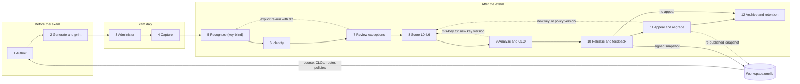
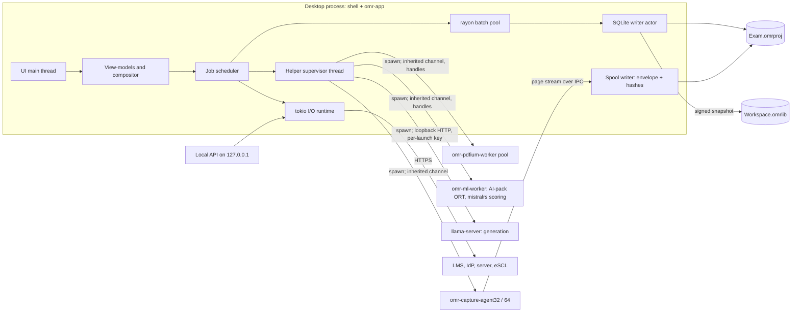
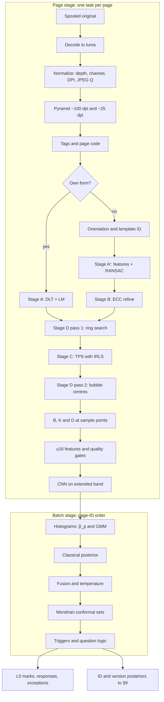

# OMR Correction — Technical Design Description

| | |
|---|---|
| **Document** | Technical design description for a native, local-first OMR exam-correction and outcome-analytics platform |
| **Version / status** | Draft v0.1, for review |
| **Facts verified as of** | 2026-10-15. Crate, model and standard versions were checked against crates.io, Hugging Face, vendor documentation and standards bodies on that date. |
| **Audience** | The product owner and the engineering team that will build the product |
| **Working name** | "OMR Correction" (codename). Rust crates use the `omr-` prefix. Projects are `*.omrproj/` packages and `*.omrx` archives. |

**How to read this document**

- **§1** summarizes the design and lists the decisions the owner still has to make.
- **§2–§3** set goals and metrics, and define what "superior to Remark Office OMR" means in measurable terms.
- **§4–§5** cover the architecture and the technology stack. §5.3 is the single authoritative stack table.
- **§6–§13** follow an exam through the system: forms, capture, recognition, identity, scoring, CLO outcomes, analytics and human review.
- **§14–§20** cover the platform: data and reproducibility, server mode, integrations, reporting, AI, security and privacy, i18n and accessibility.
- **§21–§23** cover quality attributes: performance, reliability, and accuracy assurance.
- **§24–§26** cover packaging and commercial model, the delivery plan, and risks.
- **Appendix A** catalogues every exception code: what can go wrong, how it is detected, and how it is handled. **Appendix B** is a glossary.

**Conventions**

- MUST / SHOULD / MAY follow RFC 2119.
- **[M]** marks a figure measured in the research benchmark harness. That harness ran on a 4-vCPU VM with synthetic sheets, so treat [M] figures as order-of-magnitude anchors and re-measure them on reference hardware.
- *initial* marks a starting threshold that MUST be replaced by values chosen with Learn-then-Test on the labelled corpus before GA.
- **(unverified)** marks a claim that could not be confirmed from a primary source.
- "§N.M" is a cross-reference.
- Each top-level section ends with its key sources.

## Contents

- [1. Executive summary](#1-executive-summary)
  - [1.1 What we are building](#11-what-we-are-building)
  - [1.2 How the design answers the four requests](#12-how-the-design-answers-the-four-requests)
  - [1.3 Ten architectural bets](#13-ten-architectural-bets)
  - [1.4 Stack at a glance](#14-stack-at-a-glance)
  - [1.5 Where it is superior to Remark Office OMR 12.4](#15-where-it-is-superior-to-remark-office-omr-124)
  - [1.6 Decisions needed from the owner, and the size of the job](#16-decisions-needed-from-the-owner-and-the-size-of-the-job)
- [2. Goals, non-goals and success metrics](#2-goals-non-goals-and-success-metrics)
  - [2.1 Problem statement and target users](#21-problem-statement-and-target-users)
  - [2.2 Goals](#22-goals)
  - [2.3 Non-goals](#23-non-goals)
  - [2.4 Success metrics](#24-success-metrics)
- [3. Competitive baseline and differentiation](#3-competitive-baseline-and-differentiation)
  - [3.1 Remark Office OMR 12.4 / Test Grading](#31-remark-office-omr-124--test-grading)
  - [3.2 Other incumbents and entrants](#32-other-incumbents-and-entrants)
  - [3.3 Day-one parity checklist (table stakes)](#33-day-one-parity-checklist-table-stakes)
  - [3.4 Differentiators (gap list)](#34-differentiators-gap-list)
  - [3.5 Migration path from Remark and Scantron](#35-migration-path-from-remark-and-scantron)
- [4. System architecture](#4-system-architecture)
  - [4.1 End-to-end exam lifecycle](#41-end-to-end-exam-lifecycle)
  - [4.2 Architectural principles](#42-architectural-principles)
  - [4.3 Workspace and crate map](#43-workspace-and-crate-map)
  - [4.4 Process model](#44-process-model)
  - [4.5 Threading and job model](#45-threading-and-job-model)
  - [4.6 Deployment modes](#46-deployment-modes)
  - [4.7 View-model & compositor design](#47-view-model--compositor-design)
- [5. Technology stack and key decisions](#5-technology-stack-and-key-decisions)
  - [5.1 Why Rust (and where it is not used)](#51-why-rust-and-where-it-is-not-used)
  - [5.2 ADR-001 GUI shell](#52-adr-001-gui-shell)
  - [5.3 Stack decision table](#53-stack-decision-table)
  - [5.4 Licence policy](#54-licence-policy)
  - [5.5 Dependency risk register](#55-dependency-risk-register)
  - [5.6 Effort estimate snapshot](#56-effort-estimate-snapshot)
- [6. Answer-sheet design and generation](#6-answer-sheet-design-and-generation)
  - [6.1 Template model](#61-template-model)
  - [6.2 Designer UX + Typst macro DSL over the same model](#62-designer-ux--typst-macro-dsl-over-the-same-model)
  - [6.3 Geometry specification table](#63-geometry-specification-table)
  - [6.4 Fiducials and page identity](#64-fiducials-and-page-identity)
  - [6.5 Field types](#65-field-types)
  - [6.6 Multi-version and per-student shuffling](#66-multi-version-and-per-student-shuffling)
  - [6.7 Personalized and serialized booklets](#67-personalized-and-serialized-booklets)
  - [6.8 Print safety](#68-print-safety)
  - [6.9 Pre-print lint, synthetic-fill simulator and printer/scanner qualification kit](#69-pre-print-lint-synthetic-fill-simulator-and-printerscanner-qualification-kit)
  - [6.10 Legacy and third-party form import](#610-legacy-and-third-party-form-import)
  - [6.11 Accessible sheet variants](#611-accessible-sheet-variants)
- [7. Capture and ingestion](#7-capture-and-ingestion)
  - [7.1 Source tiers](#71-source-tiers)
  - [7.2 Recommended scanner settings, device profiles and scanner tiers](#72-recommended-scanner-settings-device-profiles-and-scanner-tiers)
  - [7.3 Decode paths](#73-decode-paths)
  - [7.4 Spool-first ingestion](#74-spool-first-ingestion)
  - [7.5 Batch header sheets, imprinter sequence, expected-count reconciliation, rescan pull lists](#75-batch-header-sheets-imprinter-sequence-expected-count-reconciliation-rescan-pull-lists)
  - [7.6 Phone/tablet capture details](#76-phonetablet-capture-details)
- [8. Recognition engine](#8-recognition-engine)
  - [8.1 Pipeline overview and per-stage cost budget](#81-pipeline-overview-and-per-stage-cost-budget)
  - [8.2 Normalization](#82-normalization)
  - [8.3 Orientation, mirroring, page/template identification](#83-orientation-mirroring-pagetemplate-identification)
  - [8.4 Registration](#84-registration)
  - [8.5 Illumination/background normalization and normalized darkness D = (B−I)/(B−K)](#85-illuminationbackground-normalization-and-normalized-darkness-d--bibk)
  - [8.6 Per-bubble features](#86-per-bubble-features)
  - [8.7 Classification cascade](#87-classification-cascade)
  - [8.8 Per-question decision logic](#88-per-question-decision-logic)
  - [8.9 Image-quality metrics and gates table](#89-image-quality-metrics-and-gates-table)
  - [8.10 Phone-capture path](#810-phone-capture-path)
  - [8.11 Determinism & provenance rules specific to recognition](#811-determinism--provenance-rules-specific-to-recognition)
  - [8.12 Recognition edge-case table](#812-recognition-edge-case-table)
  - [8.13 Published accuracy baselines & how existing systems work](#813-published-accuracy-baselines--how-existing-systems-work)
- [9. Identity and contextual data extraction](#9-identity-and-contextual-data-extraction)
  - [9.1 What "context" is extracted and channel overview](#91-what-context-is-extracted-and-channel-overview)
  - [9.2 Roster ingestion & snapshots](#92-roster-ingestion--snapshots)
  - [9.3 Name normalization](#93-name-normalization)
  - [9.4 Recognizers per channel](#94-recognizers-per-channel)
  - [9.5 Roster-constrained fusion](#95-roster-constrained-fusion)
  - [9.6 Batch assignment](#96-batch-assignment)
  - [9.7 Calibration, abstention, certification](#97-calibration-abstention-certification)
  - [9.8 VLM fallback for identity](#98-vlm-fallback-for-identity)
  - [9.9 Identity edge-case table](#99-identity-edge-case-table)
  - [9.10 Privacy of identity snippets](#910-privacy-of-identity-snippets)
- [10. Scoring engine](#10-scoring-engine)
  - [10.1 Layered pipeline L0–L6, purity, determinism, idempotent regrades](#101-layered-pipeline-l0l6-purity-determinism-idempotent-regrades)
  - [10.2 Numeric policy](#102-numeric-policy)
  - [10.3 Multi-form model](#103-multi-form-model)
  - [10.4 Item types and scoring rules table + scoring-rule simulator](#104-item-types-and-scoring-rules-table--scoring-rule-simulator)
  - [10.5 Policies](#105-policies)
  - [10.6 Curving/scaling/grade scales](#106-curvingscalinggrade-scales)
  - [10.7 Rule extensibility and validation](#107-rule-extensibility-and-validation)
  - [10.8 Regrades, appeals, impact reports, SUPERSEDED watermarking, four-eyes after release](#108-regrades-appeals-impact-reports-superseded-watermarking-four-eyes-after-release)
  - [10.9 Late sittings and make-ups after release](#109-late-sittings-and-make-ups-after-release)
- [11. Learning-outcome (CLO/PLO) engine](#11-learning-outcome-cloplo-engine)
  - [11.1 Outcome framework model](#111-outcome-framework-model)
  - [11.2 Mapping model](#112-mapping-model)
  - [11.3 Formulas](#113-formulas)
  - [11.4 Attainment policy objects](#114-attainment-policy-objects)
  - [11.5 PLO/SO roll-up, longitudinal trends, item-bank memory across terms](#115-ploso-roll-up-longitudinal-trends-item-bank-memory-across-terms)
  - [11.6 Closing the loop, evidence sampling](#116-closing-the-loop-evidence-sampling)
  - [11.7 Report pack](#117-report-pack)
  - [11.8 Edge cases](#118-edge-cases)
- [12. Item, test and integrity analytics](#12-item-test-and-integrity-analytics)
  - [12.1 CTT statistics table](#121-ctt-statistics-table)
  - [12.2 Mis-key and flawed-item detection rules (ranked)](#122-mis-key-and-flawed-item-detection-rules-ranked)
  - [12.3 Small-N handling](#123-small-n-handling)
  - [12.4 Rasch](#124-rasch)
  - [12.5 DIF, marker-severity analysis for score boxes](#125-dif-marker-severity-analysis-for-score-boxes)
  - [12.6 Standard setting and CSEM band](#126-standard-setting-and-csem-band)
  - [12.7 Integrity analytics](#127-integrity-analytics)
  - [12.8 Validation against reference implementations as CI oracles](#128-validation-against-reference-implementations-as-ci-oracles)
- [13. Review and exception handling](#13-review-and-exception-handling)
  - [13.1 Exception model](#131-exception-model)
  - [13.2 Queue ordering & grouping](#132-queue-ordering--grouping)
  - [13.3 Review UI spec](#133-review-ui-spec)
  - [13.4 Governance](#134-governance)
  - [13.5 Throughput math](#135-throughput-math)
  - [13.6 Response data grid, validation rules and data lock](#136-response-data-grid-validation-rules-and-data-lock)
  - [13.7 On-screen marking of constructed responses](#137-on-screen-marking-of-constructed-responses)
- [14. Data architecture and reproducibility](#14-data-architecture-and-reproducibility)
  - [14.1 Project package and archive format](#141-project-package-and-archive-format)
  - [14.2 SQLite configuration](#142-sqlite-configuration)
  - [14.3 Logical data model](#143-logical-data-model)
  - [14.4 Audit/event log](#144-auditevent-log)
  - [14.5 Content-addressed object store](#145-content-addressed-object-store)
  - [14.6 Engine manifest & reproducibility](#146-engine-manifest--reproducibility)
  - [14.7 Migrations, backups, restore verification, schema-compat policy](#147-migrations-backups-restore-verification-schema-compat-policy)
  - [14.8 Ingest state machine and resumability](#148-ingest-state-machine-and-resumability)
  - [14.9 Workspace library](#149-workspace-library)
- [15. Multi-user server mode, sync and access control](#15-multi-user-server-mode-sync-and-access-control)
  - [15.1 Server architecture](#151-server-architecture)
  - [15.2 Sync model](#152-sync-model)
  - [15.3 Concurrent review](#153-concurrent-review)
  - [15.4 AuthN](#154-authn)
  - [15.5 AuthZ with Cedar](#155-authz-with-cedar)
- [16. Integrations and extensibility](#16-integrations-and-extensibility)
  - [16.1 LMS matrix](#161-lms-matrix)
  - [16.2 SIS & standards](#162-sis--standards)
  - [16.3 File formats in/out](#163-file-formats-inout)
  - [16.4 Local API, server REST (OpenAPI 3.1), Standard Webhooks events list, CLI](#164-local-api-server-rest-openapi-31-standard-webhooks-events-list-cli)
  - [16.5 Plugin system](#165-plugin-system)
  - [16.6 Outbox semantics for pushes](#166-outbox-semantics-for-pushes)
- [17. Reporting and student feedback](#17-reporting-and-student-feedback)
  - [17.1 Report engine](#171-report-engine)
  - [17.2 Report catalogue table](#172-report-catalogue-table)
  - [17.3 Annotated student sheets](#173-annotated-student-sheets)
  - [17.4 Release gate & distribution](#174-release-gate--distribution)
  - [17.5 Appeals & regrade-request workflow](#175-appeals--regrade-request-workflow)
  - [17.6 Exports for accreditation](#176-exports-for-accreditation)
- [18. AI-assisted features and governance](#18-ai-assisted-features-and-governance)
  - [18.1 Principles](#181-principles)
  - [18.2 Runtime](#182-runtime)
  - [18.3 Feature specs](#183-feature-specs)
  - [18.4 Optional cloud LLM (Claude API)](#184-optional-cloud-llm-claude-api)
  - [18.5 Governance table and invariants](#185-governance-table-and-invariants)
  - [18.6 Evaluation and oversight telemetry](#186-evaluation-and-oversight-telemetry)
  - [18.7 Prompt-injection and model supply-chain defences](#187-prompt-injection-and-model-supply-chain-defences)
- [19. Security, privacy and compliance](#19-security-privacy-and-compliance)
  - [19.1 Threat model summary](#191-threat-model-summary)
  - [19.2 Encryption at rest & key hierarchy](#192-encryption-at-rest--key-hierarchy)
  - [19.3 Answer-key secrecy](#193-answer-key-secrecy)
  - [19.4 Untrusted input handling, local API hardening, TLS](#194-untrusted-input-handling-local-api-hardening-tls)
  - [19.5 Privacy regimes table → product features](#195-privacy-regimes-table--product-features)
  - [19.6 EU AI Act and EU CRA](#196-eu-ai-act-and-eu-cra)
  - [19.7 Supply chain & release integrity](#197-supply-chain--release-integrity)
  - [19.8 Telemetry & crash reporting policy; procurement artefacts](#198-telemetry--crash-reporting-policy-procurement-artefacts)
- [20. Internationalisation and accessibility](#20-internationalisation-and-accessibility)
  - [20.1 i18n stack](#201-i18n-stack)
  - [20.2 RTL & Arabic specifics](#202-rtl--arabic-specifics)
  - [20.3 Accessibility of the app](#203-accessibility-of-the-app)
  - [20.4 Accessible outputs](#204-accessible-outputs)
- [21. Performance engineering](#21-performance-engineering)
  - [21.1 Targets and measured anchors](#211-targets-and-measured-anchors)
  - [21.2 Pipeline design](#212-pipeline-design)
  - [21.3 Decode strategy and per-stage cost](#213-decode-strategy-and-per-stage-cost)
  - [21.4 ROI-first processing, SIMD policy and GPU policy](#214-roi-first-processing-simd-policy-and-gpu-policy)
  - [21.5 Memory budget](#215-memory-budget)
  - [21.6 Incremental recomputation and UI responsiveness](#216-incremental-recomputation-and-ui-responsiveness)
  - [21.7 Profiling and benchmark toolchain, and bare-metal performance CI](#217-profiling-and-benchmark-toolchain-and-bare-metal-performance-ci)
- [22. Reliability and failure handling](#22-reliability-and-failure-handling)
  - [22.1 Fault-isolation model](#221-fault-isolation-model)
  - [22.2 Crash safety and resumability](#222-crash-safety-and-resumability)
  - [22.3 Resource exhaustion](#223-resource-exhaustion)
  - [22.4 Timeouts and watchdogs](#224-timeouts-and-watchdogs)
  - [22.5 External-system failures](#225-external-system-failures)
  - [22.6 Master failure-mode table](#226-master-failure-mode-table)
  - [22.7 Observability](#227-observability)
- [23. Quality engineering and accuracy assurance](#23-quality-engineering-and-accuracy-assurance)
  - [23.1 Accuracy contract](#231-accuracy-contract)
  - [23.2 Benchmark corpus](#232-benchmark-corpus)
  - [23.3 Semi-synthetic generator](#233-semi-synthetic-generator)
  - [23.4 Test strategy](#234-test-strategy)
  - [23.5 Calibration and abstention evaluation, drift monitoring, per-device recalibration](#235-calibration-and-abstention-evaluation-drift-monitoring-per-device-recalibration)
  - [23.6 CI gates and cross-platform decision identity](#236-ci-gates-and-cross-platform-decision-identity)
  - [23.7 Customer-side acceptance kit and first-batch supervised mode](#237-customer-side-acceptance-kit-and-first-batch-supervised-mode)
  - [23.8 Active learning from corrections](#238-active-learning-from-corrections)
- [24. Packaging, licensing and commercial model](#24-packaging-licensing-and-commercial-model)
  - [24.1 Distribution](#241-distribution)
  - [24.2 Code signing](#242-code-signing)
  - [24.3 Licensing mechanics](#243-licensing-mechanics)
  - [24.4 Editions and pricing hypotheses](#244-editions-and-pricing-hypotheses)
- [25. Delivery plan: phases, team and spikes](#25-delivery-plan-phases-team-and-spikes)
  - [25.1 Spikes before commitment](#251-spikes-before-commitment)
  - [25.2 Phases with scope and exit criteria](#252-phases-with-scope-and-exit-criteria)
  - [25.3 Team composition and effort](#253-team-composition-and-effort)
  - [25.4 Build-vs-buy notes](#254-build-vs-buy-notes)
- [26. Risks and open questions](#26-risks-and-open-questions)
- [Appendix A. Exception code catalogue](#appendix-a-exception-code-catalogue)
- [Appendix B. Glossary](#appendix-b-glossary)

## 1. Executive summary

### 1.1 What we are building

OMR Correction is a native desktop application for Windows, macOS and Linux, written in Rust with no Electron. It can scale up to a self-hosted department server and a phone companion. It turns paper assessments into three things:

1. **Grades**, under a published accuracy contract.
2. **Reconciled student identities.**
3. **Course- and programme-level learning-outcome evidence** that accreditors accept.

The product works fully offline, records every decision in a tamper-evident audit log, and never lets AI make a final decision.

The design rests on one observation from the research. Speed and raw per-answer accuracy are no longer where the competition is:
- the throughput target of ≥ 200 pages/s on an 8-core laptop is about 28× the fastest production document scanner (≈ 7 images/s), and the stretch target of 400 pages/s is about 57× (§21);
- published systems already reach 99.95 % per answer, and that still leaves about 4 % of 100-question sheets with at least one error (§8).

The real competition is on four fronts:
- **Never silently wrong.** Calibrated abstention, with every doubtful mark routed to a fast human review.
- **Getting identity right.** The roster is treated as a closed vocabulary.
- **Turning item scores into defensible outcome attainment.**
- **Removing institutional friction:** platforms, licensing, LMS integration, privacy and accessibility.

### 1.2 How the design answers the four requests

| Owner's request | Design answer | Where |
|---|---|---|
| Extremely fast, state-of-the-art grading | **Throughput.** Page-per-task Rust pipeline, target ≥ 200 pages/s on an 8-core laptop. A partial-pipeline harness (decode, fiducials, homography and mean darkness, on clean synthetic sheets, 4 vCPU) measured 219–266 pages/s [M]. Full-pipeline cost, including CNN routing and identity HTR, is still to be measured. **Recognition.** Fiducial-first registration with a thin-plate-spline correction. Calibrated mark classification: batch Gaussian mixture, then a tiny CNN, then Mondrian conformal sets judged on the selection outcome. **Accuracy contract.** Silent-error rate ≤ 10⁻⁵ per question at ≤ 0.5 % review rate. Until the corpus certifies it, the achieved bound is published instead. **Re-scoring.** Recognition and scoring are separate, so a key change re-scores 10,000 sheets in milliseconds | §8, §10, §21, §23 |
| Fetch student name, ID and other context | **Channels:** bubbled ID grid, handwritten ID boxes (Western and Arabic-Indic digits), handwritten names (Latin and Arabic, local HTR), barcodes and the page code, seat maps. **Fusion:** against a versioned roster snapshot with Fellegi–Sunter weights and exact CTC scoring of roster candidates, then a batch one-sheet-per-student assignment. **Auto-accept** needs the ID channel plus an independent name or page-code channel; everything else goes to a keyboard-first review queue. Rosterless and anonymous modes are supported | §9, §13 |
| Map CLOs with specific grade weights and notes | **Mappings:** versioned item→CLO mappings with weight, note, evidence link, rationale and approval, plus assessment weights. **Policies:** selectable, versioned attainment policies (average, threshold-proportion, levels, EAMU), with Wilson confidence intervals and thin-evidence warnings. **Scope:** direct and indirect blending, including course-evaluation surveys read by the same engine. A workspace library aggregates across quizzes, midterms, finals, sections and terms, then rolls up CLO→PLO→ABET/NCAAA/AACSB/NBA. **Follow-through:** closing-the-loop actions and exemplar evidence packs. Attainment is always computed on uncurved item scores | §11, §14.9, §17 |
| Everything else that might be overlooked | **Engine:** a coded exception catalogue covering every failure mode (Appendix A), item analysis with mis-key detection, responsible integrity analytics. **Exam workflow:** multi-version exams, accommodations, make-ups after release, appeals, on-screen marking of written answers. **Integration:** LMS/SIS standards (LTI 1.3, OneRoster 1.2, CASE 1.1, QTI 3.0), RBAC and SSO, desktop multi-signer governance. **Compliance:** GDPR, FERPA and PDPL features, WCAG 2.2, RTL. **Operations:** scanner qualification, reproducibility, packaging and signing, licensing without dongles. LTI, SSO, server-side RBAC and inferential integrity indices arrive in P3 | §6–§26 |

### 1.3 Ten architectural bets

1. **The core is deterministic and AI only advises.** Grades, identities, keys and attainment come from deterministic code plus human decisions. AI output is a labelled suggestion that only a human command can apply. It can be switched off, and that can be attested (§4.2, §18).
2. **Recognition is separate from scoring.** Key, weight, policy and CLO changes never re-run computer vision; they recompute a pure function over a compact mark matrix (§10.1).
3. **Recognition is key-blind.** The crate graph makes it impossible for recognition or identity code to see the answer key (§4.3).
4. **`UNREADABLE` is never `EMPTY`.** A bubble that is occluded, cut off, glared or badly registered is never silently scored as blank (§8.8).
5. **We generate our own forms.** Typst-generated sheets carry AprilTag corners, row ticks and a MAC-protected page code. They need no template set-up, and their geometry, identity and version are deterministic. Legacy, third-party and fillable-PDF forms are also read (§6).
6. **Evidence is preserved.** Originals are immutable, content-addressed and encrypted. Every decision is an event in a SHA-256 hash chain with signed checkpoints. Results carry an engine manifest, and decisions are reproducible across CPUs (§14, §19).
7. **Local-first, with an optional server.** Everything works offline:
   - per-exam project packages, plus a workspace library for course- and programme-level data;
   - post-release approvals by a second signer through signed approval bundles.

   A self-hosted, in-country server adds multi-user review, LTI, SSO and sync (§14–§16).
8. **Native code that can crash runs out of process.** PDFium, OS image codecs, TWAIN drivers, GPU execution providers and llama.cpp run in supervised helpers that receive handles, never paths. A bad page never kills a batch (§4.4, §22).
9. **Capture is grayscale and spool-first.** We deliberately diverge from Remark's bitonal advice, because driver-side thresholding destroys light pencil and erasure evidence (§7.2).
10. **Turnaround is a review-UX problem.** The bottleneck is operator seconds per exception, not CPU time. Exceptions are coded, grouped and resolved with the keyboard, against a ≤ 2 s per-item target (§13).

### 1.4 Stack at a glance

| Layer | Choice (verified 2026-10-15) |
|---|---|
| Language | Rust, edition 2024, MSRV 1.92. A headless core workspace with a thin UI shell |
| Desktop UI | **Slint 1.18**, gated by a 3-week spike. **Qt 6.12 via cxx-qt 0.10** is the pre-planned fallback, and the starting point if a mirrored Arabic UI is required at GA (ADR-001, §5.2) |
| Imaging and CV | Pure Rust: `image`/`zune-jpeg`/`tiff`/`hayro-*` decoders, `fast_image_resize`, `imageproc`, `kornia-rs` (AprilTag, RANSAC), `faer`. Runtime-dispatched SIMD. No OpenCV in the product |
| ML | `tract-onnx` for decision-path tiny CNNs (deterministic FP32 CPU). `ort` (ONNX Runtime 1.31) for HTR/OCR (PP-OCRv6, Arabic PP-OCRv5), under a fixed-batch, single-thread rule with a cross-ISA test. Optional AI pack: llama.cpp sidecar and mistral.rs worker with Apache-2.0 models (Qwen3.5, Gemma 4, PaddleOCR-VL-1.6) |
| PDF | Extract embedded scan images natively. PDFium worker pool for rasterization. Embedded **Typst 0.15** for sheets, fillable PDFs and PDF/A + PDF/UA reports |
| Capture | **GA:** hot folders and MFP push; driverless eSCL/AirScan; TWAIN (32/64-bit agents). **P3:** WIA, ImageCaptureCore and SANE agents; phone companion |
| Data | SQLite ≥ 3.51.3 (WAL, STRICT) plus a BLAKE3-addressed, AES-256-GCM-encrypted object store in an `.omrproj` package, plus a workspace library (`.omrlib`). Hash-chained, Ed25519-checkpointed audit log. Crypto-shredding through epoch keys |
| Server (optional, P3) | axum + Postgres 18 + S3-compatible storage. Cedar authorization, OIDC/SAML/SCIM, LTI 1.3 Advantage, OneRoster 1.2 |
| Extensibility | Rhai scoring formulas (sandboxed engine). wasmtime WASM-component plugins with deny-by-default capabilities. `omr-cli` with scheduled jobs |

### 1.5 Where it is superior to Remark Office OMR 12.4

| Dimension | Remark Office OMR 12.4 | OMR Correction | Available |
|---|---|---|---|
| Platforms and licensing | Windows only; per-PC activation; online activation on every VM launch; US$1,295/PC + $250/yr | Windows/macOS/Linux. Signed offline licences, no dongles, no VM penalty. Free instructor tier; per-user Pro; per-FTE institution tier (§24) | GA (phone companion P3) |
| Forms | Designed in Word; templates dragged over a scanned blank | Built-in generator and linter (WYSIWYG plus a Typst DSL). Unlimited variants, per-student shuffles, personalized booklets, fillable-PDF sheets, pre-print simulation (§6) | GA |
| Capture | TWAIN; bitonal recommended | Grayscale, spool-first capture from scanners, MFPs, eSCL and PDFs in one project, with device qualification (§7) | GA (WIA/ICA/SANE agents and phone P3) |
| Accuracy | No published figures | A published SER/AR contract per capture slice, calibrated abstention and a public benchmark protocol. Achieved bounds are published until certification (§23) | GA |
| Identity | Exact-match database lookup; handwriting read through the customer's Azure account | Local multi-channel roster-constrained fusion, including Arabic. Database lookup. Batch conflict detection. A calibrated, certifiable mis-attribution bound (§9) | GA (VLM fallback P3) |
| Outcomes | Per-test objectives and benchmarks | A full CLO/PLO engine across assessments, sections and terms, with accreditor packs, from the workspace library (§11, §14.9) | GA |
| Psychometrics and integrity | KR-20/21, α, uncorrected point-biserial, non-inferential similarity, changed-answer reports | Corrected item–rest r and CIs; mis-key inference with one-click re-keying; changed-answer and descriptive similarity reports at parity. Rasch, DIF and inferential collusion indices behind role gates (§12) | Parity reports GA; Rasch/DIF/inferential P3 |
| Review and data handling | Data Center grid, validation rules, data lock, change tracking | Confidence-ranked keyboard review queue; editable data grid with validate-and-transform rules and data lock; on-screen marking of written answers (§13) | GA |
| Audit and reproducibility | Change tracking | Hash-chained events, signed checkpoints, engine manifests, cross-CPU decision identity (§14) | GA |
| Collaboration and integration | Single-PC licence; LMS connectors sold separately | Desktop: multi-signer approval bundles, LMS REST/CSV, CASE, QTI, CLI with schedules, plugins. Server: shared projects, review leases, LTI 1.3, OneRoster REST, SSO/SCIM (§15, §16) | Desktop GA; server P3 |
| Openness | Proprietary formats; older versions cannot read newer files | Documented package format, read compatibility across ≥ 2 major versions, `omr-verify` CLI, escrow (§14, §24) | GA |

### 1.6 Decisions needed from the owner, and the size of the job

| # | Decision | Why it matters |
|---|---|---|
| Q-01 | Is a mirrored Arabic (RTL) user interface required at GA? RTL reports are GA parity either way | Yes → start the UI on Qt/cxx-qt. No → run the Slint spike first (§5.2) |
| Q-02 | In which jurisdiction is the legal entity registered? | Decides the Windows code-signing route, the primary privacy regime and the pricing currency (§24.2) |
| Q-03 | Which market comes first: the US Scantron-retirement wave, KSA/GCC (NCAAA) or India (NBA)? | Orders the accreditation report packs, locales and LMS connectors (§25) |
| Q-04 | Is K-12 in scope? | Adds COPPA and GDPR Art. 8 duties, larger default bubbles, and FACTS/ClassLink connectors (§16.1, §19.5) |
| Q-05 | Open-source the recognition engine? | A trust and audit asset, weighed against commoditization. Decision deferred to P3 (§24.4) |
| Q-06 | Are the edition price points acceptable to design partners? | Sets the commercial model in §24.4 |
| Q-07 | Minimum supported OS versions (Windows 10 ESU, oldest macOS) | Sets the CI matrix and the support burden (§24.1) |
| Q-24 | Approve the team and budget of §25.3 | Gates kickoff |

**Effort.** Reaching v1.0 GA is estimated at about 48–61 engineer-months before contingency, or about 58–73 with a 20 % contingency. That covers the engineering baseline plus ML data and models, QA automation, psychometric validation and corpus keying (§25.3). The team peaks at about 8–9 people over about 12 months (M0–M11), and the nine de-risking spikes run inside P0 (M0–M2). Some scope is not yet itemized and is sized at P0 exit (§25.3). Server mode, LTI, the mobile companion and the AI pack follow in P3 (M12–M20), and P4 adds further AI features. Sizing P3 and P4 is a deliverable at P2 exit.

## 2. Goals, non-goals and success metrics

### 2.1 Problem statement and target users

Paper multiple-choice exams remain the default in large-enrolment courses and many national systems (MENA, South Asia), while US campuses lose their hardware OMR services (§3.2). Remaining tools grade one test at a time, run on Windows only and are licensed per PC; none turns item scores into course-level CLO attainment that accreditors (ABET, NCAAA, AACSB, NBA) accept. The product (§1.1) answers this on the desktop, with a workspace linking a course's, programme's and term's assessments (§14.9) and a self-hosted department server in P3 (§4.6, §25.2).

| Persona | Role (§15.5) | Needs from the product | § |
|---|---|---|---|
| Instructor | Instructor, Co-instructor | Variants; key/policy versions; CLO mapping; results in minutes; instant regrade; CLO report without spreadsheets | §6, §10, §11 |
| TA / reviewer | TA-Reviewer | Keyboard-first exception queue (≤ 2 s per item); on-screen marking; key hidden unless permitted | §13, §13.7 |
| Scanning operator | Scanner-Operator | Scan-to-folder and driverless capture (faculty mostly use MFPs, not TWAIN); reconciled batch counts; rescan pull lists | §7 |
| Course coordinator | Instructor at offering scope | One key/policy version across sections; pooled CLO attainment, including sections scanned on other PCs (`.omrres`); section comparison | §11.3, §12.5, §14.9 |
| QA / accreditation officer | QA/Accreditation Officer, Auditor | PLO/SO roll-up across courses and terms; accreditor packs; exemplar scripts; CIs; closing the loop | §11.5–§11.7, §14.9 |
| Integrity officer | Integrity Officer (the solo desktop user holds it) | Changed-answer and descriptive similarity listings (GA); inferential indices (Department, P3); restricted access; no automatic penalties | §12.7 |
| Registrar / IT admin | Registrar, Admin | SIS/LMS push; MSI/ADMX; SSO (P3); retention and legal hold across the project registry; no PII in telemetry | §15, §19, §24 |
| Student (recipient) | No login role in v1 | Correct attribution; annotated sheet with CLO breakdown (LMS, email or print); appeal path; subject-access copy | §17.3–§17.5 |

### 2.2 Goals

| ID | Goal | Measurable definition | § |
|---|---|---|---|
| GO-1 | Fast, state-of-the-art accurate grading (owner ask 1) | §2.4 accuracy contract and throughput targets; ≥ 200 pages/s ≈ 28× the fastest production ADF (≈ 7 images/s; stretch 400 ≈ 57×), so scanner and reviewer set turnaround | §8, §21, §23 |
| GO-2 | Extract context and reconcile it with rosters (ask 2) | Roster-constrained fusion; auto-accept needs ID-intent channel AB plus name C or page-code binding E (§9.7); local Latin and Arabic HTR in every edition; per-slice certified mis-attribution bound | §9 |
| GO-3 | Map questions to CLOs with weights and notes (ask 3) | Versioned item→CLO mappings (weight, note, evidence, rationale, approval) and attainment policies; aggregation from workspace snapshots; a weight or key change recomputes everything in ≤ 50 ms for 10k sheets | §11, §14.9 |
| GO-4 | Cover what the owner may have overlooked (ask 4) | An exception code per failure mode (Appendix A); audit chain, privacy regimes, accessibility, RTL, integrations, procurement artefacts | §13, §19, §20, §22 |
| GO-5 | Superior to Remark Office OMR in every dimension | 100% of §3.3 parity at GA; each differentiator G1–G11 ships its GA part with its §3.4 metric; P3/P4 parts are claimed only from their phase | §3 |
| GO-6 | Native Rust, no Electron | Rust core, Slint or Qt shell; web UI only for server dashboards and LTI launches | §5.2 |

A dimension counts as "superior" only when a §2.4 metric beats Remark 12.4 on a shared corpus, or Remark lacks the capability. Public claims MUST cite a published measurement (§23.1; legal review, §3.5) and MUST NOT present a capability before its "Available" phase (§3.4).

### 2.3 Non-goals

- **NG-1. Not an LMS or a gradebook of record.** Results are pushed out (§16).
- **NG-2. No online-testing platform in v1.** The only digital response paths are the fillable-PDF electronic bubble sheet (GA) and the accessible web form (server mode), both §6.11.
- **NG-3. No drivers for legacy hardware OMR readers.** Their forms are read from image scans (§6.10).
- **NG-4. No writer identification, handwriting biometrics or face matching.**
- **NG-5. AI is never the final decision-maker** on grades, identities, keys, attainment or integrity (invariant 1).
- **NG-6. No mandatory cloud** (invariant 7).
- **NG-7. No printing of proprietary third-party sheet designs.**
- **NG-8. No ISIS, TWAIN Direct or proctoring in v1.**
- **NG-9. No built-in speech-recognition data entry.** OS dictation (Windows Voice Access, macOS Voice Control) drives the review UI through its accessible controls (tested per §20.3).

### 2.4 Success metrics

Numbers come from the locked decisions; *proposed* rows are W1 proposals. Verification: §21.7, §23. Until certified, a target's achieved bound is published instead (§23.1).

| Metric | Target (GA unless noted) | Remark 12.4 baseline | § |
|---|---|---|---|
| Silent error rate, standard capture | SER ≤ 1×10⁻⁵ per question at AR ≤ 0.5%; LTT-certified on ≥ 300k × DEFF labelled questions, confirmed on a disjoint ≥ 300k test split (one-sided 95%, §23.1) | No figures published | §23.1 |
| High-stakes mode | Design target SER ≤ 2×10⁻⁶ at AR ≤ 2%, certified only once ≥ 1.5M real labelled questions are in the certifying split; two-person rule (§13.4) | None | §23.1 |
| Bitonal / phone input | Separate published targets, e.g. SER ≤ 5×10⁻⁵ at AR ≤ 3%; phone beta until P3 | Bitonal is the recommended mode | §23.1 |
| Identity mis-attribution | ≤ 10⁻⁴ per auto-accepted sheet, LTT-certified per slice on ≈ 30k labelled auto-accepted sheets (shadow mode until then). Goal ≤ 10⁻⁶ by construction only (AB plus C or E; certifying it would need ≈ 3M sheets); "ID-only" booklets excluded | Exact-match DB lookup | §9.7 |
| Throughput | ≥ 200 pages/s, 8-core laptop, §21.1 reference corpus (stretch 400); ≥ 40 pages/s, 4-core N100-class; scanned PDF ≥ 100 pages/s; scanner-following p99 ≤ 1 s. Identity HTR is outside the 200 pages/s target: single-page sheets with ID boxes and a name field reach ≈ 95–140 pages/s at W = 7 (est., §21.1) | "Tied to scanner speed"; field point ≈ 3 s/sheet | §21.1 |
| Time to first result, 30 sheets | < 3 s | Not published | §21.1 |
| Regrade latency | Key change → all scores, CLO and item stats ≤ 50 ms for 10k sheets | Regrade without rescan | §10.1 |
| Review effort | ≤ 2 s median per exception; ≤ 0.5% of items queued on a well-scanned batch | Exception grid, no confidence ranking | §13.5 |
| Scale | Open 10k-sheet project ≤ 300 ms; cold start ≤ 1.5 s, warm ≤ 0.5 s; process-tree private memory ≤ 1.2 GB on 4 GB (≤ 2.5 GB on 16 GB; AI pack excluded); 60 Hz UI | Student Test Report capped at 100 images per run | §21 |
| Setup time *(proposed)* | ≤ 10 min from roster and typed key to a printable personalised PDF (50 items, 2 variants); ≤ 15 min to template a third-party form; usability test of the guided new-exam flow, ≥ 8 instructors | Sheets designed in Word; regions dragged on a scanned blank | §6.2, §6.10 |
| Determinism | Zero differences in auto-accepted responses and identities on the golden corpus across x86-64-v2/v3/v4, aarch64, thread counts and page orders; accept↔review routing differences ≤ 1 per 10⁵ bubbles and ≤ 1 per 10³ identity pages | Not claimed | §23.6 |
| Fault isolation | Zero batch aborts over a 100k-page soak and the fuzz corpus | Users report large-batch crashes on older hardware; 12.4 fixed a large-save CSV error | §22 |
| Platforms | Windows 10 22H2+/11 (x64, arm64); macOS universal2 (arm64-only from 2028); Linux x86-64; one mobile companion platform in P3, the second in P4 | Windows only | §24.1 |
| Accessibility | WCAG 2.2 AA and EN 301 549 V4.1.1, external ACR (VPAT 2.5 INT). With NVDA, JAWS, VoiceOver and Orca: every non-visual task completes (keys, scoring, CLO mapping, roster and identity by text, reports); the review UI is fully operable (navigate, escalate, defer, rescan list). Visual mark adjudication is a documented ACR exception, escalated to a sighted reviewer. Reports are PDF/UA-1 | No ACR located (unverified) | §20.3 |
| Local-first | No telemetry and no outbound connections, except a signed update-manifest check that carries no identifiers. It is ON by default (CRA expectation) and can be disabled by ADMX/MDM or by air-gapped mode; the CI egress test allowlists only that host | Online activation; ICR through the customer's Azure | §19.8 |

Key sources: https://remarksoftware.com/blog/2026/07/remark-office-omr-12-4-is-now-available/ · https://its.hku.hk/kb/user-guide-on-remark-office-omr-software/ · https://doi.org/10.3390/jimaging11090308 · https://its.uky.edu/news/scantron-service-ending-spring-2026 · https://www.kodakalaris.com/en/scanners/i5850-scanner · https://nda.ie/news/en301549-published

## 3. Competitive baseline and differentiation

### 3.1 Remark Office OMR 12.4 / Test Grading

Gravic's family: **Office OMR** (Windows desktop; 12.4 released 2026-07-28), **Test Grading** (AWS-hosted subscription), **Classic OMR 7** (hardware readers) and **Web Survey** (shelved 2025-12-31). Scantron TestFlex (March 2025) is probably a Test Grading OEM (unverified); Scantron has belonged to Regent LP since August 2024.

| Aspect | Remark baseline | Our answer |
|---|---|---|
| Price | US$1,295 per Windows PC with 1 year of maintenance; US$250/yr renewal; €1,141.95; ₹1,35,000 + GST (India); quote above 5 seats; no updates without maintenance | §24.4 |
| Licensing | Per-PC activation with re-validation; online activation on every VM launch; deactivation needs vendor support; floating licence undocumented (unverified) | §24.3 |
| Platform | Windows 10/11, .NET Framework | Windows, macOS, Linux |
| Capture | TWAIN only; PDF/TIFF/JPG/PNG/PCX import; recommends 200–300 dpi B&W; throughput "largely tied to the speed of the scanner" | §7: grayscale, tiered sources |
| Forms | "Not a form designer": sheets from Word plus guidelines; templates dragged over a scanned blank; fillable-PDF "Electronic Bubble Sheets" | §6: generator, linter, fillable PDF |
| Recognition | Thresholds, auto-rotate, ignore large marks, brightness compensation, 2-px despeckle, blank-page detection; anchors since 12.0; "patented"; no accuracy figures | §8, §23: calibrated, with a contract |
| Identity | Bubbled grids, OCR, barcodes (2D up to 99 fields); ICR only through the customer's Azure Computer Vision; Database Lookup (ODBC/SQL/MariaDB) is exact-match verify-and-replace | §9: local fusion; DB lookup §9.2 |
| Review | Grid with BLANK/MULTIPLE colours, image review, duplicates, validate-and-transform rules, change tracking and data lock; Automation Control Center; no public API | §13, §13.6, §14.4, §16.4 (`omr-cli schedule`) |
| Grading | Quick Grade (key sheet first in the stack); Advanced Grade adds partial credit with AND keys, extra credit, throw-outs, curves, scaled-score tables, benchmarks, learning objectives, version mapping. Test Grading: ≤ 5 versions, no learning objectives with multiple versions, equal totals, on-screen grading of open responses | §10: master item space; §13.7 |
| Analytics | KR-20/21, α, uncorrected point-biserial, CIs, changed-answer reports, non-inferential similarity | §12 |
| Outcomes | Per-test objectives and benchmarks only; no CLO→PLO, no cross-assessment aggregation | G1, §11 |
| Exports and formats | 35+ exports; LMS connectors licensed separately; proprietary, undocumented formats unreadable by earlier versions | §16; §14.7 (read-compat ≥ 2 majors) |
| Reported weaknesses | Pencil false positives; rigid form design; large-batch crashes on old hardware; no phone capture; no course-level database; "AI Assistant" is a documentation chatbot | G1–G11 |

### 3.2 Other incumbents and entrants

| Product | Strength to match | Gap we exploit | Price anchor |
|---|---|---|---|
| Scantron hardware with ScanTools; TestFlex | 15,000 sheets/h (iNSIGHT 1500c); installed form base | #2 pencil and proprietary forms; 24–48 h campus turnaround; ParScore end-of-life; TestFlex is cloud-only | 882-E ≈ $0.36/sheet |
| Gradescope Bubble Sheet | 5 versions with uncertain-version handling; Canvas; replaced Scantron at JMU, UMich LSA, UDel | Fixed 200-Q template; cloud only; institutional licence only | Unpublished |
| Akindi | Plain paper; inside the LMS; emails scans to students | MC only; reported case of grades landing in the wrong course via scan-to-email | Per test (unpublished) |
| Crowdmark | QR booklets; TA rubric grading | Per-student printing; documented staple and streak failures | Per course and student |
| ZipGrade | Offline phone app; versions; standards; item analysis | One sheet at a time; pencil glare | $6.99/yr; 100 papers/month free |
| Gradient (formerly GradeCam) | K-12 standards reporting; gradebook sync | K-12/US focus; web only | $3.50/student, from $2,800/yr |
| Apperson DataLink | Standards and outcomes proficiency | Hardware and proprietary forms; per-test only | DL1200 $1,250 |
| ExamSoft | Outcome tagging for accreditation | Digital-first; paper through Remark's export | Enterprise |
| Addmen, Verificare, Alpha OMR (India) | Negative and decimal marking, sets A–D, rank lists, lifetime licences | Windows only; "100% accuracy" marketing; no LMS | Alpha ₹4,999–9,999/yr |
| ScanToGrade, Papeez, ScanScore, FormRead (2025–26) | Mac/Windows desktop; 4-level shuffling; free on-device Android; free web OMR with paid AI ICR | No CLO engine, no published accuracy; mostly cloud or phone | Papeez from €4/month |
| AMC 1.7.0 (GPLv2+) | Per-student shuffles with page codes; annotated returns | LaTeX-only authoring. GPL: re-implement ideas, never copy code | Free |
| OMRChecker (MIT), SDAPS (GPL-3) | JSON templates; survey sheet codes | Side projects; OMRChecker self-reports ~90% on phone images; no review, roster, analytics | Free |
| AI-native graders (ExamGrader.ai, Notla, PaperArch, Intrazero, Evalezy, others) | Rubric-assisted handwriting grading; Intrazero handles Arabic and Bloom levels | All cloud; no OMR rigour, item analysis or CLO; Evalezy documents prompt injection in answer sheets | Varies |

**Market read.** Scantron services are being retired at JMU (2025), UKY (after Spring 2026) and UWW (Aug 2026); ParScore is end-of-life; IUP moved to Remark. Institutions keep their form stock but lose the hardware, so reading legacy forms from images, in every edition (§24.4), is the migration wedge. Commodity MCQ OMR is heading to free; defensible value is correctness guarantees, outcome evidence, local AI and institutional workflow.

### 3.3 Day-one parity checklist (table stakes)

No item may slip past GA; if one does, GA moves (§25.2). Remark features excluded by decision: online testing (NG-2), hardware OMR readers (NG-3), speech-recognition data entry (NG-9).

| ID | Area | Required at GA | § |
|---|---|---|---|
| PAR-01 | Forms | Letter and A4; multi-page and duplex; generic multi-page sheets without serials if every page carries a respondent tracker; bubbles, checkboxes, numeric and math grids; ≤ 26 choices; scales; logo; roster-personalised and generic bubbled-ID sheets; rosterless assessments (candidate number or none); fillable-PDF electronic bubble sheet; survey forms (no key, optional anonymity) | §6, §6.5, §6.7, §6.11, §9 |
| PAR-02 | Regions | OMR; Code 39/128, QR, DataMatrix, PDF417; OCR; ICR; image clip; linked and skip-pattern questions; question groups | §6.5, §9.4 |
| PAR-03 | Capture | Direct scanner (TWAIN on Windows, eSCL on every OS); PDF/TIFF (G4/LZW)/JPG/PNG; watch folders; unattended and scheduled jobs (`omr-cli schedule`); batch headers; persistent unrecognized-image queue | §7, §4.6, §16.4 |
| PAR-04 | Recognition | Auto-rotate and deskew; works without corner marks; brightness compensation; threshold override as the per-exam AR–SER operating point, never a raw global threshold (§13.5); ignore large marks (`stray_or_damage` never selects, §8.8); blank and page-error detection; damaged bubbles; form/page ID; collation; duplicates | §8 |
| PAR-05 | Review | Grid plus image review; validate-and-transform rules; data lock; database lookup for ID verification and demographics (ODBC/PostgreSQL/MariaDB); change tracking; keyboard-first | §13, §13.6, §9.2 |
| PAR-06 | Grading | Scanned or typed key; CSV key with partial credit and AND keys; multiple correct answers; negative and decimal marking; bonus and throw-out; version mapping; curves; grade scales; scaled-score lookup; rubric points, including anonymous on-screen marking by several markers; benchmarks (the attainment threshold τ_c); objectives | §10, §11.4, §13.7 |
| PAR-07 | Reports | KR-20/21, α, point-biserial, CIs, percentiles, demographic comparison; changed-answer reports by item and by student and a descriptive similarity listing (every edition, Integrity Officer role); annotated student reports by LMS file, print or email; survey frequency and crosstab reports by question group | §12, §12.7, §17.2, §17.4 |
| PAR-08 | Exports | CSV and templated or fixed-width text, XLSX, SPSS .sav, JSON; SQL scripts for SQL Server, Oracle, PostgreSQL and SQLite, including "database update" (upsert) mode, and ODBC; Canvas, Moodle, Blackboard Ultra and D2L CSVs; ExamSoft and Questionmark QSF (layouts from public material, unverified; low priority); destinations: local or sync folder, SMB (SFTP is beyond parity, §16.3) | §16.3 |
| PAR-09 | Migration | Remark data and key import; template library (every edition) | §3.5 |
| PAR-10 | Localisation | EN, ES, PT and DE UI; RTL/Arabic reports and exports (Remark's own parity is RTL PDF export). A fully mirrored Arabic UI is a differentiator (G11), gated by Q-01 and ADR-001 | §20, §5.2 |
| PAR-11 | Accommodations | Large-print and alternate layouts on the same key; a single make-up sheet, also after release, scored without rescanning the class or changing released students | §6.11, §9.1, §10.6, §10.9 |

### 3.4 Differentiators (gap list)

"Available" is the shipping phase (§25.2); GA metrics are *proposed*.

| Gap | Differentiator | Deliverable | Available | GA metric | § |
|---|---|---|---|---|---|
| G1 | Outcome attainment engine (no competitor has it end to end) | Weighted item→CLO mapping with notes; cross-assessment and multi-section aggregation; attainment policies with Wilson CIs; direct and indirect (survey) blending; CLO→PLO→accreditor matrix; PDF/A exemplar scripts | GA | NCAAA or ABET pack from released data with zero manual spreadsheet steps, ≤ 5 min per offering | §11, §14.9, §17.6 |
| G2 | Cross-platform native app, frictionless licensing | Signed Windows, macOS and Linux builds; offline licences; floating seats for labs and VDI | GA | Install to first graded sheet ≤ 15 min on each OS; zero network calls for licensing | §24 |
| G3 | Unified capture | ADF, PDF, hot folder/MFP push, eSCL and phone images in one project; native phone companion | GA; companion P3 (phone images beta until then) | ≥ 5 source types into one project; eSCL discovery ≤ 10 s | §7 |
| G4 | Local AI and HTR | Offline Latin and Arabic name/ID HTR with roster-constrained decoding, in every edition; optional advise-only VLM | GA (HTR, spike S5); VLM P3 | Identity auto-accept rate at the certified ≤ 10⁻⁴ bound; Arabic name CER published | §9, §18 |
| G5 | Calibrated confidence and a public benchmark | Per-slice SER/AR contract; low-confidence marks always reviewed; published benchmark protocol | GA | Per-slice SER/AR with achieved bounds published | §8.7, §23 |
| G6 | Collaboration | Desktop: project members, approval bundles, four-eyes, blind double review. Server: shared projects, review leases, role bindings | GA (desktop); P3 (server) | 100% of post-release changes carry a second-principal approval token or a flagged self-approval | §15.5, §15 |
| G7 | Exam generation | Unlimited variants, per-student shuffles, QR page codes; QTI 3.0, Moodle XML, GIFT, Aiken and CSV item import; Word forms via PDF | GA | 2,000 shuffled booklets rendered ≤ 10 min (spike S6) | §6.6, §6.10, §16.3 |
| G8 | Psychometrics beyond CTT | Corrected r; mis-key inference with a one-click new key version; Rasch (2PL/3PL only for pooled banks); DIF; inferential collusion indices (Department) | GA (corrected r, mis-key); P3 (Rasch, DIF, inferential indices) | Mis-key recall ≥ 90% at ≤ 5% false flags on simulated mis-keys | §12, §12.8 |
| G9 | Open format, CLI, API, plugins | Documented `.omrproj`/`.omrx`; `omr-cli` with scheduling; local API; Rhai; server OpenAPI 3.1; WASM components | GA (format, CLI, local API, Rhai); P3 (server API, WASM) | Format spec published; `omr-verify` passes 100% of corpus archives | §14, §16 |
| G10 | Student feedback loop | Annotated sheet with CLO breakdown by LMS file, email or print; appeal register; portal links and appeal form in server mode | GA; P3 (portal, LTI) | ≥ 99% of released students with a logged delivery | §17 |
| G11 | Emerging-market fit | Arabic-Indic/Persian digits; RTL reports and exports; negative marking; rank lists; regional pricing; mirrored Arabic UI | GA; mirrored UI per Q-01 | Arabic-Indic ID-digit accuracy published; rank lists shipped | §10.6, §17.2, §20, §24.4 |

Cross-cutting properties Remark does not claim: key-blind recognition; `UNREADABLE` ≠ `EMPTY`; reproducible, manifest-stamped decisions; a signed, hash-chained audit log (§4.2).

### 3.5 Migration path from Remark and Scantron

1. **Template library** (every edition, §24.4): *reading* templates (geometry only, never printable copies) for Remark standard sheets, Scantron and Apperson pre-printed forms (882-E/815-E class, from colour or gray scans with channel dropout, pen or pencil), Gradescope 200-Q and ZipGrade 20/50/100. Product names are used only nominatively, without logos.
2. **Template re-creation.** Binary Remark templates are not imported; users rebuild them from the blank form PDF (§6.10). A second path, Remark's fillable-PDF export (its AcroForm widget rectangles may encode region geometry), is unverified and needs legal review.
3. **Data and keys.** Importers accept Remark CSV, XLSX and SPSS exports; key CSVs with partial credit and AND keys ("+", "&", "and"); version-mapping tables; and scaled-score tables. Remark learning objectives become weight-1 CLO mappings flagged "imported, needs review" (§11.2).
4. **Remark-compatible exports** keep downstream scripts working (§16.3).
5. **Parallel-run mode.** For one exam cycle the institution imports Remark's results for the same scans; every per-question disagreement goes to review, giving the institution its own comparison without the vendor publishing one.

**Legal constraints.**
- **Reverse engineering.** Interoperability exceptions differ between the US (DMCA §1201(f)) and the EU (Software Directive Art. 6); the team MUST NOT reverse engineer Remark formats without a written legal opinion.
- **Benchmarks.** Remark's EULA may restrict publishing benchmarks (a "DeWitt clause" risk): head-to-head numbers MUST pass legal review, and an evaluation licence must be budgeted.

| Case | Detection | Handling |
|---|---|---|
| Excel-mangled IDs in exports (lost zeros, `E+` notation) | Length variance against the roster; pattern match | IDs as text; preview diff; explicit confirm (§9.2) |
| Option-scrambled versions (Remark documents question reordering only, unverified) | Mapping-table shape | Map into master item space π_f/σ_f (§10.3) |
| Windows-1252/1256 exports | `chardetng` | Transcode with `encoding_rs`; preview |
| Pre-v11 data the customer cannot export | No readable export | Export from their Remark install; never parse binaries |

Key sources: https://remarksoftware.com/products/office-omr/features/ · https://buy.remarksoftware.com/products/remark-office-omr · https://remarksoftware.com/products/remark-test-grading/features/ · https://remarksoftware.com/wp-content/uploads/2021/06/Remark-Office-OMR-Users-Guide11.pdf · https://www.scantograde.com/blog/scantron-alternatives-remark-gradescope-akindi-zipgrade-amc/ · https://guides.gradescope.com/hc/en-us/articles/22246010755853 · https://www.auto-multiple-choice.net/ · https://github.com/Udayraj123/OMRChecker

## 4. System architecture

### 4.1 End-to-end exam lifecycle

An *assessment* passes through twelve stages. Stages 4–7 overlap on a stream of pages, so a 30-sheet class shows first results in under 3 s (§21.1); nothing from stage 8 onward re-runs computer vision (invariant 2). Each assessment is one `Exam.omrproj` (§14.1). Course, CLO, roster, policy and item-bank data live in `Workspace.omrlib`, and every cross-assessment result (course L5, CLO, PLO roll-up, trends) reads only the signed AssessmentResultSnapshots that projects publish there (§14.9).



| # | Stage | Output | Exit gate | Owner |
|---|---|---|---|---|
| 1 | Author | Course, CLOs and policies from the workspace; master items, item→CLO map, key and policy versions | Key sealed (§19.3); mapping lint clean | §10.3, §11, §14.9 |
| 2 | Generate and print | Typst-rendered template revision, variants, serialized booklets | Pre-print lint passes; the first print freezes the revision | §6 |
| 3 | Administer | Seat map, attendance, accommodation variants, spare-booklet counts | None. Imported records (§16.3) become identity priors (§9.5) and set the key-sealing end (§19.3) | §6.7, §9.1 |
| 4 | Capture | Originals as AEAD envelopes (plaintext BLAKE3 + SHA-256), batch header, imprinter sequence; fillable-PDF field values (`digital_fillable`, no OMR) | Expected count = received count | §7 |
| 5 | Recognize | L0 mark states, quantized features, exceptions | Quality gates (§8.9) | §8 |
| 6 | Identify | Roster-constrained identity, booklet collation | Identity confirmed, or an IDN/COL exception raised; rosterless and anonymous assessments use the candidate-number or none mode and release to export only (§9.1) | §9 |
| 7 | Review | Human decisions, each an audit event | No open BLOCKER or ERROR in grade-affecting scope (§13.1) | §13 |
| 8 | Score | L1–L6 score run for one key version and one policy version | Run stamped with its Run ID (§10.1) | §10 |
| 9 | Analyse and CLO | Item and test statistics, mis-key flags, attainment on uncurved L3 | Mis-key flags resolved or acknowledged | §11, §12 |
| 10 | Release and feedback | Frozen grades, outbox push, annotated sheets; signed AssessmentResultSnapshot published to the workspace | Release gate (§17.4) | §14.9, §16, §17 |
| 11 | Appeal and regrade | Decision event, new version, impact diff, re-push, re-published snapshot | Reason-coded decision; four-eyes approval after release (§15.5) | §10.8, §17.5 |
| 12 | Archive and retention | Signed `.omrx`; retention schedule, legal holds, crypto-shredding | Retention engine (§19.5) | §14.1, §19.2 |

**Status.** Draft → Printed → Active → Reviewed → Released → Archived; every change is an audit event (§14.4).
- *Active* (capturing, provisional scoring, review) and *Reviewed* (no open BLOCKER or ERROR in grade-affecting scope) project the booklets' §14.8 states, so before release the status returns to Active when pages arrive or exceptions reopen.
- *Released* and *Archived* are never reverted: later changes, including reopening a read-only *Archived* assessment, create new versions (§10.8). The status follows the main sitting; late, make-up and accommodation sittings run beside it and release per student with frozen curve parameters (§10.9).
- Retention and evidence-crop rules: §14.5, §19.5. A survey (no key, no score run) skips stages 8 and 11.

### 4.2 Architectural principles

| # | Invariant | Rationale | Mechanical enforcement |
|---|---|---|---|
| 1 | Deterministic core; AI only advises | Appeals need explainable decisions. GDPR Art. 22 position and contest route (§19.5); AI Act Annex III (§19.6) | `omr-ai` emits only `Suggestion` records. §18.1 *Enforcing P1*: a Cedar `forbid` on `Engine` principals for human-decision actions; a shell-minted `HumanInput` on `AcceptSuggestion`; an architecture test that only that handler builds a `Command` with a `suggestion_id`; a monthly replay check. "AI off" is attested from build feature flags, the engine manifest and `AiRuntimeStarted` events; refused attempts are recorded |
| 2 | Recognition ≠ scoring | A key or weight change re-scores 10k sheets in milliseconds (2.9 ms [M]) | Separate crates. `score()` is a pure function memoized by the §10.1 Run ID; a property test checks memoized = fresh |
| 3 | Key-blind recognition | Tie-breaking toward the key biases grades | Crate graph rule R2 (§4.3), checked in CI |
| 4 | UNREADABLE ≠ EMPTY | A silent false blank is worse than a visible failure | Distinct `MarkState::Unreadable` variant; scoring raises an exception on it; `cargo-mutants` covers that branch |
| 5 | Evidence preservation | Appeals, *Nowak* access requests, accreditation | Write-once object store (§14.5); hash-chained `events` (§14.4); verification on restore (§14.7) |
| 6 | Reproducible decisions, not bit-identical floats | A grade must not depend on CPU, OS, thread count or machine load | u16 features at 1/1024; hysteresis bands; FP32 CPU decision models (identity ORT models under the §9.4 rule); seeded RANSAC; engine manifest; a missed deadline never switches the path (§22.4); cross-platform golden gate (§23.6) |
| 7 | Local-first and offline | Exam centres, data residency, procurement | No network call on any grading path. By default the only outbound connection is the signed, identifier-free update-manifest check (§19.8). The full test suite runs offline |
| 8 | Fault isolation | Third-party native code crashes and hangs | Helper processes that receive handles, never paths (§4.4); `catch_unwind` per page; a rayon `panic_handler`; iterative algorithms (§22.1) |

### 4.3 Workspace and crate map

| Crate | Responsibility | Key external deps | May depend on |
|---|---|---|---|
| `omr-model` | IDs (UUIDv7), units, `MarkState`, errors, `EngineManifest`, `OverlayScene`; no key, policy or score types | serde, postcard | — |
| `omr-imaging` | Decode, normalize, pyramid, registration primitives, SIMD sampling | image, zune-jpeg, tiff, hayro-*, fast_image_resize, imageproc, kornia-*, faer, pulp, rxing | model |
| `omr-forms` | Template model; Typst generation behind feature `render` | typst (render only), qrcode | model |
| `omr-recog` | Page ID, registration, features, classification cascade, calibration, per-question decisions; `InferenceBackend` trait | tract-onnx, ort (feature) | model, imaging, forms (no `render`) |
| `omr-identity` | Channel readers, roster fusion, LAPJV assignment | ort (feature), icu | model, imaging, recog |
| `omr-pdf` | Image-stream extraction, hayro fallback, PDFium worker protocol and client | lopdf, hayro, pdfium-render (`worker` feature only) | model, imaging, ipc |
| `omr-scan` | Source traits, eSCL, hot folders, MFP push, agent protocol; driver back ends feature-gated into the agents | notify, mdns-sd, libunftp, windows, objc2-image-capture-core | model, ipc |
| `omr-ipc` | Framing, handshake, handle passing, helper supervisor, OS job and sandbox launch (§4.4) | interprocess, rustix, memmap2, windows | model |
| `omr-platform` | Safe wrappers over OS calls: no-replace rename, filesystem-type and sync-root detection, `F_FULLFSYNC`, sleep inhibition, memory-pressure signals | windows, rustix | model |
| `omr-store` | Project and workspace (§14.9) SQLite schemas, migrations, writer actor, object store, event chain, PII vault, `.omrx` and `.omrres` | rusqlite, blake3, aes-gcm, zip, age, ed25519-dalek, keyring-core | model, platform, forms, scoring, outcomes |
| `omr-scoring` | Key and policy versions, L0–L6, Rhai formulas, `ScoringRule` trait | rust_decimal, num-rational, rhai | model |
| `omr-outcomes` | CLO/PLO engine, attainment policies | — | model, scoring |
| `omr-analytics` | CTT, Rasch, DIF, integrity | statrs, faer, argmin | model, scoring, outcomes |
| `omr-report` | Typst reports (PDF/A-2a + PDF/UA-1); annotated sheets | typst-pdf, typst-render, krilla | model, forms[render], scoring, outcomes, analytics |
| `omr-integrations` | LMS/SIS adapters, file formats, webhooks, WASM plugin host | csv, rust_xlsxwriter, calamine, quick-xml, wasmtime | model, scoring, outcomes |
| `omr-ai` (optional) | Clients for `llama-server` and `omr-ml-worker`, model manifests, grammars | — | model, ipc |
| `omr-app` | Services, command/query bus, scheduler, undo/redo, view-models, compositor, desktop Cedar | tokio, rayon, crossbeam-channel, flume, cedar-policy, tiny-skia, rstar | all of the above |
| `omr-cli` | Headless runs, watch folder, scheduled jobs, CI regression | clap | app |
| `omr-server` | REST, LTI, Postgres repositories, stateless workers | axum, sqlx, object_store, utoipa | engines and adapters (not view-models) |
| `omr-ffi` | UniFFI bindings for mobile | uniffi | app |
| `shell-slint` / `shell-qt` | Widget binding and pixel blitting only | slint / cxx-qt | app |

**Helper executables** (`omr-pdfium-worker`, `omr-capture-agent32`/`64`, `omr-ml-worker`, the external `llama-server` build): §4.4.

**Dependency rules.** An architecture test over `cargo metadata`, plus cargo-deny `[bans]` with `wrappers`, fails the build on any violation.
- **R1.** Only `shell-*` crates may depend on Slint, Qt or cxx-qt: a licence rule (§5.4) and the shell-swap hedge.
- **R2 (key-blindness).** `omr-imaging`, `omr-forms`, `omr-recog` and `omr-identity` MUST NOT depend, directly or transitively, on `omr-scoring`, `omr-outcomes`, `omr-analytics`, `omr-store`, `omr-integrations` or `omr-ai`. Recognition receives from `omr-app` a `BatchContext` (template revision, engine manifest, batch statistics) with no key, policy or answer fields. Keys are encrypted at rest and only scoring services decrypt them (§19.3). Key-dependent lint (L13 key overlap) runs in `omr-scoring` via an `omr-app` query that returns only pass/warn (§6.6, §6.9).
- **R3.** Only `omr-app`, `omr-cli` and `omr-server` may depend on `omr-ai`. `FallbackRead` requests carry no key or roster fields (§18.3).
- **R4.** Engine crates do no file or network I/O and create no thread pools; parallelism belongs to the scheduler.
- **R5.** PDFium, zxing-cpp, C AprilTag, OS image codecs (WIC, ImageIO) and scanner drivers are called only from helper executables. `mistralrs` and `fastembed` link only into `omr-ml-worker`.
- **R6.** `#![forbid(unsafe_code)]` everywhere except an audited allowlist (`omr-imaging` SIMD, `omr-ipc`, `omr-platform`, `omr-scan` FFI, `omr-pdf[worker]`, `omr-ffi`), run under Miri where feasible. `omr-store` and `omr-app` reach OS APIs through `omr-platform`.
- **R7.** `omr-scoring` never links wasmtime; WASM `scoring-rule` plugins implement `ScoringRule` in `omr-integrations` and are injected by `omr-app`.

### 4.4 Process model



**Main process.** It runs the shell, `omr-app`, every pure-Rust engine and the spool writer. Its ORT CPU EP serves only the BLAKE3-verified decision-path identity and orientation models (B′, C, D, PP-LCNet) under the §9.4 rule, so ORT never parses an untrusted file. ONNX Runtime loads only by absolute install path (`ort::init_from`, DLL-planting controls in §19.4); Linux loads the verified file through `/proc/self/fd`.

| Helper | Hosts | Profile and limits | Lifecycle | Fallback |
|---|---|---|---|---|
| `omr-pdfium-worker` × N | PDFium raster (not thread-safe); zxing-cpp; C AprilTag; WIC/ImageIO for HEIC/HEIF; out-of-process re-runs of the page pipeline, whose code it links (§22.4) | `parser`; read-only grant: vendored font directory; cap ≤ 128 MB | N = clamp(physical cores ÷ 2, 1, 4). Lazy start; exits after 60 s idle | hayro 0.8; rxing only; kornia-apriltag (fallback pixels record `path=alternate`, §22.1); HEIC refused (CAP-001, §7.3) |
| `omr-capture-agent32` / `omr-capture-agent64` | TWAIN state machine on its own message loop, driver UIs; WIA, ImageCaptureCore and SANE back ends (P3) | Crash containment only, since drivers need devices and sometimes network: a Job Object (cap ≤ 100 MB, kill on close) on Windows, `RLIMIT_AS` on Linux. No keys and no project path (capture path below). The x64 agent also runs under emulation on Windows ARM64 | Opened per device; the architecture choice is remembered per device | eSCL or hot folder (§7.1) |
| `omr-ml-worker` (optional) | AI-pack ORT models (e5-small, DINOv2-S, template detector) on CPU or GPU/NPU EPs; `mistralrs` 0.8 teacher-forced candidate scoring (PMI, §18.2) | `parser` (no network), plus GPU access at Tier ≥ 2; read-only grant: verified model directory; cap ≤ 400 MB (§21.5), or the §18.2 per-model cap while the PMI scorer is loaded | Lazy; exits when idle | AI-pack models never run in process: those features and PMI scoring turn off (§18.2) |
| `llama-server` (AI pack) | Free generation with GGUF VLM/LLM: blind reads, narratives, rubric suggestions | `ai-sidecar`; read-only grant: verified model directory; one process per resident model, caps per §18.2; random loopback port; per-launch API key via `--api-key-file` (0600, per-session directory, deleted after start), never on argv (`/proc/<pid>/cmdline` is world-readable) | Lazy; unloads after 5 min idle (default) | AI off; the core is unaffected |

Helper caps (proposed) are hard limits within the §21.5 process-tree budget; on Linux every helper sets `oom_score_adj = 800` at spawn so the kernel kills helpers first (§22.3). Generation and candidate scoring run in separate processes, and neither output enters auto-accept or the batch assignment (§9.8, §18.1).

**Sandbox profiles**, applied by the supervisor at spawn:

| Profile | Windows | macOS | Linux |
|---|---|---|---|
| `parser` | AppContainer with no capabilities, inside a Job Object (`JOB_OBJECT_LIMIT_PROCESS_MEMORY`, one active process, `KILL_ON_JOB_CLOSE`) | Bundled, signed helper `.app` (own bundle ID) with only `com.apple.security.app-sandbox`. Memory cap: the supervisor polls `proc_pid_rusage` `ri_phys_footprint` every 250 ms and sends SIGKILL above the cap (macOS does not enforce `RLIMIT_AS`) | seccomp-bpf allowlist, always: no `socket`, `connect` or `execve`. Landlock at the best available ABI: no filesystem access beyond the read-only grant, no TCP (ABI ≥ 4). `RLIMIT_AS`, plus cgroup v2 `memory.max` where delegated |
| `ai-sidecar` | Restricted token at Low integrity in the same Job Object (AppContainer blocks loopback between processes); an MSI-installed outbound-block firewall rule for the executable | As `parser`, plus `com.apple.security.network.server` only (no `network.client`) | As `parser`, but seccomp allows `socket`, `bind`, `listen` and `accept4`, and denies `connect` and addressed `sendto`/`sendmsg`; started with `--host 127.0.0.1` |

- Read-only grants are a Landlock rule (Linux), an ACE for the AppContainer or restricting SID (Windows), or a read-only path entitlement in Developer ID builds (macOS; unverified).
- Without Landlock (kernel < 5.13, e.g. RHEL 8's 4.18), `parser` is seccomp plus `RLIMIT_AS`; the engine manifest records `sandbox_level` and diagnostics warn.
- GPU access at Tier ≥ 2 adds device nodes and ioctls (Linux) or GPU access in the AppContainer (Windows); per-vendor details are unverified.

**IPC contract (`omr-ipc`).** The parent creates every channel and buffer and passes handles, never paths.
- **Channels.** Unix: a `socketpair(AF_UNIX)` inherited at spawn. Windows: parent-created anonymous pipe handles passed via `STARTUPINFOEX` + `PROC_THREAD_ATTRIBUTE_HANDLE_LIST` or `DuplicateHandle`. Nothing is named, so no DACL or path must be reachable from a sandbox. Frames are `u32 LE length (≤ 1 MiB) ‖ postcard(Envelope{proto_ver, req_id, deadline_ms, body})`.
- **Handshake.** The child returns the one-time 256-bit token the parent sent over its stdin, plus its `build_sha`; on any mismatch the parent refuses it, so mixed builds never run together.
- **Inputs.** The parent opens input files (PDFs, HEIC, models) and passes read-only handles (`SCM_RIGHTS` on Unix).
- **Outputs.** Bulk data never travels in frames; a frame carries `BufRef{handle, len, blake3, w, h, stride, format}`.
  - Linux: the helper fills a `memfd`, unmaps it and applies `F_SEAL_SHRINK | F_SEAL_GROW | F_SEAL_WRITE | F_SEAL_SEAL`; the parent checks `F_GET_SEALS` before `mmap`.
  - macOS and Windows (no sealing): the helper writes a parent-created unlinked (macOS) or delete-on-close (Windows) file handle; the parent copies it into private memory with `pread`/`ReadFile` and checks the hash on the copy.
  - Helper-writable memory is never mmapped, so a helper cannot raise SIGBUS in the parent or change bytes after the check.
- **Liveness.** A heartbeat every 1 s, plus a per-request deadline from §22.4 (e.g. 30 s per PDF render).
- **Spawning.** Only by absolute install path after signature and hash checks (§19.4), and only from one dedicated supervisor thread that is never replaced.
- **Parent death.** Channel EOF is the primary signal. Windows Job Objects kill on close; macOS watches the parent with kqueue `NOTE_EXIT`. Linux `PR_SET_PDEATHSIG` is bound to the spawning thread (hence the dedicated thread), and the child then exits if `getppid()` differs from the parent PID passed at spawn.

**Capture path** (§7.4). Capture agents hold no keys and never write the project. An agent streams each page over its channel to the spool writer, a main-process thread ahead of the compute queue, which writes the AEAD envelope while hashing the plaintext, fsyncs, and only then acknowledges. Until then the page exists only in the agent's memory, in a bounded queue (initial 16 pages; when full, the agent stops requesting transfers). Plaintext therefore never reaches disk, and a busy batch pool never stalls a scanner. Hot folders, MFP push and eSCL use the same spool writer.

| Case | Detection | Handling (back-off and quarantine policy: §22.1) |
|---|---|---|
| Helper crash or OOM | Channel EOF; non-zero exit; Job Object, cgroup or `RLIMIT_AS` limit; macOS footprint watchdog | Requeue the request as *retryable*; restart with exponential back-off. Two crashes on one input quarantine that input. A crash storm of one helper type (including `llama-server` and `omr-ml-worker`) disables it for the session, switches to its fallback and raises SYS-002. An AI process killed at its RSS cap drops one model tier instead (SYS-020, §18.2) |
| Helper hang | 3 missed heartbeats, or deadline exceeded | Kill it, then handle as a crash |
| Unsealed or hash-mismatched output | Seal check, or hash of the private copy | Reject the result and kill the helper; handle as a crash |
| Binary missing, quarantined by AV, or build mismatch | Spawn error, hash check or handshake | SYS-006: the feature switches to its fallback (helper table) and a repair install is offered; the core keeps running. A missing decision-path *model* halts recognition instead (§22.1) |
| Main app dies during a scan | The agent sees channel EOF | The agent stops the transfer and exits. Acknowledged pages are durable; pages still in its queue are lost. On restart the UI names the last durable imprint and the operator re-feeds from the next sheet (§7.4); reconciliation and the rescan list show the gap (§7.5, SYS-014) |

### 4.5 Threading and job model

| Context | Size | Priority | Work | Forbidden |
|---|---|---|---|---|
| UI main thread | 1 | Normal | Widget binding, input, blitting; ≤ 8 ms per frame | Decode, SQL, waits > 1 ms |
| Interactive pool | Compositor thread + 2 | Normal | Viewport tiles, hit-testing, re-score (≤ 50 ms for 10k sheets), grid sort | Batch work |
| Batch rayon pool | W = min(physical cores − 1, ⌊(memory budget − base) ÷ 20 MB⌋) (§21.5) | Below normal | Page-per-task recognition, import decode, thumbnails | Blocking I/O |
| Background pool | 1–2 | Lowest | OCR/HTR, AI requests, integrity checks, backups | Critical-path work |
| tokio runtime | 2–4 workers | Normal | Network, helper IPC, `notify`, local API, OIDC | CPU work > ~1 ms per poll (moved to rayon via `rayon::spawn` + oneshot) |
| Spool writer | 1 | Above normal | Envelope, hashes and fsync for every source (§7.4) | Compute work |
| Helper supervisor | 1, never replaced | Normal | Spawns, watches and reaps helpers (§4.4) | Other work |
| SQLite writer actor + reader pool | 1 + 4 connections | Normal | Writer: all writes. Readers: queries and projections | Writes from readers |
| Watchdog | 1 | Above normal | 500 ms scan of in-flight work (§22.4) | — |

**Jobs.**
- Jobs (import, recognition run, score run, export, push, backup, snapshot publish) are rows in a `jobs` table with an idempotency key and progress; unfinished jobs resume at startup, following the ingest state machine (§14.8).
- Each job carries a cancellation token checked inside loops. Progress messages to the UI are coalesced to ≤ 20 Hz.
- The scheduler preempts only at page boundaries. Classes, highest first: P0 interactive (±5 review-item prefetch, re-score, viewport); P1 scanner-following recognition (p99 image→result ≤ 1 s); P2 bulk import and re-recognition; P3 background (OCR, AI, thumbnails, maintenance).

**Back-pressure.**
- Channels are bounded: spool → compute 2W, compute → writer 64. UI events use `flume`; other synchronous edges use `crossbeam-channel`. A full channel never blocks capture, because the spool writer sits ahead of the compute queue (§4.4).
- A byte-weighted semaphore guards buffer allocation: before allocating, a worker acquires permits for its size estimated from the header (w·h·bytes per pixel, plus the compressed length, plus 2 MB of scratch).
  - A page larger than the whole budget takes every permit and runs alone, so it cannot deadlock.
  - A page over the hard input limits (§7.4) is rejected before allocation.
  - OS memory pressure halves the budget (§21.5, §22.3).

**ML threading.** In-process ORT (decision-path identity and orientation models, §9.4 rule) and tract decision models run single-threaded; the cross-page micro-batcher (§21.2) serves only AI-pack models in `omr-ml-worker`. The pools therefore never oversubscribe the CPU, and no decision depends on machine load. W tracks measured pages/s, not core count, absorbing E-cores, battery saver and throttling (§21.2, §22.3).

**Durability.** Human decisions commit at once on the writer's FULL lane (`F_FULLFSYNC` on macOS) and are acknowledged only after the commit; there is no Save button. Recognition output commits in NORMAL groups. Lanes, pragmas and WAL ordering: §14.2.

**Sleep inhibition** (via `omr-platform`). While capture or a batch is active the app holds `SetThreadExecutionState(ES_CONTINUOUS | ES_SYSTEM_REQUIRED)` on Windows, an `IOPMAssertion` on macOS, or a logind inhibitor on Linux.

**Determinism.** Pages share no mutable state. Batch-level statistics (e.g. the batch GMM of §8.7) run after the page stage, over results sorted by page ID. Deadline overruns follow §22.4.

**Panics and stuck threads.** A panicking page becomes `PageOutcome::Failed`; a rayon `panic_handler` is always set; the writer actor runs each command under `catch_unwind` (§22.1). A stuck in-process thread cannot be killed: the page's BLAKE3 is quarantined for the session, any retry runs out of process, and the pool is replaced at most once per batch (§22.4).

### 4.6 Deployment modes

Every desktop mode runs the same signed binary; being *local* or *server-backed* is a property of each project.

| Mode | Topology | Data | Limits | Network |
|---|---|---|---|---|
| Desktop solo | One PC. Software renderer under RDP/VDI | `Workspace.omrlib/` (§14.9; chosen at first run) plus one `Exam.omrproj/` per assessment, on local disks; network and sync folders refused (SYS-015, §14.2). A section scanned on another PC arrives as a signed `.omrres` snapshot | No LTI; no concurrent multi-user review; two-principal controls as below | Default: only the signed update-manifest check (§19.8). Per feature: LMS REST, OAuth SMTP, IdP |
| Department/Institution server | `omr-server` (axum, Postgres 18, S3-compatible store; §15.1), self-hosted in-country; stateless workers on the same engine crates; desktops as capture/review clients through the outbox; browser dashboards and LTI | Server-authoritative; Postgres is the workspace (§14.9); desktops keep a cache | HA tooling is a P3 spike (§15.1) | Campus network. LTI needs public endpoints (§15.1, §16.1) |
| Mobile companion | SwiftUI or Compose over UniFFI 0.32; one platform in P3, the other in P4 (§25.2). On-device quality gates and full recognition | Device, until synced to the paired desktop or the server | No design, scoring configuration or reports | LAN pairing or server (§7.6) |
| Headless CLI / scheduled jobs | `omr-cli watch` and `omr-cli schedule` jobs (§16.4) as a Windows service, launchd job or systemd unit/timer behind a production scanner's hot folder | Local workspace and projects; keys from a non-interactive key-store backend; the service's own K_sign (§19.2) | Never releases grades unattended; exceptions wait for desktop review | As desktop solo |
| Air-gapped exam-centre kit | Offline installers, offline licence (§24.3), signed offline update bundles, AI models on USB | Local; moved by signed sneakernet review bundles (§15.2) and `.omrres` / `.omrapr` files | No RFC 3161 timestamps | None; the update check is off |

**Two-principal controls on one desktop** (§15.5 desktop-solo governance). Four-eyes approval, the two-person rule, blind double review and anonymous-marking separation need a second principal: local, a co-signer's signed `.omrapr` bundle, or server mode. Without one, only four-eyes approval proceeds, as a flagged self-approval under policy `solo_self_approval`, and high-stakes mode shows a persistent banner.

**Air-gapped tamper evidence.** A checkpoint is tamper evidence only once it leaves the machine (§14.4), so air-gapped mode also prints the batch-end chain head as a QR code plus an echo line on the batch summary sheet, filed with the paper scripts.

### 4.7 View-model & compositor design

**View-models.**
- `omr-app` exposes plain Rust view-models with observable properties and commands; shells contain no logic.
- **Commands.** Every mutation is a typed `Command{actor, scope, payload, reason_code}`:
  1. Cedar authorizes it, including a second principal's approval for four-eyes steps (§15.5). `Engine` principals never issue human-decision actions; applying a Suggestion needs a shell-minted `HumanInput` (§18.1).
  2. It is validated.
  3. The state change and its event row commit in one writer transaction.
  4. A `DomainEvent` invalidates the affected view-models and triggers memoized recomputation.
- **Undo** writes a compensating event, never rewriting the log, and stops at a release boundary (§10.8).
- **Queries** read from the reader pool or from in-memory projections, chiefly `booklet_marks` (≈ 1 MB for 10k sheets × 100 questions, loaded in 20–24 ms [M]), from which scoring builds the u32 `ResponseMatrix` of §10.1 (≈ 4 MB).
- **Grids** expose a windowed model (`row_count`, `row_data(i)`) over Rust column vectors; sorting and filtering stay in Rust (target < 100 ms for 100k rows), so the toolkit never holds 100k rows of widgets.

**Compositor.**
- **Tiles** follow the lazy pyramid of §21.6: ingest writes only display levels L1 (≈ 100 dpi) and L2 (≈ 25 dpi) and a thumbnail, from the §8.2 registration pyramid (≤ 1.5 ms per page, §8.1), never a full pyramid (≈ 1.33× the page). Full-resolution and ½ tiles (512 px) are cut with `fast_image_resize` from the decoded original on view or prefetch (decode 6.4–36.7 ms per page [M], §21.3), held in the memory LRU (§21.5) and spilled to `cache/` under min(2 GB, 2% of free space) (§14.5).
- **Cache.** `cache/` (tiles, thumbnails, exception crops) is AES-256-GCM-encrypted under K_cache,session, random and never stored (§19.2), so it is never plaintext on disk and dies with the session. Evidence crops that must outlive an original are CAS objects (§14.5).
- **Frames.** The compositor thread picks the smallest mip level at or above the display scale and draws tiles and overlays into a double-buffered RGBA buffer at device resolution with `tiny-skia` 0.12, or `vello_cpu` 0.3 if the spike favours it; a 2560×1440 viewport is estimated at 3–8 ms.
- **Blitting.** The shell copies the buffer via Slint `SharedPixelBuffer`, or a `QImage` in a `QQuickPaintedItem` for Qt.
- **Pan gestures** translate the last frame and recomposite when the gesture settles. **Scale-factor changes** re-render overlays; screen-scaled pixels are never cached as truth.
- **Safe mode.** If the renderer fails to initialize, or the previous start crashed before UI-ready, the app starts in safe mode: software renderer, AI off, lazy helpers (SYS-030, §22.2). An unclean shutdown after UI-ready is SYS-031 and does not enter safe mode.

**Overlays and interaction.**
- **Overlays** come from an `OverlayScene` display list in template millimetres, mapped to the screen through the page's homography or TPS warp.
- **Toggleable layers:** template grid, detected bubbles, fill bars with threshold line, decisions and confidence, exceptions, registration residual. States are shown by shape and pattern as well as colour (WCAG 1.4.1).
- **Original/registered toggle.** The registered view is resampled per tile through the inverse warp.
- **Hit-testing.** An `rstar` 0.13 R-tree holds bubble and field rectangles in page coordinates; the shell forwards only pointer coordinates.
- **Accessibility.** Keyboard focus walks the same element model. Since the canvas is a bitmap to assistive technology, the view-model also exposes a parallel accessible list of review elements (item, exception code, state, available actions) through AccessKit or Qt accessibility, making every review control operable. Visual mark adjudication is a documented ACR exception, escalated to a sighted reviewer (§20.3).
- **Prefetch.** Tiles for the next ±5 review items are built at P0, to meet the 50 ms next-item target (§21.6).

**Export parity.**
- Raster exports come from the same compositor, so they match the screen pixel for pixel.
- PDF exports embed the original JPEG unchanged (DCT passthrough, §17.3) and draw the same `OverlayScene` as vectors.
- A golden test rasterizes each PDF with `typst-render` or hayro and compares it with the compositor output, requiring ≤ 1 px of edge displacement and identical element IDs and states.

Key sources: https://github.com/ajrcarey/pdfium-render · https://www.sqlite.org/pragma.html#pragma_synchronous · https://mjtsai.com/blog/2026/08/14/sqlite-wal-reset-bug/ · https://ort.pyke.io/setup/linking · https://github.com/ggml-org/llama.cpp/blob/master/docs/multimodal.md · https://github.com/EricLBuehler/mistral.rs · https://learn.microsoft.com/en-us/windows/win32/api/memoryapi/nf-memoryapi-creatememoryresourcenotification · https://github.com/slint-ui/slint/blob/master/CHANGELOG.md

## 5. Technology stack and key decisions

### 5.1 Why Rust (and where it is not used)

**Why Rust:**
- Memory-safe in-process parsing of untrusted JPEG, TIFF/G4, JBIG2, JPEG 2000, PDF syntax and CSV/XLSX, under `catch_unwind` and input limits; only native C, C++ and Objective-C code needs a process boundary.
- Native speed on stable Rust with runtime SIMD dispatch: the harness measured 219–266 pages/s on 4 vCPU, 70–90% of it decode.
- One codebase for desktop, server workers, CLI, mobile (UniFFI) and WASM (plugins; the optional archived decision core, §14.6).
- Mature crates for every hard dependency: Typst, rusqlite, axum, wasmtime, Cedar, tract.

**Costs:** an immature GUI ecosystem (§5.2); less ready-made computer vision than OpenCV, so we write and differential-test our own kernels; release-candidate and pre-1.0 dependencies (§5.5); long compile times, mitigated by CI caching.

| Not Rust | Why | Containment |
|---|---|---|
| PDFium (C++) | No pure-Rust renderer is robust on every PDF yet | Sandboxed `omr-pdfium-worker` |
| OS image codecs: WIC, ImageIO | HEIC/HEIF without bundling libheif (LGPL, HEVC patents) | `omr-pdfium-worker` |
| TWAIN DSM/drivers, WIA (COM), ImageCaptureCore (Obj-C), SANE (C) | OS and vendor APIs | Capture agents |
| ONNX Runtime (C++) via `ort` | Operator coverage and speed for HTR/OCR | In process (CPU EP) for decision-path identity and orientation models only (§9.4); AI-pack models and GPU EPs in `omr-ml-worker` |
| llama.cpp (C++) | VLM/LLM generation | `llama-server` sidecar |
| zxing-cpp (C++); C AprilTag (fallback) | Independent second decoder; tag-detection fallback | `omr-pdfium-worker` |
| SQLite, mimalloc, libzstd (C) | Mature and fuzzed upstream | In process; libzstd reads only AEAD-verified `cache/` entries |
| SwiftUI / Jetpack Compose | Native mobile accessibility | UniFFI boundary |
| Qt/QML (fallback only) | RTL and accessibility maturity | `shell-qt` only |
| TypeScript server web UI | The browser is the client for dashboards and LTI | Separate front end (§15.1) |

### 5.2 ADR-001 GUI shell

**Status:** accepted, conditional on a spike.

**Context:** Electron is forbidden. The shell needs screen readers on three operating systems, Arabic text, 60 fps over 600-dpi scans, 100k-row grids and an RDP/VDI fallback.

**Decision:**
- **Primary: Slint 1.18.x** (1.18.1, released 2026-09-21), under the Royalty-free License 2.0: Skia renderer, with the software renderer for RDP/VDI (adopt `renderer-skia-software` when 1.19 ships); AccessKit, parley shaping, IME, virtualized ListView/TableView and deterministic generated code.
- **Fallback: Qt 6.12 Qt Quick via cxx-qt 0.10**, under LGPLv3 with dynamic linking. It is the only option meeting every hard UI criterion today (native UIA/NSAccessibility/AT-SPI, `LayoutMirroring`, HarfBuzz with bidi editing, a virtualized `TableView`), at the cost of a C++ toolchain, cxx-qt churn and roughly 30–80 MB of deployment payload (estimate).

**Decision rule:**
1. GA parity needs EN/ES/PT/DE UI plus RTL/Arabic reports and exports (PAR-10, §3.3). A fully mirrored Arabic UI is a differentiator gated by Q-01 (§1.6); if Q-01 makes it a v1 requirement, start on Qt, because Slint RTL mirroring (#2294, open since 2023) and bidi editing (#7841) are still open.
2. Otherwise run the 3-week Slint spike (spike S1, §25.1) against the criteria below (IDs S1–S6 are local to this table). Go with Slint if all pass; switch to Qt if S1, S2 or S3 fails and cannot be fixed within the spike.
3. In parallel, ask SixtyFPS for a dated commitment on #2294 and #7841, or a paid feature.

| # | Criterion | Method | Pass |
|---|---|---|---|
| S1 | Pan/zoom, 600-dpi A4 page, 5,000 overlays | Scripted trace on a 2019 iGPU laptop and under RDP; frame times from Tracy | 60 fps on both |
| S2 | 100k-row grid | Windowed model; scrolling and sorting | Sort < 100 ms; smooth scrolling |
| S3 | Screen readers | NVDA, VoiceOver and Orca, keyboard only, complete the scripted non-visual task flow and operate every review control (§2.4, §20.3) | Completed on all three |
| S4 | Arabic | Names in grids and labels; editing; review shortcuts with the Arabic keyboard layout active | Display correct; editing usable; physical-key (scan-code) events reach the shell on all three OSes (unverified for Slint) |
| S5 | Cold start | Launch to interactive on the 8-core reference laptop | < 1 s (GA target: ≤ 1.5 s, §21.1) |
| S6 | Installer size | Including ORT and PDFium | < 60 MB |

**Consequences:**
- Only `shell-*` touches the toolkit (rule R1); if the `omr-app` view-model discipline holds, a late switch costs 6–9 EM.
- Slint has no docking or chart widget: charts are drawn by the Rust compositor, always with an accessible data table, and a custom grid provides frozen columns and column virtualization for 200-question matrices.

**Rejected for the product shell:**

| Option (2026-10-15) | Disqualifier | Still used for |
|---|---|---|
| Electron | Forbidden by the owner | — |
| Tauri 2.12.4 / 3.0 alpha | Bundles no Chromium or Node and ships single-digit-MB installers, but its UI is HTML/CSS/JS on three engines (WebView2, WKWebView, WebKitGTK, the last weak for canvas work), and Tauri 3's CEF runtime is Electron's architecture with a Rust back end. A webview would beat Slint on grids, charts, RTL and accessibility, but Qt is the better RTL escape hatch: native rendering, one engine on every OS | — (a browser front end is used only where the browser is already the client: server dashboards, LTI) |
| egui 0.37.0 | No bidi (#1016) | Internal tools (engine debug viewer, corpus labelling) |
| iced 0.14.0 | No accessibility in mainline (#552) | — |
| GPUI 0.2.2 / gpui-pre | Accessibility behind a flag; bidi still in PRs; official crate stale since Oct 2025 | Watch list |
| Dioxus Native, Xilem 0.4, Freya, Floem, Makepad | Experimental, single-maintainer or stagnant | — |
| gtk4-rs 0.11.5 | Linux-first | — |
| SwiftUI / WinUI 3 / GTK, one shell per OS | ~2.5–3× UI effort (estimate); WinUI needs C# | Mobile companion only |

### 5.3 Stack decision table

This is the authoritative stack for the whole document: every crate pinned in another section MUST also appear here, at least in the supporting-crates row. Versions verified on 2026-10-15. Licences are as declared upstream; the cargo-deny gate (§5.4) is the enforcement source of truth.

| Concern | Choice (version) | Licence | Why | Rejected (reason) |
|---|---|---|---|---|
| Language | Rust stable, edition 2024, MSRV 1.92. `Cargo.lock` committed; `cargo vendor` for offline builds | MIT/Apache-2.0 | Memory safety; one codebase across five targets | C++ (unsafe parsers); C#/Go (runtime; weaker SIMD and WASM story) |
| Desktop GUI | Slint 1.18.x (Skia renderer; software fallback) | Royalty-free 2.0 | §5.2 | §5.2 |
| GUI fallback | Qt 6.12 Qt Quick + cxx-qt 0.10.0 | LGPLv3 (dynamic); MIT/Apache-2.0 | RTL, bidi and accessibility today | — |
| Mobile | SwiftUI and Jetpack Compose over UniFFI 0.32; `crux_core` 0.20 as reference pattern | MPL-2.0 (UniFFI) | Native accessibility; core runs on device | Slint mobile (AccessKit iOS adapter immature, unverified); Qt on iOS (LGPL static-linking problem) |
| Compositor, hit-testing | tiny-skia 0.12 or vello_cpu 0.3; rstar 0.13; fast_image_resize 6.1 | BSD-3; MIT/Apache-2.0 | CPU-deterministic; same code for screen and exports | GPU-only canvas on wgpu 30 (iGPU/RDP variance); Slint `unstable-wgpu-30` kept as a later optimisation |
| Image decode | image 0.25.10; zune-jpeg 0.5.15 (luma-only); tiff 0.11.3 + `fax`; hayro-ccitt 0.4, hayro-jbig2 0.3, hayro-jpeg2000 0.4; kamadak-exif; moxcms (ICC). HEIC/HEIF via OS codecs (WIC, ImageIO) in `omr-pdfium-worker` only; none on Linux (§7.3) | MIT/Apache-2.0 family | Pure Rust, fuzzable; 200-dpi gray JPEG decodes in 6.4 ms [M] | libjpeg-turbo (C; CI oracle only); jbig2dec (AGPL); libheif (LGPL, HEVC patents); libvips (LGPL, glib); in-process OS codecs (native parsers of untrusted input) |
| CV and geometry | imageproc 0.27.0; kornia-imgproc / kornia-3d / kornia-apriltag 0.2.0 (pinned, behind own traits); `apriltag` 0.4 C binding as fallback in the worker; faer 0.24; nalgebra 0.35; `libm` on decision paths | MIT; Apache-2.0; BSD-2 | No OpenCV in the product | `opencv` 0.101.1 (libclang, per-OS shipping; dev oracle only); rust-cv crates (unmaintained) |
| SIMD, threads, allocator | pulp 0.22 / fearless_simd 1.1 + multiversion 0.9; x86-64-v2 base with runtime dispatch to v3/v4; NEON; rayon 1.12; crossbeam-channel 0.5.17; flume 0.12.0; tokio 1.53 (I/O only); mimalloc 0.1.52 | MIT/Apache-2.0 | Stable Rust, runtime dispatch | `std::simd` (nightly); `wide` 1.7 (no multiversioning); `target-cpu=native`; GPU compute (wgpu 30.0.1, CubeCL 0.11) in v1 |
| Barcodes | rxing 0.9.3 (encode and decode); zxing-cpp 0.5.3 (C++ 3.1.1) as second decoder in the worker; qrcode 0.14 | Apache-2.0; MIT/Apache-2.0 | Pure-Rust primary plus an independent second read | zbar (LGPL); rqrr (QR only) |
| Decision-path ML (marks) | tract-onnx 0.23.9 for the bubble/mark CNN (~15k–300k params) and the digit-box classifier. FP32, single-threaded, never INT8 | MIT/Apache-2.0 | Pure Rust, deterministic, WASM-capable. 83–157 µs per crop is ample for a cascade | ORT for the mark classifier (ISA-dependent MLAS kernels, ORT #5667); INT8 (ORT #6004/#14642); candle 0.11; burn 0.22; rten 0.27 |
| Other ML, incl. identity | `ort` =2.0.0-rc.14 (ONNX Runtime 1.31.0, CPU EP, `load-dynamic`, loaded by absolute path, §4.4) behind `InferenceBackend`. Models: PP-OCRv6 Latin, arabic_PP-OCRv5_mobile_rec (fine-tuned), PP-LCNet doc_ori, RF-DETR Nano/Small or D-FINE. The decision-path models B′ (row CTC), C (name HTR), D (printed OCR) and PP-LCNet orientation follow the §9.4 rule (fixed batches, `intra_op_num_threads = 1`, CPU EP only, log-likelihoods quantized to 1/1024 nat, §23.6 cross-ISA gate); a model that cannot meet it MUST NOT count toward auto-accept (§9.7). GPU/NPU EPs and the cross-page micro-batcher (§21.2) serve only AI-pack models in `omr-ml-worker`. `oar-ocr` 0.10 as reference or fork base | MIT/Apache-2.0; MIT (ORT); Apache-2.0 (models) | Operator coverage; 25–44 µs per crop [M] | DirectML (sustained engineering; Windows ML if GPU is needed); Ultralytics YOLO (AGPL); DEIMv2 (non-commercial) |
| AI pack | llama.cpp `llama-server` sidecar (pinned bNNNN build) for free generation. `mistralrs` 0.8 in `omr-ml-worker` for teacher-forced candidate scoring (PMI; prompt-token log-probs in `llama-server` are unverified, §18.2). GGUF models: Qwen3.5 0.8B/2B/4B/9B, Gemma 4 E2B/E4B, PaddleOCR-VL-1.6. GBNF / llguidance 1.9.1. In `omr-ml-worker`: fastembed 7.1.1 (multilingual-e5-small; `default-features = false`, manifest-path models only, §5.5) and DINOv2-S | MIT; Apache-2.0/MIT models | Separate processes and caps per runtime (§4.4); Metal/CUDA/Vulkan/CPU back ends; VLM evidence never enters auto-accept or batch assignment | `llama-cpp-2` 0.1.160 in process ("not safe"); kalosm (stale); excluded licences (§5.4) |
| PDF in | lopdf 0.45 / hayro-syntax stream extraction with native decode; lopdf also reads AcroForm field values (`digital_fillable`). PDFium via pdfium-render 0.9.4 + bblanchon non-V8, non-XFA packages (`pdfium-<os>-<arch>`, never `pdfium-v8-*`; chromium/NNNN recorded per platform) in a worker pool; hayro 0.8 fallback | MIT; BSD-3/Apache-2.0; Apache/MIT | 0.4 ms extraction vs 37 ms raster [M]; no JavaScript engine in the worker | MuPDF/PyMuPDF, Ghostscript, jbig2dec (AGPL); Poppler (GPL); `pdf` 0.10 (slow-moving) |
| PDF and reports out | Typst 0.15.1 (`typst`, `typst-pdf`, `typst-kit`, `typst-render`) with vendored packages and fonts (Noto Sans, Noto Naskh Arabic, IBM Plex Sans Arabic); krilla 0.8 / pdf-writer 0.15 (incl. AcroForm radio groups for the fillable sheet; unverified); PDF/A-2a + PDF/UA-1 | Apache-2.0; OFL-1.1 | Deterministic, offline, Arabic shaping, tagged PDF | printpdf 0.12.8 (lower level); LaTeX (external toolchain); headless-Chromium HTML→PDF (Electron-class runtime) |
| Capture | Hot folders (`notify` 8.2, 2-s stability gate, SMB polling); MFP push (SMB, LAN-only FTP via `libunftp`, IMAP); eSCL in pure Rust (`mdns-sd` 0.21); agents: TWAIN 2.x via app-local TWAINDSM 32/64-bit (GA); WIA 2.0 (`windows` 0.62), ImageCaptureCore (`objc2-image-capture-core` 0.3.2), SANE (own bindgen FFI) in P3 | Various; TWAINDSM LGPL (app-local, unmodified; §5.4) | From phone to production ADF | ISIS (proprietary SDK); TWAIN Direct (low adoption); NAPS2 (LGPL; reference only); `twain` 0.1.0 / `sane-scan` 0.1.2 (unmaintained) |
| Desktop storage | rusqlite 0.40.2 `bundled` (SQLite 3.53.2; ≥ 3.51.3 asserted at open); WAL, STRICT tables; `fullfsync` on macOS (§14.2); rusqlite_migration 2.6; per-page `postcard` 1.1.3 blobs; blake3 1.8.7 content addressing + SHA-256 | MIT; public domain | 10k sheets load in 20–24 ms [M] | DuckDB in desktop v1 (tens of MB of C++); Turso 0.8.3 (beta); libsql (vendor protocol); one row per bubble (4.7 s); SQLCipher as default (no per-student shredding) |
| Archive and signing | zip 9 (ZIP64); age 0.12; minisign 0.10 / ed25519-dalek 3.0 | MIT; MIT/Apache-2.0; BSD-3 | Standard tools can open and verify | Custom container |
| Local IPC | interprocess 2.4 (anonymous pipes on Windows) + postcard; `rustix` (socketpair, `SCM_RIGHTS`, sealed `memfd`; version pinned at P0); memmap2 (sealed memfds only) | (unverified); MIT/Apache-2.0 | Handles, not paths: works inside every sandbox (§4.4) | Local gRPC/HTTP (overhead, attack surface); named pipes and path-based temp files (blocked by sandboxes; TOCTOU, SIGBUS) |
| Server | axum 0.8.9; tokio 1.53; tower-http 0.7; sqlx 0.9 + Postgres 18; object_store 0.14 (S3 / Ceph RGW / SeaweedFS); `FOR UPDATE SKIP LOCKED` queue; utoipa 6.0 (OpenAPI 3.1); opentelemetry 0.33; pgaudit; pgBackRest; S3 Object Lock | MIT; PostgreSQL; Apache-2.0 | Stateless workers share the engine crates | MinIO CE (archived April 2026); Garage (AGPL); apalis 1.0 (too fresh); CRDTs (loro/yrs) for grading |
| AuthZ and AuthN | cedar-policy 4.13; openidconnect 4.0.1 (RFC 8252 PKCE loopback); SAML via a Keycloak broker; SCIM 2.0; jsonwebtoken 11.1 (LTI) | Apache-2.0; MIT | One policy language on desktop and server | samael 0.0.x (libxmlsec1, signature-wrapping risk); ZITADEL (AGPL since v3); atomic-lti 2.2.0 (reference only) |
| Crypto and secrets | keyring-core 1.0.1 (interactive desktop; service and headless backends in §19.2); AES-256-GCM (`aes-gcm` 0.11.1) everywhere: a random DEK_obj per original, HKDF-SHA256 per-item keys (§19.2); zeroize 1.9; rustls with the platform verifier; SQLCipher 4.17.0 optional | MIT/Apache-2.0 family | Per-student crypto-shredding; FIPS-approved AEAD | XChaCha20-Poly1305 (not FIPS-approved; not offered); keyring 3.x (split); whole-database-only encryption |
| i18n | fluent-bundle 0.16; icu 2.3.1 (ICU4X, data trimmed with datagen); encoding_rs + chardetng | Apache-2.0/MIT; Unicode-3.0 | Six Arabic plural forms, Umm al-Qura Hijri, collation | ICU4C (large C++ dependency) |
| Files and standards | csv 1.4; rust_xlsxwriter 0.99.1; calamine 0.36.1; quick-xml 0.42 (QTI); Standard Webhooks. No `.docx` parser in v1: Word forms are imported via PDF (§6.10) | MIT/Apache-2.0 family | §16.3 | — |
| Plugins | rhai 1.26.1 (pure, operation-limited formulas); wasmtime 49.0.3 components (WIT worlds, WASI 0.3, fuel/epoch limits, Ed25519-signed packages) | MIT/Apache-2.0; Apache-2.0 WITH LLVM-exception | Deny-by-default sandbox; data-only API | mlua 0.12 (C code); Extism 1.41 (outside the component model); native dylibs (unsafe ABI) |
| Numerics | rust_decimal (points); num-rational (1/3-credit schemes); statrs, faer, argmin (f64 statistics); Rasch in-house | MIT/Apache-2.0 family | Exact points, explicit rounding | f64 points; shipping R mirt/CopyDetect (GPL; CI oracles only) |
| Serialization | postcard 1.1.3; serde_json; RFC 8785 JCS for hashed payloads | MIT/Apache-2.0 | Stable, compact | bincode (RUSTSEC-2025-0141) |
| Observability | tracing 0.1.44, tracing-subscriber 0.3.23, tracing-appender 0.2.5, hdrhistogram; crash-handler 0.8.1 + minidumper 0.11.0 + sentry 0.49.3 (opt-in, self-hostable DSN) | MIT | PII-redacting, local-first | Vendor-hosted telemetry; on-by-default crash upload |
| CLI and FFI | clap 4.6; UniFFI 0.32 | MIT/Apache-2.0; MPL-2.0 | — | — |
| Packaging | MSIX + MSI (WiX); notarized DMG (universal2 through 2027); AppImage, Flatpak, .deb/.rpm; Velopack 1.2.161 (Sparkle 2 on macOS); `dist` 0.33.0 for the CLI | MIT | Silent and managed installs; offline bundles | cargo-packager 0.11.8 (maintenance slowing) |
| Supply chain | cargo-deny 0.20.2; cargo-vet 0.10.2; cargo-auditable 0.7.7; cargo-cyclonedx 0.5.9; cargo-about 0.9; Sigstore | Dev-only | §5.4, §19.7 | — |
| Testing and profiling | insta 1.49; proptest 1.12; cargo-fuzz 0.13.2 (libfuzzer-sys 0.4.13, arbitrary 1.5); cargo-mutants 27.1; cargo-nextest 0.9.148; criterion 0.8.2; gungraun 0.20.0; Tracy (tracing-tracy 0.12.0, tracy-client 0.19.0); samply 0.13.1. Dev-only oracles: OpenCV, libjpeg-turbo (`turbojpeg` 1.5.1); psychometric oracles in §12.8 | Dev-only | §21.7, §23.4 | divan 0.1.21 (stale) |
| Supporting crates (pinned by their owning sections) | nokhwa 0.10.11 (§7.1); rand_chacha (§6.6); unicode-normalization 0.1.25, rphonetic 4.0.0 (§9.3); lapjv 0.3.0, pathfinding 4.16 (§9.6); linfa 0.8.1, smartcore 0.6.16 (§8.7); tower-sessions 0.15 (§15.1); odbc-api (§9.2, §16.3); petal-clustering 0.14, minijinja 3.0.1 (§18.3); aes-gcm 0.11.1 (§19.2); atomic-write-file 0.3.1, fs4, sysinfo 0.39 (§22); rustix (§4.4); tokenizers (conditional, §18.2); zstd 0.13 (C libzstd, level 1; §21.6; unverified); russh + russh-sftp (pure Rust; SFTP export, §16.3; versions pinned at P0) | As declared upstream (atomic-write-file BSD-3); checked by cargo-deny | Licence and version review covers every pinned crate | — |

### 5.4 Licence policy

The product ships closed source (editions in §24.4).

| Class | Licences | Rule |
|---|---|---|
| Allow | MIT, Apache-2.0 (including WITH LLVM-exception), BSD-2/3-Clause, ISC, Zlib, 0BSD, CC0-1.0, Unlicense, BSL-1.0, Unicode-3.0, PostgreSQL | Automatic |
| Allow with conditions | MPL-2.0: licence text, and the notices name where each MPL file's Source Code Form is available, even unmodified (MPL-2.0 section 3.2(a)); modified files are published. List from `cargo deny list` (expected `uniffi*`, plus `smartstring`, `option-ext` if present). OFL-1.1: fonts only, licence shipped, never sold alone | Per-crate cargo-deny exception |
| Slint Royalty-free 2.0 | Static linking permitted; obligations below | `[[licenses.exceptions]]` with `LicenseRef-Slint-Royalty-free-2.0` for `slint*` and `i-slint-*` only. GPL-3.0 stays denied, so the GPL branch of Slint's OR expression is never selected |
| Legal sign-off; dynamic loading only | LGPL: TWAINDSM.dll (x86/x64, unmodified, pinned), app-local per capture agent and loaded by absolute path, since Windows ships only the legacy 32-bit `twain_32.dll`; Qt if the fallback is taken. Obligations: licence text, notice, source link for the exact version, user-replaceable library. SANE back ends (GPL with a linking exception, loaded from the OS; unverified; P3) | Licence register entry with an obligations checklist |
| Deny | GPL (including Qt GPL-only modules); AGPL (MuPDF, Ghostscript, jbig2dec, Garage, ZITADEL v3, Ultralytics); SSPL, Business Source and other source-available licences; non-commercial or research-only; revenue-gated; unlicensed | Build fails |

**Enforcement.**
- **cargo-deny 0.20.** `[licenses]` holds the allow-list and the exceptions above. `[bans]` covers `bincode`, `opencv` and `turbojpeg` (dev feature `oracle` only) and the R1/R2 graphs via `wrappers`. `[sources]` allows crates.io and pinned-revision git sources only.
- **Non-Cargo artefacts.** cargo-deny cannot see these, so they are listed in `third_party/manifest.toml` with SHA-256, licence, source URL and notices: PDFium, ONNX Runtime, TWAINDSM, the llama.cpp build, Qt, fonts and models.
  - PDFium notices are generated from the chosen build's bundled third-party licence files, not hand-listed. FreeType is used under the FTL, so the notices carry "Portions of this software are copyright © The FreeType Project (www.freetype.org). All rights reserved."
  - The manifest is merged into the CycloneDX SBOM and the `cargo-about` notices. CI fails on any unlisted binary in an installer.

**Model-licence register.** One entry per model: name, version and BLAKE3; licence and NOTICE text; training-data provenance, including any non-commercial fine-tuning set; approver and date. Release manifests may reference only *Approved* entries.

Permanently excluded: Ultralytics YOLO; DEIMv2; RF-DETR Atto/Femto/Pico/XL; DINOv3, SuperPoint, UVDoc and Surya weights; DocTr/DocTr++; Qwen2.5-VL-3B and its fine-tunes; Llama; Gemma 3/3n/EmbeddingGemma; weights trained on KHATT, Muharaf, IFN-ENIT or IAM. Synthetic training sheets rendered with Typst sidestep most dataset questions (§23.3).

**Slint (Royalty-free 2.0):**
- Show the `AboutSlint` widget in the About dialog, or the Slint badge on the download page.
- Embedded systems are excluded, so a locked-down scan-station appliance needs written confirmation or a commercial licence.
- Nothing distributed may expose Slint APIs. The plugin API (WIT worlds, Rhai scope) is data-only and MUST NOT carry Slint types; rule R1 enforces this structurally.

**Qt (only if the fallback is taken):**
- Dynamic linking only. Ship the licence texts, provide Qt source availability, and let users replace the Qt libraries.
- Relinking (documented in the notices). macOS: replace the Qt frameworks in the `.app` and re-sign ad hoc (`codesign --force --deep --sign - App.app`); this drops our Team ID, so library validation accepts them, and we never ship `disable-library-validation`. Windows: the MSI install (MSIX is read-only). Linux: the extracted AppImage or the `.deb`/`.rpm` install.
- Never use GPL-only modules: Qt Graphs, Qt Quick 3D, Qt Virtual Keyboard, the Qt Qml Compiler (qmlsc), Qt Quick Timeline, Qt GRPC, Qt HTTP Server, Qt Network Authorization.

**Copyleft reference implementations.** AMC, SDAPS and FormScanner (GPL), R psych/mirt/difR/CopyDetect (GPL) and NAPS2 (LGPL) are used for ideas only, never code. The R packages run only as CI oracles.

### 5.5 Dependency risk register

**Rules.** Every dependency that is on the decision path, pre-1.0 or single-maintainer sits behind an internal trait. A decision-path upgrade requires a recognition diff on the golden corpus (§23.6). Weekly update PRs run the full PR gate, and new versions are audited with `cargo vet`.

| Dependency | Risk | L / I | Mitigation | Exit |
|---|---|---|---|---|
| `ort` =2.0.0-rc.14 | Still an RC; rc.13 and rc.14 broke the API; identity models are on the decision path | Low / Med | Exact pin; `InferenceBackend`; vendored ORT 1.31.0; model-contract tests; the §9.4 decision-path rule and §23.6 cross-ISA gate | tract/rten for small models; a channel that fails the gate stops counting toward auto-accept |
| `mistralrs` 0.8 | crates.io 0.8.1 lags GitHub; CPU speed and the candidate-scoring API unverified | Med / Low | P0 check (§25.1); pin; `omr-ml-worker` only | PMI off; blind read plus second reader (§18.3) |
| `fastembed` 7.1 | Its `ort` must resolve to exactly =2.0.0-rc.14 (`ort-sys` declares `links`) | Med / Low | CI `cargo tree -i ort`; `default-features = false` | e5-small on `ort` + `tokenizers` |
| kornia-rs 0.2.0 | Young; ORB/SIFT quality and AprilTag robustness at 3–4 px per module unvalidated | Med / Med | Pin; own traits; differential tests against OpenCV; spike (§25.1) | `apriltag` 0.4 in the worker; in-house DLT/RANSAC |
| Typst 0.15.1 | No API stability; output drift | Med / Med | Pin; `DocRenderer` trait; golden PDFs; veraPDF/PAC checks; upgrades only with a golden diff review | krilla directly |
| hayro 0.8 | Experimental; no encryption; 66–86 ms per page | Med / Low | Fallback and cross-check only | PDFium only |
| PDFium binaries | ABI drift (bindings 7881 vs build 8100); bundled C libraries | Med / Med | One tested non-V8 build per platform; ABI smoke test at worker start | hayro |
| sqlx 0.9 | New major (May 2026) | Med / Low | Server only; Postgres 18 integration tests | tokio-postgres |
| oar-ocr 0.10 | Single maintainer; licence read from a badge | Med / Low | Reference or vendored fork | Own PP-OCR pipeline on `ort` |
| Slint #2294/#7841 | Mirrored Arabic UI not deliverable (a differentiator; GA parity needs RTL reports only) | Med / Med | ADR-001 rule; ask SixtyFPS | Qt shell (6–9 EM late) |
| cxx-qt 0.10 | API churn | Med / Med (only if Qt) | Pin; thin bridge | Direct C++ glue |
| llama.cpp | Rolling builds; GGUF parser CVEs | Med / Low | Pinned build; hash-pinned models; `ai-sidecar` sandbox; no user-supplied GGUF by default | mistralrs 0.8 in `omr-ml-worker` |
| wasmtime 49 | Fast major cadence | Med / Low | Pin a major; versioned WIT worlds | Rehost on the next major |
| zune-jpeg 0.5.15 | Every downstream stage depends on it | Low / High | Pin; libjpeg-turbo differential oracle (99.46–99.83% identical pixels, max \|Δ\| = 1) | libjpeg-turbo, out of process in `omr-pdfium-worker` |
| SQLite | WAL-reset corruption in 3.7.0–3.51.2 | Low / High | `bundled`; refuse to open if `sqlite3_libversion_number() < 3051003` | — |
| Velopack | `vpk` may need .NET (unverified) | Low / Low | Verify during P0 CI work | MSIX App Installer, Sparkle 2, MSI |
| Object storage | MinIO CE archived; SeaweedFS Object Lock unverified | Med / Med | `object_store` abstraction; Ceph RGW wherever WORM is required | Any S3 store with Object Lock |

### 5.6 Effort estimate snapshot

Engineering baseline only (senior Rust engineers, P0–P2 to v1.0 GA). **§25.3 is authoritative** for the all-in effort (ML, QA, psychometrics, corpus keying, contingency, unitemized scope) and the team. Server mode, mobile and the AI pack are P3 (§25.2).

| Work package | Slint | Qt/cxx-qt |
|---|---|---|
| Core engine (ingest, registration, recognition, identity, scoring, CLO model, store, exports, CLI) | 10–14 EM | Same |
| UI shell | 8–11 EM | 10–14 EM (bridge, C++ glue, build and deploy) |
| Scanner layer (TWAIN + 32-bit agent 3; WIA 1; ICA 1–1.5; SANE 1; eSCL 1–1.5; hot folder 0.25). WIA, ICA and SANE (3–3.5 EM) move to P3 (§25.2); §25.3 re-allocates that effort to unitemized GA parity items | 7–8 EM | Same |
| PDF ingest + Typst sheets and reports | 2–3 EM | Same |
| Packaging, signing, updates, CI | 2 EM + 0.25 FTE ongoing | 2.5 EM |
| Accessibility + Arabic/RTL QA, ACR audit | 1.5–2 EM (+ RTL contribution) | 1–1.5 EM |
| **Engineering baseline** (excludes the §25.3 additions) | **~31–40 EM** | **~34–45 EM** |

Key sources: https://github.com/slint-ui/slint/blob/master/LICENSES/LicenseRef-Slint-Royalty-free-2.0.md · https://github.com/slint-ui/slint/issues/2294 · https://doc.qt.io/qt-6/licensing.html · https://github.com/pykeio/ort/releases · https://typst.app/blog/2026/typst-0.15/ · https://github.com/bblanchon/pdfium-binaries · https://github.com/twain/twain-dsm · https://github.com/roboflow/rf-detr

## 6. Answer-sheet design and generation

The generator (`omr-forms`) writes a **layout manifest** beside every PDF; the recognizer reads only that manifest, so our own sheets need no template setup (third-party forms: §6.10).

### 6.1 Template model

**Structure and units.**
- TemplateFamily → TemplateRevision → Page → Block → Field → Bubble or Region. A family carries `origin ∈ {native, imported, converted}` (§6.10); forms and permutation tables reference a revision (§6.6).
- Geometry MUST be integer micrometres (`i32` µm, origin top-left, y down), never pixels or floats, so RFC 8785 (JCS) hashes are exact across platforms.
- `bubble_id = "<field_id>/<option_index>"` keys overrides and the mark matrix, never coordinates.

**Hash coverage.** *Hashed:* paper, ink mode, fiducials, code slots, ticks, every bubble and region (centre, radii, shape, stroke, interior ratio, label flag), field kinds and attributes (§6.5), label sets, master-item references, mirror map. *Not hashed:* display text, logos. *Never in a template:* keys, points, rules (invariant 3, §4.2), CLO mappings (§11.2).

**Lifecycle: Draft → Frozen → Retired.** The first printable-PDF export freezes the revision (audit event, §14.4). A frozen revision MUST NOT change; any edit forks `rev_no + 1`. Draft previews carry a PROOF watermark and the proof tag set (§6.4), so a draft cannot be graded.

**Layout manifest** (JCS JSON): *as-rendered* tags, codes, ticks, bubbles, regions, mirror map, dropout configuration, generator version. Its BLAKE3 is the template hash in every engine manifest (invariant 6, §4.2); its SHA-256 goes into exports. Freezing requires every model bubble and region exactly once in the manifest, within 10 µm of its designed position. Reprints use the archived, sealed PDF bytes (§6.7); a frozen revision regenerated (e.g. after a Typst upgrade) MUST reproduce its manifest within 10 µm or become a new revision.

### 6.2 Designer UX + Typst macro DSL over the same model

Both front ends compile to one model and obtain the manifest through Typst introspection.

**Designer (instructors, exam offices).**
- **"New exam" wizard** (§2.4 setup-time target): offering → roster snapshot (§9.2) → item count, options and label set → typed or QTI key (§10.1) → variants (§6.6) → `cancel_mode` (§6.5) → personalised PDF → print checklist (§6.7).
- Auto-flow layout (items, options, label set, columns) or manual placement, snapping to a 0.5 mm grid and the bubble pitch. Every edit is an `omr-app` command (undo/redo). A live `typst-render` preview runs beside the lint panel (§6.9).
- **Keyboard placement (WCAG 2.2 SC 2.5.7):** `Tab` cycles blocks; arrows move a block 1 mm, `Shift`+arrows 0.1 mm, `Ctrl`+arrows one pitch; `Alt`+arrows resize; `Enter` opens numeric X/Y/W/H entry. Screen readers announce each block's kind, position and lint state (§20.3).
- **Item bank and reuse.** Items enter the workspace item bank (§14.9) in the §16.3 formats (QTI 3.0, Moodle XML, GIFT, Aiken, CSV); Word item files go through Aiken/GIFT paste or CSV (no `.docx` parser in v1). "Reuse exam from term X" copies bank references, template family, key, policy and grade scale, with CLO mappings "carried forward — confirm" (§11.5). A reuse always gets a new K_exam and serial range, so last term's sheets fail the MAC (IDN-002).
- Shared institution templates have locked headers (workspace library on desktop, §14.9; the server in server mode).

**Typst DSL (power users, AMC migrants):** version-controlled `.typ` files on the vendored `@omr/sheet` package; `cancel` is required (L14).

```typst
#import "@omr/sheet:1.0.0": *
#show: omr-sheet.with(exam: "PHYS101-MT1", paper: "a4", cancel: "erase_only")
#id-grid(digits: 9, check: "luhn", writein: true)
#mcq-block(from: 1, to: 60, options: 5, labels: "A-E", columns: 4)
```

- Each macro emits `metadata((kind: "bubble", id: "Q17/2", r: 2.1mm))` at `here().position()` (`{page, x, y}` from the top-left); the host walks the compiled document's introspector (CLI equivalent: `typst eval --in`, which replaced `typst query` in 0.15).
- Optional `points:` and `clo:` arguments only create *draft* key and mapping versions (§10, §11.2).
- Typst 0.15.1 is pinned behind the `DocRenderer` trait (§5.5), with golden PDF and manifest tests (§23.4); our `World` exposes only vendored fonts and packages. Third-party sources compile in a worker under a deadline (Typst loops have no fuel limit).

### 6.3 Geometry specification table

| Parameter | Default | Range / rule |
|---|---|---|
| Bubble shape | Circle; square for multi-select | Horizontal oval 4.8×3.4 mm on dense sheets |
| Bubble Ø | 4.2 mm (33 px at 200 dpi) | 3.5–5.5 mm; ≥ 5 mm primary school, 8–10 mm large print, ≥ 20 px at capture dpi. Gravic: ≈ 2.5–3.6 mm (usability check open, Q-21, §26) |
| Outline | 0.6 pt, 100 % K | 0.5–0.8 pt; 60–70 % K allowed |
| Measured interior | Inner 80 % of radius | As AMC's 0.8 |
| Horizontal pitch | 7.0 mm | ≥ 1.6 × Ø; edge gap ≥ 2 mm |
| Row pitch | 6.35 mm | 5.5–7.0 mm; +2 mm gap or a band every 5 rows |
| Option label | 6 pt sans, 45 % K, inside the bubble | Or outside; cancelled by the per-position baseline (§8.6) |
| Quiet zone | 3 mm around blocks, tags and codes | Nothing printed inside; for tags, outside the 8 mm |
| Content area | Inside A4∩Letter (210 × 279.4 mm), ≥ 7 mm margins | Also inside the safe box below |
| Corner tags | AprilTag 36h11, 8 mm overall including the 1-module white border: 10 × 10 modules of 0.8 mm, black square 6.4 mm; the 16 corner points are the black-square corners | 6.3 px/module at 200 dpi, 9.4 at 300 dpi, 3.1 at L1 (§8.2). Outer edge ≥ 7 mm from the paper edge |
| Row ticks | 1.2 × 0.6 mm at both ends of each answer row | Or 2.5 mm squares at block corners |
| Page code | QR v2-M, 0.65 mm modules: 16.25 mm (≈ 21.5 mm with quiet zone) | DataMatrix 20×20 (≈ 13 mm) for tight layouts |
| Mirror separation | Centre distance ≥ Ø + 1 mm + 2 mm duplex tolerance (= 7.2 mm for Ø 4.2) from any mirrored bubble position on the reverse side or facing page | Hard lint rule L06; answer blocks on a leaf's two sides are mirror-disjoint |
| Capacity | ≈ 100–150 five-option items per A4 side | 4 columns of ≈ 28 rows under a 60 mm header |

**Safe box.** Content MUST survive a driver that prints at 100 % but anchors a mismatched page centred, top-left or bottom-left (the PDF origin). Derived boxes, in page coordinates:

| Page | x | y | Binding case |
|---|---|---|---|
| A4 | 7–203 mm | 24.6–272.4 mm | A4 on Letter, bottom-left anchored, loses the top 297 − 279.4 = 17.6 mm (+ 7 mm margin); top-left loses the bottom |
| Letter | 9.95–203 mm | 7–272.4 mm | Letter on A4 loses 5.9 mm of width (2.95 mm per side centred); height unaffected |

The PDF MUST set `/ViewerPreferences <</PrintScaling /None>>`.

### 6.4 Fiducials and page identity

**Corner tags** (geometry §6.3): four AprilTag 36h11 tags with distinct TL/TR/BR/BL IDs give orientation, mirror detection and 16 sub-pixel points (§8.4); row ticks add per-row control points. The *tag set* k (IDs 4k…4k+3) routes a sheet before its code is read: 0 = answer pages, 1 = batch headers (§7.5), 2 = calibration (§6.9), 3 = proofs, 4–145 reserved (36h11 has 587 IDs, 0–586, so 584–586 are unused). Detection: `kornia-apriltag` 0.2.0 (Apache-2.0; very young, pinned behind our own trait); fallback: the `apriltag` 0.4 C binding (BSD-2) in the worker.

**Page code** (QR v2-M or DataMatrix 20×20; **no PII**). Printed **twice** on the diagonal that avoids the binding corner (TR + BL by default, staples at TL; TL + BR for right-bound RTL booklets), on **every side**, including "intentionally blank" backs. The payload is fixed-width Crockford Base32 (no I, L, O, U), suited to QR alphanumeric mode and OCR.

| # | Field | Encoding | Chars | Example |
|---|---|---|---|---|
| 1 | Scheme version | Base32 digit | 1 | `1` |
| 2 | Exam ID | First 40 bits of BLAKE3("omr-exam-id-v1" ‖ exam UUID ‖ salt_u8) | 8 | `X7K2QF3M` |
| 3 | Template revision | 10 bits | 2 | `03` |
| 4 | Variant/form | 10 bits; `00` = per-booklet shuffle (§6.6), `01` = A … | 2 | `02` |
| 5 | Page (each side counts) | 10 bits | 2 | `02` |
| 6 | Booklet serial | 30 bits per exam; `000000` = generic copy (§6.7) | 6 | `000CH1` |
| 7 | MAC | First **32 bits** of HMAC-SHA256(K_exam, "omr-pc1" ‖ chars 1–21) | 7 | `K9QF2ZA` |
| | **Total** (capacity: QR v2-M 38, DataMatrix 20×20 31) | | **28** | |

**MAC and exam ID.**
- K_exam: random 256-bit secret per exam, encrypted under the project key (§19.2), carried in `.omrx` archives, never printed or logged.
- The MAC rejects sheets from other exams or institutions, self-printed sheets and misread echo lines. A forgery succeeds with probability 2⁻³² per attempt, with no offline way to test guesses. A machine without K_exam still routes pages but flags them unverified.
- The revision travels only in field 3, so the exam ID is stable across revisions. A 40-bit ID can collide: decoding tests the MAC under each candidate exam, and the generator increments `salt_u8` (stored in the exam record) when a new ID collides in its registry.

**Echo line.** Under each code, a vendored OFL monospace face prints a friendly prefix plus *every* payload character, e.g. `PHYS101-MT1 · Form B · Page 2/4 · 1 X7K2QF3M 03 02 02 000CH1 K9QF2ZA`, so a typed or OCR'd echo line is MAC-verified like a scanned code.

**Generation and decoding.** Encoding: `rxing` 0.9.3, or `qrcode` 0.14 for SVG. Decoding order and copy outcomes are owned by §8.3: differing MAC-valid copies → COL-004 `code_copies_disagree`; one valid copy → used, IDN-001 `one_copy_invalid` (INFO); none valid, or unknown exam or revision → IDN-002; nothing decoded → IDN-001.

**Legacy anchors.** Gravic-style solid squares (6.35–19.05 mm, ≥ 3.175 mm clearance, ≥ 3 per page), AMC corner circles and timing tracks are extra fiducial kinds on the same registration path.

### 6.5 Field types

| Field | Layout and parameters | Hand-off |
|---|---|---|
| MCQ | 2–26 bubbles, wrapping after 10. Label sets A–Z, 1–n, أ ب ج د…, Roman numerals. Optional "omit" bubble | §8.8, §10.4 |
| True/false | 2 bubbles (T/F, ص/خ) | As MCQ |
| Multi-select | Square boxes; min/max selections stated in the stem | Per-bubble decision (§8.8) |
| Numeric grid-in | Write-in comb above 0–9 columns; optional sign, decimal-point and fraction columns | Per-exam `gridin_conflict ∈ {bubbles_win (default, INFO), written_wins (INFO), review (ERROR)}`; a mismatch raises MRK-014 |
| ID or candidate-number grid | 0–9 columns under a write-in comb; length from the roster or candidate-number format. Luhn, mod-11, Damm or institutional check digit. Optional ٠–٩ labels (stored as ASCII) | Channel AB (§9.1, §9.4); candidate number under `identity_mode = candidate_number` (§9.1) |
| Name write-in | Latin: comb cells 4×7 mm, 2 mm dropout separators, printed "WRITE IN CAPITALS". **Arabic and other cursive scripts: a ruled line, never combs.** Optional split mode: Latin given + family combs; Arabic four labelled lines (given / father / grandfather / family). A–Z name grids available but discouraged (≈ ⅓ of a page) | Channel C (§9.4); scored per name part when split (§9.5) |
| Barcode / printed text | Code 39/128, QR, DataMatrix or PDF417 sticker or pre-printed region; OCR text region | Readers in §9.4; format rules (§13.6) |
| Signature box | Image clip with ink-present detection | Attendance evidence only; never identity (NG-4) |
| Short answer + score box | Image clip beside a squares-only "FOR INSTRUCTOR" grid (tens/units/½ or 0..max), an initials box (clip only) and an optional bubbled marker-ID field (§12.5) | Per question, on-screen marking (§13.7) or the rescanned score box (MRK-013) is declared authoritative |
| Likert / matrix | 5 or 7 points plus N/A; per-item `reverse` flag; header repeated every 10 rows | Survey kind (§10.1), indirect CLO evidence (§11.3), survey reports (§17.2) |
| Comment clip | Ruled image clip; no HTR by default, since handwriting can identify the writer | Survey reports (§17.2) |
| Respondent tracker | Bubbled booklet-number grid on every page of a generic multi-page form | Collation key (§6.7) |
| Admin bubbles | Version, absent, accommodation, invigilator flag, "not my sheet", seat, confirm-last-3-ID-digits | Version → §10.3; absent with answers → SCO-031 (§10.8); confirm digits → IDN-006. The accommodation flag is health data, printed only as an admin bubble or variant code (§20.4) |
| 2-up / 4-up | A5/A6 sub-sheets, each with its own tags and code | A crooked cut is harmless |

**Field attributes** (hashed with the revision, §6.1):
- `group_id`: question groups, summarized in survey and section reports (§17.2).
- `linked_to`: one logical field over several regions or pages; parts are concatenated in declared order before decisions.
- `depends_on {field, values}`: skip pattern on reviewed L1 values. Dependants stay `Pending` while the controlling field is `Pending`; a false condition yields `NotApplicable` (§10.1), not `Blank`. Marks in a skipped question stay in L1 and raise MRK-017 (§13.6).
- `multi_response`: "select all that apply", with multi-select semantics (§8.8).

**Surveys** (no key, no score run; §10.1) use the same fields. Anonymous surveys print no serials, or serials never linked to students; L16 blocks identity fields. They can also be issued as fillable PDFs (§6.11).

**"How to mark" row.** Every sheet prints a correct fill plus a tick, an X, a circle and a partial fill (each shown as flagged) and the exam's cancel instruction. `cancel_mode` is mandatory per exam, with no default (L14; semantics §8.8).

| `cancel_mode` | Printed instruction |
|---|---|
| `erase_only` | Fill the bubble; erase completely to change |
| `cross_cancels` | Fill the bubble; cross it out to cancel |
| `fill_cancels_check` | Tick or X the box to select; fill it completely to cancel |

### 6.6 Multi-version and per-student shuffling

**Seed** = HMAC-SHA256(K_exam, "omr-shuffle-v1" ‖ exam_id ‖ variant_or_serial ‖ reroll_counter). Fisher–Yates is implemented in `omr-forms`, not via `rand::seq` (its `shuffle` and `gen_range` changed between rand 0.8 and 0.9). Bounded sampling uses Lemire's nearly-divisionless method over `ChaCha20Rng::next_u32` (`rand_chacha`, pinned), integer-only, so every platform gives the same permutation. The algorithm ID `fy-lemire-chacha20-v1` and the counter are recorded; golden permutation vectors are in the §23.4 golden tests.

**Constraints.** Items stay within their section; shared-stem groups move as one unit; pinned items and options keep their place ("none of the above" stays last); ordered option sets may only be reversed; "no shuffle" items never move.

**Permutation tables.** For each form or booklet f, π_f maps printed position → master item and σ_f,i printed option → master option; both are hashed and archived. Scoring, analytics and CLOs work in master space (§10.3).

**Key-overlap check** for adjacently seated forms:
- A_fg = (1/n) Σᵢ [key_f(i) = key_g(i)]
- O_fg = (1/n) Σᵢ [π_f(i) = π_g(i)]

Proposed default: re-roll if A_fg > 1/m + 0.10 (m = options per item, m_i in §10; the mean of 1/m_i when it varies) or O_fg > 0.20. A pair kept above threshold raises SCO-007 (WARN). The check runs in the key-authorized `omr-scoring` service (L13 hand-off, §6.9).

**Language variants.** Each form has `lang` (BCP-47). Language versions of one exam are forms over the same master items and their renditions (§10.3), so keys, scoring, analytics and CLOs apply unchanged. The label set follows the language (A–E ↔ أ–هـ) via σ_f; a bilingual paper prints both renditions side by side; L17 requires an approved rendition in `form.lang`. The student's report defaults to the form's language (§17.3); cross-language item behaviour: §12.5.

**Integrated question-paper mode (AMC model).** Questions and boxes are authored together in Typst; introspection gives exact box positions after reflow, and `cancel_mode = fill_cancels_check` reads a fully filled box as cancelled. Each student yields 6–10 scanned pages instead of one, raising the missing-page risk, so classes above about 60 default to a separate answer sheet (a page of the serialized booklet under per-student shuffle).

### 6.7 Personalized and serialized booklets

**Serials.** Every page carries the booklet serial, even when unpersonalized, so collation works in any scan order. Serials are monotonic and never reused: a reprint gets a new serial and logs `serial_voided` for the old one, and scanning a voided serial raises COL-004 `voided_serial`.

**Personalization.** Name, ID, seat and room are pre-printed from a roster snapshot (§9.2); anonymous marking prints only a candidate number (§9.10); rosterless assessments print a candidate-number grid or no identity field (`identity_mode` `candidate_number` or `none`, §9.1). A confirm-digits block catches seat swaps (IDN-006). **Spares** (default max(3, 5 %) per room) have no bound student and bind at scan time through the identity channels (§9), as do walk-ins, late enrolments and make-up or late sittings (§10.9).

**Generic masters** (serial `000000`): allowed for single-sheet forms; multi-page only when every page carries a respondent tracker, a bubbled booklet number or the ID grid (L07).
- **Collation.** A booklet-number tracker acts as the serial (pages collate by exam + tracker value); an ID-grid tracker collates by resolved student (§9). Missing pages raise COL-001, duplicates follow §7.4, and one tracker value on two booklets raises COL-004 `tracker_collision`. Tracker digits are reviewed like ID digits; each can abstain, which costs review time (§13.5), and the page is unattributed until resolved (§7.5).
- Photocopying a serialized master repeats its serial: COL-004 (§7.4).

**Printing and packs.**
- One variable-data PDF of N booklets, sorted by room and seat; each room gets a cover sheet (sitting, room, serial range, count) and pre-printed batch headers (§7.5).
- Booklets are padded to an even page count, or a multiple of 4 for saddle-stitch (imposition or printer booklet-mode instructions), with "intentionally blank" pages that keep tags and codes; an odd count would shift every later booklet in duplex variable-data printing.
- Staples MUST be removed, or spines cut, before ADF scanning (Canon DR-G2 and Kodak scanners detect staples).
- **Collection.** Unused and voided booklets are logged per room. The room's batch header carries expected = issued − unused − voided, so a shortfall raises COL-005 (§7.5); unused booklets reconcile attendance (§9.6).

**Print-run manifest:** an immutable `print_run` record (§14.3) per run: template revision, PDF SHA-256, printer, room, serial range, time. Issued serials not scanned at exam close raise COL-007 (§7.5).

**Content secrecy.** Print PDFs, question papers and integrated-paper Typst sources reveal the questions; their sealing under K_keys until `sealed_until`, audited renders and the `age`-encrypted print-shop hand-off are in §19.3.

**Compile time.** ≈ 50–200 ms per 4-page booklet in parallel (estimate, unverified; spike S6, §25.1). Unshuffled personalized runs SHOULD compile once per variant and stamp per-booklet data as overlays on a shared Form XObject (`krilla` 0.8 / `pdf-writer` 0.15).

### 6.8 Print safety

**Defaults.** PDF 1.7, embedded subset fonts, vector bubbles, no transparency, 100 % K; tags, codes and ticks stay 100 % K in every mode. A PDF/A-2b archival copy is kept. Paper: 80 g/m², without optical brighteners where possible (they "flare", per NIST FIPS 40); lighter stock raises double-feeds and bleed-through.

**Optional dropout mode.** Guides use M+Y-only reds or oranges (ABS lists PMS 123/137/150/177/486/700), removed in software (§8.2), never in the driver. Never blue or cyan: students write in blue pen.

| Case | Detection | Handling |
|---|---|---|
| "Fit to page", shrink, or `/PrintScaling` ignored (browsers, Preview: unverified) | Measured scale (A4→Letter 0.941; Letter→A4 0.973; shrink a further 2–4 %) | 0.88–1.05: logged. 0.80–0.88 or 1.05–1.10: REG-004 WARN ("print at 100 %"). Outside 0.80–1.10: REG-004 page review (ERROR) |
| Mismatched paper, anchored top-left or bottom-left | Tags or code missing at one edge | Safe box prevents it (§6.3); otherwise 3-tag registration, CAP-009 |
| Dropout ink printed in grayscale (≈ 50 % gray) | Empty baseline far above prediction (§8.6) | Non-dropout model; CAP-008 `dropout_printed_gray` (WARN) |
| Coloured paper | Per-channel paper-white estimate | Luminance model; CAP-008 `colored_paper` (WARN) |
| Red pen on a red-dropout form | Chroma strokes missing from the dropout channel | MRK-007: re-measured on luminance (INFO if auto-accepted, else review, ERROR) |
| Toner-save, low toner, inkjet bleed | Low tag contrast; dot gain on the calibration sheet | Adaptive tag thresholds; differential measurement (§8.5) |
| Duplex front/back offset of 1–2 mm | — | Registration unaffected (each side has its own tags and code); bleed-through covered by the mirror rule's 2 mm tolerance (§6.3) |
| Bleed-through; graphite transfer between facing pages | Faint marks at mirrored coordinates | Prevented by the mirror rule; residual cases raise MRK-011 |

### 6.9 Pre-print lint, synthetic-fill simulator and printer/scanner qualification kit

**Lint** runs live in the designer and again at freeze. Every rule blocks freeze and printing, except L03, L13, and L07 with trackers present, which warn.

| Rules | Checks |
|---|---|
| L01–L05 | Quiet zones; bubble Ø below the audience minimum or < 20 px at the declared capture dpi; pitch < 1.6 × Ø (L03); content outside the safe box (§6.3); label collisions |
| L06–L09 | Mirror separation < Ø + 3 mm (L06); wrong duplex padding, or a generic multi-page form without a respondent tracker on every page (L07; WARN when trackers are present, §6.7); self-recognition test fails; manifest round-trip drift > 10 µm |
| L10–L15 | Non-K ink in black mode, or blue/cyan in dropout mode; unembedded fonts or missing `/PrintScaling`; simulator predicts ambiguity on > 0.1 % of items; key overlap (L13); `cancel_mode` unset (L14); combs on a cursive-script name field |
| L16–L17 | ID grid, name, signature, confirm-digit or candidate-number fields, or personalized serials, on an anonymous survey, or any ID or name field under `identity_mode = none` (§9.1) (L16); a presented master item without an approved rendition in `form.lang` (L17, §6.6) |

**L13 hand-off.** `omr-scoring` computes L13 (§6.6) behind an `omr-app` query; the lint panel shows only pass/warn, without key content, and `omr-forms` never receives keys (R2, §4.3).

**Self-recognition test (L08).** Each page is rendered with `typst-render` at 150 and 200 dpi gray, with noise added. The production recognizer MUST then find all 4 tags, decode both codes with valid MACs, and register with RMS < 0.05 mm.

**Synthetic-fill simulator.** Renders pencil and pen fills, partial fills, erasures, X marks, blur, rotation and scaling, runs the recognizer and predicts per-field abstention (generator: §23.3).

**Qualification kit** (calibration sheet, tag set 2): print-time QA that scan-time checks miss, replacing Remark's human "form review" service.
- **Contents:** 100 mm X/Y rulers, K patches 5–100 %, bubbles pre-filled at known coverage, dropout swatches, line pairs, HB and 2B pencil swatch boxes.
- **Reports:** scale and anisotropy, dot gain, dropout residual, pencil contrast, edge spread, JPEG quality, streaks.
- **Outcome:** pass/fail, the exact driver settings, and a stored printer × scanner profile (§7.2).

### 6.10 Legacy and third-party form import

Import is an assisted wizard, never autonomous recognition. The wizard and the shipped template library (§3.5) are in every edition, Free included (§24.4). Methods, in order:

| Path | Method |
|---|---|
| (a) Vector PDF | Parse content streams (`hayro` 0.8 or `pdfium-render` 0.9.4; never MuPDF). A circle is 4 cubic Béziers. Cluster shapes by size, snap to a lattice, attach the nearest text runs ("1.", A–E, 0–9). Exact geometry, no ML |
| (b) Raster, classical CV | Scan in **colour**: red-dropout (Scantron-type) forms vanish in the red channel. Sauvola → connected components (circularity 4πA/P² > 0.70, aspect 0.7–1.4, dpi-scaled area band; Hough and MSER as backups) → DBSCAN on centres → RANSAC affine lattice → gap analysis; PP-OCR reads the labels |
| (c) Learned detector (P4) | RF-DETR Nano/Small or D-FINE (Apache-2.0), trained on synthetic Typst sheets (§18.3c). Runs in `omr-ml-worker`, never the main process, and is an AI-pack model for the AI-off attestation (§18.1): with AI off, only (a) and (b) run. A VLM may name blocks but never supplies geometry |

**Activation.** (1) The user confirms the proposed blocks. (2) The simulator runs, then 3–5 hand-filled test scans. (3) A dry run on the first 5 filled sheets checks for a pitch error (an option nobody marks, or a column of uniform marks).

**Imported revisions** carry `origin = imported`, are identified by thumbnail NCC with a top-2 margin (§8.3), and are reported as their own accuracy slice (§23.1).

**Migration and legal limits.**
- Word forms are exported to PDF (Save as PDF keeps vector shapes) and run through path (a); v1 parses no `.docx`. After activation the result is offered as an equivalent managed form: a new TemplateFamily with `origin = converted`.
- Scantron and Remark sheets are read but never reproduced (trademark and copyright risk). Binary Remark templates are not imported (§3.5).

### 6.11 Accessible sheet variants

Each variant is a revision in the **same family**: geometry changes, master items do not, so keys, π/σ tables and CLO mappings (§11.2) apply unchanged.

| Variant | Design | Pipeline |
|---|---|---|
| Large print | Text ≥ 18 pt (24–36 pt available); 8–10 mm bubbles; A3, 11×17 or 141 % scale; high-contrast outlines, no dropout | Standard OMR, own manifest |
| X-in-box | Students mark boxes with an X (College Board style) | Needs `cancel_mode = fill_cancels_check`, under which `check_or_x` is a selection (§8.8) |
| Fillable-PDF electronic sheet (GA) | AcroForm PDF of the same revision (below) | No OMR; provenance `digital_fillable` |
| Accessible digital form | WCAG 2.2 AA web form (server mode) | Provenance `digital_accessible` (§20.4) |
| Scribe / transcription (incl. Braille) | Answers transferred onto a standard sheet | Original kept; `transcribed_by` and `verified_by` recorded (a second educator where required); item analysis may exclude these responses (§12) |

**Fillable-PDF electronic bubble sheet** (Remark "Electronic Bubble Sheets"; exams and surveys).
- **Export.** The generator adds an AcroForm to the frozen revision's pages at the layout-manifest coordinates: one radio group per single-answer item (name = `field_id`, export value = option index); one check box per `bubble_id` for multi-select; digit-only, length-limited text fields for grid-ins, ID and candidate number; and a hidden read-only field per page carrying the page-code payload with its MAC. Each "on" appearance is a solid disc over the measured interior, so a flattened or printed copy still reads through the normal OMR path. Personalized exports carry a bound serial, as on paper. The writer is `pdf-writer` 0.15; its AcroForm support is unverified and MUST be confirmed before GA (spike S6, §25.1).
- **Import.** Returned files are untrusted: `lopdf` 0.45 parses them in the sandboxed `omr-pdfium-worker` (§4.4) and reads only field values, with no OMR.
  - A bad MAC or a field that is not in the layout manifest raises IDN-002 (invalid fillable-PDF return, Page scope). An out-of-range value in a known field raises MRK-017 (sub-reason `fillable_value_out_of_range`, Item scope), and only that item goes to review.
  - Values enter L1 with provenance `digital_fillable`, pass through the same identity (§9.1) and scoring pipeline, and form their own slice (§23.1).
  - A file with no field values (flattened or printed) is rasterized and recognized as a scan, provenance `born_digital` (§7.3).
- **Limit.** Anyone can edit a PDF form, so integrity rests on the delivery channel; exam policy decides whether high-stakes exams accept `digital_fillable`.

Key sources: https://github.com/typst/typst/releases/tag/v0.15.0 · https://typst.app/docs/reference/introspection/location/ · https://remarksoftware.com/support/office/form-design · https://project.auto-multiple-choice.net/projects/auto-multiple-choice/wiki/Automatic_data_capture_process · https://github.com/kornia/kornia-rs/tree/main/crates/kornia-apriltag · https://github.com/rxing-core/rxing · https://docs.abbyy.com/flexi-capture/mrf-requirements/ap-mrf-types-color · https://nvlpubs.nist.gov/nistpubs/Legacy/FIPS/fipspub40.pdf

## 7. Capture and ingestion

Every source lands as an immutable, encrypted original in the project spool (§7.4). Recognition follows the spool at scanner speed (scheduler class P1, §4.5); a 30-sheet class sees first results in under 3 s (§21.1).

### 7.1 Source tiers

| Tier | Source | Implementation | Limits / failure handling |
|---|---|---|---|
| A1 | File import | JPEG, PNG, TIFF, PDF (incl. returned fillable PDFs, §6.11), HEIC (§7.3), from the GUI or `omr-cli` | Each file isolated; failures quarantined as CAP-001 |
| A2 | Hot folder | `notify` 8.2; a file is taken once stable for 2 s and openable exclusively. SMB shares polled every 5–10 s | Serves PaperStream, CaptureOnTouch, Kodak Capture Pro and any MFP. Source removed only after the durable acknowledgement (§7.4) |
| A3 | MFP push | SMB; LAN-only FTP (`libunftp`) with per-device credentials; IMAP mailbox | Jobs split across emails reassembled by job ID; "Auto colour" output checked per page; one settings card per brand |
| B | eSCL / AirScan | Pure Rust: `mdns-sd` 0.21 discovery (`_uscan._tcp`, `_uscans._tcp`); `ScannerCapabilities`, `ScanJobs`, `NextDocument` | ADF, duplex and Grayscale8 standard. No double-feed or imprinter control, so production sites use C or A2 |
| C | Capture agent | Out of process (§4.4); streams pages to the main process, never writes the project (§7.4). TWAIN 2.x via TWAINDSM in **separate 32- and 64-bit agents** (x64 also under emulation on Windows ARM64); WIA 2.0; ImageCaptureCore; SANE (own FFI) | A driver crash costs one batch (SYS-014). No ISIS or TWAIN Direct in v1. NAPS2: behavioural reference only (LGPL) |
| D | Phone / tablet | §7.6 | Separate accuracy targets |
| E | Browser upload | Server mode only: `<input type="file" accept="image/*" capture="environment">` over HTTPS, since `getUserMedia` needs a secure context and `capture=` over plain HTTP is unverified | No live preview; the server validates and bounces bad captures immediately |
| F | Document camera | Overhead 8–13 MP USB camera via `nokhwa` 0.10.11; fires when the page code changes and the frame is stable | ≈ 15–30 sheets/min (estimate) |

**Phasing (§25.2).** GA (P2): A1–A3, B, and C as the Windows TWAIN agent. P3: the WIA, ImageCaptureCore and SANE agents, D (mobile companion), E (server mode) and F; until then macOS and Linux sites use eSCL, hot folders or MFP push.

**TWAIN agent.**
- **Capability lock.** Set the profile, then read back `ICAP_PIXELTYPE`, `ICAP_BITDEPTH`, `ICAP_XRESOLUTION`, `ICAP_AUTODISCARDBLANKPAGES`, `CAP_DUPLEXENABLED`, `CAP_DOUBLEFEEDDETECTION` and `CAP_PRINTERENABLED`/`CAP_PRINTERSTRING` (TWAIN 2.x names; verify against 2.4). A refused value blocks the batch until the operator acknowledges it (logged).
- **Transfers.** File or compressed-memory transfer keeps the driver's bytes; DIB transfers are stored losslessly.
- **Jams.** `TWCC_PAPERJAM` or `TWCC_PAPERDOUBLEFEED` pauses the batch (SYS-014), keeping its sequence; the operator resumes from sheet N, and re-fed sheets are de-duplicated by the rescan rules (§7.4).
- **Testing.** VDI/Citrix TWAIN redirection is in the test matrix.

### 7.2 Recommended scanner settings, device profiles and scanner tiers

Remark recommends bitonal capture at 200–300 dpi "for speed". We diverge: bitonal is not faster here (300 dpi G4 decodes no faster than 200 dpi gray JPEG, §21.3); CIS scanners run grayscale at rated speed; and driver thresholding irreversibly destroys light pencil and erasure evidence.

| Setting | Value | Reason / enforcement |
|---|---|---|
| Mode | **8-bit grayscale**; colour only for dropout or ink diagnostics | Bit depth checked per page. Bitonal input raises CAP-003 `bitonal` (WARN) and is held to the bitonal targets |
| Resolution | 200 dpi for OMR; 300 dpi with ICR or small codes | 4.2 mm = 33 px at 200 dpi. Measured < 100 dpi rejected; 100–150 dpi warns; > 400 dpi gets a downsampled working copy (CAP-002) |
| Compression | JPEG q ≥ 85, or lossless | JBIG2 symbol substitution swapped digits on Xerox devices in 2013. Estimated Q̂ < 85 → CAP-003 `jpeg_quality_low` (batch WARN) with the settings card (§8.9); Q̂ < 70 also doubles the hysteresis (§8.2). Lossy JBIG2 and MRC refused (CAP-004) |
| Blank-page skip | **OFF** | Blank backs carry codes, so a skipped side shows as a gap (COL-001) |
| Despeckle, sharpening, text enhancement, background removal, driver dropout, hole-punch fill, streak reduction, bitonal thresholding | **OFF** | Each alters mark pixels. Checked by capability read-back and per-page histograms |
| Deskew / crop | Allowed, with overscan and a **black background** | Tears stay detectable (CAP-009) |
| Double-feed / imprinter / duplex | Ultrasonic ON / `BATCH-SEQ` ON / ON even for one-sided forms | CAP-010; §7.5; duplex also catches flipped sheets |

**Sites that insist on bitonal** (HKU, for example, advises B/W at 400 dpi) scan at 300–400 dpi, use the black-pixel-ratio model, raise CAP-003 `bitonal` and report against the bitonal targets (§2.4).

**Device profiles** (`device_profile`, append-only versioned, §14.3), keyed by vendor, model, serial, driver version and transport, store the locked settings, a capability snapshot, white level, edge spread, ADF anisotropy, skew and streak history. They are auto-calibrated from the first N sheets and the calibration sheet (§6.9, §23.5).

**Local health telemetry** (Diagnostics, §22.7): streak and dust incidence (CAP-006), prompting "clean the glass" after 3 affected pages; skew and anisotropy trends; double feeds per 1,000 sheets as a roller-wear proxy.

| Tier | Example | Speed | ADF | Notes (all have ultrasonic double-feed detection) |
|---|---|---|---|---|
| Workgroup | Epson DS-790WN | 45 ppm / 90 ipm | 100 | TWAIN, ISIS |
| Workgroup | Brother ADS-4900W | 60 ppm / 120 ipm | 100 | TWAIN/WIA/ISIS |
| Departmental | Ricoh fi-8170 | 70 ppm / 140 ipm in every colour mode | 100 | TWAIN x64, WIA, ICA, SANE; 10k sheets/day |
| Production | Kodak Alaris S3100 | 100 ppm / 200 ipm | 300 | Linux TWAIN + SANE; rear imprinter; 45k/day |
| Production | Canon DR-G2140 | 140–145 ppm / 280–290 ipm | 500 | Staple detection; imprinter; patch codes |

At 290 ipm (≈ 4.8 images/s), the scanner is still far slower than recognition (≥ 200 pages/s, §21.1).

### 7.3 Decode paths

Most "wrong answer" bugs start at ingestion. Every decode path is fuzzed (§23.4) and isolated per page; measured costs: §21.3.

| Input | Decoder | Quirks handled | Failure |
|---|---|---|---|
| JPEG | `zune-jpeg` 0.5.15, **luma only**, max width/height options 20,000 px; pooled output buffer | EXIF orientation (`kamadak-exif`); Adobe APP14 inverted CMYK; quality estimated from DQT; progressive ≈ 2× slower (unverified) | Truncated file or missing EOI: CAP-001, "rescan needed", bytes kept |
| TIFF | `tiff` 0.11.3 with `Decoder::with_limits` (G4 via `fax`, LZW, Deflate, PackBits, JPEG); G3 via `hayro-ccitt` 0.4 (unverified) | Per-page IFD isolation. 1-bit `WhiteIsZero` inversion (image-tiff #296) caught by a polarity check: paper must be the bright majority | Old-style JPEG-in-TIFF: CAP-001 |
| PNG / WebP / BMP | `image` 0.25.10 with `Limits` | 16/48-bit reduced to 8-bit; alpha composited on white | CAP-001 |
| PDF, one full-page image | `lopdf` 0.45 / `hayro-syntax` extract the stream, then native decode: DCT, CCITT (`fax`), JBIG2 (`hayro-jbig2` 0.3), JPX (`hayro-jpeg2000` 0.4) | `/Rotate`, image CTM, `/Decode [1 0]`, `BlackIs1`, `/ImageMask`, `/UserUnit` | `/JBIG2Globals` or MRC layers: CAP-004, refused (admin override forces double review) |
| PDF, vector or composite | PDFium worker pool (`pdfium-render` 0.9.4), `Gray` at target dpi; `hayro` 0.8 fallback, recorded as `path=alternate` with the page's questions sent to review (§22.1, §22.4) | Annotated remote-exam PDFs and flattened fillable PDFs (§6.11) rasterized at 300 dpi, provenance `born_digital` | Encrypted: password prompt, never brute-forced. Worker crash: retry, then quarantine (SYS-002) |
| HEIC / HEIF | OS codec (WIC, ImageIO) in the sandboxed `omr-pdfium-worker` (§4.4), returning 8-bit gray at target scale; `libheif` never bundled (LGPL, HEVC patents) | — | No codec (e.g. Linux): CAP-001 with "export JPEG" advice |
| Colour | `moxcms` applies the embedded ICC on colour→gray conversion; profile hash in the engine manifest | Dropout channel chosen in §8.2 | — |

**Header DPI** (often a false 72 or 96) is recorded, never trusted; geometry uses the fiducial-measured scale (§8.2).

### 7.4 Spool-first ingestion

**Invariant: no source is told "received" before its bytes are durable.** A crash therefore cannot lose an acknowledged page, and recognition can never block a scanner.

**Who writes.** Only the main process's spool writer, for every source. Capture agents hold no long-term keys; they stream pages over IPC and keep at most 8 unacknowledged pages, in memory only (proposed, §4.4). When that is full they stop requesting transfers, so the driver waits instead of failing (TWAIN and SANE transfers are pull-based; per-driver behaviour unverified).

1. Stream the source into `spool/tmp/<uuidv7>` as an AES-256-GCM STREAM envelope under a fresh DEK_obj (format §14.5; wrapping §19.2, never under the PDK), computing **BLAKE3** (content address) and **SHA-256** (evidence hash) over the **plaintext** in the same pass. fsync (F_FULLFSYNC on macOS), rename without replacing to `objects/ab/cd/<plaintext BLAKE3>`, and fsync the directory (write order: §14.5). An existing object is a byte-identical duplicate: CAP-011 (INFO), linked to it.
2. In one transaction, insert the `source_file` and `page` rows as `Spooled` (§14.8).
3. **Acknowledge durably** (FTP 226, HTTP 200, release the agent's queue slot, or finish the hot-folder file), then remove the source: delete hot-folder and FTP files; flag IMAP messages `\Deleted` and expunge. A "keep processed copy for N days" policy may use only an app-managed `.omr-done/` folder registered with the retention engine and listed in the data map (§19.5).
4. Enqueue the page for recognition (§4.5). Compute receives the just-hashed plaintext as `Arc<[u8]>` (§21.2); originals are never mmapped.

If the main process dies, pages still held by an agent were never acknowledged: on restart the UI names the last durable imprint number, and the operator re-feeds from the next sheet (SYS-014).

**Provenance per file:** source kind, device profile, driver version and capability snapshot, operator, batch, imprint string, original name and mtime, `received_at` (UTC + HLC), length, both plaintext hashes, and the page index within its container.

**Originals are never re-encoded:** the envelope's plaintext is the source bytes unchanged. Rotation is metadata; derived images live only in `cache/`, encrypted under a per-session key or held in memory (§14.5).

**Rescans and duplicates** are detected after recognition. Two images *agree* when every bubble auto-accepted in both has the same state. No whole-page perceptual hash is used: marks are a tiny fraction of the page, so all sheets of one template hash alike.

| Same … and same page | Marks agree | Differ only where ≥ 1 image abstained | Two auto-accepted states differ |
|---|---|---|---|
| Serial ≠ `000000`, or booklet-number tracker (§6.7) | COL-003 | COL-003; those bubbles queued as MRK-001 | COL-004 |
| Resolved student, for serial `000000` or an ID-grid tracker | COL-003 | COL-003; those bubbles queued as MRK-001 | IDN-005 |

Serial `000000` never triggers COL-004 by serial equality. Under COL-003 the image with fewer abstentions (then the lower registration residual) stays active; both are linked and the superseded image is kept.

**Input limits**, checked from headers before decoding:
- images: ≤ 100 MP, ≤ 20,000 px per side;
- PDFs: ≤ 5,000 pages, streamed;
- files: ≤ 2 GB; a zero-byte file raises CAP-001;
- optional bulk ZIP: ≤ 10,000 entries, ≤ 4 GB unpacked, compression ratio ≤ 100:1, no absolute or `..` paths.

The guards are this header-declared size check plus the decoders' limit-aware or caller-buffer APIs (§7.3); a decoder without such an API runs in the out-of-process worker. `try_reserve` alone is no guard: on overcommitting kernels its success guarantees nothing, so the byte-weighted semaphore (§21.5) prevents OOM. A `try_reserve` failure still maps to CAP-001.

**Covered elsewhere:** decode deadlines (§22.4), disk-space preflight and low-water pause (§22.3), pack files against antivirus overhead (§14.5), refusal of network or sync folders (§14.2).

### 7.5 Batch header sheets, imprinter sequence, expected-count reconciliation, rescan pull lists

**Batch header sheets** use tag set 1 and a MAC'd QR code holding the batch UUID, exam, section, room, expected count and an opaque operator ID (no PII). Per-room headers are pre-printed with the booklets (§6.7). Headers separate batches within one stack; patch-code separators are also accepted.

**Imprinter.** It prints `BATCH-SEQ` (e.g. `B0042-000137`) on each sheet and the agent records the string; without one, batch and stack position are recorded. Either way, any image leads back to its physical sheet in minutes, settling grade disputes.

**Reconciliation** runs per batch and per exam; an open BLOCKER or ERROR blocks release in its scope (§13.1, §13.4).

| Check | Exception |
|---|---|
| Sheets received ≠ header count (issued − unused − voided, §6.7) | COL-005 (ERROR) |
| A serial's or tracker's expected pages missing (blank backs carry codes) | COL-001 (ERROR) |
| Odd image count in a duplex batch, or an imprint gap (usually driver blank-page skip) | COL-001 |
| Abnormal image length, or an agent double-feed stop | CAP-010; re-feed prompt |
| Blank page without tags, or bleed-through only | CAP-012 (INFO); dropped; COL-001 carries any expected content |
| Serial from another room or exam (print-run manifest, §6.7) | COL-002 (INFO); auto-routed |
| Issued serial never scanned at exam close | COL-007 (WARN): absent/unreturned list (§9.6); the Instructor confirms absence. While any IDN exception or unattributed page of the exam is open, no one on it is released as absent or zero (§13.1) |
| Page cannot be attributed (no valid code, serial, tracker or identity field) | IDN-001 / IDN-002 / REG-001 / COL-006: persistent unrecognized queue, never dropped. Blocks release (§13.1 unattributed-page rule) until attached, discarded as not exam material, or replaced by a rescan |

**Rescan pull list**, sorted by batch, then stack position. Each entry shows imprint number, serial, page, room and reason, so an operator retrieves every sheet in one pass through the stack. It is available on screen or as a PDF; `Ctrl+R` in review adds to it (§13.3). Rescans link through COL-003 (§7.4).

### 7.6 Phone/tablet capture details

**On-device processing.** The companion app (SwiftUI and Jetpack Compose over UniFFI 0.32) runs the Rust core on the device (tags, homography, gates, full recognition), so the operator sees what the desktop will compute. The authoritative run is still the project's own, under its engine manifest; any disagreement with the device is surfaced as a diff (invariant 6).

**Pairing.** (1) The desktop shows a QR code with its LAN address, a 128-bit one-time token, its self-signed certificate's SHA-256 fingerprint and an expiry. (2) The phone pins that certificate and exchanges the token for a per-device credential, kept in the keychain on both sides. (3) The LAN listener runs only during a capture session, accepts only paired uploads, and is separate from the 127.0.0.1 local API (§16.4). In server mode, phones upload under OIDC instead.

**Live gates** (≈ 1280×720 at 10–15 fps; all must hold for 400 ms): 4 tags and the page code decoded; tilt < 20°; Laplacian variance at the tags above the device's threshold; < 0.5 % saturated pixels in answer blocks; illumination gradient < 40 %; ≥ 150 dpi effective (bubble ≥ 25 px).

The app then auto-captures a 2–3 frame burst and keeps the sharpest frame. A 12 MP frame with A4 filling 85 % of the long side gives ≈ 260–290 dpi. Phone registration gates: < 0.4 mm accept, 0.4–0.8 mm warn, > 0.8 mm error (REG-003, §8.4).

**Graphite glare** (owned here; referenced by §8.10). Graphite is specular, so a filled pencil bubble can read *lighter* than paper. Specular clusters over a bubble make it `UNREADABLE` (CAP-005) and force a recapture, since no algorithm recovers it reliably. The app coaches the operator towards diffuse light and a slight tilt.

**Platform scanners.** **Never ML Kit `SCANNER_MODE_FULL`**: its "image cleaning" can erase pencil. `SCANNER_MODE_BASE` is a fallback only and needs Google Play services (excluding Huawei and AOSP devices). VisionKit applies its own enhancement. Default: our own CameraX/AVFoundation pipeline, saving JPEG with HEIC off.

**Images on the phone are student records:** encrypted in the app sandbox, never saved to the camera roll, deleted once the durable acknowledgement arrives (§7.4); unsent images expire after a configurable TTL. No cloud relay by default.

Key sources: https://remarksoftware.com/wp-content/uploads/2025/06/Remark-Office-OMR-Users-Guide.pdf · https://www.pfu-us.ricoh.com/-/media/project/scanners/files/products/datasheets/r_datasheet_fi8170.pdf · https://mopria.org/mopria-escl-specification · https://www.dkriesel.com/en/blog/2013/0802_xerox-workcentres_are_switching_written_numbers_when_scanning · https://github.com/cyanfish/naps2/tree/master/NAPS2.Sdk · https://developers.google.com/ml-kit/vision/doc-scanner/android · https://developer.mozilla.org/en-US/docs/Web/API/MediaDevices/getUserMedia · https://gdlp01.c-wss.com/gds/8/0300031738/03/DR-G2140_G2110_G2090_User_Manual_EN.pdf

## 8. Recognition engine

`omr-recog` (primitives in `omr-imaging`) implements `responses = recognize(image, template_rev, engine_manifest)`: per-bubble mark states (L0), per-question responses with calibrated confidence, and coded exceptions. It is key-blind: its only inputs are the image, the template revision and a `BatchContext` without key, policy or roster fields (rule R2, §4.3). It targets the silent-error rate at a stated abstention rate (SER/AR, §2.4), not per-answer accuracy: at 99.95 % per answer, ≈ 4 % of 100-question sheets still carry an error (§23.1).

Values marked *initial* MUST be replaced before GA by values selected with Learn-then-Test (LTT) on the corpus (§8.7, §23.5).

### 8.1 Pipeline overview and per-stage cost budget

**Page stage** (one rayon task per page; §4.5, §21.2): a pure function of the original, the template revision, the engine manifest and the *prior model* (template defaults plus device profile). Outputs: transform, quality metrics, u16 features, CNN logits for an *extended band* of possibly ambiguous bubbles, and a **provisional** decision for live display, the p99 ≤ 1 s scanner-following target and time-to-first-result.

**Batch stage** (at batch close or on demand) processes one **batch slice**, keyed by (assessment, template revision, input slice, device profile), in page-ID order: integer histograms of the quantized features → β_p (§8.6) and the GMM → fusion, calibration and conformal sets → question decisions. The result is the **final** recognition run.
- **Devices** are not mixed: β_p and the GMM absorb per-scanner streaks and offsets. A device partition failing the §8.7 bimodality check is pooled across devices.
- **Re-finalization** after more pages arrive (before release) creates a new run version with a diff (§14.6). Human decisions are never overwritten (§13.4); provisional exceptions the final run resolves close as `resolved_by_batch_model`.
- **Crop pass.** A bubble CNN-routed in the final run without stored logits re-queues its page (re-decode, CNN, ±1 px instability re-sampling, §8.7 step 7). Crop passes always run and reproduce the same logits from the same original and transform, so final decisions do not depend on the band width. Target < 1 % of pages (decode dominates cost); above it, the slice widens the page-stage band for later pages (logged in the device profile). The rate is a §22.7 diagnostic.

**Release uses final runs only** (owner §14.8; gate §17.4): every released L0/L1 value MUST come from a `final` run covering its slice. The slice's batch model (β̂_p, GMM parameters, calibration state) is frozen at its first release, hash in `GradesReleased`; later pages (make-ups, rescans; §10.9) are finalized with it, as curves are frozen at publication (§10.6). Re-fitting after release is an explicit re-run (§14.6) that reaches released students only through the §10.8 impact report and four-eyes approval.



**Per-page CPU budget** (one core, 300-dpi A4) on the **reference corpus** of the ≥ 200 pages/s target (§21.1): 300-dpi 8-bit gray JPEG q85, median ≤ 600 KB, 100 questions (≈ 500 bubbles), no handwritten identity fields. [M] = measured on a 4-vCPU Xeon with a synthetic 500-bubble sheet (perf notes); estimates are from the vision notes; per-format decode measurements: §21.3.

| Stage | Measured [M] | Estimate | Budget |
|---|---|---|---|
| Decode to luma (PDF: stream extraction first) | §21.3 | 10–17 ms (≈ 16 ms at 600 KB, interpolated) | ≤ 17 ms |
| Pyramid L1, L2 | 2.2 ms (¼ box, AVX2) | 2–4 ms | ≤ 2 ms |
| Tags and page code (corner ROIs) | 0.5 ms (4-corner SAD) | 2–6 ms | ≤ 2.5 ms |
| Stage A; Stage A′ (foreign forms only, not in the total) | — | < 1 ms; 10–40 ms | ≤ 0.2 ms; ≤ 40 ms |
| Stage B ECC (conditional) | — | 5–15 ms | 0 typical |
| Stage D ×2 + Stage C | — | 3–8 ms + 0.5–1 ms | ≤ 3.5 ms |
| Background B, ink K | 0.34 ms (¼-scale integral) | 3–8 ms | ≤ 1.5 ms |
| Feature sampling | 1.1 ms (masked mean only) | 2–5 ms | ≤ 2.5 ms |
| CNN, ≤ 40 crops incl. page-stage band and instability re-runs (batch ≤ 16) | 83–157 µs/crop (tract) | 1–6 ms | ≤ 4 ms |
| Display levels and thumbnail from L1/L2, compressed (§4.7) | — | 1–2 ms | ≤ 1.5 ms |
| **Total (own form, standard mode)** | 16.7 ms clean (partial pipeline) | 30–70 ms | **34.7 ms (≤ 35 ms)** |

- **Derivation:** ≥ 200 pages/s on 8 cores with W = 7 workers ⇒ ≤ 35 ms per page. Decode is 70–90 % of per-page CPU [M], hence the conditional Stage B, the CNN cascade and the 200-dpi preference (§7.2).
- **Noisy pages** (1.0–1.65 MB; outside the reference corpus) decode in 26–37 ms [M] ⇒ ≈ 44–54 ms per page, ≈ 130–160 pages/s at W = 7 (est.); 200-dpi capture (6.4 ms decode [M]) restores the margin. Published throughput figures MUST name their corpus.
- **Identity** channels (§9.4) run in their own lane outside this budget, and every applicable channel is always evaluated: a handwritten name and ID boxes on every page need up to ≈ 2× CPU end to end (est., §21.1).
- **Unverified:** the [M] harness covered only decode, fiducial search, homography and mean darkness; full-pipeline figures await the corpus spike (S2, §25.1).
- **Batch stage:** the slice GMM runs on ≤ 1,153 histogram bins (§8.7), < 1 ms per field type regardless of N; per-position β_p fits (§8.6) take < 0.5 s per slice (est.).
- **High-stakes all-bubble CNN:** tract only, +42–79 ms per page (500 crops × 83–157 µs [M]) ⇒ ≈ 60–90 pages/s at W = 7 (est.; re-measure with the §8.11 kernel). ORT never runs this model.

### 8.2 Normalization

| Property | Handling |
|---|---|
| Bit depth | 8-bit native; 16/48-bit scaled to 8 bits; alpha composited on white. 1-bit or two-level input (dither: checkerboard FFT energy) → *bitonal mode* (§8.5), CAP-003 `bitonal` |
| Colour / ICC | ICC applied once (`moxcms`). Measure on Y = 0.299R + 0.587G + 0.114B or, for dropout templates, on the channel where the form ink is brightest (red for M+Y inks), checked against per-channel paper white. Register on min(R,G,B) |
| Measured DPI | Header DPI is distrusted. dpi_eff = 25.4 × tag-centre distance (px) ÷ template distance (mm), per axis, never snapped to a standard value. Print scale = dpi_eff ÷ dpi_capture, with dpi_capture from the first of: (1) agent metadata or device profile; (2) header DPI, if in {150, 200, 240, 300, 400, 600} and implying a scale within 0.80–1.10; (3) the physical page: paper edges against the black backing (§7.2), paper size from aspect ratio (A4/A3 1.414, Letter 1.294), scale = (tag span px ÷ paper span px) × (paper span mm ÷ template tag span mm) per axis; (4) else *unknown*: no silent band, REG-004 `scale_unverifiable` (WARN), ≥ 20 px bubble gate. Gates: §8.9 |
| JPEG quality | From the luma DQT. IJG scale S = 5000/Q (Q < 50) or 200 − 2Q; T_Q[k] = clamp(⌊(T_base[k]·S + 50)/100⌋, 1, 255). Fit Ŝ = 100·ΣT[k]T_base[k] / ΣT_base[k]² over entries with T[k] ∉ {1, 255}; Q̂ = (200 − Ŝ)/2 if Ŝ ≤ 100, else 5000/Ŝ (vendor tables give an equivalent Q). Gates: §8.9. Never deblock |
| Pyramid | Box factor f = max(1, round(dpi_eff/100)): L1 ≈ 100 dpi (registration, background, quality, template NCC), L2 ≈ 25 dpi (orientation hypotheses, thumbnails). `fast_image_resize` 6.1, pooled buffers. Measurement samples native luma; the page is never rectified |

An 8-mm tag is 10 × 10 modules of 0.8 mm, white border included (§6.3): 6.3 px per module at 200 dpi but 3.1 px at L1, at the practical floor of 3–4 px (unverified for `kornia-apriltag`; spike S3, §25.1). Tags are therefore located at L1, then decoded and refined at native resolution in their ROIs.

### 8.3 Orientation, mirroring, page/template identification

**Own forms** carry four AprilTag 36h11 tags (one distinct ID per corner from tag set k, IDs 4k…4k+3, §6.4) and a page code printed twice.

1. **Tags.** Search the four 60 × 60 mm corner windows (initial) at L1; decode and refine at native resolution with `kornia-apriltag` 0.2.0 (fallback: the C `apriltag` 0.4 binding, out of process, §4.4).
2. **Orientation and mirroring.** tag36h11 is designed for rotation, not reflection: a mirrored tag fails to decode or decodes as a *different* valid ID.
   - Fewer than 2 IDs, or IDs not all from one known tag set in a consistent TL/TR/BR/BL arrangement (up to rotation): also decode the mirrored image and keep the hypothesis that satisfies this.
   - Mirrored: un-mirror, REG-005. Corner IDs give the rotation (REG-002); the tag set routes the page (answer, header, calibration, proof; §6.4).
   - Neither hypothesis yields ≥ 2 IDs of one known set: search the full page at L1, then take the foreign-form path.
3. **Page code.** Decode with `rxing` 0.9.3, with `zxing-cpp` 0.5.3 in the helper worker as second decoder (retry chain: §6.4). Verify the 32-bit truncated HMAC-SHA256 under the per-exam secret K_exam (not the answer key) with a constant-time compare. A verified code yields revision, variant, page and booklet serial. Copy outcomes follow the §6.4 table: MAC-valid copies that differ → COL-004 `code_copies_disagree` (ERROR); exactly one MAC-valid → use it, IDN-001 (INFO; `one_copy_invalid` if the other fails its MAC); none MAC-valid, unknown exam, or unknown template revision → IDN-002 (BLOCKER, never auto-graded; a matching revision is suggested); nothing decodes → IDN-001 recovery (echo-line OCR §9.4, imprinter neighbours, manual entry).

**Foreign or legacy forms** (§6.10):
- **Orientation.** **PP-LCNet_x1_0_doc_ori** (Apache-2.0, 7 MB, ≈ 3.2 ms CPU, 99.06 % top-1 on PaddleX 1k) predicts 4 rotations but not mirroring. It is a decision-path model (`ort` under the §9.4 rule; §8.11).
- **Cross-check.** Thumbnail NCC at L2 scores 8 hypotheses (4 rotations × 2 mirror states) per candidate template; the orientation is accepted only if the classifier and the NCC argmax agree.
- **Template choice.** The best template is accepted when NCC₁ ≥ 0.5 and NCC₁ − NCC₂ ≥ 0.05 (initial); otherwise the Stage A′ inlier count breaks the tie; still unresolved → IDN-002, page queued for template assignment.

Mixed stacks are routed per page (COL-002). No page is scored against a template chosen by elimination.

### 8.4 Registration

The template-mm → image-px map is built in stages. A failed gate narrows the scope (sheet → region → bubble) instead of guessing.

**Stage A — global fit from fiducials.**
- **Correspondences:** the 16 tag corners, refined to 0.05–0.1 px by gradient-weighted line fits, plus the page-code finder centres (N ≤ 24). Row ticks are Stage C control points.
- **Fit:** normalized DLT, then Levenberg–Marquardt. Affine (k = 6) or homography (k = 8) by minimum AICc = 2N·ln(RSS/2N) + 2k + 2k(k+1)/(2N − k − 1) (2N observations; plain AIC under-penalizes k = 8 at N = 16). Phones always use a homography.
- **Outliers:** leave-one-out, not RANSAC, since N < 30: drop tag t if its residual exceeds max(3 × median, the error gate), then refit.
- **Tag count:** ≥ 3 tags unconditional (3 tags: AICc model choice on 12 corners plus the code); 2 tags + code: confidence penalty, Stage B forced, Stage C needs row ticks; < 2 tags: REG-001.
- **Decomposition:** A = R(θ)·[[s_x, k],[0, s_y]] gives skew θ, scale √(s_x·s_y) and anisotropy |s_x/s_y − 1|.

**Stage A′ — feature fallback** (foreign forms, damaged fiducials).
- **Keypoints:** ORB (`kornia-imgproc` 0.2.0), 1–3k at L1, ratio test 0.75–0.8 plus cross-check; SIFT second; AKAZE (OpenCV-only) as dev oracle. Keypoints inside bubble blocks are discarded (repetitive grids mismatch).
- **Robust fit:** `kornia-3d` 0.2.0 `ransac_homography` with adaptive stopping and SPRT; inliers within 2–3 px at L1, confidence 0.999, ≤ 5,000 iterations, then LM. Seed: BLAKE3(page_blake3 ‖ template_hash ‖ "ransac")[0..8].
- **Learned matchers:** XFeat (Apache-2.0) or ALIKED (BSD-3) + LightGlue (Apache-2.0) MAY serve phone captures of foreign forms. SuperPoint weights are excluded.

**Stage B — sub-pixel global refinement**, run only when the A′ path was taken, the Stage A residual is in the warn band, or fewer than 4 tags were found. ECC (or inverse-compositional LK) at L1 against the cached blank render of the template revision maximizes ρ(p) = ⟨î_r, î_w(p)⟩ / (‖î_r‖·‖î_w(p)‖) over zero-mean vectors; pixels more than δ darker than the template get weight 0 (marks are outliers). 10–30 Gauss–Newton iterations reach ≈ 0.1 px (custom code on `nalgebra`). No convergence within 50 iterations: keep Stage A, REG-003 (WARN).

**Stage D, pass 1 — ring localization.** NCC search of ±0.75 mm (range 0.5–1 mm) against the printed ring, rendered at the local scale given by the Jacobian; parabolic fit to the 3×3 peak. A ring with peak NCC ≥ 0.6 (initial) that agrees with its neighbours becomes a control point.

**Stage C — non-rigid residual (thin-plate spline).**
- **Model:** Δ(X) = a₀ + a₁X + a₂Y + Σᵢ wᵢ·U(‖X − Xᵢ‖), U(r) = r²·ln r, fitted to the residuals δᵢ = xᵢ − M(Xᵢ).
- **Control points:** tag corners, row ticks, and pass-1 rings stratified on a 10 mm grid in bubble-ID order; ≤ 120 on scanners, ≤ 300 on phones.
- **Solve:** [[K + λW⁻¹, P], [Pᵀ, 0]]·[w; a] = [δ; 0] with `faer` LU; K_ij = U(‖Xᵢ − Xⱼ‖), Pᵢ = [1, Xᵢ, Yᵢ]; λ fixed per modality by offline GCV; IRLS Huber weights W = diag(ωᵢ), ωᵢ = min(1, 0.5 px/|rᵢ|), 3–5 iterations.
- **Cost:** ≈ 2(n+3)³/3 flops per LU factorization (1.2 Mflop at n = 120, 18.5 Mflop at n = 300) × 3–5 IRLS iterations: est. 0.5–1 ms on scanners, 5–10 ms on phones. Fallback: piecewise-affine Delaunay mesh.
- **Absorbs** ADF feed-speed variation (non-uniform stretch no homography models), 98–102 % photocopy scale, humidity and curl. Gate: table below.

**Stage D, pass 2 — final bubble centres**, searched again under M + Δ.
- **Occluded rings** (filled bubbles): the measurement centre c is the TPS prediction. The dark-mass centroid (within half the search radius) feeds only F10 and the neighbour check, never c.
- **Neighbour consistency:** an offset deviating from the row and column neighbours' median by > 0.25 r₀ (initial) is replaced by the TPS prediction and flagged.
- **Thin slack:** the inner disk leaves only ≈ 0.15 r₀ before the ring (§8.6), so a TPS-predicted centre in a region with p95 ring residual > 0.15 r₀ is routed to the CNN, whose crop includes the ring mask (§8.7 step 3).
- **Unreadable:** if the region also failed the Stage C gate, the bubble is `UNREADABLE` (invariant 4).

| Gate (locked numbers; owned here) | Accept | Warn | Error |
|---|---|---|---|
| RMS anchor residual, scanner | < 0.25 mm | 0.25–0.5 mm | > 0.5 mm → sheet review (REG-003) |
| RMS anchor residual, phone | < 0.4 mm | 0.4–0.8 mm | > 0.8 mm → recapture |
| Print scale | 0.88–1.05 (logged) | 0.80–0.88, 1.05–1.10, or unknown (REG-004) | outside 0.80–1.10 |
| Anisotropy s_x/s_y | ≤ 0.5 % | > 0.5 % logged; > 2 % WARN (REG-004) | — |
| TPS p95 ring residual | ≤ 0.25 r₀ | — | > 0.25 r₀ (0.53 mm for Ø 4.2) → block review (REG-003) |
| Skew (ADF) | ≤ 3° | > 3° → misfeed WARN (REG-004 `skew`) | — |

### 8.5 Illumination/background normalization and normalized darkness D = (B−I)/(B−K)

- **Paper background B:** grayscale closing at L1 (max filter, then min filter; square element 2 × the bubble diameter; separable van Herk/Gil-Werman, O(1) per pixel), then a box blur of the same size. Template-known artwork (tags, bars, logos, codes) is excluded by normalized convolution, B = blur(closed·M) / blur(M), M marking valid background. B is upsampled bilinearly at each sample point.
- **Ink black K:** per tag, the median of the eroded black-border module interiors; K is the median across tags, interpolated bilinearly between tags that differ by > 25 gray levels (toner gradient). Foreign forms use the 1st percentile of template-known printed rules, else the device-profile default.
- **Normalized darkness** D(x) = clamp((B(x) − I(x)) / (B(x) − K), 0, 1), evaluated only at sample points, cancels exposure, toner density, shadows and lamp drift. Filled graphite sits well below 1; the batch model (§8.7) learns where "filled" lies. Contrast gate on B_p95 − K_p5: §8.9.
- **Never used before measurement:** CLAHE, which is non-monotone and changes relative darkness between bubbles (display, registration and AI-pack crops only, §18.3); learned shadow removal (DocShadow, GCDRNet, DocRes, DocTr), which can bleach light pencil (DocTr is also non-commercial); any generative enhancement.
- **Thresholding is auxiliary only.** Fill ratio: D > 0.35 (358/1024). Sauvola, T = m·(1 + k·(s/R − 1)) with k = 0.34 (0.2–0.5), R = 128 and a 25–51 px window at 300 dpi, serves only bitonal and foreign-form contours, on integral images over ROI blocks (a full-page integral costs 6.2 ms and 33 MB [M]). Otsu runs only on D.
- **Bitonal mode:** B = 255 and K = 0, then a 2×2 (300 dpi) or 3×3 (≥ 400 dpi) box average recovers pseudo-gray. Features become fill fractions, hysteresis doubles, and a separate calibration slice and target apply (§2.4, §23.1).

### 8.6 Per-bubble features

Regions are defined in template millimetres around the refined centre c, with r₀ = Ø/2. Sample coordinates are quantized to 1/256 px and bilinear interpolation uses integer (8-bit fractional) weights, so samples are bit-identical across SIMD levels. Features are stored as u16 at 1/1024; the corrected darkness μ̃ and the peer-relative features as signed i16 at 1/1024.

| Region | Extent | Purpose |
|---|---|---|
| Inner disk | r ≤ 0.8 r₀ (locked; leaves ≈ 0.3 mm ≈ 0.15 r₀ registration slack inside the 0.6-pt ring) | Darkness evidence |
| Ring band | 0.85–1.15 r₀ | Ring visibility (registration, circled letters, white-out) |
| Annulus | 1.2–1.6 r₀, clipped to the bubble's Voronoi cell | Ink outside the bubble |
| CNN crop | ±1.5 r₀ square → 48 × 48 (≈ native at 200 dpi: 6.3 mm ≈ 50 px) | §8.7 |

| # | Feature | Definition |
|---|---|---|
| F1–F4 | μ_in, median_in, p90_in, fill_in | Mean, median and 90th percentile of D, and the fraction with D > 0.35, over the inner disk |
| F5 | Ring contrast | mean D(ring) − mean D(annulus) |
| F6 | Annulus ink | Fraction with D > 0.35, and mean D |
| F7 | Edge density | Mean Sobel magnitude of D within 1.2 r₀ (✓/X vs solid fill) |
| F8 | Orientation histogram | 8 bins; diagonal energy indicates crosses |
| F9 | Largest component | Area fraction within 1.6 r₀ (iterative labelling) |
| F10 | Centroid offset | ‖dark centroid − c‖/r₀ (the centroid never moves c, §8.4) |
| F11 | Specular fraction | Raw ≥ 250 and above B (graphite glare) |
| F12 | Bright patch | I > B + δ_w while ring contrast is lost (white-out) |
| F13 | Chroma | Mean chroma and hue in the inner disk (colour input only) |
| F14 | Peer-relative | Δᵢ = μ̃ᵢ − median_q μ̃; rank; margin m = μ̃₍₁₎ − μ̃₍₂₎; ratio ρ = max(μ̃₍₂₎, 0)/μ̃₍₁₎, defined only when μ̃₍₁₎ ≥ 0.10 |
| F15 | Sheet-relative | zᵢ = μ̃ᵢ/μ̃_s, μ̃_s = median μ̃ of the sheet's confident marks (page-stage logit pᵢ ≥ L_q); undefined when μ̃_s < 0.10 |
| F16 | Bleed-through | D at the mirrored coordinate on the registered back side or facing page, if scanned |

**Per-position empty baseline β_p** removes in-bubble labels, toner and constant streaks. It is estimated per batch slice, hence per device (§8.1).
- **Batch estimate:** at each position p, a 2-component 1-D Gaussian mixture on μ_in over all sheets of the slice (§8.7 MAP-EM on the integer histogram; empty component initialized at the 0.2 quantile). No model pre-selects sheets, so a position darker than the prior still gets its own estimate.
  - Ashman's D > 2, π_e ≥ 0.05 and π_e·N ≥ 20: β_batch,p = the empty component's mean, n_p = π_e·N. This works until ≈ 95 % of students mark the same option (a median fails above 50 %, the 20th percentile above 80 %).
  - Unimodal (Ashman's D ≤ 2) with median μ_in below the midpoint between β_p⁰ and the prior filled level: all-empty, β_batch,p = its median, n_p = N.
  - Otherwise n_p = 0, and the slice raises MRK-016 `calibration_fallback`, sub-reason `prior_model` (INFO), listing the positions.
- **Shrinkage:** β̂_p = (n_p·β_batch,p + n₀·β_p⁰)/(n_p + n₀), n₀ = 20 (initial). The prior β_p⁰ is predicted from the layout's in-bubble label coverage × 45 % K, plus the device offset.
- **Corrected darkness:** μ̃ = (μ_in − β̂_p)/(1 − β̂_p), negative for about half of the empty bubbles.
- **Model switch:** β̂_p > β_p⁰ + 0.15 (initial) at most positions means the dropout form was probably printed in grayscale or photocopied: switch to the non-dropout model, CAP-008 `dropout_printed_gray` (WARN).

**No per-sheet threshold fitting:** a blank sheet would be forced into two clusters (the OMRChecker failure). F15 is a feature only. A sheet is flagged *light marker* if x_s < μ_f − 2σ_f, with x_s the §8.7 step 1 transform of μ̃_s and μ_f, σ_f from the batch "filled" component.

**Streaks:** CAP-006 columns are excluded from sampling; a bubble with > 30 % of its inner-disk samples masked (initial) is `UNREADABLE`.

### 8.7 Classification cascade

**1. Batch GMM in logit space** (per field type and batch slice).
- **Input:** x = logit(clamp((μ̃ + c)/(1 + 2c), 2⁻¹⁰, 1 − 2⁻¹⁰)), c = 0.125 (initial; in the model manifest); the offset keeps empty bubbles with μ̃ ≤ 0 out of the clamp bin. μ̃ is quantized to 1/1024 and values below −c share the lower clamp bin, so x takes ≤ 1,153 values and EM runs on an **integer histogram**: order-independent, cost independent of N.
- **Model:** f(x) = Σₖ πₖ·N(x; μₖ, σₖ²), K = 2 (empty, filled) or 3 (adding light/erased) by BIC = −2 ln L + (3K − 1)·ln N.
- **Fitting:** MAP-EM with a conjugate prior from the profile (n₀ = 500 per component, initial), initialized at histogram quantiles 0.40/0.95 (or 0.40/0.80/0.95); ≤ 200 iterations, stopping when Δ ln L < 10⁻⁹·N; f64 in bin order, `libm`.
- **Fallback:** the fit is used only if Ashman's D = √2·|μ_f − μ_e| / √(σ_f² + σ_e²) > 2, π_e and π_f ≥ 0.005, and ≤ 0.5 % of the histogram mass lies in a clamp bin. Otherwise the slice uses the prior model and raises MRK-016 `calibration_fallback`, sub-reason `gmm_fallback` (INFO).
- **Output:** g = ln γ_f − ln(1 − γ_f), γ_f being the filled component's posterior.

**2. Classical logistic model** ℓ_c = wᵀφ + b, φ = [g, F1–F16]: trained offline on the corpus (§23.3), hand-rolled inference (≈ 100 lines; `linfa` 0.8.1 and `smartcore` 0.6.16 for tooling only), weights hashed in the model manifest. The classical-only path outputs {empty, filled}.

**3. Router.** The CNN scores a bubble if any of these holds:
- |ℓ_c| < L_cnn (initial 9.2 nat, i.e. p within [10⁻⁴, 1 − 10⁻⁴]);
- F6 > a_min or F7 > e_min;
- ≥ 2 bubbles in the question have ℓ_c > −4.6;
- the region has a quality flag;
- the centre is TPS-predicted in a region with p95 ring residual > 0.15 r₀ (§8.4);
- the bubble is in the **deterministic 1 % audit sample**, BLAKE3("omr-audit-v1" ‖ page_original_blake3 ‖ bubble_id) mod 100 = 0, spread across positions so the drift sentinel sees every field type;
- high-stakes mode is on (every bubble).

The page stage runs the same router with the prior model and a 2× wider band. Closed-form features decide ≥ 95–99 % of bubbles (perf notes).

**4. Tiny CNN** (decision path).
- **Input:** 2 × 48 × 48 FP32: the quantized D crop plus a template ring mask.
- **Architecture:** 4–5 blocks of 3×3 convolutions (16 → 64 channels, BN folded), ReLU, global average pooling, FC to 10 logits.
- **Size:** 15,235 parameters / 0.81 M MAC (measured prototype) up to 300k parameters / 2–10 MFLOP (estimated ceiling). Ship the smallest model meeting the per-class calibration targets, within ≤ 160 µs per crop.
- **Classes (locked):** `empty`, `filled`, `light_fill`, `erased_residue`, `crossed_out`, `check_or_x`, `circled_label`, `partial_or_dot`, `stray_or_damage`, `whiteout`.
- **Runtime:** `tract-onnx` 0.23.9 is the reference: FP32, single-threaded, micro-batch ≤ 16, since per-crop cost rose from 83 µs at batch 1 to 157 µs at batch 500 [M]. Never INT8; cross-ISA logit identity per §8.11. `ort` (25–44 µs/crop [M]) MUST NOT run this model: its outputs differ across ISAs (ORT #5667) and with batch shape. ORT decision-path models: §8.11.
- **Training data:** synthetic (§23.3), real review crops excluding ID and name fields (§23.8), and the Afifi & Hussain cross-out set (licence to verify).

**5. Fusion and temperature scaling.** Inputs are quantized to 1/1024 before fusion. A 10-way stacking layer computes z = W·[z_cnn; ℓ_c; g] + b, and p̂ = softmax(z/T), one T per slice fitted by NLL on a scanner-diverse hold-out (Guo 2017). Classical-only path: p̂ = σ(ℓ_c/T_c).

**6. Mondrian split-conformal sets.**
- **Construction:** score sᵢ = 1 − p̂(yᵢ|xᵢ) on n_y ≥ 2,000 adjudicated, double-keyed crops per class y; q̂_y = the ⌈(n_y+1)(1−α)⌉-th smallest score, α = 0.001–0.005; C(x) = {y : 1 − p̂(y|x) ≤ q̂_y}; P(Y ∈ C(X) | Y = y) ≥ 1 − α under exchangeability.
- **Sensitivity:** at n_y = 2,000 and α = 0.001, q̂_y is the 1,999th order statistic, so one mislabelled crop moves it; labels therefore need adjudication.
- **Selection-conditional calibration:** calibration MUST match the routing (classical path only on crops routed there, fused path only on routed crops), or the cascade loses its coverage guarantee.
- **Uncalibrated classes** (< 2,000 crops at launch; probably `whiteout` and `circled_label`) have no q̂_y; such a class y enters C(x) when p̂(y|x) ≥ min(1 − max_{y′} q̂_{y′}, 10⁻³).
- **Sets are judged on the selection outcome.** Each class c maps to S(c) ∈ {Y, N, R} under the exam's `cancel_mode` and the question context (§8.8). A set is **decisive** if all its classes map to the same state, Y or N: the bubble takes that state and the set bitmask is stored. A set mapping to more than one state, containing an R or uncalibrated class, or empty sends the question to review. Coverage of the true class implies the correct selection state, so the guarantee carries over, and benign sets such as {empty, erased_residue} cost no abstention. A high-stakes policy MAY additionally require singleton sets.

**7. Additional abstention triggers** (each sends the question to review):
- **Disagreement:** sign(ℓ_c) ≠ sign(logit p_sel).
- **Instability:** extended-band bubbles are re-sampled at (±1, 0) and (0, ±1) px with features recomputed; the CNN re-runs only where the fused log-odds lie within 2× the hysteresis width. Any flip of selected state or top-1 class triggers review.
- **Hysteresis:** any decision variable within h of its threshold; h = 8/1024 for D features and 0.25 nat for log-odds (initial), doubled for Q̂ < 70 or bitonal input.

**8. Threshold selection (Learn-then-Test), per slice** (standard, high-stakes, bitonal, phone).
- **Search space:** λ = (α, L_q, L_b, L_cnn, erasure ρ and gap, h). Candidates are ordered from conservative to aggressive; the order MUST be fixed on the calibration split, disjoint from the LTT split.
- **Test:** errors cluster by sheet, so the binomial uses the §23.1 effective sample size. For candidate j with kⱼ silent errors in n held-out LTT questions, pⱼ = P(Binom(⌊n/DEFF⌋, ε*) ≤ ⌈kⱼ/DEFF⌉), DEFF = max(2, 1 + (Q − 1)·ρ̂) (floor initial), with Q questions per sheet and ρ̂ the intra-sheet error correlation estimated as in §23.1. Candidates are accepted in order while pⱼ ≤ δ (fixed-sequence testing); the accepted candidate with the lowest AR is deployed.
- **Guarantee:** P(SER > ε*) ≤ δ = 0.05 on the held-out LTT split; this is the certification, which the test split only confirms (§23.1). At k = 0 it needs n/DEFF ≥ ln δ / ln(1 − ε*) ≈ 3/ε* (≥ 300k·DEFF questions for ε* = 10⁻⁵); per-slice sizes, the high-stakes design target and achieved-bound publication: §23.1.

**9. Drift** (SYS-019; monitors and alarms: §23.5). Adaptation only tightens: adaptive conformal inference, α_{t+1} = α_t + γ(α − err_t) (Gibbs & Candès 2021), is clipped to α_t ≤ α_LTT, and loosening needs a new LTT run. α_t is updated only **between** recognition runs, from adjudicated outcomes (audit sample, review overturns) of earlier runs; the α_t and q̂_y a run uses are frozen at run start in the manifest's calibration state (§14.6) and reused verbatim on re-run and appeal replay. New devices start with the calibration sheet and first-batch supervised mode (§23.5, §23.7).

**AI fallback.** Review items MAY carry a blind, grammar-constrained VLM suggestion that is never applied (§18.3a).

### 8.8 Per-question decision logic

`cancel_mode ∈ {erase_only, cross_cancels, fill_cancels_check}` is mandatory per exam with **no default**, because a wrong default changes scores. It is printed in the instructions (§6.5), and lint rule L14 blocks freeze while it is unset (§6.9). The table gives S(c): Y = selected, N = not selected, R = review.

| Class | `erase_only` | `cross_cancels` | `fill_cancels_check` (tick selects, fill cancels; AMC/SDAPS) |
|---|---|---|---|
| empty, erased_residue | N | N | N |
| filled | Y | Y | N (cancel) |
| light_fill | Y | Y | R |
| crossed_out | R | N | R |
| check_or_x | R | R | Y |
| circled_label | R | R | R |
| partial_or_dot, stray_or_damage | N if another bubble in the question is Y, else R | same | same |
| whiteout | N; R if it is the only mark | same | same |

**Selection probability:** pᵢ = Σ_{c: S(c)=Y} p̂(c|xᵢ). **Single-answer item, k options**, under conditional independence: P(ans = i) = pᵢ·∏_{j≠i}(1 − pⱼ); P(blank) = ∏ⱼ(1 − pⱼ); P(multi) = 1 − Σᵢ P(ans = i) − P(blank). Pen pressure and local registration error are shared within a question, so independence is false: these are scores whose thresholds LTT calibrates at question level.

**Auto-accept rule.** o* = argmax over {1…k, blank, multi} is auto-accepted only if all five hold:
1. logit P(o*) ≥ L_q, initial 6.9 nat (0.999) in standard mode and 9.2 nat (0.9999) in high-stakes mode;
2. every bubble's conformal set is decisive (§8.7 step 6);
3. no bubble is `UNREADABLE`;
4. no trigger fired and no region flag is set;
5. if o* = multi, every bubble in the question has logit pᵢ ≥ L_b or ≤ −L_b, else MRK-002 `uncertain_set`; the accepted response is Multi{i : logit pᵢ ≥ L_b}.

Generic low-confidence routing (non-decisive set, disagreement, instability, posterior below L_q) is MRK-001 with a sub-reason.

| Outcome | Response | Exception |
|---|---|---|
| Single i | `Single(i)` | — |
| Blank | `Blank`; credit per §10.5 | MRK-015 if a whole section or booklet is blank |
| Multi | `Multi{set}`; review of a confident multi is set by `multi_review: always / high_stakes / never`; credit per §10.5 | MRK-002: INFO when auto-scored under `multi_review`, ERROR when routed to review |
| Any `UNREADABLE` | `Unreadable{bubbles}`, never `Blank` | The cause's code (CAP-005/006/009, REG-003) |

**Erasure rule.** Only for `cancel_mode` ∈ {`erase_only`, `cross_cancels`} (under `fill_cancels_check` a fill cancels). On by default; review-only in high-stakes mode.
- A *candidate* is a bubble with pᵢ ≥ 0.01, or whose conformal set contains any class other than `empty`.
- The rule applies when exactly two candidates exist, the darker one's set ⊆ {filled}, the weaker one's set ⊆ {erased_residue, partial_or_dot} (`light_fill` only if the exam policy explicitly enables it), ρ ≤ 0.5 (configurable to 0.67, i.e. 1.5–2× darker; ρ per F14, rule off where ρ is undefined) and m ≥ 0.25.
- The darker bubble is then accepted as `Single`, logged MRK-003 `resolved_erasure` (INFO, not in the §13.4 blind sample: its parameters are part of λ, so its errors count against the certified SER); otherwise review under MRK-003 or MRK-002 (ERROR).

**Multi-select.** Each bubble is decided alone, and only with a decisive set: selected if logit pᵢ ≥ L_b, not selected if ≤ −L_b, otherwise the question goes to review with that bubble highlighted. Initial L_b = L_q + ln k nat (k options), i.e. 8.5 nat standard and 10.8 nat high-stakes for k = 5, keeping the summed per-bubble error within the single-answer budget; L_b is part of λ (§8.7 step 8). The response is `Set{options}`; one wrong bubble makes the whole question a silent error.

**ID and version grids.** Each column is decoded as single-answer but never auto-accepted here; per-column outcome vectors (0–9, blank, multi), sets and `UNREADABLE` flags go to roster-constrained decoding (§9.5) and form identification (§10.3).

**Score boxes and grid-ins.** Tens, units and ½ columns are decoded as single-answer. An ambiguous value, or one above the printed maximum, raises MRK-013; a grid-in that disagrees with the write-in ICR (§9.4) raises MRK-014. Short-answer clips are cropped for on-screen marking (§13.7), reports (§17) and §18.3b.

**Key-blindness.** Nothing here sees the key. Row-shift detection (MRK-012) needs it, so the score run raises it (§10.3), never the recognizer.

### 8.9 Image-quality metrics and gates table

| Metric | Computation | Gate → action | Code |
|---|---|---|---|
| Effective DPI | Tag pitch (§8.2) | < 100 reject; 100–150 WARN; > 400 downsampled working copy | CAP-002 |
| Local bubble size | 2r₀·√det J per bubble | < 20 px → bubble `UNREADABLE` (phone live gate 25 px, §7.6) | CAP-002 |
| Bitonal / dither | 1-bit or two-level histogram; checkerboard FFT | Bitonal mode (§8.5); settings card | CAP-003 `bitonal` |
| Lossy JBIG2 / MRC | `/JBIG2Globals`; mask + layered page | Refuse; an admin override forces double review | CAP-004 |
| JPEG quality | DQT fit (§8.2) | Q̂ < 85 → batch WARN, settings card; Q̂ < 70 → also hysteresis ×2, low-Q slice | CAP-003 `jpeg_quality_low` |
| Blur | Edge spread (10–90 %) across tag edges; Laplacian variance per device | ESF > 0.3 mm → region review (scanner) or recapture (phone) | CAP-005 |
| Contrast | B_p95 − K_p5 | < 80 WARN; < 50 sheet review | CAP-005 |
| Illumination | Coefficient of variation of B | > 0.15 on a scanner → lamp or lid WARN | CAP-005 |
| Glare | Saturated (≥ 250) clusters above B; F11 | Overlapped bubbles `UNREADABLE` | CAP-005 |
| Coverage | ROIs in frame, not under backing, staple or tear | < 100 % → `UNREADABLE`, never blank | CAP-009 |
| Registration | §8.4 table | §8.4 | REG-001/003/004 |
| Streaks | Columns 1–4 px wide, dark over > 80 % of height, same x on ≥ 3 pages | Mask; "clean glass" alert | CAP-006 |
| Moiré | Mid/high-frequency FFT peaks | σ ≈ 1 px pre-blur for registration only; WARN | CAP-007 |
| Colour cast | Paper white not neutral | White balance from paper p90–p95 (display and channel choice only) | CAP-008 `cast` |
| Blank page | < 0.2 % dark pixels and no tags | Drop, or COL-001 if content expected | CAP-012 |
| Page length | Height vs template × scale tolerance | Double-feed suspicion | CAP-010 |
| Baseline drift | β̂_p vs β_p⁰ (§8.6) | Non-dropout model; batch WARN | CAP-008 `dropout_printed_gray` |

### 8.10 Phone-capture path

1. **Detection:** apply EXIF orientation and detect at a 1024–1280 px long side, on device (UniFFI core) or on the desktop. Live gates and burst capture: §7.6.
2. **Tags found:** 8-DoF homography from the tags, then Stages B, C and D on the full-resolution frame by patch sampling, under the phone gates (§8.4) with up to 300 TPS points. Foreshortening varies resolution across the page, so the bubble-size gate uses the local Jacobian.
3. **No tags (foreign form):** page quad from **DocAligner** (Apache-2.0; heatmap regression, FastViT/MobileNetV2 backbones, ONNX; no published parameter counts or IoU, so benchmarked in-house), with LSD/Canny lines and quad scoring (arXiv 2106.09987) as the classical fallback; then Stage A′ on patch coordinates.
4. **Strong curl:** UVDoc (8 M parameters, ≈ 870 ms on a Xeon CPU) MAY only initialize Stage C, and only once its weights are licensed or retrained; until then it is excluded. Otherwise regions failing the TPS gate need recapture. DocTr/DocTr++, DocGeoNet, ForCenNet and DvD are not used.
5. **Graphite glare:** specified in §7.6 (CAP-005); detected here by F11 clusters (§8.6).
6. **Raw frames only:** ML Kit `SCANNER_MODE_FULL` and VisionKit enhancement are never used.
7. **Separate calibration:** the phone slice has its own T, q̂_y, λ and published target, e.g. SER ≤ 5×10⁻⁵ at AR ≤ 3 % (§2.4, §23.1).

### 8.11 Determinism & provenance rules specific to recognition

| Rule | Mechanism |
|---|---|
| Identical across thread counts and page orders | No shared mutable state; batch statistics on integer histograms; f64 reductions in bin or page-ID order; ACI state frozen per run (§8.7 step 9); metamorphic page-permutation test (§23.4) |
| Identical decisions across ISAs (x86-64-v2/v3/v4, aarch64) and OSes | Coordinates at 1/256 px; integer bilinear sampling; features and logits stored as 16-bit at 1/1024, log-odds clamped to ±32 nat; `libm` for exp/ln; hysteresis bands. **Guarantee:** an auto-accepted value never differs, because changing it needs a difference ≥ 2h, far above cross-ISA float noise. Only accept↔review routing may differ, for a variable within one quantum of a band edge; that rate is measured and published per release (§23.6) |
| Decision-path CNN | Logits MUST be bit-identical across ISAs (the §23.6 goal): fixed operation and reduction order, no FMA, SIMD only across independent output channels. tract picks kernels at runtime (FMA/AVX2, AVX-512, NEON), so production pins tract to one kernel set (unverified that tract allows this) or uses an in-house `omr-recog` kernel checked against `tract-onnx` 0.23.9; spike S8 decides (§25.1). FP32, CPU, single-threaded; no INT8 or GPU; models BLAKE3-verified before load. Until that kernel ships, the published claim is §23.6's: identical auto-accepted decisions, review-routing differences measured per release |
| ORT decision-path models | PP-LCNet (§8.3) and identity B′, C, D follow the §9.4 decision-path rule (never the §21.2 cross-page micro-batcher) and the §23.6 cross-ISA gate; a model outside either MUST NOT count toward §9.7 condition 4 |
| Geometry solves | DLT, LM, TPS and ECC SHOULD avoid runtime ISA dispatch; residual differences reach features only at quantization level, inside the hysteresis |
| Runtime self-test (SYS-008, §23.6) | Golden crops keep every decision variable ≥ 4 quanta from every threshold and band edge, so a mismatch means a defect, not float noise. CNN logits are compared exactly once the bit-identical kernel ships |
| Deadlines | §22.4 overrun rule (SYS-003): never an automatic path change; alternate decoder or reduced dpi only as an operator re-run (`path=alternate`) |
| Randomness | Seeded RANSAC only (§8.4) |
| Per-page record (postcard, §14.3) | Stage A/B parameters, TPS coefficients, Stage D offsets, metrics; per bubble F1–F16, ℓ_c, g, 10 logits, set bitmask, class, state and deciding rule ID: ≈ 60 B per bubble, ≈ 30 KB per page |
| Crops | Re-derived bit-exactly from the immutable original plus the transform. Exception and audit crops are cached only under the per-session cache key or in memory (§14.5), so they are re-derived after the project is reopened |
| Engine manifest (§14.6) | Recognition fields: model and weight BLAKE3 hashes; template, config and calibration-set hashes; CPU level; T per slice; q̂_y and the frozen α_t; λ; c; batch-statistics hash, frozen at first release (§8.1) |
| Upgrades | Never silently re-recognized; explicit re-runs, diffs and kept human decisions per §14.6 and §13.4 |

### 8.12 Recognition edge-case table

Severity follows Appendix A: an instance resolved automatically by the stated rule is INFO (WARN where Appendix A samples it); one that leaves a question without an auto-accepted response is ERROR.

| # | Case | Detection | Handling | Code |
|---|---|---|---|---|
| 1 | Light or 2H pencil; student marking lightly throughout | μ̃ in the GMM middle; low F7; x_s < μ_f − 2σ_f | `light_fill`, accepted only under §8.8; F15 relative fill; sheet flag | MRK-001 |
| 2 | Incomplete erasure | Two candidates; weaker set ⊆ {erased_residue, partial_or_dot}; ρ ≤ 0.5–0.67 | Erasure rule (`erase_only`, `cross_cancels`; §8.8), else review | MRK-003 / MRK-002 |
| 3 | Cross-out to cancel | `crossed_out`: diagonal energy + annulus ink | `cross_cancels` → N; `erase_only`, `fill_cancels_check` → review | MRK-004 |
| 4 | Tick or X instead of a fill | `check_or_x`: coverage 0.08–0.4, high F7 | Y under `fill_cancels_check`, else review | MRK-005 |
| 5 | Circled letter | Ring and annulus inked; inner disk clean | Always review | MRK-005 |
| 6 | Stray marks, margin writing | Component spans bubbles; ink outside the template | Ignore if another mark is clear, else review | MRK-006 |
| 7 | Multiple marks | o* = multi | Per `multi_review`; review if any bubble lies within ±L_b (`uncertain_set`) | MRK-002 |
| 8 | Bleed-through, facing-page transfer | Soft low D; F16 correlation | Suppress if correlated; WARN; offset grids (§6.8) | MRK-011 |
| 9 | Rotated, or back side first | Tag IDs | Rotate; log | REG-002 |
| 10 | Mirrored image | Known tag set only when mirrored | Un-mirror; WARN | REG-005 |
| 11 | Staple, punch or torn corner over a tag | < 4 tags; backing intrusion | Stage A tag-count rule (§8.4); < 2 tags: REG-001 | CAP-009 |
| 12 | Cut-off scan or photo | Coverage < 100 % | `UNREADABLE`, never `Blank` | CAP-009 |
| 13 | ADF slip, feed-speed drift, skew | Tick-spacing variance; anisotropy; skew | Stage C on ticks; WARN above 2 % anisotropy or 3° skew | REG-004 |
| 14 | Double feed | Agent ultrasonic flag; length; code or imprinter gap | Quarantine segment; rescan list (§7.5) | CAP-010 |
| 15 | Dirty-glass streak | Recurring dark columns | Mask; > 30 % masked → `UNREADABLE`; alert | CAP-006 |
| 16 | Photocopied form | High β̂_p; speckle; repeated serials | Stage C + β_p; repeated serials to collation | CAP-008 `dropout_printed_gray` (dropout forms) / COL-004 |
| 17 | Old template revision | Valid MAC, unknown revision; high RMS | Block auto-grade; suggest a revision | IDN-002 |
| 18 | Mixed stack | Page code per page; NCC margin | Route per page; ambiguous → queue | COL-002 |
| 19 | Graphite glare (phone) | F11 clusters | `UNREADABLE`; recapture | CAP-005 |
| 20 | Shadows, uneven light | CV of B; contrast | Cancelled by D; sheet review if contrast < 50 | CAP-005 |
| 21 | Curl, fold, crease | TPS residual; ridge across bubbles | Local TPS; `stray_or_damage` → review | REG-003 / MRK-010 |
| 22 | Heavy JPEG or bitonal input | Q̂ < 85 (< 70); 1-bit | Settings card; below 70 hysteresis ×2 and own slice; suggest a gray rescan | CAP-003 `jpeg_quality_low` / `bitonal` |
| 23 | Red pen under red dropout | Chroma strokes missing from the dropout channel | Re-measure the row on luminance or min channel; INFO if then auto-accepted | MRK-007 |
| 24 | Dropout form printed in gray | β̂_p > β_p⁰ + 0.15 at most positions | Non-dropout model; batch WARN | CAP-008 `dropout_printed_gray` |
| 25 | Highlighter | High-chroma band; uniform band in gray | Subtract the band baseline; WARN | MRK-009 |
| 26 | Stain, smudge | Low-frequency darkening; chroma | Local B; review only if instability flips the decision | MRK-010 |
| 27 | White-out | F12; ring lost | N; review if it is the only mark | MRK-008 |
| 28 | Blank sheet, absent student | All pᵢ low; no ID | "Blank sheet" bucket; never auto-scored 0 | MRK-015 / CAP-012 |
| 29 | Tiny batch, all-blank survey, or ≥ 95 % choosing one option | Slice bimodality or clamp-mass check fails; position mixture rejected | Prior model; β_p by the §8.6 unimodal rule, else β_p⁰ | MRK-016 (`gmm_fallback`, `prior_model`) |
| 30 | Duplicate file or rescan | Plaintext BLAKE3; otherwise the §7.4 agreement rule on bubbles auto-accepted in both images (no perceptual hash) | Identical bytes: link. Agreeing marks: keep the image with fewer abstentions; abstained bubbles → MRK-001. Differing auto-accepted states: a human decides | CAP-011 / COL-003 / COL-004 (serial, booklet tracker) or IDN-005 (serial `000000`, ID-grid tracker) |
| 31 | Decoder bomb or truncated file | Header limits before `try_reserve`; deadline | Reject the page; the batch continues (§7.4, §22.1) | CAP-001 |
| 32 | Driver despeckle, bitonal or blank-skip left on | Bitonal detect; light-mark shift; count gaps | Settings card (§7.2); batch WARN | CAP-003 `bitonal` / COL-001 |
| 33 | Drift (scanner, paper, pen) | AR trend; audit disagreement; feature shift | Tighten-only ACI between runs; recalibrate; supervised batch | SYS-019 (§23.5) |

### 8.13 Published accuracy baselines & how existing systems work

| System / study | Method | Result | Consequence here |
|---|---|---|---|
| OMRChecker (MIT) | Box mean intensity; global threshold at the largest gap (`MIN_JUMP` 25); if no jump qualifies, the threshold stays at 255 and every bubble reads as marked | "Nearly 100 %" on scans, ~90 % on mobile (README, no protocol) | Batch GMM with a bimodality check; no per-sheet gaps |
| AMC (GPL-2+) | Corner circles; 6-parameter affine with leave-one-out; darkness ratio in a box shrunk to 0.8; upper threshold means cancel | Not published | Stage A LOO; 0.8 r₀; `fill_cancels_check` |
| SDAPS (GPLv3) | Three coverage metrics through piecewise-linear (state, quality) tables; checkcorrect mode | Not published | Multi-feature evidence; check mode |
| Loke 2018 | ~11.7k field samples | 99.94 %; on print artefacts thresholding fell to 51.4 %, pixel counting held 96.2 % | Normalized D and β_p |
| Hernández-Mier 2025 | 564,040 answers | 99.95 % per answer; 96.15 % of sheets error-free; 1.04 s/sheet | SER/AR contract |
| Espitia 2019 | ~65k images | 99.7 %; 8 sheets/s on 8 threads | Speed is cheap; accuracy is not |
| Afifi & Hussain 2019; OMRNet 2023 | Crossed-out set; MobileNetV2 | 95.96 % | Learned cross-out class |
| Tabassum 2024 | YOLOv8n | P 96.5 %, R 99.8 % | AGPL, so excluded |
| Ali 2025 (review of 25 papers) | — | No large public benchmark | Own benchmark (§23.2) |

AMC and SDAPS are GPL, so they serve as reference designs only: ideas are re-implemented and no code is copied.

Key sources: https://doi.org/10.3390/jimaging11090308 · https://doi.org/10.1371/journal.pone.0206420 · https://github.com/Udayraj123/OMRChecker · https://www.auto-multiple-choice.net/doc/usage/ · https://arxiv.org/abs/2107.07511 · https://arxiv.org/abs/2110.01052 · https://arxiv.org/abs/1706.04599 · https://github.com/PaddlePaddle/PaddleOCR/blob/main/docs/version3.x/pipeline_usage/doc_preprocessor.en.md

## 9. Identity and contextual data extraction

`omr-identity` produces one identity decision per booklet from the registered identity regions, the ID-grid column outcomes (§8.8), the page-code payloads and a roster snapshot. It is key-blind and MUST NOT depend on `omr-scoring` (rule R2, §4.3).

Identity is closed-set inference over a versioned roster snapshot R plus an explicit "not on roster" hypothesis ∅, never free OCR. A digit CNN that scored 99.57% on EMNIST read only 90.7–94.4% of real exam IDs; roster-constrained matching raised that to 99.37% (Senturk). Remark checks IDs by exact-match "Database Lookup" and runs handwriting ICR through the customer's Azure account; here every reader runs on the device in every edition (§24.3), channels are fused probabilistically, and conflicts are checked across the exam instance.

### 9.1 What "context" is extracted and channel overview

| Field | Source (primary → fallback) | Consumer |
|---|---|---|
| Student (roster entry) | Channel AB plus C or E (§9.7) | Attribution (§10), release (§17.4) |
| Section, seat, room | Roster enrolment; `seat_assignment`/`attendance` (§14.3, imported per §16.3); print-run manifest (§6.7) → batch header (§7.5); admin bubbles | Section keys (§10.3), CLO pooling (§11.3), prior π (§9.5), neighbour restriction (§12.7) |
| Exam instance; form; page and booklet | Page code (exam, template, revision, variant, page, serial). Fallbacks: batch header → operator choice (instance); version grid → inference (form, §10.3); echo-line OCR → imprinter neighbours (page, §8.3) | Identity scope; IDN-003, SCO-005 (§10.3); collation (§7.5) |
| Attendance and admin flags | Absent, accommodation, invigilator, "not my sheet" and confirm-last-3-digits bubbles; attendance import (§16.3); candidate number | Absent list, IDN-006 |

| Ch | Evidence (readers: §9.4) | Character |
|---|---|---|
| A | Bubbled ID grid (n×10, optional A–Z) | 2.6% of sheets had an ID-matrix writer defect in one study (Pavičić) |
| B | Handwritten ID boxes above the grid | Same intent as A: **A and B form one channel, AB** (§9.7) |
| C | Handwritten name (Latin combs, Arabic ruled line, §6.5) | Weak but independent of the ID intent |
| D | Printed text | Avoided; lexicon-constrained OCR only if unavoidable |
| E | Page-code serial → bound student (personalized sheets); institutional barcodes | Who was *handed* the sheet, not who *wrote* on it |
| F | Seat map, room, attendance, header section | Prior π(s) only; never a channel |

**Identity mode** (`assessment.identity_mode`, §14.3; set before freeze):

| `identity_mode` | Identity key and pipeline | Release |
|---|---|---|
| `roster` (default) | Roster student; §9.2–§9.7 | All channels (§17.4) after the §9.10 gate |
| `candidate_number` | Candidate number or ID passing its format and check digit; no roster; A and B only. `not_on_roster` is suppressed; IDN-005, `id_blank` and `id_ambiguous` apply | Export only (CSV, XLSX, print); no LMS/SIS push. Attaching a roster later converts to `roster` by a normal linkage run |
| `none` | Anonymous surveys and evaluations (§11.3); no identity stage; lint L16 (§6.9) blocks identity fields; serials absent or unlinkable (§6.7) | Export and aggregate reports only; n < 5 suppressed |

Rules:
- Identity attaches to the **booklet serial** after collation (§7.5), pooling every page with identity fields. Repeated fields of one type are one channel, log ℓ_f = (1/k)·Σ_pages log ℓ_f,page (tempered geometric mean), counted once in condition 4 (§9.7). A page supporting s while another contradicts it beyond θ_f, or pages of one serial resolving to different students, raise IDN-004 `channel_conflict`.
- **No serial.** Generic multi-page forms with an ID-grid tracker (§6.7) resolve each page and collate by resolved student; an unresolved page stays unattributed (§13.1). Spare booklets (§6.7) carry an unbound serial, so E is absent, as for walk-ins.
- **Fillable-PDF returns** (`digital_fillable`, §6.11): each typed ID or candidate-number digit enters AB as a column read with p_k = 1 (N unchanged); a personalized export's bound serial gives E. C is absent, so auto-accept needs E or `id_only_auto_accept` (§9.7).
- Identity is resolved per **exam instance**; multi-session exams and permitted retakes repeat students. A late sitting (§10.9) is matched against the original snapshot, and a student already scored raises IDN-005 unless the retake policy allows it.
- Record values (ID, name, email) come only from the roster snapshot; handwriting is evidence, never data.

### 9.2 Roster ingestion & snapshots

Sources (§16.1–§16.5; CSV encoding detection incl. Windows-1256, §16.3): CSV, XLSX (`calamine` 0.36), OneRoster 1.2 CSV/REST, LTI NRPS (server mode), LMS vendor REST (desktop), SIS plugins (`roster-connector` world) and database lookup.

**Database lookup** (Remark parity): ODBC (`odbc-api`, version unverified), PostgreSQL or MySQL/MariaDB (`sqlx` 0.9). An admin-defined, read-only, parameterized query returns (id, names, aliases, section, email, attributes); credentials stay in the OS keychain. The result is materialized as a snapshot (source `db:<alias>`), never queried per sheet, so decisions replay. ID verification is the closed-set match itself; from an IDN-004 `not_on_roster` item a reviewer MAY look up that one ID, and a hit creates a new snapshot.

**Import rules** (MUST). Most field identity failures come from ingestion, not OCR: Excel float coercion, Windows-1256 files, stale exports.
1. **IDs are text end to end.** Integer-valued numeric cells below 10¹⁵ are converted and flagged; scientific notation (`1.23E+15`), > 15 significant digits or `.0` artefacts block the import as precision loss.
2. **Leading zeros** are restored only under an explicit institution rule (fixed length N), shown in the preview; mixed ID lengths are reported.
3. **ID key normalization** (canonical; also the `student_pid` input, §14.9): NFKC (full-width digits → ASCII, NBSP → space); Arabic-Indic and Extended digits → ASCII (§20.1); format and bidi controls (§9.3 step 7) stripped; trimmed; upper-cased. Display text is unchanged.
4. **Validation report before commit:** duplicate IDs block; regex or check-digit failures and empty names warn; *namesake groups* (identical normalized names, or token edit distance ≤ 1) are recorded for §9.7.
5. **Formula-like names** (`= + - @`) are stored verbatim and neutralized only on export (§16.3).

**Snapshots.** Each import creates `roster_snapshot{id UUIDv7, offering_ids, source, fetched_at_utc, parent_id, row_count, sha256}` in the workspace library (§14.9), `sha256` covering the RFC 8785 JCS form of the normalized rows sorted by ID. Projects pin it by hash and every identity decision stores the hash, so appeals replay exactly. Multi-section exams use a union snapshot with section labels. Rows carry the workspace `student_pid` (§14.9); PII is encrypted in `pii_vault` (§19.2).
- **Attributes** (demographics): `roster_row.attributes` is a typed map (category | number | date), each key tagged `ordinary` or `special_category`; special-category values are vault-encrypted and Cedar-restricted to the QA/Accreditation Officer (§15.5). Attributes feed §10.4, §12.5 and §17.2 and never enter P(s | O).
- **Aliases.** Name aliases (`preferred`, `nickname`, `prior`, `name_ar`, `name_en`) are extra candidate strings v with Σ_v P(v | s) = 1 per student: official name 0.6, the remaining 0.4 split equally (policy MAY change this). Alternate identifiers (national ID, phone) join the writer-error neighbourhood N (§9.5) only if the institution enables them. LMS user IDs and `sourcedId` are record aliases for matching pushes (§16.6), never identity evidence.
- **Roster changes after scanning** re-run linkage idempotently and present a diff for approval (IDN-004 `roster_diff`); confirmed pairs never move silently (§9.6).
- **Provisional students.** A student missing from the roster MAY be added as an audited provisional record (`PROVISIONAL_STUDENT_ADDED`; UUIDv7 until an SIS ID exists, §14.9), flagged for registrar sync. Results stay provisional (IDN-007): print and export are allowed, and the outbox withholds LMS/SIS pushes until matched (§16.6).

### 9.3 Name normalization

Matching uses derived keys computed on a copy; displayed and exported names never change.

| Step | Rule |
|---|---|
| 1 | NFKD (`unicode-normalization` 0.1.25); folds presentation forms U+FB50–FDFF and U+FE70–FEFC, ligatures and full-width forms |
| 2 | Remove General_Category Mn: Latin accents; Arabic U+0610–061A, U+064B–065F, U+0670, U+06D6–06ED. As NFKD splits أ إ آ ؤ ئ into base letter + mark, they fold to ا ا ا و ي |
| 3 | Remove tatweel U+0640 |
| 4 | Letter map: ٱ → ا; ى → ي; ة → ه; Persian ک/ی → ك/ي |
| 5 | Arabic-Indic and Extended digits → ASCII |
| 6 | NFC, then ICU4X `icu` 2.3.1 full case fold |
| 7 | Remove U+061C, U+200B–200F, U+202A–202E, U+2066–2069, U+FEFF |

**Variants** (each is matched): "ال" and Latin al-/el- with and without; "عبد" + next token merged and split; Latin hyphens and apostrophes deleted and as separators. **Token order:** Arabic given · father · grandfather · family (2–4 tokens), in order; Latin given/family swap at a small cost.

**Token alignment.** Omitting a middle token is cheap. The distance is a hybrid of token- and character-level Levenshtein, which raised worst-case success on Arabic names under token omission from 69% to about 80% (ACL O14-2003). Split name fields (§6.5) are scored against their roster tokens. **Token weights** come from term frequency (§9.5): "محمد"/"Mohammed" carries little information, a rare family name a lot.

**Cross-script names:**
1. Use the bilingual roster fields `name_ar`/`name_en` when they exist.
2. Otherwise use a curated variant lexicon (Muhammad/Mohammed/Mohamed…), then the consonant skeletons below, compared by weighted Levenshtein with cost 0.5 between listed alternates. On the Latin side only, Double Metaphone or Beider–Morse (`rphonetic` 4.0.0) MAY add variants.
3. `icu_experimental` transliteration MUST NOT be on the critical path.

Skeleton classes (*proposed*; to be validated on bilingual roster pairs):

| Class | Arabic | Latin (lower-cased) |
|---|---|---|
| B · T · TH (alt. T, S) | ب · ت ط · ث | b p · t · th |
| J (alt. G) · H · KH | ج · ح ه ة · خ | j g · h (not word-final) · kh x |
| D · Z (alt. D, TH) | د ض · ذ ز ظ | d · z dh |
| S · SH · GH · K | س ص · ش · غ · ق ك | s · sh · gh · q k c ck |
| R · L · M · N · F | ر · ل · م · ن · ف | r · l · m · n · f ph v |
| W · Y | و · ي (word-initial only) | w · y (word-initial only) |
| Dropped | ا أ إ آ ى ع ء; medial و ي | vowels; medial w y; word-final h; doubled letters collapse |

Skeleton-only matching puts C in *skeleton mode* (§9.5, §9.7).

### 9.4 Recognizers per channel

| Ch | Model / algorithm | Size, licence | Runtime | CPU (est.) |
|---|---|---|---|---|
| A | Calibrated column likelihood from §8.8 bubble posteriors | — | In-process | < 0.5 ms per sheet |
| B | Per-box CNN (ResNet-8 / MobileNetV3-small class), 32–48 px input; 25 glyph classes: Western 0–9, Arabic-Indic ٠–٩, Persian ۴ ۵ ۶, blank, scribble | 0.3–1.5M params, in-house | `tract-onnx` 0.23.9, FP32 | ~0.1 ms per box |
| B′ | Whole-row CTC digit reader (PP-OCRv6-small architecture) | ~8M, Apache-2.0 base | `ort` =2.0.0-rc.14, CPU EP | 3–5 ms |
| C | CTC name recognizers fine-tuned on handwritten names: PP-OCRv6-small architecture (Latin), `arabic_PP-OCRv5_mobile_rec` (~2M, Arabic) | Apache-2.0 base | `ort`, CPU EP | 5–20 ms per line |
| D | Same recognizers, lexicon-constrained (course catalogue, rooms) | Apache-2.0 | `ort`, CPU EP | 5–20 ms |
| E | `rxing` 0.9.3 → 2× adaptive-binarized retry → `zxing-cpp` 0.5.3 → echo-line OCR (Crockford Base32, MAC-checked, §6.4); also Code 128/39, PDF417, DataMatrix stickers | Apache-2.0 | `rxing` in process; `zxing-cpp` in `omr-pdfium-worker` (R5, §4.3) | 1–10 ms, + IPC ≈ 1–3 ms |

- **Crops** are cut after registration (§8.4) with a 15–25% margin; box lines are removed by template subtraction or via the dropout channel. Handwriting forms are scanned at 300 dpi (§7.2).
- **Script latent (B).** A sheet-level script ∈ {Western, Arabic-Indic, mixed} is inferred over the boxes not classified blank or scribble:

  `P(script | boxes) ∝ P(script) · Π_b Σ_{g ∈ G(script)} (1/|G(script)|) · P(g | box_b) / P_train(g)`

  G(Western) = 0–9 (10 glyphs), G(Arabic-Indic) = ٠–٩ plus ۴ ۵ ۶ (13), G(mixed) = their union (23), so mixed pays a per-box dilution and wins only when both scripts occur. P(g | box)/P_train(g) is the scaled likelihood (training prior removed). Glyphs map to values only inside the §9.5 likelihood, keeping the 0/٥ (٥ = 5) and 7/٦/۷ collisions visible; §9.8 maps VLM glyphs with this posterior.
- **OOD guard.** An energy score above a calibrated threshold maps the box to `scribble`, never to a confident digit.
- **Wrong field.** A name read of only digits, or letters in the ID boxes, re-scores the crop with the other channel's recognizer (IDN-004 `wrong_field`, INFO).
- **Decision-path models.** B′, C, D and the PP-LCNet orientation model (§8.3) MUST run with batch size 1, or in page-local batches in fixed field order padded to a template-fixed width, with `intra_op_num_threads = 1` and the CPU EP only. Log-likelihoods are quantized to 1/1024 nat before fusion, and the §23.6 cross-ISA gate covers these models; one that fails moves to `tract-onnx` or stops counting toward §9.7 condition 4 (spike S8, §25.1). The cross-page micro-batcher (§21.2) serves only the template detector, embeddings and AI-pack models. No GPU for identity (§4.2 invariant 6).
- **No timing-dependent evaluation.** Every channel applicable to a booklet (field present, crop exists) is evaluated before the decision; only absent channels are skipped, and the evaluated set is stored. A channel that overruns its §22.4 deadline is marked `timed_out` and the booklet goes to review, never auto-accepted on the remaining channels.
- **Cost** ≈ 10–40 ms of a core per identity page, ≈ 15–40 ms with ID boxes and a name field (est.), against the ≤ 35 ms per-page mark budget (§8.1). Identity runs in its own lane after mark recognition, but name plus ID boxes on every page need up to ≈ 2× CPU end to end: ≈ 95–140 pages/s on single-page sheets, outside the 200 pages/s target (est.; §2.4, §21.1).
- **Training data.** Typst-rendered synthetic sheets with commercially licensed handwriting fonts and stroke/slant/elastic/scan-noise augmentation, plus consented pilot data. KHATT, Muharaf (CC BY-NC-SA 4.0) and IFN/ENIT are evaluation-only; MADBase/AHDBase/HODA terms are unverified, so research-only.

### 9.5 Roster-constrained fusion

For booklet i, with observations O = (O_A, O_B, O_C, O_E) and candidates S_i ⊆ R:

`log P(s | O) = log π(s) + log ℓ_AB(O_A, O_B | s) + log ℓ_C(O_C | s) + log ℓ_E(O_E | s) − log Z_i`,  s ∈ S_i ∪ {∅}

**Blocking.** S_i = {page-code-bound student} ∪ roster IDs in the writer-error neighbourhood N(ŷ) of the top ID read (≈ 100 hash lookups) ∪ top 8 of the A beam ∪ top 8 of the B n-best (both through an ID-prefix trie) ∪ top 8 of the name-skeleton/character-n-gram index. It is deduplicated, ranked by exact fused log-score and truncated to 20, never dropping the bound student. Seat-map neighbours enter only through π(s). Exams with 3–5k students stay at milliseconds per booklet.

**Normalizer.** Z_i = Σ_{s ∈ S_i ∪ {∅}} π(s)·ℓ(O_i | s) + T_i. The tail T_i = (|R| − |S_i|)·max_s π(s)·ℓ̄_i bounds every pruned candidate; ℓ̄_i is the larger of the 21st fused likelihood and the product of each channel's (k+1)-th beam or index score. T_i is the competing hypothesis "other" in condition 1 (§9.7). A property test checks the bound against exhaustive scoring (rosters ≤ 5k).

**Channel A.** For a column of K bubbles with calibrated selection probabilities p_k (§8.8):

`L_c(k) = (1 − β − μ)·p_k·Π_{j≠k}(1 − p_j) + β·Π_j(1 − p_j) + μ·p_k·(1/(K−1))·Σ_{m≠k} p_m·Π_{j∉{k,m}}(1 − p_j)`

- β (left blank) and μ (double-marked) are fitted by logistic calibration on labelled columns. The blank term is a candidate-independent wildcard; the double-mark term favours both marked digits; an `UNREADABLE` column has L_c(k) = 1 for all k.
- log ℓ_A(O_A | u) = Σ_c log L_c(u_c). For an (n−1)-digit u, ℓ_A sums over the n placements of one blank column, prior 1/n each.

**Channel B.** The script is marginalized once per string, never per box:

`ℓ_box(u) = Σ_script P(script) · max_alignment Π_j Σ_{g ∈ G(script), val(g) = u_j} P(g | u_j, script) · P(g | box_j) / P_train(g)`

- P(g | v, script) is uniform over the glyphs of value v in that script, so a mixed reading pays about ½ per box unless both scripts occur. Low-prior skip and insert moves (skipped first box, digits outside the comb) also absorb blank and scribble boxes.
- `log ℓ_B(O_B | u) = logsumexp(log ½ + log ℓ_box(u)/T_box, log ½ + log ℓ_CTC(u))`, with ℓ_CTC from B′.

**CTC scoring (B′, C, D).** P_CTC(y | x) sums over all alignments collapsing to y; the forward recursion costs O(T·L), ≈ 1–3 ms for 500 variants at T ≈ 64, L ≤ 40 (est.). Being the exact sequence posterior under frame independence, not a likelihood, it enters as a calibrated pseudo-likelihood `log ℓ_CTC(y) = (log P_CTC(y | x) + β_r·|y|)/T_r`, with T_r and β_r fitted per recognizer on labelled crops (β_r removes length bias between candidates). It scores given strings and cannot invent one.

**Latent intent (AB).** A and B are two images of one intention u, so a wrong but valid ID makes both wrong together:

`ℓ_AB(O_A, O_B | s) = Σ_{u ∈ N(id(s))} P(u | s) · [(1 − ε_x)·ℓ_A(O_A|u)·ℓ_B(O_B|u) + ε_x·½·(ℓ_A(O_A|u)·ℓ̃_B(u) + ℓ̃_A(u)·ℓ_B(O_B|u))]`

- P(u = id(s)) = 1 − ε_w; the remaining ε_w is spread over N: adjacent transposition, one substitution, one dropped digit, and authorized alternate identifiers. |N| ≈ 100 for a 9-digit ID.
- ε_x is the execution error (bubbled digit ≠ written digit in one column). ℓ̃_f(u) = (1/|N₁(u)|)·Σ_{u′ ∈ N₁(u)} ℓ_f(O_f | u′), where N₁(u) holds the strings differing from u in exactly one position (substitution or blank). ∅ is reserved for the student-level hypothesis.
- Start with ε_w = ε_x = 0.01 (unverified); re-estimate from corrections.
- Diagnostic per-channel likelihoods (A-versus-B `channel_conflict`): ℓ_f(O_f | s) = Σ_{u ∈ N(id(s))} P(u | s)·ℓ_f(O_f | u).

**Channel C.** Each booklet is scored in exactly one recorded mode for all hypotheses in S_i ∪ {∅}; modes never mix.
- *CTC mode:* `log ℓ_C(O_C | s) = logsumexp_{v ∈ V(s)} [log ℓ_CTC(v) + log P(v | s)]` over the student's name variants and aliases; split name fields (§6.5) add per-field scores.
- *Skeleton mode* (skeleton-only cross-script, partial names): Fellegi–Sunter weights, log(m_t/u_t) per agreeing token and log((1−m_t)/(1−u_t)) per disagreeing one. u_t is the token's roster plus institutional frequency (Splink term-frequency adjustment); m and u come from EM on unlabelled batches, refined by corrections. log ℓ_C(O_C | ∅) = 0 (the u-distribution baseline). Each candidate's term in P(s | O) is clamped to ±2.3 nats (initial); the §9.7 contradiction test uses the unclamped weights.

**Channel E.** ℓ_E = 1 − ε_qr for the student bound to the serial, and ε_qr/(|R| − 1) for every other student and for ∅; ε_qr ≈ 10⁻³ models sheet swaps (unverified). An unbound or unreadable code contributes nothing. If both code copies are MAC-valid but disagree, E contributes nothing and COL-004 `code_copies_disagree` is raised (§7.5).

**∅ hypothesis.** ŷ is the unconstrained read (top A×B beam string for the ID, top CTC beam string for the name), scored like roster strings (forward algorithm, not best path).
- *Posterior:* ℓ(O | ∅) = P_fmt(ŷ_ID)·ℓ_AB(O | ŷ_ID) · ℓ_C(O_C | ∅) · ℓ_E(O_E | ∅). P_fmt is uniform over IDs valid under the institutional format and check digit; in CTC mode ℓ_C(O_C | ∅) = P_shape(ŷ_name)·ℓ_CTC(ŷ_name), with a name-shape prior. π(∅) is a policy value (start 0.01).
- *Gap test* (likelihoods only, no priors): G_i = log ℓ(O | ŷ) − max_{s ∈ S_i} log ℓ(O | s), over AB and C.
- A one-edit writer error sits at G_w = log(|N|/ε_w) ≈ 9.2 nats, inside the locked 8–12 nat band, so ID evidence alone cannot separate a roster student's writer error from an unlisted student one edit from a roster ID:

| G_i | Outcome |
|---|---|
| < G_w − 2 | No ∅ concern |
| [G_w − 2, G_∅) | Proceeds only if C or E supports the best candidate (§9.7); otherwise IDN-004 `not_on_roster` + `writer_error` (ERROR), never auto-decided |
| ≥ G_∅ | IDN-004 `not_on_roster`. The resolver MUST NOT snap to the nearest roster entry |

G_∅ defaults to 12 nats and MUST exceed G_w + 2 (≈ 11.2 nats at the default ε_w and |N|).

**Priors π(s)** depend only on exam-instance inputs fixed before decoding: section enrolment (uniform within the session's sections), imported attendance and absent marks, and up-weights from seat map, room and batch header. Other sections stay possible but are surfaced (IDN-004 `cross_section`, INFO). π never depends on other booklets' decisions or on order; one sheet per student is enforced only by the §9.6 duplicate columns. Changed inputs re-run linkage like a roster change; a property test asserts invariance to batch and booklet order (§23.6).

**Hard conflicts** block auto-accept whatever the posterior: code binding or confirm digits disagree with the handwriting (IDN-006); two booklets claim one student (IDN-005); a channel decisively contradicts s (§9.7). Whether the code outranks handwriting is visible institutional policy.

**Evidence record:** quantized per-channel log-likelihoods for the top 3 candidates, ∅ and the tail; the evaluated channel set, C mode and G_i; the writer-error hypothesis in words ("boxes 20231457 → roster 20231475, adjacent swap"); snapshot, model and calibration hashes.

### 9.6 Batch assignment

**Scope.** Assignment covers the exam instance (all batches so far) and runs after each batch and each new roster snapshot. Every confirmed pair, human-confirmed or auto-accepted (§9.7), is fixed in later solves: it removes its row and its student's column, while competing booklets may still take dup(s) or ∅.

**Costs** (quantized to 1/1024 nat, §4.2, so ties reproduce):
- c[i, s] = −log P(s | O_i) for s ∈ S_i.
- One private ∅_i column per booklet at −log P(∅ | O_i) + λ_new (policy; start 2 nats, unverified).
- One second-copy column dup(s) per student at c[i, s] + λ_dup, λ_dup ≈ 4–7 nats.

**Exact pruning.** Delete every edge (i, s) and (i, dup(s)) whose cost is ≥ c[i, ∅_i]. This is exact: ∅_i is private to row i, so any solution using such an edge does at least as well with i moved to ∅_i. Seat-map neighbours are not edges.

**Solve.**
- Union-find splits the remaining graph into connected components; singletons take their argmax.
- Larger components are padded to square with dummy rows at cost 0; missing edges cost big-M = 2³⁰ quanta, and the solver asserts no big-M edge is used. LAPJV (`lapjv` 0.3.0) solves them on the integer quanta, exact in f64, rows and columns ordered by UUIDv7.
- Fallback: `pathfinding` 4.16 `kuhn_munkres`, which maximizes integer weights, so it gets w = M − cost.
- The largest component size is logged; above 500 rows a diagnostics alarm is raised. A dense 5,000 × 5,000 solve (~10¹¹ operations) is never planned.

**Margin.** Δ_i = OPT(component with row i forbidden from student s*, i.e. from both column s* and column dup(s*)) − OPT. For a singleton, Δ_i = min(c[i, s₂], c[i, ∅_i]) − c[i, s*], with s₂ the best other student. The fast lower bound is the minimum LAP reduced cost c̄_ij over columns j ∉ {s*, dup(s*)}; the component is re-solved exactly only when that bound is < τ_m + h.

**Team sheets** contribute one row per declared identity region, each with its own channels and private ∅ column and no dup columns, so two rows never take the same student.

**Flag, never reassign.**
- An unconfirmed booklet whose assignment differs from its own argmax raises IDN-004 `assignment_changed`, so one overconfident wrong sheet never silently pushes a correct sheet onto another student. It is never raised on a confirmed booklet.
- A new booklet competing for a fixed student takes dup(s) or ∅ and raises IDN-005 against the fixed pair; the subject is the student, so the outcome is independent of batch order. If the fixed booklet is already released, the §17.4 "identity corrected after release" path runs only after a human resolves the IDN-005.

**Batch close.** Students without a booklet, plus issued serials never scanned (COL-007, §7.5), form the absent/unreturned list, reconciled with attendance and absent bubbles; §13.1 limits its release. A booklet assigned to a student marked absent raises IDN-004 `assigned_to_absent`. The leftover solver (§13.3) pairs the rest.

### 9.7 Calibration, abstention, certification

**Calibration.** Each recognizer is temperature-scaled, with ECE checked per channel; β, μ, T_r and β_r are fitted as in §9.5.

**Auto-accept** (`roster` mode). Booklet i is auto-accepted as student s only if all four conditions hold:
1. logit P(s | O_i) ≥ L_id, initial 6.9 nat (≡ 0.999), computed in log space without 1 − P cancellation: logit P(s | O_i) = log π(s)ℓ(O_i | s) − log(Σ_{s′ ∈ S_i ∪ {∅}, s′ ≠ s} π(s′)ℓ(O_i | s′) + T_i). Failing it raises IDN-004 `low_posterior`.
2. Δ_i ≥ τ_m (initial 4.6 nats, unverified); otherwise `low_margin`.
3. There is no hard conflict, and the ∅ gap test (§9.5) does not block.
4. AB supports s, at least one of C or E supports s, and no channel contradicts s.

Channel rules for condition 4:
- LLR_f(s) = log ℓ_f(O_f | s) − max_{s′ ∈ S_i ∪ {∅}, s′ ≠ s} log ℓ_f(O_f | s′), for f ∈ {AB, C, E}. f *supports* s when LLR_f(s) ≥ θ_f (initial 4.6 nats, unverified) and *contradicts* it when LLR_f(s) ≤ −θ_f.
- A and B are one channel (one writer intent, §9.5). C supports only outside a namesake group and outside skeleton mode; it may still contradict. F never counts. On generic (non-personalized) sheets C is therefore evaluated on every booklet, and its accuracy sets the auto-accept rate.
- **`id_only_auto_accept`** (policy, off by default) MAY allow AB alone when the ID passes the institutional check digit, there is no IDN-005 or `assigned_to_absent` conflict, and the slice is LTT-certified at α ≤ 10⁻⁴. Such booklets are labelled "ID-only" and excluded from the 10⁻⁶ goal.

**Hysteresis.** Decision values are quantized to 1/1024 nat. h = 0.5 nat (initial) applies to logit P, Δ_i, every LLR_f and G_i, never to log-probabilities; a value in [threshold − h, threshold + h) goes to review (§4.2 invariant 6).

**Severity.** IDN-004 sub-reasons that did not prevent auto-accept are logged as INFO: `writer_error`, an A-versus-B `channel_conflict` settled by the other channels, `id_blank`, `id_ambiguous`, `namesake`, `wrong_field`, `cross_section`. A sub-reason that leaves identity undecided is ERROR (Appendix A).

**Certification** uses Learn-then-Test only, never conformal risk control (sample sizes restated in §23.1).
- Risk R(λ) = P(wrong student | auto-accepted at λ), with the booklet as sampling unit. λ moves L_id, τ_m and θ_f together from strict to loose; fixed-sequence testing stops at the first non-rejection. Each λ gets the exact one-sided binomial (Clopper–Pearson) p-value on the auto-accepted subset of a held-out labelled LTT split, δ = 0.05. A separate test split only confirms (achieved bound 3/n_test).
- n_acc ≥ ln(1/δ)/α ≈ 3.0/α auto-accepted sheets at zero errors (3k for 10⁻³), ≈ 4.74/α at one (47k at 10⁻⁴), so the ≤ 10⁻⁴ launch contract needs ≈ 30k labelled **auto-accepted** sheets in the LTT split (≈ 33k labelled at 90% auto-accept).
- Certificates are per slice: name script × ID-field design (grid only, grid + boxes, personalized) × capture tier (scanner, bitonal, phone, `digital_fillable` per §6.11); ID-only acceptance is certified separately. An uncertified slice stays in shadow mode and publishes its achieved bound, never the target.
- The ≤ 10⁻⁶ engineering goal holds by construction only (AB plus an independent C or E, and the hard-conflict rules); certifying it would need ≈ 3M labelled sheets.

**Shadow mode** (uncertified slices).
- Would-be auto-accepts are confirmed per screen on contact sheets (crop + roster row, ≥ 24 per screen). This satisfies the §9.10 gate but yields **no** certification labels; seeded decoys and the vigilance rule are in §13.4.
- Certification labels come from **per-sheet blind entry**: for a stratified random sample, an operator not shown the suggestion selects the student (roster search or ∅), and a different principal (§15.5) adjudicates disagreements with the engine; ≈ 10 s per sheet (unverified; hours in §13.5).
- In high-stakes mode every IDN-004/005/006 resolution gets a blind second resolution by a different principal (§13.4).

**Drift.** EWMA charts per scanner and template track identity review, override and channel-disagreement rates (chart parameters unverified). An alarm tightens thresholds and raises SYS-019; it never loosens them.

**Learning loop.** Corrections feed local recalibration (opt-in, §23.8). Identity crops never leave the device for training without a separate opt-in.

**Coordinator metrics:** auto-accept rate (ID-only separately), identity review minutes per 100 sheets, per-channel disagreement, writer-error rates per section (fed back to instructors), and post-release identity corrections from appeals, the only true field error rate.

### 9.8 VLM fallback for identity

An optional AI-pack feature (§18.2, §18.3a, §18.5). It runs asynchronously, only on booklets already in identity review (expected < 5%), never on the scan path; the queue is cancellable and never blocks release. VLM evidence MUST NOT enter auto-accept, the P(s | O) of §9.5–§9.7 or the batch assignment (§9.6), and never writes a record.

Small VLMs fail mainly by following language priors (WildHandBench: 63–91% of model errors prior-driven, against 49% of human errors), and a roster in the prompt turns those priors into confident wrong matches. Two signals are therefore computed separately, as review evidence only, in separate processes with their own RSS caps (runtime, models and tiers owned by §18.2; `llama-cpp-2` is not used): (a) a blind read generated by the `llama-server` sidecar, PaddleOCR-VL-1.6 (0.96B, reads Arabic) by default or Qwen3.5 (both Apache-2.0); (b) PMI candidate scoring with `mistralrs` 0.8 in `omr-ml-worker` (prompt-token log-probs in `llama-server` are unverified), on the tier's Qwen3.5 or Gemma 4 model, since `mistralrs` does not list PaddleOCR-VL.

**(a) Blind constrained read.** The prompt holds no roster, key or expected answer. A GBNF/`llguidance` grammar constrains output:
- ID: `[0-9٠-٩۰-۹]{N−2,N+2}` or `UNREADABLE`; glyphs map to values outside the model, using B's script posterior.
- Name: Latin and Arabic letters, space, hyphen and apostrophe, at most 60 characters, or `UNREADABLE`.
- Two renders (native 300 dpi gray and contrast-normalized) must agree; the top-1/top-2 token margin (`n_probs`) gives a minimum character margin. Agreement with B′ (IDs) or C (names) shows as a badge.
- Evidence is a calibrated edit model over the minimum-edit alignment to candidate c_s (d_sub, d_ins, d_del edits; d_indel = d_ins + d_del), with ε_V the character error rate on the golden kit (§18.6):

  `log ℓ_blind(s) = d_sub·log(ε_V/(|Σ| − 1)) + d_indel·log ε_V + (|c_s| − d_sub − d_del)·log(1 − ε_V)`

- A read whose renders disagree, or that returns `UNREADABLE`, contributes nothing.

**(b) Prior-corrected candidate scoring.** Each candidate string c (at most 10 roster names or IDs per field, plus their aliases) is scored on its own, so the model never sees the candidate set. Both terms are teacher-forced:

  `S(c) = log P_θ(c | crop, prompt) − log P_θ(c | null, prompt)`

- The image+prompt KV prefix MUST be computed once per field and render and reused across candidates, so each candidate adds only |c| tokens. If the §18.2 P0 check of prefix reuse or teacher-forced log-probs fails, (b) is off.
- *null* is the same field rendered from the blank template (box lines, no ink); its term depends only on (field, candidate, model) and is cached per exam. S is a pointwise-mutual-information ratio: a common name the model would "read" from an empty box gains nothing.
- ∅ is scored as S(blind read); an `UNREADABLE` or render-disagreeing blind read gives ∅ no AI term.
- Calibration: ℓ_pmi(s) ∝ exp(S(c_s)/T_V), with T_V fitted on the golden kit.

**Fusion.** `P_AI(s) ∝ P(s | O) · ℓ_blind(s)^{w_b} · ℓ_pmi(s)^{w_p}`
- Each AI term is centred and clamped: log ℓ_x(s) − max_{s′} log ℓ_x(s′) ∈ [−4.6, 0] (initial, unverified).
- P_AI only re-orders candidates and sets badges such as "blind read agrees" and "AI signals disagree".
- Batch-confirm is offered only when three distinct signals (deterministic resolver, VLM blind read, VLM PMI top-1) name the same student and the check digit passes where the ID scheme defines one. A human still confirms.
- VLMs hallucinate on random digit strings, so ID evidence is weighted below name evidence.

**Cost** (Tier-1 CPU, est.): PaddleOCR-VL-1.6 ≈ 2–8 s per crop, Qwen3.5-2B ≈ 1–3 s per prefill; a field (two blind renders, one PMI prefill, candidate tokens) ≈ 5–20 s; 250 identity-review booklets (5% of 5,000) × 2 fields ≈ 1–3 h in the background. `mistralrs` CPU speed versus llama.cpp is unverified.

**Records.** Each call is an `AiInvocation` with full model, runtime, prompt, grammar and decoding provenance (§18.2). Transcriptions are personal data, stored as ciphertext keyed like the §9.10 snippets; the event keeps only `output_ref` and the ciphertext SHA-256, so they shred with the snippets.

### 9.9 Identity edge-case table

"INFO if auto-accepted" applies the §9.7 severity rule; otherwise the code is ERROR.

| # | Case | Detection | Handling | Code |
|---|---|---|---|---|
| 1 | Student not on roster | G_i ≥ G_∅, or the ambiguous gap zone without C or E support (§9.5) | Unmatched queue; audited provisional add or database lookup (§9.2); never snap to the nearest neighbour | IDN-004 `not_on_roster` (+ `writer_error` in the ambiguous zone); IDN-007 once provisional |
| 2 | Two booklets for one student (replacement sheet, mis-bubbled neighbour) | Duplicate column used; new booklet competing with a fixed pair | Side-by-side review; policy: latest, merge pages, or manual; neutral note | IDN-005 |
| 3 | Namesakes | Namesake groups found at import | C never supports within the group; AB + E required, else review; show section and seat | IDN-004 `namesake` (INFO if auto-accepted) |
| 4 | Transposed digits | Roster ID = read with one adjacent swap; G_i ≈ G_w | Latent intent; accepted only under §9.7 (AB + C or E, gap test); logged as writer error | IDN-004 `writer_error` (INFO if auto-accepted) |
| 5 | Written ID ≠ bubbled ID | ℓ_A and ℓ_B favour different strings; one is a near miss | Execution-error term favours the roster-consistent reading; accepted only if C or E supports; statistics to the instructor | IDN-004 `channel_conflict` (INFO if auto-accepted) |
| 6 | Blank, double, erased or `UNREADABLE` ID columns | Column states | Blank = wildcard; double mark favours the marked digits; `UNREADABLE` = 1; accepted only under §9.7 | IDN-004 `id_blank` / `id_ambiguous` (INFO if auto-accepted) |
| 7 | Arabic-Indic vs Western digits, or mixed | Script latent; 0/٥ and 7/٦/۷ classes | Script marginalized per string; no collapse to values before fusion | — |
| 8 | Wrong identifier written (national ID, phone, seat) | Format classifier on length and prefix | Alternate identifiers join N only if authorized; otherwise review | IDN-004 `wrong_identifier` |
| 9 | ID in the name box, or vice versa | Name read all digits; letters in ID boxes | Re-score with the other recognizer | IDN-004 `wrong_field` (INFO) |
| 10 | Absent student, or sheet assigned to someone marked absent | No booklet at batch close; issued serial not returned; assignment vs absent flag | Absent list reconciled with attendance; no absent or zero release while identity evidence is open (§13.1) | IDN-004 `assigned_to_absent`; COL-007 |
| 11 | Several sections share one exam | Union roster | Section prior; cross-section matches surfaced; keys follow the student | IDN-004 `cross_section` (INFO) |
| 12 | Name in another script; nickname; 2 of 4 Arabic tokens | Script detector; low full-name but high subsequence score | Cross-script path, aliases, ordered alignment, TF weights; skeleton mode never supports | — |
| 13 | Personalized sheet used by another student | Binding ≠ handwriting; confirm digits ≠ pre-printed ID | Hard conflict; hold score; institution precedence applies | IDN-006 |
| 14 | Photocopied personalized or serialized sheet | Same serial with different marks or identity; MAC-valid code copies disagree | Split into provisional booklets | COL-004 (`marks_differ` / `code_copies_disagree`) + IDN-006 if personalized |
| 15 | Page code unreadable or invalid | All decoders and echo-line OCR fail; or no MAC-valid copy | Channels A–C and booklet neighbours; print-quality report | IDN-001 (unreadable) / IDN-002 (no MAC-valid copy) |
| 16 | Loose page without identity fields | Serial known, no identity fields; or no serial or tracker either | Inherits the booklet identity; without serial or tracker it is an orphan page under the §13.1 unattributed-page rule | — / COL-006 |
| 17 | Red or green ink erased by dropout | Box empty, strokes visible in the colour scan | Re-measure identity ROIs on luminance; rescan in colour | MRK-007 |
| 18 | Despeckle removed the dot of ٠; JPEG artefacts in ID boxes | Scanner profile; blank box where the row CTC sees a glyph | Settings card (§7.2); rescan | CAP-003 `bitonal` / `jpeg_quality_low`; IDN-004 |
| 19 | Roster changed after scanning | New snapshot hash | Idempotent re-run; diff for approval; confirmed pairs stay fixed | IDN-004 `roster_diff` |
| 20 | Adversarial swap: student writes a stronger student's ID | AB agrees on the victim; C contradicts or does not support; duplicate if the victim's booklet exists | AB alone never auto-accepts (§9.7); duplicate workflow | IDN-005 / IDN-004 `channel_conflict` |
| 21 | Team sheet; accommodation or make-up template | Multi-identity regions; template ID | One row per identity region (§9.6); same pipeline per template and exam instance | — |

### 9.10 Privacy of identity snippets

- **Stored data.** Only identity ROIs (name, ID boxes and grid, confirm digits), each a 200 dpi gray lossless WebP or PNG of ≈ 5–20 KB, re-derivable from the original scan.
- **Encryption** (key tree, epochs and residual-copy bound: §19.2). Each snippet has a random 256-bit DEK_snip (AES-256-GCM, HKDF-SHA256 per-object keys). W_snip = wrap(K_snip,exam, DEK_snip) is held under the booklet's K_booklet, which hangs under K_student once identity is confirmed; `ID_CORRECTION` re-wraps K_booklet to the new K_student (`BookletRekeyed`); a snippet whose page moves to another booklet (page attach, COL-004 split) is re-wrapped under that K_booklet (`SnippetRekeyed`). Destroying K_snip,exam (TTL) or K_student (erasure) makes the snippet unreadable.
- **Retention.** TTL = end of the appeal window + N days (policy; a legal hold suspends it). Expiry destroys K_snip,exam; the audit log keeps hashes and decisions without pixels. Identity regions inside retained originals follow the §19.5 retention engine.
- **Role gating** (Cedar, §15.5 matrix row "Resolve identity; see snippets"): Instructor, Co-instructor, Scanner-Operator and TA-Reviewer (identity lane only, restriction b), with restriction r under anonymous marking, when the designated identity adjudicator (Registrar or a non-grading Co-instructor, below) also has access. Snippets never appear in mark-review items, logs, crash reports or telemetry (§22.7).
- **Anonymous marking** (required by many UK universities).
  - Identity is resolved normally, but the compositor masks identity ROIs in every mark and score view; graders see only a candidate number.
  - Until release, restriction r and the §15.5 forbid rule deny snippet access and identity-lane actions to every principal with grading rights on the assessment. Identity items escalate to the designated identity adjudicator (Registrar or a named non-grading Co-instructor), never to the Instructor lane.
  - Separation needs ≥ 2 principals or server mode (§15.5 Desktop-solo governance); a single-principal desktop offers masking only, labelled "masked, not separated".
  - Unmasking happens at release; earlier de-anonymization is an audited event with a reason.
- **Identity-confidence gate** (release invariant, §13.4, §17.4). Nothing with names or IDs leaves the system (LMS pushes, student PDFs, email, exports) unless the booklet's identity is `confirmed`: auto-accepted under certified thresholds, or human-confirmed (other modes: §9.1). Open identity evidence also blocks other students under the §13.1 unresolved-booklet, unattributed-page and absent-list rules. Sending student A's sheet to student B is a personal-data breach (GDPR Art. 33 analysis), hence the invariant.
- **No biometrics.** Handwriting is never used for writer identification or similarity matching (GDPR Art. 4(14), Art. 9); duplicates and impersonation are settled from IDs, codes, seat data and human judgement.
- **Cloud.** A cloud VLM fallback on identity crops is data tier C (§18.4): off by default, per-institution opt-in with a DPA and disclosure.
- **Subject access.** The package includes snippets, evidence vectors, AI transcriptions and identity notes (§19.5).

Key sources: https://papers.ssrn.com/sol3/papers.cfm?abstract_id=5061151 · https://doi.org/10.48550/arxiv.2307.06120 · https://moj-analytical-services.github.io/splink/topic_guides/theory/fellegi_sunter.html · https://arxiv.org/abs/2110.01052 · https://aclanthology.org/O14-2003.pdf · https://huggingface.co/PaddlePaddle/PaddleOCR-VL-1.6 · https://arxiv.org/abs/2608.22959 · https://remarksoftware.com/blog/2025/05/using-database-lookup-in-remark-office-omr/

## 10. Scoring engine

`omr-scoring` is the only crate that reads keys (key-blindness rule R2, §4.3). Every function here is pure, so a key, policy or weight change never re-runs computer vision (invariant 2).

**Notation (§10 and §11).** m_i = printed options of item i; K_i = its keyed set, t = |K_i|; a_i = the number of full-credit options; M_i = the item maximum; N = examinees, indexed by n. §12 uses k for the number of scored items.

### 10.1 Layered pipeline L0–L6, purity, determinism, idempotent regrades

| Layer | Content | Changed only by |
|---|---|---|
| L0 | Mark states, features and posteriors per bubble (§8; postcard blob per page) | Explicit re-recognition, which produces a diff (§14.6) |
| L1 | Reviewed response per (booklet, printed position): `Single(o)`, `Set{…}`, `Blank`, `Multi{…}`, `Unreadable`, `Numeric(q)`, `Points(d)`, `NotApplicable` (skip-logic condition false, §6.5); review status auto / confirmed / changed (who, why) | `ResponseCorrected` |
| L2 | Binding of form map (π_f, σ_f), key version and policy version; responses projected into master space | `KeyVersionPublished`, `PolicyVersionPublished` |
| L3 | Exact item score s_{n,i} and item state | Derived only |
| L4 | Grade adjustments, in the L4 order below | `ItemVoided`, `IndividualOverride`, `CurveApplied` |
| L5 | Course aggregation under the course policy (§10.5), from workspace snapshots (§14.9) | Course policy version |
| L6 | Letter grade and GPA points | Grade-scale version |

**L4 evaluation order** (normative, per student and assessment):
1. Choice-group selection (best or first-attempted, §10.5), voids and excused items fix the counted item set.
2. x% = 100·(Σ counted s_i, including bonus) / (Σ counted non-bonus M_i). A zero denominator makes the assessment `NotScorable` for that student; L5 treats it as an excused absence.
3. Penalty floors: item, then section, then total (§10.5).
4. Curve or equating (§10.6, §10.3), fitted only on step-3 values of students who are `Scored`, non-provisional, not `Absent` and without an `IndividualOverride`.
5. Clamp to [0, 100]. The bonus cap applies here, and only here.
6. No-decrease check: the step-5 value MUST be ≥ min(step-3 value, 100), otherwise SCO-016.
7. `IndividualOverride` Δ (never curved or used in fitting), then clamp to [0, 100].
8. Optional `hold_harmless`: final = max(step-7 value, last published final).

**Layer rule.** L1–L3 hold what the student *demonstrated* (corrected marks, re-marked score boxes, key fixes); L4–L6 hold what the *grade* is (curves, misconduct penalties, special consideration). CLO attainment reads L3 plus the step-1 artefacts (void list, choice-group selection, excused set) and nothing else from L4–L6 (§11.3). Negative item scores (formula scoring, confidence-based marking) are clamped per item at 0 for CLO evidence, so P_{n,c} ∈ [0, 1]; the grade keeps the penalty.

**Signature.** `score(l1: &ResponseSnapshot, forms: &FormMap, key: &KeyVersion, policy: &PolicyVersion, adj: &Adjustments) -> ScoreRun`.
- **Run ID** = SHA-256(JCS{l1_hash, form_map_hash, key_hash, policy_hash, adjustments_hash, engine_manifest_hash}): the canonical score-run ID and memoization key that §4.2, §12 and §21.6 reference. `adjustments_hash` covers voids, excused items, absences, overrides and frozen curve parameters, so every L4 event yields a new ID. `l1_hash` covers sorted (booklet_id, booklet_response_hash) pairs, so one correction rehashes only one booklet.
- Runs are immutable and memoized by ID, so an identical regrade is a no-op. CLO results key on (score_run_id, mapping_set_hash, attainment_policy_hash) (§11.4).

**Data structures and execution.**
- **`ResponseMatrix`:** N × I `u32` cells in master space, column-major. Bits 0–25 hold the option set; bits 26–29 the state (`Answered`, `Blank`, `NotPresented`, `NotApplicable`, `Pending`, `Excused`, `Numeric`, `Points`); rationals and decimals live in side tables. 10k × 100 cells = 4 MB.
- **Hot loop:** integer adds over credits scaled to a run-wide common denominator D (the LCM of all credit denominators); if D > 2³², the run falls back to `Ratio<i128>`. Multi-select uses popcounts: TP = popcnt(r ∧ K), FP = popcnt(r ∧ ¬K ∧ O_i), FN = t − TP, TN = m_i − t − FP.
- **Parallelism:** rayon over fixed student chunks with in-order reduction, so output is bit-identical at any thread count.
- **Always a full recompute:** 10k × 100 items + 6 CLOs in 2.9 ms on 1 thread and 0.66 ms with rayon [M], against the ≤ 50 ms key-change budget (§21.1). Incremental maintenance would add bug surface for nothing.

**Pending, never guessed.** An `Unreadable` response, or one with an open exception, makes the item `Pending` and the booklet total `Provisional`, never blank or wrong. One that reaches a score run with no open exception covering it raises SCO-008 (ERROR) and goes back to review or rescan. The release gate refuses `Provisional` totals (§13.4, §17.4).

**Assessment kinds.**

| Kind | Key and score run | Identity (§9) | Feeds |
|---|---|---|---|
| `exam` (default) | Key version, policy version, score run L2–L4 | Roster (default), candidate number or none; the last two release to an export only, never to an LMS | Grades; direct CLO evidence |
| `imported` | No key. Each CSV/XLSX score column (§16.3) is one `Points` item with a declared M_i. Blank, "-" and "N/A" → missing; "EX" → `Excused`; a value > M_i is an import error. Versioned like a roster snapshot | Roster | L5; direct CLO evidence |
| `survey` | **No key, no score run;** L1 responses only, from §6.5 fields (Likert 5/7 + N/A with reverse flag, choice, numeric, comment clip), question groups and skip patterns; a skipped question is `NotApplicable`, not `Blank`. Online CSV/XLSX responses (§16.3) join with source = online | `anonymous` (default for course evaluations; identity mode none): no ID fields or personalized serials (lint L16, §6.9), unbound serials, no identity stage. Or `identified` | Indirect CLO evidence (§11.3); survey reports (§17.2) |

Survey reports follow §17.2. Comment clips, which can identify the writer, reach the instructor only after the offering's grades are released.

**Key versions** are append-only and live in master space.
- **Sources:** manual entry; CSV in Remark partial-credit syntax (OR, and AND via "+", "&" or "and"); QTI 3.0 (§16.3); a teacher-filled key sheet. The key-blind recognizer reads a key sheet as an ordinary sheet, anywhere in the stack (Remark Quick Grade requires it first), and `omr-scoring` routes the result to the key store. Key-sheet responses are **never** auto-accepted: the instructor MUST confirm a rendered key summary.
- **Checks at publish:** SCO-003 (BLOCKER) for an item or form with no key entry, including a blank keyed item; SCO-004 (BLOCKER) for a key option ≥ m_i or one not printed on the form; SCO-027 (WARN) for a multi-mark on an SBA key without explicit multi-accept, a letter distribution with χ² p < 0.01, or a run of ≥ 5 identical letters.
- AI cross-checks are advisory only (§18.3d). Keys are sealed until the exam ends (§19.3).

### 10.2 Numeric policy

| Quantity | Representation | Rule |
|---|---|---|
| Points, credits, totals | `rust_decimal` 1.43.0 (MIT; 96-bit mantissa, 28 dp). `num-rational` 0.4.2 for non-terminating fractions (⅓, a_i/(m_i − a_i)) | Never via f64 |
| Percentages, P_{n,c} | Exact rational until display | Comparisons against grade boundaries, τ and rank ties MUST be exact: 0.3 + 0.3 + 0.3 ≥ 0.9 is true, but false in f64 (0.8999999999999999) |
| Statistics | f64 (`statrs` 0.19.1, `faer` 0.24) | Population variance (÷N) for CTT (§12.1). The CLO t-interval is the one exception (§11.3) |
| Exports | Decimal strings at the declared precision; JSON adds the exact fraction | "." decimal separator, locale-neutral |

**Rounding policy.** `RoundingPolicy { stage: Item | Section | Assessment | Course, decimals, strategy, letter_basis: Rounded | Unrounded }`, with strategies `MidpointAwayFromZero` (Rust `f64::round`), `MidpointNearestEven` (banker's), `ToZero` and `AwayFromZero`. Default: no intermediate rounding; round once, at the course stage, to 2 dp with `MidpointAwayFromZero` and `letter_basis = Rounded`, so the displayed and mapped values never disagree. Every grade report prints the active policy.

**Boundary-student list (SCO-017, INFO)**, shown before release. It covers students with |x − b| ≤ δ for any grade boundary b, plus students whose rounded and unrounded values map to different letters (the rounding ε).
- Assessment-level scale on number-right dichotomous items: δ = max(0.5 pp, 100·CSEM_b/k), with Lord's CSEM at b and k scored items (§12.1).
- Otherwise (partial credit, penalties, L5/L6 course scales): δ = max(0.5 pp, SEM_course), where SEM_course = √(Σ_a (W_a·SEM_a%)²), SEM_a% = 100·σ_X·√(1 − α)/M_a and W_a is a fraction. Lord's CSEM does not apply to weighted multi-assessment percentages; §12.6 uses SEM_course for course-level cut bands.
- Students with a human-resolved response, an open appeal or a pending exception sort first, because a review decision there can flip a letter.

### 10.3 Multi-form model

**Master item space.** A master item is {id, type, M_i, m_i, rule, Bloom, CLO mappings, renditions}; a form f is a printed variant or a per-student booklet (§6.6).
- **Maps.** π_f maps printed position → master item; it is injective, and subsets are allowed for bank-sampled and make-up forms. σ_{f,i} maps printed option → master option. A response (f, j, ℓ) becomes (π_f(j), σ_{f,π_f(j)}(ℓ)); option sets are permuted through a 26-entry table.
- **One key, in master space.** Per-form printed keys are derived, never edited separately. Item analysis, CLOs and integrity indices therefore run in one space for unlimited forms (Remark Test Grading: ≤ 5 versions, §3.1).
- **Language variants.** `renditions`: BCP-47 language → stem/options text or QTI reference, with translation status and reviewer. Each form declares `lang` (bilingual papers print both); lint L17 (§6.9) requires an approved rendition in `form.lang` for every presented item.

**Validation at publish:** SCO-004 (BLOCKER) when π_f is not injective, σ_{f,i} is not a bijection, or a master item is never presented; SCO-006 (ERROR) when form totals M_f = Σ_j M_{π_f(j)} differ and no per-form normalization (score as % of M_f) is declared; SCO-007 (WARN), the §6.6 key-overlap check, run here inside the key-authorized service.

**Form identification**, in priority order: (1) page-code variant or booklet serial (HMAC valid), authoritative when questions and bubbles share the paper; (2) the bubbled version grid on a generic answer sheet; (3) statistical inference, a check on 1 and 2 and a suggestion when both are absent.

**Inference.** Only SBA and true/false positions enter the likelihood.
- **Categories:** the m_i options plus blank and multi. **Proportions:** p̂_i(o) = (c_i(o) + 0.5) / (N_conf,i + 0.5·(m_i + 2)), where N_conf,i counts the confirmed booklets that were presented item i.
- **Likelihood:** LL_f(n) = Σ_j ℓ_f(n, j) over the union of printed positions of all forms. If f presents j, ℓ = log p̂_{π_f(j)}(σ_{f,π_f(j)}(r_{n,j})); if not, ℓ = log 0.99 for a blank and log(0.01/(m_j + 1)) otherwise, so a shorter form gains no advantage.
- **EM:** initialize from declared codes, or else from the argmax number-right score under each derived key; assign booklets to the argmax, re-estimate p̂, and stop when stable or after 3 iterations.
- **Small-class fallback** (< 20 confirmed booklets), per position j with b_j blanks and u_j multis among N booklets: P(blank) = (b_j + 0.5)/(N + 1), P(multi) = (u_j + 0.5)/(N + 1). The remaining mass R_j goes p̄·R_j to the key and ((1 − p̄)/(m_j − 1))·R_j to each other option, with p̄ the class proportion correct clipped to [1/m_j + 0.05, 0.95].
- **Margin:** ΔLL = LL₍₁₎ − LL₍₂₎.

| Situation | Action |
|---|---|
| Declared = argmax | Accept |
| Declared ≠ argmax, ΔLL ≥ 10 nats | IDN-003 (ERROR) in the Scoring lane (§13.2): show the score under every key side by side; never auto-switch |
| Declared ≠ argmax, ΔLL < 10 nats | Accept declared; INFO |
| Nothing declared | Provisional argmax and SCO-005 (ERROR, sub-reason `inferred`). Cases with ΔLL ≥ 10 nats can be confirmed as a group |
| Best-form score ≤ E₀ + 2·SD₀, over SBA items: E₀ = Σ_j M_j·a_j/m_j, SD₀ = √(Σ_j M_j²·(a_j/m_j)·(1 − a_j/m_j)) | SCO-005 (ERROR, sub-reason `near_chance`): wrong exam, wrong key or random responding |

Per-key scores are key-derived, so they never appear outside the Scoring lane (§19.3). The 10-nat margin is a heuristic (unverified), to be tuned on the corpus (§23.2).

**Row shift (MRK-012, WARN).** The check needs the key, so the score run raises it. In any window of ≥ 6 consecutive printed positions, let h_s = the number of positions j whose response equals the key at j + s, for s = ±1; flag when h_s ≥ 5 and h₀ ≤ 1 (configurable; unverified). Shifting is a manual L1 correction with a reason code, never automatic.

**Equating (optional).**
- A Welch ANOVA of form means is always shown when ≥ 2 forms each have n_f ≥ 20; a significant result raises SCO-022 (WARN).
- Equating is offered only when Welch p < 0.01, every form has n_f ≥ 100 (heuristic, unverified) and assignment was declared random-groups (spiraled). Forms with identical master-item sets also need a declared order effect. Make-up and accommodation forms are never equated; they use per-form normalization (x% of M_f).
- Linear: x* = μ_Y + (σ_Y/σ_X)·(x − μ_X); mean equating is the case σ_Y/σ_X = 1. Parameters freeze as in §10.6.
- It is an approved, never silent L4 adjustment (step 4, §10.1). It can legitimately lower scores on an easier form: each decrease raises SCO-016, is listed first in the impact report, and is resolved as a group by approving the equating with a reason. CLO attainment uses unequated L3 scores.

### 10.4 Item types and scoring rules table + scoring-rule simulator

Credit c is a proportion; s = M_i·c. Notation as at the head of §10; TP/FP/FN/TN as in §10.1.

| Type | Key | Rules | Default |
|---|---|---|---|
| Single best answer, 2–26 options | Credit vector c_o ∈ ℚ: key 1; optional partial (e.g. ½); 0 or −p | s = M_i·c_o. Several accepted answers = several c_o = 1 (Remark "OR"); formula scoring in §10.5 | Number-right |
| Multi-select (Pick-N, select-all) | Key set K | **Dichotomous:** 1 iff FP = FN = 0 (closest to Remark "AND" keys; Remark's handling of extra marks unverified). **MTF:** (TP + TN)/m_i. **PS1/t (= Ripkey):** TP/t if TP + FP ≤ t, else 0. **PS50:** 1 if TP = t and FP = 0; ½ if 2·TP ≥ t and TP + FP ≤ t; else 0. **Plus/minus:** max(0, TP/t − FP/(m_i − t)), the FP term being 0 when m_i = t. PS1/t and PS50 are Pick-N-only; on a select-all item they raise SCO-019 | Pick-N: PS1/t. Select-all: plus/minus |
| Multiple true–false | T/F per statement (m_i statements) | 1/m_i per statement; or threshold: 1 if all right, ½ if exactly m_i − 1 right, else 0 | Per statement |
| True/false | T or F | Number-right, or formula scoring (§10.5) | Number-right |
| Matching | Stem → option | Per-stem SBA; optional all-or-nothing; INFO if a one-to-one key gets a repeated option | Per stem |
| Numeric grid-in | Values or intervals | Exact rational compare; absolute or relative tolerance; ½ = 0.5 = .5; partial-credit bands. Unparseable input ("1/0", a gap column) scores 0 (SCO-028, INFO). Written ≠ bubbled (MRK-014): "bubbles win" or "written wins" | Exact |
| Score box or on-screen mark | M_i, step (e.g. ½); optional rubric criteria with a level → points table | s = d, from a bubbled score box or from on-screen marking of the clip (§13.7), with the source recorded in L1; a value > M_i is MRK-013. Double-marking reconciliation per §13.7; marker-severity analysis in §12.5 (P3) | Third marker if the difference > 1 step |
| Likert / survey | Values, reverse flag | Not graded: `survey` kind (§10.1); indirect CLO evidence (§11.3); scale α (§12.1) | — |
| Confidence-based (P3, §25.2) | Key + confidence 1–3 | +1/+2/+3 right, 0/−2/−6 wrong (Gardner-Medwin; unverified); clamped at 0 for CLO evidence (§10.1) | Off |

**Scoring-rule simulator.** 41 multiple-select rules applied to the same responses gave mean item scores from 0.02 to 0.98, and partial-credit rules gave better reliability and discrimination than dichotomous scoring, so rule choice must be visible before commitment.
- For candidate rules R₁…R_r, the simulator performs one score run each on live L1 data, in milliseconds.
- It shows the distribution, mean and SD; α (KR-20 if dichotomous); the pass rate at the cut; the number of letter changes versus the current rule; and, for negative marking, the omission rate per item and per group, where the roster supplies a group attribute (§9.2; never inferred).
- It MUST be shown before a non-default multi-select or negative-marking rule is committed.

### 10.5 Policies

| Policy | Options (default **bold**) | Semantics and edge handling |
|---|---|---|
| Negative marking | **Off**; per-item penalty p_i; formula scoring | Formula scoring, per item: s_i = M_i if fully credited, M_i·c_o for a partial option, −M_i·a_i/(m_i − a_i) if wrong (0 when a_i = m_i), 0 if blank, so blind guessing gains 0 in expectation for any m_i and a_i. Floors (step 3, §10.1): item, section, **total ≥ 0** or none (SCO-019). A confirmed SBA multi follows `invalid_as`: **zero** or wrong. A post-release key change that raises a_i keeps the published penalty for everyone; the impact report shows the alternative. Enabling it shows a fairness warning: under penalties, women skipped more questions than equally knowledgeable men and scored lower (Baldiga 2014) |
| Blank | **0, no penalty** | — |
| Not reached | Sections flagged `speeded` | The trailing blank run after the last answer, found in the student's printed order (π_f) and mapped to master space: 0 for grading, *missing* for item statistics (§12.1); SCO-024 (INFO) |
| Confirmed multi on SBA | **Invalid = 0**; partial = max marked credit ÷ #set; human | The set is Multi{i : logit p_i ≥ L_b} (§8.8). It is exactly determined, because a confident multi is auto-accepted only when every bubble lies outside ±L_b; otherwise it stays MRK-002 and is never scored |
| Bonus | Numerator only (step 2, §10.1); **cap at 100 %**, applied at step 5 only | CLO use per `bonus_items_as_evidence` (§11.4) |
| Void | **Drop:** the item leaves the counted set, S′ = Σ_{i∉V} s_i / (M − Σ_{v∈V} M_v). **Full credit to all**, including blanks. **Credit any response** (rarely defensible). Full credit and credit-any apply only to students whose form presented the item; a voided bonus item leaves the numerator only | Not equivalent; reason code mandatory; voided items are never CLO evidence. If every item is voided, the assessment is `NotScorable` (step 2). Key correction is not a void: it is a `KeyVersionPublished` (L2) action, and the item stays CLO evidence under the corrected key (§10.8) |
| Sections and choice groups | Weight; minimum ("must pass B"); a choice group G counts q_G of its items as **best** or first-attempted | Members MUST have equal M_i, else policy publish is refused (SCO-004, sub-reason `choice_group`). Best: the q_G highest s_i, ties to the lower master position. First-attempted: the first q_G non-blank items in printed order (π_f). A voided member leaves G; q_G := min(q_G, members left). Uncounted items are `Excused` for CLO evidence and not presented for test-level statistics. A missed section minimum follows the course policy's `required` rule |
| Accommodations | Alternate forms on the same master items (§6.11); excused items; scribe transcription | Excused items leave both numerator and denominator. Transcriptions enter L1 with `ACCOMMODATION_TRANSCRIPTION`. Flags are health data, never printed (§20.4) |
| Absent | Status `Absent`, not 0 | L5: excused → the course policy's `excused` rule; unexcused → its `missing_work` rule |
| Individual override | L4 step 7 (§10.1) | `IndividualOverride(student, item?, Δ, reason, approver)`; a separate report line; never CLO evidence |

**Course policy (L5).** A JCS-canonical, SHA-256-identified `course_policy_version` in the workspace library (§14.9). For each component it reads the released L4 final (step 8) and the student status from that assessment's AssessmentResultSnapshot.

| Parameter | Values (default **bold**) | Semantics |
|---|---|---|
| `components` | (assessment_id, category, W_a) | Σ W_a = 100 % exactly, else SCO-010 (BLOCKER, Course scope: blocks only L5 publication). Imported columns are components too (§10.1) |
| `category_weights` | **none**; {category → %} | W_a = category % × the component's share of its category |
| `drop_lowest` | **none**; {category, k} | Per student, drops the k lowest component percentages in the category (ties: later due date), then renormalizes within it. Needs equal weights in the category; never drops a `required` or the last component |
| `required` | **none**; {component or category → min %, letter cap} | Not met → "requirement not met", and the letter is capped |
| `excused` | **renormalize**; make-up required; instructor decision | Renormalize: W′_a = W_a / Σ_{non-excused b} W_b, within the category first. Make-up required: Incomplete until the make-up sitting releases (§10.9) |
| `missing_work` | **0**; incomplete | Unexcused absence or a missing imported value |
| `incomplete_rule` | Excused share > `max_excused_share` (*initial* ⅓), or a required component outstanding | Letter "I"; no L5 percentage is published |
| `extra_credit` | **0 pp**; a cap in pp | Added after weighting; the result is clamped to [0, 100] |
| `rounding` | RoundingPolicy, stage = Course | §10.2 |
| `grade_scale_version` | Grade scale | L6 (§10.6) |

CLO interaction (§11.3, §11.4): L5 drop-lowest never removes CLO evidence unless `clo_respects_drop` = true; an excused component leaves A_{n,c}, consistently with W′_a; unexcused missing work counts as 0 in both.

### 10.6 Curving/scaling/grade scales

**Transforms** are L4 parameters (step 4, §10.1); L3 is never altered. All act on x%, the step-3 value as a percentage of the student's form maximum M_f, so make-ups on a form with a different M_f work unchanged.

| Transform | Formula | Refused (SCO-016) when |
|---|---|---|
| Additive shift | x′ = x% + (μ_t − μ) | — |
| Proportional to top | x′ = x%·100/max_obs | max_obs = 0 or max_obs ≥ 100 % |
| Two-point linear | (μ, max_obs) ↦ (μ_t, 100) | max_obs = μ |
| z-scaling | x′ = μ_t + σ_t·(x% − μ)/σ | σ = 0 |
| Root | x′ = 10·√(x%) | — |
| Percentile / rank | x′ = Q(PR/100), where Q is the quantile function of a declared target distribution (e.g. Normal(μ_t, σ_t) truncated to [0, 100]) or a declared table | — |
| Lookup table | External x% ↦ x′ (Remark parity) | Non-monotone on import |

**Reporting-only scaled scores (Remark parity):** z = (x − μ)/σ; T = 50 + 10z; CEEB/ETS = 500 + 100z; deviation IQ = 100 + 15z; mid-rank percentile PR = 100·(B + E/2)/N, with B scores below and E equal.

**Constraints.**
- **Monotone non-decreasing** (MUST), checked on the sorted observed scores and on a 0.01 grid over [0, 100]; otherwise SCO-016.
- **No-decrease** (step 6, §10.1): a violation raises SCO-016 (ERROR) and is blocked, or overridden with an approver. Equating follows §10.3.
- **Bounds:** clamp to [0, 100] at step 5; ties keep their order.

**Fitting and freezing.** Parameters are fitted at step 4 and frozen at publication as fitted numbers (e.g. shift +6.20 pp, slope, intercept), never as targets; a percentile or rank transform freezes as a lookup table x% ↦ x′ built on the publication cohort. Later key versions, voids, L1 corrections and later sittings (§10.9) re-apply the frozen numbers unchanged by default, so nobody is re-ranked through the curve. Re-fitting is a new policy version (four-eyes after release, §10.8) whose impact report shows frozen and re-fit columns side by side, with `hold_harmless` per student.

**Grade scales.** Intervals [lo, hi) with GPA points on 4.0 or 5.0 scales; the top interval is [lo, +∞) and the bottom one has lo = −∞, so exactly 100 % and any L5 value are covered. Scope: per test, section or learning objective (Remark parity). A gap, an overlap or a non-increasing boundary over (−∞, +∞) is SCO-029 (BLOCKER). The Saudi-style template (A+ ≥ 95 … F < 60) is editable only, because institutions vary (unverified).

**Rank and merit lists** (G11). §17.2 owns the report: its ranking basis, tie rules, ranked population, cohort scope, publication and re-issue. Scoring contributes only the mid-rank percentile PR defined above.

### 10.7 Rule extensibility and validation

| Tier | Mechanism | Limits |
|---|---|---|
| Built-in | Declarative rule enum (§10.4, §10.5) | — |
| Formula | **Rhai 1.26**, engine configuration in §16.5. An expression over a read-only scope (TP, FP, FN, TN, t, m_i, a_i, marked count, M_i, response, key), compiled once per policy version, returns `ratio(num, den)`: a registered custom type backed by `num_rational::Ratio<i64>` with checked +, −, ×, ÷ overloads and integer literals. Scope values are exact ratios and an integer result is read as n/1, so ⅓ stays exact | Operation limit (start 10⁴/evaluation), call-depth and size limits, all part of the policy version (§16.5). Another result type or an overflow is a rule error. The P0 spike verifies operator overloading and operation counting on the custom type (unverified) |
| WASM component (P3, §25.2) | `scoring-rule` WIT world on **wasmtime 49** (§16.5). Implements `ScoringRule` in `omr-integrations`, injected by `omr-app`; `omr-scoring` never links wasmtime (R7, §4.3). Column-batched: `score-column(item-spec, key-spec, list<response>) -> result<list<rational>, rule-error>` | **Fuel** is the only semantic budget (limit in the policy version; consumption recorded per run); the epoch deadline is a non-semantic watchdog. Engine flags, `ResourceLimiter` and signing per §16.5; the wasmtime version and flags go into the engine manifest (§14.6) |

**Validation gate.** A custom rule MUST pass all four checks before a published policy can use it:
1. **Property checks** on synthetic responses: output lies in [policy item floor, M_i]; a perfect response scores M_i; a blank scores 0 unless declared otherwise; two runs are identical; the score is monotone in TP when the rule declares it.
2. **Golden vectors:** ≥ 10 author-supplied cases in the package.
3. **Simulator comparison** with the nearest built-in rule.
4. **Pinned hash:** the rule's SHA-256 is recorded in the policy version and the engine manifest (§14.6).

**Runtime failure.** A trap, fuel or operation-limit exhaustion, an overflow, or a wrongly typed or out-of-range value fails the whole run closed (SCO-009, BLOCKER) and raises SYS-009 for the plugin. A watchdog overrun is never a scoring result: it follows §22.4 (cancel, one out-of-process re-run with a 4× deadline, then SYS-003) and fails the run closed (SCO-009, sub-reason `timeout`). The previous published run stays current.

### 10.8 Regrades, appeals, impact reports, SUPERSEDED watermarking, four-eyes after release

**Events**, all written to the hash-chained log (§14.4): `ResponseCorrected`, `KeyVersionPublished`, `PolicyVersionPublished`, `ItemVoided`, `IndividualOverride`, `CurveApplied`, `ScoresPublished(snapshot_hash, sitting)`, `Appeal{opened, evidence, decision}`. The appeal workflow and SLA are in §17.5.

| Appeal class | Change | Scope |
|---|---|---|
| Misread mark or score box | `ResponseCorrected` (L1), reason `APPEAL_UPHELD` | That student |
| Key challenge (two defensible answers) | `KeyVersionPublished`, e.g. key ∪ {d}. Not a void, so the item stays CLO evidence | MUST apply to **every** student, form, section and sitting that uses that master item, not only the appellant |
| Clerical or special consideration | `IndividualOverride` (L4) | That student; never CLO evidence |

**Impact report.** Each new run is diffed against the last published run: per student Δ total, Δ letter and Δ P_{n,c} with the item-level cause, decreases first (a re-fitted curve shows frozen and re-fit columns, §10.6); a SIS correction CSV; an LMS re-push through the outbox with a fresh timestamp (§16.6); student notifications (§17.4); and a new AssessmentResultSnapshot for the workspace (§14.9). Earlier reports receive a SUPERSEDED watermark (§17.1).

**Release freeze.**
- `ScoresPublished` freezes the snapshot, and undo stops at that boundary. This freeze is distinct from the data lock of §13.6.
- After release, any change to the key, a void, a curve, the policy or the grade scale needs a second approver (four-eyes, Cedar), requested as an `approval` task (§15.3); on a single-principal desktop, §15.5 (desktop-solo governance) supplies the second approver. Until approved, the change is not effective and SCO-020 (ERROR) blocks its re-release; the previous release stays current.
- Released scores computed under a superseded key, policy or roster snapshot raise SCO-021 (ERROR): recompute, diff, re-release.
- Decreases need a reason and an approver; the `hold_harmless` option forbids them (step 8, §10.1).
- After release, the one-click mis-key fix (§12.2) defaults to "accept key ∪ {d}", so nobody loses points. Formula-scoring penalties stay frozen (§10.5), and curves re-apply their frozen numbers (§10.6).

**Scoring edge cases.**

| Case | Detection | Handling | Code (Appendix A) |
|---|---|---|---|
| Key missing or incomplete, incl. a blank keyed item | Publish validation | Refused | SCO-003 BLOCKER |
| Key option ≥ m_i or not printed; invalid form map; unequal choice group | Publish validation | Refused | SCO-004 BLOCKER |
| Suspicious key pattern | χ², runs, multi on SBA key | Confirm with reason | SCO-027 WARN |
| Unequal form totals | M_f differ | Declare normalization | SCO-006 ERROR |
| Form conflict | §10.3 | Per-key scores side by side, Scoring lane | IDN-003 ERROR |
| No form code; near-chance under every key | §10.3 | Confirm inferred form; review wrong exam or key | SCO-005 ERROR |
| Row shift | Window test | Instructor flag only | MRK-012 WARN |
| Missing page | COL-001 | Items stay `Pending`. If the page is lost: excuse those items or score 0, by instructor decision with reason | COL-001 ERROR |
| Pick-N rule without cap, PS1/t or PS50 on select-all, marks > t; negative marking without floor | Lint plus data | Suggest Ripkey or plus/minus; set a floor | SCO-019 WARN |
| Unparseable grid-in | Parser | 0; listed | SCO-028 INFO |
| Non-monotone curve, or a score lowered | §10.6 | Block, or approved override | SCO-016 ERROR |
| Grade-scale gap, overlap or non-increasing boundary | Validation | Refused | SCO-029 BLOCKER |
| Near a grade boundary | §10.2 | Boundary list | SCO-017 INFO |
| Custom rule fails or traps | §10.7 | Run fails closed | SCO-009 BLOCKER |
| Post-release change awaiting second approver | Event state | Not yet effective | SCO-020 ERROR |
| Released scores stale | Newer score run exists | Recompute, diff, re-release | SCO-021 ERROR |
| Σ W_a ≠ 100 % | Course policy validation | L5 publication refused (Course scope) | SCO-010 BLOCKER |
| Sections of one assessment on different key, mapping-set or policy versions | Version compare | Pooled stats and pooled CLO blocked until aligned | SCO-030 WARN |
| "Absent" bubble filled but answers present | Admin bubble vs responses | Review; never auto-zero | SCO-031 WARN |

### 10.9 Late sittings and make-ups after release

A `sitting(id, assessment, kind = main | makeup | accommodation | late, window UTC, venue_tz, state Planned → Capturing → Reviewing → Released → Closed)` groups the booklets of one administration. The assessment status follows the main sitting (§4.1); once that is released, later sittings run beside it under an "n sittings open" badge and never revert it.

| Aspect | Rule |
|---|---|
| Released students | Never changed by a later sitting. Each sitting release is a new score run (its L1 adds booklets, so a new Run ID), published as `ScoresPublished(snapshot_hash, sitting)`. Its impact report MUST show Δ = 0 for every student already released; any other Δ makes it a §10.8 post-release change (SCO-020) |
| Forms | Scored in master space on the student's own form (subset π_f allowed, §10.3); never equated; a different M_f uses per-form normalization |
| Curve | Frozen fitted numbers, or the frozen lookup table of a percentile or rank transform, apply unchanged (§10.6). Late students never enter a fit |
| Item statistics, mis-key flags | Frozen per release snapshot ("N = main sitting"); a recomputation including later sittings is a labelled diff. A mis-key found later is a key change for every student under §10.8 |
| Key disclosure | Withheld while any sitting is outstanding (§17.3) |
| Release and push | Per student through the normal gate (§13.4, §17.4); LMS pushes and notifications go to the newly released students only. Boundary lists (§10.2) and rank lists (§17.2) are re-issued as new versions |
| CLO | Each sitting release publishes a new AssessmentResultSnapshot (§14.9). Attainment stays provisional (SCO-033) until every sitting is Closed, or until the coordinator closes the remaining absentees under the missing-data policy (§11.3) |
| Identity | Matched against the original roster snapshot. A student already scored in an earlier sitting raises IDN-005 unless the retake policy allows it (§9) |
| Closing | `SittingClosed` is an event. Absentees left at closure follow the course policy's `excused` or `missing_work` rule (§10.5) |

Key sources: https://remarksoftware.com/products/remark-test-grading/features/ ; https://remarksoftware.com/blog/2025/12/creating-a-test-with-multiple-versions-in-remark-test-grading/ ; https://remarksoftware.com/blog/2025/10/how-do-i-import-a-partial-credit-key-in-remark-office-omr/ ; https://remarksoftware.com/wp-content/uploads/2018/05/Remark-Quick-Stats-Users-Guide10.0.pdf ; https://doi.org/10.1007/s10459-010-9256-1 ; https://doi.org/10.1177/0013164421994636 ; https://doi.org/10.1287/mnsc.2013.1776 ; https://www.addmengroup.com/omr/addmen-omr-modules-and-features.htm

## 11. Learning-outcome (CLO/PLO) engine

`omr-outcomes` (depends on `omr-model` and `omr-scoring`, §4.3) is a pure function:

(per-assessment L3 scores with the §10.1 step-1 artefacts, mapping set, attainment policy, framework versions) → `AttainmentResult`

Within one project the inputs come from the current score run. Across assessments, sections and terms they come only from the signed AssessmentResultSnapshots in the workspace library (§14.9), joined on the pseudonymous `student_pid`; sections scanned on other PCs arrive as `.omrres` files or through the server.

A weight or mapping edit therefore recomputes within the ≤ 50 ms regrade budget. Aggregation across assessments, sections and terms up to PLOs and accreditor outcomes is differentiator G1 (§3.4).

### 11.1 Outcome framework model

```
Institution 1─* College 1─* Department 1─* Program 1─* PLO(code, text_en, text_ar, version, eff_from/to term)
OutcomeFramework 1─* FrameworkOutcome(code, text, domain, version, eff_from/to)
PLO *─* FrameworkOutcome   via Crosswalk(strength x, notes, approved_by)
Course(catalog ver) 1─* CloSet(version) 1─* CLO(code, text_en, text_ar, domain, bloom, τ_c?, T_c?)
CLO *─* PLO                via CloPloMap(strength m, notes, approved_by, version)
Offering(course, term) 1─* Section ; Offering 1─* Assessment(kind, W_a, direct|indirect) 1─* MasterItem
MasterItem|SubPart|RubricCriterion|ImportedColumn|SurveyItem *─* CLO   via ItemCloMap (§11.2)
AttainmentPolicy ; AttainmentResult(scope, CLO|PLO|SO, values, CI, hashes) ; ActionItem ; EvidenceSample
```

**Where they live.** The catalogue, PLOs, frameworks, crosswalks, CLO sets and policies are in the workspace library (§14.9). Each `Exam.omrproj` stores (workspace_id, offering_id, assessment_id) plus the CLO-set and mapping-set versions it was scored under.

| Framework template | Outcomes | Notes |
|---|---|---|
| ABET EAC 2026–27, Criterion 3 | SO 1–7 | SO 5 lost "and inclusive" in 2025–26, so text is versioned. **No numeric thresholds prescribed** (Criterion 4) |
| ABET CAC | Own SO set | Criteria changes under review (July 2026); template provisional |
| NQF-KSA 2023 | Knowledge & Understanding; Skills (cognitive; practical & physical; communication, ICT & numeracy); Values, Autonomy & Responsibility; levels 1–8 (bachelor = 6, unverified) | Legacy 5-domain set plus crosswalk for historical data |
| AACSB 2020 (rev. 2025-02-28), Standard 5 AoL | Institution-defined competency goals | Direct and indirect measures; no prescribed minimum; samples allowed. New Global Standards voted 2026-03-31; effective date unverified |
| NBA (India) | POs, PSOs | Levels 60/70/80 %, 80/20 direct/indirect on the 0–3 level scale |
| Custom ILO | Any | — |

**Time versioning.** Edits to outcome text, CLO sets, mappings and policies create versions with `effective_from_term`; results are never edited in place. An `AttainmentResult` binds to the versions in force for its term, so a 2024–25 report shows the old SO 5 wording.

**Interchange.** CASE 1.1 import and export (§16.2): CFDocument ↔ framework or CLO set; CFItem ↔ outcome; CFAssociation ↔ every mapping (associations may point at non-CASE targets, and the `notes` field, new in 1.1, carries mapping notes). GUIDs are preserved through an identifier ↔ UUIDv7 table, and CI round-trips a sample framework. Other imports: Canvas Outcomes CSV, Moodle competency CSV, and an XLSX template for an NCAAA TP-153 CLO table (v1 parses no .docx).

### 11.2 Mapping model

Mappings live in master-item space, so they apply unchanged to every form, per-student shuffle, make-up form and accessible variant (§6.6, §6.11), and they are never stored in templates (§6.1).

| `ItemCloMap` field | Semantics | Validation |
|---|---|---|
| `evidence_source` | Master item, sub-part, rubric criterion, imported grade column, or survey item (indirect) | Exists in the assessment |
| `clo_id`, `clo_version` | Target CLO | Version in force for the term (SCO-011, sub-reason `retired_clo_version`) |
| `w` = w_{i,c} (Decimal ≥ 0) | Relative strength of i as evidence for c | Full mode: any w > 0, default 1. Split mode: Σ_c w_{i,c} = 1 exactly. Otherwise SCO-011 |
| `note` | Free bilingual note, e.g. "parts b–c only" | — |
| `evidence_uri` | Content hash or URI of item text, rubric or QTI item | Resolves at export |
| `rationale` | Why i evidences c | Required for `approved` in accreditation mode |
| `bloom_item` (1–6) | Revised-Bloom level of the item | Compared with the CLO level (SCO-015) |
| `status` | `draft` / `proposed` (imported or AI-suggested, §18.3d) / `approved` / `retired` | Official reports use `approved` rows only (SCO-032) |
| `source` | Manual; Remark import (weight 1, "needs review", §3.5); QTI metadata; AI; carried forward | — |
| `approved_by/at`, `version`, `supersedes` | Approval act by a coordinator- or QA-scoped role (§15.5); append-only history | Each approval is an audit event |

**Three weights that must never be confused.**
1. **w_{i,c}, item → CLO:** the relative strength of evidence within a CLO.
2. **W_a, assessment weight in the course grade:** Σ_a W_a = 1 (SCO-010; course policy, §10.5).
3. **V_{a,c}, optional assessment → CLO weight:** used only by the `custom` method ("the final counts 60 % toward CLO2"); Σ_a V_{a,c} = 1.

Derived: the item grade share g_i = W_a·M_i/M_a, where M_a is the assessment's non-bonus maximum, and the evidence weight e_{i,c} = w_{i,c}·g_i.

**Full vs split** (a property of the mapping set).
- **Full (default; common practice).** Every mapped CLO receives the item's whole evidence, so Σ_c e_{i,c} can exceed g_i.
- **Split.** Σ_c w_{i,c} = 1. When every scored item is mapped, Σ_c Σ_i e_{i,c} = 1, and the e-weighted mean of a student's CLO performances equals Σ_a W′_a·(L3 total_a/M_a): the uncurved course percentage, with W′ renormalized over non-excused components (§10.5). A proptest checks this identity on score runs with no bonus items, voids, choice groups, floors, negative item scores or L5 drop-lowest; outside those conditions the two legitimately differ. The §11.3 worked example shows it.
- **Indivisible items.** An SBA, TF or grid-in item split across CLOs raises SCO-034 (INFO): splitting one MCQ is a statistical fiction. The lint suggests a primary CLO, or a mapping by sub-part or rubric criterion.

**CloPloMap.** Strength m_{c,p} ∈ {1, 2, 3}, or I/P/M (Introduced/Practiced/Mastered, mapped to 1/2/3 and editable); each link carries notes, an approver and a version. PLO → framework crosswalks use the same shape with strength x_{p,k}.

**Bloom alignment.** An item level below its CLO's level raises SCO-015 (WARN). Per CLO, the share of evidence weight at or above the CLO level is reported; below 50 % it raises SCO-015, sub-reason `below_level_share`, "assessed below stated level" (heuristic).

**Non-OMR evidence.** Rubric criteria need a level → points table; levels are entered on screen (§13.7) or bubbled in score boxes. Imported grade columns (`imported` kind, §10.1) declare M_i; a missing value is missing, never 0, and "EX" is excused. Survey items (`survey` kind, §10.1) are indirect evidence only.

**Lint panel.** A CLO × assessment coverage matrix shows Σ e_{i,c} per cell, and lists unmapped items, unassessed CLOs, thin evidence and Bloom gaps.

### 11.3 Formulas

**Notation.**
- s_{n,i}: the **uncurved L3** score; CLO evidence uses s⁺_{n,i} = max(0, s_{n,i}) (§10.1).
- Voided items are removed for everyone; excused items and uncounted choice-group items are removed for that student.
- Bonus items follow `bonus_items_as_evidence` (§11.4): `attempted_only` (default) puts the item in the numerator and denominator of P_{n,c,a} only for students with a non-blank response; `all` treats it as ordinary; `false` excludes it. g_i always uses the non-bonus M_a.
- I_{c,a}: the items of assessment a with w_{i,c} > 0. A_{n,c}: the assessments that carry evidence for c and count for student n under the missing-data policy.
- τ_c: the student threshold, default 0.60. T_c: the class target, default 0.70.

**Student performance.** Exact rationals.
- Within one assessment: P_{n,c,a} = Σ_{i∈I_{c,a}} w_{i,c}·s⁺_{n,i} / Σ_{i∈I_{c,a}} w_{i,c}·M_i
- Across assessments: **P_{n,c} = Σ_{a∈A_{n,c}} ω_{a,c}·P_{n,c,a} / Σ_{a∈A_{n,c}} ω_{a,c}**. An assessment in candidate-number or "none" identity mode (§9) cannot be joined across assessments and yields single-assessment results only.

| `student_method` | ω_{a,c} | Effect |
|---|---|---|
| **Grade-consistent (default)** | W_a·(Σ_{i∈I_{c,a}} w_{i,c}·M_i)/M_a = Σ_i w_{i,c}·g_i | Same as P_{n,c} = Σ w·g·(s⁺/M) / Σ w·g; evidence is weighted as the grade is |
| Points-pooled | Σ_{i∈I_{c,a}} w_{i,c}·M_i | Ignores W_a; big exams dominate |
| Assessment-equal | 1 if I_{c,a} ≠ ∅ | Each assessment counts equally |
| Custom | V_{a,c} | Programme-mandated weights |

**Class attainment** over the N_c students with evidence; every comparison is exact.

| `class_method` | Statistic | Attained iff |
|---|---|---|
| Average (NCAAA-style) | μ_c = (1/N_c)·Σ_n P_{n,c} | μ_c ≥ T_c |
| Threshold-proportion | π_c = x_c/N_c, where x_c = #{n : P_{n,c} ≥ τ_c} | π_c ≥ T_c |
| Levels (NBA) | L_c = max{ℓ : π_c ≥ T_ℓ}, with (T₁, T₂, T₃) = (0.6, 0.7, 0.8); 0 if none | L_c ≥ target level |
| EAMU (FCAR) | E: P ≥ 0.90; A: [0.75, 0.90); M: [0.60, 0.75); U: < 0.60. avg₃ = (3E + 2A + M)/N_c; avg₅ = avg₃·5/3 | Red flag if avg₅ < 3.3 **and** U/N_c > 10 % |
| Rubric | Share at "Meets" or above on criteria mapped to c | As threshold-proportion |

**Uncertainty**, computed in f64.
- **Wilson 95 % CI for π_c**, with p̂ = x/N and z = 1.959964: centre = (p̂ + z²/(2N)) / (1 + z²/N); half-width = z·√(p̂(1 − p̂)/N + z²/(4N²)) / (1 + z²/N).
- **Average method:** μ_c ± t_{N_c−1, 0.975}·s_c/√N_c, where s_c is the sample SD (divisor N_c − 1), an explicit exception to the §10.2 population-variance rule. When N_c < 30, a seeded percentile bootstrap is added (B = 2,000; seed from the run ID).
- **Verdict.** `verdict_basis` is `point` (default) or `ci_lower`. The badge "statistically indistinguishable from target" appears whenever the CI contains T_c; with 20–40 students per section, a 70 % target usually lies inside the noise.
- **Thin evidence (SCO-014):** fewer than 3 items, Σ_i e_{i,c} < 10 % of the course, or a single assessment.
- **Per-student coverage.** A student whose P_{n,c} covers less than `min_evidence_share` (0.5) of the CLO's planned Σ ω is flagged and left out of N_c.
- **Small n.** N_c < 10 raises SCO-023 (INFO, sub-reason `clo_small_n`) with a badge. Dashboards suppress indirect cells with n < 5.

**Direct + indirect.**
- A_c = β·Direct_c + (1 − β)·Indirect_c, with β = 0.8 in the NBA template and 1.0 when no indirect source exists; ABET and NCAAA prescribe none.
- **Indirect source:** `survey` assessments (§10.1) whose items map to c. Indirect_c = the share of respondents with a value ≥ `indirect_cutoff` (default 4 of 5; N/A excluded; reverse-coded items flipped first); with `indirect_scale` = levels, Indirect_c := max{ℓ : share ≥ T_ℓ}, else 0. Paper and imported online responses pool (the report shows the split); an anonymous survey gives a class-level value only. The designer can generate an "I can [CLO text]" item per CLO with a `proposed` mapping, which fills the gap left by the retired Remark Web Survey.
- **Like scales only.** Blends and roll-ups accept proportion with proportion (average, threshold-proportion, rubric) and levels with levels; EAMU is never blended. Anything else is SCO-035 (ERROR).

**Across sections.**
- **Pooled students by default:** π_c = Σ_s x_{c,s} / Σ_s N_{c,s}; for the average method, μ_c = Σ_s Σ_n P_{n,c} / Σ_s N_{c,s}. Averaging section rates is opt-in, with a Simpson's-paradox warning. A per-section breakdown is always shown, and each student counts once, in the section of record.
- Pooling requires the same CLO-set version, attainment-policy version and `student_method`. Sections that share an assessment MUST use the same key, mapping-set and policy versions for it; skew raises SCO-030 (WARN), and the pooled result is blocked until the versions are aligned. Sections with different instruments pool on P_{n,c}, noted "non-common instruments".

**Missing data.**

| Status | Treatment |
|---|---|
| Withdrawn | Excluded |
| Absent, excused; assessment `NotScorable` | Assessment removed from A_{n,c}; excluded from N_c if nothing remains |
| Absent, unexcused | s = 0 on that assessment's items |
| Assessment dropped by L5 drop-lowest | Still evidence if sat; treated as Absent, excused if not sat. With `clo_respects_drop` = true, removed like an excused absence |
| Uncounted choice-group items | Removed for that student; `min_evidence_share` applies |
| Incomplete, make-up or later sitting pending (§10.9), or `Pending` responses | Result provisional (SCO-033) |
| Not-reached items | 0, as in grading |

**Worked example** (illustrative numbers). Every item maps to one CLO with w = 1, so full and split modes coincide. Each cell gives M_{a,c}, the points mapped to c in assessment a, and in brackets ω_{a,c} = W_a·M_{a,c}/M_a.

| Assessment | W_a | M_a | CLO1 | CLO2 | CLO3 | CLO4 |
|---|---|---|---|---|---|---|
| Quiz | 0.10 | 20 | 12 (0.06) | 8 (0.04) | — | — |
| Midterm | 0.30 | 40 | — | 8 (0.06) | 22 (0.165) | 10 (0.075) |
| Final | 0.60 | 100 | 20 (0.12) | 20 (0.12) | 20 (0.12) | 40 (0.24) |
| Σ_a ω_{a,c} | | | 0.18 | 0.22 | 0.285 | 0.315 |

*One student, S1.* Points earned: Quiz CLO1 9/12, CLO2 6/8; Midterm CLO2 4/8, CLO3 16/22, CLO4 6/10; Final CLO1 15/20, CLO2 11/20, CLO3 12/20, CLO4 26/40.

Grade-consistent P_{S1,c}:
- CLO1 = (0.06·0.75 + 0.12·0.75)/0.18 = **0.750**
- CLO2 = (0.04·0.75 + 0.06·0.50 + 0.12·0.55)/0.22 = 63/110 = **0.573**
- CLO3 = (0.165·16/22 + 0.12·0.60)/0.285 = 64/95 = **0.674**
- CLO4 = (0.075·0.60 + 0.24·0.65)/0.315 = 67/105 = **0.638**

Check: Σ_c ω_c·P_{S1,c} = 0.135 + 0.126 + 0.192 + 0.201 = 0.654, S1's uncurved course percentage 0.1·15/20 + 0.3·26/40 + 0.6·64/100, as the §11.2 identity predicts (no bonus, voids, choice groups, floors, penalties or drops).

Other methods give different CLO2 values: points-pooled 21/36 = 0.583; assessment-equal (0.75 + 0.50 + 0.55)/3 = 3/5 = 0.600. With τ = 0.60, S1 misses CLO2 under the default and meets it exactly under assessment-equal (3/5 ≥ 3/5). That is why the method is printed on every report and the comparison is exact.

*One class.* A section of 25; CLO2; τ = 0.60; T = 0.70.
- **Data.** 18 students have P ≥ 0.60; μ = 0.684; s = 0.155 (sample SD).
- **Average.** 68.4 % < 70 % → **not attained**. t-CI [62.0 %, 74.8 %].
- **Threshold-proportion.** π = 18/25 = 72.0 % → **attained**. Wilson CI [52.4 %, 85.7 %] contains 70 %, so the badge reads "indistinguishable from target".
- **Levels.** Level 2.
- **EAMU.** E/A/M/U = 3/7/8/7 → avg₃ = 31/25 = 1.24 (avg₅ = 2.07). U = 28 %, so FCAR raises a red flag.
- **Indirect.** 16 of 20 survey respondents answer ≥ 4, so Indirect = 0.80. With β = 0.8: A = 0.8·0.72 + 0.2·0.80 = 0.736.
- **Pooling.** A second section scores 6/10. Pooled: 24/35 = 68.6 % (Wilson [52.0 %, 81.4 %]). The mean of the two section rates would be 66.0 %.

*PLO roll-up* (§11.5).
- **Inputs.** A_c = π_c with β = 1: CLO1 0.84, CLO2 0.72, CLO3 0.64, CLO4 0.68.
- **Map.** PLO1 ← CLO1 (M = 3), CLO2 (P = 2), CLO4 (I = 1). PLO2 ← CLO3 (M), CLO4 (P).
- **Course level.** PLO1 = (3·0.84 + 2·0.72 + 1·0.68)/6 = **0.773**; PLO2 = (3·0.64 + 2·0.68)/5 = **0.656**; M-only variant: 0.84 and 0.64.
- **Student level, S1.** P_{S1,PLO1} = (3·0.750 + 2·0.573 + 0.638)/6 = **0.672**; P_{S1,PLO2} = (3·0.674 + 2·0.638)/5 = **0.659**.

### 11.4 Attainment policy objects

An `AttainmentPolicy` is JSON, JCS-canonical and SHA-256-identified, with `effective_from_term`.
- **Cascade:** institution → college → programme → course; a more specific policy overrides a broader one, and the UI shows the difference. QA locks a policy at term close (Cedar, §15.5).
- **Changes** create a new version and recompute results in milliseconds. A version that changes mid-term raises SCO-025 (INFO); history is kept, and each result binds to the version in force.
- **Provenance:** each `AttainmentResult` is keyed on (score_run_id, mapping_set_hash, attainment_policy_hash), using the set of snapshot score_run_ids for cross-assessment results, and also stores the framework versions.

| Parameter | Values | Default |
|---|---|---|
| `student_method` | grade_consistent / points_pooled / assessment_equal / custom(V) | grade_consistent |
| `class_method` | average / threshold_proportion / levels / eamu / rubric | threshold_proportion |
| τ_c, T_c | Global, with per-CLO overrides (the course specification's "targeted level"). τ_c is Remark's per-objective "benchmark"; the student CLO breakdown against τ_c (§11.7) replaces Remark's Benchmark report #112 | 0.60, 0.70 |
| `levels`; `eamu_bands` | (T₁, T₂, T₃); (E, A, M) cut-points | (0.6, 0.7, 0.8); (0.90, 0.75, 0.60) |
| `verdict_basis` | point / ci_lower | point |
| β; `indirect_cutoff`; `indirect_scale` | 0–1; Likert value; proportion / levels | 1.0 (0.8 in NBA template); ≥ 4 of 5; proportion |
| `section_aggregation` | pooled / mean_of_sections | pooled |
| `missing_data`; `retake_rule` | Per status (§11.3); latest / best / first | §11.3 table; latest |
| `min_evidence_share`; `thin_evidence` | 0–1; (items, course share, assessments) | 0.5; (3, 10 %, 2) |
| `small_n`; `suppress_n` | Integers | 10; 5 |
| `bonus_items_as_evidence` | false / attempted_only / all | attempted_only |
| `clo_respects_drop` | bool: L5 drop-lowest also removes CLO evidence | false |
| `plo_rollup` | course / student; strength map; m_only | course; I/P/M = 1/2/3; false |

| Shipped template (editable; none hard-coded) | Settings |
|---|---|
| NCAAA-style (SEU practice) | average, T = 0.70. "Achieved" if ≥ 70 %; otherwise a reason and recommendations are required fields |
| NBA CO–PO | levels 0.6/0.7/0.8; `indirect_scale` = levels; A_c = 0.8·L_c + 0.2·Indirect_c on 0–3; PO = Σ_c m·A_c / Σ_c m on 0–3 |
| FCAR / EAMU | eamu with the red-flag rule |
| ABET | threshold_proportion; the institution sets τ and T, because ABET sets none |
| AACSB AoL | threshold_proportion over sampled evidence |

### 11.5 PLO/SO roll-up, longitudinal trends, item-bank memory across terms

All A_c in one roll-up must share a scale (SCO-035).

- **Course level.** PLO_p = Σ_c m_{c,p}·A_c / Σ_c m_{c,p}, over every CLO of the programme's courses in the window (term, year or accreditation cycle). An optional "M-only" filter suits summative SO assessment.
- **Student level** (preferred when IDs are stable). P_{n,p} = Σ m_{c,p}·P_{n,c} / Σ m_{c,p} over the courses student n took; π_p = the share of the graduating cohort with P_{n,p} ≥ τ_p. It needs the stable `student_pid` (§14.9) and courses scored in-product or imported via OneRoster or CSV.
- **Framework level.** SO_k = Σ_p x_{p,k}·PLO_p / Σ_p x_{p,k}. The chain item → CLO → PLO → SO / NQF domain / AoL goal is stored once, and every accreditor view is a projection of it.

**Trends.** Each CLO and PLO has a per-term series with CIs. A "changed" badge appears only when the 95 % interval for the difference between terms excludes 0: the Newcombe hybrid-score interval on π_c (threshold-proportion and levels), the Newcombe interval on the U share (EAMU), or the Welch two-sample t interval on P_{n,c} for μ₂ − μ₁ (average). Official history is the as-published value, under the versions then in force; a separate "like-for-like" view recomputes past terms under today's policy from retained L3 data and is labelled "recomputed".

**Item-bank memory.** The bank lives in the workspace (§14.9).
- Master items keep a stable UUID and content hash across terms, with per-term p, r_ir, N and form position taken from snapshots, an exposure count, the mapping history and an anchor flag.
- A content edit creates a new item version; statistics pool across versions only when an approver marks the edit statistics-compatible.
- A reused item carries its mappings forward as "carried forward — confirm" whenever the CLO-set version has changed.
- A leak signal (§19.3) proposes the status "compromised", which excludes the item from reuse.
- This feeds Rasch linking (§12.4), difficulty drift, and leakage signals: p rising across terms, or section DIF (§12.5).

### 11.6 Closing the loop, evidence sampling

**Closing the loop as data**, because AACSB and ABET look for the resulting improvement, not prose. An `ActionItem` (an `action_item` task, §15.3) holds:
- `finding` (an `AttainmentResult` reference), `cause_note`, `action`, `owner`, `due`;
- `status`: proposed → approved → in_progress → done → verified, or dropped;
- `follow_up_result`: the same CLO's result in the next offering, linked automatically;
- `effectiveness`: improved / no change / worse, by the §11.5 change rule for the result's class method, confirmed by a human.

A CLO that is not attained, or that raises an EAMU red flag, auto-creates a *proposed* item with empty cause and action fields. AI-drafted suggestions are optional and labelled (§18.3e). State changes are audit events.

**Evidence sampling.** Per CLO, the engine picks the students nearest the 90th, 50th and 10th percentiles of P_{n,c}: 3 per CLO by default, or, as an AACSB option, a seeded random sample of k per section.
- **Tie-breaks** use SHA-256(student pseudo-ID ‖ CLO ‖ term): deterministic, without always picking the same student.
- **Exclusions:** students with open appeals or exceptions, and students with accommodation flags.
- **Source.** Final samples are selected at term close on course-level P_{n,c}, from the candidate crops materialized at each release (§17.6) or from scans still held, never from purged scans. The retention hold (`evidence_materialized` or a QA waiver) is in §17.6.
- **Output**, to the §17.6 binder: only the items mapped to that CLO, as annotated crops with the key and a CLO overlay, redacted and pseudonymously labelled ("CLO2-High") per §17.6, in PDF/A.

### 11.7 Report pack

All reports go through the Typst engine (§17.1), bilingual Arabic/English with Hijri term labels such as "1445, 2nd term" (§20.2). Each prints its policy, mapping and framework versions, and carries a "draft mappings" watermark while SCO-032 is open. Per-student CLO data is restricted personal data (§19.5).

| Report | Audience | Content |
|---|---|---|
| Section CLO report | Instructor | Per CLO: N_c, P histogram, μ, π, CI, verdict and badge, warnings, contributing items |
| Student CLO breakdown | Student | P_{n,c} against τ_c on the student report (§17.3) |
| Integrated course report (NCAAA TP-154 layout) | Coordinator, QA | Per section and pooled: CLO, aligned PLO, assessment methods, targeted level, actual level, comment. The exact 09/2025 field list is unverified; obtain the ETEC template first |
| FCAR | Coordinator | EAMU vectors, red flags, actions |
| CLO × section heatmap; CLO × assessment coverage | Coordinator | — |
| Programme PLO matrix | Programme, QA | Courses × PLO with I/P/M and attainment; TP-152 tables; TP-158 PLO verification |
| ABET Criterion 4 summary | Accreditation | SO 1–7 per course and term, methods, institutional targets, trend, actions |
| AACSB Table 5-1 style | AoL committee | Goal, direct and indirect measures, performance, closing-the-loop actions |
| NBA CO–PO table | Accreditation | Levels, blend, PO attainment |
| Action tracker; evidence binder | QA | §11.6, §17.6 |

**Machine-readable exports (§16.2):** OneRoster 1.2 `learningObjectiveSet` results keyed by CASE GUIDs; CASE 1.1 frameworks and mappings; per-CLO AGS line items `CLO:<id>` (scoreGiven = 100·P_{n,c}, scoreMaximum = 100), off by default and excluded from the LMS total before the first push (§16.1); XLSX/CSV.

### 11.8 Edge cases

Outcome codes have OutcomeReport scope: they never block grade release, only official attainment reports and accreditation exports (§13.1). SCO-010 (Course scope) blocks only L5 publication.

| Case | Detection | Handling | Code | Blocks report / export |
|---|---|---|---|---|
| CLO with no items, or all voided | Coverage lint | "Not assessed", never 0 %; marking it "assessed elsewhere" or "indirect only" resolves it | SCO-012 ERROR | Yes, until resolved |
| Scored item with no CLO | Coverage lint | Listed; allowed (warm-up items) | SCO-013 WARN | No |
| Split weights ≠ 1, negative weight, or a retired CLO version | Σ_c w_{i,c}; version dates | "Normalize" action or edit; re-map retired targets | SCO-011 ERROR | Yes |
| Course weights ≠ 100 % | Σ_a W_a | L5 course publication refused | SCO-010 BLOCKER | No (L5 only) |
| Thin evidence; Bloom gap | §11.3; level compare | Badges | SCO-014, SCO-015 WARN | No |
| Draft, proposed or imported mappings | Status ≠ approved | Watermark; approval queue | SCO-032 WARN | Accreditation exports |
| Small n | N_c < 10 | CI and badge; dashboards suppress n < 5 | SCO-023 INFO | No |
| Absent or incomplete students; later sitting pending | Roster vs sheets; §10.9 | Missing-data policy; N per CLO shown | SCO-033 INFO | No (provisional) |
| Weight, mapping or policy change mid-term | New version | Recompute; history kept; version cited | SCO-025 INFO | No |
| Make-up on another form or a subset | π_f subset | Master-space mapping; per-student coverage rule | — | No |
| Retakes; section moves | Enrolment history | `retake_rule`; counted once, in the section of record | — | No |
| Cross-listed course | One offering, several codes | Home course's CLO set; reports filtered per listing | — | No |
| MCQ split across CLOs | Item type + split mode | Suggest a primary CLO or sub-parts | SCO-034 INFO | No |
| Scale mismatch (blend or roll-up) | Policy validation | Policy refused | SCO-035 ERROR | Yes |
| Sections sharing an assessment on different key, mapping-set or policy versions | Version compare | Per-section results only | SCO-030 WARN | Pooled result only |
| P exactly at τ | Exact compare | Met (≥) | — | No |
| Curve or misconduct penalty | L4 | Excluded by construction | — | No |
| Negative item score | Formula scoring, confidence-based marking | Clamped at 0 for evidence (§11.3) | — | No |
| Imported column blank or "EX" | Import parser (§10.1) | Missing or excused, not 0 | — | No |
| Different instruments per section | Different master items | Pooled on P; note "non-common instruments" | — | No |
| Survey linkable to students | ID fields on an anonymous survey | Lint L16 blocks it (§6.9); suppress n < 5 | — | No |

Key sources: https://www.abet.org/accreditation/accreditation-criteria/criteria-for-accrediting-engineering-programs-2026-2027/ ; https://dau.edu.sa/wp-content/uploads/2023/07/National-Qualifications-Framework-2023.pdf ; https://psu.edu.sa/quality-assurance-templates ; https://seu.edu.sa/media/1114562/english-language-and-translation-program-quality-guide.pdf ; https://www.nbaind.org/Files/sar-ug-t-ii-final-ver-06.pdf ; https://doi.org/10.18260/p.27316 ; https://www.imsglobal.org/spec/case/v1p1/ ; https://standards.1edtech.org/oneroster/specifications/standards/v1p2/services/gradebook/im

## 12. Item, test and integrity analytics

`omr-analytics` holds pure functions over one score run's L1 responses and uncurved L3 item scores (§10.1); per-printed-position views expose order effects.

- **Pooling.** Item statistics (p, option proportions, r_ir) pool in master space (§10.3) over examinees presented the item; across item-set classes, R_i is a % of the student's form maximum minus M_i. Test statistics (KR-20/21, α, α-if-deleted, Feldt, SEM, CSEM, D, distribution) pool only within an **item-set class** (identical master-item sets); bank-sampled or make-up subsets never pool, as their cells are missing by design.
- **Numerics.** f64 (`statrs` 0.19.1, `faer` 0.24), population variance (÷N) (§10.2). Advisory only; never changes a score.
- **Recompute.** Memoized on (score_run_id = §10.1 Run ID, analytics_config_hash, roster_snapshot_hash). The synchronous path (point statistics, analytic CIs) is O(N·Σm_i), est. < 10 ms at 10k × 100, inside the 50 ms key-change budget (§21.1); bootstrap is asynchronous (§12.3). Bootstrap and randomization draws use a counter-based PRNG seeded with SHA-256(score_run_id ‖ statistic_id), so CIs and p-values are machine-independent.
- **Data rules.**
  - Not reached = the trailing blank run in the student's *printed* order (π_f), mapped to master space (§10.5): missing for difficulty and option statistics, 0 for reliability. Omitted = 0.
  - Voided and excused items leave α and totals. `UNREADABLE` never arrives (SCO-008).
  - Sections pool only on identical key, mapping-set and policy versions; otherwise SCO-030, per-section results only (§10.8).
  - Late sittings: statistics and mis-key flags freeze per release snapshot ("N = main sitting"); later sittings appear as a labelled diff (§10.9).
  - Accommodation-variant and transcribed records are filterable, with per-variant item analysis (§6.11).
- **Phasing** (§25.2). P3: Rasch, DIF, marker severity, standard-setting methods, the inferential integrity module. Everything else here is GA (CTT from P1).

### 12.1 CTT statistics table

**Notation.** k = scored items in the item-set class; N = examinees, indexed by n; m_i = options of item i; t = keyed options; M_i = item maximum; x_i = graded item score (penalties included); X = Σ x_i; u_i = 1[full credit] (s⁺_i/M_i for partial credit, s⁺ = max(0, s)); R_i = Σ_{j≠i} M_j·u_j (number-right rest score). p_i, D, r_ir, option r, the §12.2 rules and Rasch use u_i and R_i, so guessing penalties never enter item analysis; α, SEM and CSEM use x_i.

| Statistic | Formula | Default display / flag |
|---|---|---|
| Difficulty p_i | mean(u_i) over examinees presented i who reached it | < 0.30 hard; > 0.90 easy; ≤ 1/m_i + 0.05 near chance → review |
| Upper–lower D | p_U − p_L, top and bottom 27 % by number-right total (Kelley); ties at a cut all included | Secondary; hidden when N < 50 |
| Point-biserial r_pb (uncorrected) | ((X̄₁ − X̄₀)/s_X)·√(p·q) | Remark parity; labelled "includes the item" |
| **Corrected item–rest r_ir** (primary) | corr(u_i, R_i), Pearson; also for polytomous items | < 0 probable flaw or mis-key; < .10 review; .10–.19 marginal; .20–.29 acceptable; ≥ .30 good. 95 % CI = tanh(atanh(r) ± 1.96/√(N − 3)) |
| Option-level r_o | corr(1[chose o], R_i), every option, omit included | Distractor with r_o > 0 is suspicious |
| Distractor functioning | P(o); proportions by rest-score quintile (trace lines) | P(o) < 5 % → non-functioning (unverified rule) |
| KR-20 | (k/(k−1))·(1 − Σ p_i·q_i / σ_X²) | Only if every item is scored {0, 1}, equal M_i, no penalty; else α |
| KR-21 | (k/(k−1))·(1 − μ(k − μ)/(k·σ_X²)) | Same condition; legacy parity |
| Cronbach α | (k/(k−1))·(1 − Σ σ_i² / σ_X²), σ_i² = variance of x_i (M_i²·p_i·q_i for weighted dichotomous items) | Bands (Downing 2004): ≥ .90 high stakes, .80–.89 end of course, .70–.79 low stakes. α < .50 or negative → SCO-018 |
| α-if-item-deleted | α over the other k − 1 items | Rise ≥ .01 → flag (heuristic) |
| Feldt CI for α | (1 − α)/(1 − α̂) ~ F(N−1, (N−1)(k−1)). Lower = 1 − (1 − α̂)·F_{1−γ/2}; upper = 1 − (1 − α̂)·F_{γ/2}; γ = .05 | Always shown when N < 100 |
| SEM | σ_X·√(1 − α) | ±1.96·SEM band on the histogram |
| CSEM (Lord binomial) | √(x(k − x)/(k − 1)) at number-right score x; only for number-right scores on k unit-weighted dichotomous items, else SEM | At the cut (k = 50, x = 30 → 3.5 points). Feeds δ and SCO-017 (§10.2, §12.6) |

**Missing data.** Reliability statistics (KR-20/21, α, α-if-deleted, Feldt, SEM, CSEM) use the complete N × k graded-score matrix of one item-set class, not-reached = 0 as in grading; only difficulty and option columns use reached-only denominators.

**Summary.** N, mean, median, SD, range, percentiles; α per section/subtest and item-set class. Zero variance → "n/a", never 0. Negative α is reported as is, with the hint "mis-keyed, multidimensional or mis-scanned? check person-fit (§12.4)".

### 12.2 Mis-key and flawed-item detection rules (ranked)

| Rank | Rule (thresholds configurable) | Message | Code |
|---|---|---|---|
| 1 | r_ir(key) < 0 and some distractor d has r_d > 0.10 | "Probable mis-key: d" | SCO-001 (ERROR, acknowledge) |
| 2 | p_U(d) > p_U(key): the top 27 % prefer d (Remark's flag uses whole-class counts) | "Top group prefers d" | SCO-002 |
| 3 | p(key) < 1/m_i and p(d) > p(key) with r_d > r_key | "Distractor outperforms key" | SCO-002 |
| 4 | Two options each with r > 0.15 | "Possibly two correct answers" | SCO-002 |
| 5 | p ≤ 1/m_i + 0.05 and \|r_ir\| < 0.10 | "Too hard or guessed" | Item-report flag |
| 6 | r_ir < 0.10; P(d) < 5 %; or p > 0.95 with r_ir ≈ 0 | "Low discrimination" / "non-functioning distractor" / "little information" | INFO |

- **Multi-select keys.** An option in K with r_o < 0 while one outside K has r_o > 0.10 → "probable mis-keyed option" (SCO-001).
- **Row shifts.** MRK-012 (§10.3) shows in the same panel (shifted answers mimic mis-keys).
- **Flag stability.** N < 1,000: share of the 1,000 bootstrap resamples (§12.3) where the rule fires ("computing…" until done). N ≥ 1,000: stable if the rule holds at both ends of the Fisher-z CI. < 50 %, or failing at one end → low-confidence *(proposed)*. Sort by rank, then stability.
- **One-click resolutions:** change key to d; accept key ∪ {d}; void under a §10.5 policy (drop by default); keep with a note.
  - A key change is a `KeyVersionPublished` (L2, reason `KEY_ERROR`, evidence snapshot) for every form and section using the master item; not a void, so the item stays CLO evidence (§10.5).
  - **What-if preview** (pure re-score, milliseconds): Δ grade distribution, letter changes (decreases first), Δ α, Δ pass rate, Δ CLO attainment on uncurved L3.
  - After release, §10.8 applies: default key ∪ {d}, four-eyes (SCO-020; §15.5 on single-principal desktops), impact diff, re-push, SUPERSEDED watermark.
  - Flags never re-key on their own; LLM explanations are labelled speculative (§18.3f).

### 12.3 Small-N handling

| N (examinees reaching the item) | Behaviour |
|---|---|
| ≥ 100 | All statistics. The DIF ETS class needs ≥ 100 per group (§12.5) |
| 50–99 | All CTT statistics; Feldt CI and bootstrap CIs on r_ir always shown. Rasch only with pooled anchors (§12.4). DIF Δ and CI without an ETS class |
| 30–49 | D hidden. Rules 3–4 low-confidence. Rasch only with pooled anchors; no DIF |
| 10–29 | SCO-023. Bootstrap CIs and a "low confidence" badge on r_ir and α. Rules 1–2 read "possible — insufficient data" with their CI; rules 3–4 suppressed. No Rasch, DIF or integrity module |
| < 10 | SCO-023. Counts, p and option distribution only *(proposed)* |

- **Bootstrap.** 1,000 non-parametric resamples of examinees, percentile CIs; a cancellable background job, restarted on each key change, run only when N < 1,000 (≈ 3×10⁷ cell operations at N = 300, k = 100; ≈ 10⁹ at 10k). The ≤ 50 ms synchronous path gives Fisher-z and Feldt CIs only.
- **Suppression.** Reports shared beyond the instructor show cells with n < 5 as "< 5" (SCO-023), with complementary suppression where a total would reveal one *(proposed)*.

### 12.4 Rasch

- **Gate.** N ≥ 100 in the calibration set, or sections and terms pooled through anchor items from workspace item-bank statistics (§14.9, §11.5). Linacre (1994): N ≈ 30 → ±1 logit at 95 % confidence; N ≈ 100 → ±½ logit at 95 %, N ≈ 150 at 99 %; ≥ 250 for high stakes. Each item needs ≥ 8 correct and ≥ 8 incorrect responses, else it is listed as extreme. v1 calibrates dichotomous items only, on u_i.
- **Estimation.** Items by CML (elementary symmetric functions; default) or MML-EM with 21–41 Gauss–Hermite nodes; persons by Warm's WLE. Identification: mean b = 0, or fixed anchors. Stop at max \|Δb\| < 10⁻⁴ or 200 iterations *(proposed)*; non-convergence → CTT only, with a notice. In-house (~2–3k lines on `faer`/`nalgebra` + `argmin` 0.11); no mature Rust IRT crate exists.
- **Outputs.** Item and person infit and outfit MNSQ (0.5–1.5 productive, > 2.0 degrading; unverified); a Wright map per CLO shows whether its items target the class.
- **Person-fit as an OMR QA signal** (misfit in a strong student usually means a mis-registered grid or wrong form). Person outfit > 2.0, or a Guttman-error outlier when N < 100 or Rasch is unavailable *(proposed)*, raises SCO-026 (WARN, Booklet): review with "check registration or form".
- **Grades stay raw.** Rasch never changes grades. Raw and θ orderings agree only for complete data on one item set, not with missing-by-design items (subset forms).
- **No 2PL/3PL in v1.** They need roughly ≥ 500 / ≥ 1,000 examinees, and c is poorly identified (unverified). They MAY come later for pooled server-mode banks, never for grading a single class.

### 12.5 DIF, marker-severity analysis for score boxes

**Mantel–Haenszel DIF** (P3).
- **Matching.** Number-right total *including* the studied item (Holland & Thayer 1988; Zwick 1990); rest-score matching yields spurious DIF when group abilities differ. An optional second pass purifies the criterion of C items other than the studied one. One stratum per distinct total; one-group strata dropped; thin strata merged only up to T_s ≥ 2.
- **Statistic.** Per stratum s: A_s/B_s = reference-group correct/incorrect, C_s/D_s = focal-group correct/incorrect, T_s = stratum total.
  - α_MH = Σ_s(A_s·D_s/T_s) / Σ_s(B_s·C_s/T_s); Δ_MH = −2.35·ln α_MH
  - SE(Δ) = 2.35·SE(ln α_MH) (Robins–Breslow–Greenland); significance by the continuity-corrected MH χ²
- **ETS classes.** A: \|Δ\| < 1.0, or MH χ² not significant at .05. C: \|Δ\| ≥ 1.5 and (\|Δ\| − 1.0)/SE(Δ) > 1.645, the interval-null test (Paek & Holland 2013). B: every other item.
- **Gate.** Pooled data only, identical master items and key version, always labelled "exploratory". Below 100 per group *(proposed)*, Δ and CI without a class. The C rule is low-powered even at scale.
- **Groupings.** Gender (in Saudi Arabia usually male vs female campus sections), section or instructor, campus, language of instruction; roster-snapshot attributes incl. database lookup (§9.2). Demographic attributes are QA-only, n < 5 suppressed.
- **Form language.** When forms differ in language (`form.lang`, §10.3), the per-item p difference by form language shows with its CI and the note "item may not be equivalent across languages" (exploratory).
- **Section DIF.** Uniform DIF favouring a *later* sitting on several items raises a neutral "possible item exposure" note.
- **No automatic action.** C items go to the item-bank review list (§14.9).

**Marker severity (score boxes and on-screen marking).**
- **Prerequisite.** Every awarded score carries the marker's identity: the on-screen marker (§13.7) or a bubbled marker-ID field beside the score box. The §6.5 initials box is a handwritten clip, not machine-readable; without either, no analysis.
- **Double-marked agreement** (GA, with §13.7 double marking and §10.4 reconciliation): quadratic-weighted κ and ICC with CIs; κ_w < 0.6 flags rubric clarity *(proposed)*.
- **Severity (P3).** Per marker × item: n, mean, SD, distribution. Markers see different students, so ŝ comes from regressing s_i on each student's objective-item score, pooled across markers; severity_m = mean(s − ŝ) over marker m's scripts, with a 95 % CI. Flag when the CI excludes 0 and \|severity\| ≥ ½ step *(proposed)*.
- **Moderation** is an explicit, audited L4 decision; never automatic rescaling.

### 12.6 Standard setting and CSEM band

The methods are an optional P3 module; the band and boundary list are GA. Cuts are in points on M_i-weighted number-right scores (§12.1 notation; m′_i ≤ m_i).

| Method | Inputs | Cut | Use |
|---|---|---|---|
| Modified Angoff | p_ij = judge j's probability that a minimally competent candidate answers item i correctly | Σ_i M_i·mean_j(p_ij); judge SD, rounds and impact shown | Panels |
| Nedelsky | m′_i = options the minimally competent candidate cannot eliminate | Σ_i M_i/m′_i | SBA only |
| Ebel | Difficulty × relevance grid; expected proportion e_cell per cell | Σ_cells e_cell·Σ_{i∈cell} M_i | Panels |
| Hofstee | c_min, c_max (acceptable cut %); f_min, f_max (acceptable fail rate) | Line (c_min, f_max)→(c_max, f_min) ∩ observed fail-rate curve F(c). No intersection → warn and offer the nearest bound | Compromise |
| Cohen | Observed scores | 0.60 × 95th-percentile score | Single class, no panel |
| Bookmark | Items ordered by Rasch difficulty at RP67 | Judges' bookmark | Calibrated bank only (§12.4) |
| Borderline regression | Station score + global rating | Regression value at "borderline" | OSCE / rubric stations |

- **Negative marking.** Standard setting uses number-right scores; the instructor converts the cut explicitly.
- **Proposal only.** A *proposed* cut becomes a grade-scale version (§10.6) only when an instructor adopts it.
- **Always shown:** fail rate at the cut per section; the band cut ± δ, δ from §10.2 (Lord CSEM at the cut on number-right dichotomous assessment scales, else SEM_course). Students inside the band form the boundary list (SCO-017).
- **Judge data.** Ratings are audit events under pseudonymous judge IDs.

### 12.7 Integrity analytics

**Off by default**, enabled per assessment and tier. Results go only to the Integrity Officer (Cedar, §15.5; the solo desktop user holds it) and, where institution policy grants it, an Instructor (§15.5 restriction n). Findings are not exceptions (§13): they never touch scores, CLO evidence or LMS pushes, never trigger an automatic penalty or notification, and no AI narrative is written about an individual (§18.5). Where research differs, the most conservative position wins.

| Tier | Edition, phase | Content | Inference |
|---|---|---|---|
| **Parity** (Remark Changed Answer and Student Response Similarities) | Every edition, Free included; GA | **Changed answers by item:** WR/RW/WW counts per item (also revealing ambiguous items). **By student:** per-sheet WR/RW/WW counts with the score group. **Similarity listing:** pairs passing the Harpp–Hogan screen (EEIC/D ≥ 1.0 and similarity > 5 SD), with identical-incorrect and identical-correct counts and seat distance if known | None: no p-values, thresholds or flags; labelled "descriptive, not a statistical test". By-item counts hold no per-student data, so Cedar policy MAY extend them to the Instructor |
| **Inferential module** | Department edition, P3 | GBT, ω, randomization tests, erasure tests, cross-form letter matching, seat-map multiplicity, case files and referrals (below) | Per-examinee α_e and BH families; release-gated by §12.8 |

**Erasure data (both tiers).** The key-blind recognizer reports `erased_residue` and `resolved_erasure` (MRK-003); analytics joins them with the key to classify each erasure as WR, RW or WW. Disabled for bitonal (CAP-003 `bitonal`) and phone captures until erasure detection is calibrated for them.

**Module preconditions:** L1 final; identities `confirmed`; k ≥ 30 scored items; N ≥ 30 *(proposed)*. Otherwise parity tier only.

**Probability model (distractor-popularity conditioning).**
- P̂(o ∣ i, g) = (n_{i,o,g} + 0.5)/(n_{i,g} + 0.5·m_i), within G = clamp(⌊N/10⌋, 3, 10) equal-count rest-score groups; at G = 3 the case view states "coarse ability conditioning". The match probability for copier c and source s on item i is P̂(r_{s,i} ∣ i, g_c).
- Conditioning on distractor popularity as well as ability matters: an ability-only baseline over-flagged pairs sharing a misconception (85.7 % of flagged pairs in PIRLS data; copyfair 2026).
- Matches are identical incorrect and identical correct responses on scored, non-voided items; omits and not-reached never match.

| Index | Evidence | Role |
|---|---|---|
| GBT (van der Linden & Sotaridona 2006) | Poisson-binomial tail on matches under the conditioned P̂ | **Primary** when N < 200 |
| ω (Wollack 1997) | Nominal-response-model probabilities | **Primary** when N ≥ 200 (gate set by our own simulation). Best Type I control and power in Wollack 2003 |
| Randomization test (Lang 2023) | Exact, distribution-free p | **Confirmatory.** A pair is flagged only if this test *and* the primary test pass the family threshold (implementation to be validated) |
| K, K1/K2, S1/S2; M4 (Maynes 2014) | Identical incorrect (S2 and M4 add correct) | Descriptive companions |
| Harpp–Hogan | EEIC/D ≥ 1.0 and similarity > 5 SD | Explainer; never flags on its own |
| g2 | CTT probabilities | Oracle comparison only (liberal Type I); never shown as a flag |

The primary index is fixed per assessment before any result is shown (no index shopping).

**Multiplicity.** Uncontrolled pairwise testing falsely flags examinees at about 3× the nominal α (Wollack, Cohen & Serlin 2001).
- **With seating data** (seat bubbles §6.5, seat map §9.1): copier c is tested only against its ≤ 8 adjacent seats in the same room and sitting; flagged if p ≤ α_e/m_c, with α_e = 0.001 per examinee and m_c = c's neighbour count (Bonferroni).
- **Without:** all ordered pairs in the room and sitting (or the cohort) under Benjamini–Hochberg FDR at q = 0.01, with the banner "no seating data — lower specificity".
- Families never cross sittings, so accommodation rooms and make-ups are separate. If seat bubbles contradict the seat map, the no-seating mode is used and the conflict shown.

**Further signals (module).**
- **Cross-form letter matches.** Copier c sits on form B, source s on form A, and s marked letter ℓ_{s,j} at printed position j. The chance that c marks the same letter is q_j = P̂(σ_{B,π_B(j)}(ℓ_{s,j}) ∣ π_B(j), g_c). Letter matches over positions both answered get the GBT (Poisson-binomial) tail under the same families, α_e and BH rules as same-form pairs. A low score shows in the case view only, never as a criterion. High key overlap (SCO-007) is reported as lost power.
- **Erasure (wrong→right) tests.** A sheet is flagged only if the one-sided Poisson p ≤ α_e = 0.001, with λ = the score group's WR share of erasures × the sheet's erasure count. Room, proctor and batch aggregates (the default view; the classic K-12 tampering case) are flagged at p ≤ 0.01/R, Bonferroni over R units.

**Presentation and governance (both tiers).**
- **Wording.** "Unusual response similarity — a statistical anomaly, not evidence of misconduct on its own." Never "cheating", "copying" or "suspect".
- **Pseudonymity.** Pairs and sheets stay pseudonymous until the officer unmasks them (an audited event).
- **Case view (module):** seat distance and map, forms and scores; observed vs expected identical-incorrect and identical-correct counts; p, the threshold or q, and the model's assumptions; every shared wrong answer with its class-wide and within-group popularity; the Harpp–Hogan explainer; an alternative-explanations checklist (study group, shared tutor, leaked key, shared misconception).
- **Popular-answer guard.** If ≥ 50 % *(proposed)* of shared wrong answers are the modal wrong option, a banner warns that honest similarity is likely (Harpp's 1.19-million-pair McGill study: 8 of 11 common errors in its one above-threshold pair were the most popular wrong answer).
- **Audit and retention.** Every view is a read-access event; decisions carry reason codes. A referral is a signed PDF case file with the chain head. Results are purged with the exam archive unless a legal hold applies (§19.5). Institutions SHOULD complete a legal review before first use.

| Case | Detection | Handling |
|---|---|---|
| Shared misconception on hard items | Shared errors concentrate on modal distractors | Conditioned model; banner; no automatic action |
| Leaked key or circulated answers | Flagged pairs dominated by identical *correct* responses | Aggregate "possible key exposure" view instead of pair flags; check key-view events (§19.3) |
| Study group or shared tutor | Statistically indistinguishable | Alternatives checklist; human adjudication |

### 12.8 Validation against reference implementations as CI oracles

| Oracle | Licence | Checks | Tolerance |
|---|---|---|---|
| R psych, CTT | GPL (unverified each) | α, KR-20/21, r_ir, α-if-deleted, Feldt | \|Δ\| ≤ 10⁻⁹ |
| girth 0.8.0 conditional Rasch (`rasch_conditional`, function name unverified) | MIT | CML b | \|Δb\| ≤ 0.01 logit |
| R mirt (CRAN 2026-08-20), `itemtype = "Rasch"` | GPL | MML-EM b with the same quadrature, re-centred to mean b = 0 before comparison; WLE θ; infit/outfit | \|Δb\| ≤ 0.01 logit |
| py-irt 0.7.1 | MIT | Rasch b (variational) | Smoke check only; no tolerance |
| R difR | GPL (unverified) | α_MH, Δ_MH, SE(Δ), ETS class | \|Δ\| ≤ 10⁻⁶; same class |
| CopyDetect (archived on CRAN 2022-04-10; GitHub source) | GPL (unverified) | ω, GBT, K variants, M4 | Relative p ≤ 10⁻⁶, or the same decision |
| Published simulations (Wollack 2003; Sotaridona & Meijer 2003; Lang 2023; copyfair 2026) | — | Type I error and power | Within the published intervals |

- **Isolation.** Oracles run in a separate CI container and write committed JSON fixtures; `cargo-deny` keeps them unlinked and unbundled (§5.4).
- **Integrity release gate** (module only; the parity tier raises no flags). Simulate honest classes at N ∈ {30, 60, 100, 200, 300} and k ∈ {30, 40, 60, 100}, with misconception-heavy distractors, honest erasure rates and cross-form neighbours; ≥ 200 replicated classes per (N, k) cell (≥ 6,000 simulated examinees at N = 30). Pass: per-examinee false-flag point estimate ≤ 0.001 and one-sided 95 % Clopper–Pearson upper bound ≤ 0.002, separately for same-form pairs, cross-form pairs and erasure flags. Power curves are published.
- **Property tests (`proptest`).** Invariance to examinee order, form permutation and option relabelling; r ∈ [−1, 1]; zero variance → n/a. Analytics SHOULD meet the scoring core's zero-survivor `cargo-mutants` bar.

Key sources: https://www.rasch.org/rmt/rmt74m.htm · https://nces.ed.gov/nationsreportcard/tdw/analysis/scaling_checks_dif_categ.aspx · https://doi.org/10.1111/j.1745-3984.2003.tb01104.x · https://journals.sagepub.com/doi/10.1177/01466210122032118 · https://doi.org/10.1177/01466216261488632 · https://doi.org/10.3102/10769986221143515 · https://pubs.acs.org/doi/10.1021/acs.jchemed.8b00434 · https://cran.r-project.org/package=CopyDetect

## 13. Review and exception handling

Anything the engines will not decide becomes a coded exception (Appendix A) in a single review system. §13.6 adds the full response grid (Remark Data Center parity) and §13.7 on-screen marking of constructed responses. Turnaround depends on review cost, not CPU time (§13.5).

### 13.1 Exception model

```rust
pub struct Exception {
    pub id: Uuid,                        // UUIDv7
    pub code: ExcCode,                   // e.g. Mrk(1); catalogue = Appendix A
    pub sub_reason: SubReason,           // closed enum per code, e.g. NotOnRoster
    pub severity: Severity,              // Blocker | Error | Warn | Info, per branch (Appendix A)
    pub scope: Scope,                    // Page|Region|Item|Booklet|Student|Batch|Exam|Course|OutcomeReport|Document
    pub subject: SubjectRef,             // stable ids: batch, serial, page, bubble ids, master item, student, document
    pub evidence: Evidence,              // crop refs (BLAKE3 + transform), quantized features, sets,
                                         // candidates, run id, engine_manifest_hash
    pub suggestion: Option<Suggestion>,  // value + source (Engine | Rule | Ai{model_hash}) + confidence
    pub group_key: u64,                  // §13.2
    pub state: ExcState,
    pub raised_by: RunRef,               // recognition | identity | score run | system component
}
```

| Severity | Meaning | Release effect |
|---|---|---|
| BLOCKER | The subject cannot be attributed, graded or trusted | Blocks within its scope (below) |
| ERROR | A response, identity or score is undecided, or a grade-affecting decision is pending | Blocks within its scope |
| WARN | Attention or sampling wanted; the engine's decision stands | Never blocks |
| INFO | Resolved automatically under a documented rule and logged | Never blocks |

**Severity rules.**
- A branch resolved automatically under a documented rule is INFO, or WARN where the blind sample (§13.4) should cover it; never ERROR. A branch that leaves a response, identity or score undecided MUST be ERROR or higher. Appendix A gives the severity per branch.
- INFO and auto-decided WARN instances are created directly in `resolved` by `engine:<component>` and never queue.
- **Raising.** Exam policy MAY raise a severity. High-stakes mode raises the auto-decided branches of MRK-003/004/005 to ERROR (review-only).
- **Lowering** a BLOCKER or ERROR whose scope can affect a grade (Page … Exam) needs Instructor + QA/Accreditation Officer four-eyes approval (§15.5), never Admin alone. It applies to future runs only and is printed on every release report. **Never lowered:** SCO-003, SCO-004, SCO-008, SCO-009, IDN-004 (ERROR branches), IDN-005, IDN-006, COL-004, SYS-010, SYS-011.

**Identity and durability.** An exception is keyed by (code, sub_reason, subject). A re-run raising the same key updates the evidence; one no longer raising it marks the exception `superseded` (`resolved_by_batch_model`) unless a human has resolved it. SYS exceptions close when their condition clears. Every transition is a hash-chained event (§14.4) committed with `synchronous=FULL` (`fullfsync` on macOS, §14.2); there is no Save button.

| State | Entered by | Next |
|---|---|---|
| open | Engine, rule or system | assigned, superseded |
| assigned | Lease: desktop local lock; server 10-min lease, 60-s heartbeat (§15.3) | resolved, deferred, escalated, proposed, open (lease lost) |
| deferred / escalated | Reviewer (`Ctrl+D` / `Ctrl+E`). Escalation goes to the Instructor lane; identity items under anonymous marking go to the identity adjudicator (§9.10), never to a grader | assigned |
| proposed | Resolution saved after a lease loss or authorization lapse (§15.2, §15.3; SYS-024) | resolved (in-scope reviewer accepts), adjudication (someone else resolved it meanwhile) |
| resolved | A value plus a reason code; INFO and auto-decided WARN instances start here | awaiting_second, verified, reopened |
| awaiting_second | Two-person rule (§13.4) | verified (agrees), adjudication (disagrees) |
| adjudication | Disagreeing resolutions or competing overrides (SYS-023) | resolved (Instructor, or identity adjudicator) |
| verified | Agreeing second resolution or blind sample; automatic when no second check is required | reopened |
| superseded | A later run no longer raises it, or its subject was replaced (COL-003) | — |
| reopened | Appeal or adjudication | assigned |

**Release scope.** An open BLOCKER or ERROR (any state other than resolved, verified or superseded) blocks only what its scope can affect:

| Scope | Blocks |
|---|---|
| Page, Region, Item, Booklet, Student | Grade release of the student the subject is attributed to; unattributed subjects follow the rules below |
| Batch | Grade release of every student with a booklet or page in the batch, or on the batch header's section/room list (§7.5) |
| Exam | Grade release of every student of the exam |
| Course | L5 course publication only (§10.5) |
| OutcomeReport | Official attainment reports and accreditation exports only (§11.7, §17.6). SCO-032 (WARN) also blocks accreditation exports |
| Document | That document only |

- **Unresolved booklets.** An open IDN exception on booklet i blocks every student s with P(s | O_i) ≥ 10⁻³, and its tentative assignee.
- **Unattributed pages** (no serial, tracker or student: CAP-001, REG-001, IDN-001, IDN-002, COL-006, SYS-001/003 on such a page) block every student with an open COL-001 in the same exam instance; on forms without serials or expected page sets, every student whose booklet is in the page's batch. This lasts until the page is attached (`PAGE_ATTACHED`), discarded (`NOT_EXAM_MATERIAL`) or replaced by a rescan (`RESCAN_REPLACED`).
- **Absent list.** While any booklet of an exam instance has an open IDN exception, or an unattributed page is open, no student on the absent/unreturned list (§7.5, COL-007) is released as absent or zero.
- **Delivery codes** (SYS-012, SYS-025) are outbox states raised after `GradesReleased`. They keep that student's delivery pending (§16.6, §17.4) and are never gate inputs, so a retry is never blocked by its own failure.

### 13.2 Queue ordering & grouping

**Lanes.**

| Lane | Reviewers | Codes |
|---|---|---|
| Capture | Scanner-Operator, Instructor, Co-instructor | CAP-001/002/003/004/007/008/010/011/012, REG-001/002/005, COL-001/002/003/005/006/007, IDN-001, IDN-002 |
| Identity | Scanner-Operator, Instructor, Co-instructor; TA-Reviewer with an identity-lane binding | IDN-004, IDN-005, IDN-006, IDN-007, COL-004 |
| Marks | TA-Reviewer (assigned sections), Instructor, Co-instructor | MRK (except MRK-012), CAP-005/006/009, REG-003/004 |
| Scoring | Instructor (key owner or delegate) | SCO, MRK-012, IDN-003 |
| System | Admin | SYS, except SYS-023 and SYS-032, which go to the lane of the contested or contradicted code |

- **Key isolation.** Capture, Identity and Marks items never display key-derived values (§19.3). IDN-003 shows per-key scores, so it sits in the Scoring lane.
- **Anonymous marking** (§9.10). Until release, principals with grading rights on the assessment are excluded from the Identity lane, and identity items escalate to the designated identity adjudicator; a contested identity (SYS-023) therefore stays in the Identity lane.
- Integrity findings are not exceptions (§12.7). Constructed-response marking has its own queue (§13.7). Approvals, adjudications and other work for a named person also appear in the task inbox (§15.3).

**Order within a lane:** severity (highest first), then code, master item or field, group, and similarity. Marks groups are sorted by top-bubble darkness (the quantized row fill vector), so Q17's 40 MRK-001s are judged as one monotone sequence. Identity items are sorted by batch and stack position (one pass through the paper); SCO items by the number of students affected.

**Group key:** `group_key = H(code, sub_reason, item/field, suggested value, feature bucket)`.

**Batch confirm** (`Shift+Enter`) requires a shared group key with every member within tolerance, no `UNREADABLE` bubble, no BLOCKER, and the reviewer having seen a contact sheet of every member crop, with the count. Identity batch confirm also requires every applicable channel and any AI signal to agree, and the check digit to pass (§9.7, §9.8).

**Prefetch.** Tiles for the next 5 and previous 5 items are prefetched at P0 (§4.5, §4.7), so the next item appears within 50 ms. Server mode leases the current item plus the next 5 (§15.3).

### 13.3 Review UI spec

**Mark items** show the row strip with per-bubble fill bars, threshold line and hysteresis band; a 3× zoom; original/registered (`F2`) and overlay (`Space`) toggles; the student's other answers (their typical "full" darkness); and the suggestion with its source (engine, rule, or AI plus model). **No answer key is shown:** reviewers decide what was marked, not whether it is right.

**Identity items** show registered crops of the name, ID boxes and ID grid (2×, contrast-normalized, marks overlaid); the top 3 candidates with per-channel evidence (agree/disagree by colour *and* shape) and the writer-error hypothesis in words; seat-map neighbours; and section and seat for namesakes.

**Keyboard** (WCAG 2.1.1, 2.1.4).
- **Physical keys.** Bindings use physical key positions (scan codes), not produced characters, so they work under Arabic and other non-Latin layouts. Option keys also accept typed Arabic option letters (أ/ا ب ج د …, abjad order), mapped to positions A, B, C, D …. Physical-key events in the shell are unverified for Slint (ADR-001 criterion S4, §5.2).
- **No collisions.** In mark context, option letters and digits belong to the answer, so commands use arrows, function keys or `Ctrl+` chords; no `Alt+letter` bindings (Windows menu mnemonics).
- **Numeric fields** (grid-in, score box, ID column): `0`–`9` enter digit values. **Multi-select items:** option keys toggle membership, `Enter` commits, `Ctrl+M` is disabled.
- **Character-key shortcuts** (2.1.4): single-key bindings are active only while the review canvas has focus; settings provide a keymap editor and a "single-key shortcuts off" switch.

| Key | Mark context | Identity context |
|---|---|---|
| `↓` / `↑` (`J` / `K` only when no option uses them) | Next / previous | Same |
| `Enter` | Accept suggestion, or commit the typed value | Accept top candidate |
| Option letters, `1`–`9` | Set answer (toggle in multi-select) | `1`–`3`: choose candidate |
| `Backspace` / `Ctrl+M` / `Ctrl+U` | Blank / multi-mark (invalid) / unreadable (rescan needed) | — |
| `N` / `D` | — (option keys) | Not on roster / duplicate (side-by-side) |
| `/` or `Ctrl+F` | Roster search (fuzzy, by ID or name, bidi-aware) | Same |
| `Ctrl+D` / `Ctrl+E` / `Ctrl+R` | Defer / escalate / add to rescan list (imprint number, stack position) | Same |
| `F2` / `Space` | Original vs registered / overlay | Same |
| `Shift+Enter` | Apply to rest of group (shows count) | Only under the §13.2 identity rule |
| `Ctrl+Z` / `F1` | Undo (compensating event) / help page for the item's code | Same |

**Accessibility** (§20.3). Each item has an AccessKit text summary, e.g. "Question 17, form B. B filled 0.82, D light 0.31. Suggestion B, engine.", for navigation and low-vision operation; states use shape and pattern, not colour alone (WCAG 1.4.1). Screen-reader operability of every review control, the ACR exception for visual mark adjudication (escalation to a sighted reviewer) and OS voice control are specified in §20.3; there is no built-in speech-recognition entry.

**Leftover solver** (batch close). Unassigned booklets (as crops) appear beside roster students without a booklet (name, ID, section, seat), edges labelled with candidate scores. The reviewer pairs them by keyboard (`/`, `Enter`) or dragging; each pairing fixes an edge and re-solves its component (§9.6), often yielding confirmable suggestions for neighbouring cases.

**Notes.** Reviewer notes are personal data the student can access (*Nowak*, §19.5); the note field says so.

### 13.4 Governance

**Overrides are events** (§14.4) recording old and new value, a reason code from the canonical list (§14.4), an optional note, actor and role, image hash, engine manifest hash and exception ID. They are keyed by stable bubble ID, master item and serial, never by pixel position or run.

**Principals.** Two-person review, blind double review, four-eyes approval and anonymous-marking separation need ≥ 2 principals (local second principal, `.omrapr` co-signer or server mode); without a co-signer, self-approval follows `solo_self_approval` (`SOLO_SELF_APPROVAL`, cool-off, flagged on every affected report). See §15.5. High-stakes mode on a single-principal desktop shows a persistent banner that the two-person rule and blind double review are unavailable.

**Two-person rule** (on by default in high-stakes mode).
- Applies to ERROR and BLOCKER resolutions in the Identity, Marks and Scoring lanes; Capture and System items and self-clearing SYS conditions are exempt.
- The item enters `awaiting_second`; a different principal resolves it without seeing the first resolution or any suggestion. Agreement → `verified`; disagreement → `adjudication` by the Instructor (identity items under anonymous marking: the identity adjudicator).
- Post-release key or policy changes always need four-eyes approval (§10.8).

**Blind double review.**
- **Sample:** a random 3 % (configurable 2–5 %) of resolved exception items, including engine-resolved WARN instances, plus 100 % of identity-conflict resolutions (IDN-004/005/006) in high-stakes mode. Rates are owned here; §15.3 enforces blindness on the server.
- A different principal resolves it without the first decision or any suggestion; where the two-person rule applied, its second resolution counts. Disagreement → `adjudication`. Agreement per reviewer, code and lane estimates the post-review residual error (§23.1).
- Blind samples never hold release; a disagreement found after release is corrected through §10.8.
- The same sampler draws the AI blind-calibration sample (§18.6) as a separate stratum.

**Reviewer quality and automation bias.**
- Per reviewer: disagreement with adjudicated outcomes, dwell time and suggestion-acceptance rate. Acceptance near 100 % with dwell under 0.5 s (threshold unverified) triggers a coaching prompt and more sampling, because under *SCHUFA* (GDPR Art. 22, §19.5) rubber-stamping is not human involvement.
- **Contact sheets** (shadow mode, §9.7) are exempt from the dwell trigger; their vigilance metric is the seeded-decoy miss rate, and a missed decoy voids that screen's confirmations.
- These metrics are QA instruments, not disciplinary tools by default.

**Release gate** (per student, §17.4). Its exception condition is owned here: release is blocked while a BLOCKER or ERROR that can affect the student under the §13.1 release scope is not resolved, verified or superseded (so `awaiting_second`, `adjudication` and `proposed` block). §17.4 adds the identity-mode, reconciliation (COL-005), score-run and approval conditions. Each gate evaluation is logged with the audit-chain head. The release dialog shows the quality and exception summary (exceptions by code, severity and state; overrides; AR; sampled disagreement), which the §19.5 Art. 22 position relies on.

**Re-recognition** creates a new run (§14.6). Human resolutions carry over by stable key; a run that disagrees with a human value raises SYS-032 in the lane of the contradicted code and never overwrites the human value.

**First-batch supervised mode** (§23.7). A new scanner, template, app version or uncalibrated slice sends a stratified 2 % of auto-accepted questions to review as "verify" items.

**Wording.** Duplicate, swap and impersonation cases use neutral wording, such as "two sheets resolve to one student".

### 13.5 Throughput math

`H = [N·Q·AR·t_m·k + N·r_id·t_id·k_id + N·n_cr·t_cr·m + Σ_code n_code·t̄_code] / 3600 + H_label`

| Symbol | Meaning |
|---|---|
| H | Operator hours |
| N, Q | Sheets (booklets), and questions per sheet |
| AR | Abstention rate per question |
| t_m | Median seconds per mark item |
| k | Resolutions per reviewed item: 2 under the two-person rule, otherwise 1 + b, where b is the blind double-review fraction (0.03 default, §13.4) |
| r_id, t_id, k_id | Identity review rate per booklet, seconds per identity item, and resolutions per identity item (as k; 2 for identity-conflict resolutions in high-stakes mode) |
| n_cr, t_cr, m | Constructed responses per sheet, seconds per marking, and markings per response (1 + double-marking fraction, §13.7) |
| n_code, t̄_code | Count and measured median seconds for each other exception code, including the blind-sampled share of auto-decided WARN instances |
| H_label | Shadow-mode labelling hours (below) |

| Scenario | Sheets × Q | AR | k | Marks (t_m = 2 s) | Identity (t_id = 10 s) | Total |
|---|---|---|---|---|---|---|
| Class quiz | 200 × 50 | 0.5 % | 1.03 | 50 items, 1.7 min | r_id = 3 %: 6 items, 1.0 min | ≈ 3 min |
| Department exam | 1,000 × 100 | 0.5 % | 1.03 | 500 items, 17.2 min | 30 items, 5.2 min | ≈ 22 min |
| High-stakes, two-person | 1,000 × 100 | 2 % | 2 | 2,000 items, 2.2 h | 30 items, 10 min | ≈ 2.4 h |
| Phone or bitonal batch | 1,000 × 100 | 3 % | 1.03 | 3,000 items, 1.7 h | 30 items, 5.2 min | ≈ 1.8 h |
| ID-only generic sheets (`id_only_auto_accept` off) | 1,000 × 100 | 0.5 % | 1.03 | 500 items, 17.2 min | r_id = 100 %: 1,000 items, 2.9 h | ≈ 3.1 h |
| Large programme | 100,000 × 100 | 1 % | 1.03 | 100,000 items, 57.2 h | 3,000 items, 8.6 h | ≈ 66 h |
| Class quiz + 4 constructed responses (t_cr = 30 s, 10 % double-marked) | 200 × 50 | 0.5 % | 1.03 | 1.7 min; marking 800 × 30 s × 1.1 = 7.3 h | 1.0 min | ≈ 7.4 h |

- **Assumptions.** t_m = 2 s is the locked target. r_id = 3 % follows the 2.6 % writer-defect base rate and assumes a second identity channel (name C or page-code binding E, §9.7); without one, and with `id_only_auto_accept` off, r_id = 100 %. r_id, t_id and t_cr are unverified and must be measured. Every identity channel is in every edition (§24.3), so editions never change r_id.
- **AR values** are contract ceilings (§2.4), not predictions; the per-exam forecast uses the AR measured on that slice, which decisive-set routing (§8.7) lowers.
- **Single principal:** k = k_id = 1 (no blind review or two-person rule, §13.4).
- **Respondent trackers** (generic multi-page forms, §6.7) are reviewed like ID digits, adding N·P·r_tr·t_tr·k_id/3600 hours (P pages per booklet; per-page tracker review rate r_tr and seconds per tracker item t_tr, both unmeasured).
- **Shadow mode** (until identity certification, §9.7): H_label = n_label·t_be/3600, with per-sheet blind entry at t_be ≈ 10 s (unverified). That is ≈ 2.8 h per 1,000 labelled sheets, or ≈ 92 h for the ≈ 33k labelled sheets (≈ 30k auto-accepted) that certify one slice at 10⁻⁴ (§9.7, §23.1). Contact-sheet confirmation for the release gate adds ≈ 0.5 s per sheet (≈ 8 min per 1,000; unverified).
- **What dominates:** AR (mark review), not CPU throughput; constructed-response marking whenever present.
- **Locked targets:** ≤ 2 s median per exception item; ≤ 0.5 % of items queued on a well-scanned batch; next item within 50 ms. Identity items are too few to move the median; they are tracked separately, goal t_id ≤ 10 s median (unverified).
- **Forecasts.** Before a batch is committed and during review, the app MUST show per exam the AR–SER trade-off curve (§23.5) and forecast operator-hours from the formula, with per-code medians measured on that installation and the exam's k, r_id and marking terms. The chosen point is the counterpart of Remark's "threshold override" (PAR-04): a per-exam operating point, never a raw global threshold. Batch-confirm use is tracked.

### 13.6 Response data grid, validation rules and data lock

Remark Data Center parity (PAR-05). Database lookup for ID verification and demographics is in §9.2.

**Grid.**
- One row per booklet (per respondent for surveys), one column per field: responses, identity fields, admin bubbles, score boxes, rubric levels and imported columns. A windowed model over the L1 column store (§4.7); sort and filter run in Rust (< 100 ms for 100k rows).
- Each cell shows value and state (auto-accepted, human-set, open exception code, validation failure, derived) by glyph as well as colour; selecting it shows the field's registered crop with the §13.3 overlays and keys.
- Filters: code, lane, state, field, batch, validation rule, "changed by a human"; views are saved per exam.
- Identity columns follow §9.10 (masked under anonymous marking). Score columns are key-derived and visible only with key access (§19.3).

**Editing and change tracking.**
- A cell edit is a `ResponseCorrected` event (§10.8, §14.4) with a reason code. It resolves any open exception on that cell; editing an auto-accepted value is an override (§13.4). Edits change L1 only, never L0 or originals; scores recompute through a normal score run (§10.1).
- Per-cell history (old → new, actor, role, reason, time) and a per-exam change report (CSV/XLSX) give Remark change-tracking parity.
- No fill-down or bulk edit of responses; the only multi-row action is batch confirm (§13.2).
- **Off-paper rubric entry.** A students × criteria view takes rubric-criterion evidence with no scanned clip (lab, presentation): keyboard level entry `1`–`n` through the criterion's level → points table, an "excused" state, and a per-cell audit event. Entries are L1 `Points` responses and feed CLO evidence (§11.2).

**Validation rules.** A versioned, pure `validation_ruleset` per assessment is evaluated after every L1 change (milliseconds); its hash is recorded with the L1 snapshot.

| Rule | Example | Typical severity |
|---|---|---|
| required | Demographic or survey item answered; ID complete | warn |
| allowed set, range | Likert 1–5 or N/A; score box ≤ M_i | error |
| format | Regex or check digit on write-in, OCR or barcode fields | error |
| cross-field implication | "consent = No ⇒ Q2–Q30 blank" | warn |
| skip pattern | `depends_on` (§6.5): a mark on a skipped (`NotApplicable`, §10.1) question | warn |
| mutually exclusive | N/A together with another option | error |
| uniqueness | Candidate number or seat unique within the exam | error |
| lookup | Value exists in the roster or the database lookup (§9.2) | error |

A failure raises MRK-017 with the rule ID as sub-reason (rule severity `error` → ERROR, `warn` → WARN). Rules never change values; corrections go through the grid or the queue.

**Transform rules** (export only): recode map, reverse-score, computed field (Rhai, pure and operation-limited, §10.7), concat/split, and lookup join (roster or database lookup, §9.2). Outputs are derived columns, labelled as such in exports; they never alter L1, scores or CLO evidence. The transform-set hash is written to the export manifest.

**Data lock.**
- `DataLocked{scope: batch | assessment, l1_hash}` freezes L1 in scope: no grid edits, exception resolutions or L1-changing re-runs. Only the Instructor locks and unlocks (Cedar, §15.5). `DataUnlocked` needs a reason code; after release, L1 changes also need four-eyes approval (§10.8).
- The lock is independent of the release freeze (`ScoresPublished`, §10.8), which locks the released L1 snapshot implicitly.
- Re-scoring under a new key or policy is allowed while locked, because it does not change L1 (§10.1).

### 13.7 On-screen marking of constructed responses

Manual marking of clipped regions is a GA feature; AI grouping and rubric suggestions remain P4 (§18.3b).

**Source.** Image-clip fields (§6.5 short answer, with or without a paper score box) are cropped from the registered page (§8.8) and re-derived bit-exactly from the originals, so marking never needs a rescan. Per question, the exam declares whether on-screen marking or the paper score box is authoritative.

**Rubric.**
- Each question has a versioned rubric: items {id, label, points (negative allowed), optional criterion_id for CLO evidence (§11.2)}, plus an optional free adjustment in steps (e.g. ½).
- L1 stores `Points(d)` with source `onscreen` (§10.4), where d = clamp(Σ points + adjustment, 0, M_i) as a rational (§10.2), together with the selection that produced it, `RubricMarks{rubric_version, items, adjustment, marker_id}`.
- Changing an item's points publishes a new rubric version and re-derives d for every response it was applied to, giving a new score run (§10.1); selections are never re-entered.
- Stamps and comments are positioned on the clip in template millimetres (`OverlayScene`, §4.7) and rendered into annotated student reports (§17.3). Comments are personal data the student can access (§13.3).

**Workflow.**
- Mark by question (default: every response to one question in sequence, for consistency) or by script. Order is randomized with a recorded seed; identity ROIs are masked and only a candidate number is shown (§9.10); objective-item scores are hidden by default to avoid halo effects.
- Keys: `1`–`9` toggle rubric items (physical keys, §13.3), `Ctrl+↑`/`Ctrl+↓` adjust, `Enter` commits and advances, `Ctrl+E` escalates, `F2` shows the full page.

**Multiple markers.**
- Questions or scripts are assigned through Cedar role bindings (TA-Reviewer with a marking assignment); server mode uses leases (§15.3), the desktop local principals (§15.5).
- Every award records the marker's principal ID, which feeds marker-severity analysis (§12.5).
- **Double marking.** A configurable blind sample (initial 10 %; 100 % in high-stakes mode) is marked again by a second marker who sees neither the first award nor its annotations.
- **Reconciliation** (§10.4): mean, max, or a third marker when the difference exceeds the tolerance (default 1 step); exceeding it raises MRK-013 `marker_disagreement`, routed to the third marker or the Instructor. Agreement (κ_w, ICC) is reported in §12.5.
- Moderation, such as rescaling one marker, is an explicit audited L4 decision, never automatic (§12.5).

**Release.** An unmarked response stays `Pending` in L1, reaches scoring as SCO-008 and blocks that student's release.

**Comment coding (surveys).** The same clip workflow codes free-text survey comments against a versioned codebook (code, label, parent) instead of a rubric: several codes per clip, no points, inter-coder κ on a double-coded sample, and code frequencies in survey reports (§17.2).

Key sources: https://consensus.app/papers/details/95ba2ba158a85920b65f680a801f8b74/ · https://project.auto-multiple-choice.net/projects/auto-multiple-choice/wiki/Automatic_data_capture_process · https://github.com/sdaps/sdaps · https://remarksoftware.com/products/office-omr/features/ · https://www.scl.org/10098-cjeu-exam-answers-and-examiner-s-comments-are-personal-data/ · https://twobirds.com/en/insights/2023/global/key-takeaways-from-the-schufa-case-of-the-cjeu · https://arxiv.org/abs/2606.11477

## 14. Data architecture and reproducibility

`omr-store` owns this section (§4.3). Its goals: no human decision is ever lost; every result replays from its inputs; the format outlives the app version that wrote it.

### 14.1 Project package and archive format

A project package holds one assessment; cross-assessment data lives in the workspace library (§14.9).

```
Exam.omrproj/
  project.omr              marker + header: format major.minor, project UUID, workspace_id, offering_id, assessment_id
  project.db (-wal, -shm)  SQLite: metadata, events, small blobs (page records, mark vectors)
  keys/epochs.kst          vault epoch keys; outside project.db and every DB snapshot (§19.2)
  objects/ab/cd/<blake3>   immutable originals as AEAD envelopes, addressed by BLAKE3 of the plaintext; objects/packs/ (§14.5)
  spool/tmp/               in-flight envelopes (§7.4, §14.5)
  snapshots/               rotating DB snapshots (§14.7)
  cache/                   tiles, thumbnails, crops: per-session encrypted or memory-only (§14.5); never backed up
  exports/                 artefacts + manifest.json + .minisig
  .lock                    OS advisory lock of the single writer process
```

**Why a package.** Scans of 0.1–1 MB are past the size at which SQLite BLOBs beat plain files, and one 10–20 GB file would make every backup a full copy and expose evidence to a single torn write; immutable objects keep backups incremental.

**Platform treatment.** macOS registers the package (`LSTypeIsPackage`, a UTI conforming to `com.apple.package`), so Finder shows one document. Windows and Linux see a folder; *proposed:* a registered `project.omr` file type, a local, non-redirected default root settable by ADMX (§24.1), and transfer only as `.omrx`.

**Archive `.omrx`** (ZIP64, `zip` 9.0.3):

| Entry | Content and rule |
|---|---|
| `manifest.json` | First entry, JCS-canonical: format, schema and app versions; project UUID; per object, plaintext BLAKE3 and SHA-256, envelope SHA-256 and length; engine manifests; chain head and latest signed checkpoints |
| `signature.minisig` | Ed25519 signature (`minisign` 0.10) over the manifest by the exporting device's K_sign, checked before anything is unpacked |
| `project.db` | Backup-API snapshot, never the live file plus WAL |
| `objects/…` | Envelopes, ZIP method *stored* (no recompression) |
| `keys/pdk.age` | Project key wrapped to the recipients (`age` 0.12.1, X25519 or passphrase; escrow recipient by policy); opens answer keys and the other PDK children (§19.2) |
| `keys/epoch-<e>.age` | Epoch keys for PII, notes and images, wrapped to the archive's recipients (escrow by policy), never in clear (§19.2). Each personal recipient is a `disclosure_record` named by the erasure inventory. Exported without them, the archive is **pseudonymous**: scores are readable, PII and images are not |
| `engine/`; outer `.age` layer | Optional: the WASM decision core (§14.6); whole-archive encryption that stock `age`/`rage` can decrypt for escrow |

**Signer trust.** Device signing keys are certified by the server or by an institution signing key distributed through ADMX/MDM. An unknown signer shows "integrity verified, signer unverified (fingerprint …)" and imports only as a read-only copy unless the user pins the key (trust on first use, logged); the server rejects unknown device keys (§15.2).

**Import rule for an untrusted `.omrx`** (also for server import, §15.2), in order:
1. ZIP limits (§7.4); signature and signer trust; manifest; object hashes.
2. Open the received `project.db` only in the sandboxed worker (§4.4), or with `mmap_size=0`, `cell_size_check=ON`, DEFENSIVE, `trusted_schema=OFF` and `sqlite3_limit` caps (SQL length, columns, expression depth, attached databases); run `integrity_check`. `sqlite_schema` (type, name, tbl_name, sql) must hash-match the canonical schema for its `user_version`, so any extra or altered table, index, trigger or view is refused.
3. Never open it read-write: build a fresh `project.db` from our own DDL, copy rows table by table (`ATTACH 'file:…?mode=ro'`; `INSERT INTO main.t SELECT … FROM src.t`), and verify the chain on the copy.

**`omr-verify`** (standalone CLI) runs the same checks: without keys, envelopes, signature and chain, because events carry no plaintext PII (§14.4); with keys, also the plaintext hashes.

### 14.2 SQLite configuration

**Version floor.** `rusqlite` 0.40.2 `bundled` ships SQLite 3.53.2. The app MUST refuse to run on `sqlite_version()` < 3.51.3: 3.7.0–3.51.2 have a WAL-reset corruption bug triggered by concurrent writes and checkpoints from several connections, exactly the writer-plus-readers design.

| Setting | Value |
|---|---|
| `journal_mode`; `synchronous` | WAL; FULL on the decision lane, NORMAL on the bulk lane (set per transaction) |
| `fullfsync`; `checkpoint_fullfsync` | ON on macOS/iOS for every connection that commits human decisions (F_FULLFSYNC); no effect elsewhere |
| `foreign_keys`; `busy_timeout` | ON; 5000 ms |
| `journal_size_limit` | 64 MiB, plus `wal_checkpoint(TRUNCATE)` at batch end and on close |
| `secure_delete` | ON; supports §19.2 but is not sufficient alone |
| `application_id`; `user_version` | `0x4F4D5231` ("OMR1", proposed); migration number (§14.7) |
| Tables | `STRICT`; `WITHOUT ROWID` for hash-keyed tables |
| `trusted_schema`; `SQLITE_DBCONFIG_DEFENSIVE` | OFF; ON. Plain-SQL triggers and views still fire, so received databases follow §14.1 |
| `cache_size` | Writer 64 MiB; each reader 16 MiB (§21.5) |
| Readers | 4 connections, `query_only`; `mmap_size` ≤ 256 MiB each, 0 on 4 GB machines and on removable media (SIGBUS risk) (§21.5) |
| Checks | `quick_check` runs in the background on a reader connection once the project has opened read-only. Writes are queued until it passes; on failure the project stays read-only and raises SYS-010 (§21.6, §22.2). Weekly `integrity_check` |

**Writer actor** (§4.5). One thread owns the only read-write connection. This section owns the durability lanes (§4.5 and §22.2 refer here):
- **Decision lane:** each command (state change, event, projection update) is one FULL transaction; the UI acknowledges only after the commit.
- **Bulk lane:** recognition output commits with NORMAL, in groups of ≤ 50 pages or every 250 ms.
- A FULL commit in WAL mode syncs all earlier frames (the WAL fsync covers the whole file; on macOS only with `fullfsync`), so a decision never refers to lost rows. Removable and exFAT media may still lose acknowledged commits; the app warns when a project sits on one.
- A unique `command_id` makes a post-crash retry a no-op. Each command runs under `catch_unwind`; a panic rolls back and reports the decision as not saved (respawn: §22.1).

**Refused locations (SYS-015).** Sync clients copy `-wal`/`-shm` out of step with the database (corruption) and upload PII to third parties; network filesystems break SQLite locking. Detection (coverage of every sync client unverified):

| Platform | Signals |
|---|---|
| Windows | UNC path; `GetDriveTypeW` = `DRIVE_REMOTE` (mapped drives, folders redirected to SMB); `GetVolumeInformationW` file system not in {NTFS, ReFS, exFAT, FAT32} (virtual sync drives); Cloud Files `SyncRootManager` roots |
| macOS | `statfs` type `smbfs`, `nfs`, `afpfs` or `webdav`; `~/Library/Mobile Documents`; `~/Library/CloudStorage/*`; `NSURLIsUbiquitousItemKey` on the project directory (iCloud "Desktop & Documents") |
| Linux | `statfs` type NFS or SMB2/CIFS; FUSE only for remote subtypes in `/proc/self/mountinfo` (`fuse.sshfs`, `fuse.rclone`, `fuse.s3fs`, `fuse.gvfsd-fuse`), so local `ntfs-3g`/`exfat-fuse` disks pass; ancestor markers (`.dropbox`, `.sync_*.db`, `.owncloudsync.log`); `~/Dropbox`, `~/Nextcloud`, `~/OneDrive` |

**Handling.** The live project is refused, with an offer to copy it locally and verify the hashes. Read-only viewing copies `project.db` and any `-wal` to a local temp directory and opens the copy (WAL recovery runs) with `query_only=ON`, showing the copy time; `immutable=1`, which ignores the WAL, only when no non-empty `-wal` exists. Snapshots, backups, exports and archives MAY go there.

**Two users, one project** (RDP, user switching, a USB disk moved between PCs). The `.lock` OS lock (`File::try_lock`, stable since Rust 1.89) and a `project_lease` row (30-s heartbeat) guard the project. A second opener gets read-only access with an "opened by X on Y since T" banner. Takeover needs a free OS lock, or a heartbeat older than 5 min plus confirmation, and is an event. Concurrent editing needs server mode (§15).

### 14.3 Logical data model

**Conventions.** UUIDv7 keys; mutable rows add `created_seq` and `version` (the sync 409 precondition, §15.2). Content-addressed rows are unique on the SHA-256 of their JCS form. Points and weights are decimal `TEXT`, rationals `"n/d"`, time UTC plus HLC. PII appears only in `pii_vault` and the encrypted `roster_row` and `alias` fields; every other table uses the pseudonymous `student_id` = the workspace `student_pid` (§14.9).

**Two stores.** `project.db` holds one assessment (below); `workspace.db` (§14.9) holds cross-assessment data, including the §11.1 outcome entities, `clo_key` (stable across CLO versions) and `clo_lineage(old, new, relation)`, so multi-year trends survive curriculum revisions. A project pins hashed read-only copies of the workspace versions it uses, so it replays on its own.

```
project_header(workspace_id, offering_id, assessment_id) ; pinned(kind roster_snapshot|clo_set|course_policy|attainment_policy|grade_scale, sha256, body)
project_member(principal_id, display_name, ed25519_pub, added_by) 1-* role_binding(role, scope_type, scope_id, valid_from, valid_to)
student(student_id = student_pid) 1-1 pii_vault(enc fields, key_id) ; alias(kind, enc value)
roster_snapshot(sha256, parent, source, fetched_at) 1-* roster_row(student_id, section, enc fields, attributes{key: ordinary|special_category}) (§9.2)
assessment(kind exam|imported|survey, anonymity anonymous|identified, identity_mode roster|candidate_number|none, anonymous_marking, W_a, direct|indirect, mode, sealed_until)
    1-* master_item(item_key, bank_item_id?, M_i, m_i, bloom, renditions) (§10.3) ; imported_column(M_i, source) ; survey_item(group_id, scale, reverse, depends_on) (§6.5)
    1-* rubric_criterion(levels→points) ; rubric_version(question, items{id, label, points, criterion_id?}) (§13.7)
sitting(kind main|makeup|accommodation|late, start_utc, end_utc, venue_tz, state) (§10.9) ; room(name, capacity)
    seat_assignment(sitting, room, seat_label, row, col, student_id) ; attendance(sitting, student_id, present|absent|late|left, source)
    incident(sitting, room, reporter, note_ref)
template_family(origin native|imported|converted) 1-* template_revision(sha256, frozen_at) ; form(code, lang, template_revision, pi_f, sigma_f)
    1-* booklet(serial | respondent-tracker value (§6.7), bound_student?)
print_run(template_revision, pdf_sha256, printer, room, serial_from, serial_to)
key_version(n, parent, enc payload) ; policy_version(sha256)
(master_item|rubric_criterion|imported_column|survey_item) *-* clo via item_clo_map(w, note, evidence_uri,
    rationale, bloom_item, status, source, approved_by, version, supersedes) ; mapping_set(sha256)
device_profile(vendor, model, serial, driver_ver, transport, locked_settings, capability_snapshot, calibration_hash, health_series)
batch(header, operator, device_profile, expected_count) 1-* source_file 1-* page(object, state, serial, page_no, imprint) *-1 booklet(state)
object(blake3 PK, sha256, len, kind original|evidence_crop, wrap_key_id, pack_id?, offset?)
recognition_run(kind provisional|final, parent_run, engine_manifest) 1-* page_record(blob) ; 1-* booklet_marks(blob)
identity_run(roster_snapshot, models, thresholds) 1-* identity_decision(booklet, student|null, status, evidence)
exception(code, sub_reason, subject, severity, scope, state) (§13.1) ; review_lease ; response_correction(booklet, position, old, new, reason, event)
rubric_mark(booklet, question, rubric_version, items, adjustment, marker_id) ; validation_ruleset ; data_lock (§13.6)
score_run(id = Run ID of §10.1, key_version, policy_version, results blob) ; adjustment(void|bonus|curve|equating|override)
release(score_run, sitting, snapshot_hash, chain_head) 1-* published_score ; attainment_result(score_run_id, mapping_set_hash, attainment_policy_hash) ; evidence_sample
appeal(booklet, student_id, items[], category, received_via, received_at, state, sla_due, assignee, decision, reason_code, self_reviewed) (§17.5)
approval_request(change_ref, author, approver?, state, impact_report_sha256, approval_token?, self_approved)
task(kind approval|adjudication|divergence|roster_diff|mapping_approval|appeal|action_item|system_alert, subject_ref, assignee, due, state, created_by)
outbox (§16.6) ; export ; events ; checkpoint ; access_log ; legal_hold ; retention_policy ; erasure_ledger ; disclosure_record (§16.3) ; jobs ; project_lease(holder, host, heartbeat_at)
```

**Assessment kinds** (§10.1). `survey` and `imported` have no key; survey responses are ordinary L1 rows, and an anonymous survey forbids `identity_run`, `bound_student` and any serial→student link (§6.5). Rosterless assessments (`identity_mode` `candidate_number` or `none`) release to an export only, with no LMS push (§9).

| Storage class | Entities | Rule |
|---|---|---|
| Immutable, hashed | `object`, `template_revision`, `engine_manifest`, `roster_snapshot`, `policy_version`, `attainment_policy`, `mapping_set`, `pinned`, `print_run` | Never updated |
| Append-only versioned | `key_version`, `clo_set`/`clo`, `item_clo_map`, `clo_plo_map`, `crosswalk`, `grade_scale_version`, `rubric_version`, `validation_ruleset`, `device_profile`, `project_member`/`role_binding` | A change is a new row with `supersedes`; publishing or approving is an event |
| State projection | `exception`, `identity_decision`, `response_correction`, `rubric_mark`, `data_lock`, page and booklet state, `sitting`, `seat_assignment`, `attendance`, `appeal`, `approval_request`, `task`, `outbox` | Changed only together with an event in the same transaction; replay-checked (§14.4) |
| Derived, persisted | `page_record`, `booklet_marks`, `score_run`, `attainment_result`, `published_score` | Recomputable; keyed as in §14.6 |
| Operational | `project_lease`, `review_lease`, `jobs` | Heartbeat or progress rows; takeovers, lease losses and job outcomes are events |

**Blobs and the mark matrix.**
- `page_record`: a postcard blob, ≈ 30 KB per page (§8.11), never `bincode`.
- `booklet_marks`: option bitmask plus state per printed position, ≈ 1 B per question. 10k booklets load into the ≈ 1 MB mark matrix that feeds the `ResponseMatrix` (§10.1) in 20–24 ms (one row per bubble: 4.7 s, measured).
- L1 (states per §10.1) = final-run decisions + `rubric_mark` selections (`RubricMarks{items, adjustment, marker_id}`, §13.7) + sparse `response_correction` rows, keyed by (serial, printed position), never by run, so corrections survive re-recognition (§13.4).
- `score_run.results` is a columnar blob; `published_score` serves SQL exports and the outbox. Item-level rows are generated only at export: an `item_scores` table would add 10⁶ rows per 10k-sheet exam that no engine reads.

### 14.4 Audit/event log

**Hybrid model.** State lives in ordinary tables; every grading-relevant fact is appended to `events` in the same transaction as the state change. Full event sourcing was rejected: it adds upcasting cost without audit value.

| Column | Notes |
|---|---|
| `seq`; `event_id`; `type`; `schema_ver` | Local monotonic key (the server assigns a global seq, §15.2); UUIDv7 idempotency key; payloads are upcast on read, never rewritten |
| `entity_type`, `entity_id`, `actor_id`, `actor_role` | Engines act as `engine:<component>` and never perform decision actions (§15.5) |
| `payload` | RFC 8785 JCS; decimals are strings, because JCS serializes numbers as doubles. **No PII and no student-linked values in plaintext.** Notes, old and new responses, points and identity targets are `{ct_ref, ct_sha256}`: booklet-scoped under the booklet key (re-wrapped to K_student at identity confirmation), student-scoped under K_student, AI outputs under the snippet key (§9.10, §18.2). The chain hashes the ciphertext digest, so erasure shreds the values and the chain still verifies (§19.2) |
| `device_id`, `device_seq`, `hlc_ts`, `wall_ts_utc` | Ordering uses seq/HLC only |
| `reason_code`, `reason_note_ref`, `engine_manifest_hash` | Codes below |
| `prev_hash`, `hash` | `hash = SHA-256(prev_hash ‖ JCS(row without hash))`. Genesis: `prev_hash = SHA-256("omr-chain-v1" ‖ project UUID)` |

**Event types.** Besides the scoring events of §10.8, examples include `PageSpooled`, `IdentityConfirmed`, `BookletRekeyed`, `SnippetRekeyed`, `ExceptionResolved`, `DataLocked`/`DataUnlocked` (§13.6), `GradesReleased`, `SittingClosed` (§10.9), `KeyViewed`, `KeyOwnershipTransferred` (§19.3), `ErasureExecuted`, `EvidenceCropRetained`, `BreakGlassUsed`, `ChainCheckpoint`, `ApprovalTokenImported`, `AssessmentSnapshotPublished` (§14.9), and the AI records `AiInvocation`, `AiInvocationRefused`, `AiRuntimeStarted` and `SuggestionDecided` (§18.1, §18.5: hashes and `{output_ref, output_ct_sha256}`, never prompt text or output).

**Canonical reason codes** (referenced by §13.4). Stable strings with Fluent labels; adding one is a minor format change.

| Family | Codes |
|---|---|
| Marks | `AMBIGUOUS_MARK`, `ERASURE_RESIDUE`, `STRAY_MARK`, `MULTI_MARK_INTENT_NOTE`, `SCANNER_ARTIFACT`, `TEMPLATE_MISALIGN`, `ROW_SHIFT_CORRECTION`, `ACCOMMODATION_TRANSCRIPTION` |
| Identity, collation | `ID_CORRECTION`, `NOT_ON_ROSTER`, `DUPLICATE_RESOLVED`, `ROSTER_DIFF_ACCEPTED`, `PROVISIONAL_STUDENT_ADDED`, `RESCAN_REPLACED`, `PAGE_ATTACHED`, `NOT_EXAM_MATERIAL` (§13.1), `MISSING_PAGE_EXCUSED` |
| Scoring | `KEY_ERROR`, `KEY_CHALLENGE_UPHELD`, `ITEM_VOIDED_FLAWED`, `BONUS_AWARDED`, `CLERICAL_CORRECTION`, `SPECIAL_CONSIDERATION`, `POLICY_CORRECTION` |
| Appeals, QA | `APPEAL_UPHELD`, `APPEAL_DENIED`, `ADJUDICATION`, `RERUN_ACCEPTED` |
| Governance | `ERASURE_REQUEST`, `RETENTION_EXPIRY`, `LEGAL_HOLD`, `BREAK_GLASS`, `SECURITY_INCIDENT`, `SOLO_SELF_APPROVAL` (§15.5), `KEY_OWNERSHIP_TRANSFER` (§19.3), `OTHER`. A note is mandatory with `SOLO_SELF_APPROVAL` and `OTHER`; a self-approved event also carries `self_approved = true` |

**Checkpoints** `{project, seq, head_hash, hlc_ts}` are signed with the device's Ed25519 K_sign (`ed25519-dalek` 3.0; FIPS 186-5 approved) from the platform or headless key store (§15.4); server mode uses a KMS-held institution key and an RFC 9162-style Merkle log (§15.2).
- One is written every 1,000 events (proposed) and at batch end, release, export and close.
- An RFC 3161 timestamp is added only when a TSA is configured (§19.8); none by default.
- The chain head is embedded in every signed export, LMS push comment and registrar report; air-gapped sites also print it on the batch summary (§4.6).

**Verification:** incremental on open; full weekly, on restore and import, and in `omr-verify`. A monthly projection replay rebuilds corrections, key versions, identity decisions and releases from events (decrypting live students, skipping shredded ones) and compares them with the tables. It catches writes that bypassed the command bus and any Suggestion-caused state change without a human `SuggestionDecided{accepted|edited}` (§18.1). Failure raises SYS-011: read-only, release blocked.

| Tamper evidence proves | It does not prove |
|---|---|
| Nothing up to an externally held checkpoint was altered, removed or reordered | History that never left the machine is intact: whoever holds the key and the file can rewrite it |
| An export, push or report matches the chain at seq n | A human decision was correct or honest |
| An original is bit-identical to what was ingested | The paper was the student's genuine script |
| Wall-clock time, given an RFC 3161 token | That every state change produced an event (same-transaction writes and the replay check mitigate this) |

### 14.5 Content-addressed object store

**Write order**, run by §7.4 in the main process (capture agents hold no long-term keys and only stream pages, §4.4). A database row never points at a missing file; a crash leaves at most an orphan.
1. Stream into `spool/tmp/` as an envelope under a fresh random DEK_obj, hashing the **plaintext** with BLAKE3 and SHA-256 in the same pass. The DEK_obj wrap is a row (`object.wrap_key_id`), never under the PDK: under K_booklet (itself under K_vault,e, re-wrapped to K_student at identity confirmation, §19.2), or under the current K_vault,e until the page is collated. Re-wrapping and shredding never rewrite the file.
2. fsync the file (`sync_all`; F_FULLFSYNC on macOS).
3. Rename without replacing to `objects/ab/cd/<blake3>`: Linux `renameat2(RENAME_NOREPLACE)`; macOS `renamex_np(RENAME_EXCL)`; Windows `MoveFileExW(MOVEFILE_WRITE_THROUGH)` without `REPLACE_EXISTING`.
4. fsync the directory.
5. Insert the database row.

**Deduplication.** An existing target is an exact duplicate (CAP-011); rescans with different bytes are linked by COL-003.

**Hashes and envelope.** Content address = BLAKE3 1.8.7 of the plaintext; evidence hash = SHA-256 of the plaintext, for anything a third party verifies (BLAKE3 is not FIPS-approved). Manifests add the envelope SHA-256, so envelopes verify without keys. Envelope = `magic ‖ version ‖ dek_id ‖ nonce_prefix ‖ chunks`: AES-256-GCM STREAM over 1 MiB plaintext chunks (nonce layout: §19.2), header as associated data, so truncation, reordering and appending fail. The plaintext is the original bit for bit, so DCT passthrough works after decryption (§17.3).

**Garbage collection and retention.**
- Loose files with no database row are swept after 24 h.
- `cache/` is LRU-capped at min(2 GB, 2 % of free space) (§21.6) and encrypted under a random K_cache held in memory for one app session, or kept in memory only. Earlier sessions' entries are unreadable and swept at open, so crops are re-derived from originals after a reopen.
- Originals are deleted only by the retention engine (§19.5), by crypto-erase and unlink; full scans by default at appeal window + 1 term. It MUST first materialize retained evidence crops (`kind = evidence_crop`; `EvidenceCropRetained`), and refuses to purge an offering's full scans until it is `evidence_materialized` or a QA officer records a waiver (§17.6, §19.5).

**Pack files** reduce antivirus per-file overhead (magnitude unverified). Above ~10k loose objects, sealed envelopes are copied unchanged into immutable ~256 MB packs (copy, fsync, verify, switch offsets in one transaction, unlink the loose file). A pack is rewritten once more than 50% of it is dead.

**Growth.** Expect 10–20 GB of originals per large course per semester; server sizing is in §15.1.

### 14.6 Engine manifest & reproducibility

Every recognition, identity and score run stores a manifest as JCS JSON, identified by its SHA-256.

| Group | Contents |
|---|---|
| Build, CPU | App semver, git SHA, rustc, target, `Cargo.lock` hash; dispatched SIMD level (x86-64-v2/v3/v4, NEON); threads; key-store backend (§15.4) |
| Decoders, ML | `zune-jpeg`, `tiff` and `hayro-*` versions; PDFium build; `tract-onnx`; `ort`, ONNX Runtime and execution provider; BLAKE3 of every model |
| Inputs, calibration | Template revision, config, ICC and device-profile hashes; calibration state and batch-statistics hash (§8.11) |
| Identity, scoring, AI | Roster snapshot and thresholds (§9.7); key, policy, form-map and rule hashes; wasmtime version, flags and fuel used (§10.7); the "AI off" attestation or per-suggestion provenance (§18.5) |

**Cache keys.** The page stage uses `H(image ‖ template revision ‖ engine manifest ‖ config)`. Score runs are memoized by the Run ID of §10.1; attainment results key on (score_run_id, mapping_set_hash, attainment_policy_hash) (§11.4).

**Re-runs.** A manifest differing from the running engine raises SYS-007; nothing is re-recognized silently. "Re-recognize with current engine" adds a new run beside the old one plus a signed per-question diff; a run contradicting a human resolution raises SYS-032, and the human value stays in force (§13.4). The §10.8 impact report adds the effect on scores and CLOs. Adoption is an event (`RERUN_ACCEPTED`) and needs four-eyes approval if it touches released students (§10.8).

**Appeal replay** shows, per booklet, the original's hash, template revision and manifest, each bubble's decision path, the identity decision with its roster snapshot, and every correction with its author. Re-execution needs the matching engine, the archived core, or an archived signed `omr-cli` build. *Proposed:* every release stays downloadable for ≥ 6 years.

**Optional archived WASM decision core.** The classical decision logic over stored u16 features, compiled to `wasm32` and stored in `.omrx`. Engine flags (NaN canonicalization; relaxed SIMD and threads off; no WASI), fuel as the only semantic budget and the epoch watchdog (a trap is SYS-003, never a result) follow §16.5 "WASM determinism"; cross-host bit identity is a §23.6 CI gate, not an assumption. Cost ≈ 1.2–2× for that stage (estimate), negligible because it reads stored features, not pixels. Recommended for high-stakes mode; including the CNNs is an open question.

### 14.7 Migrations, backups, restore verification, schema-compat policy

These rules apply equally to the workspace (§14.9).

**Migrations** (`rusqlite_migration` 2.6.0) are forward-only, one transaction each, run after a `VACUUM INTO` snapshot and a confirmation that older apps will then open the project read-only, and followed by `integrity_check`, `foreign_key_check` and chain verification. Events are never rewritten. CI migrates stored projects from every released schema and compares golden query outputs.

| Situation | Behaviour |
|---|---|
| Older format, within 2 majors (MUST) | Opens at once; migrated on first write, after confirmation and a snapshot |
| Older than 2 majors | Migration code SHOULD be kept indefinitely; otherwise import through an intermediate `omr-cli` |
| Newer than the app | Read-only, with an upgrade prompt (SYS-016) |
| Sending to a colleague on an older version | Down-level `.omrx` (SHOULD) when no newer-only feature is used |

**Backups.**
- **Rolling snapshots** (backup API or `VACUUM INTO`): every 15 min while active, plus hourly, daily and weekly; keep 3, 24, 7 and 4. Extra snapshots precede a post-release key change, mass re-recognition, erasure, migration or restore. In-app snapshots never include `keys/epochs.kst`.
- **Off-device copies:** encrypted and incremental (snapshot plus new objects), to a disk, share, sync folder or server; `keys/epochs.kst` is copied as one file overwritten in place, with no version history.
- **Retention:** rolling copies ≤ 35 days. Residual copies become undecryptable ≤ epoch length + 35 days after an erasure, provided escrow destroys retired epoch keys (§19.2).

**Restore verification**, also a monthly background drill (failure raises SYS-028):
1. `integrity_check` and `foreign_key_check`.
2. Verify every object: envelope SHA-256, AEAD tags and plaintext BLAKE3 for all; plaintext SHA-256 on a sample, or on all in high-stakes mode.
3. Verify the chain to its last signed checkpoint, and compare it with checkpoints held off the machine to detect rollback.
4. Re-apply the erasure ledger (§19.2).
5. Replay later events from the server or event bundles (§15.2); otherwise list the lost window and the batches to rescan.

### 14.8 Ingest state machine and resumability

Each transition is one idempotent transaction, keyed by (object BLAKE3, step, step version) or by (booklet, run); stage outputs are memoized under the §14.6 cache keys. Unfinished jobs resume at launch (§4.5).

| Page state | Entered when | Durability | On restart |
|---|---|---|---|
| `Spooled` | Original durable and rows inserted; only then is the source acknowledged (§7.4) | FULL | Enqueue decode |
| `Decoded` → `Registered` → `Read` | Pyramid built; transform passed the gates; provisional page record stored | NORMAL | Pages below `Read` re-run the pure page stage (§14.6 cache key) |
| `Final` | Included in a final recognition run | NORMAL | — |
| `Quarantined(reason)` | CAP-001, SYS-001/003, or two helper crashes on one input (SYS-002) | FULL | Rescan list |
| `Superseded` | Replaced by a rescan (COL-003) | FULL | — |

**Booklet states:** `Collating` → `Collated` → `Recognized(run)` → `IdentityResolved` (FULL) → `Scored(run)` (derived; may be `Provisional`, §10.1) → `Reviewed` (no BLOCKER or ERROR in scope; FULL) → `Released` (FULL) → `Pushed` (read-back confirmed, §16.6).
- **Before release** these states are projections and may move back (a reopened exception returns `Reviewed` to `Scored`).
- **Release** MUST use `final` recognition runs only and freezes the slice's batch model; later re-fits reach released students only through §10.8 (both rules: §8.1).
- **`Released` is never reverted:** a later change creates a new release (§10.8). Make-up, late and accommodation sittings after release are released per student under §10.9; released students do not change.
- **After a crash** no acknowledged page is lost. Agents stream to the main process, so at most the agent's unacknowledged queue (initial bound 16 pages) and the page in flight are lost (§7.4); the UI names the last durable imprint number for re-feeding.
- **Recovery:** an orphan file is adopted on re-import, otherwise swept; re-importing the project's own `.omrx` offers "open" or "import as copy"; disk full and clock skew follow SYS-004 and SYS-018 (§22).

### 14.9 Workspace library

Everything that spans assessments, sections, courses or terms lives in one desktop **workspace**, `Workspace.omrlib/`, chosen at first run on a local disk (SYS-015 rules, §14.2). It uses the §14.2 SQLite configuration, its own event chain (§14.4) and the PII vault (§19.2), and holds no images. In server mode Postgres is the workspace (§15.1).

```
Workspace.omrlib/
  workspace.omr             marker: format, workspace_id, institution namespace UUID
  workspace.db (-wal,-shm)  catalogue, registries, policies, item bank, result snapshots
  keys/epochs.kst           vault epoch keys; K_inst and K_bank are wrapped here (§19.2)
  snapshots/ imports/ .lock DB snapshots (§14.7); received .omrres files; writer lock
```

| Area | Entities (versioned as in §14.3) |
|---|---|
| Catalogue, outcomes | institution → college → department → programme → course (catalogue versions); PLO, framework, crosswalk; CLO set, CLO, `clo_key`, `clo_lineage`, `clo_plo_map` (§11.1) |
| Calendar, teaching | term (UTC dates; Hijri labels optional, display only); offering(course, term) 1-* section; enrollment; master `roster_snapshot` per offering |
| Policies | `course_policy_version` (L5 parameters, §10.5); `attainment_policy` (§11.4); `grade_scale_version` (§10.6) |
| Item bank (§11.5) | `bank_item`(item_key, version, content_sha256, type, m_i, default M_i, bloom, tags, renditions, status draft\|active\|retired\|compromised, exposure_count, anchor, stats_compatible_with_prev); `bank_item_stats`(term, offering, form position, N, p, r_ir, b); key history under K_bank (§19.3) |
| Registries | `project_registry`(project UUID, path, host, assessment_id, last chain head, last seen); `student_registry`(student_pid, vault ref, aliases, erasure state); `project_member` (§15.5) |
| Results | `assessment_result_snapshot` (below); course- and programme-level `attainment_result`, `action_item`, `evidence_sample` (§11.5, §11.6) |

**Stable pseudonymous student ID.** `student_pid` = UUIDv5, in the institution namespace, of HMAC-SHA256(K_inst, normalized SIS ID); the SIS ID is normalized only by the §9.2 import rules (IDs as text; rule 3 key normalization).
- It is the project `student_id` of every roster student. A provisional student gets a UUIDv7 until an SIS ID is known; an alias event then links the two.
- K_inst lives in the workspace vault, escrowed like the project data key (§19.2); without it a pid cannot be recomputed from an SIS ID.
- A colleague's PC gets K_inst through a signed, `age`-encrypted workspace-join file or ADMX/MDM escrow. A snapshot computed under another K_inst is refused, since its pids would not join.

**Project binding.** `project.omr` carries workspace_id, offering_id and assessment_id; the project pins the roster snapshot, CLO-set version and policies it uses (§14.3).

**AssessmentResultSnapshot.** On every release (each sitting, §10.9) and post-release re-run (§10.8), the project publishes a signed snapshot into the workspace and logs `AssessmentSnapshotPublished` in both chains.

| Part | Content |
|---|---|
| Header | workspace_id, offering_id, assessment_id, sections, sitting, score_run_id (§10.1), project chain head, publishing device key, supersedes |
| Scores | Pseudonymous L3 item scores (student_pid × master item, columnar postcard); void, excused and choice-group lists; form maps |
| Per student | Released L4 final (step 8, §10.1); status (Absent excused or unexcused, Excused, NotScorable, Provisional); sitting id. L5 (§10.5) and rank lists (§17.2) read these, because `IndividualOverride` events cannot be rebuilt from L3 plus the policy hash |
| Hashes | Mapping-set hash; policy hash; hashes of the evidence crops materialized at release (§17.6) |

- Snapshots are immutable, JCS-hashed and pseudonymous; names come from the workspace vault at report time. The newest per (assessment, section) is current; older ones remain for trends.
- **Erasure** is the only exception: full erasure (§19.2) deletes the student's rows from every snapshot; the signed hash covers a kept list of per-student row hashes, so the remaining rows still verify. Identity-only erasure leaves snapshots unchanged.
- Course L5 aggregation, cross-assessment and multi-section CLO, PLO roll-up, trends and item-bank statistics are computed **only** from snapshots, never by opening projects.
- If the workspace is unreachable, the snapshot waits in the project outbox, and L5 shows "n snapshots pending".

**Exchange.** A section scanned on another PC arrives as a signed `.omrres` file (JCS manifest, postcard payload, Ed25519 signature by the device key, optional `age` layer), verified under the §14.1 signer-trust rules, or through the server.

**Erasure, legal hold and retention** (§19.2, §19.5) iterate the project and student registries. Unreachable projects and archives are listed for manual action and recorded as pending in the erasure ledger.

**Phase.** "Workspace + snapshot publish" is P1 scope (§25.2).

Key sources: https://mjtsai.com/blog/2026/08/14/sqlite-wal-reset-bug/ · https://sqlite.org/releaselog/3_52_0.html · https://docs.gotosocial.org/en/latest/advanced/sqlite-networked-storage/ · https://docs.rs/crate/rusqlite/* · https://discuss.pytorch.org/t/reproducibility-and-floating-point-arithmetics-with-out-avx512/220674 · https://csrc.nist.gov/pubs/sp/800/88/r2/final

## 15. Multi-user server mode, sync and access control

### 15.1 Server architecture

`omr-server` is one signed binary that runs in three roles: `api`, `worker` and `scheduler`.

| Component | Choice | Notes |
|---|---|---|
| API | `axum` 0.8.9, `tokio` 1.53, `tower-sessions` 0.15 | REST (§16.4), LTI (§16.1), SCIM |
| Database | Postgres 18 via `sqlx` 0.9.0 | Compile-time-checked queries; pin `sqlx`, a fresh major (May 2026). Postgres 14 reaches end of life on 2026-11-12 |
| Objects | `object_store` 0.14.2 over Ceph RGW (Object Lock), SeaweedFS (Object Lock unverified), or in-region cloud S3/Azure; local FS for small installs | Not MinIO CE (archived April 2026) or Garage (AGPL-3.0); RustFS is early |
| Queue | `jobs` table, `FOR UPDATE SKIP LOCKED`, lease plus heartbeat | Simpler and more auditable than `apalis` (1.0.0 only on 2026-10-12) |
| Workers | Stateless; same engine crates and manifest as the desktop; sandboxed PDFium workers (§4.4) | CPU level recorded per worker (§14.6) |
| Web UI | TypeScript SPA: dashboards, LTI launches, accessible digital response form (§6.11) | Public REST API only |
| Keys | KMS or Vault, envelope encryption (§19.2) | Never on worker disks |
| Audit and recovery | RFC 9162-style Merkle log (§14.4); `pgaudit`; pgBackRest PITR; S3 Object Lock (WORM) for evidence; `opentelemetry` 0.33 | Quarterly restore drill (proposed) |

**Data.** The schema mirrors §14.3 and §14.9; Postgres is the workspace. Blobs are `bytea`; originals are the same envelopes, keyed by BLAKE3 of the plaintext. DuckDB MAY later be added as a server-only analyst layer.

**Deployment.** Self-hosted in-country; the draft Saudi PDPL amendments would require in-Kingdom storage, if adopted (§19.5). Only the web UI and the LTI endpoints need public HTTPS.

**Availability, capacity and tenancy** (targets *proposed*):

| Topic | Specification |
|---|---|
| RPO / RTO | RPO ≤ 5 min: pgBackRest continuous WAL archiving (`archive_timeout` ≤ 60 s) plus one streaming standby; objects are immutable and replicated by the store. RTO ≤ 1 h, measured in the quarterly restore drill |
| Outage behaviour | Desktops keep capturing and reviewing through the outbox (§15.2); release, LMS pushes and LTI launches wait |
| Topologies | *Small* (one department): one node with all three roles; Postgres with an off-host WAL archive; local FS or S3. *Standard*: ≥ 2 stateless API nodes behind a load balancer, N workers, Postgres primary + standby, S3 with Object Lock. The failover tool (e.g. Patroni or CloudNativePG; unverified) is a P3 spike |
| Worker sizing | ≈ 55–66 clean pages/s per vCPU [M] (219–266 on 4 vCPU, partial pipeline), ≈ 27–37 for noisy real pages (est.; §21.1); recognition is rarely the bottleneck (10 scanners at 120 ppm ≈ 20 pages/s) |
| Storage per 10k pages | Objects 1–10 GB (§14.1); Postgres ≈ 0.3–0.5 GB, dominated by `page_record` (§14.3) |
| Exam-week target | 300 concurrent reviewers (≈ 150 decisions/s) at p99 decision commit ≤ 200 ms, load-tested before the first institutional deployment |
| Upgrades | None inside configured exam windows, except security fixes. Expand/contract schema migrations keep N and N−1 desktop and API clients working (§16.4); stateless roles restart rolling |
| Tenancy | One deployment hosts many departments, scoped by Cedar institution, college and department bindings plus RLS (§15.5). Each department has its own KMS key and a delegated Admin; only institution-scope roles (QA, Registrar) read across departments |

### 15.2 Sync model

The server is authoritative. On a desktop, a server-backed project is a local SQLite cache, an event outbox and an object upload queue.

**Push.**
- Events are sent in order with `(device_id, device_seq, hlc_ts)`, after the objects they reference.
- **Principal binding.** The server MUST reject any event whose `actor_id` differs from the push session's authenticated principal (OIDC or offline-grant subject) or, for a sneakernet bundle, from the subject bound to the enrolled device key that signed it. `engine:<component>` events are accepted only for engine event types and only from that device. An HLC below the device's last acknowledged HLC is rejected.
- Cedar authorizes the principal with the bindings and offline grant valid at the event's `hlc_ts`. The server checks the `version` precondition, assigns a global `seq`, deduplicates by `event_id` and `(device_id, device_seq)`, and returns the accepted seqs, a signed checkpoint and any rejections (409 with the server's state).

**Pull.** The client fetches `seq > last_seen` and rebuilds its projections. Derived results (score runs, attainment) are recomputed locally, never synced as truth. Originals are fetched lazily by hash.

**Clocks and history.**
- HLC = 48-bit physical ms + 16-bit counter, `device_id` as tie-break. Wall time is recorded but never orders anything, because exam-centre clocks are often wrong; skew over 5 min raises SYS-018.
- Clients verify the server's Merkle consistency proofs on pull, so the server cannot rewrite history a client has seen without that client noticing.
- **Split views** are detected by comparing signed tree heads: pushes, bundles, exports and registrar reports carry the client's and the server's latest signed checkpoints, and clients refuse a checkpoint inconsistent with any head they hold. An external C2SP tlog-witness MAY co-sign checkpoints.

| Conflict class | Example | Resolution |
|---|---|---|
| Commutative | Tags, appended notes, new exceptions | Auto-merge |
| Competing override | Two resolutions of one response or identity from the same `version` | Both kept; adjudication task in the lane of the contested code (§13.2, §15.3); neither value released (SYS-023). **Last-writer-wins is forbidden** |
| Concurrent publication | Two key or policy versions from the same parent | Serialized; the second becomes a draft that must be rebased and re-approved |
| Derived | Scores under key v3 while the server has v4 | Not a conflict: recompute |
| Authorization lapse | Expired offline grant or revoked binding | Rejected; kept as `proposed` (§13.1) for someone in scope |

CRDTs are rejected (an override needs an accountable decision, not a merge), as are SQLite session changesets as transport (no actor, reason or chain).

**Sneakernet bundles** (exam centres without a network; also desktop-to-desktop review, §15.5).
1. The coordinator exports a bundle, `age`-encrypted to the reviewer's device key, Ed25519-signed and expiring after 14 days: a base seq, the exception IDs in scope, the needed crops, and the roster subset (identity lane only).
2. The reviewer works offline.
3. The returned event bundle is checked for device signature, actor binding, replay (`device_seq`) and scope; the conflict classes above apply, and the bundle hash is recorded as an event.

**Attaching a solo project to a server.** Upload its `.omrx`. The server applies the §14.1 import rule and imports the chain as a device chain only if the signing device key is enrolled or certified. The project's workspace snapshots (§14.9) move into the server workspace.

### 15.3 Concurrent review

**Leases.** The desktop uses a local lock. The server uses `review_lease(exception_id PK, holder, expires_at)`:

```sql
-- acquire or renew (each 60-s heartbeat re-runs it); no row returned = not acquired
INSERT INTO review_lease (exception_id, holder, expires_at)
VALUES ($1, $me, now() + interval '10 minutes')
ON CONFLICT (exception_id) DO UPDATE
  SET holder = EXCLUDED.holder, expires_at = EXCLUDED.expires_at
  WHERE review_lease.expires_at < now() OR review_lease.holder = EXCLUDED.holder
RETURNING holder;

-- queue draw, in the same transaction as the lease inserts
SELECT e.id FROM exception e
WHERE e.state IN ('open', 'assigned') AND <scope>
  AND NOT EXISTS (SELECT 1 FROM review_lease l
                  WHERE l.exception_id = e.id AND l.expires_at > now() AND l.holder <> $me)
ORDER BY <§13.2 order> LIMIT 6
FOR UPDATE OF e SKIP LOCKED;
```

- SKIP LOCKED only arbitrates concurrent draws; the lease table is the persistent exclusion. An `assigned` item whose lease expired counts as open (§13.1).
- TTL 10 min, heartbeat 60 s. A reviewer holds the current item plus up to 5 prefetched, matching the ±5 prefetch of §4.7.
- **Lease lost while offline:** the decision is saved as `proposed` (§13.1; SYS-024); if someone else resolved the item meanwhile, it goes to adjudication.

**Blind double review.** Sampling is set in §13.4; the second resolution comes from a different principal (§15.5). The server enforces blindness: the API omits the first decision, the first reviewer and any AI suggestion (Cedar `forbid` on `ViewPriorResolution`).

**Four-eyes.** Approval requests are `approval_request` entities (§14.3), approved under §15.5 (restriction g). A change is not effective until approved (SCO-020, ERROR); released grades stay frozen (§10.8).

**Reviewer metrics** (§13.4) are visible to QA only.

**Task inbox and notifications.** Work that falls to another person, or has a due date, is a `task` row (§14.3) on desktop and server alike; every state change is an event.

| Kind | Raised by | Assignee |
|---|---|---|
| `approval`, `mapping_approval`, `roster_diff` | Post-release change (§10.8); mapping approval (§11.2); roster diff (§9.2) | A principal in scope who may approve (§15.5) |
| `adjudication` | Two-person disagreement (§13.4); competing override (SYS-023) | Instructor; under anonymous marking, identity items go to the identity adjudicator (§15.5) |
| `divergence` | LMS read-back ≠ pushed value (SYS-013, §16.6) | Instructor |
| `appeal` | Intake, SLA reminders and escalation (§17.5) | Appeal assignee, then the coordinator |
| `action_item` | Closing the loop (§11.6) | Named owner, with a due date |
| `system_alert` | Backup failure (SYS-028); drift (SYS-019); denied key view (§19.3) | Key owner or Admin |

- **Desktop:** in-app inbox plus OS notifications (Windows toast, macOS UserNotifications, freedesktop) for local principals; a task for a remote person travels in the signed bundle carrying the work (`.omrapr` or review bundle; §15.5, §15.2).
- **Server:** inbox, email digests over OAuth SMTP (§17.4), and the webhooks `task.created` and `task.overdue` (§16.4).
- Notification text carries IDs and links only, never PII or scores. Overdue tasks escalate to the coordinator (an Instructor bound at offering scope).

### 15.4 AuthN

| Mechanism | Implementation |
|---|---|
| OIDC, desktop | `openidconnect` 4.0.1, RFC 8252 loopback redirect with PKCE S256 in the system browser. Tokens in the keychain; refresh-token rotation |
| OIDC, server | Entra ID, Google Workspace, Keycloak. MFA is delegated to the IdP. Admin, Registrar and Integrity Officer need MFA evidence, mapped per IdP: Keycloak `acr` step-up; Entra Conditional Access authentication context (claim per tenant, to verify); where the IdP sends no MFA claim (e.g. Google), an in-app WebAuthn step-up |
| SAML 2.0 | Through a Keycloak broker (Shibboleth, ADFS, eduGAIN/InCommon). Not `samael` (0.0.x on libxmlsec1; XML signature-wrapping is the classic SAML failure) and not ZITADEL (AGPL-3.0 since v3) |
| Provisioning | SCIM 2.0 (RFC 7643/7644) users and groups → role bindings. Deprovisioning revokes sessions, leases and offline grants |
| Break-glass | ≥ 2 local accounts; credentials sealed by Admin and Registrar; WebAuthn or a long random secret. Each use raises an event and an alert, is valid for 8 h (proposed) and is reviewed. Covers an IdP outage on exam day |
| Desktop offline grant | Server-signed Ed25519 grant {user, bindings, expiry ≤ 14 days}, unlocked by a PIN, kept in the keychain. Expired → read-only (SYS-022) |
| Machine clients | OAuth2 client credentials (server); bearer token (local API, §16.4) |
| Headless service (`omr-cli watch`, `omr-cli schedule`) | Own service principal (Scanner-Operator binding; never releases grades, §4.6) and own K_sign, enrolled like a device key. KEK from a non-interactive backend (§19.2: DPAPI, `systemd-creds`, System keychain; Linux desktops without Secret Service: kernel session keyring after one prompt per session), never a plain key file; the backend in use is recorded in the engine manifest (§14.6) |

**Cookies.**

| Cookie | Attributes | Purpose |
|---|---|---|
| Session | `Secure; HttpOnly; SameSite=Lax`; 30-min idle timeout (proposed); CSRF tokens | Web UI |
| `lti_state` | `Secure; HttpOnly; SameSite=None; Path=/lti/launch`; ≤ 10 min; `Partitioned` when framed | The documented exception to Lax (§16.1): a hash of the OIDC `state` and `nonce`, carried across the platform's cross-site form_post, where a Lax cookie is not sent. The launch validates and deletes it, then creates the Lax session through a 303 redirect |

**Assurance.** The server targets OWASP ASVS 5.0.0 L2 (hardening: §19.4); IdP sign-in pages are outside our conformance claim. PIN, break-glass and recovery-key fields allow paste, password-manager autofill and OS biometric or keychain unlock, so no cognitive function test is required (WCAG 2.2 SC 3.3.8, §20.3).

**Students** have no login role in v1 (§2.1); delivery follows §17.4.

### 15.5 AuthZ with Cedar

**Engine.** `cedar-policy` 4.13 runs in `omr-app` on the desktop and in the API middleware on the server, with one policy set and one schema. Its principal types are `User` and `Engine` (`engine:<component>`, §14.4); decision actions include `ResolveException`, `SetResponse`, `ConfirmIdentity`, `PublishKeyVersion`, `ApproveMapping`, `ReleaseGrades` and `AcceptSuggestion` (§18.1), plus `LockData`/`UnlockData` (§13.6), `MarkResponse` (§13.7) and `LowerSeverity` (§13.1); blind review forbids the read action `ViewPriorResolution` (§15.3). These action names are canonical.

**Principals and scope.**
- A principal holds any number of role bindings: (role, scope ∈ {institution … section}, valid_from, valid_to). A coordinator is an Instructor bound at offering scope.
- **Entity loading.** Per request, the loader adds `principal in RoleScope::"<role>/<scope>"` for each binding valid now (valid_from ≤ now < valid_to). Scope groups nest downward (an offering group is a member of its sections' groups), and every scoped resource references its groups. "Now" is the server clock (for pushed offline events, the event's `hlc_ts`, §15.2); on desktop, max(local clock, last server time seen, last event HLC), so winding the clock back cannot revive an expired binding.

**Enforcement.**
- Every command (§4.7) and every API request is authorized, and denials are logged.
- NL query (§18.3g) offers no raw SQL: its compiler injects the caller's Cedar row filter, and the SQLite authorizer allows reads only through the semantic-layer views.
- **Postgres RLS backstop.** The API connects as `omr_app`, which owns no tables and lacks BYPASSRLS. Every scoped table has ENABLE and FORCE ROW LEVEL SECURITY. Bindings are expanded into offering IDs and set per transaction, never per session, so pooled connections carry nothing over; a missing setting yields an empty array and fails closed:

```sql
SELECT set_config('app.scopes', $1, true);   -- transaction-local
CREATE POLICY scoped ON booklet FOR ALL TO omr_app
  USING      (offering_id = ANY (coalesce(nullif(current_setting('app.scopes', true), ''), '{}')::uuid[]))
  WITH CHECK (offering_id = ANY (coalesce(nullif(current_setting('app.scopes', true), ''), '{}')::uuid[]));
```

Legend: ● allowed in scope; letter = restricted (key below); — denied.

| Action | Instr | Co-instr | TA | Scan-Op | QA | Integrity | Registrar | Auditor | Admin |
|---|---|---|---|---|---|---|---|---|---|
| Design templates and forms | ● | ● | — | — | — | — | — | — | — |
| Capture, batch reconciliation | ● | ● | — | ● | — | — | — | — | — |
| Resolve mark exceptions | ● | ● | a | — | — | — | — | — | — |
| Mark constructed responses (§13.7) | ● | ● | s | — | — | — | — | — | — |
| Lock or unlock L1 data (§13.6) | ● | — | — | — | — | — | — | — | — |
| Resolve identity; see snippets (§9.10) | r | r | b, r | ● | — | — | u | — | — |
| View answer key | c | d | e | — | f | f | — | f | — |
| Edit or publish key or policy | ● | d | — | — | — | — | — | — | — |
| Approve post-release change | g | g | — | — | ● | — | — | — | — |
| Lower a BLOCKER or ERROR severity (§13.1) | t | — | — | — | t | — | — | — | — |
| Release grades; push to LMS | ● | d | — | — | — | — | h | — | — |
| Edit CLO mappings / approve them | ● / i | ● / — | — | — | — / ● | — | — | — | — |
| Lock attainment policy; frameworks | — | — | — | — | ● | — | — | — | — |
| View per-student PII and results | ● | ● | j | k | l | m | ● | l | — |
| Integrity analytics (§12.7) | n | — | — | — | — | ● | — | — | — |
| Audit and access logs | o | o | — | — | o | — | — | ● | p |
| Export data with PII | ● | ● | — | — | — | — | ● | — | — |
| Erasure, legal hold | — | — | — | — | — | — | q | — | q |
| Users, roles, plugins, integrations | — | — | — | — | — | — | — | — | ● |

**Restriction key:**
- a: assigned sections only.
- b: identity lane only.
- c: owner only before unsealing (§19.3).
- d: if delegated by the owner.
- e: if policy grants it, and only after unsealing.
- f: after release; hashes and history.
- g: not the change's author, except solo self-approval under policy (below).
- h: SIS push only, after the Instructor releases.
- i: approval at offering (coordinator) scope.
- j: assigned sections; masked under anonymous marking.
- k: names for identity resolution only.
- l: pseudonymized by default.
- m: referred cases only.
- n: if institution policy grants it (e.g. by-item changed-answer counts, §12.7).
- o: own scope.
- p: system and security events only.
- q: Registrar executes, Admin approves.
- r: denied to anyone with grading rights on the assessment while it uses anonymous marking and is unreleased (§9.10).
- s: with a marking assignment; identity masked (§13.7).
- t: Instructor and QA together, under four-eyes; never Admin alone; future runs only.
- u: only as the designated identity adjudicator under anonymous marking (§9.10).

**Global `forbid` rules:**
- Keys are sealed for everyone but the owner, Admin included. Sole exception: Admin and Registrar together, by two-person break-glass, may transfer ownership to a named Co-instructor without either viewing the key (`KEY_OWNERSHIP_TRANSFER`, §19.3); the previous owner gets a task.
- Released runs change only through four-eyes approval.
- Bindings expire: TA at term end plus the appeal window; Scanner-Operator at the end of the exam window.
- Accommodation variants are visible only to Instructor, Co-instructor and Registrar (GDPR Art. 9); `special_category` roster attributes only to QA (§9.2).
- Admin cannot read PII without break-glass, and never reads keys, even with break-glass (§19.3).
- Anonymous marking (restriction r): before release, `principal in resource.assessment.graders` gets no snippet access or identity-lane action; identity items escalate to a designated non-grading identity adjudicator (Registrar or a named Co-instructor), never the Instructor lane (§9.10).
- Capture-, Identity- and Marks-lane items never return key-derived values such as per-key scores or correctness (§13.2).
- Engines never perform decision actions; `AcceptSuggestion` needs a human input token minted by the shell (§18.1).

```cedar
// Several bindings = several RoleScope memberships, each loaded only while valid.
permit (principal, action == Action::"ResolveException", resource)
when { resource.lane == "marks" && principal in resource.section.taReviewers };

// Four-eyes after release. `approval` is an ApprovalRequest entity loaded by ID from the approvals table
// (desktop: only after its ApprovalToken signature verifies), never taken from the request payload.
forbid (principal, action in [Action::"PublishKeyVersion", Action::"PublishPolicyVersion",
        Action::"VoidItem", Action::"ApplyCurve", Action::"PublishGradeScale"], resource)
when { resource.assessment.released }
unless {
  context has approval && context.approval.status == "approved" &&
  context.approval.subject == resource &&
  (context.approval.approver != principal ||
   (context.approval.selfApproved && resource.assessment.soloSelfApprovalAllowed))
};

// Engines and AI advise only (base policy set, §18.1).
forbid (principal is Engine, action in [Action::"ResolveException", Action::"SetResponse",
        Action::"ConfirmIdentity", Action::"PublishKeyVersion", Action::"ApproveMapping",
        Action::"ReleaseGrades", Action::"AcceptSuggestion", Action::"LockData", Action::"UnlockData",
        Action::"MarkResponse", Action::"LowerSeverity"], resource);
```

**Desktop solo.** The local user holds every role on their own projects, Integrity Officer included, except where ADMX/MDM policy forces key sealing, retention or AI off.

**Desktop-solo governance.** Each project and the workspace keep `project_member(principal_id, display_name, role bindings, ed25519_pub, added_by)` rows (§14.3); membership changes are events. Steps that need a second person get one from one of three paths:

| Path | Mechanism | Check |
|---|---|---|
| (a) Local second principal | A named profile on the same machine, unlocked by its own PIN or OS account, with its own signing key in the keychain | Approver principal ≠ author |
| (b) Approval bundle | The author exports a signed, `age`-encrypted `.omrapr` file holding the change payload and impact report. The co-signer approves in their own install or with `omr-verify approve`, producing an Ed25519 ApprovalToken over (event hash, impact-report hash), which the author imports | approver_key ≠ author_key; the key belongs to a project member allowed to approve |
| (c) Self-approval, if no co-signer exists | Only if policy `solo_self_approval = true` (default true for Free and Pro, false for institution-managed installs via ADMX). Needs a mandatory reason (`SOLO_SELF_APPROVAL` plus note), a cool-off (default 24 h, configurable 0–72 h), the impact report, and a "self-approved" flag on the audit event and on every affected report. Appeals decided this way carry "self-reviewed" (§17.5) | `approval.selfApproved` and the policy allows it |

- **Feature availability.** Two-person review, blind double review and anonymous-marking separation require ≥ 2 principals (local or bundle) or server mode. A single-principal desktop offers anonymous marking as masking only, labelled "masked, not separated" (§9.10), and in high-stakes mode shows a persistent banner. Remote reviewers exchange review bundles (§15.2) desktop to desktop, with a local base seq.
- On a single-principal desktop the cool-off is deliberate friction, not a security control: the user controls the machine.
- **Phases** (§25.2). P1: the desktop Cedar set with solo roles, key sealing, local second principals and the self-approval policy. P2: `.omrapr` bundles and blind double review. P3: server role bindings and SCIM.

**Policy governance.** Policies and the schema are versioned, and every change is an event. CI validates them against the schema and tests every cell of the matrix, including binding-validity boundaries and principals with several bindings.

Key sources: https://postgresql.org/developer/roadmap · https://blog.elest.io/minio-is-in-maintenance-mode-your-guide-to-s3-compatible-storage-alternatives/ · https://lib.rs/crates/samael · https://zitadel.com/blog/apache-to-agpl · https://www.owasp.org/index.php/OWASP_Application_Security_Verification_Standard · https://crates.io/api/v1/crates/cedar-policy

## 16. Integrations and extensibility

### 16.1 LMS matrix

**Where each path runs.** LTI 1.3 needs public login, launch and JWKS endpoints: server mode only (§4.6), P3. The desktop uses vendor REST with institution-issued credentials, or files. Rosterless, anonymous and survey assessments are never pushed (exports only, §9).

**Connectors.** Built-ins are native Rust behind traits mirroring the `lms-connector`/`roster-connector` WIT worlds (§16.5); third-party connectors use the WASM tier (P3). All have contract tests against the vendor sandbox. GA desktop REST: Canvas, Moodle and the Q-03 market's primary LMS; others use CSV until P3 (§25.2).

| Platform | Desktop | Server | Facts and traps |
|---|---|---|---|
| Any LTI 1.3 platform | — | AGS, NRPS, Deep Linking 2.0, Dynamic Registration | **AGS:** one line item per assessment (payload §16.6; per-CLO items below). Each Score carries `scoreGiven`, `scoreMaximum`, `activityProgress=Completed`, `gradingProgress=FullyGraded` and `timestamp`; a timestamp that is not newer is ignored, so a regrade needs a fresh one. **NRPS** often hides `lis.person_sourcedid`; matching uses LMS IDs and emails held as roster aliases. **Dynamic Registration:** Canvas, Moodle 3.10+, Brightspace; Blackboard manual |
| Canvas | REST (per-institution developer key) or CSV | AGS | Bulk `POST …/submissions/update_grades` returns an async Progress object. Throttling is cost-based (`X-Rate-Limit-Remaining`). Docs moved to the Instructure Developer Portal (redirects after 2026-07-01). Outcome passback via rubric assessment is unverified |
| Moodle 4.x/5.x | Teacher web-service token (never site-admin; CVE-2021-20184) or CSV | AGS | `core_grades_update_grades` targets activity items. `core_competency_grade_competency_in_course` can map CLOs (parameters unverified) |
| Blackboard Learn | REST Gradebook v2 or offline CSV | AGS (manual registration) | Per-institution portal approval. Anthology filed Chapter 11 (September 2025); Blackboard re-emerged standalone in March 2026, so expect API policy churn |
| D2L Brightspace | Valence `PUT /d2l/api/le/{v}/{ou}/grades/{go}/values/{user}`, numeric `IncomingGradeValue` | AGS | Category objects (type 9) are rejected. Needs an instructor-level role as well as the scope |
| Google Classroom | REST | — | Only coursework created by the **same Cloud project** can be graded, so the app creates it. Only `draftGrade` and `assignedGrade` are writable. Verification tier unverified |
| Microsoft Teams Assignments | Graph | Microsoft 365 LTI | PATCH `…/outcomes/{id}` with `educationPointsOutcome`, then `return`. Never write `published*`. The legacy Teams Assignments LTI was retired on 2026-09-17 |

**Per-student PDF feedback** (desktop REST, §17.4) on each REST connector as it ships (GA: Canvas, Moodle and the Q-03 LMS; others P3), each unverified until its API check: Canvas submission-comment file; Moodle assignment feedback file; D2L dropbox feedback; Blackboard attempt feedback.

**K-12.** ClassLink is served through OneRoster 1.2 (§16.2). FACTS is a P3 `roster-connector` plugin, only if K-12 is in scope (Q-04).

**Per-CLO line items** (`CLO:<id>`, 100·P_{n,c} of 100) are **off by default**: AGS cannot exclude a line item from the course total, and Canvas and Moodle count AGS items by default, so the exam would count twice. Enabling them raises a blocking warning; before the first push the instructor confirms a 0-weight group or category (Canvas "Do not count this assignment towards the final grade"; Moodle aggregation weight 0), which desktop REST sets and reads back where the API allows (Canvas `omit_from_final_grade`, unverified). Preferred CLO channels: OneRoster `learningObjectiveSet` (§16.2), the report pack (§11.7).

**LTI implementation.** In-house on `jsonwebtoken` 11.1 and `openidconnect` (`atomic-lti` 2.2.0 has low adoption: reference only); seek 1EdTech LTI Advantage certification.
- **Launch validation:** signature against the platform JWKS (cached, rotation-aware); `iss`, `aud`/`azp`; `deployment_id` against an allowlist; single-use `nonce` and `state`; `exp`/`iat` within ±5 min.
- **State.** The launch is a cross-site form POST that carries no Lax cookie, so login initiation sets `lti_state`, a hash of `state` and `nonce` (attributes in §15.4); the launch validates and deletes it, then opens the Lax session via a 303 redirect. Framed launches without third-party cookies use LTI postMessage storage (`lti_storage_target`, unverified per platform), else a new window.
- **Service tokens:** a JWT client assertion signed by the tool key (RFC 7523). **Role claims** become time-limited Cedar bindings for the launched offering only, never Admin or Registrar.

### 16.2 SIS & standards

| Standard or system | Use and notes |
|---|---|
| OneRoster 1.2 Rostering | Import orgs, classes, users and enrollments (CSV binding; REST in P3). `sourcedId` is kept as an alias; each import is a roster snapshot (§9.2) |
| OneRoster 1.2 Gradebook | Export `LineItem`/`Result`. `learningObjectiveSet` carries CLO-level results keyed by CASE GUIDs; `AssessmentLineItem`/`AssessmentResult` carry item-level results. 22 CSV files and 81 REST endpoints in total; the ARP-GS profile can be adopted alone. Field names are unverified, so CI validates against the 1EdTech JSON schema |
| CASE 1.1 | Frameworks and CLO sets as `CFDocument`/`CFItem`/`CFAssociation` (with `notes`). GUID ↔ UUIDv7 table and round-trip test (§11.1) |
| Banner (Ellucian Ethos); PeopleSoft Campus Solutions; Workday Student (WWS, REST, RaaS) | `roster-connector` and `lms-connector` plugins over the CSV/OneRoster core. Ethos documentation is gated and keys are per institution; grade write-back is unverified |
| Registrar correction CSV | Always-available fallback after post-release changes (§10.8) |

### 16.3 File formats in/out

| Format | In / Out | Library | Safety rules |
|---|---|---|---|
| CSV | ● / ● | `csv` 1.4 | **Export:** UTF-8 with BOM; IDs as quoted text; `.` decimals, ISO 8601 dates; bidi isolates (U+2066–2069) stripped. Formula guard on text-typed columns only (names, notes, free text, aliases, IDs): a leading `=`, `+`, `-`, `@`, TAB or CR gets a `'` prefix. Numeric columns are canonical numbers (`-?[0-9]+(\.[0-9]+)?`), never prefixed, so negative scores stay numeric. **Import:** BOM/UTF-16 detection, else `chardetng` + `encoding_rs` (Windows-1256) confirmed on a preview; formulas never evaluated; ID precision checks (§9.2) |
| XLSX | ● / ● | `calamine` 0.36.1 / `rust_xlsxwriter` 0.99.1 | IDs written as text; RTL view for Arabic sheets; `.xlsm` refused |
| Templated or fixed-width text | — / ● | Own writer; versioned export templates | Field list, delimiter, quoting, header, fixed widths with padding, encoding (UTF-8, Windows-1256 …); CSV text-column guard |
| SPSS `.sav` | — / ● | Own writer (no maintained pure-Rust writer verified); ReadStat as a CI oracle only | Labels from item metadata |
| JSON | ● / ● | `serde_json` + published JSON Schema | Decimals as strings plus the exact fraction (§10.2) |
| SQL / ODBC | ● (read-only lookup) / ● | Lookup (§9.2): ODBC via `odbc-api` (version unverified), PostgreSQL or MySQL/MariaDB via `sqlx` 0.9. Export: dialect scripts for SQLite, PostgreSQL, SQL Server and Oracle | Parameterized statements; credentials in the key store (§19.2). Insert or **update mode**: upsert keyed on (student, assessment) via `INSERT … ON CONFLICT` (PostgreSQL, SQLite) or `MERGE` (SQL Server, Oracle) |
| QTI 3.0 (3.0.1); QTI 1.2 | ● / ● ; — / ● | `quick-xml` 0.42, XSD-validated in CI | DTD and external entities rejected. QTI 1.2 is for Canvas Classic Quizzes |
| Moodle XML, GIFT, Aiken | ● / — | Own parsers | Fuzzed; preview before commit. No `.docx` parser: Word forms go through Save as PDF (§6.10), Word items through Aiken/GIFT paste or CSV |
| Assessment scores (LMS gradebook exports, spreadsheets; CSV/XLSX) | ● / — | `csv` / `calamine` | Wizard: student key column (ID, email or LMS user ID, via roster aliases); each score column becomes one `Points` item with a declared M_i in an `imported` assessment (§10.1). Blank, `-`, `N/A` → missing; `EX`, `excused` → excused; value > M_i → error row. Versioned like a roster snapshot |
| Online survey responses (Qualtrics, Microsoft Forms, Google Forms; CSV/XLSX) | ● / — | `csv` / `calamine` | Column-to-question mapping wizard with preview; rows join the survey's L1 responses with source = online (§10.1); comments go to the comment-coding lane (§13.7). For an anonymous survey the wizard discards respondent-identifier columns (name, email, user or response ID, IP, location) before commit (§6.5) |
| Seat map; attendance | ● / — | `csv` / `calamine` | Seat map: student, sitting, room, seat, row, col, optional neighbour list. Attendance: CSV, or a printed per-room OMR sign-in sheet. Both feed §9.5, §12.7 and key sealing (§19.3) |
| Fillable-PDF response sheet (PAR-01) | ● / ● | `pdf-writer` 0.15 (AcroForm unverified; spike) / `lopdf` 0.45 | One radio group per item; values read without OMR (provenance `digital_fillable`), then the normal identity and scoring pipeline; JavaScript and XFA ignored |
| LMS gradebook CSVs (Canvas, Moodle, Blackboard Ultra, D2L); Remark-compatible layouts | — / ● (Remark keys and data also ● in) | Versioned templates | Remark layouts documented from public material; no proprietary binaries; legal note in §3.5 |
| ExamSoft format; Questionmark QSF | — / ● | Versioned templates | Layouts from public material (unverified); obtain the vendor specifications before GA |

**Export destinations** (named profiles, also used by `omr-cli run`): a local folder, including OneDrive, Dropbox and Google Drive sync folders (SYS-015 allows them for exports; this is how cloud drives are reached); an SMB share; SFTP (pinned host key; client crate unverified); OAuth SMTP email, with PII exports blocked by default (student reports: §17.4).

**Rules for every format.**
- Every importer is fuzzed, size-limited and shows a preview with a validation report before it commits.
- Every export writes an `ExportCreated` event (purpose, destination, PII flag).
- Every identifiable export or push writes a `disclosure_record`: "school-official (exempt)" for the institution's own LMS and SIS and vendors acting as school officials (34 CFR 99.31(a)(1), 99.32(d)(2)); a full 99.32 record, open to the student, for accreditors, researchers (99.31(a)(6)) or authorities (§19.5).

### 16.4 Local API, server REST (OpenAPI 3.1), Standard Webhooks events list, CLI

**Desktop local API** (off by default).
- **Binding.** `127.0.0.1` and `::1` only, on a random port, with a 256-bit bearer token generated per launch and stored in a user-only file (0600, or an owner-only DACL).
- **Request checks.** `Host` MUST be `127.0.0.1:<port>`, `[::1]:<port>` or `localhost:<port>` (blocks DNS rebinding); a foreign `Origin` is rejected; no CORS headers are sent.
- **Scopes.** Read-only by default; write scopes (import, recognize, export) are opt-in; release and key endpoints are never exposed. Cedar authorizes each call as the signed-in user, and every call is logged.
- The phone-pairing listener is a separate component (§7.6).

**Server REST.** `/api/v1`, with an OpenAPI 3.1 document generated by `utoipa` 6.0, from which SDKs are generated.
- **Authentication:** OIDC sessions for browsers; scoped OAuth2 client credentials for integrations.
- **Conventions:** `Idempotency-Key` on POST; `ETag`/`If-Match` (409 or 412 on conflict); cursor pagination; RFC 9457 problem details; per-client rate limits; images through short-lived signed URLs; N−1 kept for ≥ 12 months (proposed).

**Webhooks** (sent by the server and by `omr-cli watch`), following Standard Webhooks.
- **Signing.** HMAC-SHA256 over `id.timestamp.body`, in the headers `webhook-id`, `webhook-timestamp` and `webhook-signature` (`v1,<base64>`); several signatures may be sent during secret rotation. 5-min replay tolerance; the ID doubles as the idempotency key. Retries for 72 h, then a dead-letter queue.
- **Targets (SSRF).** HTTPS only. After resolution, loopback, link-local (169.254.0.0/16, fe80::/10), RFC 1918, ULA and cloud-metadata addresses are refused unless an Admin allowlists that exact host. The IP is pinned, redirects are not followed, the timeout is 10 s, and at most 4 KB of the response is read.
- **Payloads are thin:** type, IDs and links, with no PII and no scores.
- **Events:** `batch.completed`, `sheet.flagged`, `key.changed`, `grades.released`, `lms.push_failed`, `appeal.opened`, `task.created`, `task.overdue` (§15.3). *Proposed:* `exception.resolved`, `attainment.updated`, `export.ready`, `job.failed`.

**CLI.** `omr-cli` is distributed with `dist` 0.33.
- **Subcommands:** `import`, `recognize`, `score`, `report`, `export`, `archive` (signed `.omrx`), `run`, `schedule`, `watch`, `verify`, `migrate`, `pack`, `bench`. `--json` output, documented exit codes, no prompts.
- **Jobs.** `omr-cli run <job.toml>` runs ordered steps, validated against a published JSON Schema: `open`; `scan` (eSCL device or hot folder); `read` (recognition and identity); `review` (builds the exception queue and a digest, never resolves anything); `score`; `report`; `export` (to a destination profile, §16.3); `archive`.
- **Scheduling** (Remark Automation Control Center parity, Pro and above, §24.4). `omr-cli schedule install|list|remove <job.toml> --at <cron>` writes Windows Task Scheduler XML, a launchd plist or a systemd timer. Every run and step is an audit event; a failure raises its exception code plus `job.failed` (server) or a desktop notification.
- **Service principal.** `omr-cli watch` and scheduled runs act as their own service principal (Scanner-Operator binding, own K_sign; §15.4) with a non-interactive key-store backend (§19.2), and never release grades (§4.6).
- `omr-verify` also ships as a minimal separate binary for auditors; `omr-verify approve <file.omrapr>` lets a remote co-signer issue the ApprovalToken (§15.5).

### 16.5 Plugin system

| | Rhai tier | WASM component tier (P3) |
|---|---|---|
| Use | Scoring formulas (§10.7) | Third-party scoring rules, exporters, roster connectors and LMS/SIS connectors |
| Runtime | Rhai 1.26.1, in process | wasmtime 49.0.3 (Apache-2.0 WITH LLVM-exception), WASI 0.3 (2026-06-11; native async HTTP) |
| Interface | Pure function over host values, returning `ratio(num, den)` (§10.7) | WIT worlds `scoring-rule`, `exporter`, `roster-connector`, `lms-connector`, in package `omr:plugins@1.x`. The host supports majors N and N−1 |
| Budget | Operation count (semantic; part of the policy version); size limits; no I/O | `scoring-rule`: fuel only (semantic). Connectors and exporters: fuel plus an epoch deadline. All: `ResourceLimiter` (256 MiB default); no WASI filesystem or network unless granted |
| Determinism, trust | Exact rationals (`Ratio<i64>`), no floats; source pinned by SHA-256 in the policy version | Engine flags below; Ed25519-signed package from an allowlisted publisher; SHA-256 pinned in the policy and the engine manifest |

**Rhai engine configuration** (MUST).
- `Engine::new_raw()` with only the Core, Arithmetic, BasicString, BasicArray and BasicMap packages plus the registered `ratio` type over `num_rational::Ratio<i64>` with checked operators (§10.7). Features `no_float` and `no_module` (or `DummyModuleResolver`); `decimal` is not enabled. No BasicTimePackage, hence no `timestamp()`. `disable_symbol("eval")`; `on_print`/`on_debug` go to the job log.
- `set_max_operations`, `set_max_call_levels`, `set_max_expr_depths` and the string, array and map size limits are set, and their values are part of the policy version.

**WASM determinism** (MUST; `scoring-rule` plugins and the archived decision core, §14.6).
- **Fuel** is the only semantic budget. Its limit is part of the policy version, fuel consumed is recorded per run, and exhaustion raises SCO-009 on every host.
- **The epoch deadline** is a non-semantic watchdog at ≥ 10× the expected run time and never produces a score. An overrun follows §22.4 (cancel, one out-of-process re-run with a 4× deadline, then SYS-003); a score run then fails closed (SCO-009 `timeout`, §10.7) and stays unpublished.
- **Engine flags:** `cranelift_nan_canonicalization(true)`, `wasm_relaxed_simd(false)` (modules using it are rejected), `wasm_threads(false)`, no WASI imports. The wasmtime version, flags and fuel used go into the engine manifest (§14.6).

**Capability manifest.** Admin sees it at install; granting it writes a `PluginInstalled` event.

```toml
[plugin]
id    = "edu.example.banner-connector"
world = "omr:plugins/lms-connector@1.0.0"

[capabilities]
http           = ["https://banner.example.edu"]   # exact origins only
secrets        = ["banner_client_id", "banner_client_secret"]
pii            = "minimal"   # none | minimal (LMS/SIS IDs + scores) | full
max_memory_mib = 256
```

**Host enforcement.** Secrets are injected per call. HTTP goes through a host proxy that enforces the origins, TLS, the outbound-address rules (§16.4) and rate limits. Record fields are filtered to the declared PII level.

**Report-template packages** are a third package type: Ed25519-signed ZIPs of `.typ` sources, assets and `omr-report.toml`, with no WASM and no capabilities. Contents, compile sandbox and install test are in §17.1; later render failures raise SYS-029.

**Failure.** A plugin trap or capability violation raises SYS-009 (kill, quarantine, mark affected results). Exporters and connectors fall back to built-ins; a scoring rule never does, and the run fails closed with SCO-009 (§10.7).

**Licence boundary.** The plugin API never exposes Slint types (Slint licence).

**Rejected:** `mlua` 0.12 / Luau (adds C code); Extism 1.41 (outside the component model); native dynamic libraries.

### 16.6 Outbox semantics for pushes

**Row.** `(target, line_item, student, score_run)`, plus `payload_sha256`, `idem_key = SHA-256(target ‖ line_item ‖ student ‖ score_run)`, `ags_timestamp`, `state`, `attempts`, `last_pushed_value` and `last_read_back`.

**States.** `pending → sending → sent → confirmed`, with the side states `retrying`, `held`, `failed` (SYS-012), `diverged` (SYS-013) and `superseded`.

**Push payload and column mapping.**

| Target column | Value pushed | Maximum |
|---|---|---|
| Assessment line item (default) | L4 final % (last step of the L4 order, §10.1) scaled to the column: L4 % × M_col / 100, a Decimal rounded by the assessment-stage `RoundingPolicy` (§10.2). The L6 letter appears only in the comment, if policy shows it | M_col = nominal M_a after voids; 100 under per-form % normalization (§10.3) |
| Course result (optional) | L5 % and L6 letter from workspace snapshots (§14.9), after L5 publication (no open SCO-010). To the SIS via the registrar path (§15.5 h); in an LMS only to a mapped column excluded from the LMS's own total | 100 |
| Per-CLO line item (opt-in, §16.1) | 100·P_{n,c} | 100 |
| Absent, excused / unexcused | Excused: the platform's excused flag (e.g. Canvas `excuse`, unverified), else nothing, never 0. Unexcused: 0 only if the course policy says so (§10.5), else nothing | M_col when a score is sent |

**Desktop REST mapping wizard.** Select the LMS course, then create a column or map an existing one (stored per assessment and target); if its points differ from M_col, rescale (default) or abort. Students match through LMS user-ID aliases (§9.2); unmatched ones are `held`.

**Rules (MUST):**
1. **Eligibility.** Only released, identity-`confirmed` students with a non-provisional result and no open IDN-007 (provisional student pending registrar match, §9.2) are queued (§9.10, §13.4); others are `held`.
2. **Concurrency.** One request in flight per (target, line item, student). A newer score run supersedes queued older rows.
3. **Idempotency.** `idem_key` is sent where the API supports it and deduplicates locally. `ags_timestamp` is the run's release instant, fixed per row and reused on every retry, so a delayed retry of an older run cannot overwrite a newer score.
4. **Retries.** Exponential back-off with full jitter (2 s base, 15 min cap; proposed), honouring `Retry-After` and vendor rate headers. Failures are isolated per student; after 72 h a row becomes `failed`. SYS-012, like SYS-025 for email (§17.4), tracks delivery state and is not a gate input (§13.1), so it never blocks the retry that clears it.
5. **Read-back** after every write (AGS scope `result.readonly`) compares `resultScore`/`resultMaximum`, or the vendor's value, with what was pushed, within ½ of the LMS display precision (Canvas: 2 dp, unverified). A match makes the row `confirmed`; "released" in the UI means confirmed.
6. **Never overwrite manual LMS edits.** The row becomes `diverged` if the LMS value differs from `last_pushed_value`, or, on a first push, if the LMS already holds a value. A `divergence` task (§15.3) asks the Instructor to keep the LMS value, overwrite it with a reason, or annotate it.
7. **Regrades** push again with a new timestamp. The comment carries the score-run ID (§10.1) and the chain head (§14.4); the impact report (§10.8) lists the re-pushed students.
8. **Unmapped or unenrolled students** are `held` until a roster mapping arrives.
9. **Disclosure records.** Every confirmed push writes one (§16.3).
10. **Offline desktops.** The outbox persists across offline periods and drains only with fresh authorization.

Key sources: https://docs.ltiaas.com/learn/lti-dynamic-registration · https://standards.1edtech.org/oneroster/specifications/standards/v1p2/services/gradebook/rest · https://standards.1edtech.org/case/specifications/standards/v1p1 · https://developers.google.com/classroom/reference/rest/v1/courses.courseWork.studentSubmissions/patch · https://learn.microsoft.com/en-us/graph/api/educationoutcome-update · https://www.svix.com/resources/glossary/webhook-signature/ · https://wasi.dev/releases/wasi-p3 · https://tenable.com/cve/CVE-2021-20184

## 17. Reporting and student feedback

### 17.1 Report engine

- **Engine.** `omr-report` embeds **Typst 0.15.1** (`typst`, `typst-pdf`, `typst-kit`; `typst-render` for previews). Its `typst::World` sees only vendored OFL fonts (Noto Sans, Noto Naskh Arabic, IBM Plex Sans Arabic) and vendored packages, with no system fonts or network, so output is offline and deterministic. Typst has no API stability guarantee: it is pinned behind a `ReportRenderer` trait with golden PDF and manifest tests (`insta`).
- **Templates are data.** Report = versioned, hashed Typst template + facts JSON from a pure query over one score-run snapshot (score_run_id, §10.1), or a survey's response snapshot. Institutional templates are signed `report-template` packages (§16.5), test-compiled at install; a failing one fails closed and the built-in template is offered.
- **Render failure** (Typst panic, missing glyph, 30 s timeout, §22.4) → SYS-029 (ERROR, Document scope): retried once; only that document and the deliveries needing it wait (§17.4).
- **Standards.** PDF/A-2a + PDF/UA-1, tagged, `lang` per text run. Arabic tagged reading order is unverified; the §20.4 checks MUST pass before PDF/UA is claimed.
- **Bilingual.** Arabic and English from the same facts, as parallel labels or sequential sections; strings from Fluent, numbers, dates and Hijri labels from ICU4X (§20.1–§20.2).
- **Determinism.** Document date = snapshot time, never "now". Byte-identical output is a test target (unverified for 0.15); otherwise goldens compare the manifest and rendered pages.
- **Footer** on every page: score_run_id, key and policy versions, roster snapshot, engine manifest hash, template hash, chain head, UTC time + zone, AI label ("none" or the AI-drafted sections, §18.5).
- **Signing.** Exports carry `manifest.json` (SHA-256 per file), minisign/Ed25519-signed by the per-device K_sign (§19.2) or, in server mode, a KMS-held institution key.
- **Export registry.** Records every file produced and distributed. Once a newer key, policy or post-release change exists, re-renders carry a diagonal "SUPERSEDED by run X, date" and distributed copies are listed as stale (SCO-021).
- **Throughput.** Per-student reports compile in parallel (rayon, one `World` per task, fonts shared via `Arc`) and stream to disk, uncapped (Remark caps its Student Test Report at 100 images per run). The 2,000-booklet Typst spike is S6 (§25.1).

### 17.2 Report catalogue table

| Report | Audience (Cedar role) | Content | Remark equivalent |
|---|---|---|---|
| Test summary | Instructor | N, mean, median, SD, range, percentiles, α + Feldt CI, SEM, histogram with cut and CSEM band; per item-set class, form and section | Test Analysis; #310 |
| Item analysis | Instructor | p, D, r_ir, r_pb, option table by quintile, trace sparklines, ranked flags with stability (§12.2) | #203/#204/#206; #320 |
| Response matrix; incorrect responses | Instructor | Students × items, correct shown by glyph; per item, who chose which distractor | Same names |
| Grade list | Instructor, Registrar | Raw, adjusted, letter, scaled (z, T, CEEB, DIQ, percentile), boundary list (SCO-017) | Student Grade #150; Student Statistics |
| Rank / merit list | Instructor, Registrar (internal by default) | Rank, score, percentile rank (§10.6 mid-rank PR); rules below | — (Addmen and Alpha merit lists) |
| Student report | Student | Annotated sheets + CLO breakdown (§17.3) | Student Test Report #151 |
| Comparative / demographic | Instructor; demographics QA-only | Sections, campuses, terms; roster-snapshot attributes (§9.2); n < 5 suppressed | Comparative and Demographic Grade |
| CLO and accreditation pack | Instructor, QA, programme | §11.7 | Learning Objectives #111; Benchmark #112 |
| Changed answers | Integrity Officer; by item MAY extend to Instructor | WR/RW/WW by item and by student (§12.7 parity tier; every edition, GA) | Changed Answer by item / student |
| Similarity listing | Integrity Officer | Harpp–Hogan-screened pairs, descriptive (§12.7 parity tier; every edition, GA) | Student Response Similarities |
| Integrity case file | Integrity Officer | §12.7 inferential module (Department, P3) | — |
| Survey report | Instructor, QA; anonymous surveys: aggregates only | Rules below; scale α (§12.1); indirect CLO evidence (§11.3) | Quick/Advanced Survey: crosstabs, question groups |
| Regrade impact; release receipt | Instructor, Registrar, Auditor | Per-student Δ and SIS correction CSV (§10.8); released snapshot hash, chain head, per-student delivery status | — |
| Appeal register | Instructor, QA | Open appeals, SLA status, decisions, overturn rate per exception code (§17.5) | — |
| Rasch, DIF, marker severity, standard setting (P3) | Instructor, QA | §12.4–§12.6 | — |
| Operations | Scanner-Operator, Admin | Batch reconciliation (COL-005), exception summary, reviewer QA and automation-bias metrics (§13.4), scanner health, signed acceptance report (§23.7) | — |

**Survey report** (kind `survey`, §10.1: no key, no score run).
- Per item: valid N, frequency and %, response rate (responses ÷ enrolled in the roster snapshot); Likert mean, SD, median and top-2-box, reverse-keyed items flipped. Skipped questions (`NotApplicable`, §10.1) count apart from blanks. Online responses (§16.3) merge with paper, splittable by source.
- Per question group: summary and scale α. Crosstabs of any item × item, question group or roster attribute, with χ²; cells with n < 5 suppressed (SCO-023).
- Comment clips follow §10.1 (instructor sees them after grade release; excluded from exports by default); coded comments report code frequencies (§13.7). Anonymous surveys produce no student-level output.

**Rank / merit list** (G11; rules owned here). Basis: the value displayed under the RoundingPolicy (§10.2), compared exactly. Tied students share a rank ("1224" *(proposed)*); ordinal "1234" only when the declared tie-break chain resolves every tie; never alphabetical or by ID. Only `Scored`, non-provisional students are ranked; absent, excused and withdrawn students are listed separately. Cohort scope reads §14.9 snapshots. Publication needs the institution flag `rank_publication`, uses candidate numbers and never goes to an LMS. A changed list (regrade, later sitting, §10.9) is re-issued as a new version, the old one watermarked SUPERSEDED (§17.1).

Every tabular report also exports to XLSX/CSV (§16.3).

### 17.3 Annotated student sheets

**Contents of the per-student PDF.**
1. **Summary page:** total, letter, section scores, per-CLO bars of P_{n,c} against target (§11.3), the release ID and an appeal QR. The QR resolves to an institution-configured URL per assessment (LMS regrade-request assignment, form, mailto, or the server-mode portal, §17.5) with an opaque token, no PII; if none is configured, the staff contact is printed instead.
2. **Scans:** each page of *that student's* booklet.

**Language.** The student's form language (`form.lang`, §10.3), else the report locale (§20.1).

**Scans without re-encoding (passthrough).** Original JPEG bytes become a `/DCTDecode` stream at native dpi; TIFF G4 becomes `/CCITTFaxDecode`; HEIC and other formats become lossless Flate grayscale for the export only (the stored original is untouched). A 10k-page export is I/O-bound (seconds), not 10–20 ms × 10k of encoding (§21.6).

**Overlay.** The review UI's `OverlayScene` (§4.7), mapped through each page's homography/TPS warp and drawn as vectors: pixel-identical to the reviewer's view. Per item: selected-mark outline; ✓ / ✗ glyphs (shape as well as colour); points and partial-credit notes; "voided"; a "reviewed" glyph where a human changed the reading. **Reviewer notes** are personal data the student can obtain (*Nowak*): policy decides whether they print here; they are always in the subject-access package (§19.5).

**Key disclosure policy:** none / correct-or-incorrect only / full key / full key after a date. The key MUST be withheld while any sitting of the same master items is outstanding (make-ups, other campuses; §10.9).

**Isolation.** Pages come from the booklet's page list, never from batch-PDF ranges, so a mis-collated neighbour cannot leak; on 2-up and 4-up sheets only the student's panel is cropped.

**Accessibility.** Each scan carries data-generated alt text ("Page 2 of 3, questions 26–50, 21 correct") plus a tagged item-results table (§20.4).

### 17.4 Release gate & distribution

**Release** is a `GradesReleased` event per student and assessment, carrying the snapshot hash and the batch-model hash. It requires:
- the per-student gate of §13.4 (release scope per §13.1, including its unresolved-booklet, unattributed-page and absent-list rules; identity mode; COL-005 reconciliation; approvals);
- a non-`Provisional` score run (§10.1) whose L0/L1 values all come from `final` recognition runs covering their (assessment, template revision, input slice) (§8.1, §14.8);
- the scheduled release time, if set.

Candidate-number and "none" identity modes release to an export only, never to an LMS (§9). Provisional students (IDN-007) may be printed and exported; the outbox withholds LMS/SIS pushes until they are matched (§16.6). The release dialog shows the quality and exception summary (§13.4), on which the §19.5 Art. 22 position relies.

**Batch model.** Frozen at the first release in a slice (hash in `GradesReleased`); later pages (make-ups, rescans) are finalized with it, and re-fits follow §14.8 (§10.8 impact report, four-eyes).

**Independence.** One blocked student never blocks the others, except as §13.1 requires for unresolved or unattributed evidence. Later-sitting students are released individually, and pushes go only to them (§10.9).

**Channels, in order of preference.**

| # | Channel | Mode, phase | Rules |
|---|---|---|---|
| 1 | LMS | Server: AGS score + comment (§16.1). Desktop REST (GA for Canvas, Moodle and the Q-03 market's primary LMS; others P3, §25.2): per-student PDF uploaded through that platform's feedback-file endpoint (§16.1; each unverified until its API check) | Value, scoreMaximum and column mapping per §16.6; pushed through the outbox; "released" only after read-back confirms |
| 2 | Email with the PDF attached | Desktop, GA; policy-gated, off by default | SMTP MUST use OAuth 2.0 (Exchange Online disables SMTP AUTH Basic for existing tenants in December 2026). Only after the identity gate, only to the roster-snapshot address, only if its domain is on the institution allowlist (ADMX). Optional AES-256 encryption with a random per-student password delivered through the LMS |
| 3 | Portal link | Server mode (P3) | SSO-protected, short-lived, single-student OIDC link *(proposed TTL 14 days)*; email then carries only the link |
| 4 | Print and hand back; LMS bulk-feedback ZIP | Desktop | — |

**Encrypted email copies.** PDF/A forbids encryption, so the archived copy stays unencrypted PDF/A-2a + PDF/UA-1. The delivery copy uses the PDF 2.0 AES-256 security handler with permission bit 10 (accessibility extraction) set, as PDF/UA-1 requires; library support unverified (`lopdf`, `krilla`). High-stakes mode SHOULD require encryption, since a wrong roster address would expose the PDF.

**Logging.** Every release, link, email, delivery, download and view is an event; the read-access log answers "who saw what" within the PDPL 72-hour window (§19.5).

**Regrades** re-deliver with an "updated" banner and revoke old links; pushed LMS comments and sent emails cannot be recalled.

| Case | Detection | Handling |
|---|---|---|
| Name glyph missing from vendored fonts (e.g. Devanagari, CJK) | Typst missing-glyph warning | Optional font pack; otherwise SYS-029 for that document, listing the students. Never silent tofu |
| Make-up sitting pending | Sitting schedule vs key policy | Key withheld; scores may still be released (§10.9) |
| Delivery failure | SMTP or LMS error | SYS-025 / SYS-012; that student stays pending delivery. Outbox states, never gate inputs (§13.1, §16.6) |
| Roster address outside the allowlist | Domain check | Not emailed; use channel 1 or 4 |
| Identity corrected after release | `ID_CORRECTION` after `GradesReleased` | For a confirmed pair, only after a human resolves IDN-005 (§9.6). Revoke links; breach assessment (§9.10, §19.5); re-release |

### 17.5 Appeals & regrade-request workflow

**Intake.**
- **GA (desktop):** the instructor logs each appeal arriving by email, LMS message or the §17.3 QR URL into the appeal register, or enters it on the student's behalf. Server mode (P3) adds a portal form.
- **Record:** appeal(id, booklet, student, items[], category, received_via, received_at, state, sla_due, assignee, decision, reason_code) (§14.3), plus a statement and attachments. Categories: misread mark, key challenge, clerical, identity, special consideration.
- **Window.** Configurable; late requests are flagged, not rejected.

| State | Entered when | Notes |
|---|---|---|
| submitted | Intake | SLA clock starts |
| triaged | Category and assignee set | Assignee ≠ the original reviewer of those items. A single-principal desktop follows the §15.5 self-approval rules; the record carries the "self-reviewed" flag |
| evidence-ready | Pack generated | Automatic |
| decided | Upheld / partly / rejected, with reason | `Appeal{decision}` event; change classes per §10.8 |
| applied → notified → closed | New run, re-push, student informed | A key challenge applies to every student. Withdrawal is possible from any state |

**Evidence pack** (PDF/A + JSON): native-resolution crops with fill bars and mark states; confidence and the engine manifest; override history with actors and reason codes; key version history; **every AI suggestion offered, with the human decision** (§18.5); a what-if impact.

**SLA.** Configurable *(proposed default 10 working days)*; the clock pauses while the student is asked for information. Reminders and escalation to the coordinator are `appeal` tasks (§15.3), with no PII or scores in notification text. The overturn rate per exception code feeds recognition QA (§23.1).

**Retention.** Open appeals hold the scans against deletion (§19.5).

### 17.6 Exports for accreditation

**Evidence binder** per offering: a PDF/A-2a + PDF/UA-1 document plus a ZIP of CSV, XLSX and JSON, with a signed `manifest.json` and the chain head. Contents: course summary, CLO reports with CIs (§11.7), item→CLO map with versions and notes, action tracker, evidence samples (§11.6). Layouts per §11.7 (NCAAA TP-154, ABET, AACSB); machine-readable exports per §16.2.

**Evidence materialized at release**, because binders are often built years after full scans are purged (§19.5).
- On each `GradesReleased` of an assessment with CLO mappings, and each post-release re-run, `omr-report` materializes a candidate pool: per CLO, the 5 students *(proposed)* nearest each of the 10th, 50th and 90th percentiles of that assessment's P_{n,c}, after the §11.6 exclusions. Each gets redacted, re-encoded crops of the items mapped to that CLO, stored in the exam project with retention class "evidence", keyed by (score_run_id, mapping_set_hash, attainment_policy_hash) and referenced by hash from the AssessmentResultSnapshot (§14.9).
- Term close selects the final §11.6 samples on course-level P_{n,c} while scans are still held, then marks the offering `evidence_materialized`. Binders read only materialized crops, never full scans.
- The retention engine MUST NOT purge an offering's full scans until it is `evidence_materialized` or a QA officer records a waiver (§11.6, §19.5).

**Redaction MUST alter pixels** (scans are embedded unchanged, §17.3, so a vector box could be deleted). Crops are re-rendered with the identity ROIs (template geometry) filled, then re-encoded; the exporter verifies zero pixel variance in each ROI. Metadata is stripped; labels are pseudonymous ("CLO2-High").

**Other rules.** Cells with n < 5 suppressed; terms labelled in Gregorian and Hijri (§20.2); evidence crops kept for the accreditation cycle, often 6 years (§19.5).

Key sources: https://typst.app/docs/changelog/0.15.0/ · https://remarksoftware.com/products/remark-test-grading/remark-test-grading-reports/ · https://www.scl.org/10098-cjeu-exam-answers-and-examiner-s-comments-are-personal-data/ · https://mc.merill.net/message/MC786329/v/2025-06-12T17-33-31-167Z · https://developerdocs.instructure.com/services/canvas/external-tools/lti/file.assignment_tools · https://psu.edu.sa/quality-assurance-templates

## 18. AI-assisted features and governance

This section covers the optional AI pack (`omr-ai`, the `llama-server` sidecar, AI-pack models in `omr-ml-worker`) and the governance keeping invariant 1 (§4.2) true. Recognition, identity, scoring, CLO attainment and reporting are complete without it (Tier 0). The pack ships in P3; (b), the learned detector of (c) and (g) in P4 (§25.2).

### 18.1 Principles

| # | Principle | Requirement |
|---|---|---|
| P1 | Advise only | `omr-ai` MUST emit only `Suggestion` records, which change state only through a human `AcceptSuggestion`. No AI output enters P(s ∣ O), identity auto-accept, the batch assignment (§9.5–§9.7), a mark state, key, score, attainment value or exception resolution. No default-accept or accept-on-timeout. |
| P2 | Blind by construction | Requests reading student work (`FallbackRead`, `ShortAnswerRead`) carry no key, roster, expected answer or identity (R3, §4.3); `KeyCrossCheck` carries no student data. |
| P3 | Local first | Everything runs on the device; cloud is opt-in per institution × feature × data tier, off by default (§18.4). Grading never waits on the network. |
| P4 | Licence-clean | Only Apache-2.0 or MIT weights in the signed manifest load (§18.2; exclusions §5.4). MiniCPM-V-4.5 and Moondream 3 wait for LICENSE verification (Q-17). |
| P5 | Asymmetric harm | Thresholds minimise errors against the student (correct answer read as wrong, mark read as blank) before total error (Grabowski 2026). |

**Enforcing P1** (cited by §4.2 row 1 and §4.7):
1. **Cedar.** The §15.5 policy set forbids `Engine` principals `ResolveException`, `SetResponse`, `ConfirmIdentity`, `PublishKeyVersion`, `ApproveMapping`, `ReleaseGrades` and `AcceptSuggestion`.
2. **Human input.** `AcceptSuggestion` carries the reviewer principal and `HumanInput{ui_event_seq, dwell_ms}`, minted only by the shell input handler on a real key press or click; the writer actor rejects it unless `dwell_ms > 0` and `ui_event_seq` is session-monotonic. Engines, the local API, CLI, plugins and scheduled jobs (§16.4) cannot mint it.
3. **Single constructor.** An architecture test asserts that only the `AcceptSuggestion` handler builds a `Command` with a `suggestion_id`.
4. **Replay.** The monthly projection replay (§14.4) flags suggestion-caused state changes lacking a human `SuggestionDecided{accepted | edited}`.

**Attestable "AI off"**, evidenced by the build, the engine manifest and recorded launches, never by mere absence of AI output:
- **Policy.** `ai.mode ∈ {off, local, local+cloud}` per institution (ADMX or server policy) and per assessment; the stricter wins, and every change is audited.
- **Effect of `off`.** `omr-ai` returns `Disabled` before contacting any runtime; the supervisor refuses to spawn `llama-server` or load any AI-pack manifest model (e5-small, DINOv2-S, template detector) and records each attempt as `AiInvocationRefused{feature, caller, mode}`.
- **Launches.** Only the supervisor starts an AI runtime or loads an AI-pack model (architecture test), and only after committing `AiRuntimeStarted{binary_sha256, model_sha256[], pid}`.
- **Build.** Without the `ai` cargo feature, no `omr-ai`, sidecar launcher or AI-pack loader is linked; institutions MAY also install without the pack. The engine manifest records feature flags, binary hashes and `ai: absent | off | local | cloud`.
- **Statement.** "No generative-AI content or AI-assisted suggestions were used" requires `absent` or `off` in every engine manifest in scope, mode `off` throughout, and zero `AiInvocation` and `AiRuntimeStarted` events. It names its evidence level ("absent by build" or "off by policy"), annexes the `AiInvocationRefused` events and is signed with the chain head (§14.4).
- **ML is not generative AI.** The attestation lists the decision-path CNNs and HTR recognizers (§8.7, §9.4) by name and hash. Boards forbidding any learned model MAY use the **classical-only profile** (§22.1): CNN-routed bubbles (§8.7) go to review, identity uses only channels A and E (§9.7), and AR rises several-fold (unverified).

**Hardware tiers.** Latencies are unverified estimates and MUST be re-measured on the target machine with `llama-bench` and the §18.2 scorer.

| Tier | Hardware | Generation models (`llama-server`, GGUF Q4) | (a) cost per flagged crop | Features |
|---|---|---|---|---|
| 0 | Any, 4 GB | None | — | None; the full product works |
| 1 | CPU, 8 GB, 4–8 cores | Qwen3.5-2B (0.8B if free RAM < 3 GB, proposed) for marks, (b), (d), (e); PaddleOCR-VL-1.6 for names, IDs, HTR | 1–3 s per render (Qwen3.5-2B), 2–8 s (PaddleOCR-VL-1.6); 3–9 s per mark crop incl. 2 renders and scoring | (a) for identity, and for marks only if it keeps pace (§18.3a); (b) with background HTR (1,600 crops ≈ 1–3.6 h; DINOv2-only grouping ≈ 30 ms per crop); (d); (e) streamed, cancellable |
| 2 | 16 GB, Apple Silicon or recent iGPU | Qwen3.5-4B or Gemma 4 E4B; PaddleOCR-VL-1.6 | 0.2–1 s per render | (a)–(g) |
| 3 | Discrete GPU, ≥ 8 GB VRAM | Qwen3.5-9B; batched HTR | < 0.5 s per render | (a)–(g) |

- **Footprints.** Q4 ≈ 1, 1.5–1.9, 3 and 6 GB for Qwen3.5 0.8B, 2B, 4B and 9B, plus the `mmproj` encoder; Gemma 4 E4B's RAM follows its 8.0B total parameters. On 8 GB the OS and app (§21.5) leave ≈ 3.5–4 GB (unverified): one 2B process at its cap (≈ 2.5–3.5 GB) fits and two do not, so Tier 1 keeps at most one AI process resident.
- **Tier selection.** On first enable, a 30 s micro-benchmark measures prompt (pp) and generation (tg) tokens/s per model, free RAM and backend (Metal, Vulkan, CUDA, CPU), storing tier and rates per machine for deadlines (§22.4) and AI-time forecasts (§18.3a). Users may pick a lower tier, never one whose largest process cap exceeds free RAM minus the app budget.
- **Downloads.** Only after an explicit enable, never in the background (§19.8); metered connections need confirmation.

### 18.2 Runtime

**Processes** (supervised helpers, §4.4). Generation and candidate scoring never share a process; each has its own RSS cap.

| Process | Runs | Isolation | Lifecycle |
|---|---|---|---|
| `llama-server` (llama.cpp, MIT; one pinned `bNNNN` build per platform and backend) | All free generation: blind reads, transcriptions, rubric and Bloom suggestions, narratives, query plans | `ai-sidecar` (§4.4): listens on `127.0.0.1` at a random port, never connects out; API key via `--api-key-file` (0600, per-session directory, deleted after start), never on the command line; GPU at Tier ≥ 2 | One per resident model; lazy; unloads after 5 min idle |
| `omr-ml-worker`, AI-pack build | `mistralrs` 0.8 (MIT) PMI scoring, in process; AI-pack ORT models (e5-small, DINOv2-S, template detector) on CPU or a GPU EP | `parser`, no network (§4.4); inherited IPC channel only; GPU at Tier ≥ 2 | Lazy; loads AI-pack models only on a supervisor request (`AiRuntimeStarted`, §18.1) |

- **Caps.** Per process 1.2 × (GGUF + `mmproj` bytes) + KV bytes + 256 MB, with KV bytes = 2 × n_ctx × n_attn_layers × n_kv_heads × head_dim × 2 B (f16) or the runtime's figure at load; n_ctx is 4,096 for reads and 8,192 for narratives (proposed). It applies to each `llama-server` and to `omr-ml-worker` while the PMI scorer is loaded; otherwise `omr-ml-worker` keeps its ≤ 400 MB helper cap (§4.4, §21.5). AI caps sit outside the §21.5 tree limit. Enforcement per OS: §4.4.
- **Residency.** Tier 1 runs the AI lane in model-grouped phases (queued blind reads per model, then PMI scoring), stopping one process before starting the next. Tier ≥ 2 swaps processes LRU when caps exceed free RAM minus the app budget.
- **PMI scoring** (§18.3a step 3, §9.8) uses `mistralrs` because prompt-token log-probs in `llama-server` are unverified (`llama-cpp-2` is not used, §5.3), and Qwen3.5-2B (4B at Tier ≥ 2) because `mistralrs` does not list PaddleOCR-VL-1.6. The image+prompt KV prefix MUST be computed once per crop and render and reused, so each candidate adds only its |c| tokens. A P0 check (§5.5) MUST verify teacher-forced log-probs and prefix reuse in the pinned build (both unverified): without log-probs PMI scoring is off; without prefix reuse it is off at Tier 1 (§9.8). Badges then use the blind read and the second reader only.
- **Embeddings and detector.** AI-pack ORT models never run in the main process. `fastembed` 7.1.1 (`default-features = false`) loads e5-small only from the manifest path, never from the Hugging Face Hub; CI (`cargo tree -i ort`) asserts a single `ort 2.0.0-rc.14`, else `ort` plus `tokenizers` replace fastembed (mean pooling, L2 normalization).
- **Decoding.** Local reads: greedy (T = 0), top-2 log-probs (`n_probs`), GBNF or `llguidance` 1.9.1 grammars. Self-consistency (§18.3b): locally T = 0.7 and 5 samples with recorded seeds; in the cloud, 5 independent requests at provider defaults (§18.4), recorded as `sampling: provider_default, seed: n/a`. Deadlines follow §22.4 from the measured pp/tg rates; long generations stream and can be cancelled.

**Signed model manifest** (Ed25519, release key, §24.1).

| Field | Purpose |
|---|---|
| `model_id`, family, parameter count, quantization, SPDX licence, NOTICE files | Identity; model-licence register (§19.7) |
| SHA-256 and BLAKE3 of every file (GGUF, `mmproj`, safetensors, ONNX, tokenizer, chat template) | Verified before load; partial files never load |
| Runtime (`llama-server`, `mistralrs` or `ort`) and compatible builds; prompt-template and grammar hashes | Refuse mismatches; provenance |
| `min_tier`, RAM estimate | Tier selection; process caps |
| Hash of the golden-kit report and per-feature gate results (§18.6) | A model ships only after passing |

**Distribution and pinning.**
- **Separate download** (§24.1). Never in the installer: mirrors with resume, or signed offline USB bundles for air-gapped campuses, verified alike.
- **No user-supplied model by default.** An Admin MAY allow a custom model that passes the local golden kit (§18.6); its output is labelled "unvalidated model".
- **Freeze per assessment.** The first `AiInvocation` of an assessment freezes model hashes, runtime builds, templates and grammars; changes need an explicit action and a golden-set regression. Outputs are stored, never silently recomputed (CPU, Metal and Vulkan differ).

**Records** (audit events; names proposed). Payloads hold hashes and references, never prompt text or model output (§14.4).
- **`AiInvocation`:** suggestion ID (UUIDv7), feature, target, data tier, model ID and SHA-256, runtime and build, backend, prompt-template and grammar hashes, input object hashes, decoding parameters, seed (where the runtime supports one), `{output_ref, output_ct_sha256}`, log-prob margins (no tokens) and latency. Student-linked output is ciphertext under the §9.10 snippet keys, crypto-shredded with them.
- **`SuggestionDecided`:** `accepted | edited | rejected | ignored`, with the reviewer principal and dwell time. `AiInvocationRefused` and `AiRuntimeStarted`: §18.1.

**Failures.** None affects grading.

| Failure | Response | Code |
|---|---|---|
| Hash or signature mismatch | Refuse the load; feature off | SYS-006 |
| RSS cap hit or OOM, or overruns > 2× the deadline (§22.4) | Drop one tier; requeue | SYS-020 |
| Other crash, or crash storm, of `llama-server` or the AI-pack `omr-ml-worker` | Restart with back-off (§4.4); a crash storm turns AI off for the session | SYS-002 |

### 18.3 Feature specs

**(a) Fallback reading of ambiguous marks, IDs and names.** Generic mechanism; identity specifics (grammars, edit model, fusion caps, batch-confirm signals, cost): §9.8.
- **Trigger.** Only items already in review (MRK and IDN exceptions after deterministic abstention), asynchronously in the P3 background class (§4.5), never on the scan path; the item shows "AI pending" and the reviewer never waits.
- **Input.** `FallbackRead{crop_ref, field_kind, grammar}`: a registered-image crop with a 10–15% margin, in two renders, native gray and contrast-normalized (CLAHE never feeds measurement, §8.5).

Steps:
1. **Blind constrained read** (`llama-server`). Mark grammar: the question's options plus `NONE | MULTIPLE | UNREADABLE`, Arabic labels (أ ب ج د) mapped to indices outside the model; IDs and names: §9.8 grammars. The minimum top-1/top-2 token log-prob margin m is recorded.
2. **Independent second reader.** Marks: deterministic features and the CNN class (§8.7). IDs: the per-box digit CNN. Names: HTR (§9.4).
3. **Prior-corrected candidate scoring** (§18.2), over closed candidate sets: `S(c) = log P_θ(c ∣ crop) − log P_θ(c ∣ null)`, both terms teacher-forced. *null* is the field rendered from the blank template; its term depends only on (field, candidate, model) and is cached per exam. Candidates: options ∪ {NONE, MULTIPLE} for marks (cancelling letter priors), or the roster top-k for identity (§9.8, WildHandBench rationale).
4. **Badges and disposition.** "AI agrees" needs identical outputs from both renders; m ≥ m*, with m* tuned on a split disjoint from the §18.6 gate split so that suggestion error among agreeing reads is < 0.1%; second-reader agreement, including a multiple mark for a `MULTIPLE` read (§8.8); and, with PMI scoring on, argmax S(c) equal to the blind read. Any disagreement shows a greyed "AI uncertain"; `UNREADABLE` shows "AI abstained". Suggestions are never pre-selected; acceptance takes an explicit key press (§18.1). Batch-confirm: identical cases only (§13.2), every signal agreeing, plus the §9.8 conditions for identity.

**Strengths and limits.** Small VLMs help with crossed-out letters, circled options, a letter beside the grid and an ID in the name box, but hallucinate on random digit strings (hence the lower ID weighting, §9.8); their grounding never supplies geometry.

**Cost at Tier 1 (est.).** At ≈ 3–9 s per flagged mark crop (2 renders, a scorer prefill, candidate continuations) and AR 0.5%, 500 sheets × 100 questions give 250 crops: ≈ 12–40 min of compute against ≈ 8 min of review at 2 s per item (§13.5). The AI queue therefore follows review-queue order (§13.2). At Tier 1, (a) is on for identity (≤ 5% of booklets, §9.8) but off by default for marks, except in exams whose forecast AI time (crops × measured seconds per crop) is at most the §13.5 forecast review time.

**(b) Handwritten short-answer grouping and rubric suggestions** (P4). Grouping only orders and batches the clips of the on-screen marking lane (§13.7), which owns rubrics, anonymity, marker IDs, double marking and re-scoring after rubric edits (which Remark lacks).
1. **Ink extraction.** Subtract the blank-template render from the registered page (morphological difference, then Sauvola with window 31–51 px and k = 0.2–0.35). Ink < 0.3% of the region with no component above noise size gives *possibly blank*, never auto-zeroed. Faint pencil gets a second, more sensitive pass and a flag.
2. **Representations.** Transcription (PaddleOCR-VL-1.6 or Qwen3.5) with log-probs; a normalized key (NFKC, case-fold, punctuation squash, Arabic folding §9.3, numeric canonicalization 0.5 = .5 = 1/2, units); an e5-small text embedding (384-d); a DINOv2-S image embedding (Qwen3-VL-Embedding-2B optional for diagrams; Rust path unverified).
3. **Grouping.** Pass 1: exact equality of normalized keys. Pass 2 (default): deterministic average-linkage clustering on `d = 0.6·d_text + 0.4·d_img` (image weight 1.0 when HTR confidence is low), cut at cosine distance 0.12–0.20 (initially 0.16), with inputs sorted by answer ID and ties broken by ID. Option: HDBSCAN (`petal-clustering` 0.14), min_cluster_size = max(3, ⌈n/50⌉), min_samples 2–3.
4. **Member trust.** margin = sim(own medoid) − sim(nearest other medoid); margin < 0.05 marks a member *uncertain*, shown first. A **negation guard** splits out any member that differs from its medoid on negators or quantifiers (not, never, no, except, only, all, none, لا, ليس, غير, لم, لن, إلا), which embeddings ignore.
5. **Grading UX.** The teacher grades the medoid, scans thumbnails and evicts outliers with one key; rubric items apply to the whole group as §13.7 rubric applications. Group order is randomized with a recorded seed. Grouping with full manual review cut workload by 64–74% (Weegar 2023).
6. **LLM rubric suggestions** (optional). Input: question, rubric, medoid and up to 5 sampled members, as quoted data. Output: `{rubric_item_ids[], evidence_spans[]}`; a span that is not a verbatim substring of a transcription voids the suggestion. Of 5 samples (§18.2 Decoding), agreement ≥ 0.8 is "high" and anything lower "review first". By default only checklist-type rubric items are suggested: LLM–human agreement is moderate (QWK 0.59–0.64 in one study), with both over- and under-scoring. Below 70% acceptance after 30 decisions, the feature switches off for that question.
7. **Legal.** A patent freedom-to-operate search MUST precede marketing of "AI answer groups" (R-25, §26).

**(c) Template inference.** The non-AI paths (the only ones with AI off) and activation (overlay confirmation plus dry run) are in §6.10. The learned tier (P4) is RF-DETR Nano or Small (30.5M / 32.1M params, Apache-2.0) or D-FINE (Apache-2.0), with classes {bubble, option_row, question_block, id_grid, name_box, text_answer_box, barcode, qr, fiducial, version_code}, trained only on synthetic data: random Typst layouts with scanner noise, JPEG artefacts, ±3° skew, perspective and illumination warps, and partial fills. It runs as ONNX on `ort` in `omr-ml-worker` (§18.2), ≈ 50–150 ms per page on CPU (estimate), and shows a per-element confidence on an editable overlay. A VLM may label blocks semantically ("student ID") but never supplies geometry.

**(d) Answer-key cross-check and CLO/Bloom suggestions.**
- **Key cross-check.** With item text available, the key owner MAY have an LLM answer each item without the key; disagreements show as INFO on key review ("model would choose C; key says B"). It never sets a key (small-model accuracy on real exams is unverified). Sealed item text never reaches an AI prompt (§19.3), so the check runs only after unsealing, at the owner's request, locally or on cloud tier A (§18.4).
- **CLO and Bloom.** e5-small ranks CLO statements by cosine similarity to each item (top 3), and the LLM proposes a Bloom level from the 6-level enum. Rows are `status = proposed`, `source = AI` (§11.2). Version inference is deterministic, not AI (§10.3).

**(e) Grounded narrative reports.**
1. **Facts.** The deterministic engines (§11, §12) emit typed facts such as `F12 = {label, value, fmt, n, ci95}`, with no names or IDs.
2. **Claims.** The LLM emits claims from a closed set (`compare(Fa, Fb, gt|lt|eq±tol)`, `trend([F…], increasing|decreasing|flat)`, `below_target(F, T)`, `above_target(F, T)`); a checker verifies each against the data and drops failures.
3. **Prose.** Each sentence cites claim IDs, and quantities appear only as `{{F\d+}}` placeholders.
   - Outside placeholders, the grammar and the validator reject every digit (ASCII, Arabic-Indic, Persian) and every word of a closed per-language number lexicon (cardinals, ordinals, fractions, multiplicatives, percentages). English: one…thousand, first…, half, third, quarter, twice, double, triple, percent, per cent. Arabic: واحد…ألف، نصف، ثلث، ربع، ضعف، مرتين، بالمئة، في المائة.
   - Comparative quantifiers (most, majority, few, أغلب) are allowed only in a sentence citing a verified claim of the matching relation.
   - A draft with an unknown placeholder, an unverified sentence or a lexicon hit is rejected; a language without a lexicon gets only the step 5 template.
4. **Suggestions.** Causal and pedagogical text goes in a labelled *Suggestions* section that faculty must approve before ABET or NCAAA export; exported AI-drafted paragraphs are labelled (§17.1).
5. **Baseline.** A deterministic `minijinja` 3.0.1 template always produces a complete, correct report, in Arabic and English from the same facts; it is the only generator when AI is off.

**(f) Item-flag explanations.** Flags are deterministic (§12.2). The LLM may explain one, or say why a distractor could be defensible; the output is labelled "AI, speculative", never re-keys and never reaches students.

**(g) Natural-language query.**
- **Plan.** The question becomes a `QueryPlan` JSON (metric, dimensions, filters, time range, comparison, chart) whose `llguidance` schema enums are the semantic-layer catalogue; the model sees the catalogue, never data.
- **Compiler.** A deterministic compiler emits parameterized SQL over the semantic layer: SQLite views and `omr-analytics` projections on the desktop, the same views on Postgres in server mode (a server-only DuckDB layer MAY follow, §15.1). The compiler, not the model, injects Cedar row filters (§15.5) and n < 5 cell suppression for comparisons between demographic groups.
- **Execution.** A dedicated `query_only` connection whose `sqlite3_set_authorizer` allows reads only through the semantic-layer views (base tables and `load_extension` denied). A `progress_handler` aborts after 5 s; results are capped at 10,000 rows; every query is logged.
- **Raw SQL.** The model never emits SQL. QA and Admin may run it only through per-session TEMP views that embed their Cedar row filter (§15.5); other users rely on plans, exports (§16.3) or the server-mode semantic layer.
- **UX.** The UI restates the plan in words and asks a clarifying question when several metrics match (raw vs weighted score).
- **Gate.** §18.6 (g); otherwise the feature is disabled. Whether 2–4B models pass it is unverified.

### 18.4 Optional cloud LLM (Claude API)

Cloud use is off by default. Admin policy enables it per institution × feature × tier, and the UI shows it while active.

| Tier | Content | Transform | Features | Prerequisites |
|---|---|---|---|---|
| A | Aggregates, facts JSON, semantic catalogue, item text after unsealing (§19.3) | No student rows; cells n < 5 suppressed | (d) after unsealing, (e), (f), (g) | Institution opt-in |
| B | Pseudonymized transcriptions | IDs → HMAC-SHA256 with a local key; names scrubbed via the roster dictionary plus regexes for email, phone and ID patterns; a residual-PII detector blocks the send | (b) rubric suggestions | Opt-in, DPA |
| C | Handwriting images, including name and ID crops (cannot be anonymized) | None possible | (a), (b) HTR | Explicit opt-in, DPA, DPIA, disclosure to students |

**Rules.**
- **Transport.** The Messages API over HTTPS, since Rust has no official SDK (rustls with the platform verifier, §19.4).
- **Validation.** JSON-schema structured outputs (`output_config.format`) replace the local grammars. The local validators (digit and number-word ban, claim checker, verbatim spans) re-run on every response; a failure falls back to the local or deterministic path.
- **Model allowlist.** `claude-haiku-5-5`, `claude-sonnet-5-5`, `claude-opus-5-5`. Covered Models (Claude Fable 5/5.1, Mythos 5/5.1) are blocked: they require 30-day retention and are not eligible for zero data retention (ZDR).
- **Request parameters.** No `temperature`, `top_p` or `top_k` is sent: Opus 5.5 rejects any, and Sonnet 5.5 and Haiku 5.5 reject non-default values (HTTP 400). The API has no seed. Thinking: Haiku 5.5 sends `thinking: {type: "disabled"}` and Sonnet 5.5 `thinking: {type: "between_tools"}` (both at effort ≤ high); Opus 5.5 cannot disable thinking and sends `output_config.effort: "low"`. Thinking tokens are billed as output.
- **Data terms.** No training without express permission. No retention by default, except for Covered Models. ZDR per organization on request; its scope MUST be confirmed in the contract.
- **Residency.** `inference_geo` (`"us"`, `"global"`) exists only on the first-party API and Claude Platform on AWS. EU or GCC residency goes through Bedrock or Vertex regional endpoints, where the cloud provider is the processor and its own prices apply. KSA-region availability is unverified.
- **Cost controls.** Prompt caching for the system prompt and rubric. The Batch API (50% off) exists only on the first-party API and Claude Platform on AWS, not on Bedrock or Vertex. Tiers B and C use Batch and prompt caching only if the contract confirms both are inside the organisation's ZDR scope.
- **Failures.** 429, 5xx, timeout or `stop_reason = "refusal"` raise SYS-021; the work falls back to the local model or a queue, and grading never blocks.

**Cost** (first-party API, USD per million tokens, input/output; excludes thinking tokens; Bedrock and Vertex priced separately; as of 2026-10, subject to change; the Batch API halves these):

| Model | Price | CLO narrative (≈ 6K in, 1.5K out) | Rubric suggestions per exam (10 q × 40 clusters, ≈ 2K in, 300 out) | Same, ×5 self-consistency |
|---|---|---|---|---|
| Claude Haiku 5.5 | $0.10 / $0.50 (prompts ≤ 100K) | ≈ $0.0014 | ≈ $0.14 | ≈ $0.70 |
| Claude Sonnet 5.5 | $2 / $10 | ≈ $0.027 | ≈ $2.80 | ≈ $14 |
| Claude Opus 5.5 | $4 / $20 | ≈ $0.054 | ≈ $5.60 | ≈ $28 |

Cost is not the constraint; privacy, procurement and availability are.

**Legal checklist** (regimes and timing: §19.5–§19.6):
- **FERPA** (school-official exception, 34 CFR 99.31(a)(1)(i)(B), needs direct control; 99.33 limits re-disclosure): a DPA template prohibiting training; a disclosure log.
- **GDPR** (Art. 28 processor terms; Art. 22 meaningful review, SCHUFA C-634/21; Art. 35 DPIA likely): §18.5–§18.6, a DPIA template, AI records in subject-access packages.
- **EU AI Act** (Annex III high-risk; the 2027-12-02 deferral awaits Official Journal publication, unverified, Q-09, so obligations are treated as applicable now; AI grading suggestions are high-risk unless counsel concludes otherwise under Art. 6(3)): the §18.6 logging and oversight evidence.
- **KSA PDPL** (SCCs without adequacy; the SDAIA draft, consultation 2026-10-06 to 11-05, adds in-Kingdom storage): the KSA policy template sets every cloud tier off.

### 18.5 Governance table and invariants

| Function | AI role | Auto-apply | Required human act | Logged |
|---|---|---|---|---|
| Clear bubble reading | None | Yes, with QA sampling (§13.4) | Exception review | Engine manifest |
| Ambiguous mark | VLM suggestion (§18.3a) | **Never** | Confirm per item or identical group | Crop hash, model and prompt-template hashes, log-prob margins |
| Name or ID reading | VLM evidence (§9.8) | **Never** | Per item; batch-confirm only when all signals agree | Same |
| Roster match, version inference | None (§9.5–§9.7, §10.3) | Only under §9.7; version never silently | Queue or confirm | Evidence vector; ΔLL |
| Template | Proposal | Never | Confirm overlay, then dry run | Diff from proposal |
| Answer key | Cross-check only | Never | Teacher enters or scans the key | Disagreements |
| CLO and Bloom mapping | Suggestion | Never (`status = proposed`) | Instructor approves | `source = AI` |
| Short-answer groups and rubric | Suggestions | Never | Teacher grades each group | Acceptance statistics |
| Scores, grades, attainment | None | From human-approved inputs | Instructor publishes | Full provenance |
| Narratives, student feedback | Draft | Never unapproved | Faculty approve or release | AI-drafted label |
| Item flags | Deterministic; optional LLM explanation | Flags yes, re-key never | Instructor re-keys | What-if impact |
| Integrity analytics | None; no AI text about individuals | Never | Role-gated review (§12.7) | Access log |
| NL query | Plan generation | Read-only execution | User sees the plan | Query log |
| Prompt-injection flag | Detector | Flag only | Teacher decides | Flag event |

**Invariants.**
1. AI never sees identity while assessing content, nor the key while reading student work.
2. AI never emits numbers into reports (§18.3e).
3. Acceptance is an explicit, dwell-logged human act (§18.1). Rubber-stamping is not human involvement (SCHUFA), so the §18.6 oversight metrics are mandatory.
4. Every AI artifact carries the §18.2 `AiInvocation` provenance: model ID and SHA-256, runtime build, template and grammar hashes, decoding parameters and seed (where supported).
5. No training on institutional data without a separate opt-in (§23.8).
6. Suggestions are personal data: they appear in subject-access packages (GDPR Art. 15), and an appeal shows every suggestion offered with the human decision (§17.5). Pixels and AI outputs are crypto-shredded with the identity snippets when the appeal window closes (§9.10); the chain keeps hashes (including `output_ct_sha256`) and decisions.
7. Accreditation exports label AI-drafted content or carry the signed "no AI" statement (§18.1).

### 18.6 Evaluation and oversight telemetry

**Gates before a model manifest is signed** (kit sizes and thresholds proposed). Every gate uses the one-sided 95% Clopper–Pearson bound per feature × script, on a split disjoint from the one tuning m*, T_V and the lane thresholds. "Error ≤ 0.1%" therefore needs ≥ 2,995 agreeing cases with 0 errors (4,742 with 1; 6,294 with 2), so kits are sized for the agreeing subset, not the total.

| Feature | Golden kit | Gate |
|---|---|---|
| (a) Marks | ≥ 10,000 ambiguous crops (erasures, crosses, circles, ticks) | Upper bound on error among "AI agrees" suggestions ≤ 0.1% |
| (a) Names and IDs | ≥ 6,000 Latin and ≥ 6,000 Arabic names; ≥ 6,000 ID rows | Same, per script; per-script CER reported. A script over its CER threshold gets HTR suggestions disabled by default |
| (b) Grouping and rubric | ≥ 30 questions with gold groups; ≥ 1,000 rubric decisions | Purity and negation-split recall reported; lower bound on "high"-lane precision ≥ 90% |
| (c) Template | ≥ 200 synthetic and ≥ 50 real forms | Lower bound on bubble recall ≥ 99.5%; zero lattice errors after dry run |
| (e) Narratives | ≥ 100 fact sets | Zero unverifiable claims; zero digits and zero lexicon number words outside placeholders (hard gate) |
| (g) NL query | ≥ 200 NL→plan pairs | ≤ 4 wrong plans in 200 (upper error bound ≈ 4.5%, so exact-plan accuracy ≥ 95% as a bound) |

**In-production oversight.**
- **Blind calibration sample.** The §13.4 sampler draws a separate stratum of AI-eligible review items (2–5%) shown without the suggestion; comparing the hidden suggestion with the human decision measures production accuracy free of anchoring. The **anchoring gap** P(human = AI ∣ shown) − P(human = AI ∣ blind) is estimated per reviewer × feature only from ≥ 200 blind items pooled across exams ("insufficient data" before that); a large positive gap triggers coaching, more blind sampling and a stricter m*.
- **Acceptance metrics.** Acceptance rate, dwell time, edit distance and appeal overturns are tracked per feature, question, model and reviewer. Near-100% acceptance with dwell under 0.5 s (unverified threshold) triggers the §13.4 response; per-question acceptance gates new model versions.
- **Fairness.** Suggestion error rates are compared across sections, scripts, answer languages, form variants (including large print) and capture slices, with errors against the student tracked separately. Only slices with ≥ 200 suggestions each are compared, using a Katz log-ratio 95% CI on the error-rate ratio, Holm-corrected across slices; a ratio > 1.5 whose adjusted CI excludes 1 (proposed) disables the feature for the disadvantaged slice. Accommodation variants are analysed only in aggregate by QA (health data, §19.5).
- **Where the metrics go.** They stay local, appear in the Operations report (§17.2), and are the EU AI Act logging, oversight, accuracy and post-market evidence that gates GA and EU pilots (§19.6).

### 18.7 Prompt-injection and model supply-chain defences

**Prompt injection.**
- **Containment.** System prompts are fixed and hashed; student content enters only as quoted data inside delimiters. Outputs are grammar- or schema-constrained, and the model has no tools. Neither runtime can open an outbound connection (§18.2), so a subverted model cannot exfiltrate; cloud requests are built by the app, not the model.
- **Detection.** A regex plus a small classifier flags imperatives aimed at the grader ("give full marks", "ignore previous instructions", and Arabic equivalents), also in transcriptions of answer-box text, which the VLM sees as images.
- **Response.** A flag reaches the teacher as INFO and triggers nothing. As no AI output changes state (P1), a successful injection yields at most a flagged, misleading suggestion.

**Supply chain.**
- **Pinning.** Models are hash-pinned in the signed manifest (SYS-006 on mismatch); the sidecar is signed, pinned per release and spawned by absolute path (§4.4).
- **Parser risk.** llama.cpp has had GGUF-parser memory-safety bugs, so current CVEs MUST be checked for each pinned build. Model parsers run only in the sandboxed helpers (`llama-server`; `mistralrs` in `omr-ml-worker`), without outbound network and under an RSS cap; fixes ship as signed app updates.
- **Registers.** The model-licence register sits beside the SBOM (§19.7); the dataset register marks IAM as non-commercial and KHATT, Muharaf and IFN/ENIT as evaluation-only.
- **Training data** is synthetic (Typst) or consented; watch-list models (TeleOCR, OvisOCR2) never ship unreviewed.

Key sources: https://hf.co/Qwen/Qwen3.5-2B · https://hf.co/PaddlePaddle/PaddleOCR-VL-1.6 · https://github.com/ggml-org/llama.cpp/blob/master/docs/multimodal.md · https://docs.mistralrs.dev/reference/supported-models/ · https://arxiv.org/abs/2608.22959 · https://arxiv.org/abs/2606.11477 · https://platform.claude.com/docs/en/manage-claude/api-and-data-retention · https://twobirds.com/en/insights/2023/global/key-takeaways-from-the-schufa-case-of-the-cjeu

## 19. Security, privacy and compliance

### 19.1 Threat model summary

| Asset | Threats (actor) | Primary controls |
|---|---|---|
| Answer keys and question content before and during the exam | Curious student; insider TA; print shop; lost laptop; malware | Encryption, owner-only access and sealing; audited views, renders, prints and exports; recipient-encrypted print files; key-blind recognizer (§19.3, §4.3) |
| Page-code secret K_exam | Forged or self-printed sheets | 256-bit secret under the project key; never printed or logged (§6.4) |
| PII, scans, notes | Lost laptop; insider browsing; sync-folder leak; processors; crash reports | Full-disk plus field and object encryption; epoch keys outside snapshots; Cedar + RLS; sync folders refused; telemetry off; read-access log (§19.2, §19.5) |
| Grades and responses | Insider alters marks; student writes another student's ID | Events, four-eyes, blind double review; identity gate (§13.4, §15.5, §9.10) |
| Audit chain | Rewriting by whoever holds the key | Checkpoints held off the machine; RFC 3161; server Merkle log (§14.4) |
| Host integrity | Malicious PDF, TIFF, XLSX or `.omrx`; plugin; GGUF | Sandboxed workers, pure-Rust decoders, fuzzing, WASM sandbox, signed artefacts (§19.4) |
| Release integrity | Compromised dependency or update channel | §19.7 |
| LMS, SIS and SMTP credentials | Theft; over-privilege | Key store or KMS (§19.2); least-privilege scopes; no site-admin tokens (§16.1) |
| Exam-day availability | IdP outage; network loss; licence server down | Offline-first operation, break-glass, offline grants; the licence never blocks an exam in progress (§15.4, §24.3) |

**Out of scope:** malware running as an unlocked instructor session (it can do what the user can), and exam-room cheating beyond §12.7.

### 19.2 Encryption at rest & key hierarchy

The baseline is OS full-disk encryption (BitLocker, FileVault, LUKS): the app warns if it is off, and policy MAY make that blocking. These controls MUST be in place before design partners process real student data (P1, §25.2).

```
Key store (backends below)                    server: KMS or Vault
 KEK_device --wraps--> PDK (256 bit) <--wraps-- recovery key (printed) / escrow age recipient
   PDK +- K_keys       keys, permutation tables, key-sheet scans, sealed content (§19.3)
       +- K_exam       page-code MAC secret (§6.4)
 keys/epochs.kst       beside project.db, outside it and every DB snapshot; rows hold only epoch_id
   K_vault,e           epoch key; wrapped by KEK_device and by the recovery key / escrow
     +- DEK_obj        per original at ingest, before collation (§7.4, §14.5)
     +- K_student      pii_vault fields, notes, student-linked event fields (§14.4), evidence crops
     |    +- K_booklet once identity is confirmed (re-wrapped on ID_CORRECTION)
     +- K_booklet      per booklet, from collation until identity is confirmed
     |    +- DEK_obj   per original once collated (STREAM envelope, §14.5)
     |    +- W_snip    = wrap(K_snip,exam, DEK_snip): nested snippet wrap (§9.10)
     +- K_snip,exam    snippet TTL key (§9.10)
 K_cache,session       random, memory only: cache/ tiles and crops (§14.5)
 K_sign                Ed25519 per device or service; server: KMS-held institution key
 Workspace keys/epochs.kst (§14.9):
   K_inst              student_pid = UUIDv5(HMAC-SHA256(K_inst, SIS ID normalized per §9.2)); escrowed like the PDK
   K_bank              item-bank content and key history (§19.3)
```

**Rules (MUST).**
- **Epochs.** No student-linkable key is wrapped directly under the PDK; each hangs under the current K_vault,e. The workspace has its own `keys/epochs.kst`.
- **Pre-identity originals.** The booklet is unknown at spool time, so DEK_obj is first wrapped under K_vault,e, then under K_booklet at collation; `IdentityConfirmed` wraps K_booklet under K_student. Wraps are database rows (`object.wrap_key_id`, §14.5), so re-wrapping and shredding never rewrite the envelope.
- **Helpers hold no keys** (capture agents, PDFium workers, AI processes); only the main process writes envelopes (§4.4, §7.4).
- **Re-attribution.** `ID_CORRECTION` re-wraps K_booklet to the new K_student and deletes the old wrap (`BookletRekeyed`); snippets follow, since W_snip hangs under K_booklet (§9.10), so erasing the wrong student never shreds the true owner's evidence. A page moved between booklets (COL-004, page attach) has its DEK_obj and snippet wraps re-wrapped under the new K_booklet (`SnippetRekeyed`).
- **Cache.** `cache/` is never plaintext on disk; K_cache,session is never stored, so the cache dies with the session.

**Algorithms.**
- **AEAD:** AES-256-GCM (`aes-gcm` 0.11.1) everywhere; XChaCha20-Poly1305 is not offered. Per-item keys `K_item = HKDF-SHA256(K_parent, salt ‖ purpose ‖ item_id)` (256-bit random salt, 96-bit random nonce) avoid the 2³² random-nonce limit. AES-GCM is FIPS-approved; the RustCrypto crate is not a validated module.
- **Originals:** STREAM over 1 MiB chunks under DEK_obj; envelope, nonce layout and plaintext hashes in §14.5.
- **Wrapping:** AES-256-GCM with (purpose, key_id, epoch_id) as associated data; keys are zeroized on drop (`zeroize` 1.9).

**Key-store backends.** The backend is recorded with the device enrolment and in the engine manifest (§14.6). Enrolling a service (§15.4) wraps the PDK and the current epoch entries to its KEK and gives it its own K_sign.

| Context | KEK_device store |
|---|---|
| Interactive desktop | OS keychain (`keyring-core` 1.0.1) |
| Linux without Secret Service (minimal WM, xrdp) | Recovery key or passphrase once per session; KEK in the kernel session keyring (`keyctl`), never a file |
| Windows service (`omr-cli watch`, schedules) | DPAPI under the service's virtual account (`NT SERVICE\<name>`) |
| systemd unit | `systemd-creds encrypt --with-key=tpm2+host`, `LoadCredentialEncrypted=` |
| macOS launchd daemon | System keychain item whose ACL admits only the signed daemon |
| Server | KMS or Vault, epoch keys included; workers get short-lived DEKs; Postgres and the object store hold only ciphertext |

**Recovery key.** A keychain wiped by an OS reinstall is the likeliest data loss (SYS-017). Created with the project (256 bits, printed as Base32 groups plus a QR code; the user re-types one group), it unwraps the PDK and the current epoch entries; policy MAY also wrap both to an institutional escrow `age` recipient. Without either, data is unrecoverable by design, and setup says so.

**SQLCipher 4.17.0** MAY be added as an extra layer, but not by default: one database key cannot crypto-shred one student. Its Community Edition licence text is unverified.

**Crypto-shredding.** Overwriting fails on SSDs, on copy-on-write filesystems (APFS, Btrfs, ReFS) and against VSS, Time Machine and sync snapshots; NIST SP 800-88r2 recognizes cryptographic erase instead.
1. **Check.** A legal hold or open appeal blocks erasure (§19.5). The workspace project and student registries (§14.9) are iterated; unreachable projects and archives are listed for manual action.
2. **Destroy** the wraps for the scope (table).
3. **Tombstone:** append `ErasureExecuted`. The chain stays verifiable because it hashes ciphertext digests.
4. **Scrub:** `secure_delete`, `wal_checkpoint(TRUNCATE)`, `VACUUM`, cache purge.
5. **Ledger:** record the erasure in `erasure_ledger` and push it to the server or escrow; every restore re-applies it.
6. **Rotate** the epoch within 30 days (below).

| Scope | Destroyed | Retained (stated in the confirmation) |
|---|---|---|
| Full erasure | K_student, which makes unreadable the vault fields, notes, originals, snippets and evidence crops (via K_booklet) and the student-linked event fields (`{ct_ref, ct_sha256}`, §14.4). Result rows are deleted, and the student is removed from the immutable workspace snapshots as §14.9 specifies | The audit-chain skeleton: event types, reason codes, actors, timestamps, hashes and the pseudonymous student_pid (re-linkable only with K_inst and the SIS ID), kept under GDPR Art. 17(3)(b)/(e) as the integrity record |
| Identity-only (a legal duty to keep the grade record, Art. 17(3)(b)/(e)) | Vault fields; originals, snippets and crops (pixels show names); the student-registry row | Pseudonymous results, the K_student-protected event fields, and the skeleton |

**Epochs, snapshots and archives.**
- **Keystore.** In-app snapshots never copy `keys/epochs.kst`; off-device backups copy it as one file overwritten in place, with no version history. The app excludes it from OS backups where an API exists (macOS `NSURLIsExcludedFromBackupKey`; Windows `FilesNotToSnapshot`/`FilesNotToBackup`; coverage unverified).
- **Rotation.** Epochs last 30 days by default, and any erasure forces a rotation within 30 days: create K_vault,e+1 and re-wrap the surviving K_student, K_booklet, pre-collation DEK_obj and K_snip,exam under it. When the last in-app snapshot needing epoch e has aged out (≤ 35 days, §14.7), destroy K_vault,e in the keystore, every backend and escrow.
- **Archives.** `.omrx` carries `keys/epoch-<e>.age` wrapped to escrow recipients only by default (a personal recipient is a `disclosure_record`, §14.1), never a clear epoch key. An archive is shredded once every recipient destroys that key; the erasure inventory names the archives that hold the student.
- **Bound.** Residual copies become undecryptable ≤ epoch length + 35 days after erasure (≤ 65 days by default), provided escrow destroys retired epoch keys. A keystore copy outside the app's control (an OS backup that ignored the exclusion, a versioned sync folder) voids the bound for that copy, and users are told so.

### 19.3 Answer-key secrecy

**Storage.** K_keys encrypts key versions and derived per-form keys; permutation tables (π_f, σ_f), because with one form's key they reveal every form's key; key-sheet scans; and **question content**: master-item text, QTI payloads, question-paper, booklet and print-run PDFs, and the Typst sources of integrated papers.

Before `sealed_until`, content is never a plain file in `exports/`. Only the scoring services decrypt keys. Keys and content never reach recognition or identity (R2, §4.3), logs or crash reports. They reach AI prompts or cloud tiers only after unsealing, as §18.3 and tier A (§18.4) allow; the §18.3d key cross-check never sends the key. Bank items (§14.9) stay encrypted under the workspace K_bank after unsealing, because they are reused.

**Ownership.** The authoring Instructor owns the key and may share it with named Co-instructors; TA-Reviewers see it only if policy allows, after unsealing.

**Sealing.** `sealed_until = max(sitting.end_utc)` over every sitting of the same master items, make-ups and other campuses included (§14.3). Until then:
- only the owner can view, render, print or export keys and content; Admin never can, even with break-glass (§15.5);
- scoring may run, but per-item correctness, item analysis and student reports stay owner-only.

Key-derived values, such as the score under each key for IDN-003, appear only in the scoring lane (§13.2).

**Hand-off and audit.**
- A print operator gets an `age`-encrypted PDF for their recipient key, watermarked with their name; a SHA-256 receipt is logged. Exported keys carry the recipient and their SHA-256.
- Every view, render, print or export of a key or of content is an event with a reason. A denied attempt raises a `system_alert` task for the owner (§15.3).

**Ownership transfer.** If the owner is unavailable, Admin and Registrar together, through two-person break-glass, can transfer ownership to a named Co-instructor without either viewing the key (reason code `KEY_OWNERSHIP_TRANSFER`, §14.4; the previous owner gets a task). This is the only exception to the §15.5 key-sealing `forbid`.

**Leak signals.** Item p-values that jump across terms or sections are flagged (§11.5, §12.5). A flag proposes the bank status `compromised` (§14.9), which excludes the item from assembly.

### 19.4 Untrusted input handling, local API hardening, TLS

| Input | Risk | Control |
|---|---|---|
| Images and PDFs | Parser bugs; decompression bombs; a subverted worker | Pure-Rust decoders under `catch_unwind` and header limits (§7.4). PDFium only in sandboxed `parser` workers fed read-only handles, never paths (per-OS profiles, Landlock fallback and `sandbox_level`, output sealing: §4.4). `cargo-fuzz` 0.13 on every ingest path, nightly |
| CSV, XLSX, QTI, GIFT | Formula injection; XXE; entity expansion | No evaluation; no DTD processing; size limits (§16.3) |
| Foreign `.omrx` or `project.db` | Zip-slip; forged manifest; hostile schema (SQL triggers and views) | The §14.1 import rule: ZIP limits, signature and hashes; sandboxed or hardened read-only open; schema hash match; rows copied into a fresh `project.db`, never opened read-write. Server import does the same (§15.2) |
| Plugins; GGUF models | Malicious code; GGUF parser bugs | WASM sandbox and signatures (§16.5); hash-pinned models; low-privilege `llama-server` sidecar and `omr-ml-worker` (§18.7) |
| LMS and IdP responses | Token confusion; oversized JSON | Strict JWT validation; typed, size-limited parsing |
| Helpers and DLLs | Hijacking; DLL planting; antivirus quarantine | Absolute-path spawn after signature and hash checks; ONNX Runtime by absolute path only; restricted DLL search, each DLL hash-checked under a write-denying handle; macOS library validation (§4.4). Failures raise SYS-006 |
| Outbound requests (webhooks, plugin HTTP) | SSRF to loopback, internal networks or cloud metadata | The §16.4 target rules (HTTPS only; private, link-local and metadata addresses refused unless allowlisted; IP pinned; no redirects), also enforced by the plugin host proxy (§16.5) |

**TLS.** `rustls` with `rustls-platform-verifier` (the OS trust store), so campus TLS-inspecting proxies with an IT-installed root CA work; Admin policy MAY add a CA. There is no "ignore TLS errors" option (SYS-027). TLS 1.2 minimum, 1.3 preferred. Updates and models are verified by Ed25519 signatures, so an intercepting proxy cannot inject code.

**Local API:** §16.4. **Server hardening:** ASVS 5.0 L2, CSP plus CSRF tokens, rate limits, and an annual external penetration test (proposed).

### 19.5 Privacy regimes table → product features

| Regime | Obligations that matter here | Product response |
|---|---|---|
| FERPA | Local staff use is not a disclosure. A vendor or hosted server must be a "school official" under direct control (34 CFR 99.31(a)(1)(i)(B)). Disclosures to school officials are exempt from 99.32 recording (99.32(d)(2)); others need a record the student may inspect (99.32(c)). Re-disclosure limits (99.33). NY Ed Law 2-d, CA SOPIPA; SDPC NDPA requests | Self-hosting; a `disclosure_record` per identifiable disclosure (§16.3); NDPA/DPA templates; no vendor access by default |
| GDPR | *Nowak*: answers and examiner comments are personal data, so students may access them; rectification covers misattribution, not wrong answers. Art. 9: accommodation flags are health data. Art. 17(3)(b)/(e): retention under legal obligation. Art. 22 with *SCHUFA*: involvement must be meaningful, and Art. 22(3) gives a right to contest. Art. 28 processors; Art. 35 DPIA (likely, with minors); Art. 33: a misattributed sheet is a breach | Subject-access package; accommodations stored as a variant code only, restricted, never exported; retention engine; DPIA template; identity gate (§9.10). **Art. 22 position:** (1) The decision is the instructor's accountable release of results that a deterministic, instructor-configured key and policy compute; OMR is transcription, and the release dialog shows the quality and exception summary (§13.4). (2) Students obtain human review and contest results through appeals (§17.5). (3) The DPIA template records the Art. 22(2) basis, typically (b) (Union or Member State law, such as exam regulations), in case an authority deems OMR grading solely automated |
| Saudi PDPL (enforced 2024-09-14) | **In force:** 72 h notice to SDAIA where an incident may harm data subjects; 30 days for data-subject requests; transfers need adequacy or safeguards such as SCCs. **Draft amendments** (consultation 2026-10-06 to 11-05; commencement unverified): Art. 23(2) data **stored in the Kingdom**; breach notice **with no harm threshold**; National Register registration for transfers. Whether CST cloud rules reach public universities is unverified | In-Kingdom server; cloud features off by default and region-pinned when on; read-access logging to answer "what did they see" within 72 h; request-deadline tracking |
| UAE PDPL; Egypt Law 151/2020; Jordan PDPL 2023; Qatar Law 13/2016; India DPDP | Similar principles; residency and consent details unverified | Per-jurisdiction profiles for residency, retention and deadlines |
| COPPA; GDPR Art. 8 (only if K-12 is in scope, Q-04) | Parental consent; minimal data | K-12 profile: no cloud tiers, stricter retention |

| Feature | Specification |
|---|---|
| Subject-access package | One click per student; PDF/A plus JSON with a SHA-256 manifest: the student's original pages and annotated sheets; responses and corrections with reason codes; reviewer notes; identity snippets and evidence; AI suggestions shown and the human decisions; score history including superseded runs; CLO results; 99.32 disclosure records. Each generation is logged |
| Retention engine | Per category, each with a legal basis. **Defaults:** full scans = appeal window + 1 term; snippets = TTL (§9.10); class `evidence` (crops) = accreditation cycle (often 6 years); per-student results = institution schedule; AI logs = appeal window, or max(appeal window, 6 months) in the EU profile (AI Act Art. 19, Art. 26(6)), keeping hashes, not images, beyond the snippet TTL; de-identified aggregates = indefinite. **Before purging an original** it MUST materialize the retained evidence crops and log `EvidenceCropRetained` (§14.5). It MUST refuse to purge an offering's full scans until term close sets `evidence_materialized` (§11.6, §17.6), unless QA records a waiver. Dry-run report first; crypto-shred plus unlink; every action logged |
| Term close | Per offering, by QA or N days after the last sitting: (1) final attainment; (2) §11.6 evidence samples become redacted, re-encoded crops (zero-variance check, §17.6), state `evidence_materialized`; (3) policies lock (§11.4); (4) a signed `.omrx` per assessment and a workspace term snapshot (§14.9) go to the institutional archive (network shares allowed, §14.2); (5) the assessment becomes Archived: read-only, reopened only by a post-release change (§10.8) |
| Legal hold | Set by the Registrar per student, assessment or offering. Always beats retention and erasure |
| Read-access logging | `access_log`, a separate hash chain at NORMAL durability: who viewed which student's PII, scans or results, and when. Queryable per principal and per subject for breach scoping |
| Data map, DPA templates | Generated record of categories, locations, processors, transfers and retention. Templates: GDPR Art. 28 + SCCs, SDPC NDPA, KSA transfer clauses |
| Minimisation | Pseudonymous IDs outside the vault; small-n suppression (n < 5) in CLO reports shared beyond the instructor (§11.4); pseudonymized research and accreditation exports; anonymous marking (§9.10) |
| Breach support | Affected-subject list and access timeline within hours; SDAIA (72 h) and GDPR Art. 33 notification templates |

### 19.6 EU AI Act and EU CRA

**EU AI Act.**
- **Classification.** Annex III 3(b) ("evaluate learning outcomes") is **high-risk**. The decision-path CNN and HTR models make the product ML-based; whether it legally is an "AI system" needs counsel.
- **Timing.** The Digital Omnibus defers Annex III obligations to **2027-12-02**; Council approval came on 2026-06-29, but Official Journal publication is unverified (Q-09). Until it is confirmed, Annex III obligations count as applicable since 2026-08-02 (Art. 113) for any EU placement, pilots included, so the Art. 9–15 evidence below gates GA and EU pilots.
- **Art. 6(3).** Mark detection arguably fits the "narrow procedural task" derogation, and AI-pack suggestions the "preparatory task" one, with two limits:
  - *Material influence.* The derogation requires that the system does not materially influence the outcome, yet auto-accepted marks reach grades unseen. The Art. 6(4) record must argue that OMR is transcription and that the accountable decision is the instructor's key, policy and release.
  - *Profiling* always makes an Annex III system high-risk (Art. 6(3), last subparagraph). Integrity analytics (§12.7), HTR identity (§9.4) and AI grading suggestions (§18.3) are treated as high-risk unless counsel concludes otherwise.
- **Documentation.** The assessment MUST be documented under Art. 6(4) before market placement. The Art. 49(2) registration duty in the amended text is unverified. A legal opinion is needed before any EU design-partner use (R-14).
- **Stance.** Meet the high-risk requirements anyway.

| Requirement | Evidence in the product |
|---|---|
| Risk management (Art. 9); data governance (Art. 10) | Risk register (§26), failure-mode table (§22.6); corpus, consent and keying (§23.2); dataset-licence register |
| Technical documentation (Art. 11); record-keeping (Art. 12) | This document, model cards, engine manifests (§14.6); event log (§14.4); AI provenance (§18.5) |
| Transparency (Art. 13); human oversight (Art. 14) | Instructions for use and the SER/AR contract, shipped with every release; an offline help page per Appendix A code; review queue; advise-only AI; automation-bias metrics (§13.4, §18.6) |
| Accuracy, robustness, security (Art. 15); post-market monitoring | §23; fuzzing; signed updates; drift control charts (SYS-019) |
| Log retention (Art. 19 providers; Art. 26(6) deployers) | Log export; logs kept ≥ 6 months by the EU retention profile (§19.5) |

The attestable "AI off" switch (§18.1) lets exam boards that forbid AI certify that none was used.

**EU Cyber Resilience Act.** Reporting through ENISA's Single Reporting Platform has applied since 2026-09-11, and impacted users are informed.

| Event | Early warning | Notification | Final report |
|---|---|---|---|
| Actively exploited vulnerability (Art. 14(2)) | ≤ 24 h | ≤ 72 h | ≤ 14 days after a fix or mitigation is available |
| Severe incident (Art. 14(4)) | ≤ 24 h | ≤ 72 h | ≤ 1 month after the notification |

- **From 2027-12-11:** SBOM, a declared support period and CE marking.
- **Product response:** a PSIRT with 24 h on-call during terms; `security.txt` (RFC 9116) and a coordinated vulnerability disclosure policy, published now; an SBOM per release (§19.7) and the declared support period (§24.3); secure defaults (telemetry off, local API off, no default passwords); security updates automatic by default through the signed update check (§19.8), deferrable by policy, available as offline bundles, never applied during capture.

### 19.7 Supply chain & release integrity

| Control | Tool and gate |
|---|---|
| Licences, advisories, bans | `cargo-deny` 0.20.2, on every PR. Fails on GPL, AGPL, statically linked LGPL, RustSec advisories, banned crates (e.g. `bincode`, RUSTSEC-2025-0141) and unknown sources |
| Third-party audits | `cargo-vet` 0.10.2, on every PR |
| Dependency list in binaries; SBOM | `cargo-auditable` 0.7.7; `cargo-cyclonedx` 0.5.9 plus the non-Rust parts (PDFium, ORT, llama.cpp, fonts, models). Which CycloneDX version it emits is unverified; procurement may require 1.6+ or SPDX 3.0 |
| Notices | `cargo-about` 0.9 and model NOTICE files. PDFium is bblanchon's non-V8, non-XFA package (never `pdfium-v8-*`), with its chromium build recorded; its notices are generated from that build's bundled licence files, not hand-listed. FreeType is used under the FTL, with its required credit line |
| Provenance | Sigstore attestations; reproducible-build check (Slint 1.18 generates deterministic code) |
| Model-licence register | Hash and licence per model; excluded licences per §5.4; downloads only through signed manifests (§18.2) |
| Code signing | Azure Artifact Signing (GA January 2026, $9.99/mo) is available only to US, CA, EU and UK organisations, so a Saudi entity needs an OV certificate with an HSM- or cloud-held key; EV no longer gives instant SmartScreen reputation. macOS: Developer ID plus notarization in the legal entity's name (§24.2) |
| Updates | Ed25519-signed manifests (Velopack; Sparkle 2 EdDSA); signed offline bundles; staged rollout and rollback |
| Runtime and release | Helpers, DLLs and models hash-checked at startup (SYS-006). Signing keys in an HSM; two-person release approval |

### 19.8 Telemetry & crash reporting policy; procurement artefacts

**Outbound connections and telemetry.**
- **Default:** no telemetry and no outbound connections, except a signed update-manifest check that carries no identifiers. It is ON by default (CRA expectation) and can be disabled by ADMX/MDM or by air-gapped mode.
  - **The check** is an HTTPS GET, at most daily, of the channel's public Ed25519-signed manifest, with no licence, device or user identifier and no cookie. When it is disabled, updates arrive as signed offline bundles.
  - **Configured connections.** Every other connection exists only after a user or Admin configures it: LMS/SIS, IdP, SMTP, an RFC 3161 TSA (§14.4), AI-pack downloads (only after an explicit enable action, never in the background; §18.1, §18.2), the cloud LLM (§18.4) and crash upload.
  - **Enforcement.** A CI egress test allowlists exactly the update host. `fastembed` is built without default features, so it never contacts the Hugging Face Hub (§18.2). Licences are verified offline (§24.3).
- **Crash reports** are opt-in, prompted, and off by default in EU deployments.
  - **Stack:** `crash-handler` 0.8.1 + `minidumper` 0.11.0 + `sentry` 0.49.3, sent to an institution-configured DSN (self-hosted Sentry or GlitchTip).
  - **Content** (§22.7). Dumps MUST be limited to thread stacks and the module list; until a P0 check confirms `minidumper` can enforce this, upload stays disabled and dumps stay local for the diagnostics bundle.
  - **Sanitizing.** Stack memory can hold fragments of names, IDs or answers. Before upload, every pointer-sized stack word that does not point into a mapped module or a stack becomes a sentinel (as Breakpad's `sanitize_stacks` does); otherwise only a stack-walked backtrace (module + offset per frame, registers) is sent.
  - **Preview.** The user previews that backtrace and the module list. Images, the database and heap memory are never included.
- **Usage metrics:** none in v1. **Policy controls:** ADMX/MDM policies can force all of this off. Logs pass through the PII redaction layer (§22.7).

| Procurement artefact | Content |
|---|---|
| HECVAT (Full and Lite) | Security questionnaire, for desktop and server modes |
| ACR (VPAT 2.5 INT) | WCAG 2.2 AA; EN 301 549 V4.1.1, alongside V3.2.1 (harmonised until the OJEU citation); Section 508 (§20.3) |
| SDPC NDPA; GDPR DPA + SCCs; KSA transfer terms; DPIA template; data map | Legal and privacy pack, pre-filled from §19.5 |
| AI Act Art. 6(4) assessment; technical-documentation summary | §19.6 |
| SBOM; model-licence register; notices | Per release (§19.7) |
| `security.txt`; CVD policy; PSIRT contact; CRA reporting procedure | Published |
| ASVS 5.0 L2 self-assessment; penetration-test summary; in-Kingdom deployment guide | Server mode |
| Instructions for use; accuracy contract; acceptance-kit report | Per release (§19.6, §23.7) |

Key sources: https://www.scl.org/10098-cjeu-exam-answers-and-examiner-s-comments-are-personal-data/ · https://www.clydeco.com/en/insights/2026/10/sdaia-publishes-draft-amendments-to-the-pdpl · https://www.gibsondunn.com/eu-ai-act-omnibus-agreement-postponed-high-risk-deadlines-and-other-key-changes/ · https://www.jonesday.com/en/insights/2026/07/eu-cyber-resilience-act-24hour-reporting-duties-start-september-11-2026 · https://csrc.nist.gov/pubs/sp/800/88/r2/final · https://devclass.com/2026/01/14/code-signing-windows-apps-may-be-easier-and-more-secure-with-new-azure-artifact-service/ · https://docs.rs/keyring-core

## 20. Internationalisation and accessibility

### 20.1 i18n stack

- **Strings: Project Fluent** (`fluent-bundle` 0.16), one FTL file per locale, stable message IDs, translator comments. A build step diffs keys across locales; a missing key falls back to English and is listed in the build report. Arabic uses all six CLDR plural categories via Fluent selectors.
- **Formatting: ICU4X** (`icu` 2.3.1) for numbers, dates, plural rules and collation, trimmed with `icu4x-datagen` to the shipped locales and compiled in. Rosters sort with the locale collator.
- **Separate settings.** UI locale, report locale and digit style are independent: an English UI can produce Arabic reports.
- **Bidi isolates.** Fluent wraps placeables in FSI/PDI (U+2068/U+2069): kept in the UI and PDFs; stripped from CSV, XLSX, logs and any widget that renders them as boxes. Exports scan for U+2066–2069.
- **Digits at ingest.** U+0660–0669, U+06F0–06F9 and full-width U+FF10–FF19 become ASCII in numeric write-ins; IDs and roster keys follow the canonical §9.2 rule 3 (also used for `student_pid`, §14.9). The original string is kept for display and audit.
- **Time.** Stored as UTC + IANA zone (`Asia/Riyadh`), shown in the venue's zone, ordered by HLC (§15.2).
- **Locale-neutral data exports:** ASCII digits, `.` decimal separator, ISO 8601 dates, UTF-8 BOM for CSV, IDs typed as text.
- **CI** runs a +40 % expansion pseudo-locale and an RTL pseudo-locale to catch truncation and hard-coded strings *(proposed)*.

### 20.2 RTL & Arabic specifics

| Element | Mirrored in RTL UI? | Rule |
|---|---|---|
| Chrome, panels, toolbars, forms, tables | Yes | Logical start/end alignment |
| Directional icons (back/next, indent) | Yes | Non-directional icons stay |
| Scan canvas, thumbnails | **Never** | Paper geometry is physical |
| Bubble grids and overlays | **Never** | Follow the template |
| Item numbering and order | **Never** | Follows the template's printed reading direction, not the UI direction |
| Numeric chart axes, histograms, Wright maps | **Never** | Values increase left → right |
| IDs, course codes, emails and paths inside Arabic text | n/a | LRI/PDI isolates |

- **Fonts.** UI and PDFs share the vendored fonts (Noto Naskh Arabic, IBM Plex Sans Arabic, Noto Sans), so metrics match.
- **Digits.** CLDR `ar` defaults to Arabic-Indic digits (`ar-SA-u-nu-arab` renders ١٧٫٥ / ٢٠ with U+066B/U+066C separators); `ar-MA` and `ar-DZ` default to Latin. An explicit institution/user setting (`latn` | `arab`) replaces the locale default.
- **Hijri.** Umm al-Qura (ICU4X), beside Gregorian, display-only; never canonical, as sighting-based dates differ by ±1 day. Term labels such as "1445, 2nd term" are institution-defined strings on the term entity, not computed.
- **Option labels.** The label set (A–Z, 1–n, أ ب ج د …) belongs to the template (§6.5) and reports display it; data exports MUST use positional codes, with the label set in metadata. Review keys bind to physical key positions and accept typed Arabic option letters (§13.3); physical-key events in the Slint shell are unverified (ADR-001 criterion S4, §5.2).
- **Language variants.** A form carries its language and per-item renditions (§10.3); student reports default to it (§17.3).
- **Names.** Folding and matching are in §9.3; the display form is never mutated.
- **XLSX** in Arabic locales sets the RTL sheet-view flag (`rust_xlsxwriter` 0.99.1).
- **Shaping.** Typst shapes Arabic via rustybuzz; kashida justification is unverified, so test it.
- **GA scope and toolkit gate** (PAR-10; ADR-001, §5.2). RTL/Arabic reports and exports are GA parity (Remark's is RTL PDF export). A mirrored Arabic UI is a differentiator gated by Q-01: Slint 1.18 has RTL mirroring (#2294) and bidi *editing* (#7841) open, so a v1 mirrored UI means Qt 6.12/cxx-qt. On Slint, Arabic name and note input fields MUST be on the spike's test list.

### 20.3 Accessibility of the app

**Targets.**
- WCAG 2.2 AA.
- EN 301 549 V4.1.1 (published 2026-09-02, aligned with WCAG 2.2). V3.2.1 stays harmonised until the new edition is cited in the OJEU, expected around December 2026 (unverified); until then the ACR reports both side by side.
- European Accessibility Act, in force since 2025-06-28.
- US ADA Title II (28 CFR 35.200; interim final rule of 2026-04-20, under litigation): our server web UI, LTI launch pages, student download pages, emailed or downloaded PDFs and the mobile companion meet WCAG 2.1 AA by 2027-04-26 (large entities) and 2028-04-26 (small). The desktop app falls under general Title II / Section 504 effective-communication duties and procurement ACRs; vendor software counts toward the university's obligation.

**GA metric** as defined in §2.4: external ACR (VPAT 2.5 INT); NVDA, JAWS, VoiceOver and Orca complete every non-visual task and operate the review UI; visual mark adjudication is an ACR exception, escalated to a sighted reviewer; reports PDF/UA-1 (§20.4). Accessibility goes through AccessKit (Slint) or native Qt to UIA, NSAccessibility and AT-SPI.

| WCAG 2.2 criterion | Design consequence |
|---|---|
| 1.4.1 Use of colour | Mark states, flags and ✓/✗ use shape or pattern as well as colour (§4.7) |
| 1.4.3 / 1.4.11 Contrast | Text 4.5:1; UI components and overlay outlines 3:1; OS high-contrast mode honoured |
| 1.4.4 / 1.4.10 Resize, reflow | Panels reflow at 400 %; the scan canvas is exempt as 2-D content but zooms |
| 2.1.1 / 2.1.2 Keyboard | Every task, including template design and review, works from the keyboard; no focus trap in the canvas |
| 2.1.4 Character key shortcuts | Single-key review shortcuts are active only while the review canvas has focus; keymap editor and off switch (§13.3) |
| 2.2.1 Timing adjustable | Review leases (10-min TTL) renew by heartbeat, so no time limit; session expiry warns ≥ 20 s ahead and can be extended |
| 2.4.7 / 2.4.11 Focus visible, not obscured | Toasts and sticky panels never cover focus |
| 2.5.7 Dragging movements | Template zones move and resize with arrow keys (0.1 / 1 mm steps) and numeric fields |
| 2.5.8 Target size | ≥ 24 × 24 px |
| 3.3.8 Accessible authentication | OIDC in the system browser (password managers, passkeys); offline PIN accepts paste |
| 4.1.2 Name, role, value | The custom canvas and grid expose roles and states |
| 4.1.3 Status messages | Batch progress announced politely, at most once per 5 s *(proposed)* |

**Accessible review list** (§4.7, §13.3), e.g. "Item 3 of 41. Q12: B 0.83, C 0.41, ambiguous, MRK-001", with the sighted keyboard map. It serves operability, navigation and low-vision users (with zoom), not blind adjudication: deciding a pencil mark from the recognizer's own reading would be circular.

**Testing.**
- Accessibility-tree golden snapshots (`insta`) and keyboard-only end-to-end scripts in CI.
- Manual passes with NVDA, JAWS, Narrator, VoiceOver and Orca, at 200–400 % zoom and in high-contrast mode.
- OS dictation (Windows Voice Access, macOS Voice Control) operates the review controls through their accessible names; no built-in speech data entry (§2.3).
- Sessions with disabled users.
- **ADR-001 criterion S3 (§5.2; spike S1, §25.1):** NVDA, VoiceOver and Orca, keyboard only, complete the scripted non-visual task flow and operate every review control.
- The mobile companion uses native SwiftUI/Compose accessibility.

### 20.4 Accessible outputs

**Reports.** PDF/UA-1 + PDF/A-2a (§17.1): tagged headings and tables with header cells; per-span `lang`; data-generated alt text for every chart plus a data-table appendix; colour-blind-safe palettes with patterns.

**Validation.** veraPDF in CI; PAC as a manual release check (automation unverified). Arabic and mixed-bidi reading order MUST be checked before PDF/UA is claimed.

**Student reports.** The tagged item-results table conveys everything the scan shows (§17.3). A large-print variant scales text by 150–200 %. Encrypted email copies keep the accessibility permission bit (§17.4). An accessible HTML version in the server portal is *(proposed)*.

**Sheet variants** (§6.11): large print, X-in-box, fillable PDF, the accessible digital form (WCAG 2.2 AA web form, server mode, provenance `digital_accessible`), scribe transcription including Braille. Same master items and CLOs; per-variant item analysis and the transcribed-record filter are in §12.

**Accommodation flags are health data** (GDPR Art. 9): only a variant code (`LP`, `scribe`, `extra_time`), never the reason, in the PII vault (§19.2); role-restricted; never in exports, LMS pushes or any document but the student's own. Accommodated students are excluded from evidence samples (§11.6), and their sittings form separate integrity families (§12.7).

Key sources: https://github.com/slint-ui/slint/issues/2294 · https://github.com/slint-ui/slint/issues/7841 · https://blog.unicode.org/2026/04/ · https://corp.unicode.org/pipermail/cldr-users/2019-April/000917.html · https://nda.ie/news/en301549-published · https://plantemoran.com/explore-our-thinking/insight/2026/04/doj-extends-ada-title-ii-web-accessibility-compliance-deadlines · https://publications.ici.umn.edu/nceo/accommodations-toolkit/large-print-policies

## 21. Performance engineering

The ≥ 200 pages/s target on an 8-core laptop is ≈ 28× the fastest production ADF (Kodak i5850: 420 ipm ≈ 7 images/s); the 400 stretch is ≈ 57×. Turnaround is bound by the scanner and the reviewer (§13.5), so performance work targets latency and low-end laptops as much as peak pages/s.

### 21.1 Targets and measured anchors

| Metric | Target (locked) | Anchor | Verified by |
|---|---|---|---|
| Recognition, 8-core laptop, §8.1 reference corpus (300-dpi gray JPEG q85, median ≤ 600 KB, 100 questions) | ≥ 200 pages/s, identity HTR excluded (caveats); stretch 400 | 219–266 pages/s on 4 vCPU, clean, partial pipeline [M]. Noisy 1–1.65 MB pages: ≈ 130–160 pages/s at W = 7 (est., §8.1) | Bare-metal nightly (§21.7) |
| Recognition, 4-core N100-class | ≥ 40 pages/s | ≈ 75 ms per page per worker at W = 3 | Reference laptop |
| Scanner-following | p99 image → result ≤ 1 s; no queue growth at 420 ipm | 16.7 ms per clean page, 1 thread [M]; W ≥ 2 held (§21.2) | Simulated-scanner soak |
| Scanned-PDF import | ≥ 100 pages/s | Stream extraction 0.39 ms + decode [M] | Corpus benchmark |
| Key change → scores, CLO, item statistics, 10k sheets | ≤ 50 ms | Re-score 10k × 100 + 6 CLOs: 2.9 ms (1 thread), 0.66 ms (rayon) [M] | `criterion` + UI trace |
| Open a 10k-sheet project | ≤ 300 ms | Blob load 20–24 ms [M]; `quick_check` off the open path (§21.6) | Tracy trace |
| UI | 60 Hz; ≤ 8 ms main-thread work per frame; no frame > 33 ms in a batch; input → visual ≤ 50 ms | — | Frame histogram |
| Next review item | ≤ 50 ms | ±5-item prefetch; lazy tiles (§21.6) | Review harness |
| Time to first result, 30 sheets | < 3 s | ≈ 0.15–0.35 s of compute (30 × ≤ 35 ms (§8.1) ÷ W, W = 3–7) | End-to-end test |
| Cold / warm start, N100-class reference | ≤ 1.5 s / ≤ 0.5 s | Lazy sessions | Startup trace |
| Memory | ≤ 1.2 GB on 4 GB (≤ 2.5 GB on 16 GB): process-tree private memory, AI pack excluded | §21.5 | 24 h soak |

**Caveats.** [M] is a partial-pipeline Rust harness (decode, fiducials, homography, mean darkness) on a 4-vCPU Xeon VM (`x86-64-v3`), clean synthetic 500-bubble sheets. Unverified: real-scan JPEG entropy; laptop per-core speed (claimed 1.3–1.8× a server core) and throttling; full-pipeline stage costs (§8.1); identity cost, ≈ 10–40 ms of a core per identity page (≈ 15–40 ms with ID boxes and a name field) with every applicable channel evaluated (§9.4, est.). Sheets with ID boxes and a handwritten name on every page need up to ≈ 2× CPU; single-page ones reach ≈ 95–140 pages/s at W = 7 (est.), so the 200 pages/s target excludes identity HTR (§2.4). Numbers MUST be re-measured on ≥ 2 reference laptops and ≥ 5 scanners before public claims (§25.1).

### 21.2 Pipeline design

Pools, priorities, channel capacities and the writer actor: §4.5.

**Data flow.**
- **Spool first** (§7.4). Back-pressure exists only between spool and compute, so no scanner waits.
- **Page per task.** One worker decodes, registers and reads a page while its 8.7 MB image is cache-hot. This scaled linearly (16.7 ms per page on 1 thread → 219 pages/s on 4 [M]); stage-per-thread pipelines would ship 8.7 MB buffers between cores. Decode once, then downsample (decoding twice: 171 pages/s [M]).
- **Zero copy.** Compute takes the plaintext the spool has just hashed and encrypted (§7.4) as `Arc<[u8]>`; re-runs decrypt the envelope (§19.2) into a pooled buffer. Originals are never memory-mapped (ciphertext; SIGBUS on truncated removable media). Decoded buffers come from a pool (`ArrayQueue<Vec<u8>>`), saving ≈ 2,100 page faults per 8.7 MB allocation; ROIs are stride views.

**ML.**
- **Decision CNN** (tract): micro-batches of ≤ 16 within a page, since tract's per-crop cost *rises* with batch (83 → 157 µs [M]).
- **Decision-path ORT models** (B′, C, D, PP-LCNet) follow the §9.4 fixed-batch, single-thread, CPU-EP rule, so evidence never depends on scheduler timing.
- **Cross-page micro-batcher** (32 crops or 5 ms): only for the template detector, embeddings and AI-pack models in `omr-ml-worker`, where batch ≥ 16 cuts 44 → 25 µs per crop [M]. These MAY use intra-op = cores ÷ 2 on one background thread, never during a recognition batch.

**Latency and scaling.**
- **Small batches.** Provisional page-stage decisions (§8.1) stream to the UI per page; the tract session and decoder pool are created at project open, off the UI thread.
- **Adaptive W** (proposed). Start at W₀ = min(physical cores − 1, memory bound) (§21.5). Every 5 s, if the spool → compute queue stayed non-empty and the last added worker raised EWMA pages/s by < 5%, remove one (minimum 1). When input-bound (queue empty > 50% of the window), hold W; keep W ≥ 2 during P1 scanner-following. Re-probe upward every 60 s.

### 21.3 Decode strategy and per-stage cost

Stage budgets (≤ 35 ms per reference-corpus page): §8.1; decoders per format: §7.3. This table owns measured decode and import cost. Decode is 70–90% of per-page CPU on realistic scans [M], so gains come from fewer and smaller pixels.

| Input | Path | Measured [M] | Rule |
|---|---|---|---|
| JPEG 300 dpi gray, clean / noisy (0.44 / 1.0 / 1.65 MB) | `zune-jpeg` 0.5.15, luma | 10.0–13.3 / 26.2 / 36.7 ms | Noisy pages exceed the §8.1 decode budget (≤ 17 ms), hence 200 dpi for OMR-only forms (§7.2) |
| JPEG 200 dpi gray | Same | 6.4 ms | Preferred OMR-only capture |
| JPEG RGB 4:2:0 | Luma vs RGB output | 12.8 vs 24.7 ms | Always request luma |
| JPEG, libjpeg-turbo | `turbojpeg` 1.5.1 | ≈ 20% faster on noisy pages; IDCT ¼ scaling saves only 15–30% | CI differential oracle only; never linked into product builds (`cargo-deny` ban outside dev-dependencies). Scans lack restart markers, so no partial decode |
| TIFF G4 300 dpi | `tiff` 0.11.3 + `fax` | 11.9 ms | Bitonal is not faster than gray |
| Scanned PDF, image page | Stream extraction, then native decode | 0.39 ms + decode | Default |
| PDF raster | PDFium worker, Gray / BGRA; `hayro` 0.8 fallback (`path=alternate`, §22.1) | 36.8 / 117.2 ms; `hayro` 66–86 ms | Vector or composite pages only; never BGRA |
| Phone photo, 12–48 MP | JPEG: `zune-jpeg`. HEIC: OS codec in the sandboxed `omr-pdfium-worker`, gray at target scale (§7.3) | — | Progressive JPEG ≈ 2× slower (unverified) |
| Stored original, re-run | AES-256-GCM decrypt (§19.2), then the format's path | — | ≈ 0.2–1 ms per MB with AES-NI or ARMv8 crypto (est.) |

### 21.4 ROI-first processing, SIMD policy and GPU policy

**ROI first** (stage costs: §8.1). Registration runs on pyramid level L1 (≈ 100 dpi), orientation on L2 (≈ 25 dpi) (§8.2). Integral images cover only L1 or ROI blocks, never the full page (6.2 ms and 33 MB [M]). Bubble features are sampled at native resolution through the inverse transform, touching ≈ 8% of pixels.

**SIMD.**
- **Targets.** Base `x86-64-v2`, runtime dispatch to v3/v4 through `multiversion` 0.9, `pulp` 0.22 or `fearless_simd` 1.1; NEON on arm64; `fast_image_resize` 6.1 dispatches itself. Release builds: no `target-cpu=native`, no `wide` (it lacks multiversioning), AVX-512 only after a speed check.
- **Determinism.** Own decision kernels (masked sums, SAD) are integer, so the dispatch level cannot change their output. Float kernels that dependencies select per ISA (tract, `fast_image_resize`) can; the §23.6 gate bounds their effect.
- **Priority: low.** Expected gain is ≤ 2–4× on the ≈ 4 ms measured non-decode share.

**GPU.** In v1, recognition and identity run on the CPU, and the CPU result is canonical.

| GPU helps | GPU hurts |
|---|---|
| Models over ≈ 20M params and batched non-decision OCR (ORT execution providers in `omr-ml-worker`) | Bubble work is ≈ 1 ms of CPU per page, about one upload–dispatch–readback round trip |
| AI-pack inference (Metal, Vulkan, CUDA; Tiers 2–3) | iGPU driver variance and RDP/VDI multiply the test matrix |
| UI tile textures (≈ 1–3 ms upload per page) | Shader-compilation stalls ≥ 100 ms; vendor float behaviour breaks reproducibility. DirectML is in sustained engineering, so Windows GPU work targets Windows ML |

### 21.5 Memory budget

`W = min(physical cores − 1, ⌊(budget − base) ÷ 20 MB⌋)`, then adapted (§21.2). **Metric:** private memory of the whole process tree, AI pack excluded: Windows `PrivateUsage` (commit) summed over the app's Job Object; Linux `RssAnon + RssShmem` (`/proc/<pid>/status`); macOS `phys_footprint` (`proc_pid_rusage`). File-backed mappings are reported separately.

| Component | 4 GB (N100-class, W = 3) | 8 GB (AI Tier 1, 6 cores, W = 5) | 16 GB (8-core, W = 7) | Notes |
|---|---|---|---|---|
| Base (code, heap, fonts; Typst lazy) | ≈ 150 MB (est.) | ≈ 175 MB | ≈ 200 MB | — |
| In-flight pages, W × ≈ 20 MB | 60 MB | 100 MB | 140 MB | Gray + L1/L2 + compressed + scratch; RGB decode (+25 MB) forbidden |
| Spool → compute queue (2W compressed) | 6 MB | 10 MB | 14 MB | — |
| Decision CNN (tract) | ≤ 20 MB | ≤ 20 MB | ≤ 20 MB | — |
| Identity and OCR models (ORT, in process) | ≤ 150 MB (mobile; est.) | ≤ 300 MB | ≤ 400 MB | Lazy; unloaded after 60 s idle |
| Tile LRU / thumbnail and L1/L2 LRU | 96 / 48 MB | 192 / 96 MB | 256 / 128 MB | Lazy tiles (§21.6); dropped first under pressure |
| SQLite page cache | 64 MB writer + 4 × 16 MB readers | Same | Same | `cache_size` is **per connection** (§14.2) |
| UI, compositor buffers, textures | ≈ 150 MB | ≈ 175 MB | ≈ 200 MB | §4.7 |
| Helpers: N = clamp(cores ÷ 2, 1, 4) PDFium/decode workers ≤ 128 MB each; capture agent ≤ 100 MB; `omr-ml-worker` ≤ 400 MB without the PMI scorer | 2 + agent: ≤ 356 MB | 3 + agent: ≤ 484 MB | 4 + agent + ml-worker: ≤ 1,012 MB | Hard caps (§4.4); only while active |
| **Tree limit** (worst case) | **1.2 GB** (≈ 1.16 GB) | **1.7 GB, proposed** (≈ 1.68 GB) | **2.5 GB** (≈ 2.5 GB) | Main process alone: ≈ 0.81 / 1.20 / 1.49 GB |
| SQLite reader mmap (file-backed, outside the limit) | 0 | ≤ 4 × 256 MiB | ≤ 4 × 256 MiB | 0 on removable media (SIGBUS risk, §14.2) |
| AI pack: `llama-server`, and `omr-ml-worker` while the `mistralrs` PMI scorer is loaded (own caps, outside the limit) | Not allowed | One AI process at a time, ≈ 2.5–3.5 GB at its cap (est.); never two | LRU swap within free RAM (§18.2) | Cap = 1.2 × (GGUF + `mmproj`) + KV + 256 MB; tier refusal: §18.2 |

- **Byte-weighted semaphore** (§4.5). Permits are sized from header-declared dimensions before decode; the semaphore, not `try_reserve`, prevents OOM (§7.4). A 600 dpi A3 gray page (≈ 70 MB) takes every permit and runs alone, so it cannot deadlock.
- **Allocation guards**, since third-party decoders allocate their own buffers and under overcommit a successful `try_reserve` can still end in an OOM kill:
  1. header-declared size checked against the §7.4 limits, and permits acquired, before any decode;
  2. limit-aware or caller-buffer decoder APIs (§7.3); `zune-jpeg` decodes into a pooled buffer reserved by `try_reserve_exact` (failure → `PageError::TooLarge`, CAP-001);
  3. a decoder with neither (possibly `hayro-jbig2`, `hayro-jpeg2000`; unverified) runs in `omr-pdfium-worker`;
  4. process caps: hard caps on every helper (§4.4); for the main process, a Windows Job commit limit at 2× its budget as a backstop (proposed), elsewhere the §22.3 ladder (`RLIMIT_AS` conflicts with GPU drivers; unverified).
- **Allocator:** `mimalloc`, benchmarked against the system allocator per OS.

### 21.6 Incremental recomputation and UI responsiveness

**Recompute.**
- **Matrices.** Scoring runs on the `u32` `ResponseMatrix` of §10.1 (≈ 4 MB for 10k × 100), built from the ≈ 1 MB `booklet_marks` projection (§14.3), loaded from per-sheet `postcard` blobs in 20–24 ms (one row per bubble: 4.7 s [M]).
- **Score runs** are full, pure recomputes memoized by the §10.1 Run ID. CLO results key on (score_run_id, mapping_set_hash, attainment_policy_hash) (§11.4), item statistics on (score_run_id, analytics_config_hash, roster_snapshot_hash) (§12). Measured 0.66–2.9 ms [M]; item statistics < 10 ms (est., §12.1). The 50 ms budget includes projection to view-models; an LRU of the last 16 runs makes undo and redo free.
- **Exports** embed the original JPEG bytes unchanged (§17.3), so a 10k-page export is I/O-bound, not 10–20 ms per page of re-encoding.

**UI.**
- **Main thread:** no decode, no SQL (§4.5).
- **Lazy tile pyramid** (§4.7). Ingest writes only display levels L1 and L2 (from the §8.2 pyramid) and a ≈ 256 px thumbnail: ≈ 1 MB raw per 300-dpi A4 page, zstd level 1 (`zstd` crate, a libzstd binding; it decompresses only AEAD-verified blobs the app wrote, so §4.3 R5 does not apply; pin: §5.3), within the ≤ 1.5 ms §8.1 budget line. A full pyramid at ingest (≈ 11.6 MB per page, ≈ 2.3 GB/s at 200 pages/s) is forbidden. Full-resolution tiles are cut from the original on view or prefetch (decode 6–37 ms, §21.3), held in the tile LRU (§21.5) and spilled to `cache/` (cap min(2 GB, 2% of free space); per-session encryption, §14.5).
- **Review prefetch.** Exception and audit crops are cached during recognition (§8.11) and re-derived from originals after a reopen, since the session cache key is gone (§14.5). Tiles for ±5 items are built at P0 (§4.7).
- **Throttling.** Progress updates ≤ 20 Hz; lists and grids virtualized; a 100k-row sort < 100 ms (§5.2).
- **Project open.** Read-only on the read path (blobs plus summary rows) within 300 ms; `PRAGMA quick_check` (§14.2) then runs in the background on a reader connection, ≈ 0.3–1 s on a ≈ 300 MB 10k-sheet database (est.). All writes, decision commits included, queue until it passes; a failure keeps the project read-only with SYS-010 (§22.2).
- **Cold start.** Model sessions, the Typst world and fonts load lazily; the AI sidecar never starts at launch.

### 21.7 Profiling and benchmark toolchain, and bare-metal performance CI

| Need | Tool | Note |
|---|---|---|
| Micro-benchmarks | `criterion` 0.8.2 | Kernels, decode, re-score |
| Deterministic gate | `gungraun` 0.20.0 (Valgrind instruction counts, Linux) | ±3% per PR |
| Timeline profiling | Tracy via `tracing-tracy` 0.12.0 / `tracy-client` 0.19.0 | Protocol locked to Tracy v0.14.1, so the GUI version must match |
| Sampling | `samply` 0.13.1; `cargo-flamegraph`; VTune, Instruments, WPA | — |
| Not adopted | `divan` 0.1.21 | Stale since Apr 2025 |

**Bare-metal performance CI.**
- **Runners.** Wall-clock tests never run on shared CI VMs. Two self-hosted laptops (8-core Zen 4 or Core Ultra class; 4-core N100 class) run with a fixed governor on AC power, logging thermals.
- **Nightly:** corpus pages/s, median of 5 runs; a regression > 5% fails (proposed).
- **Per release:** Apple M-series and Snapdragon X too, since tract on ARM64 is not yet benchmarked.
- **In the field:** `omr-cli bench` (proposed) runs the same corpus on customer hardware; field reports come from the Diagnostics histograms (§22.7).

Key sources: https://github.com/etemesi254/zune-image · https://github.com/ajrcarey/pdfium-render · https://github.com/pykeio/ort/releases · https://github.com/microsoft/onnxruntime/issues/6004 · https://onnxruntime.ai/docs/execution-providers/DirectML-ExecutionProvider.html · https://github.com/nagisa/rust_tracy_client · https://www.kodakalaris.com/en/scanners/i5850-scanner

## 22. Reliability and failure handling

The goal is the §2.4 metric (zero batch aborts over a 100k-page soak and the fuzz corpus), no lost human decision and no silent data loss. System failures carry SYS codes (Appendix A) that point back to the subsections below.

### 22.1 Fault-isolation model

**Per page.** Each page task runs in `catch_unwind(AssertUnwindSafe(…))` and returns `PageOutcome::{Ok, Flagged, Failed{stage, reason}}`. A failure gets one retry on the same path (§22.4), then the page is **quarantined** with its reason (SYS-001). It stays in reconciliation (COL-005) and the rescan pull list (§7.5), never dropped.

**Panic plumbing.**
- The release profile keeps `panic = "unwind"`.
- Every rayon pool sets `ThreadPoolBuilder::panic_handler` (without one, `rayon::spawn` aborts the process). `par_iter` propagates panics, so it runs only inside page tasks.
- Every FFI callback body is wrapped in `catch_unwind`, because unwinding across `extern "C"` aborts.
- No lock is held across page work; a poisoned mutex rebuilds its component.
- **Writer actor.** A command panic rolls back and reports "not saved" (§14.2). Three panics in 60 s, or one during COMMIT, respawn the actor once with a fresh connection; a further panic leaves the project read-only (SYS-010, sub-reason `writer_panic`).

**Beyond `catch_unwind`** (stack overflow, abort, C/C++ segfault, OOM abort).
- Native code that parses untrusted input or talks to drivers runs out of process (§4.4): PDFium, zxing-cpp, C AprilTag, OS HEIC codecs (WIC, ImageIO), the capture agents, GPU execution providers and llama.cpp. In-process ORT loads only BLAKE3-verified models; libjpeg-turbo is never linked into product builds (§21.3).
- Flood fill, connected components, contour tracing and union–find use explicit stacks; fuzzing includes pathological images (all-black page, spirals, pure noise).

**Helper supervisor** (spawning thread, sandboxes, parent death: §4.4).
- A crashed helper restarts with exponential back-off (0.5 s × 2ⁿ with jitter, capped at 30 s; proposed). Two crashes on one input quarantine that input.
- A crash storm (≥ 5 crashes in 10 min; proposed; SYS-002), or a helper binary missing or quarantined by antivirus (SYS-006), disables the helper for the session and switches to its §4.4 fallback: `hayro`, `rxing`, `kornia-apriltag`, eSCL or hot folder, ORT CPU, or AI off.
- **Fallbacks never change decisions silently.** A page whose pixels or tag corners come from a fallback (e.g. a `hayro` raster) records `path=alternate` and its questions go to review, unless CI proves the fallback bit-identical. MAC-checked `rxing` reads need no flag.

**Decision-path model missing or tampered** (SYS-006, BLOCKER). Recognition halts and a repair install is offered. An Admin MAY instead start an explicit *classical-only* run (§18.1), recorded in the engine manifest, with every CNN-routed bubble sent to review. Silently continuing with fewer models is forbidden: it would change decisions without changing the manifest.

### 22.2 Crash safety and resumability

Ingest state machine: §14.8; durability lanes and pragmas: §14.2; snapshot rotation: §14.7. These rules cover projects and the workspace (§14.9).

**Resume and durability.**
- **Resume.** On start, all non-terminal items are re-enqueued; transitions are idempotent upserts keyed as in §14.8 (page-stage cache key: §14.6).
- **Lanes** (§14.2). Human decisions commit on the FULL lane before the UI acknowledges them, with `fullfsync` and `checkpoint_fullfsync` on macOS, where plain `fsync()` does not flush the drive cache. The last NORMAL group of recognition output may be lost on power loss and is recomputed.
- **Commit cost.** FULL 0.33 ms, NORMAL 0.022 ms on a virtio SSD [M]. With `F_FULLFSYNC` or USB media a decision commit may take ≈ 20 ms (est.; measured per OS in the spike), acceptable at human decision rates.
- **Removable media** (exFAT, USB) may still lose acknowledged commits; the app MUST warn when a live project is on one.
- **Spool.** No source is acknowledged before its bytes are durable (§7.4). A crash loses at most the page in flight and the capture agent's unacknowledged queue (initial bound 16 pages); the UI names the last durable imprint for re-feeding (§14.8).

**Storage integrity.**
- **Open and check.** WAL recovery is automatic. The project opens read-only; `PRAGMA quick_check` then runs in the background on a reader connection (timing: §21.6), and writes queue until it passes. On failure the project stays read-only, raises SYS-010 and offers the last verified snapshot. A weekly `integrity_check` also runs.
- **Atomic files.** Unix: temp file → `sync_all` (which issues `F_FULLFSYNC` on Apple targets) → rename → directory fsync. Windows: `MoveFileExW` with replace-existing and write-through. Implementation: `atomic-write-file` 0.3.1 (BSD-3) or `tempfile`. Content-addressed objects are never overwritten (§14.5).

**Unclean shutdown.** A crash flag is set at start and cleared on clean exit; a marker records UI-ready.

| Condition at start | Code | Handling |
|---|---|---|
| Crash flag from an unclean shutdown (power loss, OS or app crash) | SYS-031 (INFO) | Resume non-terminal jobs; recompute the last NORMAL group; offer a diagnostics bundle |
| Renderer init failure (GPU, RDP, VDI), or the previous start crashed before UI-ready | SYS-030 (WARN) | Safe mode this session: software renderer, AI off, lazy helpers (§4.7) |
| Two consecutive crashed starts | SYS-030 (WARN) | Safe mode persists until an Admin clears it |

**Crash-consistency gate** (§23.6): ≥ 10,000 faults injected at random points. SIGKILL covers process crashes only (the page cache survives); power cuts use LazyFS (a FUSE layer dropping un-fsynced writes on an injected crash) and `dm-log-writes` replay of every write prefix on Linux, plus hard power cuts on a reference Mac (≥ 100 cycles, proposed). After each, no acknowledged decision may be lost, no row may reference a missing object, and the audit chain must verify.

### 22.3 Resource exhaustion

**Disk** (SYS-004).
- **Preflight:** estimated batch bytes × 1.3, plus the tile-cache cap (§21.6), against `fs4::available_space`; bytes per page are learned from the first pages.
- **Low-water mark** = max(2 GB, min(5%, 20 GB)): evict the disposable `cache/` (tiles, then crops), then pause ingest and the scanner. Nothing scanned is dropped.
- **Reserve.** A 128 MB file with real blocks (`fallocate`, `F_PREALLOCATE`, `SetEndOfFile`), filled with random bytes so compression or dedup cannot shrink it, is deleted in an emergency so state can still commit. If free space does not rise (e.g. an APFS snapshot holds the blocks), the app enters the read-only pause at once.
- **Pause, not crash.** `SQLITE_FULL`, `ENOSPC` and `ERROR_DISK_FULL` are recoverable pauses; work resumes automatically.

**Memory** (SYS-005), on the §21.5 process-tree metric.
- **Signals.**
  - Windows: `CreateMemoryResourceNotification(LowMemoryResourceNotification)` plus commit tracking (tree `PrivateUsage` vs `GlobalMemoryStatusEx.ullAvailPageFile`; ladder at 85% of the commit budget), since commit fails first on 4 GB laptops.
  - macOS: `DispatchSource` memory-pressure warning and critical.
  - Linux: on kernel ≥ 6.5, an unprivileged PSI trigger with a 2 s-multiple window, e.g. `some 150000 2000000` (unverified); older kernels (Ubuntu 22.04, RHEL 9) return EPERM, so the app polls `some avg10` every 2 s plus cgroup v2 `memory.events`.
  - Everywhere: the tree metric against §21.5 every 500 ms.
- **Response ladder:** (1) drop the tile and thumbnail LRUs; (2) halve the byte budget and workers (minimum 1); (3) unload OCR/HTR models and stop the AI-pack processes; (4) pause ingest. Steps are undone one at a time after 60 s without pressure (proposed).
- **Who is killed.** On Linux, helpers set `oom_score_adj = 800`, so the kernel kills them first. Windows has no OOM killer: a failed commit aborts the allocating process. The main process can still die (no claim is made otherwise); the §22.2 crash path then loses no acknowledged decision.

**Power and sleep** (SYS-026). Sleep is inhibited during capture and batches (§4.5). On battery, power-saver or thermal events, W follows measured pages/s (§21.2) and long HTR and AI jobs pause until AC returns. On wake, the app re-checks helper heartbeats and the scanner session, and refreshes review leases.

**Antivirus.** On-access scanning of small files slows ingest; pack files mitigate it (§14.5). A quarantined DLL or helper is SYS-006 (§22.1).

### 22.4 Timeouts and watchdogs

Cancellation tokens are checked at stage boundaries and inside own loops. Third-party calls (`zune-jpeg`, `fax`, `hayro-*`, tract, ORT) take none; input limits (§7.4) and micro-batch sizes bound their overrun, and a hang is the stuck-thread case below. A watchdog scans in-flight work every 500 ms, marks overruns `Stalled` and stops waiting (SYS-003).

**A missed deadline never changes the processing path** (invariant 6). *Overrun rule* for decode, registration and read:
1. Cancel, or abandon a call that cannot be cancelled.
2. Re-run the same path once, with a 4× deadline, in the out-of-process `omr-pdfium-worker`, which links the same page-task code and engine manifest.
3. If it overruns again, quarantine the page (SYS-003).
4. An alternate decoder or reduced dpi is used only in an explicit, operator-initiated re-run, which records `path=alternate` in provenance and the engine manifest and routes every question on the page to review.
5. A lossless alternate (`fax` ↔ `hayro-ccitt`) MAY run automatically once CI proves bit-identical pixels on the golden and fuzz corpora (§23.4).

| Operation | Deadline | On overrun |
|---|---|---|
| Decode | 2 s | Overrun rule |
| Registration / read | 1 s / 1 s | Overrun rule |
| OCR/HTR per field | 5 s | Cancel; the booklet's identity goes to review with the channel marked `timed_out`, never auto-accepted on the remaining channels (§9.4). No 4× re-run: review is already the safe outcome and no path changes |
| PDF render (worker) | 30 s | Kill; overrun rule in a fresh worker; `hayro` only as an operator re-run (`path=alternate`) |
| WASM epoch watchdog (§16.5) | ≥ 10× the expected run time; never yields a result | One out-of-process re-run at 4×, then SYS-003; a score run fails closed (SCO-009, sub-reason `timeout`, §10.7) |
| Helper heartbeat | 1 s; 3 missed | Kill and restart (SYS-002) |
| Capture transfer | 60 s without `MSG_XFERREADY` (proposed) | Kill the agent; spooled pages survive (SYS-014) |
| VLM request | 1.5 × (prompt tokens ÷ pp rate + max tokens ÷ tg rate) + 5 s, rates from the §18.1 micro-benchmark; fallback reads capped at 20 s (Tier 1) / 10 s (Tier ≥ 2) (proposed) | No suggestion; counts toward a tier drop (SYS-020) only above 2× the deadline. Long generations stream and can be cancelled |
| Cloud LLM / LMS HTTP | 60 s; LMS 10 s connect (proposed) | Local fallback (SYS-021) / outbox back-off (SYS-012) |
| Report render (Typst) | 30 s per document (proposed) | Fail the document; retry once (SYS-029) |

- **Stuck threads** can be neither killed nor parked. A stalled page's BLAKE3 goes on a session quarantine list at once, so it is retried only in the killable worker. The thread keeps its core and permits (not reclaimed, so the budget stays truthful). The rayon pool is replaced at most once per batch, bounding leaks at W; if another thread then sticks, ingest pauses and the app asks for a restart (lossless resume, §22.2).
- **Scaling.** Deadlines double on N100-class machines and in power-saver mode (proposed).
- **Cancel.** A user cancel keeps completed pages; the job stays resumable.

### 22.5 External-system failures

| Failure | Detection | Handling | Code |
|---|---|---|---|
| Jam or double feed | `TWCC_PAPERJAM` / `TWCC_PAPERDOUBLEFEED`; eSCL `JobState`; expected vs received count | Pause; keep sequence numbers; "resume from sheet N" with dedup by page code and hash | SYS-014, COL-005 |
| Driver hang, modal UI, or vanished eSCL device | Heartbeat; transfer deadline; mDNS timeout | Restart the agent; keep spooled pages; offer the hot folder | SYS-014 |
| 32-bit-only TWAIN driver; Windows ARM64 | DSM finds no source | Matching-architecture agent, remembered per device (§7.1) | — |
| LMS 429/5xx, expired token, unenrolled student | Status code; per-student outbox | Back-off with jitter, honouring `Retry-After`; "released" only after read-back | SYS-012 |
| Manual LMS gradebook edit | Read-back ≠ last pushed value | Never overwrite; divergence task (§16.6) | SYS-013 |
| IdP outage | Discovery or token failure | 14-day offline grant (PIN + keychain); audited break-glass | SYS-022 |
| Clock skew or jump | HLC skew > 5 min | Order by sequence and HLC, never wall clock; flag | SYS-018 |
| Server unreachable during sync | Outbox unacknowledged; missed lease heartbeats | Queue events; save review work as *proposed*; adjudicate conflicts | SYS-023, SYS-024 |
| Workspace unreachable at release | Snapshot publish fails | Snapshot waits in the project outbox; L5 shows "n snapshots pending" (§14.9) | — |
| SMTP failure; intercepting TLS proxy | Send error; unknown root CA | Retry with the delivery pending; platform verifier with an admin-installed CA, never "ignore TLS" | SYS-025, SYS-027 |
| Cloud LLM outage, 429 or refusal | API status | Local fallback; queue | SYS-021 |
| Licence or update server unreachable | HTTP failure | Never blocks an exam in progress (§24.3); offline bundles | — |

### 22.6 Master failure-mode table

System-level failures only (recognition: §8.12; identity: §9.9; capture and decode: §7.3–§7.5). Detection is specified by the owner section and summarized per code in Appendix A.

| # | Failure | Handling | Code | Owner |
|---|---|---|---|---|
| 1 | Page-task panic | Retry once, then quarantine; batch continues | SYS-001 | §22.1 |
| 2 | Helper crash, OOM or crash storm (an AI-pack RSS-cap hit is SYS-020, row 22) | Back-off restart; input quarantined after 2 crashes; fallback after a storm | SYS-002 | §22.1 |
| 3 | Stall or lock-ordering deadlock | Overrun rule; thread stacks in the bundle | SYS-003 | §22.4 |
| 4 | Corrupt input or decompression bomb | Header limits before decode; reject that page only | CAP-001 | §7.4 |
| 5 | Disk low or full | Evict cache, pause, use the reserve, resume | SYS-004 | §22.3 |
| 6 | Memory pressure | Response ladder; helpers die first | SYS-005 | §22.3 |
| 7 | Power loss, OS or app crash | Resume; recompute the last NORMAL group | SYS-031 | §22.2 |
| 8 | Crash loop at start; GPU, RDP or VDI renderer failure | Safe mode; persistent after 2 crashed starts until an Admin clears it | SYS-030 | §22.2, §4.7 |
| 9 | Database integrity failure; writer-actor panic | Read-only; restore the snapshot and replay later events. Writer: roll back, respawn once, then read-only | SYS-010 | §14.7, §22.1 |
| 10 | Audit-chain break | Read-only; release blocked; incident report | SYS-011 | §14.4 |
| 11 | Project or workspace on SMB/NFS or a sync folder | Refuse; offer copy-to-local | SYS-015 | §14.2 |
| 12 | Two users open one project | Second user read-only; stale-lease takeover | — | §14.2 |
| 13 | Project schema newer than the app | Read-only; upgrade prompt | SYS-016 | §14.7 |
| 14 | Key unwrap fails (lost keychain, new OS profile) | Recovery key or escrow | SYS-017 | §19.2 |
| 15 | Model, helper or ORT DLL missing, tampered or AV-quarantined; MSVC runtime missing | Decision path: halt and repair. Optional helper: §4.4 fallback. Optional feature: off (HTR off raises the identity review rate). App-local CRT shipped | SYS-006 | §22.1, §19.7 |
| 16 | Engine changed since the last run | No silent re-run; explicit re-run with a diff | SYS-007 | §14.6 |
| 17 | Decision self-test mismatch (ISA path, emulation, tampering) | Recognition disabled on that machine | SYS-008 | §23.6 |
| 18 | Plugin trap or capability violation (an epoch overrun follows §22.4) | Quarantine the plugin; built-in fallback, or the score run fails closed (SCO-009) | SYS-009 | §16.5 |
| 19 | Backup or restore check fails | Retry; exception in the queue (§13.1); keep earlier snapshots | SYS-028 | §14.7 |
| 20 | Recognition or identity drift | Tighten only; recalibrate; supervised batch | SYS-019 | §23.5 |
| 21 | Report render failure (Typst panic, missing glyph, timeout) | Fail that document, retry once; only that student's delivery waits | SYS-029 | §17.1 |
| 22 | Local AI too slow or unavailable (OOM, RSS cap, VLM overruns > 2× the deadline) | Drop a tier; grading unaffected | SYS-020 | §18.2 |
| 23 | Wall-clock jump, time-zone or DST change | UTC storage; HLC ordering; flag | SYS-018 | §22.5 |
| 24 | Logs fill the disk | Rotation: 14 files, ≈ 200 MB | — | §22.7 |

### 22.7 Observability

**Logs.** `tracing` 0.1.44 spans run `batch{id} > page{id} > stage`; `tracing-subscriber` 0.3.23 writes JSON to `tracing-appender` 0.2.5 (non-blocking, daily rotation, `max_log_files = 14`, ≈ 200 MB cap). Logs are operational, not evidence; decisions live in the audit chain (§14.4).

**PII redaction.** Logs never contain names, IDs, answers, images or **source file names** (hot-folder names often embed student names, e.g. `Ahmed_Ali_2023145.jpg`); they use object hashes and UUIDv7s. Each span has a field allowlist, and free text is masked against the roster dictionary and ID patterns. A CI test fuzzes rosters through every log path.

**Diagnostics panel.**
- **Pipeline:** per-stage `hdrhistogram` p50/p95/p99, pages/s, queue depths, W, process-tree memory, helper restarts, exception rates by code and the AR trend.
- **Scanner health** per device profile: streak incidence (CAP-006), skew and anisotropy trends, double feeds per 1,000 sheets (roller wear), jam rate (§7.2).

**Diagnostics bundle.** One click collects redacted logs, the engine manifest, config, system info, histograms and, if consented, minidumps. It never includes images or the database, and the user reviews it before sending.

**Crash reporting** (opt-in; stack, sanitizing and preview: §19.8). Minidumps can carry heap memory and stacks can hold PII, so dumps MUST be limited to thread stacks and module lists. Whether `minidumper` 0.11 exposes that control is unverified; until a P0 check confirms it, upload stays disabled and dumps stay local for the previewed diagnostics bundle.

**Server mode** exports the same spans through `opentelemetry` 0.33 (§15.1), with the same redaction.

Key sources: https://www.sqlite.org/pragma.html#pragma_synchronous · https://sqlite.org/wal.html · https://learn.microsoft.com/en-us/windows/win32/api/memoryapi/nf-memoryapi-creatememoryresourcenotification · https://docs.kernel.org/accounting/psi.html · https://github.com/ajrcarey/pdfium-render · https://rustsec.org/advisories/RUSTSEC-2025-0141

## 23. Quality engineering and accuracy assurance

### 23.1 Accuracy contract

**Definitions** (question level, against adjudicated ground truth, §23.2).
- **Silent error (SE):** an auto-accepted question whose L1 response (the selected option set, or blank) differs from the truth; a filled bubble read as blank is an SE. A question routed to review, including `UNREADABLE`, is *abstained*.
- **SER** = SE ÷ questions; **AR** = abstained ÷ questions.
- **Also tracked:** sheet SER (sheets with ≥ 1 SE); post-review residual error (blind double review, §13.4; appeal overturns, §17.5); ID mis-attribution, gated separately (§9.7).
- **Context.** At 99.95% per answer, ≈ 4% of 100-question sheets carry an error (Hernández-Mier 2025); SER ≤ 10⁻⁵ means ≤ 1 silent error per 1,000 such sheets.

| Slice | Target (locked) | Labelled questions in the LTT split (0 errors, one-sided 95%), each × DEFF |
|---|---|---|
| Standard (own forms, ADF, 200–300 dpi gray) | SER ≤ 1×10⁻⁵ at AR ≤ 0.5% | ≥ 300k (3,000 sheets) |
| High-stakes | SER ≤ 2×10⁻⁶ at AR ≤ 2%; design target until certified | ≥ 1.5M (15k sheets) |
| Bitonal; phone | Separate, e.g. SER ≤ 5×10⁻⁵ at AR ≤ 3% | ≥ 60k each |
| Identity (unit = booklet, no DEFF) | ≤ 10⁻⁴ per auto-accepted sheet at launch (shadow mode until certified); goal ≤ 10⁻⁶ by construction | ≈ 30k labelled *auto-accepted* sheets (≈ 33k labelled at 90% auto-accept); ≈ 3k for 10⁻³ |

**Certification.**
- **LTT is the certification:** P(SER > ε*) ≤ δ = 0.05 on the held-out LTT split (§8.7 step 8). The disjoint test split only confirms it, with its achieved bound (3/n_test at k = 0). Until certified, a slice publishes its achieved bound, never the target; for high-stakes, until the certifying split holds ≥ 1.5M × DEFF real labelled questions (n_eff ≥ 1.5M; ≥ 3M at the DEFF floor).
- **Identity** is certified per slice on the auto-accepted subset of the identity LTT split (method, n_acc ≥ 3.0/α, ID-only acceptance: §9.7). The 10⁻⁶ goal is not certifiable (≈ 3M labelled sheets).

**Statistics.**
- **Bounds** are one-sided 95% (the upper limit of a two-sided 90% Clopper–Pearson interval): 3.00/n, 4.74/n, 6.30/n for k = 0, 1, 2. Two-sided 95% limits (3.69/n, 5.57/n, 7.22/n) MUST NOT be used for the contract.
- **Clustering.** Errors cluster by sheet (a light-pencil student, a creased page), so the sheet is the sampling unit.
  - DEFF = max(2, 1 + (m̄ − 1)·ρ̂) (floor *initial*), with m̄ questions per sheet and ρ̂ the intra-sheet correlation of the silent-error indicator, estimated (ANOVA estimator) on a relaxed-threshold run of the same split with ≥ 100 silent errors. The floor guards against the relaxed run under-stating clustering at the deployed λ.
  - The contract bound and the LTT p-values (§8.7 step 8) use n_eff = n ÷ DEFF and k_eff = ⌈k ÷ DEFF⌉. Reports also give the sheet-SER bound.
  - A sheet-level block bootstrap is no correction at k = 0 (every resample has zero errors); it is a cross-check only when k ≥ 3.
  - Example: at DEFF = 2, 300k questions with 0 errors certify only 2×10⁻⁵; 10⁻⁵ needs ≈ 600k.
- **Slices.** Results are reported per slice (pen, pencil and light; erasures; multi-marks; bitonal; phone; scanner; printer; form family, own vs imported, §6.10; script; JPEG-quality band), with real and semi-synthetic results separate. `digital_fillable` returns (§6.11) are their own slice: no OMR, so they never enter a scanned slice's SER bound; their identity is certified separately as its own capture tier, "ID-only" when accepted without E (§9.1, §9.7).
- **Publication.** The protocol and results are published (G5, §3.4). Head-to-head figures against Remark need EULA review (§3.5).

### 23.2 Benchmark corpus

**Contents.**
- **Real corpus, year 1:** ≥ 7,000 sheets × 100 questions from ≥ 20 institutions, ≥ 10 scanners and ≥ 5 printers: ≥ 300k questions in the LTT split + ≥ 300k in the test split + calibration crops, before DEFF inflation (§23.1). High-stakes and identity certification need more (§23.1); identity labels accrue in shadow mode (§9.7).
- **Coverage:** Latin and Arabic forms (RTL option order, Arabic-Indic ID digits); pen, pencil, phone and bitonal legacy forms. Small slices add §23.3 data, never for a certified bound.

**Labels and splits.**
- **Ground truth.** Two independent keyers per sheet, adjudicated by a third; keyer error rates are tracked. Identity labels are a separate, access-restricted set from per-sheet blind entry, never contact-sheet glance confirmation (§9.7).
- **Splits.** Calibration (≥ 2,000 crops per class, §8.7), LTT and test sets are disjoint **by institution and scanner**, so tests measure transfer. The LTT candidate order is fixed on the calibration split, never on LTT data.
- **Hall of shame.** Every field failure (from support, appeals and supervised batches) is frozen and never removed; a new error on it fails nightly CI.

**Governance.** Data-sharing agreements and consent per institution; name and ID regions masked in mark slices; retention per §19.5; a versioned corpus manifest (object hashes, labels, splits) cited by every evaluation report and model manifest.

The first milestone is the 1,000-page S2 spike corpus (§25.1), built in-house from the §23.7 hand-fill pack so it does not wait on partner data agreements (a schedule risk, §26).

### 23.3 Semi-synthetic generator

Ground-truth geometry is tracked through every warp, so per-bubble labels stay exact. The generator is built in Rust and shares `omr-imaging`; Python is used for offline effects only.

| Stage | Parameters |
|---|---|
| 1. Render | The product's Typst engine (§6.1) at 600 dpi |
| 2. Print | Dot gain 0–1 px at 600 dpi; "fit to page" scale 0.94–1.00; offset ±3 mm; rotation ±0.5°; dropout hue ±15°, saturation 40–90% |
| 3. Marks | ≥ 10k real exemplar fills plus procedural fills: coverage 30–120%; offset ±25% r; Bézier scribbles 0.5–0.8 mm; graphite 0.35–0.85 with Perlin grain; pen 0.85–0.98 blue or black; ticks, X marks, dots, circled letters, crescents |
| 4. Erasures | Residue 5–35% of darkness; 1–3 px halo; scuff −3 to −10; cross-out then re-mark |
| 5. Stray marks | Handwriting over bubbles; eraser crumbs 0.2–0.5 mm; doodles |
| 6. Paper | Tint; speckle; folds; stains; staple holes; torn corners; mirrored bleed-through 2–8% |
| 7. Scan | Skew ±3° ADF or ±10° hand-fed; feed scale 0.97–1.03 plus roller slip; illumination falloff; noise σ 1–6; blur σ 0.3–1.2 px; JPEG q 30–95 at 4:2:0; bitonal threshold (fixed 100–180 or adaptive) then G4; streaks 1–3 px, ΔI 30–200; clipped fiducials; 180°; wrong side first |
| 8. Photocopy | 1–3 generations; gamma 0.7–1.4; contrast boost; toner speckle; scale 0.98–1.02; black borders |
| 9. Photo | Tilt ≤ 30°; curl; vignette 20–60%; shadows 20–50%; glare; motion blur 0–3 px; white-balance shift |

- **Sim-to-real check**, per slice, before synthetic data is used there: (1) KS statistic D_KS ≤ 0.05 (initial) on each feature (D, edge density, GMM parameters), an effect size, since with ≥ 10⁵ bubbles a KS p-value rejects trivial differences; (2) a classifier two-sample test on 48×48 crops, AUC ≤ 0.60 (initial); (3) synthetic SER and AR within the 95% CI of the real estimate at a relaxed operating point (≥ 30 real silent errors observable). A failing slice is fixed first. A passing slice's synthetic data MAY train and rank models and tighten thresholds, never enters a certified bound (§23.1), and its SER is never quoted alone.
- **Licence traps.** Albumentations is frozen at 2.0.8 (MIT); its successor **AlbumentationsX is AGPL-3.0** and banned, even internally. Augraphy (MIT; last release 8.2.6, Dec 2023, stale) MAY be used offline for paper and ink effects. `cargo-deny` does not see Python, so the tooling lockfile gets its own licence check.

### 23.4 Test strategy

| Technique | Tool | Scope and rule |
|---|---|---|
| Golden snapshots | `insta` 1.49 | ≈ 200 curated pages. Mark states, classes and exceptions must match bit for bit; confidences rounded to 0.01. Changes need `cargo insta review` sign-off. Also Typst PDF/manifest goldens (§17.1) and compositor images (§4.7) |
| Property tests | `proptest` 1.12 | Score bounds and linearity in weights; CLO sums equal the total for partition mappings; re-scoring is idempotent, and a key edit touches only edited questions; homography round-trip < 0.1 px; template and roster round-trips; adding ink never lowers P(filled) |
| Metamorphic relations | Harness over §23.3 | Under rotation ±5°, translation ±5 mm, scale 0.95–1.05, 180°, gamma 0.8–1.25, brightness ±20, contrast 0.8–1.2, JPEG q ≥ 70 and 300 → 200 dpi: a question auto-accepted in both runs MUST keep its response; moves between auto-accept and review are counted (budget ≤ 0.1% of questions per transform); ∣Δp∣ < 0.05 outside the ambiguity band. **Bit-identical** across page order and thread count. Option shuffle plus key permutation gives equal scores. Inserted duplicate or blank pages leave other students unchanged |
| Differential tests | CI-only oracles | `zune-jpeg` vs libjpeg-turbo (99.46–99.83% identical pixels, max ∣Δ∣ = 1 [M]; mark states must match); rules vs CNN; stream extraction vs PDFium; `fax` vs `hayro-ccitt` bit-identity before automatic use (§22.4); OpenCV for geometry; the §12.8 psychometric and integrity oracles (GPL, never shipped) |
| Fuzzing | `cargo-fuzz` 0.13.2, `libfuzzer-sys` 0.4.13, `arbitrary` 1.5 | Decoder wrappers, PDF glue, project/template/`.omrx` loaders, roster CSV/XLSX, page-code payloads, QTI/LMS import, IPC frames. ≈ 10 min per PR (ClusterFuzzLite), long runs nightly. Decoder targets run with libFuzzer `-timeout=2`; crashers and hangs become regression tests |
| Mutation testing | `cargo-mutants` 27.1 | Zero survivors in `omr-scoring` and `omr-outcomes` |
| Fault injection and soak | Custom harness; bare metal | The §22.2 crash-consistency faults; disk full on a loop-mounted volume; helper crash and hang; clock jump; memory signals. 24 h soak of 200k pages, process-tree memory flat ±5%, zero batch aborts |
| UI | Slint testing API (headless) | Review flows; accessibility automation (§20.3) |
| Runner | `cargo-nextest` 0.9.148 | Process per test; flaky-test detection |

### 23.5 Calibration and abstention evaluation, drift monitoring, per-device recalibration

**Evaluation protocol** (machinery: §8.7). Fit on the calibration split, choose λ on the LTT split, confirm on the test split. Report:
- **contract metric:** the one-sided 95% SER bound at the deployed λ (§23.1) and the AR at that λ, with its CI;
- the risk–coverage curve of selective risk r = SE ÷ accepted, so SER = r × (1 − AR); AURC (Geifman & El-Yaniv) is a model-comparison summary only;
- ECE (15 equal-mass bins) and reliability diagrams, as diagnostics only, since ECE is dominated by the easy bulk;
- per-class conformal coverage vs 1 − α, separately on the classical and fused routes (§8.7).

The AR–SER curve feeds the administrator UI and the operator-hours forecast (§13.5). A slice without calibration data runs on high-stakes thresholds with first-batch supervision (§23.7).

**Drift** (SYS-019). EWMA charts (λ = 0.2, L = 3; proposed) per scanner × template track audit-sample disagreement (§8.7), review overturn rate, β̂_p and GMM parameters vs the device profile, the population stability index of D histograms, AR and identity rates (§9.7). An alarm raises SYS-019 in the exception queue (§13.1), tightens thresholds by adaptive conformal inference clipped at α_LTT, prompts recalibration and starts a supervised batch; loosening needs a new LTT run on enough adjudicated data. α_t updates only between recognition runs and is frozen in each run's manifest calibration state (§8.7 step 9, §14.6).

**Per-device recalibration.** A new device starts with the calibration sheet (§6.9), which sets white level, edge spread, anisotropy and streak history; priors auto-update from the first N sheets. Temperature and thresholds are refit only on locally adjudicated data with LTT (§23.8), and each refit gets a new calibration hash in the engine manifest.

### 23.6 CI gates and cross-platform decision identity

| Gate | When | Contents | Fails on |
|---|---|---|---|
| G1 | Every PR, ≤ 15 min | Unit, property and golden tests; clippy; `cargo-deny`, `cargo-vet`, `cargo-auditable`; 10 min fuzz; `gungraun` | Any failure; +3% instructions without sign-off |
| G2 | Nightly | Real corpus plus ≥ 500k semi-synthetic sheets; long fuzz; mutation testing; bare-metal pages/s; AI golden kits (§18.6) | SER upper bound above baseline; AR up > 10% relative in any slice; **any** new hall-of-shame error; a surviving scoring mutant; throughput −5% (proposed) |
| G3 | Release | Decision identity (below); reference-laptop targets (§21.1); 24 h soak; crash-consistency run (§22.2); signed per-slice accuracy report; signed model manifests; SBOM; accessibility audit | A differing auto-accepted value; routing differences over budget; target missed; leak; invariant violation |

- **CI matrix:** `ubuntu-24.04`, `windows-2025`, `macos-15` (arm64), `macos-15-intel` (support until Aug 2027 unverified), Windows ARM64 (private-repo availability unverified).
- **Decision identity** (mechanisms: §8.11, §9.4), on ≈ 200 golden pages, 10k crops and 2,000 identity pages:
  - **One machine:** across 1, 2 and N threads and 3 random page orders, every output (mark states, classes, conformal-set bitmasks, exceptions, identity decisions) MUST be bit-identical.
  - **Across ISAs** (x86-64-v2, v3, v4; aarch64 on macOS and Windows): auto-accepted responses and identities MUST be identical; a difference blocks the release. Accept ↔ review routing differences (a value within one quantum of a threshold or band edge) are allowed at ≤ 1 per 10⁵ bubbles and ≤ 1 per 10³ identity pages (initial); G3 lists them with the largest deviation in quanta.
  - **Legs:** x86 runs under Intel SDE (`-nhm` v2, `-hsw` v3, `-skx` v4; unverified), exercising CPUID dispatch inside tract, `zune-jpeg` and `fast_image_resize` (`OMR_FORCE_ISA`, proposed, steers only own kernels); aarch64 runs natively.
  - **Identity models** B′, C, D and PP-LCNet are in the gate (§9.4); one that fails stops counting toward auto-accept (§9.7) until fixed.
  - **Claim.** Until the bit-identical CNN kernel of §8.11 ships, the published claim is "identical auto-accepted decisions; review-routing differences measured per release".
- **Runtime self-test** (SYS-008). A signed golden set ships with the app (≈ 20 pages, ≈ 2,000 mark and identity crops, a few MB), every item ≥ 4 quantization steps from every threshold and band edge on all reference legs, so legitimate ISA differences cannot fail it. It runs at first launch, after updates, on a CPU feature-level change and before high-stakes runs (≈ 5 s, est.). Decisions must equal the signed reference (logit deviations are logged), catching broken ISA paths, x64 emulation on ARM, tampering and libm drift; a mismatch disables recognition on that machine.

### 23.7 Customer-side acceptance kit and first-batch supervised mode

**Acceptance kit**, measuring accuracy on the customer's own printers, scanners, pencils and handwriting.
- **Contents:** the calibration sheet (§6.9); **golden sheets** with printed fills of known coverage, testing the print → scan chain; a **scripted hand-fill pack** that tells the operator exactly what to mark (erasures, light pencil, crosses, ticks, multi-marks, Arabic and Latin names, a deliberately wrong ID digit).
- **Run** through the production scanner and profile, then compare with the known truth.
- **Signed acceptance report** (Ed25519; embeds the engine manifest, device profile and chain head): per-slice SER and AR with **honest bounds** (0 errors in 5,000 questions supports only SER ≤ 6×10⁻⁴, one-sided 95%, before DEFF); registration RMS and image-quality metrics; pages/s; pass/fail against institutional thresholds.
- **Repeat** after any scanner, driver, profile, app or model change. Reports are kept for procurement and accreditation (§17.2).

**First-batch supervised mode.**
- **Trigger:** a new scanner, template, app version or uncalibrated slice.
- **Sample:** 2% of *auto-accepted* questions, stratified by confidence decile and bubble state, enter review as "verify" items; half come from the two lowest confidence deciles, weighted back for estimates. Errors found count toward drift (§23.5) and local recalibration.
- **Exit:** ≥ 200 sheets with zero errors, or Instructor sign-off (proposed). This is a gross-fault detector, not a certification: ≈ 400 verified questions with 0 errors bound SER only at ≤ 7.5×10⁻³ and catch SER ≥ 10⁻² with ≈ 98% probability.
- Identity has its own shadow mode (§9.7).

### 23.8 Active learning from corrections

- **Logged locally**, per review decision: the native 48×48 crop, features, scores, operator label, scanner profile and template ID, as student records under the project's retention (§19.5).
- **Local adaptation, no upload** (Admin-enabled). Temperature and thresholds are refit per slice with LTT on adjudicated local corrections. Automatic changes only tighten; loosening needs sufficient n, Admin approval and a new calibration hash. Runs are never re-recognized silently (invariant 6).
- **Local fine-tuning** of the bubble and digit classifiers MAY come later (P3+, opt-in). A fine-tuned model is a new decision model: new hash, and it must pass the self-test, a local hold-out and per-assessment pinning.
- **Opt-in upload** (per-institution consent plus a FERPA/GDPR addendum): option-bubble crops only (**ID, name and signature fields are excluded**, because ID columns encode digits), shuffled in batches of ≥ 500, with no coordinates, sheet linkage or EXIF.
- **Label noise.** A correction that flips a p > 0.99 prediction needs a second reviewer. Reviewer reliability (§13.4) weights labels; only adjudicated labels enter calibration sets.
- **Updates.** New models ship as Ed25519-signed (minisign) files with signed evaluation reports and pass G1–G3 (§23.6). Overturn rates and new hall-of-shame cases feed the next cycle.

Key sources: https://doi.org/10.3390/jimaging11090308 · https://doi.org/10.1001/jama.1983.03330370053031 · https://arxiv.org/abs/2110.01052 · https://arxiv.org/abs/2208.02814 · https://arxiv.org/abs/1705.08500 · https://arxiv.org/abs/1706.04599 · https://arxiv.org/abs/2106.00170 · https://pypi.org/pypi/albumentationsx/json

## 24. Packaging, licensing and commercial model

### 24.1 Distribution

| Target | Artefacts | Updates | Notes |
|---|---|---|---|
| Windows x64 + arm64 | MSIX; MSI via WiX (per-machine and per-user, silent, Intune/SCCM/GPO); ADMX/ADML | Velopack (MIT, delta) or App Installer; IT-managed MSI: self-update off by policy | Native arm64 with the x64 and 32-bit TWAIN agents under emulation; app-local MSVC runtime |
| macOS | Notarized Developer ID DMG (hardened runtime, stapled) | Sparkle 2 (EdDSA) or Velopack | universal2 through 2027, then arm64 only (macOS 26 is the last Intel release) |
| Linux x86-64 | AppImage (glibc ≈ manylinux_2_28), Flatpak, .deb/.rpm | Velopack (AppImage); signed repositories | SANE agent (P3) needs bundled backends and Flatpak device access |
| CLI | `omr-cli` via `dist` 0.33 | Package managers | `dist` does not bundle GUIs |
| AI pack (P3) | Separate signed download; signed model manifest (§18.2); offline USB bundle | Pinned per assessment (§18.2) | Never in the installer |

Requirements:
- **Size.** Installer MUST stay < 60 MB including ONNX Runtime and PDFium (spike S1; ADR-001 criterion S6, §5.2).
- **Signing.** Every executable and DLL MUST be signed and hash-checked at start-up (SYS-006, §19.7); antivirus quarantine of the ORT DLL or a helper is a known field failure.
- **Release artefacts** MUST include the §5.4/§19.7 notices, CycloneDX SBOM, model-licence register and `AboutSlint` attribution, plus LGPL relinking materials if Qt ships.
- **ADMX policies** MUST cover LMS, IdP and licence-server URLs; telemetry forced off; AI pack and cloud tiers off; the update-manifest check (§19.8), channel and deferral; local project and workspace root; allowed device profiles.
- **Updates.** Channels: stable, preview, and an LTS line per academic year. Updates MUST NOT apply during a batch, review session or release; admins set exam-week freeze windows. Engine updates never re-recognize an existing project (invariant 6).
- **Offline kits.** Signed offline bundles of installer, licence, updates and AI pack serve air-gapped exam centres (§4.6).

| Case | Detection | Handling |
|---|---|---|
| Lab PC without admin rights | Elevation probe | Per-user MSI or MSIX; no services or drivers |
| VDI, Citrix or RDP without a GPU | Renderer init failure; crash flag at next start | Slint software renderer; persistent safe mode (SYS-030) |
| VDI profile folder redirected to SMB | Filesystem probe (§14.2) | Refused as project root; locally mounted VHDX profile containers count as local (per-product behaviour unverified); ADMX sets a local root |
| Antivirus quarantines a helper or model | Missing file or hash mismatch | SYS-006; repair prompt; the feature switches to its §4.4 fallback. A missing or tampered decision-path model halts recognition until repair or an Admin-started classical-only run (§22.1) |
| Update offered mid-exam | Active batch, review or release | Deferred until idle, outside freeze windows |

### 24.2 Code signing

| Platform or artefact | Mechanism | Eligibility and lead time |
|---|---|---|
| Windows | Azure Artifact Signing (GA Jan 2026; US$9.99/mo, 5,000 signatures) | Only organisations in the US, CA, EU or UK and individuals in the US or CA; no instant SmartScreen reputation |
| Windows, elsewhere | OV certificate with an HSM- or cloud-HSM-held key (EV no longer gives instant reputation) | Validation takes weeks: order in P0 |
| macOS | Developer ID signing plus notarization | Apple Developer Program membership in the legal entity's name |
| Linux | Repository signing keys (deb/rpm, Flatpak) | Generated in P0 and held offline |
| Updates and licences | Vendor Ed25519 keys, separate from code-signing keys, with key IDs for rotation; Sigstore provenance | HSM-held; documented rotation and revocation |
| Exports, `.omrx` and audit checkpoints | Per-device K_sign in the OS keychain (§19.2); server mode uses a KMS-held institution key | Created on the customer's device or server; never vendor-held |

The legal entity's jurisdiction decides the Windows path (Q-02); e.g. a Saudi entity needs OV plus an HSM.

### 24.3 Licensing mechanics

- **Licence file.** JCS-canonical JSON: `licence_id` (UUIDv7), licensee, edition, seat model and count, features, `valid_from`, `maintenance_until`, optional `expires`, `grace_days`, optional licence-server binding; Ed25519-signed, verified offline against embedded vendor keys by key ID. No phone-home, hardware fingerprint or dongle; licence checks make no network call (§19.8). Identity is the user or institution, so VMs carry no penalty.
- **Free** needs no licence file and never expires. **Pro**: one user, up to 3 devices, any OS; offline verification makes the device count contractual only (accepted trade-off).
- **Floating seats** (Pro multi-seat for labs and VDI; Department is unlimited-user): a self-hosted licence service issues signed seat leases; standalone at GA, an `omr-server` module in P3. *Proposed:* 24 h TTL renewed hourly; offline borrow ≤ 14 days, matching the desktop offline grant (§15.4).
- **Never block an in-progress exam** (any recognition run not yet released and exported). On expiry, lease loss or seat exhaustion, the exam keeps full function (scan, review, score, release, export) under a logged *emergency lease* reported as overage. After the grace period only new exam-project creation stops. Opening, viewing, exporting and verifying projects is always allowed in every edition.
- **Editions never gate accuracy or identity.** Recognition, every identity channel (incl. local ID and name HTR), the template library and the legacy-form import wizard are in every edition, Free included; editions gate only workflows and institutional features. Recognition and scoring outputs are identical across editions; the engine manifest excludes the edition.
- **Clock rollback** is detected against the maximum HLC timestamp in project event logs; warning only.
- **Vendor exit.** The contract makes all licences perpetual if the vendor ceases business or discontinues the product without a successor. Technically:
  - per-licensee perpetual licence files (generated at each sale or renewal, bound to `licensee` and `licence_id`), deposited with an escrow agent and released individually on the exit trigger, so a leaked file unlocks one licensee only;
  - an institutional-tier source deposit;
  - a published format specification plus `omr-verify`.
- **Security updates** continue for the declared support period regardless of maintenance (EU CRA duties from 2027-12-11, §19.6); feature updates require maintenance.
- **Our EULA** MUST NOT forbid publishing benchmarks or claim rights over customer data.

| Case | Detection | Handling |
|---|---|---|
| Tampered or corrupt licence | Signature failure | Free features plus a banner; projects intact |
| Licence server unreachable | Renewal fails | Continue to lease expiry plus grace; offline borrow |
| Vendor key compromised | Key ID on a signed revocation list (updates and offline bundles) | Re-issue licences and re-deposit escrowed files under the new key; reject the old key after notice |
| Escrow deposit missing for a licensee | Escrow agent reconciles against issued `licence_id`s *(proposed: quarterly)* | Vendor regenerates and deposits within 30 days (contractual) |

### 24.4 Editions and pricing hypotheses

All prices are hypotheses to validate with design partners (Q-06). Every edition, Free included, has full recognition, every identity channel, the template library and the legacy-form wizard (§24.3).

| Edition | Scope (hypothesis) | Available | Price | Anchors undercut |
|---|---|---|---|---|
| Free / Instructor | Full local grading and review; unlimited scans; sheet designer and fillable-PDF sheets; scanner, PDF and hot-folder import; phone-image import (beta, separate bound until P3); per-test item analysis, objectives, benchmarks; changed-answer and descriptive similarity listings (Integrity Officer role, held by the solo user); CSV/XLSX | GA | $0 | ZipGrade $6.99/yr; ScanScore free; Remark $1,295 for individuals |
| Pro (perpetual, per user) | Plus surveys; on-screen marking; DB lookup; CLI with `omr-cli schedule` and local API; full reports and email delivery; desktop LMS REST; CLO attainment for the user's own courses (workspace, §14.9); multi-seat floating licences for labs and VDI; local AI pack from P3 | GA (AI pack P3) | ~US$149–299 one-time with 1–2 years of updates | Remark $1,295 + $250/yr; Addmen lifetime + ~10%/yr |
| Department / Institution (annual, per FTE student, unlimited users) | Plus multi-section and PLO/SO roll-up from workspace snapshots, accreditation packs, closing the loop, longitudinal trends, escrow. From P3: server mode and sync, SSO/SCIM, LTI 1.3 and OneRoster REST, inferential integrity module (§12.7) | GA (server features P3) | ≤ US$0.75–1.50 per FTE per year | Gradient $3.50/student (from $2,800/yr); Remark TG plus paid connectors; Scantron ≈ $0.36/sheet |
| Regional | PPP-adjusted India and MENA lists (G11) | GA | Per market | Remark India ₹1,35,000 + GST; Alpha OMR |
| Services | Onboarding; scanner qualification; accreditation-pack setup; on-prem install; acceptance testing (§23.7) | GA | Fixed fee | Basic form review stays free (built-in linter), as Remark's does |

Cloud-LLM features use the customer's own contract or pass through at cost; grading never depends on them (§18.4). Revenue comes from institutional outcomes, integrations and assurance, not per-scan fees; the free tier, with legacy-form reading, is the funnel for the Scantron-retirement wave.

**Open-core option.** Releasing the engine crates (MIT/Apache-2.0) builds trust and allows external audit of key-blindness, but competitors could copy the engine and accuracy becomes harder to differentiate on. **Recommendation:** publish the format specification, `omr-verify` and the benchmark protocol at GA (G5, G9); decide on the engine in P3 (Q-05). Feasible: dependencies are permissive-only (§5.4) and the engine crates do not depend on Slint.

Key sources: https://azure.microsoft.com/en-us/products/artifact-signing · https://learn.microsoft.com/en-us/windows/apps/package-and-deploy/code-signing-options · https://github.com/velopack/velopack · https://github.com/axodotdev/cargo-dist/releases · https://github.com/slint-ui/slint/blob/master/LICENSES/LicenseRef-Slint-Royalty-free-2.0.md · https://doc.qt.io/qt-6/licensing.html · https://www.zipgrade.com/pricing/ · https://www.jonesday.com/en/insights/2026/07/eu-cyber-resilience-act-24hour-reporting-duties-start-september-11-2026

## 25. Delivery plan: phases, team and spikes

### 25.1 Spikes before commitment

All spikes run in parallel in P0. S1, S2 and S5 gate P1 scope; S9 gates design-partner use of real student data. *(proposed)* thresholds are W1 proposals.

| ID | Spike | Weeks | Go criteria | If no-go |
|---|---|---|---|---|
| S1 | GUI shell (ADR-001, Slint 1.18) | 3 | All ADR-001 criteria S1–S6 (§5.2): 60 fps canvas with 5k overlays (2019 iGPU, RDP); 100k-row sort < 100 ms; the screen-reader task flow (criterion S3); Arabic display and editing, with physical-key (scan-code) events reaching the shell (unverified for Slint); cold start < 1 s on the 8-core reference laptop; installer < 60 MB | Qt 6.12 via cxx-qt 0.10; start on Qt directly if Q-01 makes a mirrored Arabic UI a GA requirement |
| S2 | Recognition on a 1,000-page double-keyed corpus built in-house from the §23.7 hand-fill pack plus partner sheets (gray JPEG, colour JPEG, phone) | 4 | *(proposed)* ≤ 1 silent error per 100k questions on scanner slices at AR ≤ 1%; ≥ 100 pages/s on 4 cores | Force 300 dpi gray; widen hysteresis; invest in the CNN; re-plan P1 |
| S3 | `kornia-apriltag` 0.2.0 vs C `apriltag` 0.4 | 2 | Recall ≥ the C library at 3–4 px/module on photocopied 8 mm tags and blurred phone frames | C binding behind the same trait |
| S4 | PDF ingest | 2 | *(proposed)* ≥ 95% of real MFP pages through image-XObject extraction; ≥ 100 pages/s; zero host crashes on fuzzed PDFs | More PDFium rasterization; `hayro` fallback |
| S5 | Arabic digit and name HTR | 4 | *(proposed)* On ≥ 3k consented, licence-clean pilot sheets: per-box digit top-1 ≥ 99.0% (Western and Arabic-Indic); Arabic name CER ≤ 10%; ≥ 90% auto-accept on non-personalised sheets under the AB + C rule (§9.7), zero mis-attributions among auto-accepts | Arabic locales use personalised sheets (AB + E) at GA; names stay image clips |
| S6 | Typst 0.15.1 at 2,000 booklets; fillable-PDF export | 2 | *(proposed)* ≤ 10 min on 8 cores; byte-identical re-render; veraPDF/PAC pass for PDF/A-2a + PDF/UA-1, Arabic included; AcroForm radio groups written by `pdf-writer` 0.15 and read back (support unverified, §6.11) | Render each variant once and overlay per-booklet fields (`krilla`); AcroForm written by a post-pass |
| S7 | GA capture agents on ≥ 5 scanners (TWAIN 32/64-bit, eSCL) | 3 | Imprinter, duplex and double-feed status reported; hung driver restarted without page loss | Narrow the certified scanner list; hot folder |
| S8 | Cross-ISA decision identity | 2 | Zero differences in auto-accepted values on 10k golden crops and 2,000 golden identity pages (B′, C, D and PP-LCNet on ORT) across x86-64-v2/v3/v4 (forced under Intel SDE) and aarch64; routing differences ≤ 1 per 10⁵ bubbles and ≤ 1 per 10³ identity pages; decides between pinned `tract` kernels and an in-house CNN kernel (§8.11) | Widen hysteresis bands; run B′ and C on `tract-onnx`, or exclude them from auto-accept (§9.7) |
| S9 | Release pipeline | 2 (+ certificate lead time) | Signed and notarized MSI/MSIX/DMG/AppImage from CI; update and rollback verified | Blocks P1 use with real student data |

**P0 checks outside the spikes.**
- `mistralrs` 0.8 MUST give teacher-forced prompt-token log-probs and image+prompt KV-prefix reuse on Qwen3.5-2B at Tier 1 (§18.2). No-go: without log-probs PMI scoring is off; without prefix reuse, off at Tier 1. Badges then use only the blind read and the second reader.
- `minidumper` MUST be able to exclude heap memory from dumps (§19.8). No-go: crash upload stays disabled and dumps stay local.

### 25.2 Phases with scope and exit criteria

Windows are indicative months from kickoff with the full team (§25.3).

| Phase | Window | Scope | Exit criteria |
|---|---|---|---|
| P0 Foundations | M0–M2 | Crate boundaries (key-blindness enforced); 5-target CI with `cargo-deny`, `cargo-vet`, `cargo-auditable`, `cargo-cyclonedx`; `omr-model`, `omr-store`, event log, engine manifest; ingest fuzzing; S1–S9 and P0 checks; corpus programme and consent; certificates ordered; sizing of unitemized scope (§25.3) | ADR-001 decided; 1,000-page labelled corpus; ≥ 3 design partners (≥ 1 Arabic-locale) with fixed exam dates; legal opinion on AI Act Art. 6(3)/6(4), incl. profiling, before any EU partner use (Q-09) |
| P1 MVP (design-partner beta) | M3–M6 | Own sheets (Typst, fiducials, page code, variants); scanner/PDF/hot-folder ingest; recognition; roster identity (bubbled ID, ID-box digits B/B′, QR page-code binding E); scoring L0–L6; review; CTT; CSV/XLSX; workspace and snapshot publish (§14.9); basic CLO (one course, one policy family); desktop Cedar policies with solo roles, key sealing and four-eyes via a local second principal or policy-gated self-approval (§15.5); P1 privacy minimum (below); Art. 12 logging and Art. 14 oversight documentation; first-batch supervised mode | Each partner grades ≥ 1 real exam; achieved SER bound ≤ 3×10⁻⁵ at AR ≤ 1% (≥ 100k × DEFF labelled questions: the S2 corpus plus keyed partner P1 sheets, §23.1); ≥ 100 pages/s on 4 cores; first result < 3 s; regrade ≤ 50 ms; 100k-page soak without abort; identity in shadow mode; draft ACR (VPAT 2.5 INT) if any partner is a US public institution |
| P2 v1.0 GA | M7–M11 | All of §3.3, including fillable-PDF sheets, surveys, data grid and lock (§13.6), DB lookup (§9.2), on-screen marking (§13.7), changed-answer and similarity reports, rank lists, email delivery (§17.4), appeal register (§17.5) and `omr-cli schedule`. Also: full CLO engine (frameworks, PLO roll-up from snapshots, policies, report packs, closing the loop); local ID and name HTR; template library and legacy-form import (vector PDF + classical CV); migration kit; native-Rust desktop REST for Canvas, Moodle and the Q-03 market's primary LMS (others by CSV until P3); capture tiers A1–A3, eSCL and the Windows TWAIN agent (§7.1); approval bundles (`.omrapr`) and blind double review (§15.5, §13.4); standalone licence service; onboarding (first-run and new-exam flows, sample project, offline help); Typst reports; signed packaging; EN/ES/PT/DE UI with Arabic reports and exports (mirrored UI only if Q-01 = yes) | 100% parity; standard slice certified at the §2.4 SER/AR target, or its achieved bound published with the contract labelled "target" (§23.1); bitonal and phone bounds published; §2.4 performance on 2 reference laptops; identity certified ≤ 10⁻⁴ per slice, else shadow mode with mandatory confirmation; AI Act Art. 9–15 evidence (§19.6); external ACR; SBOM; security review; HECVAT/DPA templates (§19.8) |
| P3 Institution | M12–M20 | Server mode (Postgres as workspace), sync, sneakernet bundles, server role bindings, SSO/SCIM, LTI 1.3 Advantage, OneRoster 1.2 REST, student portal links and appeal form; one native mobile companion (UniFFI) chosen by the Q-03 market; browser upload, document camera, and WIA, ImageCaptureCore and SANE agents (§7.1); AI pack; Rasch, DIF, inferential integrity analytics (Department); standard setting (§12.6); marker severity (§12.5; double-marked agreement is GA with §13.7); confidence-based marking; WASM component plugins (third-party connector tier); remaining desktop REST connectors | ASVS 5.0 L2 review; LTI certification sought; phone-slice targets met; AI gates per §18.6 |
| P4 AI extensions | M18–M26 | Learned template detector (RF-DETR/D-FINE, synthetic data); short-answer grouping on the §13.7 lane; NL query; second mobile companion platform | Per-feature golden sets (e.g. ≥ 95% exact-plan accuracy on ≥ 200 NL questions); auto-disable on low acceptance |

**P1 privacy and security minimum.** No design partner processes real student data before:
- signed, notarized CI builds (S9), with helpers and models hash-checked at start-up (SYS-006);
- the project data key, PII vault and printed recovery key (§19.2), and verified restore from snapshot (§14.7);
- a signed DPA or data-sharing agreement with that partner and a retention profile (§19.5); for EU partners, also the P0 AI Act opinion.

**Calendar.** With kickoff around 2026-12, GA (end of M11) lands around 2027-11.
- **Term fit.** GA serves spring 2028. Fall-2027 finals (US December; India November–December) run on a P2 release candidate under first-batch supervised mode (§23.7), for design partners only, since releases SHOULD ship ≥ 4 weeks before a term's exam period *(proposed)*.
- **EU AI Act.** Annex III obligations count as applicable since 2026-08-02 until the Digital Omnibus deferral to 2027-12-02 is in the OJ (unverified, Q-09; §19.6), so Art. 9–15 evidence is a GA exit item, backed by the P0-exit legal opinion.
- **EU CRA.** Reporting duties apply now; SBOM, support period and CE marking from 2027-12-11, after GA (§19.6).
- **ADA Title II** (2027-04-26, large entities) covers web content, mobile apps and documents delivered to students (§20.3); hence the P1 draft-ACR exit criterion.

Parity items are never cut; GA moves instead. Cuttable, in order: a second accreditation pack, the Q-03-market LMS REST connector (CSV instead), Hijri display. Never cut: the accuracy contract, the identity gate, the audit log, accessibility and the P1 privacy minimum.

### 25.3 Team composition and effort

Authoritative for effort; §5.6 shows only the engineering baseline by work package. All figures are estimates.

| Item | Slint | Qt/cxx-qt |
|---|---|---|
| Engineering baseline (§5.6): core, UI shell, scanners, PDF/Typst, packaging, accessibility | 31–40 EM | 34–45 EM |
| ML data and models: generator, CNN, Latin and Arabic HTR fine-tuning, conformal calibration | 5–8 EM | 5–8 EM |
| QA automation from P1 | ≈ 8 EM | ≈ 8 EM |
| Psychometric and CLO validation | 1–2 EM | 1–2 EM |
| Corpus keying: ≥ 7,000 sheets (§23.2), double-blind at ~2 min per sheet per keyer plus ~10% adjudication (≈ 490 person-hours) | ≈ 2.5–3 EM | ≈ 2.5–3 EM |
| **Itemized total, before contingency** | **≈ 48–61 EM** | **≈ 51–66 EM** |
| **With 20% contingency** *(proposed)* | **≈ 58–73 EM** | **≈ 61–79 EM** |

- **Not itemized; sized at P0 exit:** desktop LMS REST, PII vault, audit chain, desktop Cedar, plugin runtime, interop formats, surveys, legacy import, appeals, i18n, workspace (§14.9), and GA parity items the baseline omits (fillable PDF, data grid and rules, on-screen marking, email delivery, scheduling). Moving the WIA, ImageCaptureCore and SANE agents to P3 frees ≈ 3–3.5 EM of the baseline scanner package for these.
- **Team:** ≈ 8–9 people for ≈ 12 months (M0–M11) to GA (roles below), ≈ 87–93 EM of engineering capacity (QA included, designer excluded). The ≈ 15–35 EM above the with-contingency total is the reserve for unitemized scope; if P0 sizing exceeds it, the §25.2 cut list applies first, then GA moves.
- A late shell switch costs 6–9 EM (§5.2); P3/P4 scope is sized at P2 exit.

| Role | Allocation P0–P2 | Owns |
|---|---|---|
| Tech lead / architect (codes) | 1 | Invariants, crate boundaries, ADRs |
| Rust: imaging, recognition, PDF | 1.5–2 | §7, §8, §21 |
| Rust: data, scoring, CLO, analytics, exports | 1 | §10–§12, §14, §16 |
| UI engineer + product designer (0.5) | 1.5 | Shell, review UX, onboarding |
| Platform: capture agents, packaging, CI | 1 | §7.1, §24 |
| ML engineer | 1 | §8.7, §9.4, §23.3 |
| QA / test automation | 1 from P1 | §23 |
| Psychometrician; accreditation domain expert | 0.25–0.5; 0.25 | Formulas, thresholds, oracles; report-pack specs |
| Accessibility auditor; legal and privacy counsel | External | ACR; EULA, benchmarks, AI Act, PDPL, FTO, licences |
| Corpus keyers; translators (AR, ES, PT, DE) | Contract | Ground truth; Fluent strings, report templates |

### 25.4 Build-vs-buy notes

| Component | Decision | Rationale |
|---|---|---|
| Recognition, identity fusion, scoring, CLO, psychometrics | Build | No licensable engine; AMC and SDAPS are GPL; R `mirt` only as a CI oracle |
| GUI toolkit | Adopt Slint (royalty-free) or Qt (LGPL) | Commercial Slint licence only for a scan-station appliance (Q-11) |
| PDF raster; reports and sheets; barcodes | Adopt PDFium (worker pool); Typst 0.15.1; `rxing` + `zxing-cpp` | MuPDF, Ghostscript and Poppler are excluded by licence |
| OCR/HTR models | Adopt PP-OCR (Apache-2.0) and fine-tune; build our own data | Research-only Arabic corpora are excluded |
| Scanner adapters | Build | No maintained crates; NAPS2 is a behavioural reference only |
| Updater | Adopt Velopack / Sparkle 2 | Velopack's .NET packager prerequisite is unverified |
| Licence service | Build (small, Ed25519) | Offline and escrow requirements |
| SAML; LTI 1.3 | Adopt a Keycloak broker; build LTI | `samael` 0.0.x; `atomic-lti` has low adoption; seek 1EdTech certification |
| Server object storage | Adopt S3-compatible (SeaweedFS, Ceph RGW) | MinIO CE archived; Garage is AGPL |
| ACR audit, pen test, signing certificate, translations | Buy | External credibility; eligibility (§24.2) |

Key sources: https://github.com/slint-ui/slint/issues/2294 · https://github.com/kornia/kornia-rs · https://typst.app/blog/2026/typst-0.15/ · https://github.com/ajrcarey/pdfium-render · https://github.com/pykeio/ort/releases · https://github.com/twain/twain-dsm · https://www.federalregister.gov/documents/2026/04/20/2026-07663/extension-of-compliance-dates-for-nondiscrimination-on-the-basis-of-disability-accessibility-of-web

## 26. Risks and open questions

Likelihood (L) and impact (I) are rated H/M/L.

| ID | Risk | L | I | Mitigation | § |
|---|---|---|---|---|---|
| R-01 | Accuracy contract unreachable on low-quality school scans (central product risk) | M | H | Enforced capture spec; check sheet; per-slice targets; tunable AR; supervised first batch | §7.2, §23 |
| R-02 | Not enough labels to certify the §2.4 targets (label counts in §23.1); sheet clustering (DEFF) inflates every question count | H | H | Year-1 corpus ≥ 7,000 sheets; semi-synthetic generator (never quoted alone); shadow mode; achieved bounds until certified; high-stakes stays a design target | §23.1, §23.2, §9.7 |
| R-03 | New scanners or printers break conformal exchangeability; review rate spikes | H | M | Per-device recalibration; 2% stratified supervised batch; drift monitoring | §23.5 |
| R-04 | Scanner firmware "enhancements" silently destroy marks | H | H | Device profiles; flag (CAP-003) or refuse (CAP-004) risky settings; duplex parity check | §7.2 |
| R-05 | Slint RTL (#2294) and bidi editing (#7841) late for MENA | M | H | Q-01; S1; warm Qt fallback; mirrored UI not parity (PAR-10); dated SixtyFPS commitment | §5.2 |
| R-06 | Young or RC dependencies churn (`ort` rc.14, `kornia-rs` 0.2, Typst 0.x, `sqlx` 0.9, `hayro`, single-maintainer `oar-ocr`) | M | M | Exact pins; internal traits; fallbacks; golden tests | §5.5 |
| R-07 | TWAIN driver hangs; PDFium crashes or ABI drift | H | M | Out-of-process agents and workers; watchdogs; quirks database; fuzzing | §7.1, §22 |
| R-08 | Licence contamination (AGPL/GPL code, NC weights or datasets, Qt GPL modules, static LGPL) | M | H | `cargo-deny`; model-licence register; legal review | §5.4 |
| R-09 | Decisions differ across CPUs or versions | M | H | Fixed-point features, hysteresis, FP32 CPU, no INT8; quantized identity log-likelihoods; cross-ISA CI under Intel SDE plus aarch64 (S8) | §14.6, §23.6 |
| R-10 | Effort underestimate: unitemized GA scope is sized only at P0 exit | H | H | P0 sizing against the §25.3 capacity reserve; spike gates; cut list, then GA date; P3 deferrals | §25.3 |
| R-11 | No code-signing eligibility, or long certificate lead time | M | M | Order OV + HSM in P0; decide the entity (Q-02) | §24.2 |
| R-12 | Remark EULA blocks benchmark publication; reverse-engineering exposure | M | M | Legal review; own benchmark; customer parallel runs | §3.5 |
| R-13 | Commodity OMR goes free; strong incumbent (Gravic likely behind TestFlex, unverified) | H | H | Monetise outcomes, integrations and assurance; free funnel; open format | §24.4 |
| R-14 | EU AI Act: Annex III education is high-risk; no Art. 6(3) derogation for features that profile students; obligations count as applicable since 2026-08-02 until the Omnibus is in the OJ | M | H | Logging and oversight built in; Art. 6(4) record; legal opinion at P0 exit, before EU pilots; Art. 9–15 evidence as a GA gate | §19.6, §25.2 |
| R-15 | Saudi PDPL. In force: 72 h breach notice where harm is possible, 30-day requests, transfer safeguards. Draft amendments (consultation 2026-10-06 to 11-05): in-Kingdom storage, breach notice without harm threshold, National Register registration for transfers | M | H | In-Kingdom self-hosted server; read-access logging; request-deadline tracking; cloud tiers off | §19.5 |
| R-16 | EU CRA reporting live since 2026-09-11, with the Art. 14(2) and 14(4) deadlines of §19.6; SBOM, support period and CE marking from 2027-12-11 | H | M | PSIRT, `security.txt`, CVD policy, SBOM per release | §19.6, §19.7 |
| R-17 | Accessibility blocks procurement: ADA Title II (2027-04-26) for web UI, LTI pages, student PDFs and mobile companion; EN 301 549 V3.2.1 harmonised until V4.1.1 is cited in the OJEU | H | H | Accessibility in S1; external audit; draft ACR in P1 for US public partners; ACR before GA | §20.3 |
| R-18 | Roster import corrupts IDs (Excel zeros, 16+ digit IDs, Windows-1256) | H | M | IDs as text; strict importer with preview; OneRoster/NRPS | §9.2 |
| R-19 | Arabic HTR: research-only corpora; unpublished small-model accuracy | H | M | Synthetic and consented data; per-script disable; personalised sheets (AB + E) fallback (S5) | §9.4 |
| R-20 | Mis-attributed results reach students (privacy breach) | L | H | Identity confidence gate; per-student release block | §17.4 |
| R-21 | Integrity false positives harm students | M | H | Restricted role; GA listings descriptive only; conservative α; distractor conditioning; no auto-penalty | §12.7 |
| R-22 | AI risks: automation bias, prompt injection, GGUF parser bugs, model drift | M | M | Advise-only; blind calibration sample; hash-pinned models; sandboxed sidecar | §18 |
| R-23 | SQLite corruption (network or sync folders; WAL-reset bug before 3.51.3) | M | H | Refuse such paths; SQLite ≥ 3.51.3 | §14.2 |
| R-24 | Data loss after a keychain wipe | M | H | Recovery key printed or escrowed at project creation | §19.2 |
| R-25 | Patent exposure (answer grouping, grading UI) | L | M | FTO search before P4 marketing | §18.3 |
| R-26 | Platform churn: LMS APIs, Blackboard restructuring, MinIO archived, Exchange Online SMTP Basic auth off Dec 2026 | M | M | Connector trait with contract tests; `object_store`; OAuth SMTP | §16, §17.4 |
| R-27 | Design-partner exam calendar does not fit the P1 window | M | H | Partner exam dates fixed at P0 exit; staged hand-fill exams allowed | §25.2 |
| R-28 | Corpus consent and data-sharing agreements across ≥ 20 institutions are slow | H | M | Scripted hand-fill pack (§23.7); semi-synthetic generator; partner DPAs signed in P0 | §23.2 |
| R-29 | Key-person dependency (single ML engineer, single tech lead) | M | H | Pairing; documented models, training data and ADRs | §25.3 |

**Open questions**

*Owner and product*
- Q-01: Mirrored Arabic UI (not a parity item, PAR-10) required at GA? Yes → start on Qt; no → Slint spike first.
- Q-02: Jurisdiction of the legal entity (drives signing, privacy regime, currency).
- Q-03: First market: US Scantron wave, KSA/GCC (NCAAA) or India (NBA)? Orders report packs and locales; picks the GA LMS REST connector and first mobile platform.
- Q-04: K-12 in scope? Brings COPPA, GDPR Art. 8, larger bubbles and FACTS/ClassLink connectors.
- Q-05: Open-core (decided in P3)?
- Q-06: Are the price points acceptable to partners?
- Q-07: Minimum OS versions (Windows 10 ESU, oldest macOS).
- Q-24: Approve the team and budget of §25.3 (≈ 8–9 people for ≈ 12 months to GA; ≈ 58–73 EM with contingency).

*Legal*
- Q-08: Remark EULA benchmark clause; reverse-engineering scope (DMCA §1201(f) vs EU Art. 6); nominative trademark use.
- Q-09: OJ publication of the AI Act Omnibus; whether Art. 6(3) covers OMR and suggestion-only AI; which features count as profiling.
- Q-10: Final Saudi PDPL text; whether NCA/CST rules apply to public universities; DGA accessibility rules; PAdES and national PKI.
- Q-11: Slint's "embedded systems" exclusion for a scan-station appliance.
- Q-12: Per-market review by counsel (FERPA, GDPR, PDPL, DPDP); patent FTO.

*Accreditation field lists*
- Q-13: Official NCAAA TP-154 (09/2025) fields.
- Q-14: ABET EAC 2026–27 SO wording and Criterion 4 evidence format.
- Q-15: Adoption date of AACSB's new Global Standards; NBA SAR CO-PO formats; NQF-KSA bachelor level (unverified).

*Licence and format verifications*
- Q-16: SANE linking exception; TWAINDSM; SQLCipher CE text; CopyDetect (probably GPL); heap exclusion in `minidumper` (P0 check, §25.1).
- Q-17: MADBase, AHDBase and HODA terms; MiniCPM-V-4.5 and Moondream 3 licences.
- Q-18: Qt 6.12 LTS status and cxx-qt support window; CycloneDX version emitted by `cargo-cyclonedx` 0.5.9.
- Q-23: ExamSoft and Questionmark QSF export layouts; AcroForm writing in `pdf-writer`/`krilla`; the ODBC crate and its version.

*Unverified figures*
- Q-19: All measured anchors come from synthetic sheets on a 4-vCPU VM; laptop per-core speed, `tract` on ARM64, the progressive-JPEG penalty and antivirus per-file overhead are unmeasured.
- Q-20: Slint TableView at 100k rows and the 5k-overlay canvas are unmeasured; HTR and VLM latencies are estimates; QueryPlan accuracy with 2–4B models is unknown.
- Q-21: 4.2 mm default bubbles vs Gravic's ≈ 2.5–3.6 mm need a usability check; ADF feed-stretch is unmeasured.
- Q-22: Remark's accuracy and throughput are unpublished; TestFlex OEM status, Remark floating licences and Remark option-scramble support are unverified.

Key sources: https://www.jonesday.com/en/insights/2026/07/eu-cyber-resilience-act-24hour-reporting-duties-start-september-11-2026 · https://www.gibsondunn.com/eu-ai-act-omnibus-agreement-postponed-high-risk-deadlines-and-other-key-changes/ · https://www.clydeco.com/en/insights/2026/10/sdaia-publishes-draft-amendments-to-the-pdpl · https://mjtsai.com/blog/2026/08/14/sqlite-wal-reset-bug/ · https://github.com/slint-ui/slint/issues/2294 · https://www.federalregister.gov/documents/2026/04/20/2026-07663/extension-of-compliance-dates-for-nondiscrimination-on-the-basis-of-disability-accessibility-of-web · https://github.com/Intellindust-AI-Lab/DEIMv2/blob/master/LICENSE.md

## Appendix A. Exception code catalogue

The single authority for exception codes: CI fails on any code cited in the document or code base that is not listed here, and each code links to an operator help page (`F1` in review). Severity is per branch (rules: §13.1); Scope uses the §13.1 enum. Sub-reasons are closed enums per code. The owning section specifies detection and handling; the cells summarize them.

**Capture (CAP)**

| Code | Case | Detection | Default handling | Severity | Scope | Owning section |
|---|---|---|---|---|---|---|
| CAP-001 | Corrupt, truncated, zero-byte or unsupported file (incl. HEIC without an OS codec, decoder bomb) | Decode error; magic bytes; header limits before allocation (≤ 100 MP, ≤ 20,000 px per side, ≤ 5,000 PDF pages, ≤ 2 GB); `try_reserve` failure | Quarantine with reason, device and profile; batch continues; HEIC → "export JPEG" advice | BLOCKER | Page | §7.3, §7.4 |
| CAP-002 | Effective DPI too low or too high | dpi_eff from tag-centre distances (§8.2; header DPI distrusted); local bubble size 2r₀·√det J | < 100 dpi: page rejected (ERROR); 100–150: WARN; > 400: downsampled working copy (INFO); bubble < 20 px → `UNREADABLE` (ERROR) | ERROR / WARN / INFO | Page, Region | §8.2, §8.9 |
| CAP-003 | Degraded capture mode. Sub-reasons `bitonal` (1-bit or dithered), `jpeg_quality_low` | 1-bit or two-level histogram; checkerboard FFT energy; JPEG quality Q̂ < 85 from the DQT (§8.2) | Settings card. Bitonal: fill-fraction mode, wider ambiguity band, own accuracy slice. Q̂ < 85: batch WARN; Q̂ < 70 also doubles hysteresis and selects the low-Q slice | WARN | Batch | §7.2, §8.2, §8.9 |
| CAP-004 | Lossy JBIG2 or MRC "compact PDF" | `/JBIG2Decode` with `/JBIG2Globals`; page built from mask + layered images | Refused by default (page unread); Admin override forces double review of ambiguous marks | ERROR | Page | §7.3 |
| CAP-005 | Blur, glare, shadow or low contrast (mostly phone) | Edge spread at tags; contrast B_p95 − K_p5; illumination CV; saturated clusters (§8.9) | Live retake. WARN: contrast 50–80, lamp CV > 0.15, or no bubble/identity ROI affected. ERROR: ESF > 0.3 mm (region review), bubbles or identity ROIs `UNREADABLE` (never empty), contrast < 50 (sheet review) | WARN / ERROR | Page, Region | §7.6, §8.9 |
| CAP-006 | Scanner streaks (dirty glass) | 1–4 px dark columns over > 80 % of height, same x on ≥ 3 pages | Mask the columns; "clean glass" alert; bubble > 30 % masked → `UNREADABLE` (ERROR) | WARN / ERROR | Region | §8.6, §8.9 |
| CAP-007 | Moiré | FFT peaks in the background | σ ≈ 1 px pre-blur for registration only | WARN | Page | §8.9 |
| CAP-008 | Colour cast or ink-mode mismatch. Sub-reasons `cast`, `dropout_printed_gray`, `colored_paper` | Non-neutral paper white; β̂_p > β_p⁰ + 0.15 at most positions (§8.6); per-channel paper white | `cast`: white balance from paper p90–p95 (INFO). Others: non-dropout or luminance model; batch WARN | INFO / WARN | Batch | §8.2, §8.6 |
| CAP-009 | Torn, folded or cropped corner; cut-off scan | Missing tag; black backing inside the page polygon; coverage < 100 % | Register on 3 tags + code + block anchors. WARN if no bubble or identity ROI is covered; covered bubbles `UNREADABLE` (ERROR) | WARN / ERROR | Page, Region | §8.4 |
| CAP-010 | Double feed | Agent ultrasonic or length stop; serial or imprint gap; header count | Re-feed prompt; otherwise COL-001; rescan list | ERROR | Batch | §7.5 |
| CAP-011 | Byte-identical duplicate file | Plaintext BLAKE3 already in the object store | Ignore; link to the existing object (`DuplicateIgnored`) | INFO | Page | §7.4 |
| CAP-012 | Blank page or bleed-through only | < 0.2 % dark pixels and no tags; mirrored-correlation test | Drop; COL-001 carries any expected content | INFO | Page | §7.5, §8.9 |

**Registration (REG)**

| Code | Case | Detection | Default handling | Severity | Scope | Owning section |
|---|---|---|---|---|---|---|
| REG-001 | No usable fiducials | < 2 tags and no page-code finder patterns | Layout classifier (§8.3); otherwise foreign-form queue | BLOCKER | Page | §8.3 |
| REG-002 | Rotated or upside-down | Tag IDs | Auto-rotate; log | INFO | Page | §8.3 |
| REG-003 | High residual (fold, curl, crumple) | RMS anchor residual: scanner warn 0.25–0.5 mm, error > 0.5 mm; phone 0.4–0.8 / > 0.8 mm; post-TPS p95 ring residual > 0.25 r₀; no convergence in 50 iterations (Stage A kept, WARN) | Block refinement → TPS. Warn band: logged and sampled. Error band: region review; unresolved bubbles `UNREADABLE` | WARN / ERROR | Page, Region | §8.4 |
| REG-004 | Print scale, anisotropy or skew off. Sub-reasons `scale`, `anisotropy`, `skew`, `scale_unverifiable` | Scale 0.80–0.88 or 1.05–1.10 (0.88–1.05 silent, logged); anisotropy > 2 %; ADF skew > 3°; scale not measurable (§8.2) | Grade; batch WARN "print at 100 %". `scale_unverifiable`: no silent band; per-bubble ≥ 20 px gate. Outside 0.80–1.10 → page review (wrong template or photocopy) | WARN / ERROR | Page | §8.2, §8.4 |
| REG-005 | Mirrored image | Tags decode only after mirroring | Un-mirror | WARN | Page | §8.3 |

**Identity (IDN)**

| Code | Case | Detection | Default handling | Severity | Scope | Owning section |
|---|---|---|---|---|---|---|
| IDN-001 | Page code unreadable, or one copy invalid. Sub-reasons `one_copy_invalid`, `echo_line_recovered`, `neighbour_inferred`, `unresolved` | Tags OK; a copy fails `rxing`, the 2× retry and `zxing-cpp`, or fails its MAC while the other is MAC-valid | One MAC-valid copy: use it (INFO). Otherwise echo-line OCR, MAC-verified (INFO) → layout classifier + booklet neighbours (ERROR, confirm) → manual entry (ERROR) | INFO / ERROR | Page | §6.4, §8.3 |
| IDN-002 | Foreign, unknown or old-revision form, or invalid fillable-PDF return | No MAC-valid copy; unknown exam; valid MAC but unknown revision; template choice unresolved (§8.3); fillable-PDF import: bad MAC or a field not in the manifest (§6.11; an out-of-range value in a known field is MRK-017) | Queue: assign a template, create one (§6.10) or discard; never auto-graded | BLOCKER | Page | §8.3, §6.10, §6.11 |
| IDN-003 | Declared-form conflict (wrong version sheet) | Code variant, bubbled version and assigned form disagree, or declared ≠ LL-argmax with ΔLL ≥ 10 nats (§10.3) | Scoring lane: score under each key side by side; a human decides; never auto-switch | ERROR | Booklet | §10.3 |
| IDN-004 | Identity unresolved. Sub-reasons `id_blank`, `id_ambiguous`, `not_on_roster`, `low_posterior`, `low_margin`, `channel_conflict`, `writer_error`, `wrong_identifier`, `wrong_field`, `namesake`, `assignment_changed`, `assigned_to_absent`, `roster_diff`, `cross_section` | Posterior, margin, channel LLRs, ∅ test, batch assignment (§9.5–§9.7) | Ranked candidates with evidence; leftover solver; "add provisional student"; never nearest neighbour. INFO only on an auto-accepted booklet (§9.7): `writer_error`, `channel_conflict`, `id_blank`, `id_ambiguous`, `namesake`, `wrong_field`, `cross_section`. Otherwise ERROR; always ERROR for `not_on_roster` (+ `writer_error` in the ∅ ambiguous zone, §9.5), `low_posterior`, `low_margin`, `assignment_changed`, `assigned_to_absent`, `roster_diff` | INFO / ERROR | Booklet | §9.5, §9.7, §9.9 |
| IDN-005 | Two booklets resolve to one student | Duplicate column used; two strong matches; duplicate binding; differing rescans under serial `000000` or an ID-grid tracker (§7.4); a later sitting for an already-scored student, unless the retake policy allows it (§10.9) | Side-by-side review; policy: latest, merge pages or manual; neutral note only | ERROR | Student | §9.6 |
| IDN-006 | Personalized sheet used by another student, or binding contradicts handwriting | Pre-printed ID ≠ confirm digits; bound student ≠ handwritten channels | Hold score; institution precedence policy; human decides | ERROR | Booklet | §9.5 |
| IDN-007 | Provisional student pending registrar match | Audited provisional record (§9.2) not yet matched to the SIS | Results provisional; print and export allowed; the outbox withholds LMS/SIS pushes until matched (§16.6) | WARN | Student | §9.2 |

**Collation (COL)**

| Code | Case | Detection | Default handling | Severity | Scope | Owning section |
|---|---|---|---|---|---|---|
| COL-001 | Missing page | Expected page set per serial or respondent tracker (blank backs carry codes); odd duplex count; imprint gap | Items stay `Pending`; rescan pull list by imprint number. Page lost: excuse those items or score 0, by instructor decision with reason (§10.8) | ERROR | Booklet | §7.5 |
| COL-002 | Out-of-order or mixed exams | Serial + page-code routing | Auto-collate and route | INFO | Page | §7.5 |
| COL-003 | Rescan of the same sheet | Same page and serial (≠ `000000`) or booklet-number tracker, or same resolved student for serial `000000` or an ID-grid tracker; every bubble auto-accepted in both images has the same state (no perceptual hash, §7.4) | Image with fewer abstentions (then lower registration residual) stays active; both linked and kept. Bubbles abstained in either image → MRK-001 | INFO | Booklet | §7.4, §7.5 |
| COL-004 | Same serial or tracker, different content. Sub-reasons `code_copies_disagree`, `marks_differ`, `voided_serial`, `tracker_collision` | Both page-code copies MAC-valid but different; auto-accepted states differ under one serial or booklet-number tracker (§7.4); voided serial; one respondent tracker on two booklets. Never raised by serial `000000` equality (ID-grid case: IDN-005) | Split into provisional booklets; human assigns | ERROR | Booklet | §6.7, §7.4, §8.3 |
| COL-005 | Batch count mismatch | Header-sheet expected count (issued − unused − voided, §6.7) ≠ sheets scanned | Reconcile by rescan or a reasoned count correction | ERROR | Batch | §7.5 |
| COL-006 | Orphan page | Decoded page with no serial, tracker or identity fields, so it cannot be attached (§9.9) | Attach (`PAGE_ATTACHED`), discard (`NOT_EXAM_MATERIAL`) or replace by rescan; unattributed-page rule (§13.1) | ERROR | Page | §7.5, §9.9 |
| COL-007 | Issued serial not returned | Print-run manifest minus scanned serials at exam close (§6.7) | Absent/unreturned list; Instructor confirms absence; any integrity referral is a separate §12.7 decision | WARN | Student (Exam if not personalized) | §6.7, §7.5 |

**Marks (MRK)**

| Code | Case | Detection | Default handling | Severity | Scope | Owning section |
|---|---|---|---|---|---|---|
| MRK-001 | Low-confidence mark (light, half or generic abstention; sub-reason gives the trigger) | Non-decisive conformal set (> 1 selection state, an R class, or empty; §8.7); posterior below L_q; classical/CNN disagreement; ±1 px instability; hysteresis band | One-key review | ERROR | Item | §8.7, §8.8 |
| MRK-002 | Multiple marks. Sub-reason `uncertain_set` | ≥ 2 bubbles selected; `uncertain_set`: o* = multi but some bubble within ±L_b | Exam `multi_review` policy (always / high_stakes / never): confident multi auto-scored under it → INFO; routed to review, or `uncertain_set` (never scored, §10.4) → ERROR. Auto-pick only via the erasure rule (MRK-003) | INFO / ERROR | Item | §8.8 |
| MRK-003 | Eraser residue. Sub-reason `resolved_erasure` | `cancel_mode` ∈ {`erase_only`, `cross_cancels`} only. Exactly two candidates (pᵢ ≥ 0.01, or a set with a class other than `empty`); darker set ⊆ {filled}; weaker set ⊆ {erased_residue, partial_or_dot} (`light_fill` only if policy enables it); ρ ≤ 0.5 (configurable to 0.67), m ≥ 0.25 | Darker bubble accepted as `Single`, logged `resolved_erasure` (INFO); otherwise review (ERROR). Review-only in high-stakes mode | INFO / ERROR | Item | §8.8 |
| MRK-004 | Crossed out or cancelled | CNN `crossed_out`; `filled` under `fill_cancels_check` | Apply the exam's mandatory `cancel_mode` ∈ {`erase_only`, `cross_cancels`, `fill_cancels_check`}. Decided: WARN (sampled). R under §8.8: review (ERROR) | WARN / ERROR | Item | §8.8 |
| MRK-005 | Tick, X or circled letter instead of a fill | `check_or_x`, `circled_label` | Check mode: accept with flag (WARN). Fill-only mode, or circled: review (ERROR) | WARN / ERROR | Item | §8.8 |
| MRK-006 | Margin or out-of-box writing | Non-template ink in the row margin | Ignored when another mark is clear (INFO); otherwise review with crop (ERROR) | INFO / ERROR | Item | §8.12 |
| MRK-007 | Red or coloured pen under dropout | Chroma strokes missing from the dropout channel | Re-measure on luminance or min channel (identity ROIs too); then auto-accepted: INFO; otherwise review (ERROR) | INFO / ERROR | Item | §8.2, §8.12 |
| MRK-008 | Correction fluid | `whiteout`: bright patch, printed outline lost | Another clear mark in the question: N (INFO). The only mark ("obscured"): review (ERROR) | INFO / ERROR | Item | §8.8, §8.12 |
| MRK-009 | Highlighter | Translucent high-chroma band, or a uniform low band | Subtract the band baseline | WARN | Item | §8.12 |
| MRK-010 | Stain, smudge or crease | Low-frequency darkening; chroma; ridge across bubbles | Local background; ERROR only if the decision flips under perturbation | WARN / ERROR | Item | §8.12 |
| MRK-011 | Facing-page transfer or bleed-through | Faint marks at mirrored coordinates of strong marks | Suppress when correlated | WARN | Page | §8.12 |
| MRK-012 | Answers shifted by one row | Window of ≥ 6 printed positions with h_s ≥ 5 at s = ±1 and h₀ ≤ 1 (configurable; unverified). Needs the key, so the score run raises it | Instructor flag only; manual L1 correction with a reason (`ROW_SHIFT_CORRECTION`); never automatic | WARN | Booklet | §10.3 |
| MRK-013 | Score-box conflict or marker disagreement. Sub-reasons `ambiguous`, `over_max`, `marker_disagreement` | Ambiguous tens/units/½; value > printed maximum or M_i; two markers differ beyond tolerance (§10.4, §13.7) | Grader resolves; `marker_disagreement` → third marker or Instructor | ERROR | Item | §8.8, §13.7 |
| MRK-014 | Grid-in ≠ write-in | Bubbled value ≠ ICR of the write-in | Policy `gridin_conflict` (§6.5): `bubbles_win` (default) or `written_wins` → INFO; `review` → ERROR | INFO / ERROR | Item | §6.5, §8.8, §9.4 |
| MRK-015 | Blank section or booklet | All bubbles empty (sheet bimodality fails) | Blank section: INFO. Blank booklet: ERROR, never auto-scored 0 | INFO / ERROR | Booklet | §8.8 |
| MRK-016 | `calibration_fallback`. Sub-reasons `gmm_fallback`, `prior_model` | `gmm_fallback`: Ashman's D ≤ 2, a component weight < 0.005, or > 0.5 % of mass in a clamp bin (§8.7); `prior_model`: a position's baseline falls back to β_p⁰ (§8.6). Typical cause: tiny batch or skewed field | Prior model; β_p by the §8.6 unimodal rule, else β_p⁰ | INFO | Batch | §8.6, §8.7 |
| MRK-017 | Validation rule failed (sub-reason = rule ID; incl. skip-pattern violations and `fillable_value_out_of_range`, §6.11) | `validation_ruleset` after each L1 change (§13.6); fillable-PDF import (§6.11) | Correct in the grid or queue; rules never change values | WARN / ERROR (rule severity) | Item, Booklet | §13.6 |

**Scoring, key, version and policy (SCO)**

Raised by score runs (§10), CLO computation (§11) and item analysis (§12); never by recognition.

| Code | Case | Detection | Default handling | Severity | Scope | Owning section |
|---|---|---|---|---|---|---|
| SCO-001 | Probable mis-key | r_ir(key) < 0 and some distractor d has r_d > 0.10; multi-select: a key option with r_o < 0 while a non-key option has r_o > 0.10 | Ranked flag. Change key to d, accept key ∪ d, void, or keep with note → new key version + impact diff. Instructor acknowledgement resolves it | ERROR | Exam | §12.2 |
| SCO-002 | Possibly flawed item | Upper 27 % prefer a distractor; p(key) < 1/m_i with a stronger distractor; two options with r > 0.15 | Same actions; low-confidence or suppressed when N < 30 (§12.3) | WARN | Exam | §12.2 |
| SCO-003 | Key missing or incomplete | Blank keyed item (incl. an empty multi-select key); item or form without a key entry; no key version for a variant | Score run refuses that item or form | BLOCKER | Exam | §10.1 |
| SCO-004 | Key or form structure invalid. Sub-reason `choice_group` | Key option ≥ m_i or not printed; π_f not injective; σ not a bijection; master item never presented; accommodation variant fails publish validation; `choice_group`: unequal M_i within a choice group (§10.5) | Publication of that key, form map or policy refused; diff shown | BLOCKER | Exam | §10.1, §10.3, §10.5 |
| SCO-005 | Form not identified by code, or near-chance under every key. Sub-reasons `inferred`, `near_chance` | `inferred`: no form code; form = provisional LL-argmax (§10.3). `near_chance`: best-form score ≤ E₀ + 2·SD₀ over SBA items, E₀ = Σ_j M_j·a_j/m_j, SD₀ = √(Σ_j M_j²·(a_j/m_j)·(1 − a_j/m_j)) | Score under each key shown; `inferred` cases with ΔLL ≥ 10 nats confirmable as a group. `near_chance`: wrong exam, wrong key or random responding. Never switch silently | ERROR | Booklet | §10.3 |
| SCO-006 | Form totals differ with no declared normalization | M_f = Σ_j M_{π_f(j)} differ per form | Block publication until per-form normalization (% of M_f) is declared | ERROR | Exam | §10.3 |
| SCO-007 | High key overlap between adjacent forms | A_fg > 1/m + 0.10 or O_fg > 0.20 for adjacently seated forms (§6.6) | Re-roll at design time; version inference and integrity statistics lose power | WARN | Exam | §6.6, §6.9 (L13) |
| SCO-008 | Unreadable or unresolved response reached scoring | `Unreadable`, `Pending` or unresolved review state in L1, with no open exception covering it | Item not scored (never as blank); back to MRK review, marking (§13.7) or rescan | ERROR | Booklet | §10.1 |
| SCO-009 | Custom rule trap, fuel exhaustion, timeout or out-of-range output. Sub-reason `timeout` | Rhai/WASM trap, fuel or operation-limit exhaustion, overflow; output > item max, < policy floor, wrongly typed or non-finite, or differing across two evaluations. `timeout`: second watchdog overrun after the 4× re-run (§22.4) | Run fails closed; the previous published run stays current; no silent fallback to a built-in rule; SYS-009 for the plugin (SYS-003 for a timeout) | BLOCKER | Exam | §10.7 |
| SCO-010 | Σ W_a ≠ 100 % | Course aggregation validation (incl. best-k-of-m, section minimums) | L5 course publication refused; grade release unaffected | BLOCKER | Course | §10.5 |
| SCO-011 | Item→CLO mapping invalid. Sub-reason `retired_clo_version` | Split mode: an item's weights sum ≠ 1, or a negative weight; mapping to a retired CLO version | Explicit normalize or edit; re-map retired targets | ERROR | OutcomeReport | §11.2 |
| SCO-012 | CLO with no evidence, or all its evidence voided | No mapped item, rubric criterion or imported column | Map evidence, or mark "not assessed", "assessed elsewhere" or "indirect only" (resolves it); never 0 % | ERROR | OutcomeReport | §11.8 |
| SCO-013 | Scored item with no CLO mapping | Coverage lint | Listed; the item is still scored | WARN | OutcomeReport | §11.8 |
| SCO-014 | Thin CLO evidence | < 3 items, < ~10 % of course points, or a single assessment | Badge in reports | WARN | OutcomeReport | §11.3 |
| SCO-015 | Bloom misalignment. Sub-reason `below_level_share` | Item Bloom level below its CLO's level; `below_level_share`: < 50 % of a CLO's evidence weight at or above the CLO level (heuristic) | Warning in the mapping view | WARN | OutcomeReport | §11.2 |
| SCO-016 | Non-monotone curve, or a curve that lowers a score | Monotonicity on sorted scores and a 0.01 grid over [0, 100]; no-decrease check (step 6, §10.1); each decrease from equating (§10.3) | Block; an override needs an approver and a reason. Equating decreases resolve as a group by approving the equating | ERROR | Exam | §10.6 |
| SCO-017 | Boundary student | Final value within the CSEM band or the rounding ε of a grade boundary | Boundary list for review | INFO | Student | §10.2, §12.6 |
| SCO-018 | Low or negative reliability (α) | α < 0.5, or negative | Hint: mis-key, multidimensionality, or a mis-scanned batch (check person fit, SCO-026) | WARN | Exam | §12.1 |
| SCO-019 | Exploitable policy | Pick-N with no cap; PS1/t or PS50 on a select-all item; negative marking with no floor | Warning at policy setup; suggest Ripkey or plus/minus, or a floor | WARN | Exam | §10.4, §10.5 |
| SCO-020 | Post-release change pending approval | Key, void, curve, policy, weight or grade-scale change after `ScoresPublished` | Not effective until four-eyes approval (§10.8, §15.5); impact report; SUPERSEDED watermark; re-push | ERROR | Exam | §10.8 |
| SCO-021 | Stale released scores (a newer score run exists) | Released or exported scores computed under a superseded key, policy or roster snapshot | Recompute, diff, re-release | ERROR | Exam | §10.8 |
| SCO-022 | Form means differ significantly | Welch ANOVA across forms (each n_f ≥ 20), p < 0.01 | Equating offered only under §10.3 conditions (every n_f ≥ 100, declared random groups; make-up and accommodation forms never equated, per-form % of M_f); policy-gated, never silent | WARN | Exam | §10.3 |
| SCO-023 | Small N | Item statistics N < 30; CLO N_c < 10 (sub-reason `clo_small_n`); report cells n < 5 | Bootstrap CIs, suppression, low-confidence badges | INFO | Exam, OutcomeReport | §12.3, §11.3 |
| SCO-024 | Not-reached run detected | Trailing blank run after the last answer, in printed order, in a section flagged `speeded` | Score 0; missing in item statistics | INFO | Booklet | §10.5 |
| SCO-025 | Weights, mapping or policy version changed mid-term | New version of the policy, weights, mapping or outcome framework | Recompute under the new version; keep history; bind results to the version in force | INFO | OutcomeReport | §11.4 |
| SCO-026 | Person misfit: possible registration or form error | Person outfit > 2.0, or a Guttman-error outlier when N < 100 or Rasch is unavailable | Sheet to review: check registration, form and identity; no score change | WARN | Booklet | §12.4 |
| SCO-027 | Suspicious key pattern at publish | Multiple marks on an SBA key without explicit multi-accept; letter distribution χ² p < 0.01; a run of ≥ 5 identical letters | Confirm with a reason | WARN | Exam | §10.1 |
| SCO-028 | Unparseable grid-in | Parser rejects the bubbled value (e.g. "1/0", a gap column) | Score 0; listed | INFO | Booklet | §10.4 |
| SCO-029 | Grade-scale gap, overlap or non-increasing boundary | Validation of the half-open intervals over (−∞, +∞) | Grade scale refused | BLOCKER | Exam | §10.6 |
| SCO-030 | Sections on different key, mapping-set or policy versions | Version compare across sections of one assessment | Pooled statistics and pooled CLO blocked until aligned or acknowledged; per-section results unaffected | WARN | Exam, OutcomeReport | §10.8, §11.3 |
| SCO-031 | "Absent" bubble filled but answers present | Admin bubble vs responses | Review; never auto-zero | WARN | Booklet | §10.8 |
| SCO-032 | Draft, proposed or imported mappings used in an official report | Mapping status ≠ approved | Watermark; approval queue; blocks accreditation export | WARN | OutcomeReport | §11.2 |
| SCO-033 | Provisional CLO result (incomplete or make-up pending) | Roster vs sheets; later sitting pending (§10.9); `Pending` responses | Missing-data policy; N per CLO shown; result labelled provisional | INFO | OutcomeReport | §11.3 |
| SCO-034 | Indivisible item (SBA/TF/grid-in) split across CLOs | Item type + split mode | Suggest a primary CLO or sub-parts | INFO | OutcomeReport | §11.2 |
| SCO-035 | Scale mismatch in a blend or roll-up | Attainment-policy validation | Policy refused | ERROR | OutcomeReport | §11.3, §11.5 |

**System (SYS)**

Installation-level conditions are recorded with Exam scope in each project open at the time.

| Code | Case | Detection | Default handling | Severity | Scope | Owning section |
|---|---|---|---|---|---|---|
| SYS-001 | Page task panic | `catch_unwind` returns `PageOutcome::Failed{stage, reason}` | One retry on the same path, then quarantine the page with its reason; the batch continues | ERROR | Page | §22.1 |
| SYS-002 | Helper crash, OOM or crash storm (PDFium/decode worker, capture agent, `omr-ml-worker`, `llama-server`) | Socket EOF; non-zero exit; 3 missed 1-s heartbeats; memory cap: Job Object (Windows), cgroup v2 `memory.max` or RLIMIT_AS (Linux), footprint-polling watchdog (macOS); an AI-pack RSS cap hit or OOM is SYS-020 (§18.2) | Exponential back-off restart. 2 crashes on one input → quarantine it (ERROR). Crash storm (≥ 5 in 10 min; proposed) → helper off for the session, §4.4 fallback; a pixel-changing fallback records `path=alternate` and sends the page's questions to review | WARN / ERROR (quarantined input) | Page | §4.4, §22.1 |
| SYS-003 | Stage timeout or stalled page | Deadlines (§22.4): decode 2 s, registration 1 s, read 1 s, PDF render 30 s; watchdog every 500 ms. OCR/HTR timeouts (5 s) mark the channel `timed_out` instead (§9.4) | Overrun rule (§22.4): cancel; page BLAKE3 to the session quarantine list; one out-of-process re-run of the same path at 4×; second overrun → quarantine. Never an automatic path change (alternate path: operator re-run, `path=alternate`). Pool replaced at most once per batch; another stuck thread pauses ingest | ERROR | Page | §22.4 |
| SYS-004 | Disk space low or full | Preflight: batch estimate × 1.3 plus tile-cache cap; low-water mark max(2 GB, min(5 %, 20 GB)); `ENOSPC`, `SQLITE_FULL`, `ERROR_DISK_FULL` | Evict `cache/`, then pause ingest and scanner; release the 128 MB reserve to save state; drop nothing scanned; resume when space is freed | WARN (low) / ERROR (full) | Batch | §22.3 |
| SYS-005 | Memory pressure | Process-tree private memory vs the §21.5 budget (every 500 ms); Windows `LowMemoryResourceNotification` and commit at 85 % of budget; macOS `DispatchSource`; Linux PSI trigger (kernel ≥ 6.5), else `some avg10` polling plus cgroup v2 `memory.events` | Ladder: drop image LRUs, halve byte budget and workers, unload OCR/HTR models and AI-pack processes, pause ingest | INFO | Batch | §22.3 |
| SYS-006 | Model, helper or DLL missing (incl. antivirus quarantine), or hash or build mismatch | BLAKE3 vs engine manifest; signature; handshake `build_sha`; `LoadLibrary` error | Refuse to load. Decision-path model: recognition halts for pending batches; repair install, or an Admin classical-only run (§22.1). Optional helper: its §4.4 fallback. AI-pack model or optional feature: off | BLOCKER (decision path) / WARN | Batch | §4.4, §19.7, §22.1 |
| SYS-007 | Engine changed since the last run | Engine manifest hash ≠ the project's | No silent re-recognition; an explicit re-run creates a new run plus a diff | INFO | Exam | §14.6 |
| SYS-008 | Decision self-test mismatch | Golden crops at first run or after an update give decisions ≠ reference | Recognition disabled on this machine for pending batches; diagnostics bundle | BLOCKER | Batch | §23.6, §23.7 |
| SYS-009 | Plugin trap or capability violation | Rhai operation limit; WASM trap or fuel exhaustion (epoch overruns: SYS-003, §22.4); capability denial; schema validation | Kill and quarantine the plugin; mark affected results. Exporters and connectors fall back to built-ins; scoring rules raise SCO-009 | WARN | Exam | §16.5 |
| SYS-010 | Database integrity failure. Sub-reason `writer_panic` | Background `quick_check` on a reader connection after a read-only open, writes queued until it passes (§14.2, §21.6); weekly `integrity_check`; `writer_panic`: writer-actor panic after its one respawn (§22.1) | Read-only; restore the last verified snapshot; replay later events from the server or a bundle (§14.7). Desktop only: recover rows into a new database (SQLite recovery extension; under rusqlite `bundled` unverified), verify the recovered chain from the last signed checkpoint, replay verified events onto the snapshot, list events after the first break for re-entry | BLOCKER | Exam | §14.7, §22.1, §22.2 |
| SYS-011 | Audit-chain verification failure | Hash mismatch, gap or bad checkpoint signature | Read-only; release blocked; incident report naming the first bad seq | BLOCKER | Exam | §14.4 |
| SYS-012 | LMS or SIS push failure | 429/5xx, auth error, unenrolled student; outbox per student × line item | Back-off with jitter, honouring `Retry-After`; "released" only after read-back confirms; delivery stays pending once retries are exhausted. Not a gate input (§13.1) | ERROR | Student | §16.6 |
| SYS-013 | LMS gradebook divergence | Read-back ≠ last pushed value | Never overwrite; `divergence` task (§15.3) | WARN | Student | §16.6 |
| SYS-014 | Capture fault (jam, driver hang, agent crash) | Agent event or EOF; transfer deadline; expected vs received count; short image | Spooled pages survive; resume and dedupe; rescan list | WARN | Batch | §7.1, §22.5 |
| SYS-015 | Unsafe project location | Network filesystem, UNC path, cloud-sync root | Refuse the live project; offer copy-to-local; backups and exports may go there | BLOCKER | Exam | §14.2 |
| SYS-016 | Project schema newer than the app | `user_version` > supported | Open read-only; prompt to upgrade | WARN | Exam | §14.7 |
| SYS-017 | Key unwrap failure | Keychain entry missing, or the KEK unwrap fails | Recovery key or escrow; otherwise unrecoverable by design | BLOCKER | Exam | §19.2 |
| SYS-018 | Clock skew | HLC skew > 5 min | Order by seq/HLC; flag in the audit log | WARN | Exam | §15.2, §22.5 |
| SYS-019 | Recognition or identity drift | Control charts on AR, override and disagreement rates per scanner and template; feature shift | Tighten thresholds (never loosen automatically); recalibration prompt; supervised batch | WARN | Batch | §9.7, §23.5 |
| SYS-020 | Local AI degraded or too slow | RSS cap or OOM of `llama-server` or the candidate-scoring `omr-ml-worker` (`mistralrs`); VLM overruns > 2× the deadline (§22.4) | Drop one model tier; requeue; suggestions absent meanwhile; grading unaffected. Other crashes and crash storms are SYS-002 (§18.2) | INFO | Exam | §18.2, §22.4 |
| SYS-021 | Cloud LLM outage, 429 or refusal | API status | Local fallback; queue; never blocks grading | INFO | Exam | §18.4 |
| SYS-022 | IdP outage or expired offline grant | Discovery or token failure; grant older than 14 days | Audited break-glass account; offline grant with PIN; an expired grant leaves the desktop read-only | WARN | Exam | §15.4 |
| SYS-023 | Competing overrides | Version mismatch (409) on sync | Both kept; diff shown; adjudication in the lane of the contested code (§13.2); neither value released until resolved; never last-writer-wins | ERROR | Item | §15.2 |
| SYS-024 | Review lease expired while offline | Missed heartbeats | Save as `proposed` (§13.1); re-acquire; QA sees stale proposals | WARN | Item | §15.3 |
| SYS-025 | Delivery to a student failed | SMTP (OAuth) send error; link or attachment generation failed | Retry; that student's delivery stays pending. Not a gate input (§13.1) | ERROR | Student | §17.4 |
| SYS-026 | Power, sleep, thermal or battery event | OS power events; falling pages/s | Inhibit sleep while scanning; adapt worker count; resume | INFO | Batch | §22.3 |
| SYS-027 | TLS validation failure | Unknown root CA (intercepting proxy) | OS trust store via the platform verifier; admin-installable CA; no "ignore TLS" option | WARN | Exam | §19.4 |
| SYS-028 | Backup or restore verification failure | `VACUUM INTO` / backup API error; restored snapshot fails its check (monthly drill) | Retry; `system_alert` task to the Admin (§15.3); keep the previous snapshots | WARN | Exam | §14.7 |
| SYS-029 | Report/PDF render failure | Typst panic, missing glyph, timeout (30 s per document) | Fail that document and retry once; other documents continue; deliveries that need it stay pending | ERROR | Document | §17.1, §22.4 |
| SYS-030 | Renderer failure or crash loop at start | Renderer init error (GPU, RDP, VDI); crash before UI-ready | Safe mode: software renderer, AI off, lazy helpers; after two consecutive crashed starts it persists until an Admin clears it | WARN | Exam | §22.2, §4.7 |
| SYS-031 | Unclean shutdown recovered | Crash flag at start; non-terminal items | Resume non-terminal jobs; recompute the last NORMAL commit group; offer a diagnostics bundle | INFO | Exam | §22.2 |
| SYS-032 | Re-run disagrees with a human resolution. Sub-reason `rerun_disagrees_with_override` | A new run's value ≠ the human-set value at the same stable key | Human value stays in force; both shown side by side in the lane of the contradicted code | ERROR | Item, Booklet | §13.4, §14.6 |

Key sources: https://consensus.app/papers/details/95ba2ba158a85920b65f680a801f8b74/ · https://www.dkriesel.com/en/blog/2013/0802_xerox-workcentres_are_switching_written_numbers_when_scanning · https://project.auto-multiple-choice.net/projects/auto-multiple-choice/wiki/Automatic_data_capture_process · https://www.sqlite.org/pragma.html#pragma_synchronous · https://docs.kernel.org/accounting/psi.html · https://learn.microsoft.com/en-us/windows/win32/api/memoryapi/nf-memoryapi-creatememoryresourcenotification · https://standards.1edtech.org/oneroster/specifications/standards/v1p2/services/gradebook/im

## Appendix B. Glossary

| Term | Meaning in this document |
|---|---|
| AACSB AoL | Association to Advance Collegiate Schools of Business. AoL is its Assurance of Learning standard (Standard 5) |
| ABET SO | ABET student outcomes 1–7 (EAC Criterion 3) |
| ADF | Automatic document feeder of a scanner |
| AGS / NRPS | LTI Advantage Assignment and Grade Services (grade passback) and Names and Role Provisioning Services (roster) |
| Approval bundle (`.omrapr`) | A signed, encrypted change package that a second person approves in their own installation, enabling four-eyes control without a server (§15.5) |
| AprilTag 36h11 | A family of square fiducial markers with robust IDs. Used at the four page corners |
| AR | Abstention rate: the share of questions routed to human review |
| Attainment policy | A versioned object that defines how CLO attainment is computed: method, thresholds, blending, missing-data rules |
| β_p | Per-position empty-bubble baseline estimated across a batch. It removes printed labels and toner from darkness measurements |
| BLAKE3 / SHA-256 | BLAKE3 is the internal content-address hash. SHA-256 is used for anything a third party verifies, such as audit chains and export manifests |
| AssessmentResultSnapshot (`.omrres`) | Signed, pseudonymous per-assessment result set that a project publishes into the workspace library for course- and programme-level computation (§14.9) |
| Booklet | One physical copy of an assessment (one or more pages), identified by a booklet serial |
| cancel_mode | Per-exam marking convention: `erase_only`, `cross_cancels` or `fill_cancels_check`. Mandatory, no default (§6.5, §8.8) |
| CASE 1.1 | 1EdTech Competencies and Academic Standards Exchange. Used to import and export outcome frameworks |
| Cedar | AWS's open-source authorization policy language. Used for RBAC/ABAC on desktop and server |
| CLO / PLO | Course / Programme Learning Outcome |
| Conformal prediction (Mondrian, split) | Turns calibrated scores into prediction sets with a per-class coverage guarantee. A non-singleton set means "abstain" |
| Crypto-shredding | Erasing data by destroying its encryption key. Used to reconcile the right to erasure with an immutable audit chain |
| CSEM / SEM | (Conditional) standard error of measurement |
| CTC | Connectionist temporal classification. A recognizer output head that allows the exact likelihood of any candidate string to be computed |
| CTT | Classical test theory: item difficulty, discrimination, KR-20, Cronbach's α |
| D (normalized darkness) | D = (B − I)/(B − K): pixel darkness relative to local paper white B and measured ink black K |
| DIF | Differential item functioning (Mantel–Haenszel; ETS A/B/C) |
| DLT, LM, RANSAC, SPRT, ECC, TPS | Direct linear transform; Levenberg–Marquardt; random sample consensus; sequential probability ratio test; enhanced correlation coefficient alignment; thin-plate spline |
| Epoch key | A rotating key that wraps all student-linkable data keys. It lives outside database snapshots, and destroying a retired epoch key completes crypto-shredding (§19.2) |
| EAMU / FCAR | Excellent–Adequate–Minimal–Unsatisfactory performance vectors in the Faculty Course Assessment Report method |
| EM (effort) | Engineer-month |
| Engine manifest | The record of app version, git SHA, model hashes, template, configuration and calibration hashes, and CPU level that produced a recognition run |
| eSCL / AirScan | Driverless network scanning protocol (Mopria/Apple), HTTP + XML over mDNS discovery |
| Exception | A coded review item (Appendix A) with severity BLOCKER / ERROR / WARN / INFO. Release is blocked while any BLOCKER or ERROR is open |
| Fellegi–Sunter | Probabilistic record-linkage model. Per-field log-likelihood-ratio match weights |
| GGUF | llama.cpp model file format |
| HLC | Hybrid logical clock. Orders events across devices with unreliable wall clocks |
| HTR / ICR / OCR | Handwritten text recognition / intelligent character recognition (handwritten characters) / optical character recognition (print) |
| JCS | JSON Canonicalization Scheme (RFC 8785). Used before hashing event payloads |
| Key version / policy version | Immutable versions of an answer key and of the scoring rules. Every score run names both |
| KR-20, α | Internal-consistency reliability coefficients |
| LAPJV | Jonker–Volgenant linear assignment algorithm. Used for batch one-sheet-per-student matching |
| LTI 1.3 Advantage | 1EdTech standard for LMS tool launch, grade passback (AGS), roster (NRPS) and deep linking |
| LTT | Learn-then-Test. A distribution-free method for selecting thresholds with a guaranteed risk bound |
| Master item | The canonical question. Variants map to master items through permutations π_f (items) and σ_f (options) |
| MFP | Multifunction printer/copier, typically scanning to a folder or email |
| NCAAA / NQF-KSA | Saudi National Center for Academic Accreditation and Assessment / National Qualifications Framework |
| NBA | National Board of Accreditation (India). A source of CO-PO attainment formulas |
| OneRoster 1.2 | 1EdTech roster and gradebook standard. Its `learningObjectiveSet` carries CLO-level results |
| PAR-xx, G1–G11, R-xx, Q-xx | Identifier families for parity items (§3.3), differentiators (§3.4), risks and open questions (§26) |
| PDF/A, PDF/UA | ISO archival PDF profile and ISO accessible (tagged) PDF profile |
| QTI 3.0 | 1EdTech Question and Test Interoperability (item banks and keys) |
| Rasch | One-parameter item response theory model. Optional here, for N ≥ ~100 or pooled data |
| Recognition run / score run | An immutable execution of recognition (image → marks) or scoring (marks + key + policy → scores), stamped with its inputs' hashes |
| Roster snapshot | An immutable, hashed import of a class roster that identity decisions reference |
| Scope (exception) | What an open exception blocks: Page, Region, Item, Booklet, Student, Batch or Exam block grade release; Course blocks L5 publication; OutcomeReport blocks accreditation exports; Document blocks that document only (§13.1) |
| SER | Silent error rate: auto-accepted but wrong, per question |
| student_pid | Institution-wide pseudonymous student identifier, HMAC-derived from the normalized SIS ID, stable across projects and terms (§14.9) |
| Template / template revision | Immutable, content-hashed sheet geometry. Printing a revision freezes it |
| TWAIN / WIA / ICA / SANE | Scanner APIs on Windows (TWAIN, WIA), macOS (ImageCaptureCore) and Linux (SANE) |
| UNREADABLE | Bubble state for unobservable evidence (occlusion, glare, out of frame, failed local registration). Never treated as blank |
| Workspace library (`.omrlib`) | The desktop store for institution, programme, course, CLO, policy, roster, item-bank and result-snapshot data shared across exam projects (§14.9) |
| Variant / form | One version (A, B, C, …) of an assessment, with its own item and option order |
| VLM | Vision-language model. Used only for advisory fallback reads in the optional AI pack |
| ZDR | Zero data retention, a cloud-LLM contractual option |
